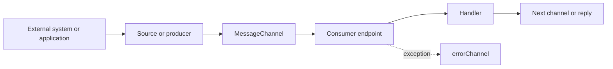
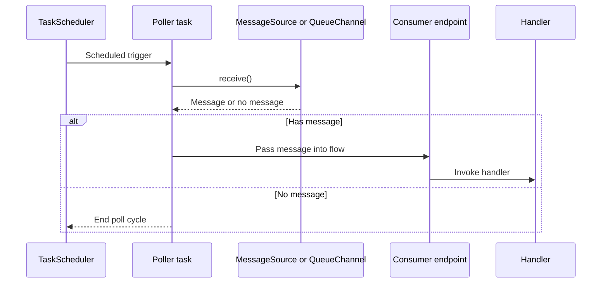
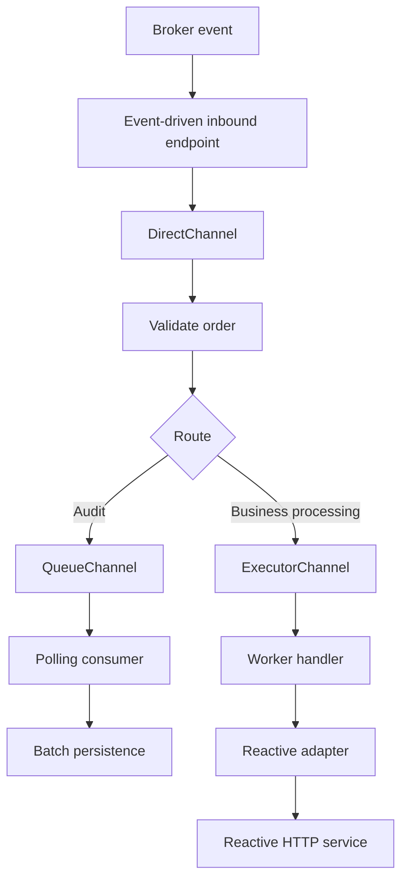

# Event-driven, polling, and reactive runtimes

Spring Integration is a message-processing runtime. An `IntegrationFlow` describes the steps and the connections between them; when the Spring ApplicationContext starts, the framework creates channels, endpoints, and supporting components to execute that flow. How a message is triggered, delivered to a consumer, and carried through subsequent steps depends primarily on the data source type, channel type, and endpoint execution mechanism.

Three common models are **event-driven**, **polling**, and **reactive**. They describe how the runtime receives and distributes work from different perspectives. Event-driven typically pushes messages to consumers as soon as a message arrives. Polling actively checks a source or channel on a schedule. Reactive models processing as an asynchronous stream of signals capable of propagating consumption demand upstream. One application can combine all three within the same system.

## 1. Spring Integration runtime seen from a message

A Spring Integration message consists of a payload and headers:

- **Payload** contains business data, such as an `Order`, a CSV line, or event content.
- **Headers** carry metadata such as message ID, timestamp, correlation ID, reply channel, error channel, or routing information.
- **MessageChannel** transfers messages from sender to receiver. The channel forms the boundary between producer and consumer.
- **Endpoint** connects a channel to processing behavior. Common endpoints include service activators, transformers, filters, routers, splitters, aggregators, and bridges.
- **Message source or inbound adapter** brings data from an external system into the flow.
- **Gateway** allows the application to invoke a flow like calling an API, while optionally receiving a reply.
- **Poller, scheduler, and executor** determine when work is retrieved and which thread executes it.

A simple path can be visualized as follows:



Channels alone do not dictate the entire execution behavior. For instance, `DirectChannel` invokes a subscriber directly on the message-sending thread; `QueueChannel` holds messages for a consumer to receive later; `ExecutorChannel` delegates dispatch to an executor; `FluxMessageChannel` also participates in the Reactive Streams model. Therefore, when reading a flow, identify in order: the message source, the receiving channel, the endpoint registered on that channel, and what mechanism triggers that endpoint.

## 2. Event-driven runtime: process as messages arrive

In the event-driven model, a producer sends a message to a channel capable of notifying consumers. When a message arrives, the channel dispatches it to a registered handler. Consumers do not need to wake up periodically to check whether new messages exist.

`SubscribableChannel` implementations fit this push-style distribution. Endpoints register their handlers with the channel at initialization and unregister when stopped. Under synchronous configuration, processing calls usually run right on the `send()` calling thread.

### DirectChannel

`DirectChannel` is a common choice for sequential steps in a flow. It dispatches each message to one eligible subscriber. When there are multiple subscribers, the dispatcher can distribute messages using a load-balancing strategy; a message is normally processed by one handler, rather than every handler receiving a copy.

The key point about `DirectChannel` is that processing runs synchronously on the message-sending thread. If a handler takes 200 ms, the producer calling `send()` must wait for that processing to finish. Errors raised in the synchronous call chain can propagate back to the caller. In return, control flow is easy to follow and an active transaction on that thread can cover subsequent synchronous steps.

### PublishSubscribeChannel

`PublishSubscribeChannel` sends a message to multiple subscribers. It suits cases where the same event must trigger multiple independent branches, such as updating metrics, writing audit logs, and sending notifications.

Without a configured executor, dispatch usually remains synchronous: the producer may have to wait for all subscribers to finish. When an executor is configured, subscribers can run asynchronously. In that case, consider completion order, error handling, and resource limits because branches no longer necessarily finish in the same order the producer sent messages.

### ExecutorChannel

`ExecutorChannel` uses a `TaskExecutor` to dispatch messages on worker threads. The producer can continue once work has been handed off to the executor, depending on the send result and the executor's rejection policy. This decouples handler execution time from the message-sending thread, while creating a new execution boundary.

That boundary carries several consequences:

- Transactions bound to the sending thread do not propagate automatically to worker threads.
- Completion order can differ from send order when there are multiple workers.
- The executor's queue can accumulate when send rate exceeds processing rate.
- Exceptions in asynchronous tasks must be observed via an appropriate error handling mechanism; the original caller normally does not receive exceptions synchronously.

Do not pick an executor merely hoping to "go faster". An executor is useful when you need to decouple producers from consumers or allow concurrent processing. Without bounded threads and queues, it can turn a traffic spike into a large backlog or resource exhaustion.

### Comparing common channels

| Channel | How messages are received | Buffering | Typical execution model |
|---|---|---|---|
| `DirectChannel` | Pushed to a subscriber | No queue storage | Synchronous on sending thread |
| `PublishSubscribeChannel` | Pushed to multiple subscribers | Not a storage queue | Synchronous, or asynchronous if an executor is attached |
| `ExecutorChannel` | Pushed via an executor | May have an executor queue | Worker thread |
| `QueueChannel` | Consumer calls `receive()` | Yes | Consumer typically uses a poller |
| `FluxMessageChannel` | Publisher emits messages to subscribers | Follows Reactor mechanics and stream configuration | Reactive Streams |

This table describes primary characteristics and does not replace checking actual configuration. For instance, `PublishSubscribeChannel` can use an executor; `QueueChannel` can be shared by multiple consumers; and an executor can use a bounded or unbounded queue depending on configuration.

## 3. Polling runtime: actively fetching messages on a schedule

Polling is used when a data source does not proactively emit events, or when the application wants to control the reading cadence. Consumers are triggered by a poller. The poller schedules a task; that task calls `receive()` on a channel or calls `receive()` on a `MessageSource`, then forwards retrieved messages into the flow.

There are two cases commonly confused:

1. **Source polling**: `SourcePollingChannelAdapter` queries a `MessageSource` on a schedule. Examples include reading new files, querying a database table, or calling a pull-based API source.
2. **Pollable channel consumer**: `PollingConsumer` retrieves messages already sitting inside a `PollableChannel`, such as a `QueueChannel`.

Both use a poller, but the target being polled differs. Source polling queries an external source or message source; a pollable consumer pulls messages already sent into a channel by a producer.



### Configuring pollers

A poller typically combines a trigger, a per-cycle message limit, and advice for the poll task. Key parameters include:

| Component | Operational meaning |
|---|---|
| `fixedDelay` | Schedules the next run after the previous run finishes plus the delay interval |
| `fixedRate` | Schedules on a fixed time cadence |
| `cron` | Runs according to a cron schedule expression |
| `maxMessagesPerPoll` | Limits how many messages are retrieved in a single poll cycle |
| `receiveTimeout` | Wait duration when receiving from a pollable channel |
| `taskExecutor` | Executor used to run poll tasks when configured |
| Transaction advice | Wraps a poll cycle or configured scope in a transaction |
| Retry advice | Retries operations according to a retry policy |

Choose `fixedDelay` when you want a pause after each processing cycle. Choose `fixedRate` when the cadence should adhere to fixed time marks. Choose `cron` when business schedules rely on specific hours or days. For long-running handlers, account for actual execution time and scheduler policy to avoid unintended backlog or overlapping load.

`maxMessagesPerPoll` enables batch-style processing. Large batches can reduce scheduling overhead and raise throughput, yet also lengthen each transaction, hold resources longer, and increase recovery work if a cycle fails. Small batches bound per-cycle duration and give other tasks opportunities to run.

### Source polling example

The example below reads up to 20 messages per cycle, spaced one second apart. A transaction is attached to the poller so fetching and forwarding messages follow the chosen transaction manager:

```java
@Bean
IntegrationFlow pollingOrders(
        MessageSource<Order> orderSource,
        OrderHandler orderHandler,
        PlatformTransactionManager transactionManager) {

    return IntegrationFlow.from(orderSource, endpoint -> endpoint.poller(
                    Pollers.fixedDelay(Duration.ofSeconds(1))
                            .maxMessagesPerPoll(20)
                            .transactional(transactionManager)))
            .handle(orderHandler, "handle")
            .get();
}
```

If starting from a `QueueChannel`, the consumer endpoint also needs a poller to call `receive()`:

```java
@Bean
IntegrationFlow consumeQueuedOrders(OrderHandler orderHandler) {
    return IntegrationFlow.from("orders.queue",
                    endpoint -> endpoint.poller(
                            Pollers.fixedDelay(Duration.ofMillis(250))
                                    .maxMessagesPerPoll(10)))
            .handle(orderHandler, "handle")
            .get();
}
```

In the second example, `orders.queue` must be a `PollableChannel`, such as a `QueueChannel`. Attaching a poller to a push channel like `DirectChannel` is not a matching configuration: a push channel invokes subscribers when messages arrive, whereas a poller needs a source that can be polled to receive messages.

### How does polling affect latency and load?

If a poller runs every second, a newly arrived message may wait nearly a full second before being picked up, not counting source read time and handler processing. Shortening the poll interval lowers average latency but increases checks when no data is present. With remote sources, empty polls can also consume connections, CPU, or API quota.

When designing polling, measure empty poll counts, messages per cycle, receive duration, processing duration, and backlog. If a source supports cursor-based or offset-based reads, clearly define when progress is committed. If retries are enabled, ensure re-reads do not trigger duplicate side effects; critical business operations typically require idempotency keys or deduplication mechanisms.

## 4. Reactive runtime: processing by data streams and demand

The reactive runtime is built on Reactive Streams. A publisher emits data, a subscriber registers to receive data, and a subscription represents consumption demand. Subscribers can request the number of elements they are ready to process. This demand mechanism forms the basis for backpressure: when downstream is slow, upstream can throttle emission rather than pushing unbounded data.

Spring Integration integrates with Reactor and Reactive Streams to connect message flows with publishers and subscribers. `FluxMessageChannel` is a channel that can act as a publisher of a message stream. Reactive components can bridge publishers into flows and pass asynchronous processing results back into message flows.

Example of declaring a reactive channel:

```java
@Bean
FluxMessageChannel reactiveOrders() {
    return new FluxMessageChannel();
}
```

A flow can start from this channel and connect to a handler suited for reactive processing:

```java
@Bean
IntegrationFlow reactiveOrderFlow(
        FluxMessageChannel reactiveOrders,
        ReactiveOrderHandler reactiveOrderHandler) {

    return IntegrationFlow.from(reactiveOrders)
            .handle(reactiveOrderHandler)
            .get();
}
```

In the example, `ReactiveOrderHandler` represents a handler integrated with the application's reactive APIs. When implementing, use the handler type and reactive return types supported by the Spring Integration version in use; avoid wrapping a blocking call inside `Mono` and treating it as non-blocking processing.

### Backpressure does not automatically make every step non-blocking

Reactive helps when all steps in the chain cooperate with the reactive model. If a handler invokes blocking JDBC, synchronous file reads, or waits on a blocking HTTP client on a thread serving the stream, that thread remains blocked. That can degrade consumption throughput across the entire chain.

When a blocking API must be called, offload the blocking work to an appropriate scheduler, typically bounded elastic or a controlled executor. For I/O operations, prefer reactive clients to avoid occupying threads while waiting. Also define concurrency for operators such as `flatMap`, `concatMap`, or `parallel`: higher concurrency raises throughput in some scenarios but can alter completion order and increase in-flight requests.

Backpressure only takes effect at boundaries where publishers, subscribers, and adapters actually coordinate via Reactive Streams. If an imperative source continuously pushes messages into an unbounded queue, placing a `FluxMessageChannel` later in the chain will not automatically throttle the original source. Design buffers, concurrency bounds, overflow policies, and overload responses explicitly.

### How does reactive differ from an asynchronous executor?

Both models can avoid making the producer wait for the handler to complete, but their coordination mechanisms differ:

- An executor accepts a task and enqueues it onto the executor. Worker count and queue size determine how much work can run or wait.
- A reactive stream models a data sequence and demand between producer and consumer. Backpressure is part of the stream protocol.
- An executor is typically configured at a channel or endpoint dispatch boundary.
- Reactive is typically configured across publishers, operators, subscribers, and connecting adapters.

Using an executor does not mean you have backpressure. Using reactive does not guarantee the system has no queues or cannot overload. Inspect the full message path and conversion boundaries across imperative, executor, and reactive sections.

## 5. Combining all three models in one flow

Real systems rarely rely on a single model. For example, an application might receive order events from a broker in an event-driven manner, send an audit branch into a `QueueChannel` for batch writes by a poller, and call a reactive HTTP service in the next branch.



When combining models, clearly mark where threads change, where buffering occurs, and where transactions end. A flow might start synchronously, cross through an executor, and enter a reactive publisher. Each boundary has its own error policy and lifecycle. Without identifying boundaries, tracing a message across logs and thread dumps becomes much harder.

## 6. Lifecycle of IntegrationFlow and endpoints

`IntegrationFlow` is a configuration describing a processing route. Spring Integration registers the corresponding channels and endpoints in the ApplicationContext. Endpoints are lifecycle-managed by the framework; they typically participate in Spring's `SmartLifecycle` mechanism.

When the context starts, endpoints are initialized and registered with the appropriate channels or schedulers. When the context stops, endpoints stop to prevent accepting new work and release resources per each component's lifecycle. Actual runtime state also depends on properties such as `autoStartup`, `phase`, executor/scheduler configuration, and whether the flow was registered dynamically.

For static flows, bean declarations are usually sufficient. When flows must be added or removed while the application is running, Spring Integration provides `IntegrationFlowContext` and dynamic flow registration. Dynamically registered flows must be intentionally started, stopped, and destroyed; registering without lifecycle management can leave endpoints or related resources alive longer than intended.

When diagnosing an inactive flow, verify both that beans were created and that endpoints are actually running. Having an `IntegrationFlow` bean does not imply every endpoint in the flow is receiving messages. An endpoint might not be started, might be stopped, might lack subscribers, or might be waiting for a poller trigger.

## 7. Transactions, retries, and error channels across runtimes

### Transactions

Transaction boundaries depend on the execution mechanism:

- With `DirectChannel`, handlers run synchronously on the same thread and can participate in an existing transaction on that thread if the transaction manager and endpoint configuration match.
- With a poller, transaction advice can open a transaction for the poll task. Clarify whether the transaction covers receiving the message, handler processing, or acknowledging the data source as well.
- With `ExecutorChannel`, worker threads do not automatically inherit transactions bound to the sending thread. If a handler requires a transaction, configure the transaction on the consumer side or inside the worker task itself.
- With reactive flows, transactions must fit the reactive context and a reactive transaction manager. Do not assume ThreadLocal transactions from imperative code propagate automatically through publishers.

Transactions do not replace idempotency. An external source can redeliver a message after a timeout or after a consumer finishes processing without having acknowledged success. Define the source's delivery semantics, ack/commit timing, and how duplicate messages are handled.

### Retries

Retry is typically attached to an endpoint or poller via an advice chain. Retry suits transient errors such as timeouts or rate limits, but requires bounded attempt counts, backoff intervals, and error classification. Do not infinitely retry invalid data errors.

For operations with side effects, retry can re-execute part of already-completed work. Use idempotency keys, unique constraints, outbox/inbox patterns, or business-appropriate deduplication mechanisms. When retries are exhausted and still fail, messages need a clear path for recording, routing to a dead-letter destination, or manual intervention.

### Error channels

Spring Integration provides error messages and `errorChannel` for routing failures. With synchronous processing, exceptions can propagate back up the call chain. With asynchronous processing or pollers, exceptions do not necessarily return to the original caller; failures must be observed on the error channel or the task's error handler.

When investigating errors, retain sufficient context: original exception, failed message, message ID, correlation ID, endpoint, timestamp, and retry count. Logging only a stack trace while dropping identifying headers or payloads makes linking errors back to original messages difficult. Avoid logging sensitive payloads verbatim; log lookup keys and essential metadata instead.

### Message store and correlation

Channels determine how messages are transferred to consumers; message stores hold messages or message group state so multi-step processing can resume when data is incomplete. These two roles are related but not interchangeable. In-memory implementations suit transient state within a single run; retaining state across restarts requires choosing a persistent implementation and configuring transactions, backups, and cleanup accordingly.

A classic example is a splitter and aggregator. The splitter breaks one message into multiple child messages and attaches group metadata, typically correlation ID along with sequence number and sequence size. The aggregator uses correlation to group related messages, stores group state in a message group store, and applies a release strategy to decide when the group is ready to emit a result. If a group might never complete, configure timeouts and expired-group cleanup policies so state does not grow indefinitely.

Correlation IDs must be stable and distinct enough to separate concurrent business workflows. If multiple orders share the same correlation key, the aggregator can merge unrelated data; if each child message receives a different key, the group will never complete. When investigating a stuck aggregator, check correlation IDs, sequence headers, count of messages in the group, release strategy, timeouts, and state persisted in the message group store. With the claim-check pattern, a store can also hold large payloads while the flow passes only a reference key; in that case, manage payload TTLs and deletion after use.

## 8. Diagnosing runtime and performance

Monitor both endpoint state and execution resource state. A flow can be started yet remain slow because the executor ran out of workers, the poller pulls too few messages per cycle, or handlers wait on I/O for too long.

| Symptom | Where to check |
|---|---|
| Message sent yet no handler runs | Channel type, registered subscribers, endpoint state, and channel name |
| Messages sit long in queue | Queue depth, producer/consumer rates, poll interval, `maxMessagesPerPoll` |
| Latency rises under load | Executor active threads, queue capacity, handler duration, scheduler, and downstream latency |
| Messages processed repeatedly | Retries, ack/commit, transaction rollback, source semantics, and idempotency |
| Errors do not surface to caller | `errorChannel`, executor/poller error handler, and worker thread logs |
| Processing order changes | Worker count, reactive operator concurrency, load balancing, and multiple subscribers |
| Flow stops receiving messages after restart | Endpoint lifecycle, `autoStartup`, dynamic registration, subscriptions, and source connections |

Several useful observability practices:

- Propagate message IDs and correlation IDs throughout the flow to correlate logs across endpoints.
- Use `MessageHistory` when you need to trace which components a message visited.
- Use `ChannelInterceptor` or `WireTap` to inspect messages at specific boundaries; avoid introducing extra side effects inside interceptors.
- Track queue depth, received/processed/failed message counts, processing durations, and retry counts.
- Monitor thread pools: active threads, pool size, queue size, and rejected tasks.
- Capture thread dumps when suspecting deadlocks, thread starvation, or handler blocking.
- Verify endpoint lifecycle state and actual poll schedules rather than checking only bean existence.

With polling, distinguish "no data" from "poller not running". With event-driven flows, distinguish "producer not sending" from "channel has no subscribers". With reactive flows, distinguish "publisher not emitting", "subscriber not subscribed", "downstream not requesting more data", and "handler blocked".

## 9. Choosing a model by requirements

| Requirement | Suitable starting model | Reason |
|---|---|---|
| Source has callbacks or broker pushes events | Event-driven | Processes as messages arrive, low latency |
| Reading files, database tables, or pull-only APIs | Polling | Application actively controls read cadence |
| Need batching or rate-limited data ingestion | Polling | Can tune interval and messages per cycle |
| Heavy asynchronous I/O needing demand-based throttling | Reactive | Provides stream model and backpressure |
| Need to decouple producer from consumer via a worker pool | Executor-based event-driven | Dispatches tasks via executor |
| One flow has varied source types and requirements | Hybrid | Each segment uses the mechanism matching its source and load |

Practical design guidelines:

1. Choose channels by required semantics: single-consumer dispatch, broadcast, buffering, or stream.
2. Choose polling when a source must be queried on a schedule; do not add a poller to a push path just to feel like there is a scheduler.
3. Bound queues and executors according to downstream capacity. An unbounded queue only delays when overload becomes visible.
4. Place transactions where consistency boundaries can be upheld; do not expect transactions to cross threads or reactive boundaries automatically.
5. Design retries together with idempotency and error handling from the start.
6. Choose reactive only when non-blocking benefits can be preserved across critical steps of the chain.
7. Measure throughput, latency, backlog, and error rates before tuning poll intervals or worker counts.

## 10. Checklist for reading an IntegrationFlow in operations

When taking over or debugging a flow, walk through these questions:

- Does the message originate from a gateway, inbound adapter, `MessageSource`, publisher, or direct application send?
- Is the first channel a `SubscribableChannel`, `PollableChannel`, or `FluxMessageChannel`?
- Is the endpoint triggered by push, a poller, or a subscription?
- Does the handler run on the sending thread, scheduler thread, executor worker, or reactive scheduler?
- Are there buffers at any channel, executor, or adapter? Are those buffers bounded?
- At which boundaries do transactions, retries, and error channels apply?
- Does the message carry a correlation ID and an idempotency mechanism?
- Is the endpoint running and are subscriptions still active?
- Which metrics prove that the producer, channel, and consumer are making progress?

If you can answer these questions, you can explain where a message is created, where it waits, which thread processes it, where errors go, and why latency shifts. That is the foundation for managing lifecycles, transactions, retries, message stores, correlation, threading, and performance in the Spring Integration runtime.
