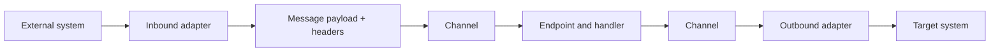

# Runtime extension points and the boundary with adapters

Spring Integration provides a runtime for wiring message-processing components into flows. The runtime manages messages, channels, endpoints, consumers, pollers, executors, and the lifecycle of integration components. Adapters sit at the boundary between the runtime and external systems such as a file system, HTTP, JMS, Kafka, mail, or TCP. An adapter translates that external system's communication model into the message model that a flow can process.

Distinguishing these two parts helps you choose the right extension point. When you need to change how the application processes messages, extend the flow with the appropriate handler, transformer, router, or channel. When you need to connect a new protocol or data source, use an existing adapter or implement one following Spring Integration's contracts. Keeping this boundary clear minimizes business logic coupling to transport details while enabling deliberate management of transactions, retries, errors, correlation, and threading.

## 1. Where do the runtime and adapters sit in the architecture?

The runtime operates on a unified message model. A message carries a payload and headers; channels transfer messages between components; endpoints connect channels to handlers or sources. Endpoints can transform, route, filter, split, aggregate, or handle messages.

Adapters translate between this model and an external system's native protocol. An inbound adapter receives data from outside and brings it into the flow. An outbound adapter receives messages from the flow and sends data outward.



In the diagram, the runtime manages messages, channels, endpoints, and how they execute. Adapters handle communicating with external systems and mapping data into or out of the message model. A flow might not need an adapter if it starts from an internal channel or is invoked directly by the application.

| Component | Responsibility | Examples |
|---|---|---|
| Runtime core | Message coordination and endpoint lifecycle | `Message`, `MessageChannel`, `MessageHandler`, `IntegrationFlow` |
| Flow processing components | Perform transformations or decisions on messages | Transformer, router, filter, splitter, aggregator, service activator |
| Inbound adapter | Bring data from an external system into the flow | File inbound, HTTP inbound, JMS message-driven adapter |
| Outbound adapter | Send data from the flow to an external system | File outbound, HTTP outbound, JMS outbound adapter |
| Gateway | Bridge request/reply calls across system boundaries | HTTP inbound gateway, HTTP outbound gateway, messaging gateway |

An adapter is not a channel. An adapter is an endpoint or component connected to a transport; a channel is the runtime construct connecting producers to consumers inside a flow.

## 2. Core runtime extension contracts

Spring Integration offers several contracts to customize part of a flow without rewriting message orchestration mechanics.

| Contract or component | Role | When to use |
|---|---|---|
| `MessageSource<T>` | Supplies a message when polled for data | Source can be read periodically, usually paired with a poller |
| `MessageHandler` | Receives and processes a message | Integrate a service or custom processing logic into a flow |
| Transformer | Converts payload or message into another form | Data normalization, schema mapping, format decoding |
| Router | Selects the next channel based on the message | Routing by payload type, header, or classification result |
| Filter | Decides whether a message proceeds | Validation checks or discarding unsuitable messages |
| Channel interceptor | Observes or intercepts send/receive operations on a channel | Logging, timing, metadata inspection, or shared policies |
| Endpoint and lifecycle contracts | Connects handler to channel and participates in lifecycle management | Create integration components with explicit start/stop configuration |

### 2.1. Polled sources vs. message-pushing sources

`MessageSource<T>` is a pull-based contract: the runtime calls the source to obtain a message. `SourcePollingChannelAdapter` combines a source with a poller to invoke it on a schedule or trigger. This model fits file directories, database tables requiring periodic scans, or pull-only APIs.

Event-driven sources work in the opposite direction: the external system notifies of new data, and a producer component receives the event and sends a message to a channel. Such adapters typically manage transport listeners or callbacks. When implementing a message-pushing adapter, manage listener registration, stopping event reception, and releasing resources according to the endpoint's lifecycle.

The two models are not arbitrarily interchangeable. A poller controls the frequency of querying a pull source; it is not an event-catching mechanism. For push sources, use an event-driven adapter or an appropriate bridge rather than creating an unnecessary polling loop.

### 2.2. Handlers as the connection point to application logic

`MessageHandler` receives the full message so it can read both payload and headers. For POJO handlers declared via annotations or the Java DSL, Spring Integration resolves method arguments from the message. You can use a specific payload type to express the input contract, or accept `Message<?>` when envelope access is needed.

Each handler should focus on a single, clearly describable task. If data conversion is needed, use a transformer. If branch selection is needed, use a router. If invoking business logic is needed, use a service activator. Separating responsibilities keeps the flow observable and avoids cramming all orchestration into one large method.

## 3. The adapter boundary: mapping transport to messages

Inbound adapters typically perform several tasks before a message enters the flow:

1. Receive data from an API, listener, socket, broker, or storage source.
2. Convert transport data into an appropriate payload, such as bytes, text, objects, or a specialized type.
3. Map transport metadata into headers when supported by the adapter and required by configuration.
4. Send the message to an output channel or pass it to the next endpoint.

Outbound adapters perform the reverse: read the message, translate payload and metadata into a request or record in the target protocol, send it out, and handle the outcome according to the adapter's semantics.

Avoid letting transport types like HTTP requests, JMS sessions, or Kafka consumer records leak deep into business logic when services only need a DTO. Keep protocol details at the adapter and convert to the application model at the start of the flow. When replying to an external system, map the business result back into the shape required by the adapter or gateway.

Headers are a critical part of this boundary. Adapters may create or map headers such as content type, message ID, correlation ID, partition, delivery tag, or source details. Header names and mapping rules depend on the specific adapter; never assume every adapter produces the same set of headers. Clearly define which headers are technical metadata, which are business data, and which must propagate through downstream steps.

## 4. Distinguishing one-way adapters from request/reply gateways

Adapters and gateways differ in their communication contract:

| Endpoint type | Communication direction | Expected outcome |
|---|---|---|
| Inbound adapter | External into flow | Emits messages into the flow without requiring a per-message reply |
| Outbound adapter | Flow to external | Sends messages out without producing a business reply for the flow |
| Inbound gateway | External request into flow | Can return a result from the flow back to the caller |
| Outbound gateway | Flow request to external | Receives a reply from the target system and feeds the result back into the flow |

For example, an HTTP inbound adapter fits a webhook or event-ingestion endpoint. An HTTP inbound gateway fits when a client sends a request and expects a response generated from processing results. Similarly, an outbound adapter sends data to a target system one-way; an outbound gateway performs a request and awaits a reply over a supported protocol.

Gateways introduce additional concerns around timeouts, request/reply correlation, and error handling when the target system does not respond. Do not use a gateway merely to send a message; if no reply is needed, a one-way adapter expresses the intent more accurately.

## 5. Building flows with the Java DSL and keeping logic outside adapters

The example below polls files periodically and passes each file to an application handler. The adapter handles finding and receiving files; the handler processes contents according to the application's contract:

```java
@Bean
IntegrationFlow inboundFiles(FileHandler fileHandler) {
    return IntegrationFlow
            .from(Files.inboundAdapter(new File("/var/app/in")),
                    endpoint -> endpoint.poller(Pollers.fixedDelay(1_000)))
            .handle(fileHandler, "accept")
            .get();
}
```

In this example, the inbound adapter is the data source; the poller defines when the runtime queries the source; and the service activator calls `FileHandler`. If files are later replaced by a broker or HTTP endpoint, business processing can stay unchanged as long as the new adapter maps data to the same payload and header contract.

An outbound flow can start from an internal channel and write messages to a target directory:

```java
@Bean
IntegrationFlow outboundFiles() {
    return IntegrationFlow
            .from("completedFiles")
            .handle(Files.outboundAdapter(new File("/var/app/out"))
                    .autoCreateDirectory(true))
            .get();
}
```

This flow illustrates the boundary: the `completedFiles` channel belongs to the runtime; the outbound adapter performs the file operation. In real applications, define the payload type accepted by the file adapter, filename generation, duplicate file handling, temporary-write-then-rename behavior, permissions, and error policy.

## 6. Extending with custom adapters

Before writing your own adapter, check built-in adapters for your transport and use case. Built-in adapters already handle many subtle details such as connection management, acknowledgments, client retries, header mapping, and shutdown.

If you need a custom pull source, implement `MessageSource<T>` and let `SourcePollingChannelAdapter` invoke it. The source returns a message when data is available and returns `null` when no message is currently present. Reading logic needs sensible timeouts and work bounds so a single poll does not occupy a thread for too long.

If you need to receive events from a callback-based library, integrate the listener with the endpoint lifecycle or extend a base class for message producers such as `MessageProducerSupport` when appropriate. A producer component must:

- Register listeners or open connections when started.
- Convert received events into `Message<?>` with a clearly defined payload and header contract.
- Send messages to the output channel using the producer's mechanism.
- Stop receiving events and release resources when the endpoint stops.
- Route data-receive or message-send errors into the appropriate error handling mechanism.

If custom message processing is needed inside the flow, implementing `MessageHandler` is usually sufficient. Do not write a transport adapter just to invoke a service or transform a payload; extend at the right runtime contract.

A well-designed custom adapter does not leak transport library connections, callbacks, or proprietary data types outward. It provides clear configuration, manages resources according to lifecycle, and emits consistent messages for downstream flow processing.

## 7. Lifecycle: how the runtime starts and stops endpoints

Spring-managed endpoints typically participate in the application context lifecycle. Many endpoints implement `SmartLifecycle`, enabling Spring to control start/stop, startup ordering via phases, and automatic startup via `autoStartup`.

When the application starts, components are created and wired per configuration; endpoints begin receiving or emitting messages once started. When the application stops, endpoints must stop accepting new work, complete or handle in-flight work according to policy, and release resources. Shutdown details depend on the adapter and transport: broker listeners, schedulers, executors, and connection pools each have their own lifecycles.

### 7.1. Dynamic flow registration with IntegrationFlowContext

Some systems need to create or destroy flows while the application is running, such as enabling an integration pipeline per tenant or managed configuration. `IntegrationFlowContext` supports dynamic flow registration:

```java
IntegrationFlowRegistration registration = flowContext
        .registration(tenantFlow)
        .id("tenant-" + tenantId)
        .register();
```

The registration object gives access to the flow's components and lifecycle controls such as start, stop, or destroy. When a flow is no longer needed, stop and unregister it to remove endpoints, channels, and associated resources. The ID should be unique and stable within the context scope.

Dynamic flows are useful when topology genuinely changes at runtime. Do not create a new flow per message; that multiplies endpoint counts, obscures state visibility, and can leak resources. If you only need routing by tenant or data type, a router and channel configuration are usually better suited.

## 8. Transactions, retries, and errors at the adapter boundary

Transactions and retries must match transport semantics and execution location. The runtime can provide advice or endpoint/poller configuration, but it cannot automatically create a distributed transaction spanning every system.

### 8.1. Transactions tied to resources and execution boundaries

With a polling endpoint, transaction advice can be attached to the poller so fetching data and processing the message run within the corresponding resource's transaction, if supported by the source and transaction manager. With listener-driven adapters, transactions are typically tied to the transport's listener container or message-receiving mechanism.

A JDBC transaction does not automatically include publishing a message to another broker. If a flow crosses an `ExecutorChannel`, queue, or asynchronous boundary, downstream processing typically runs on a different thread and is outside the original thread-bound transaction. Clarify which operations a transaction covers, when it commits, and what happens if downstream steps fail after commit.

When consistency is required between database updates and event publication, consider outbox/inbox patterns, idempotent consumers, or broker transaction mechanisms instead of assuming a local transaction covers the entire flow.

### 8.2. Retries must account for duplicate delivery

Retry advice can re-invoke a handler on eligible failures. Transport adapters or clients may also have their own retries. Coordinate both retry layers to avoid multiplying attempt counts unexpectedly.

Before enabling retries, verify whether the operation is safe to repeat. Sending an HTTP order-creation request, writing a file, or publishing an event may have succeeded at the target system while the response was lost. Retrying without an idempotency key or duplicate detection can execute a business action multiple times.

Retries also need attempt limits, backoff intervals, and error classification. Configuration errors or invalid data generally cannot be resolved by immediate re-sending.

### 8.3. Error channels and transport boundaries

Errors can happen when an adapter receives data, when an endpoint processes payloads, or when an outbound adapter communicates with a target system. Distinguish transport errors, conversion errors, and business errors because their recovery strategies differ.

Spring Integration can wrap message-processing errors into an `ErrorMessage` and send them to an error channel configured on the flow, endpoint, or message. In synchronous processing, exceptions can propagate back to the caller. With pollers or asynchronous consumers, errors typically occur on the execution thread and must be observed via an error channel, logging, or the container's error-handling mechanism.

Adapters may also need to translate runtime errors into transport semantics: rejecting or requeuing messages, routing to a dead-letter queue, returning an HTTP status, keeping files for retry, or moving failed files to an error directory. Do not assume sending an error to an error channel means the transport rolled back or the message will automatically be redelivered.

## 9. Message stores and correlation belong to the runtime flow

Some flows must retain state across multiple messages. An aggregator may wait for all parts of a group; a resequencer may reorder messages by sequence; queues or other components may need to store messages before consumers process them. `MessageStore` provides the abstraction for storing messages and related state for these components; depending on configuration, a store can be in-memory or backed by persistent storage.

Correlation determines which messages belong to the same group. Headers such as `correlationId`, `sequenceNumber`, and `sequenceSize` can support grouping and ordering. An adapter may map a transport message ID or key into suitable metadata, yet the flow must enforce consistent correlation rules. Do not treat a broker-scoped unique ID as if it were automatically a business correlation ID.

When using a persistent store, define retention periods, expired-data cleanup policies, handling for incomplete groups that never finish, and restart recovery. A store preserves flow state; it does not replace transport adapter acknowledgment, offset, or transaction mechanisms.

## 10. Threading and performance at the runtime/adapter boundary

Channel and endpoint types determine which thread processes a message:

| Mechanism | Execution model | Consequences to consider |
|---|---|---|
| `DirectChannel` | Invokes consumer synchronously on sending thread | Easy exception propagation back to caller; downstream latency affects sending thread |
| `ExecutorChannel` | Submits work via executor | Switches threads; must manage queues, pools, errors, and context propagation across boundaries |
| `QueueChannel` | Stores messages for consumers to retrieve later | Buffers and decouples producer/consumer; requires capacity, timeouts, and consumption mechanism |
| Poller | Queries source or receives messages on a schedule | Needs bounded messages per poll and bounded processing time to avoid schedule drift |

Event-driven adapters typically depend on listener container or client threads. Polling adapters depend on schedulers and pollers. Adding an executor can boost throughput when resources allow, yet can also increase queue backlogs, latency, in-flight message counts, and error visibility complexity.

When diagnosing performance, observe simultaneously:

- Message ingress and egress rates per channel.
- Queue depth or number of pending messages.
- Handler processing duration and external system wait time.
- Executor pool size, busy thread count, and rejected tasks.
- Retry frequency, error counts, and messages routed to dead-letter or error flows.
- Open correlation group counts and data volume in the message store.

If producers consistently outpace consumers over time, enlarging thread pools only postpones resource exhaustion. Locate slow endpoints, rate-limit ingress, tune batching or capacities, and establish backpressure policies aligned with the transport.

## 11. Diagnosing errors at the right boundary

When a message does not reach its destination, trace boundaries in order:

1. **Inbound adapter:** was data actually received? Is the listener or poller running? Are there connection, permission, or acknowledgment errors?
2. **Inbound message:** does the payload have the expected type and content? Are key headers such as message ID, correlation ID, and content type mapped properly?
3. **Channel:** are there subscribers? Is the channel buffer full or is no consumer pulling messages?
4. **Endpoint/handler:** is the endpoint started? Did the handler throw an exception, enter retry, or get dropped/redirected by a filter/router?
5. **Asynchronous boundary:** did the message cross into an executor or queue? On which thread and which error channel are errors handled?
6. **Outbound adapter:** was the request sent? What did the target system return? Were there timeouts, rejections, retries, or duplicates?

Common symptoms:

| Symptom | Area to inspect first |
|---|---|
| No messages enter the flow | Inbound adapter, listener, poller, and transport connection |
| Messages arrive with wrong payload or missing headers | Mapping and conversion at the adapter boundary |
| Messages stall at a channel | Subscribers, routers, filters, queue capacity, and endpoint state |
| Errors appear only after adding an executor | Error channel, thread pool, queue, and context across thread boundaries |
| Messages processed multiple times | Retries, acknowledgments, redelivery, and handler idempotency |
| Aggregator does not emit results | Correlation keys, sequence metadata, timeouts, and message store |
| Flow does not stop cleanly | Adapter lifecycle, listener container, scheduler, and executor |

Runtime observability should combine logs carrying correlation IDs, metrics, and endpoint states. When inspecting the topology built inside the context, use Integration Graph/Actuator observability matching your application's version and configuration. The graph identifies connections; logs and metrics explain where messages travel and how long each step takes.

## 12. Choosing the right extension point

Start by asking which part needs to change:

- **Transform data or make decisions inside the flow:** use a transformer, router, filter, splitter, aggregator, or service activator.
- **Read a pull source on a schedule:** implement `MessageSource<T>` or use a built-in inbound adapter and configure a poller.
- **Receive push events from a transport:** use an event-driven inbound adapter or a producer following the appropriate contract.
- **Send one-way messages to another system:** use an outbound adapter.
- **Send requests and expect replies:** use a gateway with clearly defined timeouts and correlation.
- **Modify topology while the application runs:** use `IntegrationFlowContext` and fully manage start/stop/destroy.
- **Apply shared policies across channels or endpoints:** consider interceptors, advice, or appropriate endpoint configuration.

Before promoting an adapter or endpoint to production, define the payloads and headers it produces, resource lifecycles, transaction boundaries, retry policies, error paths, correlation rules, and execution model. When these decisions are explicit, the runtime can orchestrate flows reliably while adapters handle faithful communication with external systems.
