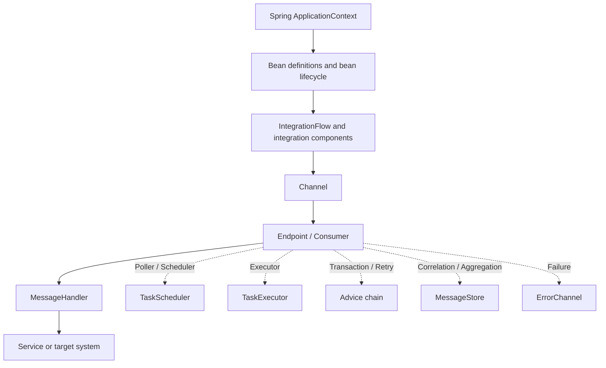
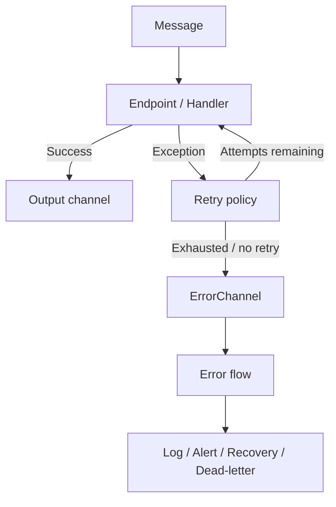
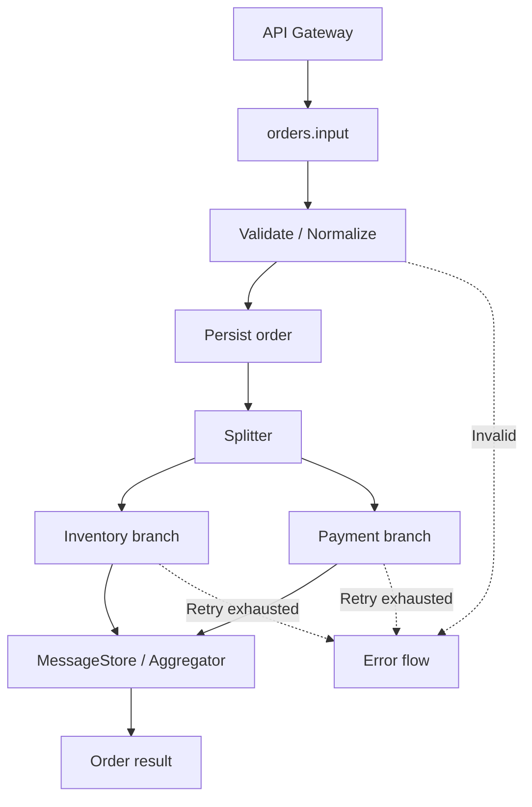

# Learning path from bean lifecycle to running flows in production

Spring Integration is a framework that helps applications connect systems and organize data processing as message flows. A flow can receive messages from an adapter, route them through channels, invoke endpoints, wait on pollers, run on executors, persist state in a message store, and emit results or forward errors to another flow. To understand the runtime, you must look at both the Spring bean lifecycle and how integration components are created, wired, started, executed, and stopped.

This article lays out a learning path from container fundamentals to production operations. Each stage answers a specific question: which components are created, where messages travel, what triggers processing, which thread executes work, where state is stored, how errors are recovered, and how to know whether a flow is operating properly.

## 1. The overall picture of the runtime

A flow in a Spring Integration application typically comprises the following layers of components:



These components relate to one another yet are not a single concept:

- **Spring container** manages beans, dependency injection, initialization callbacks, and application lifecycle.
- **IntegrationFlow** describes the message route and processing steps.
- **Channel** transfers messages between components and determines communication style such as synchronous, queued, or broadcast.
- **Endpoint** connects a channel to a handler or message source; the endpoint manages how the handler is triggered.
- **Consumer** is the component receiving messages from a channel to pass to a handler. Depending on channel and endpoint types, reception can be event-driven or polling.
- **Poller** schedules message retrieval on an interval or trigger. **Executor** supplies threads to run work.
- **Transactions, retries, error flows, and message stores** provide reliability and statefulness mechanisms.

A flow can be very short, such as receiving one message and calling a service. Yet to run reliably in operations, you must understand how Spring creates endpoints, when endpoints begin accepting messages, how messages are handed off, and what happens when processing is slow or fails.

## 2. Stage one: mastering the Spring bean lifecycle

Spring Integration runs inside the Spring ApplicationContext. Channels, endpoints, pollers, task schedulers, message stores, and business services are typically managed as Spring beans or registered as beans by the framework. Therefore, the bean lifecycle is the foundation for understanding the runtime.

### 2.1. From bean definition to a ready-to-run bean

At a high level, context initialization involves these steps:

1. Spring reads configuration and creates bean definitions.
2. The container instantiates beans and resolves dependencies.
3. Bean post-processors participate in processing beans before or after initialization.
4. Beans run initialization callbacks such as `@PostConstruct`, `InitializingBean.afterPropertiesSet()`, or a custom init method.
5. After the context refreshes, beans with appropriate lifecycle contracts are started.
6. When the context closes, components are instructed to stop and release resources.

Not every callback serves the same purpose. `@PostConstruct` is suited for validating or preparing a bean's internal state after dependencies are injected. It is not an ideal place to launch a long-running background loop before the entire context is ready. For components that need to start and stop with the context, use Spring-managed lifecycle contracts.

### 2.2. `Lifecycle` and `SmartLifecycle`

`Lifecycle` defines two basic operations, `start()` and `stop()`. `SmartLifecycle` adds capabilities useful in real-world applications, including:

- `isAutoStartup()` indicates whether the bean starts automatically on context refresh.
- `getPhase()` orders startup and shutdown across lifecycle components.
- `stop(Runnable callback)` allows signaling when an asynchronous stop completes.

Many integration endpoints are lifecycle-managed. When the context starts, endpoints can subscribe to channels or begin polling schedules. When the context stops, endpoints stop accepting new work and run their shutdown sequence according to lifecycle rules.

Lifecycle ordering matters. For example, a message-emitting endpoint needs critical dependencies ready before starting; a consumer should stop at the right time to avoid pulling more messages after downstream resources have closed. When a flow has multiple components managing their own threads, verify startup and shutdown order rather than relying solely on `@Bean` method declaration order.

### 2.3. Distinguishing bean initialization from message processing

A bean existing in the context does not mean it is processing messages. Distinguish:

- **Created:** the instance was created by Spring.
- **Initialized:** dependencies and initialization callbacks completed.
- **Started:** the lifecycle component was enabled.
- **Subscribed or scheduled:** the endpoint connected to a channel or was scheduled by a scheduler.
- **Processing:** the handler is actively executing a specific message.
- **Stopped/destroyed:** the endpoint stopped or the bean released its resources.

When debugging, merely seeing a bean in the ApplicationContext is not enough to conclude the flow is running. Check endpoint lifecycle state, subscriptions, poll schedules, and processing metrics.

## 3. Stage two: understanding IntegrationFlow, endpoints, and channels

`IntegrationFlow` is a way to describe a processing pipeline. The Java DSL lets you chain steps into a readable sequence:

```java
@Bean
IntegrationFlow orderFlow(OrderService orderService) {
    return IntegrationFlow.from("orders.input")
            .filter(Order.class, Order::isValid)
            .transform(Order.class, Order::normalize)
            .handle(orderService, "process")
            .get();
}
```

The DSL snippet describes logic and wiring. When the context is processed, Spring Integration creates or registers the corresponding runtime components, such as channels and endpoints connecting handlers to channels. Each endpoint has its own configuration and lifecycle.

### 3.1. What do endpoints and consumers do?

An endpoint is the integration layer sitting between a channel and processing logic. It configures how messages are received, how parameters are converted, how handlers are invoked, how replies are emitted, and how mechanisms like advice are applied. A consumer is the side receiving messages from a channel.

Two common forms:

- **Event-driven consumer:** the endpoint subscribes a handler to a `SubscribableChannel`. When the channel dispatches a message to a subscriber, the handler is invoked according to the channel's dispatch mechanism.
- **Polling consumer:** the endpoint pulls messages from a `PollableChannel` on a poller schedule. Messages may already be sitting in the queue before the consumer retrieves them.

An inbound adapter can act as a message producer. For data sources that require periodic querying, `SourcePollingChannelAdapter` uses a poller to invoke a `MessageSource` and emit messages into the flow. For sources with callbacks or listeners, an adapter can receive data reactively on events without needing a poller.

### 3.2. Choosing channels by communication style

| Channel | How it works | When appropriate |
|---|---|---|
| `DirectChannel` | Invokes handler synchronously on sending thread | Simple flows needing a clear call stack and able to share a thread-bound transaction |
| `QueueChannel` | Stores messages in a queue for consumers to pull | Need to decouple send and receive timing, absorbing rate differences within capacity bounds |
| `ExecutorChannel` | Dispatches handler via a `TaskExecutor` | Need asynchronous processing or decoupling sending thread from processing thread |
| `PublishSubscribeChannel` | Broadcasts one message to multiple subscribers | Need multiple branches to receive the same event |
| `RendezvousChannel` | Sender waits for receiver to accept the message via rendezvous | Need synchronous handoff between two parties per channel semantics |

Choosing a channel is a communication and runtime decision, not just naming a flow segment. For example, switching from `DirectChannel` to `ExecutorChannel` can alter execution threads, observed ordering, error propagation, and transaction boundaries.

### 3.3. Tracing a message

As a message moves through a flow, trace these questions:

1. Which adapter or gateway created the message?
2. Which channel was the message sent to?
3. Is that channel subscribable or pollable?
4. Which endpoint receives the message and which handler is invoked?
5. Does the handler return void, a reply message, or a new payload?
6. Which channel does the reply enter to continue the flow?
7. If the endpoint fails to process, which error flow receives the exception?

Making a habit of tracing messages makes reading the DSL easier and identifies exactly where to observe when a flow does not behave as expected.

## 4. Stage three: distinguishing event-driven, pollers, and schedulers

A poller only appears when a component must actively pull data on a schedule. Not every endpoint has a poller.

### 4.1. Two common polling cases

**Polling consumer** reads messages from a `PollableChannel`, such as a `QueueChannel`. Messages are sent to the queue first; the poller wakes the consumer to retrieve one or more messages.

**Source polling adapter** invokes a `MessageSource` on a schedule to pull data from an external source, such as reading pending database records or checking a file directory. The adapter creates messages and sends them into the flow's channel.

In both cases, the poller governs execution timing. `TaskScheduler` manages scheduling the task; `PollerMetadata` describes the poll's attributes.

### 4.2. Poller properties to understand

| Property | Operational meaning |
|---|---|
| `fixedDelay` | Schedules the next run after the previous run finishes plus the configured delay |
| `fixedRate` | Schedules on a fixed time cadence; watch for potential overlap depending on execution setup |
| `cron` | Schedules according to a cron time expression |
| `maxMessagesPerPoll` | Limits the number of messages processed in a single poll |
| `receiveTimeout` | Wait time when receiving from a pollable channel |
| `taskExecutor` | Executor that can be configured to execute poll tasks |
| `adviceChain` | Applies advice such as transactions or retries around polling/endpoint operations per configuration placement |

Choose triggers based on business requirements. For instance, a job checking files once a minute can use cron or fixed delay. A consumer reading a queue continuously must consider `maxMessagesPerPoll`, receive timeout, and how the scheduler is provisioned with threads. A poller running too frequently can create unnecessary load; running too infrequently increases latency and message age in the queue.

### 4.3. Poller configuration example

```java
@Bean(name = PollerMetadata.DEFAULT_POLLER)
PollerMetadata defaultPoller() {
    return Pollers.fixedDelay(500)
            .maxMessagesPerPoll(10)
            .receiveTimeout(1000)
            .get();
}
```

This example declares a default poller that polling endpoints needing default configuration can use. An endpoint can declare its own poller for a different cadence and limits. The values above only illustrate parameters and are not optimal settings for every application; verify how endpoints pick up poller configuration in the Spring Integration version in use.

## 5. Stage four: understanding executors and concurrency

The current thread of a processing step depends on channel type, endpoint, and executor configuration.

| Mechanism | Thread typically executing handler |
|---|---|
| `DirectChannel` | Message-sending thread |
| `ExecutorChannel` | Thread supplied by `TaskExecutor` |
| `QueueChannel` with polling consumer | Thread executing the poll task/consumer |
| `PublishSubscribeChannel` without executor | Message-publishing thread dispatches subscribers |
| `PublishSubscribeChannel` with executor | Subscribers can be executed on the executor |
| Source polling adapter | Thread running the poll task, or executor configured for the poller |

Do not deduce threads from endpoint names alone. Check the actual channel, poller metadata, executor, and how subscribers are configured.

### 5.1. `TaskExecutor` and `TaskScheduler`

These two abstractions serve different purposes:

- `TaskExecutor` executes work on managed threads, typically for asynchronous and parallel processing.
- `TaskScheduler` schedules work by time or trigger, typically to fire pollers.

A poller can be triggered by a scheduler and then use an executor according to configuration. Do not merge both concepts into a single shared thread pool before understanding the load and lifecycle of each workload type.

### 5.2. Concurrency risks

- **Race conditions:** multiple threads reading and writing shared mutable state.
- **Unbounded queues:** work arrives faster than processing speed, causing memory to grow continuously.
- **Thread starvation:** blocking tasks occupy all pool threads, preventing other tasks from running.
- **Oversubscription:** too many threads cause CPU contention, context switching, and pressure on databases or external services.
- **Altered ordering:** asynchronous processing may finish in a different order than messages were sent.

To stay in control, use immutable payloads, bound queue capacities, size pools to match downstream capacity, configure timeouts, and define policies when the executor rejects tasks. If business logic requires ordering, pick channels, partitioning/keys, and consumer models that preserve the needed order.

### 5.3. Thread boundary example

```text
HTTP request thread
    |
    v
DirectChannel
    |
    v
Service Activator (same thread)

HTTP request thread
    |
    v
ExecutorChannel
    |
    v
TaskExecutor worker thread
    |
    v
Service Activator (different thread)
```

With `DirectChannel`, synchronous call stacks are easy to follow and thread-bound transactions can continue along the same call chain. With `ExecutorChannel`, processing shifts to another thread. Thread-bound transactions on the sending thread do not automatically travel with the message to worker threads.

## 6. Stage five: managing IntegrationFlow lifecycle

There are two common ways to manage flows.

### 6.1. Static flows declared as beans

Declaring `IntegrationFlow` with `@Bean` fits pipelines whose lifecycle is tied to the application:

```java
@Bean
IntegrationFlow billingFlow(BillingService billingService) {
    return IntegrationFlow.from("billing.input")
            .handle(billingService, "charge")
            .get();
}
```

When the context starts, the framework registers flow components and starts endpoints according to configured lifecycle/autostartup settings. When the context closes, endpoints stop according to lifecycle rules.

### 6.2. Dynamic flows registered via `IntegrationFlowContext`

Some applications need to create or remove flows at runtime while operating, such as enabling an integration pipeline for a new tenant or configuring a new data source. `IntegrationFlowContext` provides a dynamic flow registration API:

```java
IntegrationFlowRegistration registration = flowContext
        .registration(dynamicFlow)
        .id("tenant-orders-" + tenantId)
        .autoStartup(false)
        .register();

registration.start();

// When the flow is no longer needed:
registration.stop();
registration.destroy();
```

Examples must be adapted to the flow style and Spring Integration version in use. Key points to manage include:

- The flow ID must be stable and not collide with already registered flows.
- If multiple channels/endpoints share names, enforce prefix conventions to avoid bean name collisions.
- Decide explicitly whether the flow auto-starts upon registration or starts conditionally.
- Keep the `IntegrationFlowRegistration` handle to retrieve input channels, start, stop, and destroy.
- When removing a flow, release the registration and associated resources; merely dropping the Java reference does not unregister endpoints.

Avoid re-registering flows for the same tenant on every request. Maintain a registry or synchronization mechanism to prevent creating duplicate consumers. When replacing a running flow, coordinate stopping the old flow, shifting traffic to the new flow, and preventing duplicate processing during the transition.

### 6.3. Graceful shutdown

When the application stops, define:

1. Stop accepting new messages at inbound adapters or load-generating sources.
2. Stop endpoints/consumers according to lifecycle.
3. Allow in-flight messages to finish within the shutdown timeout window.
4. Commit or roll back transactions based on processing outcomes.
5. Retain unprocessed messages in persistent queues/stores if business requirements call for recovery.
6. Close executors, schedulers, and integration resources in the proper order.

An in-memory-only queue can lose messages if the process terminates abruptly. Graceful shutdown reduces risk, but it does not replace persistence and idempotency design when high durability is required.

## 7. Stage six: transactions and processing guarantee boundaries

Transactions help coordinate operations across transaction-capable resources, such as databases or compatible brokers. In Spring Integration, transactions are typically applied via transaction advice on a poller or endpoint alongside an appropriate `PlatformTransactionManager`.

### 7.1. Defining transaction boundaries

Before configuring transactions, answer:

- Does the transaction begin before receiving the message, after receiving it, or before invoking the handler?
- Which operations participate in the same transaction manager?
- Does commit occur when the handler finishes or after the reply is sent?
- If sending the message to an asynchronous channel, are downstream steps inside the original transaction?
- When an exception occurs, which exception types trigger rollback?

A poller's transaction can encompass polling and corresponding processing depending on advice placement and resource types. However, a database transaction does not automatically cover an HTTP call or an operation on an external system. `ExecutorChannel` also introduces a thread boundary; transactions bound to the current thread do not propagate automatically to worker threads.

### 7.2. Transactions do not mean exactly-once

A database transaction can roll back database writes, but it cannot automatically recall a sent email, undo an executed HTTP request, or revert mutations on a mutable Java object. If a message is redelivered after failure, the handler may run multiple times.

Therefore, for business operations with side effects, design idempotency keys, unique constraints, inbox/outbox patterns, or appropriate deduplication mechanisms. State explicitly which semantics the system guarantees: at-most-once, at-least-once, or a coordinated approximation of exactly-once within specific resource scopes.

## 8. Stage seven: retries, error channels, and error recovery

Errors can occur when receiving messages, transforming payloads, calling services, sending messages, or communicating with external systems. A production flow must define which errors can be retried, which errors go to a dedicated handling branch, and which errors must halt processing.

### 8.1. Bounded retries

Retry advice can wrap a handler or polling operation. A policy typically requires:

- Maximum attempt count.
- Wait interval between attempts and backoff.
- Retryable exception types.
- Retry stop conditions.
- Recovery callback or destination for the message once attempts are exhausted.

Only retry transient, recoverable errors such as temporary timeouts or brief connection failures. Retrying invalid data errors typically repeats the exact same failure and adds load. Against an overloaded downstream service, aggressive retries can cause a retry storm; use backoff and concurrency limits.

### 8.2. Error flows

Spring Integration supports error channels to wrap failures into `ErrorMessage` instances and route them to an error-handling flow. How errors are routed depends on execution mode and error channel configuration: errors in polling tasks or asynchronous processing can be sent to an error channel; on synchronous call paths, exceptions can also propagate back to the sending thread if no local error handling intercepts them. You can route by exception type, originating endpoint, or business metadata to log, record status, send alerts, or move messages to a dead-letter path.



When designing error flows, retain enough information for investigation: exception, original message or identifying attributes, failing endpoint, and correlation ID. Exercise caution when logging payloads containing sensitive data.

Never swallow an exception and treat the message as successfully processed. If a recovery path marks a message as handled, maintain explicit status so operators can distinguish business success from quarantined failures.

## 9. Stage eight: message stores and correlation

Some flows must retain messages across multiple points in time or combine multiple messages into one result. In those cases, state cannot live solely in local variables of a single handler call.

### 9.1. MessageStore

`MessageStore` is an abstraction for storing and retrieving messages or message groups. It is used by components such as aggregators, resequencers, and certain channel types. Depending on the implementation, data can reside purely in memory or be persisted durably.

When choosing a store, consider:

- Do messages survive an application restart?
- Does the store support transactions with related resources?
- How are payloads and headers serialized?
- Are there capacity limits, cleanup mechanisms, and group expiration policies?
- Can you observe the number of waiting messages/groups?

An in-memory store is useful for testing or scenarios not requiring restart recovery. For flows requiring state recovery, select appropriate persistence and test mid-processing restarts.

### 9.2. Correlation in splitters and aggregators

A splitter creates multiple child messages from one message. An aggregator uses a correlation strategy to determine which messages belong to the same group, then uses a release strategy to decide when the group is ready to emit a result.

Commonly involved headers include:

- `correlationId`: identifies the message group.
- `sequenceNumber`: position of the message within the sequence.
- `sequenceSize`: expected message count in the group when determinable.

If messages are missing, duplicated, or arrive out of order, the aggregator needs timeouts, a release strategy, and a policy for incomplete groups. Message groups held too long can cause unbounded store growth; configure expiry and monitor lingering entries.

Correlation is not idempotency. Correlation links messages within a group; idempotency prevents a business action from being applied repeatedly. A flow may need both.

## 10. Stage nine: testing and runtime observability

Do not wait until production to verify that a flow works properly. Testing must cover both handler logic and key runtime behaviors.

### 10.1. Testing layers

| Testing layer | Goal |
|---|---|
| Service unit tests | Verify business logic independently of IntegrationFlow |
| Flow tests | Send messages to input channels and assert outputs, headers, and step order |
| Endpoint tests | Verify payload/header mapping, filters, routers, transformers, and handlers |
| Poller tests | Verify triggers, batch sizes, receive timeouts, and empty-queue handling |
| Error/retry tests | Verify attempt counts, backoff, recovery, and error flows |
| Lifecycle tests | Verify endpoint start/stop, dynamic flow registration/removal, and shutdown |
| Integration tests | Verify transactions, message stores, brokers, or real/simulated databases as appropriate |

With Spring Integration Test, you can use testing utilities such as `MockIntegration` and test channels to send and receive messages. For scheduler- or executor-dependent parts, verify both final results and asynchronous completion conditions; avoid tests relying on arbitrary `Thread.sleep()` calls.

### 10.2. Signals to observe

- Counts of messages sent, received, succeeded, and failed per channel/endpoint.
- Queue depth and age of the oldest message.
- Average processing time, percentiles, and queue wait time.
- Retry counts, messages entering error flows, and dead-letter paths.
- Active thread count, executor queue size, and executor task rejections.
- Poll duration, messages per poll, and poller wait times.
- Open message group count, group age, and expired group count.
- Transaction duration, rollbacks, and resource connection errors.

Micrometer and Spring's observability ecosystem can export metrics depending on version and application configuration. Message history or logs keyed by correlation ID help trace a message's path. Avoid logging full payloads in production if sensitive data exposure is a risk.

### 10.3. Diagnostic workflow when a flow does not run

1. Confirm ApplicationContext refreshed successfully and related beans were created.
2. Check whether endpoints started, `autoStartup`, and lifecycle phase.
3. Confirm the input channel name matches and the adapter/gateway sent messages.
4. Identify whether the channel is event-driven or pollable; if pollable, check the poller and scheduler.
5. Check whether consumers/subscribers are properly registered and handlers are invoked.
6. Check whether the executor has available threads, whether its queue is full, and whether downstream is slow.
7. Search for exceptions, retries, and error messages by correlation ID.
8. If using an aggregator, inspect correlation keys, sequence metadata, message store, and group timeouts.
9. If using transactions, identify the transaction manager, boundary, and actually participating resources.

This workflow moves from lifecycle to message path and then to concurrency and reliability. It narrows down failure scope boundary by boundary.

## 11. Stage-by-stage practice roadmap

The table below suggests a learning sequence and hands-on deliverable for each stage. You can use a single order-processing example throughout to connect the concepts.

| Stage | Concepts to master | Practice exercise / expected outcome |
|---|---|---|
| 1. Spring container | Bean definitions, dependency injection, initialization, `Lifecycle`, `SmartLifecycle` | Create a bean that logs start/stop and observe context refresh/close |
| 2. Basic flow | `IntegrationFlow`, channels, endpoints, handlers | Receive an Order, validate, transform, and invoke a service |
| 3. Channels and consumers | Direct, queue, publish-subscribe, event-driven consumer | Swap channels and observe differences in threading, buffering, and fan-out |
| 4. Polling | `MessageSource`, polling consumer, `PollerMetadata`, scheduler | Read work periodically, limit batches, and handle empty queues |
| 5. Executors | `TaskExecutor`, `TaskScheduler`, concurrency, backpressure | Run asynchronously, bound pools, and simulate slow downstream services |
| 6. Flow lifecycle | Static flows, `IntegrationFlowContext`, start/stop/destroy | Register flows per tenant and remove them when tenants deactivate |
| 7. Reliability | Transaction advice, retries, error channels, idempotency | Simulate transient errors, permanent errors, and replayed identical requests |
| 8. Stateful flows | MessageStore, splitter, aggregator, correlation | Split an order into multiple tasks and aggregate results |
| 9. Production | Metrics, logging, graceful shutdown, capacity, and recovery | Run load tests, stop the app mid-flight, and verify recovery behavior |

After each stage, write down three things: where the message starts, which component triggers the next step, and which thread executes that step. Once you have clear answers to those three questions, the runtime picture becomes much easier to understand.

## 12. Synthesis scenario: processing orders in production

Suppose a system receives orders from an API, persists the order, splits inventory-check and payment tasks, and then aggregates the results.



When designing this flow, make concrete decisions:

- Which channel does the API adapter send messages to, and which endpoint receives first?
- Which transaction runs the order persistence step? Does that transaction cover operations in the payment branch?
- Which correlation ID does the splitter generate, and what condition does the aggregator use to release?
- Do the two branches run synchronously or asynchronously? How many concurrent tasks does the executor allow?
- If the payment service times out, how many times is it retried and which idempotency key prevents double charging?
- If one branch never returns a result, how is group timeout handled and who receives the alert?
- When the application restarts, from which store are pending messages and groups recovered?
- Which dashboard reveals growing queues, repeating retries, or an aggregator holding groups too long?

These decisions tie bean lifecycle, channels, endpoints, consumers, pollers, executors, transactions, retries, message stores, and observability into one cohesive runtime design.

## 13. Pre-production checklist for flows

- [ ] All endpoints have explicit lifecycle and startup state.
- [ ] Input channels, output channels, and consumers are clearly defined.
- [ ] Pollers are attached only to endpoints requiring polling; triggers, batch sizes, and timeouts are tuned for load.
- [ ] Executors have bounded threads, bounded queue capacity, and task rejection policies.
- [ ] Shared payloads and metadata are safe under multi-threaded processing.
- [ ] Transaction boundaries and participating resources are verified.
- [ ] Retries have attempt limits, backoff, and exception classification.
- [ ] Error flows have clear recovery and never silently drop messages.
- [ ] MessageStore has persistence/expiry matching recovery requirements.
- [ ] Correlation and idempotency are designed separately without conflating them.
- [ ] Metrics exist for queues, endpoints, executors, pollers, retries, and message groups.
- [ ] Graceful shutdown and restart scenarios have been tested.
- [ ] Logs do not expose sensitive payloads or headers.

Upon completing this roadmap, you can read an IntegrationFlow and explain how Spring constructs it, which endpoints receive messages, which consumers trigger handlers, how pollers/executors allocate threads, which steps are wrapped by transactions and retries, where state is persisted, and which operational signals to watch. That is the foundation for moving from merely writing a flow to diagnosing and operating production flows.
