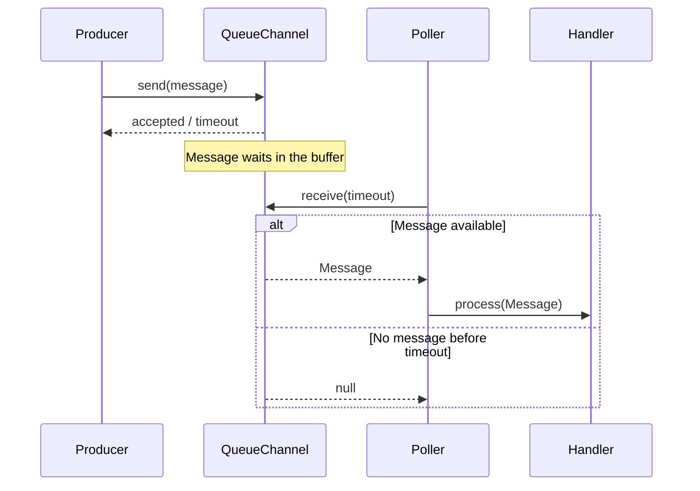
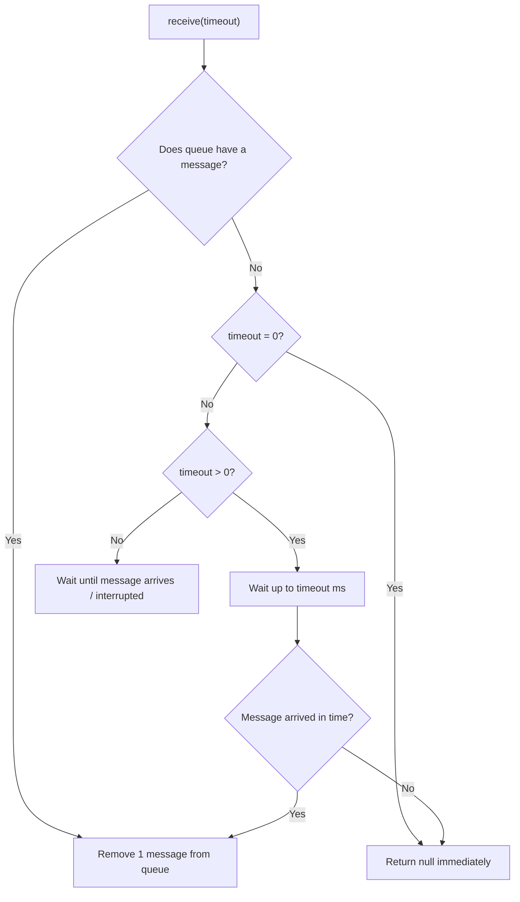
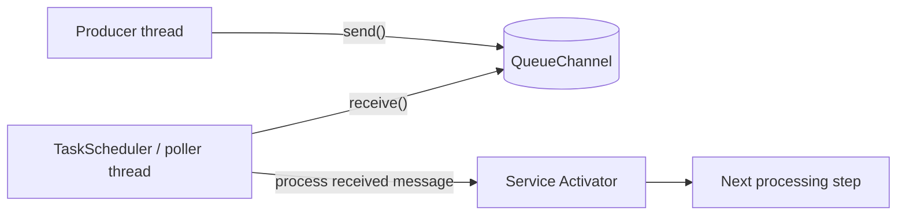
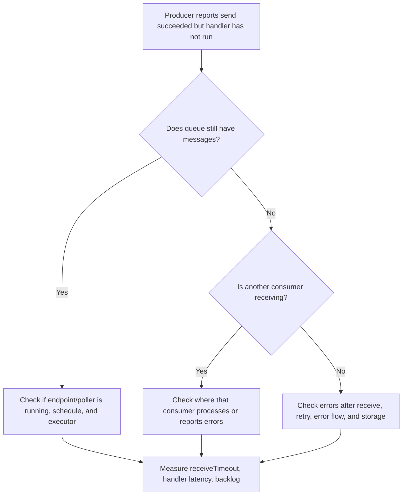

# PollableChannel and Receive Semantics

In the **Spring Integration runtime**, a message flow does not necessarily push messages directly from producer to consumer. With `PollableChannel`, the producer sends a message into the channel, while the consumer actively **pulls** the message when needed or when a `poller` is scheduled. Separating the sending cadence from the processing cadence is especially useful when the system receives data in bursts, needs a buffer to absorb traffic spikes, or wants to throttle processing rates.

This topic focuses on the **channel runtime**: the exact meaning of `receive()`, timeouts, message removal from the queue, how a poller drives consumers, and the implications for threading, transactions, retries, errors, and observability.

## 1. What Role Does PollableChannel Play in a Message Flow?

`org.springframework.messaging.PollableChannel` is an interface extending `MessageChannel` that adds two message-receiving operations:

```java
public interface PollableChannel extends MessageChannel {
    Message<?> receive();
    Message<?> receive(long timeout);
}
```

The main difference lies in **who decides when receiving happens**:

| Channel type | How the consumer receives | Runtime characteristics |
| --- | --- | --- |
| `DirectChannel` | Channel invokes subscriber when producer calls `send()` | Direct invocation, typically processed on the producer's thread |
| `ExecutorChannel` | Channel dispatches to subscriber via an executor | Active push; processing can run on another thread |
| `QueueChannel` | Consumer calls `receive()` or a poller calls it on its behalf | Buffered, decoupling the producer from consumer cadence |
| `PriorityChannel` | Consumer calls `receive()` | Buffered and selects messages by priority |
| `RendezvousChannel` | Sender and receiver meet to exchange the message | No buffered queue; sending and receiving must coordinate in time |

The last three channels are common implementations of `PollableChannel`. `DirectChannel` and `ExecutorChannel` are `SubscribableChannel` implementations; do not call `receive()` on them.



A common misconception: **`PollableChannel` does not create a polling thread simply by existing**. Some component must call `receive()`: application code, a `PollingConsumer`, or a framework-managed polling endpoint. The poller is the scheduling mechanism that invokes receive and triggers the corresponding handler.

## 2. Meaning of `receive()` and `receive(timeout)`

For `QueueChannel`, the practical semantics are:

| Call | When the queue has a message | When the queue is empty |
| --- | --- | --- |
| `receive(0)` | Takes a message immediately | Returns `null` immediately without waiting |
| `receive(250)` | Takes a message when available | Waits up to roughly 250 ms, then returns `null` if still empty |
| `receive(-1)` | Takes a message when available | Can wait indefinitely until a message arrives or the thread is interrupted |
| `receive()` | Takes a message when available | Equivalent to receiving with an infinite wait in the standard `QueueChannel` implementation |

The timeout is measured in **milliseconds**. A positive value is a limit on *how long to wait to receive*, not a deadline for the entire message-processing work. For `QueueChannel`, a negative timeout denotes an unbounded wait. When using another `PollableChannel` implementation or a custom wrapper class, verify that implementation's contract and actual behavior, especially regarding timeout and interruption cases.

An example of active receiving without starting a poller:

```java
import org.springframework.integration.channel.QueueChannel;
import org.springframework.messaging.Message;
import org.springframework.messaging.support.MessageBuilder;

QueueChannel channel = new QueueChannel(2);

Message<?> empty = channel.receive(0);  // null: non-blocking check

channel.send(MessageBuilder.withPayload("ORDER-001").build(), 0);
Message<?> first = channel.receive(0);  // receives ORDER-001, removed from queue

Message<?> next = channel.receive(100); // waits up to 100 ms; null if empty
```

When no message is present, `null` is a normal result of a timed poll. Do not treat every `null` return as an error or build an infinite retry in a busy loop.

### 2.1. `receive()` Takes the Message; It Does Not Confirm Successful Processing

With an in-memory `QueueChannel`, once `receive()` returns a message, that message has been **removed from the queue**. The call does not know whether the downstream handler will succeed or throw an exception. Therefore:

1. A successful `send()` only indicates that the channel accepted the message at send time.
2. `receive()` returning a message only indicates that the consumer retrieved the message.
3. The handler finishing successfully is a separate event; if business acknowledgment is required, you must design a corresponding mechanism.

A message removed from the queue that subsequently fails in the handler **does not automatically return to the queue**. An in-memory `QueueChannel` does not by itself provide `exactly-once` processing guarantees or message recovery across application restarts.

### 2.2. Distinguishing Send Timeouts from Receive Timeouts

The two operations can block for **two different reasons**:

| Operation | Wait condition | Result on timeout |
| --- | --- | --- |
| `channel.send(message, 200)` | The queue has bounded capacity and is currently full | Usually returns `false` if the message cannot be enqueued in time |
| `channel.receive(200)` | The queue is currently empty | Returns `null` when no message is available |

`send()` can also fail due to an exception or an interceptor; do not reduce every send failure to a `false` return value. With a bounded-capacity `QueueChannel`, `send(message, 0)` is a way to check whether a message can be enqueued immediately without waiting for space.



## 3. Example: Creating a QueueChannel and a Polled Consumer

A minimal configuration using Spring Integration annotations:

```java
import org.springframework.context.annotation.Bean;
import org.springframework.context.annotation.Configuration;
import org.springframework.integration.annotation.EnableIntegration;
import org.springframework.integration.annotation.Poller;
import org.springframework.integration.annotation.ServiceActivator;
import org.springframework.integration.channel.QueueChannel;
import org.springframework.messaging.Message;
import org.springframework.messaging.support.MessageBuilder;
import org.springframework.stereotype.Component;

@Configuration
@EnableIntegration
class OrderFlowConfig {
    @Bean
    QueueChannel ordersQueue() {
        return new QueueChannel(100); // Limit of 100 queued messages
    }
}

@Component
class OrderProcessor {
    @ServiceActivator(
        inputChannel = "ordersQueue",
        poller = @Poller(fixedDelay = "500", maxMessagesPerPoll = "5")
    )
    public void process(Message<String> message) {
        System.out.println("Processing: " + message.getPayload());
        // Invoke actual business logic here
    }
}

@Component
class OrderPublisher {
    private final QueueChannel ordersQueue;

    OrderPublisher(QueueChannel ordersQueue) {
        this.ordersQueue = ordersQueue;
    }

    boolean publish(String orderId) {
        Message<String> message =
                MessageBuilder.withPayload(orderId).build();
        return ordersQueue.send(message, 200);
    }
}
```

In this example:

- `OrderPublisher` sends messages into the queue. If the handler is busy, messages can wait as long as the queue has capacity.
- `@Poller(fixedDelay = "500")` schedules polling runs with a 500 ms delay after one polling cycle completes.
- `maxMessagesPerPoll = "5"` allows a single poll to process up to 5 messages; it does not mean the system creates 5 threads.
- `OrderProcessor.process()` receives each message pulled by the poller. With the default configuration without an added executor or asynchronous boundary, the handler executes on the poller's execution thread.

When manual reads are needed, you can inject the `ordersQueue` bean and call `receive(0)` or `receive(timeout)`. **Do not attempt manual `receive()` calls while a poller is also consuming the same queue** when checking message order or counts: the two sides act as competing consumers.

## 4. PollingConsumer, Scheduling, and Threading

An endpoint consuming from a `PollableChannel` is typically implemented by the framework using `PollingConsumer`. The endpoint uses a `TaskScheduler` to trigger poll cycles; once it retrieves a message, it invokes the configured handler. This directly affects latency, throughput, and where exceptions are observed.



Common tuning knobs:

| Setting | Impact | Operational notes |
| --- | --- | --- |
| `fixedDelay` | Waits a fixed interval after the previous poll completes | Suitable when an exact fixed cadence is not required |
| `fixedRate` | Schedules on a regular time interval | Handler duration, scheduler pool size, and task overlap affect the actual cadence |
| `maxMessagesPerPoll` | Limits how many messages are processed per poll | A larger number drains the queue faster, but can make a single poll run longer |
| `taskExecutor` | Delegates polling/processing work to a configured executor | Requires managing pool sizing, saturation, shutdown, and ordering |
| `receiveTimeout` | Sets how long the receive call waits during a poll cycle | A large value can tie up the polling thread when the queue is empty |
| `adviceChain` | Wraps polling execution with advices such as transaction/retry | Advice scope determines what is actually retried or rolled back |

**One poller does not mean one worker per message.** If a handler takes 2 seconds and a single poll processes 5 messages sequentially, that poll cycle can take around 10 seconds (excluding other I/O). Increasing the scheduler rate in that scenario does not automatically turn the handler into parallel execution. To increase concurrency, explicitly configure an executor or managed consumers while checking ordering requirements and downstream system capacity.

### 4.1. Receive Semantics When Multiple Consumers Poll Together

When multiple consumers read from the same `QueueChannel`, each dequeue hands that specific message to **only one consumer**. This fits the competing consumers pattern. However:

- Insertion order into the queue may be FIFO, but **processing completion order** is not guaranteed when multiple consumers run concurrently.
- Two messages with the same `correlationId` can still be processed by two different consumers.
- If sequential processing per order ID or customer ID is required, choose an appropriate partitioning, key-based locking, or orchestration design; merely setting a correlation header does not make the queue group messages automatically.

`PriorityChannel` replaces the dequeue rule with priority ordering, so global FIFO cannot be assumed. `RendezvousChannel` has no buffer: send and receive operations must meet directly, making sender/receiver wait timeouts even more critical.

## 5. Backpressure, Capacity, and Performance

Suppose the system receives 400 messages/second while the handler processes only 250 messages/second. The queue can absorb the difference temporarily, but if the imbalance persists, it will fill up. `QueueChannel(100)` in the example establishes a clear bound so the producer knows when the system can no longer accept more work.

When the queue is full, a sender calling `send(message, timeout)` may have to wait until a consumer drains some messages. When the timeout expires and there is still no room, the send fails. This is a form of **backpressure at the channel boundary**, though the producer application still has to decide whether to retry, report an error, throttle, or switch to a more durable mechanism.

Symptoms and diagnostic checks:

| Symptom | Possibilities to check | Remediation |
| --- | --- | --- |
| Queue depth grows continuously | Send rate exceeds processing rate | Measure producer/consumer throughput, shed load, or scale processing capacity |
| Producer frequently times out on send | Queue reached capacity or consumer stopped running | Check poller, handler, and queue capacity |
| Queue is often empty, yet handler latency remains high | Large polling interval or delayed scheduler triggers | Adjust poll schedule based on latency requirements |
| Polling thread is held for long periods | Large `receiveTimeout` or slow handler I/O | Measure receive time and processing time separately |
| Adding threads does not increase throughput | Bottleneck at DB/API, lock contention, or connection pool | Identify the limiting resource before increasing concurrency |

An in-memory queue is a runtime buffer, **not a durable message broker**. For recovery across restarts, evaluate a durable message store or an external broker suited to your system's semantics.

## 6. Errors, Transactions, and Retries After Receive

Consider the sequence:

```text
send -> QueueChannel -> receive -> handler -> database/API
                              |
                              +-> handler throws exception
```

With an in-memory `QueueChannel`, the message may have already left the queue **before** the handler fails. Application-level retry can re-invoke the handler for the *same message already held in the execution context*, but you cannot assume the queue will automatically put that message back.

Distinguish three layers of responsibility:

1. **Retry:** defines which errors are retried, retry count, backoff intervals, and what happens when retries are exhausted. If retry only wraps the handler invocation, it does not automatically turn message retrieval into a rollbackable transaction.
2. **Transaction:** when combining a poller with `TransactionInterceptor` and a transaction-aware `MessageStore`, dequeuing the message and updating resources in the same transaction *can* be rolled back depending on the implementation and transaction manager. With a RAM-backed `QueueChannel`, do not assume a database rollback restores an already-dequeued message.
3. **Error flow / recovery:** when processing fails, you need a point to capture the exception, log with context, route to an error channel or recovery store, and decide when replay is safe. An error in a polling task is not necessarily thrown back to the producer thread that called `send()`.

In Spring Integration, pollers support error handling and can be configured with an error channel or advice. Exact configuration depends on the endpoint type and `errorChannel` wiring; verify the path of `ErrorMessage` with targeted tests rather than assuming every exception automatically reaches an arbitrary error handler.

Example handling strategy for an order event:

| Failure | Recommended handling | Rationale |
| --- | --- | --- |
| Temporary HTTP 503 | Bounded retry with backoff | Potentially recoverable transient failure |
| Payload missing required field | Route to error flow with reason | Retrying the exact same payload usually will not help |
| DB update succeeded but response lost | Use an idempotency key on retry | Prevents duplicate side effects |
| Consumer stops while queue is RAM-only | Accept risk or use durable persistence | Process memory does not preserve messages across restarts |

If the business requires `at-least-once`, acknowledgments, post-crash retry, or `exactly-once` at the side-effect level, design the whole pipeline end-to-end: source, storage, transactions, idempotency keys, sink, and recovery mechanism. The `PollableChannel` interface alone does not provide those guarantees.

## 7. Message Store, Correlation, and Processing Order

A message has two categories of data to distinguish:

- **Payload:** the business content, such as an order ID or payment event.
- **Headers:** metadata for routing, tracing, or linking messages, such as `id`, `timestamp`, `correlationId`, `sequenceNumber`, `sequenceSize`.

`PollableChannel` carries messages and defines the receive mechanism, but it does not build correlation groups by itself. To aggregate multiple message parts into a single result, you need endpoints such as `Aggregator`/`Resequencer` along with a configured `MessageGroupStore`, release strategy, and group timeout. Queue depth and the number of messages waiting in a correlation group are also two distinct metrics.

Similarly, `QueueChannel` uses an in-memory queue by default. You can configure a suitable `MessageStore` for durable persistence; when doing so, evaluate the atomicity of message retrieval, transaction configuration, recovery behavior, and throughput impact. Do not assume all `MessageStore` implementations share identical transactional semantics.

Regarding ordering:

- `QueueChannel`'s FIFO applies to **dequeue order** under normal usage.
- **Completion order** can differ when handlers run asynchronously.
- Retries, error routing, slow responses, and priorities can all make business order diverge from the original send order.

## 8. Observing and Diagnosing the Channel Runtime

When a message flow runs slowly or "loses" messages, inspect boundary by boundary:

1. **Producer:** messages sent, failed `send()` returns, wait duration when the queue is full.
2. **Channel:** queue depth, max capacity, message wait time (if instrumented).
3. **Poller:** actual trigger cadence, messages received per poll, ratio of `null` polls, `receive()` wait time.
4. **Handler:** execution duration, errors by type, retry count, and completion throughput.
5. **Runtime:** endpoint start/stop state, whether scheduler/executor threads remain healthy or are saturated.

Spring Integration supports observation/metrics integration depending on version and configuration; combine Micrometer, logs containing `correlationId`, and message history to trace execution. Do not infer "message processed" solely from the producer's count of successful sends.

A short diagnostic flow:



If a polling endpoint is stopped, messages can continue accumulating in the queue until producers are blocked by the capacity limit. When the endpoint restarts, the poller resumes pulling remaining messages; this applies only to messages actually still present in the underlying store.

## 9. Short Hands-on Exercises

**Exercise 1 — Verify timeouts.** Create `QueueChannel(2)`, call `receive(0)` while empty, and observe `null`. Send one message, receive it with `receive(0)`, then call `receive(100)` while empty; use a timer to observe the difference between non-blocking and timed waits. Do not use unbounded `receive()` in a test without a corresponding producer.

**Exercise 2 — Verify capacity.** Send two messages to `QueueChannel(2)` without a consumer, then try sending a third message with `send(message, 0)`. Observe the result, pull one message with `receive(0)`, and try sending again. Explain why the producer experiences backpressure when the consumer is slow.

**Exercise 3 — Verify poller behavior.** Attach `@ServiceActivator` with `@Poller(fixedDelay = "500", maxMessagesPerPoll = "2")`. Send 5 messages and log processing timestamps and thread names. Then increase handler processing time to observe actual intervals between polls; try adding controlled concurrency and observe completion order.

**Exercise 4 — Verify the error path.** Make the handler deliberately throw an exception for a specific payload. Record queue depth before/after, poller logs, and the error/recovery path. Answer: was the message removed from the queue, does it automatically reappear, and what configuration would need to be added if the use case requires controlled replay?

## 10. Key Principles to Remember

- `PollableChannel` lets the consumer decide when to receive; **the poller is the component that performs scheduled receiving**.
- `receive(0)` checks immediately, `receive(timeout > 0)` waits with a bound; `QueueChannel` supports unbounded waiting via `receive()` or a negative timeout.
- Returning `null` on timeout normally means **no message is available yet**, not a processing failure.
- Successful `send()`, successful `receive()`, and **successful business processing** are three distinct milestones.
- Queue capacity, poll timing, threads/executors, and handler speed determine latency, backlog, and backpressure.
- Retry, transactions, message stores, error flows, and correlation must be explicitly designed if recovery, delivery guarantees, or business ordering are required.

Mastering receive semantics lets you accurately read the state of a Spring Integration flow: whether a message is waiting in a channel, being pulled by a poller, being processed in a handler, or routed to a recovery path on error.
