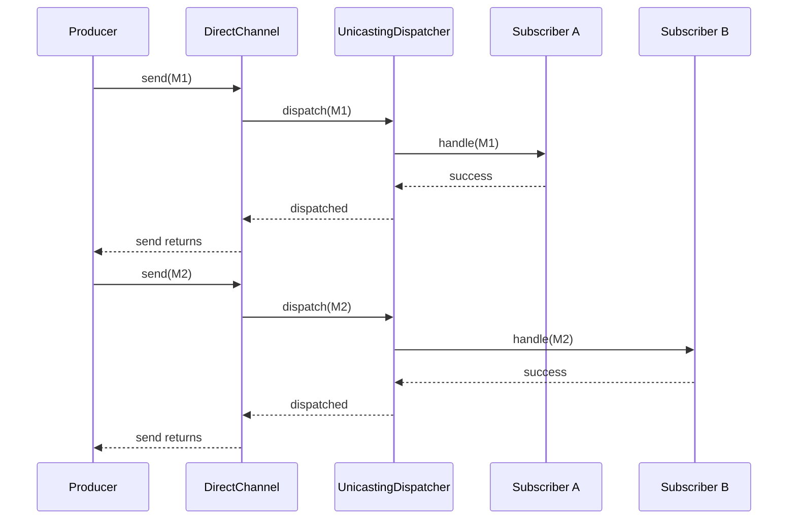
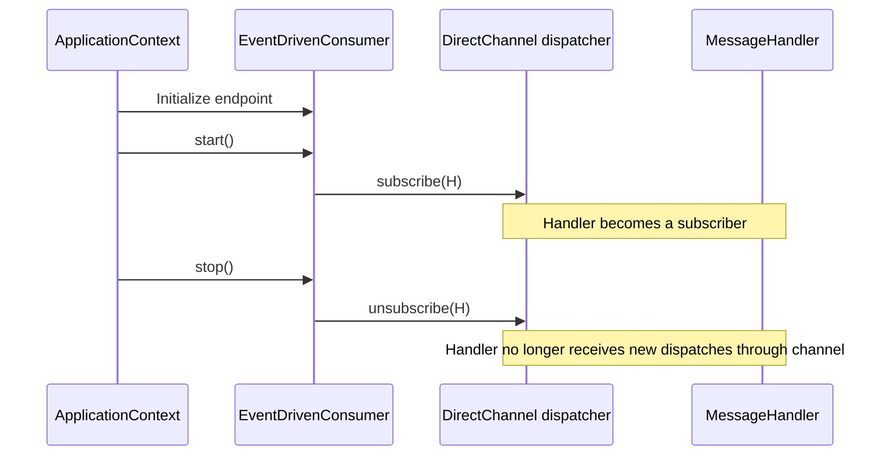
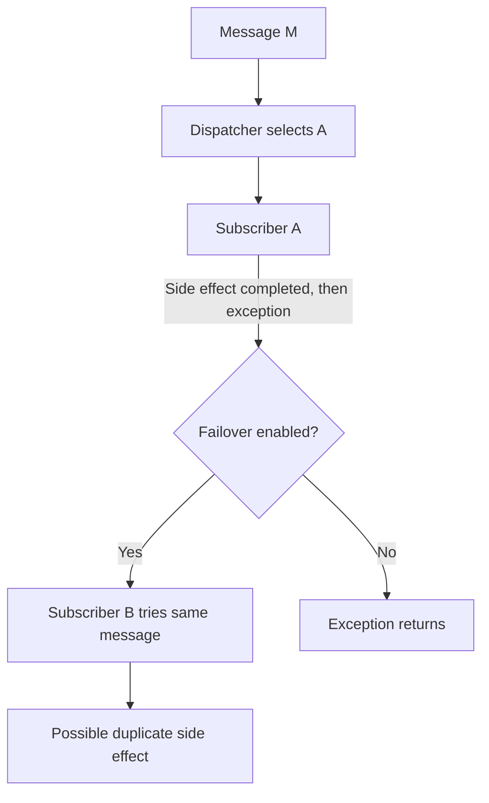
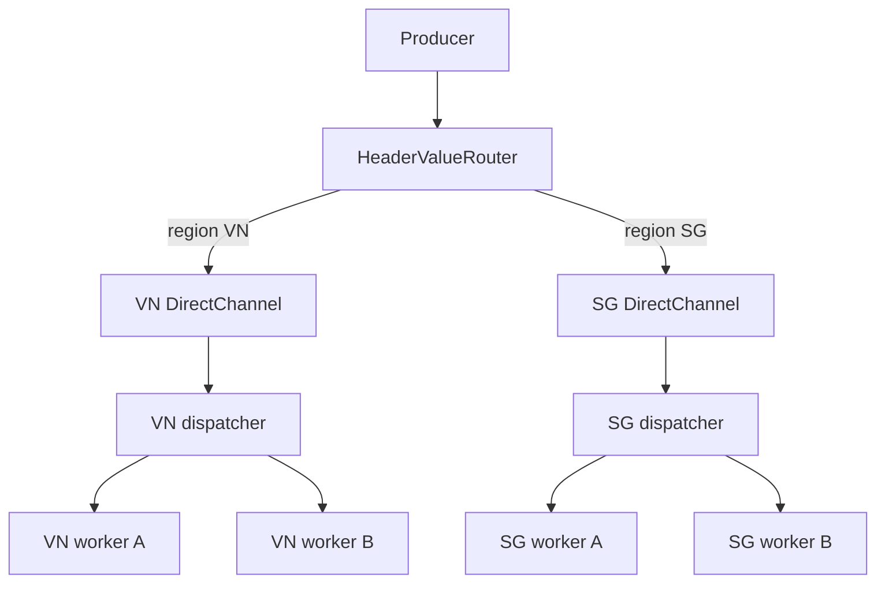

# DirectChannel Dispatcher and Subscribers

In Spring Integration, `DirectChannel` receives messages from producers and dispatches them directly to a registered subscriber. The component that decides which subscriber is invoked is the **dispatcher**. For `DirectChannel`, the dispatcher uses a unicast mechanism: each message send selects a single subscriber to process it. When multiple subscribers exist, the dispatcher can distribute messages among them according to a load-balancing strategy.

Understanding the relationship between the dispatcher and subscribers explains why multiple endpoints reading from the same channel receive only one message per dispatch rather than all receiving every message, how round-robin works, what happens when a handler fails, and why `DirectChannel` does not automatically serialize producer threads.

## 1. Channel, Dispatcher, and Subscriber Are Three Distinct Roles

A channel is the connection point between producers and consumers. With `DirectChannel`, the channel receives the `send()` call and delegates dispatching to `UnicastingDispatcher`. The dispatcher manages the list of registered handlers and chooses one handler for the current message.

The roles:

| Component | Responsibility |
|---|---|
| Producer | Creates the message and calls `send()` on the channel |
| `DirectChannel` | Receives the message, provides the communication boundary, and forwards the dispatch request |
| Dispatcher | Selects a subscriber and coordinates invoking the handler |
| Subscriber | Registered `MessageHandler` that receives messages |
| Endpoint | Connects the handler to the channel and manages the subscription according to lifecycle |

`DirectChannel` is a `SubscribableChannel`. Producers do not invoke a specific handler directly; they simply send to the channel. The dispatcher picks a handler based on the subscriber list and the distribution strategy.

```mermaid
flowchart LR
    P[Producer] -->|send(message)| C[DirectChannel]
    C --> D[UnicastingDispatcher]
    D --> S1[Subscriber A]
    D --> S2[Subscriber B]
    D --> S3[Subscriber C]
    S1 --> H1[MessageHandler A]
    S2 --> H2[MessageHandler B]
    S3 --> H3[MessageHandler C]
```

The diagram shows that the dispatcher has multiple subscriber choices. During a normal dispatch, it selects one subscriber to invoke. It does not broadcast the message to all three subscribers.

## 2. What Does UnicastingDispatcher Do?

`DirectChannel` uses `UnicastingDispatcher` to route a message to one handler. The dispatcher performs two related tasks:

1. Uses `LoadBalancingStrategy` to pick the next handler from the subscriber list.
2. Invokes the selected handler and handles the dispatch outcome, including failover behavior if enabled.

The name *unicasting* reflects unicast semantics: one message is delivered to one selected subscriber. If the channel has multiple subscribers, they share different messages among themselves. The dispatcher does not clone messages to broadcast them.

In the common default configuration, `DirectChannel` uses a round-robin strategy. When multiple subscribers exist, sends are distributed cyclically across subscribers in turn. Dispatcher configuration can also control failover behavior when the selected handler throws an exception.



The dispatcher does not understand the business meaning of the payload. It does not choose a subscriber by `tenantId`, order type, or header values. Selecting a handler based on business conditions belongs to a router or dedicated routing logic.

## 3. Who Are Subscribers and How Are They Registered?

The subscriber contract of `SubscribableChannel` is `MessageHandler`. A handler can be registered directly using `subscribe()`, or managed by a Spring Integration endpoint.

Example of registering a handler directly:

```java
DirectChannel channel = new DirectChannel();

MessageHandler auditHandler =
        message -> auditService.record(message);

channel.subscribe(auditHandler);
```

When a message is sent to the channel, the dispatcher can select `auditHandler` to process it. If there is only one subscriber, the dispatcher's choice is that subscriber.

In a Spring Integration flow, the application usually does not need to call `subscribe()` itself. When the flow is initialized, the framework creates the endpoint and handler. The event-driven endpoint registers the handler with the input channel on start and unregisters it on stop.



This means the channel bean can still exist in the `ApplicationContext` even while the endpoint is stopped. When diagnosing a channel with no consumers, check endpoint subscriptions and lifecycle, not just whether the channel bean exists.

### Example: Two Flows Subscribing to the Same DirectChannel

Suppose an application has two workers processing the same kind of message:

```java
@Bean
DirectChannel ordersChannel() {
    return new DirectChannel();
}

@Bean
IntegrationFlow orderWorkerA(
        OrderWorkerA workerA) {

    return IntegrationFlow.from("ordersChannel")
            .handle(workerA, "handle")
            .get();
}

@Bean
IntegrationFlow orderWorkerB(
        OrderWorkerB workerB) {

    return IntegrationFlow.from("ordersChannel")
            .handle(workerB, "handle")
            .get();
}
```

The two flows create two endpoints consuming the same channel. Once both endpoints are started, the two handlers are two subscribers on `ordersChannel`. With the default round-robin strategy, messages sent to the channel alternate between the two subscribers.

This is point-to-point load sharing. If the goal is for both worker A and worker B to receive a copy of every order, `DirectChannel` does not provide those semantics; use `PublishSubscribeChannel` or create broadcast branches instead.

## 4. Round-Robin Load Balancing

Round-robin selects subscribers in cyclic order. With three subscribers A, B, and C, consecutive successful dispatches are typically distributed in a cycle:

```text
Message 1 -> A
Message 2 -> B
Message 3 -> C
Message 4 -> A
Message 5 -> B
Message 6 -> C
```

Round-robin works well when subscribers have roughly equivalent processing capacity and each message has a similar cost. It does not balance based on actual processing time, current CPU usage, or the number of in-flight tasks on each subscriber.

For example, if handler A processes a message in 20 ms while handler B takes 500 ms, round-robin still distributes messages turn by turn. Subscriber B can become a bottleneck even though both sides are assigned roughly the same number of messages.

| Characteristic | Round-robin |
|---|---|
| Selection method | Alternates sequentially through subscribers |
| Distribution | Based on dispatch turns, not processing time |
| Best suited for | Subscribers with similar capacity and message cost |
| Does not guarantee | Balancing CPU, latency, or active task count |
| Completion order | Can differ from send order with concurrent producers or differing handler latencies |

Do not treat round-robin as a guarantee that every subscriber receives the exact same number of messages in every short time window. Producers may send concurrently, subscribers may be added or removed, and errors/failover can change where processing actually occurs.

## 5. Configuring the Load-Balancing Strategy

`DirectChannel` allows configuring a `LoadBalancingStrategy` through its constructor. If you want to state the default strategy explicitly, you can instantiate the channel with `RoundRobinLoadBalancingStrategy`:

```java
@Bean
DirectChannel ordersChannel() {
    return new DirectChannel(
            new RoundRobinLoadBalancingStrategy());
}
```

This is also the round-robin strategy used in `DirectChannel`'s default configuration in current Spring Integration versions. Specifying it explicitly can be helpful when you want configuration readers to see the distribution policy clearly.

If you need a different policy, you can implement `LoadBalancingStrategy` compatible with your framework version. The strategy selects a subscriber from the list of handlers provided by the dispatcher. Keep selection logic simple and thread-safe, and avoid blocking I/O during selection.

Do not place complex business rules inside a load-balancing strategy. If a message must reach a specific handler based on headers or payload, use a router to direct it to the appropriate channel. Load balancing addresses sharing messages among equivalent subscribers; a router decides which branch a message must take.

## 6. Failover When a Subscriber Fails

Failover is the dispatcher behavior of trying another subscriber if the chosen subscriber fails to process a message due to an exception. `DirectChannel` supports enabling or disabling failover.

Example configuration that disables trying the next subscriber when the selected handler throws an exception:

```java
@Bean
DirectChannel strictOrdersChannel() {
    DirectChannel channel = new DirectChannel();
    channel.setFailover(false);
    return channel;
}
```

With failover enabled, the dispatcher can continue trying the next subscriber according to the load-balancing strategy when the previous handler throws an exception. When failover is disabled, the error from the selected subscriber is returned along the dispatch call's error path.

Distinguish clearly:

- **Load balancing** selects which subscriber is tried first.
- **Failover** decides whether the dispatcher tries another subscriber when the prior attempt fails.
- **Retry advice** executes a retry policy according to configured attempt counts, exception types, and backoff intervals.
- **Dead-letter/error flow** receives the message or error after processing fails according to application policy.

Failover is not a complete retry policy. It has no backoff, business-level attempt limits, or exception classification like a separately configured retry advice.

### Side-Effect Risks During Failover

Suppose subscriber A writes a record to the database and then throws an exception because a notification step fails. If the dispatcher fails over to subscriber B, B may reprocess the same message and write a duplicate record.



Therefore, failover is only safe when subscribers have equivalent semantics and idempotent processing, or when side effects are rolled back or properly controlled. Never use failover to mask configuration errors or unrecoverable data errors.

## 7. Configuring Load Balancing and Failover Together

A channel can specify a strategy and configure failover independently:

```java
@Bean
DirectChannel balancedOrdersChannel() {
    DirectChannel channel =
            new DirectChannel(new RoundRobinLoadBalancingStrategy());

    channel.setFailover(true);

    return channel;
}
```

The configuration above reflects two independent decisions:

1. Round-robin selects the first subscriber cyclically.
2. If the selected subscriber throws an exception, the dispatcher is allowed to try another subscriber.

When failover is disabled, round-robin still continues distributing subsequent messages to the next subscriber; only the behavior of trying another subscriber for the same dispatch changes.

If you want to control error behavior, configure it explicitly and test with a handler that intentionally throws an exception. Do not infer whether failover works properly just from the count of messages received by each worker.

## 8. The Dispatcher Does Not Replace a Router

A common question is: "If there are multiple subscribers, how does `DirectChannel` know which subscriber a message belongs to?" The answer is that the dispatcher does not perform content-based routing. It chooses a subscriber according to the load-balancing strategy.

For example, if a message has a `region` header and requires:

- `region=VN` goes to domestic processing.
- `region=SG` goes to Singapore processing.
- Other regions go to the default branch.

This is a routing problem. The flow can use a router to pick a channel by header, and then each channel can have multiple subscribers load-balanced within that group.



The router decides **which group a message goes to**. Each `DirectChannel`'s dispatcher decides **which subscriber within that group receives the message**. These two decision levels can be combined within the same flow.

## 9. A Subscriber Is Not a Worker Thread

A subscriber is a handler registered with a channel, not a thread or an executor instance. One handler can be invoked on different producer threads if multiple producers send concurrently to a `DirectChannel`.

This leads to several consequences:

- One subscriber can process multiple messages concurrently if multiple threads invoke dispatch.
- Mutable state inside a handler/service must be protected for thread safety.
- Round-robin distributes invocations; it does not assign a dedicated worker thread to each subscriber.
- `DirectChannel` does not create a thread pool on its own.
- If concurrency limits are needed, you must use another mechanism such as an executor, semaphore, queue, or upstream concurrency limit.

For example, a singleton service used as a handler can receive multiple concurrent calls. If the service keeps a mutable instance field to accumulate per-message data, the code must synchronize or scope state per request/message instead of sharing it unsafely.

Do not assume that because `DirectChannel` dispatches synchronously, a handler only ever runs one call at a time. Synchronous here means handler execution happens on the sending thread; it does not mean the channel holds a global lock.

## 10. Subscription Lifecycle and Changing the Subscriber List

Subscribers can be added to or removed from a channel via endpoint lifecycle:

- When an endpoint starts, the handler is subscribed.
- When an endpoint stops, the handler is unsubscribed.
- When a dynamic flow is registered, the flow's endpoints can subscribe to channels.
- When a dynamic flow is unregistered, its endpoints are destroyed and corresponding subscriptions are removed.

If a channel is shared across multiple flows, stopping one endpoint should not drop another endpoint's subscription. When investigating missing subscribers, check which endpoints are running and which flow registrations still exist.

With manual subscriptions, the application owns the responsibility of calling `unsubscribe(handler)` when the handler is no longer needed. If you forget to unsubscribe, the channel may retain references to the handler and its dependencies, keeping the component alive longer than expected.

For dynamic flows, use `IntegrationFlowContext` to register and remove flows. Do not delete beans manually or tamper with the dispatcher's internal subscriber list as a substitute for framework lifecycle.

## 11. No Subscribers and Subscriber Limits

If endpoints have not started yet or all subscribers have unsubscribed, the channel may have no handler to dispatch to. In that case, `send()` cannot complete a dispatch to a consumer. The send result and whether an exception is thrown depend on channel configuration, such as policies requiring subscribers and how the producer handles the boolean return value.

Therefore, producers should check the return value of `send()` when message delivery matters:

```java
boolean accepted = ordersChannel.send(message);

if (!accepted) {
    throw new MessageDeliveryException(
            message, "No subscriber accepted the message");
}
```

This is an illustrative example for checking the send result; the application should choose an appropriate exception and handling policy. If the channel is configured to require subscribers, the framework can report an error immediately when no consumer is present.

When deploying dynamic endpoints, avoid sending messages before the flow has been registered and the endpoint is ready. If messages must not be lost during transitions, buffer at a queue/broker and open ingress only when consumers are ready.

## 12. Message Ordering and Producer Concurrency

Round-robin is not a global ordering guarantee. With a single producer thread sending sequentially, the second dispatch call only happens after the first returns if synchronous processing succeeds. However, when multiple producer threads exist, calls can interleave and execute concurrently.

Even when the dispatcher selects subscribers in turn, completion order can differ from send order:

- Message A is sent first and assigned to subscriber A, whose handler takes 500 ms.
- Message B is sent next and assigned to subscriber B, whose handler takes 50 ms.
- Message B may finish before message A.

If the business requires ordering per aggregate or key, design key-based partitioning or serialization. A `DirectChannel` with round-robin does not guarantee that all messages for the same order reach the same subscriber.

If key-based sticky routing is required, use a router or stateful partitioning strategy appropriate to the task, and ensure messages with the same key are processed with the required ordering semantics. Do not use round-robin to solve business ordering.

## 13. Transactions and Errors with Multiple Subscribers

With `DirectChannel`, the handler runs synchronously on the sending thread. If the producer is inside a transaction and the handler uses the same transaction manager with matching propagation, the operations can participate in that transaction.

However, failover can shift processing to another subscriber after an exception. If the first subscriber already performed side effects, the outcome depends on transaction boundaries and the type of side effect:

- Database updates within the same transaction can roll back if the exception triggers a transaction rollback.
- HTTP calls or sending emails cannot be rolled back by a database transaction.
- File writes or external system calls require separate compensation or idempotency mechanisms.
- If a handler catches an exception and does not rethrow it, the dispatcher may treat the execution as successful depending on the execution path.

With multiple subscribers, do not enable failover mechanically. Verify whether subscribers are genuinely interchangeable and whether side effects can safely repeat.

When business retries are required, use a bounded, observable retry advice or error flow. Failover should only be part of the dispatch decision, not the sole recovery mechanism.

## 14. Comparing DirectChannel Dispatcher with Other Channels

| Channel | Dispatch semantics | Subscriber/consumer behavior |
|---|---|---|
| `DirectChannel` | Unicast, direct dispatch | Selects one subscriber; supports load balancing/failover |
| `PublishSubscribeChannel` | Broadcast | Sends to registered subscribers |
| `ExecutorChannel` | Unicast via executor | Selects a subscriber and hands dispatch off to a worker thread |
| `QueueChannel` | Buffered in queue | Consumers pull messages via a poller |
| `FluxMessageChannel` | Reactive Streams | Publisher/subscriber following demand and stream semantics |

Do not confuse `ExecutorChannel` with `DirectChannel` just because both can have multiple subscribers. The crucial difference is that `ExecutorChannel` delegates dispatch through an executor, whereas `DirectChannel` invokes the handler synchronously on the sending thread by default.

## 15. Observing the Dispatcher and Subscribers at Runtime

When a message goes to the wrong handler or is not processed, inspect both the channel and the endpoints:

- Channel name and endpoint component name.
- Number of currently registered subscribers.
- Running state of the endpoints.
- Load-balancing strategy currently in use.
- Failover setting.
- Message ID and correlation ID.
- Thread names of producer and handler.
- Processing duration of each subscriber.
- Exception counts and failover counts.
- Number of messages received by each subscriber over an interval.

A diagnostic table:

| Symptom | Where to check |
|---|---|
| Only one handler receives messages | Only one subscriber may have started |
| Messages alternate across handlers | Round-robin is active |
| One handler receives more messages | Subscriber changes, producer concurrency, or failover |
| Second handler runs after first handler fails | Failover is enabled and the next subscriber was tried |
| Message reaches every handler | Likely using `PublishSubscribeChannel` or multiple branches, not default unicast |
| No handler receives messages | Endpoint not started, subscription removed, or no subscribers |
| One subscriber processes multiple messages concurrently | Multiple producer threads are dispatching to that handler |
| Message processed twice | Failover after side effects, retry, or producer resend |

You can use a `ChannelInterceptor` to observe messages at the channel and log component names in handlers to identify which subscriber handled a message. Avoid logging full sensitive payloads; prefer message IDs, correlation IDs, and lookup keys.

## 16. Testing Load Balancing and Failover

When testing a dispatcher, separate the two behaviors: subscriber selection and handling when a subscriber fails.

Example testing round-robin with two handlers:

```java
@Test
void directChannelDistributesMessagesAcrossSubscribers() {
    DirectChannel channel = new DirectChannel();

    AtomicInteger firstCount = new AtomicInteger();
    AtomicInteger secondCount = new AtomicInteger();

    channel.subscribe(message -> firstCount.incrementAndGet());
    channel.subscribe(message -> secondCount.incrementAndGet());

    channel.send(new GenericMessage<>("one"));
    channel.send(new GenericMessage<>("two"));
    channel.send(new GenericMessage<>("three"));
    channel.send(new GenericMessage<>("four"));

    assertThat(firstCount.get()).isEqualTo(2);
    assertThat(secondCount.get()).isEqualTo(2);
}
```

This test illustrates round-robin distribution under simple conditions: two stable subscribers, one producer thread, and no exceptions. In real application tests, avoid hardcoding assumptions about subscriber order if the strategy may change.

Testing failover separately:

```java
@Test
void dispatcherCanFailOverWhenSelectedHandlerThrows() {
    DirectChannel channel = new DirectChannel();
    channel.setFailover(true);

    AtomicInteger fallbackCount = new AtomicInteger();

    channel.subscribe(message -> {
        throw new IllegalStateException("temporary failure");
    });

    channel.subscribe(message -> fallbackCount.incrementAndGet());

    channel.send(new GenericMessage<>("order"));

    assertThat(fallbackCount.get()).isEqualTo(1);
}
```

Illustrative examples should be run against the Spring Integration version and subscriber ordering/strategy used by the application. When testing failover, verify exception behavior, side effects, and the return value from `send()`, not merely whether the fallback handler was called.

Scenarios to include in a test suite:

- A single subscriber receives messages.
- Multiple subscribers receive messages distributed per the configured strategy.
- Enabling and disabling failover produce different outcomes when a handler throws an exception.
- A subscriber is unsubscribed when its endpoint stops.
- No subscribers exist and `send()` behaves according to channel policy.
- Multiple producer threads send concurrently.
- A handler with side effects does not duplicate them unintentionally on failover.
- New subscribers are added or removed via dynamic flow lifecycle.

## 17. Choosing a Dispatcher or a Router?

| Requirement | Recommended mechanism |
|---|---|
| Distribute messages across equivalent handlers | `DirectChannel` dispatcher with load balancing |
| One message must reach every subscriber | `PublishSubscribeChannel` |
| Choose branch by header or payload | Router |
| Try another subscriber when the selected handler fails | Dispatcher failover, if semantics are safe |
| Retry the same operation with attempts/backoff | Retry advice |
| Buffer messages when no consumer is available | `QueueChannel` or broker |
| Process by key and preserve ordering | Partitioning or key-based routing with sequential consumers |

A flow can combine a router and a dispatcher. The router selects the processing group by business logic; each group uses a `DirectChannel` to share load among equivalent subscribers.

## 18. DirectChannel Dispatcher Diagnostic Checklist

When investigating why a subscriber was invoked or skipped, check in order:

1. Is the actual channel a `DirectChannel`?
2. How many endpoints are subscribed to the channel?
3. Have the endpoints started and registered their handlers successfully?
4. Which load-balancing strategy is the dispatcher using?
5. Is failover enabled or disabled?
6. Did the selected handler throw an exception?
7. Could side effects have occurred before the exception?
8. Is load balancing being confused with payload/header-based routing?
9. Are multiple producer threads sending concurrently?
10. Does the handler hold mutable state requiring thread-safety protection?
11. Was a subscriber stopped or unregistered during flow configuration changes?
12. Do metrics/logs include message ID, correlation ID, endpoint ID, and thread name?

Once you distinguish the dispatcher from subscribers, you understand why `DirectChannel` picks one handler, how round-robin alternates turns, how failover changes the execution path, and how endpoint lifecycle affects the subscriber list. This forms the foundation for designing point-to-point load sharing, safe error handling, and channel runtime diagnostics in Spring Integration.
