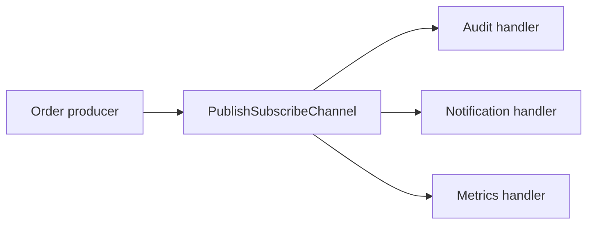

# PublishSubscribeChannel Message Broadcasting

In Spring Integration, `PublishSubscribeChannel` sends a message to all `MessageHandler` instances registered with the channel. This is the broadcast pattern (delivering to multiple destinations), commonly used for notification events such as `OrderCreated`, `PaymentCompleted`, or `CustomerUpdated`: the same event needs to be audited, update metrics, send notifications, and sync with other systems.

This channel fits when every subscriber needs to receive the same event and run its own processing. It does not buffer messages for consumers to retrieve later, does not create durable copies on its own, and does not guarantee that every branch succeeds. To design reliable message flows, you must understand how the channel dispatches, the difference between synchronous and asynchronous execution, error handling, correlation, and subscriber lifecycle.

## 1. The Broadcast Mechanism

`PublishSubscribeChannel` is a `SubscribableChannel`. When a producer calls `send(message)`, the channel iterates through its current subscribers and dispatches the message to each one. Subscribers are `MessageHandler` instances, typically created and registered by Spring Integration through the consumer endpoints of an `IntegrationFlow`.

For example, an order event needs to be processed across three branches:



All three branches receive the `OrderCreated` event. Each branch is responsible for its own task. A message is not split into three payload pieces; the channel broadcasts the same content to each subscriber.

Differences from other common channels:

| Channel | Distribution behavior | When it fits |
|---|---|---|
| `DirectChannel` | Selects one subscriber to process the message; usually load-balances when multiple subscribers exist | One of the handlers performs the primary task |
| `ExecutorChannel` | Dispatches asynchronously to one subscriber chosen by the dispatcher | Decoupling sending and processing threads for a point-to-point branch |
| `PublishSubscribeChannel` | Broadcasts to all subscribers | Multiple branches all need to receive the same event |
| `QueueChannel` | Places the message into a queue; consumers pull messages via polling | Buffering between producer and consumer or controlling pull cadence |

`PublishSubscribeChannel` supports sending only. It does not implement `PollableChannel`, has no `receive()`, and does not use a poller to pull messages from the channel. Consumers register directly as subscribers.

Broadcasting also differs from publishing independent messages to a broker. A subscriber only receives messages while it is registered and active at dispatch time. A subscriber that starts later does not replay previously broadcast messages. If you need to retain a backlog across restarts, use an appropriate broker or message store.

## 2. Synchronous vs. Asynchronous Execution

By default, `PublishSubscribeChannel` invokes subscribers on the sending thread. You can pass a `TaskExecutor` to dispatch subscribers on worker threads.

| Characteristic | Without an executor | With an executor |
|---|---|---|
| Processing thread | Thread calling `send()` | Executor worker threads |
| When `send()` returns | After subscribers have been invoked synchronously | Usually after tasks are dispatched to the executor |
| Impact of a slow subscriber | Slows down the producer and subsequent subscribers | Occupies a worker and can grow the executor queue |
| Handler exceptions | Can propagate directly to the sending thread | Handled via the channel's `ErrorHandler`; does not return to the finished send call |
| Transaction bound to sending thread | Can participate on the same thread if a transaction is active | Does not automatically propagate to worker threads |

In synchronous mode, subscribers run sequentially during dispatch. A slow handler increases `send()` latency and extends how long the producer holds resources. This is useful when the producer needs to know processing outcomes immediately within the same call and wants a clear single-thread boundary.

In asynchronous mode, the executor decouples dispatch from handler execution. The producer does not wait for each branch to finish. This reduces producer latency under normal conditions, at the cost of managing queues, worker counts, rejections, and errors occurring after tasks begin executing.

Note: using an executor does not mean all branches finish simultaneously or in a fixed order. Start and finish times depend on worker scheduling, processing duration, and downstream resources. If business logic requires ordering, express that ordering through data or a separate serialization mechanism.

## 3. Configuring with Java DSL

The example below broadcasts an order event to two branches: audit and notification. Both branches share an executor for asynchronous processing.

```java
import java.util.concurrent.Executor;
import java.util.concurrent.ThreadPoolExecutor;

import org.springframework.beans.factory.annotation.Qualifier;
import org.springframework.context.annotation.Bean;
import org.springframework.context.annotation.Configuration;
import org.springframework.integration.dsl.IntegrationFlow;
import org.springframework.messaging.MessageHeaders;
import org.springframework.scheduling.concurrent.ThreadPoolTaskExecutor;

@Configuration
public class OrderBroadcastConfiguration {

    @Bean
    public ThreadPoolTaskExecutor broadcastExecutor() {
        ThreadPoolTaskExecutor executor = new ThreadPoolTaskExecutor();
        executor.setCorePoolSize(4);
        executor.setMaxPoolSize(8);
        executor.setQueueCapacity(200);
        executor.setThreadNamePrefix("si-broadcast-");
        executor.setRejectedExecutionHandler(
                new ThreadPoolExecutor.AbortPolicy());
        return executor;
    }

    @Bean
    public IntegrationFlow orderBroadcastFlow(
            @Qualifier("broadcastExecutor") Executor broadcastExecutor,
            AuditService auditService,
            NotificationService notificationService) {

        return IntegrationFlow.from("orders.input")
                .publishSubscribeChannel(broadcastExecutor, pubSub -> pubSub
                        .minSubscribers(2)
                        .subscribe(branch -> branch.handle(
                                (OrderCreated event, MessageHeaders headers) -> {
                                    auditService.record(event, headers);
                                    return null;
                                }))
                        .subscribe(branch -> branch.handle(
                                (OrderCreated event, MessageHeaders headers) -> {
                                    notificationService.send(event);
                                    return null;
                                })))
                .get();
    }
}
```

`orders.input` is the flow's input channel. `publishSubscribeChannel(...)` creates the broadcast point and registers two subflows as subscribers. Both receive the same `OrderCreated`, but process independently. `return null` indicates the handler only performs side effects and produces no downstream reply message.

The executor is a Spring-managed bean. `corePoolSize`, `maxPoolSize`, and `queueCapacity` must be sized based on measured load and the capacity of the audit service, notification service, and their dependencies. The example uses `AbortPolicy`: if the executor cannot accept more tasks, dispatch can fail and a rejection exception surfaces directly on the submitting side.

`minSubscribers(2)` requires the channel to dispatch successfully to at least two subscribers for `send()` to be considered successful. If only one subscriber is dispatched to, the send does not meet the threshold. Without `minSubscribers` configured, the default is `0`; thus send can be considered successful even with zero subscribers. Starting with Spring Integration 5.4.3, `requireSubscribers` is also available to throw `MessageDispatchingException` when the channel has no subscribers. Choose the check that matches your framework version and flow requirements.

If asynchronous processing is not needed, omit the executor argument:

```java
return IntegrationFlow.from("orders.input")
        .publishSubscribeChannel(pubSub -> pubSub
                .subscribe(branch -> branch.handle(auditService, "record"))
                .subscribe(branch -> branch.handle(notificationService, "send")))
        .get();
```

In the synchronous configuration, the send call completes only after all subscribers have been invoked. Therefore, evaluate the processing duration of each branch and its impact on the producer.

## 4. Sequence Headers and Correlation

By default, `applySequence` is `false`. In that mode, the channel can pass the exact same `Message` instance to multiple subscribers. This is suitable for independent branches that only read the same event.

When branches produce results that must be aggregated later, you can enable `applySequence(true)`. The channel creates messages sharing the same payload reference while adding metadata:

- `correlationId`: identifies the group of messages produced by a single broadcast.
- `sequenceNumber`: position of the branch in the group, starting at `1`.
- `sequenceSize`: number of subscribers in the broadcast group.

For example, with three subscribers, the emitted messages share the same correlation ID, have sequence size `3`, and sequence numbers `1` through `3`.

```java
.publishSubscribeChannel(broadcastExecutor, pubSub -> pubSub
        .applySequence(true)
        .subscribe(branch -> branch.transform(this::createAuditResult)
                .channel("broadcast.results"))
        .subscribe(branch -> branch.transform(this::createNotificationResult)
                .channel("broadcast.results"))
        .subscribe(branch -> branch.transform(this::createMetricsResult)
                .channel("broadcast.results")))
```

The results can be routed to a common channel and passed to an `Aggregator`. With the default completion strategy based on sequence size, the aggregator knows it must collect three items sharing the same correlation ID.

Do not enable sequence headers mechanically. If one subscriber emits no result, an aggregator may wait until a timeout or incomplete-group policy triggers. If a branch emits multiple results, clarify how sequence metadata should be preserved or adjusted. When using an aggregator, configure release strategy, group timeout, message store, and expired-group handling to match business rules.

`applySequence(true)` creates separate `Message` instances to carry distinct headers, but those instances still reference the same payload object. Messages and headers are designed to be immutable; however, an application-provided payload can still be a mutable object. Never mutate a shared payload in place inside a subscriber, because another branch might observe the mutated state. If transformation is needed, create a new object.

## 5. Error Handling Across Subscribers

Errors can occur at two different stages:

1. **Dispatch failure:** the executor rejects the task or the channel cannot dispatch to a subscriber. The error can surface immediately during the send call.
2. **Handler failure:** the task ran, but subscriber code threw an exception, such as a failed database or external service call.

With synchronous dispatch, handler exceptions can propagate directly to the sending thread. By default, `ignoreFailures` is `false`, meaning handler errors are reported rather than ignored. If you set `ignoreFailures(true)`, the channel can ignore subscriber failures according to that setting. Only use this option when business requirements allow one branch to fail without failing the send operation.

With an executor, exceptions thrown inside a worker cannot return to an already-completed `send()` call. `PublishSubscribeChannel` supports an `ErrorHandler`; the default when using an executor is `MessagePublishingErrorHandler`, which sends an error message to the channel specified in the request's `errorChannel` header or to the global `errorChannel`. You can configure a custom `ErrorHandler` if different handling is required. Without an executor, the channel's `ErrorHandler` is not used and exceptions are thrown on the sending thread.

Example configuring an error handler in DSL:

```java
.publishSubscribeChannel(broadcastExecutor, pubSub -> pubSub
        .errorHandler(broadcastErrorHandler)
        .subscribe(branch -> branch.handle(auditService, "record"))
        .subscribe(branch -> branch.handle(notificationService, "send")))
```

`broadcastErrorHandler` is a bean implementing `org.springframework.util.ErrorHandler`, configured by the application to log or forward errors per operational policy. An error handler at the channel boundary should preserve the original message info, subscriber, and correlation ID for accurate diagnosis.

Do not confuse a subscriber failure with an initial message send failure. With asynchronous processing, a successful `send()` typically only means dispatch was accepted under channel and executor policies. It does not prove that audit logging finished, notifications were sent, or all downstream services succeeded.

## 6. Transactions and Processing Guarantees

`PublishSubscribeChannel` does not open transactions on its own. Transactions depend on the transaction boundaries of the producer or each subscriber.

In synchronous mode, subscribers run on the sending thread. If the producer is inside a transaction and downstream operations share the same transaction manager, they can participate in that transaction. If a handler throws an exception and it propagates outward, the transaction wrapping the send call can roll back per Spring's rules. Verify this against your actual transaction manager, propagation, and exception types.

In asynchronous mode, subscribers run on worker threads. A transaction context bound to the sending thread does not propagate to workers. Each branch must open its own transaction if its operations require transactionality. For example, business methods in `AuditService` or `NotificationService` can define their own transactions; do not rely on the producer's transaction to protect downstream async work.

In-memory broadcasting provides no durable delivery guarantee. If the process stops after the producer sends successfully but before a worker completes, work in flight or queued in the executor can be lost. When business rules require events never to be lost, consider a transactional outbox on the producer side and a durable broker for event distribution. Subscribers should be idempotent because brokers, retries, or recovery can cause the same event to be processed multiple times.

Retries should also be designed per branch. If the audit branch succeeded while the notification branch failed, retrying the entire broadcast operation could run audit again. Use stable event IDs, idempotency keys, or per-subscriber state tracking to prevent duplicate side effects. Configure bounded retries with backoff, and route final failures to an appropriate handler.

## 7. Backpressure, Executors, and Performance

In synchronous mode, a slow subscriber directly slows down the producer. This is a natural form of backpressure, though one slow branch affects every subscriber invoked after it.

In asynchronous mode, the executor absorbs some bursts via workers and its queue. When incoming event rates exceed processing rates for a sustained period, the queue grows. If the queue fills up, `RejectedExecutionHandler` determines how the executor reacts. `AbortPolicy` raises a clear error; `CallerRunsPolicy` can make the sending thread run the task and slow down; discard policies can drop work. For important business events, never pick a task-discarding policy without another preservation and recovery mechanism.

A single executor shared across the channel allows a slow branch to tie up workers needed by remaining branches. If audit and notification have very different load characteristics, consider separating them onto distinct channels or executors to limit cross-impact. The trade-off is having to manage additional queues, concurrency limits, and lifecycles for each executor.

Metrics to monitor include:

- Number of registered subscribers and endpoint active state.
- Messages sent, subscribers reached, and rate of sends failing `minSubscribers`.
- Active tasks, queue length, rejected tasks, and queue wait duration.
- Processing duration, error rate, and retry count per branch.
- Rate of messages routed to the error channel and events not yet processed successfully.

Give threads a meaningful name prefix to identify workers in thread dumps. Avoid unbounded queues if load can grow continuously, as huge queues only delay saturation while increasing memory consumption and latency.

## 8. Subscriber Lifecycle and Runtime State

`IntegrationFlow` consumer endpoints register their handlers with the channel during application context initialization and lifecycle. When an endpoint stops, its subscriber is removed from the channel; when the endpoint restarts, it re-registers. Therefore, the actual subscriber count can change with runtime state, not just match declared beans.

If using `minSubscribers`, the number of active subscribers can cause `send()` to return `false`. If `requireSubscribers` is enabled, sending when no subscribers exist throws `MessageDispatchingException`. Check endpoint states and start/stop ordering during deployment or shutdown, especially when producers continue sending while consumers are stopping.

The channel does not buffer messages for stopped subscribers. If processing must not be missed during rolling deployments, pause upstream sources, use an acknowledgment-capable broker, or apply a proper drain procedure before stopping consumers.

## 9. Testing Broadcast Behavior

A simple test can verify that two subscribers both receive the same message:

```java
import static org.junit.jupiter.api.Assertions.assertEquals;
import static org.junit.jupiter.api.Assertions.assertTrue;

import java.util.concurrent.atomic.AtomicInteger;

import org.junit.jupiter.api.Test;
import org.springframework.integration.channel.PublishSubscribeChannel;
import org.springframework.messaging.Message;
import org.springframework.messaging.support.MessageBuilder;

class PublishSubscribeChannelTests {

    @Test
    void sendsMessageToEverySubscriber() {
        PublishSubscribeChannel channel = new PublishSubscribeChannel();
        AtomicInteger auditCalls = new AtomicInteger();
        AtomicInteger notificationCalls = new AtomicInteger();

        channel.subscribe(message -> auditCalls.incrementAndGet());
        channel.subscribe(message -> notificationCalls.incrementAndGet());

        Message<String> message = MessageBuilder
                .withPayload("order-42")
                .build();

        assertTrue(channel.send(message));
        assertEquals(1, auditCalls.get());
        assertEquals(1, notificationCalls.get());
    }
}
```

With an asynchronous channel, do not use `Thread.sleep()` to wait for workers in tests. Use `CountDownLatch`, `CompletableFuture`, or an appropriate test utility to wait for each branch to finish within a bounded timeout. Also test edge cases: zero subscribers, fewer subscribers than `minSubscribers`, a handler throwing an exception, the executor rejecting tasks, and errors reaching the error channel.

If using `applySequence(true)`, verify the correlation ID, sequence number, and sequence size for each branch. If results flow into an aggregator, also test the case where one branch emits no result and confirm that the group timeout or release strategy behaves as expected.

## 10. Troubleshooting Common Issues

| Symptom | Possible cause | Where to check |
|---|---|---|
| Only one branch receives the message | Remaining flows have not started, subscribed to the wrong channel, or stopped | Check endpoint lifecycle and active channel subscribers |
| `send()` returns `true` even with no subscribers | `minSubscribers` defaults to `0` and `requireSubscribers` is not enabled | Configure subscriber threshold or require subscribers for your version |
| Producer slows down during broadcast | Running synchronously or one subscriber holds the thread too long | Check sending thread, per-handler duration, and executor setup |
| `send()` succeeds but one branch fails | Branch runs asynchronously and failed after dispatch | Check `ErrorHandler`, error channel, and worker logs |
| Queue grows or rejections occur | Subscriber throughput is lower than event arrival rate, or executor is shutting down | Monitor workers, queue, downstream latency, and rejection policy |
| Aggregator never completes | Missing output from one branch, lost sequence metadata, or mismatched correlation | Check `applySequence`, header propagation, release strategy, and timeout |
| One branch sees a mutated payload | A subscriber modified a shared payload object | Use immutable payloads or copy before mutating |

When investigating, take a specific event ID or correlation ID and trace when the producer sent it, which subscribers were active, when each branch started and ended, and any downstream errors. For asynchronous processing, correlate worker logs and metrics; checking only the `send()` result is not enough.

## 11. Design Checklist

- Use `PublishSubscribeChannel` when all subscribers must receive the same event.
- Use `DirectChannel` or `ExecutorChannel` if only one handler should process each message.
- Choose synchronous or asynchronous dispatch based on latency, transactions, and producer load tolerance.
- With an executor, bound the queue and concurrency; configure explicit rejection and error handling.
- Set `minSubscribers` or `requireSubscribers` if missing consumers must be detected.
- Enable `applySequence` only when correlation and aggregating branch results are needed.
- Keep payloads immutable or copy data before mutating.
- Design transactions, retries, and idempotency independently for each subscriber.
- Use a broker or outbox when events must survive restarts durably.
- Monitor endpoint state, throughput, queue depth, rejections, latency, and per-branch errors.

`PublishSubscribeChannel` enables one message to trigger multiple processing branches within the same Spring Integration runtime. Broadcast reliability depends on picking the right distribution semantics, managing subscribers via lifecycle, controlling executors, and clearly defining error handling, transactions, correlation, and delivery guarantees.
