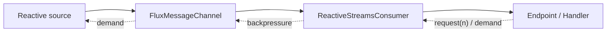
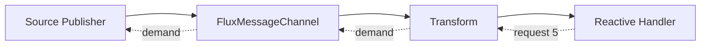

# FluxMessageChannel and Reactive Subscriptions

`FluxMessageChannel` is a Spring Integration channel that combines two roles: receiving messages through `MessageChannel` and emitting messages as a Reactive Streams `Publisher<Message<?>>`. It bridges Spring Integration's message-based model with Project Reactor, enabling subscribers to request data on demand and propagate backpressure back toward the source when the entire processing path supports reactive execution.

The key point is that `FluxMessageChannel` is neither a `QueueChannel` nor a conventional `SubscribableChannel`. It provides no `receive()` API for polling, nor does it let consumers register directly via `MessageHandler.subscribe(...)`. Consumers must be Reactive Streams `Subscriber` instances; inside an integration flow, Spring Integration typically creates a `ReactiveStreamsConsumer` to connect the endpoint to the publisher.

## 1. What Problem Does Reactive Streams Solve?

In the imperative model, producers normally send messages and consumers process them in a push style. If the producer emits faster than the consumer can process, the system needs a limiting or buffering mechanism. Without bounds, queued data can grow and put pressure on memory.

Reactive Streams adds **backpressure**. A consumer tells the publisher how many elements it is ready to accept via demand. The publisher emits only up to the requested number of elements. When the consumer slows down, demand drops and that signal can propagate upstream to the source, throttling emission rates.



Reactive Streams separates two phases:

- **Assembly:** constructing the publisher and operators that describe how data will flow through the stream.
- **Subscription:** a subscriber subscribes, requests data, and triggers execution.

Therefore, creating a `Flux` or a reactive `IntegrationFlow` does not yet mean data is being processed. A downstream subscription is required to start consumption. Demand originates from the subscriber and propagates upstream through Reactive Streams-capable publishers and operators.

## 2. What Kind of Channel Is FluxMessageChannel?

`FluxMessageChannel` has the following key characteristics:

- Implements `MessageChannel`, so producers can still send `Message<?>` via `send()`.
- Implements `Publisher<Message<?>>`, so subscribers can call `subscribe()` to receive messages.
- Implements `ReactiveStreamsSubscribableChannel`, so the channel can consume an upstream `Publisher<Message<?>>` via `subscribeTo(...)`.
- Does not implement `SubscribableChannel` and does not implement `PollableChannel`.
- Uses an internal hot `Flux` as the emission source for messages sent into the channel.

The following table distinguishes the consumption APIs:

| Channel | How consumers receive data | Has Reactive Streams demand? | Characteristics |
|---|---|---|---|
| `DirectChannel` | `MessageHandler` subscriber | Not governed by Reactive Streams contract | Synchronous dispatch on the sending thread |
| `QueueChannel` | `receive()` or polling consumer | Not governed by Reactive Streams contract | Buffers messages in a queue, with optional capacity |
| `ExecutorChannel` | `MessageHandler` dispatched via `TaskExecutor` | No native Reactive Streams demand | Separates processing threads using an executor |
| `FluxMessageChannel` | Reactive Streams `Subscriber` | Yes | Hot publisher, demand-driven consumption |

Do not call `receive()` on `FluxMessageChannel`, because it is not a `PollableChannel`. Likewise, do not use `SubscribableChannel`'s subscribe API; consumers must subscribe via Reactive Streams. Within a flow, Spring Integration provides consumer adapters so developers can still configure endpoints using familiar Java DSL.

## 3. Two Reactive Connection Directions

`FluxMessageChannel` supports both directions:

1. **Imperative producer to reactive consumer:** the application calls `send(message)`, and downstream subscribers receive messages according to demand.
2. **Reactive publisher to integration flow:** an upstream `Publisher<Message<?>>` is passed to `subscribeTo(...)`; the channel subscribes upstream once a downstream subscription is ready.

```mermaid
flowchart TB
    subgraph A[Imperative to reactive]
        P[Message producer] -->|send(message)| F1[FluxMessageChannel]
        F1 -->|Publisher.subscribe| S[Reactive subscriber]
    end
    subgraph B[Reactive to integration flow]
        R[Publisher<Message<?>>] -->|subscribeTo| F2[FluxMessageChannel]
        F2 --> C[ReactiveStreamsConsumer]
        C --> H[MessageHandler]
    end
```

### 3.1. From Imperative Producer to Subscriber

Producers can send messages using the Spring Integration API:

```java
@Bean
FluxMessageChannel ordersFluxChannel() {
    return new FluxMessageChannel();
}

public void publishOrder(FluxMessageChannel channel, Order order) {
    Message<Order> message = MessageBuilder
            .withPayload(order)
            .setHeader("correlationId", order.id())
            .build();

    boolean accepted = channel.send(message);
    if (!accepted) {
        throw new MessageDeliveryException(message,
                "FluxMessageChannel did not accept the message");
    }
}
```

On the consuming side, you can wrap the channel as a Reactor `Flux`:

```java
Flux<Message<?>> stream = Flux.from(ordersFluxChannel);

Disposable subscription = stream
        .map(Message::getPayload)
        .cast(Order.class)
        .subscribe(this::processOrder);
```

This example illustrates how the APIs connect; in a real application, the subscription must have an explicit lifecycle and processing errors must be observed. A successful `send()` indicates that the channel accepted the send operation under its semantics, not proof that the handler finished business processing.

`FluxMessageChannel` is a hot source. Therefore, do not assume a late-subscribing subscriber will replay all previously sent messages as when subscribing to a cold publisher that regenerates data for each subscriber. If every message must be processed, establish subscriptions before producers emit data or use a queue/broker with appropriate persistence and replay semantics.

### 3.2. Controlling Demand with a Subscriber

A Reactive Streams subscriber calls `request(n)` to signal how many items it is ready to receive. Reactor provides `BaseSubscriber` to customize how data is requested:

```java
BaseSubscriber<Message<?>> subscriber = new BaseSubscriber<>() {

    @Override
    protected void hookOnSubscribe(Subscription subscription) {
        request(8); // Initially request up to 8 messages
    }

    @Override
    protected void hookOnNext(Message<?> message) {
        process(message);
        request(1); // After finishing one message, request one more message
    }
};

Flux.from(ordersFluxChannel).subscribe(subscriber);
```

The subscriber above starts with a demand of 8, then replenishes one element after processing each message. This illustrates the demand mechanism; if `process()` blocks, it will delay emitting subsequent demand. In real applications, prefer appropriate operators and schedulers rather than manually managing requests unless low-level control is truly needed.

When messages are no longer needed, cancel the subscription:

```java
subscriber.dispose();
```

Canceling a subscription stops that subscriber from receiving further elements. It does not automatically stop all producers or other subscribers using the source.

## 4. ReactiveStreamsSubscribableChannel and subscribeTo

`ReactiveStreamsSubscribableChannel` is the contract for a channel that can subscribe to an upstream Reactive Streams publisher. `FluxMessageChannel.subscribeTo(Publisher<? extends Message<?>>)` connects an existing stream of messages to the channel.

```java
Flux<Message<Order>> source = orderClient.events()
        .map(order -> MessageBuilder.withPayload(order).build());

ordersFluxChannel.subscribeTo(source);
```

When a downstream subscription is ready, the channel subscribes to the supplied publisher and forwards messages into its internal `Flux`. This lets the reactive source emit according to downstream flow demand.

Distinguish these operations:

| API | Data direction | Meaning |
|---|---|---|
| `send(message)` | Imperative producer → channel | Pushes one message into the channel |
| `subscribe(subscriber)` | Channel → reactive consumer | Consumer subscribes to receive messages and emits demand |
| `subscribeTo(publisher)` | Upstream publisher → channel | Channel subscribes to a reactive source to receive messages on demand |

`subscribeTo(...)` is not the same as calling `send()` repeatedly in a loop. It links the upstream publisher's subscription and demand directly to downstream consumption.

## 5. ReactiveStreamsConsumer in IntegrationFlow

When an endpoint's input channel is a `FluxMessageChannel`, Spring Integration can use `ReactiveStreamsConsumer` to connect the `MessageHandler` to the publisher. Flow configuration stays in Java DSL:

```java
@Bean
FluxMessageChannel ordersInput() {
    return new FluxMessageChannel();
}

@Bean
FluxMessageChannel normalizedOrders() {
    return new FluxMessageChannel();
}

@Bean
IntegrationFlow normalizeOrders(FluxMessageChannel ordersInput,
                                FluxMessageChannel normalizedOrders) {
    return IntegrationFlow.from(ordersInput)
            .transform(Order.class, Order::normalize)
            .channel(normalizedOrders)
            .get();
}
```

In this example, both input and output are `FluxMessageChannel`. The endpoint receiving data from the reactive channel is wired via Reactive Streams; results are sent to another reactive channel so downstream continues consuming on demand.

### 5.1. For a Fully Reactive Flow, Every Boundary Must Fit

Placing a `FluxMessageChannel` at the start of a flow does not automatically make all remaining endpoints and channels reactive. If a `DirectChannel`, `QueueChannel`, or an imperative component sits between two endpoints, that boundary can revert execution to the conventional push model.

To maintain reactive behavior end-to-end, place `FluxMessageChannel` between endpoints that belong to the same reactive pipeline and ensure handlers/adapters are compatible with that model. Spring Integration documentation recommends reactive channels at boundaries between endpoints when a fully reactive flow is desired.

### 5.2. Reactive Option for Endpoints

Starting in Spring Integration 5.5, `ConsumerEndpointSpec.reactive()` lets you configure an endpoint as a `ReactiveStreamsConsumer` regardless of input channel type. You can supply a function transforming `Flux<Message<?>>`, for instance to apply `publishOn()`, `doOnNext()`, `log()`, or `retry()`:

```java
IntegrationFlow flow = IntegrationFlow.from("orders.input")
        .handle(orderService, endpoint -> endpoint.reactive(flux ->
                flux.publishOn(Schedulers.boundedElastic())
                    .doOnNext(message -> log.debug(
                            "Handling {}", message.getHeaders().getId()))))
        .get();
```

This snippet illustrates configuring a reactive customizer function; handler signatures and generics must match your framework version's API. `publishOn()` switches the scheduler for downstream operators; it does not automatically make a blocking API non-blocking. If the handler invokes synchronous JDBC, the execution thread is still blocked while waiting on the database.

## 6. How Does Backpressure Propagate Through the Flow?

Suppose downstream can process only 20 messages per second while upstream can emit 500 messages per second. With Reactive Streams, downstream emits demand matching its current capacity. Upstream operators and publishers receive corresponding requests, throttling the rate of emitted data.



Backpressure helps regulate the number of elements requested across the stream. However, do not equate it with a fixed-capacity queue or a persistence mechanism:

- Demand bounds how many elements the subscriber is requesting at that moment.
- Some operators may have internal prefetch or buffers; understand operator configurations.
- An imperative source calling `send()` does not necessarily know how to pause data generation on demand like a reactive publisher.
- When a flow crosses blocking endpoints or imperative channels, backpressure may not propagate end-to-end as expected.
- Backpressure does not durably persist messages across restarts.

If bounded buffering is needed, check the specific operators, adapters, and data sources. If messages must be retained when downstream stops or the process restarts, use an appropriately configured `QueueChannel`, persistent `MessageStore`, or a broker such as JMS/Kafka instead of treating `FluxMessageChannel` as a durable queue.

## 7. Hot Sources, Subscriptions, and Lifecycle

`FluxMessageChannel` uses an internal hot `Flux` to accept sent messages. A hot source has a lifecycle independent of individual subscriptions; messages are emitted at runtime rather than replayed from the beginning for each subscriber like a cold publisher.

This establishes several operational rules:

1. Determine when subscribers are created relative to when producers start sending.
2. Retain a reference to the `Disposable` or subscription if the application needs to cancel explicitly.
3. When stopping an adapter or flow, verify whether upstream publishers are canceled/completed per the lifecycle contract.
4. On restart, determine whether the publisher can be re-subscribed or a new publisher must be created.
5. Never use an in-memory hot stream as durable message storage.

Java DSL can take a `Publisher<Message<T>>` directly as a source:

```java
IntegrationFlow flow = IntegrationFlow
        .from(orderPublisher)
        .transform(Order.class, Order::normalize)
        .get();
```

`IntegrationFlowBuilder.toReactivePublisher()` can turn a flow into a reactive publisher for the application to subscribe to externally. Starting in Spring Integration 5.5.6, the variant `toReactivePublisher(boolean autoStartOnSubscribe)` controls starting the flow upon subscription. With `autoStartOnSubscribe=true`, the flow starts when subscribed to; the flow stops when the publisher is canceled or terminates under framework-managed lifecycle.

Do not confuse the lifecycle of `toReactivePublisher()` with arbitrary subscriptions on a separately declared `FluxMessageChannel` bean. If you create subscriptions outside the flow, the application remains responsible for cancellation and lifecycle of the associated components.

## 8. ReactiveMessageHandler and Imperative Handlers

Spring Integration supports `ReactiveMessageHandler` for clients returning reactive types. How the framework handles them depends on whether the flow has a reactive consumer.

| Context | How reactive return types are handled |
|---|---|
| Standard imperative flow | The adapter may immediately subscribe to the reactive result after the handler returns; there is no end-to-end reactive composition preserving backpressure |
| Flow with `ReactiveStreamsConsumer` | The reactive result is composed into the stream, such as via `flatMap`, so demand can throttle consumption |

Thus, merely changing a business method from returning `OrderResult` to returning `Mono<OrderResult>` is not enough to conclude the whole integration flow is reactive. Check whether the endpoint runs via `ReactiveStreamsConsumer` or an imperative adapter.

Blocking handlers such as JDBC, file I/O, or synchronous clients can tie up stream-processing threads. If you must call a blocking API, isolate it on an appropriate scheduler/executor and bound concurrency; better yet, use a reactive client if the target system supports one. Never call `block()` casually inside a reactive pipeline, as it blocks the thread and defeats the benefits of a non-blocking flow.

## 9. Errors, Retries, and Cancellation

Reactive Streams signals stream termination via `onComplete` or `onError`; a subscriber can also cancel its subscription. This lifecycle differs from an imperative handler throwing an exception directly on the sending thread.

### 9.1. Error Handling

You can observe or transform errors using Reactor operators:

```java
Flux.from(ordersFluxChannel)
        .doOnError(error -> log.error("Reactive flow failed", error))
        .onErrorResume(error -> fallbackPublisher(error))
        .subscribe(this::processMessage);
```

`onErrorResume()` replaces the failing portion of the stream with a fallback publisher. If an error is unhandled, the subscription terminates with `onError`; do not assume the subscriber will continue receiving subsequent messages after that error.

### 9.2. Retries

```java
Flux.from(ordersFluxChannel)
        .retryWhen(Retry.backoff(3, Duration.ofMillis(200)))
        .subscribe(this::processMessage);
```

Retry resubscribes according to the operator's policy. With a hot source, resubscribing does not mean past messages will automatically be replayed. If failed messages must be replayed, design a replayable source or persist failed messages to a store/broker. Handlers with side effects must be idempotent because retries can cause an operation to execute multiple times under certain conditions.

### 9.3. Cancellation

Cancellation can propagate upstream to the publisher if the publisher supports cancellation. This lets the source stop emitting data when no subscribers remain or when the application actively stops consuming. However, not every external adapter or driver can stop instantaneously; inspect the driver's contract and lifecycle implementation.

## 10. Comparing FluxMessageChannel with Queues and Executors

| Requirement | Suitable component | Rationale |
|---|---|---|
| Buffer messages and let consumers poll when ready | `QueueChannel` | Has a queue and `receive()` API; configurable capacity |
| Async dispatch via a thread pool | `ExecutorChannel` | Uses `TaskExecutor` to run handlers on worker threads |
| Reactive source/consumer, demand, and backpressure | `FluxMessageChannel` | Publisher and Reactive Streams subscriptions |
| Durable persistence across restarts | Persistent `MessageStore` or broker channel | Provides appropriate persistence mechanisms |
| Synchronous handler invocation on same thread and transaction boundary | `DirectChannel` | Handler runs directly on the sending thread |

`FluxMessageChannel` is not a universal replacement for every queue or executor. It fits when sources and processing steps can participate in Reactive Streams. If endpoints are blocking, a thread pool with a bounded queue may be more suitable; if durability is needed, use a store or broker.

## 11. Observing and Diagnosing Reactive Subscriptions

When a flow emits no messages or downstream receives no data, check in order:

1. Was the source publisher created properly and is it emitting data?
2. Is `FluxMessageChannel` wired correctly into the flow or was `subscribeTo(...)` called?
3. Is there an active downstream subscriber?
4. Has the subscriber requested demand, or is it holding demand at `0`?
5. Was the subscription canceled or did the stream terminate with an error?
6. Is an operator filtering out all messages, buffering, or capping concurrency?
7. Does the flow contain imperative boundaries such as `DirectChannel`, `QueueChannel`, or blocking handlers?
8. If using reactive adapters, do stop/restart transitions recreate subscriptions properly per lifecycle?

Useful signals:

- Active subscription counts and cancellation counts.
- Messages emitted/consumed, emission rate, and processing rate.
- Per-operator/handler latency and `onError` counts.
- Demand/prefetch or concurrency limits on bounded operators.
- Thread names at `publishOn`/scheduler boundaries.
- Count of messages sent to fallback, retry, or dead-letter paths.

You can use `doOnSubscribe`, `doOnRequest`, `doOnNext`, `doOnCancel`, `doOnError`, and `log()` to observe behavior in test environments. In production, choose appropriate log levels to avoid excessive event logging and prevent exposing sensitive payloads.

## 12. Testing FluxMessageChannel

Tests should verify both message paths and subscription lifecycles. You can use Reactor's `StepVerifier` to verify the publisher:

```java
@Test
void subscriberReceivesMessagesOnDemand() {
    FluxMessageChannel channel = new FluxMessageChannel();

    try {
        StepVerifier.create(Flux.from(channel), 0)
                .thenRequest(1)
                .then(() -> assertTrue(channel.send(MessageBuilder
                        .withPayload("order-1")
                        .build())))
                .assertNext(message ->
                        assertEquals("order-1", message.getPayload()))
                .thenCancel()
                .verify(Duration.ofSeconds(2));
    }
    finally {
        channel.destroy();
    }
}
```

The test creates a subscription with initial demand `0`, then requests one element before sending a message. It verifies that the receive path works after the subscriber issues demand; to test batched backpressure, send multiple messages and invoke `thenRequest(n)` step by step. Clean up the channel in `finally` to prevent resource leaks if an assertion fails.

Scenarios to test:

- Subscriber receives messages after requesting demand.
- No messages are processed beyond the requested demand.
- `subscribeTo()` connects an upstream publisher and downstream subscriber.
- Cancellation stops the subscriber from receiving further messages.
- Upstream errors are observed via `onError` or recovery policies.
- Flows with `FluxMessageChannel` between endpoints preserve reactive behavior.
- Blocking handlers do not hang tests indefinitely and scheduler boundaries behave as intended.
- Adapter or flow stop/restart lifecycles create and dispose subscriptions cleanly.

Do not use `Thread.sleep()` to wait for a stream to emit messages. Use `StepVerifier`, `StepVerifier.withVirtualTime()` for time-based operators when appropriate, or bounded-timeout latches/awaits.

## 13. Common Pitfalls

| Symptom | Possible cause | Remediation |
|---|---|---|
| Calling `receive()` does not work | `FluxMessageChannel` is not a `PollableChannel` | Use a Reactive Streams `Subscriber` |
| Cannot subscribe with `MessageHandler` | Channel does not implement `SubscribableChannel` | Use `Publisher.subscribe()` or a reactive endpoint |
| Messages sent before subscriber is ready are missed | Hot source does not replay like a cold publisher | Establish subscription first or use a queue/broker with replay/persistence |
| No messages appear even though flow is declared | No subscription or no demand yet | Check subscribers, requests, and lifecycle |
| Backpressure does not slow the source | Part of the flow is imperative or source is non-reactive | Inspect all channels/endpoints and source pause capability |
| Blocking handler slows down the stream | Blocking call running on reactive processing thread | Use a reactive client or isolate on a bounded scheduler/executor |
| Retry does not replay older messages | Retry resubscribes to a hot source | Use a replayable source or store failed messages |
| Source keeps running after cancel | Adapter/driver does not support cancellation as expected | Check adapter lifecycle and cancellation contract |

## 14. Design and Operations Checklist

- [ ] Verify whether producers and consumers genuinely support Reactive Streams.
- [ ] Use `FluxMessageChannel` when publisher/subscriber semantics and backpressure are needed.
- [ ] Do not use `receive()` or `SubscribableChannel.subscribe()` on this channel.
- [ ] Establish subscriptions before producers emit if every message must be received.
- [ ] Place reactive channels between endpoints to maintain a fully reactive flow.
- [ ] Define demand, prefetch, concurrency, and buffering across operators.
- [ ] Do not assume `send()` confirms the handler has finished processing.
- [ ] Isolate blocking I/O away from reactive processing threads.
- [ ] Manage `Disposable`, cancellation, stop, and restart explicitly.
- [ ] Use a replayable/persistent source if replay or zero message loss is required.
- [ ] Pair retries with idempotency whenever handlers have side effects.
- [ ] Collect metrics/logs for subscriptions, demand, throughput, errors, and cancellations.
- [ ] Test with `StepVerifier` or bounded-timeout await mechanisms; avoid arbitrary sleeps.

`FluxMessageChannel` bridges message channels and Reactive Streams. Its core value lies in subscriptions and demand: subscribers control how much data to receive, while the flow can propagate backpressure to the source if endpoints and adapters along the path all support reactive execution. By choosing proper reactive boundaries, managing subscriptions and lifecycle, and isolating blocking work, Spring Integration can combine structured integration flows with demand-driven stream processing while preserving runtime observability and control.

## References

- [Spring Integration — Message Channels](https://docs.spring.io/spring-integration/reference/channel.html)
- [Spring Integration — Reactive Streams Support](https://docs.spring.io/spring-integration/reference/reactive-streams.html)
- [Project Reactor — Reference Guide](https://projectreactor.io/docs/core/release/reference/)
