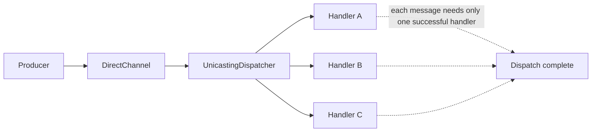
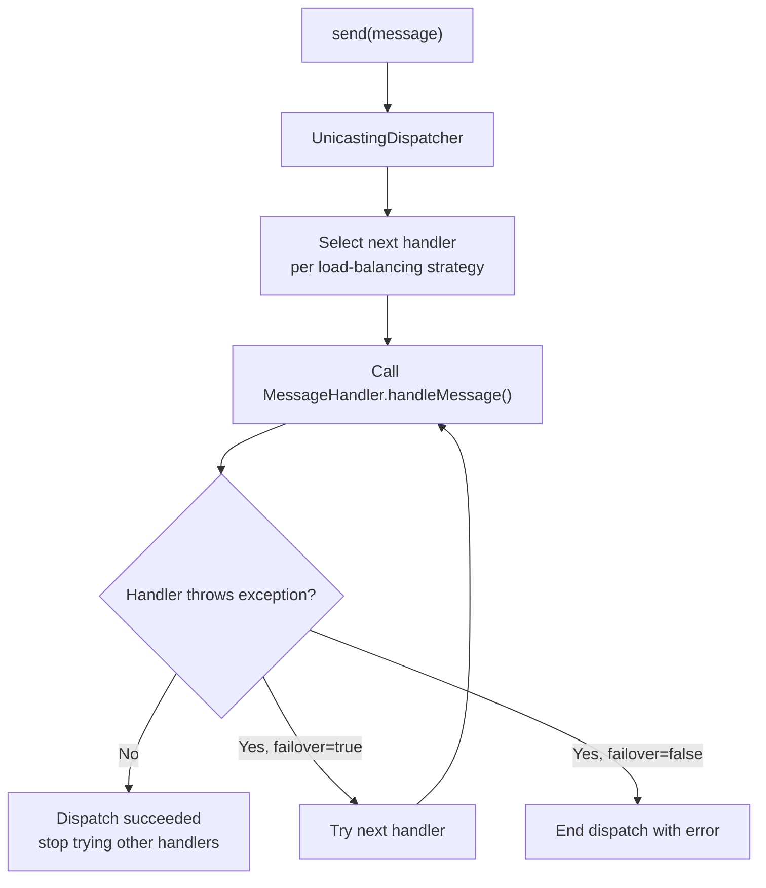
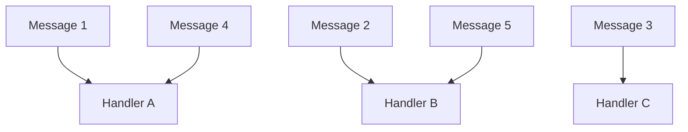

# UnicastingDispatcher with a Single Selected Handler

`UnicastingDispatcher` is Spring Integration's point-to-point dispatcher. When a channel has multiple registered `MessageHandler` instances, the dispatcher chooses the order in which handlers are tried and stops as soon as one handler processes the message successfully. Each message is therefore delivered to at most one successful handler, rather than being broadcast to all subscribers.

In a standard configuration, `DirectChannel` uses `UnicastingDispatcher` with round-robin load balancing and failover enabled. Consecutive messages are distributed in rotation among registered handlers. If the selected handler throws an exception, the dispatcher can try the next handler according to the strategy order. This is consumer selection and failover within the same dispatch attempt; it is not a retry of the same handler.

This article explains how the dispatcher selects a handler, how round-robin and failover interact, when to use multiple subscribers on one channel, and how to diagnose which handler processed a message.

## 1. Where Does UnicastingDispatcher Fit in the Message Flow?

`MessageChannel` is the connection point between producer and consumer. For a subscribable channel, endpoints register a `MessageHandler` as a subscriber. When a producer sends a message, the channel delegates the dispatch request to the message dispatcher.

For point-to-point channels such as `DirectChannel` and `ExecutorChannel`, the dispatcher is typically `UnicastingDispatcher`. It manages the set of registered handlers and selects one handler to process each message.



Each component has a distinct responsibility:

| Component | Role |
|---|---|
| Producer | Creates and sends the message to the channel |
| `DirectChannel` | Provides the point-to-point dispatch point and manages subscriptions |
| `UnicastingDispatcher` | Determines the handler trial order and dispatches the message |
| `LoadBalancingStrategy` | Determines the order in which handlers are tried, e.g., round-robin |
| `MessageHandler` | Executes business logic on the message |
| `failover` | Determines whether the dispatcher tries the next handler when the current handler throws an exception |

`UnicastingDispatcher` is an internal implementation in the dispatch pipeline. In applications, this behavior is normally configured through channels such as `DirectChannel` or `ExecutorChannel`, rather than instantiating the dispatcher directly.

## 2. How Is a Message Delivered to One Handler?

Suppose three endpoints are subscribed to the `orders.input` channel. When a producer sends a message, the dispatcher retrieves the subscriber list, applies the load-balancing strategy if configured, and tries handlers in the determined order.

When a handler processes the message without throwing an exception, the dispatcher treats the dispatch as successful and skips the remaining handlers. If the handler throws an exception and failover is enabled, the dispatcher can continue trying the next handler.



Understand the phrase "one selected handler" precisely:

- In the normal success case, only one handler is successfully invoked for that message.
- When the first handler throws an exception and failover is enabled, multiple handlers may be tried sequentially for the same message.
- When all handlers throw exceptions, dispatch fails.
- When the channel has no registered handlers, the dispatcher has no target to deliver the message to.

The Javadoc describes `UnicastingDispatcher` as attempting to send a message to at most one successful handler. If there are no handlers, it throws `MessageDispatchingException`; if all handlers throw exceptions, it throws `AggregateMessageDeliveryException`.

## 3. Round-Robin Load Balancing

### 3.1. How It Works

Round-robin rotates the starting point across registered handlers. If there are three handlers A, B, and C and all process successfully, a sequential series of sends can be distributed as follows:



This is turn-based distribution, not an actual load-measurement mechanism. Round-robin does not know whether handler A is idle or busy with a long-running message; nor does it adjust to CPU usage, latency, or queued work.

In Spring Integration, `DirectChannel` uses round-robin load balancing and enables failover by default. This mechanism matters when multiple handlers subscribe to the same channel. If there is only one subscriber, there are no other handlers to alternate across.

### 3.2. Example: Two Flows Subscribing to One DirectChannel

Channel declaration:

```java
@Configuration
@EnableIntegration
public class DispatchConfiguration {

    @Bean
    public MessageChannel ordersInput() {
        return new DirectChannel();
    }

    @Bean
    public IntegrationFlow localOrdersFlow(
            LocalOrderHandler handler) {
        return IntegrationFlow.from("ordersInput")
                .handle(handler, "handle")
                .get();
    }

    @Bean
    public IntegrationFlow remoteOrdersFlow(
            RemoteOrderHandler handler) {
        return IntegrationFlow.from("ordersInput")
                .handle(handler, "handle")
                .get();
    }
}
```

Both flows reference the `ordersInput` channel, so two endpoints register handlers on the same `DirectChannel`. With the default configuration, the dispatcher distributes messages in round-robin order when both handlers are available.

Producer:

```java
@Component
public class OrderPublisher {

    private final MessageChannel ordersInput;

    public OrderPublisher(
            @Qualifier("ordersInput") MessageChannel ordersInput) {
        this.ordersInput = ordersInput;
    }

    public void publish(Order order) {
        ordersInput.send(new GenericMessage<>(order));
    }
}
```

This pattern fits when the two handlers are interchangeable workers: each message needs only one worker to handle it. If `LocalOrderHandler` and `RemoteOrderHandler` perform two independent business operations that must both run, using a single `DirectChannel` with unicasting is the wrong model; use broadcasting or split into two flow branches instead.

### 3.3. Round-Robin Does Not Guarantee Equal Processing Time

If A processes a message in 5 ms while B takes 2 seconds, round-robin still distributes by turn rather than processing speed. Depending on the channel and threading model, a slow handler can slow down the producer or occupy a worker thread in an executor.

Do not assume that round-robin means:

- Handlers always have the same number of in-flight messages.
- Handlers have the same wait times.
- Each handler finishes one message before receiving the next.
- Messages are processed in global order.
- Load is distributed according to CPU or actual capacity.

If you need capacity-based load balancing, key-based affinity, or per-worker concurrency limits, design an appropriate strategy, partition, or queue. Round-robin is simply a basic ordering policy.

## 4. Failover When a Handler Throws an Exception

### 4.1. What Does Failover Do?

The `failover` property controls whether the dispatcher keeps trying other handlers when one handler throws an exception. The default on `UnicastingDispatcher` is `true`.

For example, with three handlers A, B, and C:

1. The dispatcher selects A.
2. A throws an exception.
3. If failover is enabled, the dispatcher tries the next handler in the order determined by the strategy and registration order.
4. If B succeeds, dispatch ends and C is not invoked.
5. If B also throws an exception, the dispatcher can try C.
6. If all fail, the dispatcher throws `AggregateMessageDeliveryException`.

Failover does not re-run A. It moves to another handler in the channel's subscriber set.

### 4.2. Failover Is Not Business Retry

This is a critical point when designing multiple interchangeable handlers.

Suppose handler A performs the following steps:

1. Writes a record to the database.
2. Calls a payment service.
3. Throws an exception while writing the audit log.

If failover is enabled, the dispatcher can hand the same message to handler B. Handler B may write the record again and call the payment service again. As a result, partial side effects already executed in A can be duplicated in B.

Therefore, only enable failover when handlers are interchangeable and the business logic can tolerate trying another handler after an error. If a handler has side effects, you need transactions, an idempotency key, or a mechanism that clearly tracks which steps completed.

Do not use failover as a substitute for:

- Retrying the same handler with backoff.
- Broker redelivery after an unacknowledged message.
- A dead-letter queue.
- A circuit breaker.
- A router selecting a handler based on payload or business state.

### 4.3. Disabling Failover

If you want an error in the selected handler to fail immediately, you can disable failover:

```java
@Bean
public MessageChannel failFastOrders() {
    DirectChannel channel = new DirectChannel();
    channel.setFailover(false);
    return channel;
}
```

Then, if the selected handler throws an exception, the dispatcher does not try the remaining subscribers. This is appropriate when each message must be handled strictly by the chosen worker and errors should be handed off to an error handling or retry policy at another layer.

### 4.4. Distinguishing Failover from Fixed-Order Fallback

There are two independent decisions:

- Load balancing decides which handler is tried first.
- Failover decides whether to try the next handler when the current handler throws an exception.

If you want to always try primary first, then secondary, then tertiary in a fixed order, you can disable load balancing and keep failover enabled. Without a load-balancing strategy, the dispatcher starts from the first handler according to configured endpoint ordering; ordering can be based on the `order` attribute or subscription order.

XML example:

```xml
<int:channel id="primaryThenBackup">
    <int:dispatcher load-balancer="none" failover="true"/>
</int:channel>
```

On the other hand, if you want round-robin distribution without falling back on error:

```xml
<int:channel id="roundRobinFailFast">
    <int:dispatcher load-balancer="round-robin" failover="false"/>
</int:channel>
```

The two configurations solve different goals. Choose based on business semantics, not merely the desire to "have multiple handlers."

## 5. Choosing a Load-Balancing Strategy

Spring Integration provides standard options for a channel's dispatcher:

| Strategy | Handler Selection | When Appropriate |
|---|---|---|
| `round-robin` | Rotates across subscribers | Workers have equivalent roles |
| `none` | No load balancing; starts in handler order | Primary/backup or fixed ordering |
| Custom `LoadBalancingStrategy` | Application determines trial order | Affinity, custom policy, or metadata-based selection needed |

`round-robin` and `none` are built-in namespace configuration values. Since Spring Integration 3.0, you can provide a custom `LoadBalancingStrategy` implementation via `load-balancer-ref`.

XML configuration example with a custom strategy:

```xml
<int:channel id="customDispatch">
    <int:dispatcher load-balancer-ref="customLoadBalancer"/>
</int:channel>

<bean id="customLoadBalancer"
      class="com.example.integration.CustomLoadBalancingStrategy"/>
```

The strategy name must point to a bean implementing `LoadBalancingStrategy`. The strategy must determine the order in which handlers are tried for a message. If multiple threads send messages concurrently, the implementation must also be concurrency-safe.

Do not use a custom strategy to replace a router when target selection depends on the message's business content. A router expresses routing decisions explicitly and is easier to observe.

## 6. Exception-Based Failover Strategy in Newer Versions

Since Spring Integration 6.3, channels based on `UnicastingDispatcher` can use a `Predicate<Exception>` as a failover strategy instead of a simple boolean flag.

This lets the application decide which exceptions permit trying the next handler:

- Transient worker errors may permit failover.
- Validation or invalid-data errors probably should not move to another worker.
- Business errors that cannot be resolved by an alternate handler should go to the error flow.

The Spring Integration 6.5 Javadoc describes `setFailoverStrategy(Predicate<Exception>)`; this property replaces `setFailover(boolean)`, so configure only one of the two mechanisms.

For complex error analysis logic, the Spring Integration documentation recommends considering `ErrorMessageExceptionTypeRouter`. Putting too much business logic into the failover predicate makes dispatcher behavior hard to understand and test.

## 7. How Does Unicasting Differ from Broadcast and Routing?

The three mechanisms serve different purposes:

| Mechanism | Decision | Result |
|---|---|---|
| `UnicastingDispatcher` | Selects one subscriber according to strategy | One successful handler per message |
| `PublishSubscribeChannel` | Sends to all subscribers | Multiple handlers receive the same message |
| Router | Inspects content/headers/state to select the target channel | Message is forwarded to the matching channel |

### 7.1. When One Worker Should Process Each Message

Use `DirectChannel` or `ExecutorChannel` with multiple subscribers if the subscribers are interchangeable workers. The dispatcher selects one handler; round-robin can distribute work by turn.

### 7.2. When Every Subscriber Must Receive the Message

Use `PublishSubscribeChannel` if the message is an event notification that multiple components need to handle, such as sending an email, writing an audit log, and updating a projection. Each subscriber has an independent responsibility; failover is not a replacement for broadcast.

### 7.3. When the Destination Depends on Message Content

Use a router if a domestic order must go to a domestic handler and an international order must go to an international handler. The dispatcher does not inspect the payload to understand business meaning; it only selects from the subscriber set of the same channel according to the load-balancing strategy.

Router example:

```java
@Bean
public IntegrationFlow orderRouter() {
    return IntegrationFlow.from("orders.input")
            .<Order, String>route(
                    order -> order.isInternational()
                            ? "international"
                            : "domestic",
                    mapping -> mapping
                            .channelMapping("international", "internationalOrders")
                            .channelMapping("domestic", "domesticOrders"))
            .get();
}
```

In this case, the routing decision is based on the payload. Once the message arrives at the target channel, that channel can still have its own dispatcher to select a consumer.

## 8. DirectChannel and ExecutorChannel Share Dispatch Style but Differ in Threading

Both `DirectChannel` and `ExecutorChannel` use point-to-point semantics and support load balancing/failover. The major difference is how dispatching is executed.

| Property | DirectChannel | ExecutorChannel |
|---|---|---|
| Dispatcher | UnicastingDispatcher | UnicastingDispatcher |
| Subscriber selection | One handler per strategy | One handler per strategy |
| Handler thread | Usually the sending thread | Thread used by the executor |
| Producer waits for handler | Usually yes | Usually no, unless the executor applies CallerRuns or throttling |
| Transaction between sender and handler | Can share thread/transaction | Does not share the sender's thread-bound transaction |
| Exception from handler | Can propagate to the sender | Post-dispatch errors typically occur on a worker thread |
| Failover | Yes | Yes; async errors must be observed on the worker side |

If `ExecutorChannel` uses an executor, task submission can succeed even if the handler fails later. Therefore, the `send()` outcome does not prove that downstream business logic succeeded.

## 9. Observing Which Handler Received a Message

When multiple endpoints subscribe to the same channel, debugging requires knowing which handler was selected for each message. You can log the handler name, message ID, and correlation ID right at the start of the handler.

```java
@Component
public class LocalOrderHandler {

    private static final Logger log =
            LoggerFactory.getLogger(LocalOrderHandler.class);

    public void handle(Message<Order> message) {
        log.info(
                "handler=local, messageId={}, orderId={}",
                message.getHeaders().getId(),
                message.getPayload().id());

        // Process the order.
    }
}
```

Alternate handler:

```java
@Component
public class RemoteOrderHandler {

    private static final Logger log =
            LoggerFactory.getLogger(RemoteOrderHandler.class);

    public void handle(Message<Order> message) {
        log.info(
                "handler=remote, messageId={}, orderId={}",
                message.getHeaders().getId(),
                message.getPayload().id());

        // Process the order.
    }
}
```

You can also track:

- Number of messages received by each handler.
- Number of exceptions per handler.
- Number of failover occurrences.
- Processing time per handler.
- Rate of messages failing after all handlers have been tried.
- Thread name if the channel uses an executor.
- Message ID and correlation ID to trace the same message across steps.

Do not only count total messages sent to the channel. When there are multiple subscribers, the total sent count does not tell you how many messages each handler received or how many failovers occurred.

## 10. Common Pitfalls When Using UnicastingDispatcher

| Symptom | Possible Cause | How to Check |
|---|---|---|
| Only one of two handlers runs | Normal unicasting semantics | Verify whether broadcast is needed instead |
| Messages always go to one handler | Only one subscriber, strategy disabled, or subscription failed | Check subscriber count and load-balancer |
| Another handler is invoked after the first fails | Failover is enabled | Check the exception and failover configuration |
| Side effects are duplicated | First handler executed partially then threw an exception, dispatcher switched to another handler | Check idempotency and transactions |
| No handler receives messages | No subscribers or endpoints have not started | Check channel and endpoint lifecycle |
| All handlers fail | Every handler in the dispatch attempt threw an exception | Check AggregateMessageDeliveryException and error flow |
| Uneven distribution by processing time | Round-robin is not load-aware balancing | Measure latency and consider a suitable strategy |
| Producer does not see handler exception | Channel uses an executor, handler failed after submission | Check error channel and worker logs |
| Message reaches wrong business handler | Using dispatcher to handle payload-based routing | Use a router to select the target channel |

### 10.1. Checking Subscriber Count

For a channel with multiple subscribers, you can check the handler count through the channel management API appropriate to the implementation or inspect registered endpoints in the application context. For deeper diagnostics, log endpoint start/stop events and assign explicit IDs to each endpoint.

### 10.2. When All Handlers Fail

If all handlers throw exceptions, the dispatcher raises `AggregateMessageDeliveryException`. In that case, inspect the component exceptions to see which handlers were tried and the cause of each error. If failover is disabled, an error from the selected handler terminates the dispatch attempt sooner.

With a synchronous channel, the exception may surface on the sending thread. With `ExecutorChannel`, a handler may fail after the producer received a successful submission result; worker-side error handling is required.

## 11. Design Principles

- Use unicasting when each message only needs one worker to process it.
- Use round-robin when subscribers have equivalent responsibilities and are interchangeable.
- Only enable failover if the next handler can safely process the same message after the previous handler fails.
- Design for idempotency when handlers have side effects or can fail mid-execution.
- Use fixed-order fallback for primary/backup patterns.
- Disable failover when an error in the selected handler must terminate dispatch immediately.
- Use PublishSubscribeChannel when every subscriber must receive the message.
- Use a router when the destination depends on business payload or headers.
- Do not treat round-robin as load balancing based on latency or worker capacity.
- With ExecutorChannel, monitor errors on worker threads and do not infer business success solely from the `send` result.
- Assign endpoint IDs and log message ID/correlation ID to trace which handler received a message.

## 12. Key Takeaways

`UnicastingDispatcher` chooses the handler trial order and dispatches a message to one successful handler. `DirectChannel` defaults to round-robin load balancing with failover enabled. Round-robin rotates through subscribers; failover tries the next handler if the current handler throws an exception.

The two properties solve different problems: load balancing chooses who is tried first, and failover decides whether to continue when a handler fails. Failover is not retrying the same handler and can cause duplicate side effects if handlers are not truly interchangeable.

If you need one worker to process each message, unicasting fits. If all subscribers must receive it, use publish-subscribe. If you select targets based on message content, use a router.

## References

- [Spring Integration — Message Channel Implementations](https://docs.spring.io/spring-integration/reference/channel/implementations.html)
- [Spring Integration — Configuring Message Channels](https://docs.spring.io/spring-integration/reference/channel/configuration.html)
- [Javadoc — UnicastingDispatcher (Spring Integration 6.5)](https://www.springframework.org/spring-integration/docs/6.5.0/api/org/springframework/integration/dispatcher/UnicastingDispatcher.html)
- [Javadoc — LoadBalancingStrategy](https://docs.spring.io/spring-integration/api/org/springframework/integration/dispatcher/LoadBalancingStrategy.html)
