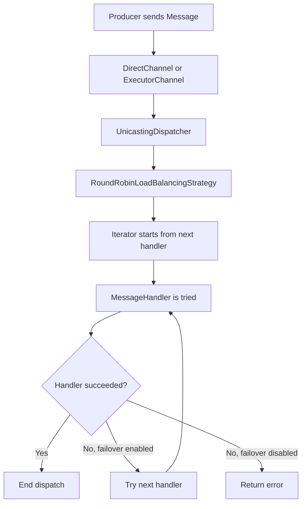

# RoundRobinLoadBalancingStrategy

In Spring Integration, a `SubscribableChannel` can have multiple `MessageHandler` instances subscribed to receive messages. For point-to-point channels such as `DirectChannel` or `ExecutorChannel`, the dispatcher must decide which handler is tried first on each send. `RoundRobinLoadBalancingStrategy` makes that decision by rotating the starting point across the handler list.

This strategy fits when multiple consumers can handle the same type of work and each message only needs one consumer to process it successfully. It is part of the message flow dispatching mechanism: endpoints register handlers on the channel, the dispatcher selects a handler, and execution then runs on the sending thread or an executor depending on the channel type. It does not create a poller, queue, thread pool, or message persistence mechanism.

## 1. Where Round-Robin Sits in the Dispatch Process

`RoundRobinLoadBalancingStrategy` implements the `LoadBalancingStrategy` interface in the `org.springframework.integration.dispatcher` package. `UnicastingDispatcher` uses the strategy to construct the traversal order of registered handlers. On each dispatch, round-robin selects one handler as the new starting point; the remaining handlers follow in circular order.



The key point is that the dispatcher has *unicast* semantics: once a handler processes the message successfully, the remaining handlers are not invoked for that message. If the current handler throws an exception and failover is enabled, the dispatcher can try the next handler. Thus, in an error scenario, a single message may be attempted by multiple handlers before dispatch ends.

## 2. How Does the Algorithm Work?

Suppose a channel has three subscribers in the order `A`, `B`, `C`. When dispatches succeed on the first handler, the starting point rotates as follows:

| Send | First Handler Tried | Outcome When Handler Succeeds |
| ---: | --- | --- |
| 1 | A | A processes message 1 |
| 2 | B | B processes message 2 |
| 3 | C | C processes message 3 |
| 4 | A | A processes message 4 |
| 5 | B | B processes message 5 |
| 6 | C | C processes message 6 |
| 7 | A | A processes message 7 |

After the last handler, the loop wraps back to the first handler. The Javadoc describes this strategy as maintaining the index of the first handler to try and using a different starting point on each dispatch. The iterator yields the remainder of the collection and then wraps around to the beginning, so each handler appears at most once in a single traversal.

For example, if the next send starts at `B`, the iterator order is `B → C → A`. If `B` succeeds, the dispatcher stops there. `C` and `A` do not receive that message.

Round-robin only rotates the starting point in the handler trial order. It does not measure processing time, CPU usage, pending task count, queue depth, or consumer health. Nor does it inspect the payload to keep messages with the same `orderId` pinned to a specific consumer.

## 3. Which Channels Use This Strategy?

| Component | Role of Round-Robin | Execution Semantics |
| --- | --- | --- |
| `DirectChannel` | Selects the starting handler among subscribers | Invokes the handler on the sending thread; synchronous with the `send()` call |
| `ExecutorChannel` | Uses the same dispatcher type and handler distribution strategy | Hands execution off to a `TaskExecutor`; handlers can run on worker threads |
| `PublishSubscribeChannel` | Does not use unicast round-robin to pick one handler | Broadcasts the message to all subscribers |
| `QueueChannel` | Does not use a round-robin dispatcher to distribute to subscribers | Stores messages in a queue; consumers/pollers fetch messages via `receive()` |

`DirectChannel` is created by default with `RoundRobinLoadBalancingStrategy` and failover enabled. `ExecutorChannel` supports the same dispatcher configuration. Load balancing and failover only matter when more than one `MessageHandler` is subscribed to the channel. If there is only one subscriber, there is nothing to rotate across.

Do not confuse round-robin with broadcast. If three subscribers need to receive the same event, use `PublishSubscribeChannel`. If three consumers need to compete for buffered messages, use a queue-backed channel and configure a poller. Round-robin on `DirectChannel`/`ExecutorChannel` is a handler-selection mechanism for point-to-point dispatch.

## 4. Default Configuration and Explicit Configuration

### Java configuration

You can use the default `DirectChannel` constructor; the round-robin strategy is already configured:

```java
@Bean
DirectChannel ordersChannel() {
    return new DirectChannel();
}
```

If you want to make the intent explicit in configuration, you can pass the strategy directly:

```java
@Bean
DirectChannel ordersChannel() {
    return new DirectChannel(new RoundRobinLoadBalancingStrategy());
}
```

To configure multiple endpoints receiving input from the same channel, have them share the input channel name. Minimal example:

```java
@Bean
IntegrationFlow workerA() {
    return IntegrationFlow.from("ordersChannel")
            .handle((String payload, MessageHeaders headers) -> {
                System.out.println("worker-A: " + payload);
                return null;
            })
            .get();
}

@Bean
IntegrationFlow workerB() {
    return IntegrationFlow.from("ordersChannel")
            .handle((String payload, MessageHeaders headers) -> {
                System.out.println("worker-B: " + payload);
                return null;
            })
            .get();
}
```

The two flows register two handlers on the same channel. When each handler succeeds, messages are distributed alternately between `worker-A` and `worker-B`. In real applications, inject a dedicated service into each flow rather than placing all business logic inside a lambda.

### XML configuration

You can declare the strategy and failover directly inside the `dispatcher` element:

```xml
<int:channel id="ordersChannel">
    <int:dispatcher load-balancer="round-robin" failover="true"/>
</int:channel>
```

`round-robin` is the default value, so you can omit the `load-balancer` attribute unless you want to emphasize the setting. `load-balancer` and `load-balancer-ref` are mutually exclusive: use a built-in value or reference a custom bean.

## 5. Round-Robin Combined with Failover

`failover` determines whether the dispatcher keeps trying the next handler when the current handler throws an exception. By default, failover is enabled.

Suppose a channel has three handlers `A`, `B`, `C`:

- The first dispatch starts at `A`.
- `A` throws an exception.
- If failover is enabled, the dispatcher continues trying `B` and then `C` according to the current iterator, stopping when one handler succeeds.
- If all handlers fail, the dispatcher throws `AggregateMessageDeliveryException` containing the errors raised during dispatch.

Example disabling failover in Java:

```java
@Bean
DirectChannel failFastChannel() {
    DirectChannel channel = new DirectChannel();
    channel.setFailover(false);
    return channel;
}
```

Or XML configuration:

```xml
<int:channel id="failFastChannel">
    <int:dispatcher failover="false"/>
</int:channel>
```

Disabling failover means the dispatcher does not move to another handler when the attempted handler throws an exception. It does not retry the message, place it in a queue, or persist it for later processing.

### Why Can Failover Create Duplicate Side Effects?

Suppose `A` has already written a record to the database or called an external API, and then throws an exception because a subsequent step failed. With failover enabled, `B` can receive the same message and repeat the side effect. The dispatcher has no way of knowing how far `A` progressed.

Therefore, only enable failover when handlers in the group are genuinely interchangeable alternatives capable of processing the same message type. If they update the same business entity, ensure the operation is idempotent, use a unique key on `messageId`/`eventId`, or design transactions to prevent duplicate data. Do not treat failover as business retry with backoff or dead-letter handling.

With `DirectChannel`, handlers run synchronously on the sending thread; exceptions can directly affect the outcome of the `send()` call. With `ExecutorChannel`, handlers execute via an executor, so the send call can typically complete once the task is submitted, before the handler finishes. Consequently, errors on the worker thread are not necessarily thrown back to the producer; you must configure and monitor error handling for the executor and integration flow accordingly.

## 6. How Does Subscriber Order Affect Behavior?

Round-robin cycles over the handler collection managed by the dispatcher. Subscriber order is determined by the `order` attribute if declared on the endpoint; otherwise, subscription registration order is used. Thus, this order determines which handler is the initial starting point and the subsequent failover sequence.

If business requirements dictate that a primary handler is always tried first, followed by backup handlers in a fixed order, disable load balancing. Example:

```java
@Bean
DirectChannel primaryBackupChannel() {
    // No LoadBalancingStrategy: always start at the first subscriber.
    // Failover remains enabled by default to try the next subscriber if the handler fails.
    return new DirectChannel(null);
}
```

In XML, use `load-balancer="none"`:

```xml
<int:channel id="primaryBackupChannel">
    <int:dispatcher load-balancer="none" failover="true"/>
</int:channel>
```

When there is no strategy, the dispatcher always starts at the first handler in subscriber order. Failover can still proceed to the second and third handlers if the preceding handler throws an exception. This expresses a primary/secondary model much more clearly than round-robin.

## 7. Limitations When Evaluating Fairness and Concurrency

Round-robin generally distributes first-attempt counts fairly evenly when handlers always succeed and the subscriber set does not change. However, equal first-selection counts do not mean actual processing load is balanced:

- **Different processing times:** one handler processes a message in 5 ms while another takes 500 ms. Rotating by message count can still overload the slower handler.
- **Different message costs:** one message may be cheap while the next calls multiple services. The strategy does not balance by CPU or estimated cost.
- **Failover:** when the first handler fails, the next handler can process the message. Successful execution counts can therefore diverge from first-selection counts.
- **Multiple producer threads:** each dispatch can pick a different starting point, yet handlers can still be invoked concurrently. Round-robin does not enforce a global sequential queue.
- **Multiple application instances:** each instance has its own channel and dispatcher. The rotation counter is not a shared coordinator across JVMs or hosts.

With `DirectChannel`, synchronous execution on the sending thread does not mean only one thread runs a handler. If multiple producers call `send()` concurrently, the same handler can be invoked concurrently on those threads. A handler with shared mutable state still requires proper synchronization.

With `ExecutorChannel`, round-robin decides which handler gets the message, while `TaskExecutor` decides how the task runs. Pool size, queue capacity, and rejection policy affect work intake. The strategy does not observe those metrics to self-adjust.

If you need to preserve ordering by `correlationId` or `orderId`, use key-based partitioning or an appropriate serialization mechanism. Round-robin does not guarantee that two messages with the same key go to the same handler. If you need load balancing based on actual load, consider a custom strategy relying on safely accessible load metrics, or delegate coordination to a queue/broker platform with appropriate consumer group semantics.

## 8. Customizing LoadBalancingStrategy

`LoadBalancingStrategy` is the interface used to determine the traversal order of `MessageHandler` instances. Its main method is:

```java
Iterator<MessageHandler> getHandlerIterator(
        Message<?> message,
        Collection<MessageHandler> handlers);
```

A custom implementation can build the iterator based on headers, message type, or custom policies. You can pass the implementation to the `DirectChannel` constructor, or declare it as a bean and reference it via `load-balancer-ref` in XML.

```xml
<int:channel id="customChannel">
    <int:dispatcher load-balancer-ref="customStrategy"/>
</int:channel>

<bean id="customStrategy" class="example.CustomLoadBalancingStrategy"/>
```

The strategy is typically used across many dispatches on the same channel. If the implementation holds state, make state updates thread-safe under concurrent sends. Also ensure the iterator only returns handlers still present in the collection supplied by the dispatcher and does not accidentally loop infinitely.

Do not write a custom strategy merely to change ordering according to a rule already handled by `order`, `load-balancer="none"`, or default round-robin. Every custom policy adds logic that must be tested when subscribers are added, removed, or run across multiple instances.

## 9. Testing and Runtime Diagnostics

When verifying round-robin, test both successful distribution and behavior when handlers fail.

**Basic distribution test:** register three handlers `A`, `B`, `C`, send a number of messages divisible by three, and count how many times each handler succeeds. With no exceptions and an unchanged subscriber list, the counts should be equal. For message counts not divisible by the number of handlers, the difference in first-attempt counts is at most one.

**Failover test:** make the first handler throw a controlled exception and verify that the next handler is tried when failover is enabled. Repeat with failover disabled to confirm the dispatcher stops on the first error. Add a case where the handler produces a side effect before throwing an exception to verify business idempotency.

**Per-message and per-handler logging:** log `messageId`, endpoint/handler name, `Thread.currentThread().getName()`, start time, completion time, and exceptions. Logs distinguish the initially selected handler from a handler invoked only via failover.

**Check subscriber configuration:** verify that endpoints actually share the same channel, the subscriber count is greater than one, `order`/registration order matches expectations, and no flow is using a different channel due to a misspelled name.

**Check the executor:** if using `ExecutorChannel`, monitor active threads, queue depth, rejected tasks, and the error flow. If logs show messages dispatched in rotation but completion times diverge sharply, analyze per-handler processing times and capacity instead of blindly changing round-robin.

### Scenario Exercise

A `DirectChannel` has three subscribers `A`, `B`, `C` in exact registration order. Send six consecutive messages. Initially all three handlers succeed.

1. Record which handler is tried first for each message.
2. Have `B` throw an exception the next time it is tried first. Keep `failover=true` and record which handler is tried next for that same message.
3. Disable failover, rerun the scenario, and compare the outcomes.
4. Have `B` write a record before throwing an exception. Determine how to prevent the side effect from being repeated by the backup handler.
5. Run multiple producer threads sending messages concurrently. Inspect the logs and explain why completion order does not necessarily match send order.

## 10. When Should You Use RoundRobinLoadBalancingStrategy?

Use it when multiple handlers have equivalent processing capabilities, each message needs only one handler to succeed, and rotating selection turns is sufficient for distribution goals. It is a sensible default for many `DirectChannel` setups with multiple subscribers performing the same type of independent work.

Choose another approach if your requirements call for broadcast, message buffering, key-based ordering, load-aware handler selection, or an explicit primary/backup setup. Round-robin answers one narrow question: *which handler is tried first on this dispatch?* Requirements around concurrency, transactions, retries, idempotency, business ordering, and runtime observability still must be designed separately.

## References

- [Spring Integration Reference — Configuring Message Channels](https://docs.spring.io/spring-integration/reference/channel/configuration.html): configuring `DirectChannel`, `ExecutorChannel`, round-robin, and failover.
- [Spring Integration Reference — Message Channel Implementations](https://docs.spring.io/spring-integration/reference/channel/implementations.html): point-to-point, broadcast, threading, and dispatcher semantics.
- [RoundRobinLoadBalancingStrategy Javadoc](https://docs.spring.io/spring-integration/docs/latest-ga/api/org/springframework/integration/dispatcher/RoundRobinLoadBalancingStrategy.html): description of the strategy and `getHandlerIterator`.
- [UnicastingDispatcher Javadoc](https://docs.spring.io/spring-integration/docs/latest-ga/api/org/springframework/integration/dispatcher/UnicastingDispatcher.html): handler dispatching and failover configuration.
