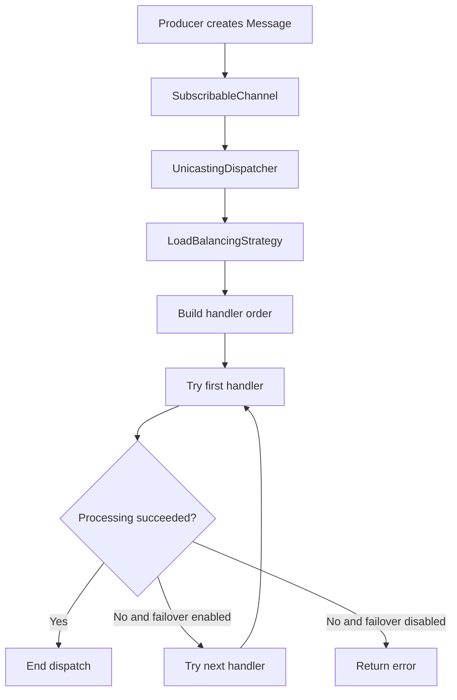

# Load Balancing Keys and Handler Ordering

When a `SubscribableChannel` has multiple registered handlers, the dispatcher must determine which handler is tried to process a message. In Spring Integration, `LoadBalancingStrategy` decides the trial order of those handlers. A *load balancing key* is data used by the application to make that distribution decision, typically placed in a message header such as `customerId`, `accountId`, or `tenantId`.

Two concepts must be kept separate: **handler order** and **distribution key**. Handler order is the order in which handlers appear in the list managed by the dispatcher. The distribution key is message data used by the strategy to pick a starting point or processing order. Spring Integration provides round-robin as the default strategy for `DirectChannel`; if you need messages with the same key to go to the same handler first, the application can implement a custom `LoadBalancingStrategy`.

## 1. How Does the Dispatcher Select a Handler?

For point-to-point channels such as `DirectChannel` or `ExecutorChannel`, `UnicastingDispatcher` iterates through handlers using the iterator provided by `LoadBalancingStrategy`. The dispatcher sends a message to the first handler in the iterator. If that handler succeeds, dispatch ends. If the handler throws an exception and failover is enabled, the dispatcher can try the next handler in the iterator.



`PublishSubscribeChannel` has broadcast semantics and therefore does not use this unicast mechanism to pick a single handler. `QueueChannel` is a pollable channel; messages are pulled from the queue by consumers rather than distributed among subscribers by `UnicastingDispatcher`.

## 2. Handler Order and Load-Balancing Keys Are Different

Handler order defines the sequence in which the dispatcher can try consumers. It usually comes from subscriber registration order and the endpoint ordering generated by the Spring Integration configuration. If an endpoint supports the `order` attribute, that attribute can affect registration order. When you need to depend on this order, declare it explicitly and inspect the actual subscriber list; do not infer it solely from the order of `@Bean` methods in source code.

A load-balancing key is a piece of data on the message. Example:

```java
Message<OrderCommand> message = MessageBuilder
        .withPayload(command)
        .setHeader("customerId", command.customerId())
        .build();
```

`customerId` is not a special header that `DirectChannel` understands automatically. It only has meaning when the channel's `LoadBalancingStrategy` reads that header and applies the corresponding distribution policy. You can use `orderId`, `accountId`, `tenantId`, or another business key, provided the key has a stable value and is supplied consistently across every message needing the same policy.

Example with three handlers in order `[A, B, C]`:

| Message | Key | Starting Handler (example) |
| --- | --- | --- |
| M1 | `customer-17` | B |
| M2 | `customer-22` | A |
| M3 | `customer-17` | B |
| M4 | `customer-31` | C |
| M5 | `customer-22` | A |

With a hash-based strategy, the same key produces the same starting point if the handler list and its ordering do not change. This is key-based *affinity*: messages with the same key prefer the same handler. It does not mean the handler processes messages sequentially or runs only one message at a time.

## 3. Default Round-Robin Does Not Preserve Key Affinity

`DirectChannel` defaults to `RoundRobinLoadBalancingStrategy`. This strategy rotates the first handler tried on each dispatch rather than basing it on `customerId` or business headers.

Suppose there are three handlers `A`, `B`, `C`. Consecutive messages can be distributed as follows:

| Dispatch | Key | First Handler Tried |
| ---: | --- | --- |
| 1 | `customer-17` | A |
| 2 | `customer-22` | B |
| 3 | `customer-17` | C |
| 4 | `customer-31` | A |
| 5 | `customer-17` | B |

Messages for the same `customer-17` can start at different handlers. Round-robin fits when consumers are equivalent and messages are independent; it does not fit when state for a customer or aggregate needs to be processed at the same consumer.

If you need fixed-order primary/backup handling, disable load balancing so the dispatcher always starts at the first handler. If you need key-based affinity, provide a custom strategy. Do not confuse these two policies: round-robin distributes by send turn, whereas a key-based strategy distributes by message content.

## 4. Implementing a Key-Based Strategy

`LoadBalancingStrategy` receives the message along with the handler collection and returns an iterator determining the trial order. The following example uses the `customerId` header to pick a starting handler by hashing the key:

```java
import java.util.ArrayList;
import java.util.Collection;
import java.util.Iterator;
import java.util.List;

import org.springframework.integration.dispatcher.LoadBalancingStrategy;
import org.springframework.messaging.Message;
import org.springframework.messaging.MessageHandler;

public final class CustomerKeyLoadBalancingStrategy
        implements LoadBalancingStrategy {

    private static final String KEY_HEADER = "customerId";

    @Override
    public Iterator<MessageHandler> getHandlerIterator(
            Message<?> message,
            Collection<MessageHandler> handlers) {

        List<MessageHandler> orderedHandlers = new ArrayList<>(handlers);
        if (orderedHandlers.isEmpty()) {
            return List.<MessageHandler>of().iterator();
        }

        Object headerValue = message.getHeaders().get(KEY_HEADER);
        if (!(headerValue instanceof String customerId)
                || customerId.isBlank()) {
            throw new IllegalArgumentException(
                    "Missing valid customerId header for message distribution");
        }

        int start = Math.floorMod(customerId.hashCode(), orderedHandlers.size());
        List<MessageHandler> dispatchOrder = new ArrayList<>(orderedHandlers.size());

        for (int offset = 0; offset < orderedHandlers.size(); offset++) {
            int index = (start + offset) % orderedHandlers.size();
            dispatchOrder.add(orderedHandlers.get(index));
        }

        return dispatchOrder.iterator();
    }
}
```

The strategy creates a copy of the collection to build a circularly ordered iterator without modifying the handler list managed by the dispatcher. `Math.floorMod` ensures the starting index stays within valid bounds even when the hash is negative. The example uses `String.hashCode()` for illustration; in distributed systems, standardize key normalization and the hash algorithm across instances.

Registering the strategy on `DirectChannel`:

```java
@Bean
DirectChannel customerOrdersChannel() {
    return new DirectChannel(new CustomerKeyLoadBalancingStrategy());
}
```

Producers must always attach the same business key to messages requiring affinity:

```java
Message<OrderCommand> message = MessageBuilder
        .withPayload(command)
        .setHeader("customerId", command.customerId())
        .build();

customerOrdersChannel.send(message);
```

When the key is missing, the example deliberately rejects the message so contract violations are caught immediately. Another application might choose a default handler or fallback strategy, but this must be explicitly defined in the contract; never silently accept `null`, empty strings, or random values, because distribution results will become hard to diagnose.

## 5. Handler Order Also Determines Failover Order

The strategy does not only pick the first handler. It returns the entire sequence the dispatcher traverses if failover is needed. With collection `[A, B, C]` and the key selecting starting point `B`, the iterator is `[B, C, A]`.

When `failover=true`:

1. The dispatcher tries `B`.
2. If `B` succeeds, dispatch ends; `C` and `A` are not invoked.
3. If `B` throws an exception, the dispatcher tries `C`.
4. If `C` also fails, the dispatcher tries `A`.
5. If all fail, dispatch fails and an aggregate exception is thrown.

When `failover=false`, the dispatcher does not proceed to the next handler if the attempted handler raises an error. Choose failover based on business semantics. If handlers are equivalent alternatives and side effects are idempotent, failover can improve processing success rates. If each handler owns a key-partitioned slice of state, failover can break affinity and route a message to a handler that does not own that state.

In particular, a handler may have written data or called an external service before throwing an exception. The next handler does not know whether the earlier side effect already occurred. Therefore, use idempotency keys, unique constraints, or appropriate transactions to prevent duplicate processing.

## 6. Key-Based Affinity Does Not Guarantee Sequential Processing

If two messages with the same `customerId` are sent almost simultaneously, the strategy may select the same handler for both. However, that handler can still be invoked concurrently:

- With `DirectChannel`, multiple producer threads can call `send()` concurrently. The same handler can be called on multiple threads.
- With `ExecutorChannel`, dispatches can submit tasks to the executor and multiple worker threads can execute the same handler concurrently.
- If there are multiple application instances, each instance has its own dispatcher. The same key may select the same handler slot in each instance, but those are different handler objects.

Therefore, affinity only answers *which handler is preferred for a message with this key?* It does not answer *are messages with the same key processed sequentially?*

If sequential execution per key is required, combine routing with a serialization mechanism:

1. **Key-based partitioning:** map keys onto stable partitions; each partition has a consumer that processes sequentially.
2. **Per-key queue/executor:** place messages with the same key into the same sequential queue while allowing different keys to run in parallel.
3. **Broker partitions:** use the key as a partition key in a broker supporting partition ordering, where only one consumer in a group processes each partition sequentially per broker semantics.
4. **Storage locks or optimistic locking:** protect updates to shared data; optimistic locking detects conflicts, though it does not enforce message ordering by itself.

Do not slap `synchronized` onto the entire handler as a default fix. That can unnecessarily serialize all keys, hurt throughput, and only coordinates within a single JVM.

## 7. Impact When the Handler List Changes

A simple hash strategy uses the formula:

\[
index = hash(key) \bmod N
\]

Where `N` is the current number of handlers. This is easy to understand and distributes fairly evenly when keys are well-distributed. However, when the number of handlers changes from `N` to `N+1`, many keys can be mapped to different handlers. Changes in collection ordering can also alter mappings even when the handler count stays the same.

Practical consequences:

- Rolling deployments or scaling consumer counts can shift affinity.
- If handlers keep in-memory state, a key's message may arrive at a new handler while the state still sits in the old handler.
- If the key protects business ordering, changing mappings requires a drain or state-transfer plan.

For systems needing stable mappings as node counts change, consider consistent hashing or a fixed number of partitions. Consistent hashing reduces the number of keys remapped on membership changes, but still requires managing state migration and ensuring instances share the same membership view. When state is critical, keeping state in a shared store or using broker partitions is usually easier to operate than holding state solely in handler memory.

## 8. Choosing an Appropriate Key and Handler Order

A good key represents the exact scope that needs affinity. Choose `customerId` if all operations for a customer need the same handler; choose `accountId` if state is partitioned by account; choose `orderId` if only steps for the same order need grouping. A key that is too broad reduces parallelism; a key that is too narrow can let updates requiring serialization run on different handlers.

Criteria to consider:

| Criterion | Design Question |
| --- | --- |
| Stability | Does the key stay unchanged across retries, redeliveries, and restarts? |
| Business scope | Which messages strictly require the same handler or partition? |
| Distribution | Is there a hot key dominating total traffic? |
| Security | Does the key contain personal data or secrets? Should a tokenized value be used? |
| Handler lifecycle | When handlers are added/removed, how is key state handed over? |
| Failover | Can backup handlers safely process this key? |

Handler order should be declared intentionally. If using round-robin, order only dictates where rotation begins. If using a key-based strategy, collection order is an input to mapping keys to slots. If using primary/backup, collection order defines the primary handler and backup handlers.

Do not rely on bean declaration order or source-file ordering as a distribution contract. Configure ordering on the endpoint/channel using mechanisms supported by your Spring Integration version, and verify the actual subscriber list at application startup. When membership changes, treat it as a routing change that can affect key affinity.

## 9. Testing and Observing the Distribution Strategy

Unit-test the strategy first, then test dispatch behavior through the channel:

1. **Same key:** invoke the strategy repeatedly with the same key and same handler list; the first handler must be identical.
2. **Different keys:** verify multiple keys distribute across handlers; do not require small key sets to split with exact uniformity.
3. **Missing key:** verify the chosen policy, such as rejecting the message or using a defined fallback.
4. **Changed handler order/count:** verify how mappings shift and whether that matches the operational plan.
5. **Failover:** make the preferred handler throw an exception and verify the next handler in order; check idempotency if the first handler already produced side effects.
6. **Concurrency:** send multiple messages with the same key from multiple threads to prove the strategy alone does not guarantee sequential execution; if ordering is required, also test the actual queue/partition/lock.

Simple test example for the affinity property:

```java
@Test
void sameCustomerKeyStartsWithSameHandler() {
    MessageHandler handlerA = message -> { };
    MessageHandler handlerB = message -> { };
    MessageHandler handlerC = message -> { };
    List<MessageHandler> handlers = List.of(handlerA, handlerB, handlerC);

    CustomerKeyLoadBalancingStrategy strategy =
            new CustomerKeyLoadBalancingStrategy();

    Message<String> first = MessageBuilder.withPayload("order-1")
            .setHeader("customerId", "customer-17")
            .build();
    Message<String> second = MessageBuilder.withPayload("order-2")
            .setHeader("customerId", "customer-17")
            .build();

    assertSame(strategy.getHandlerIterator(first, handlers).next(),
            strategy.getHandlerIterator(second, handlers).next());
}
```

At runtime, record the channel, selected handler, masked or tokenized routing key, `messageId`, `correlationId`, thread name, and dispatch outcome. Track message counts per handler, processing duration, errors, retries, queue depth, and hot-key ratios. Avoid using raw keys as metric labels when cardinality is very high; log hashed keys or track top keys in a separate analytics system.

## 10. Policy Selection Process

1. Determine whether messages need the same handler, only the same partition, or are completely independent.
2. If messages are independent and consumers are equivalent, use the default round-robin.
3. If a primary handler and fixed backup order are needed, disable load balancing and configure subscriber order explicitly.
4. If affinity is needed, pick a stable business key and implement a `LoadBalancingStrategy` reading the key from a header.
5. If per-key sequentiality is needed, add queues/partitions/serialization; do not rely on affinity alone.
6. Define failover behavior, retries, idempotency, and membership changes before deployment.
7. Test mapping, concurrency, failures, and scale-out; monitor real distribution after release.

A load-balancing key helps the dispatcher choose handlers based on message context, while handler ordering governs trial and failover sequences. When these two pieces are designed alongside sequentiality, idempotency, and consumer lifecycle requirements, message distribution in Spring Integration becomes much easier to predict and operate.
