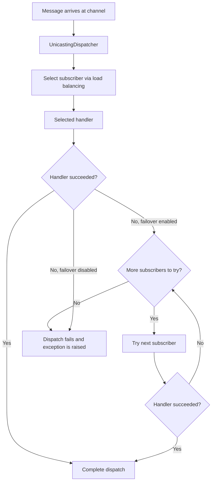

# Failover When a Handler Throws an Exception

In Spring Integration, certain channels use a unicast dispatcher to select a subscriber to process a message. When the selected handler throws an exception, the dispatcher can try the next subscriber if failover is enabled and another eligible subscriber exists. This mechanism gives a dispatch attempt a chance to succeed when one handler cannot process the message.

Dispatcher failover is a decision scoped to a single dispatch attempt. It is not retrying the same handler, does not automatically wait with backoff, does not guarantee exactly-once processing, and is not a failover mechanism across application instances. To use it safely, you must understand how the dispatcher selects handlers, which exceptions trigger failover, what happens when all handlers fail, and whether the first handler could have already produced side effects.

## 1. Unicast Dispatchers and Multiple Subscribers

`DirectChannel` and `ExecutorChannel` typically use `UnicastingDispatcher`. The dispatcher selects one subscriber from those registered on the channel. When there are multiple subscribers, the load-balancing strategy determines which subscriber is invoked first.

With `DirectChannel`, the handler runs synchronously on the sending thread. With `ExecutorChannel`, dispatching is handed off to a `TaskExecutor` and handlers run on worker threads. Both can have multiple subscribers, but their execution models and how exceptions return to the sender differ.



`PublishSubscribeChannel` has different semantics: it broadcasts the same message to multiple subscribers. The ignore-failures setting of the broadcast dispatcher is not unicast failover. Choose the channel based on intent: one subscriber processes one message, or multiple subscribers all receive the message.

## 2. How Does Failover Work?

With a unicast dispatcher, the general process is:

1. The dispatcher retrieves the list of registered subscribers.
2. The load-balancing strategy selects the starting subscriber.
3. The dispatcher invokes the handler with the message.
4. If the handler completes, the dispatch ends.
5. If the handler throws an exception and failover is permitted, the dispatcher tries the next subscriber.
6. This continues until one handler succeeds or no more subscribers remain to try.
7. If no handler processes it successfully, the dispatch fails and an exception is propagated according to the channel's execution model.

In standard configuration, failover on a unicast dispatcher is enabled by default. It can be disabled via the `failover` property on the channel. When disabled, an exception from the selected subscriber ends the dispatch immediately without trying other subscribers.

Failover does not create a new message. The dispatcher attempts to process the same message on another subscriber within the same dispatch. Accordingly, the message headers and payload are passed to the next handler as part of the message being dispatched.

## 3. Configuring Failover on DirectChannel

You can configure the channel bean directly:

```java
@Configuration
class DispatchConfiguration {

    @Bean
    DirectChannel ordersDispatch() {
        DirectChannel channel = new DirectChannel();
        channel.setFailover(true);
        return channel;
    }
}
```

`setFailover(true)` allows the dispatcher to try the next subscriber when the current handler throws an exception. Set `false` if each message may only go to the initially selected subscriber and errors must be returned immediately.

Example of two handlers subscribed to the same channel:

```java
@Component
class OrderHandlers {

    private final OrderService primaryService;
    private final OrderFallbackService secondaryService;

    OrderHandlers(OrderService primaryService,
                  OrderFallbackService secondaryService) {
        this.primaryService = primaryService;
        this.secondaryService = secondaryService;
    }

    @ServiceActivator(inputChannel = "ordersDispatch")
    public void primary(Order order) {
        primaryService.process(order);
    }

    @ServiceActivator(inputChannel = "ordersDispatch")
    public void secondary(Order order) {
        secondaryService.process(order);
    }
}
```

The two methods are two distinct subscribers. If the selected subscriber throws an exception and failover is enabled, the dispatcher can try the remaining subscriber. However, these two subscribers are treated as interchangeable handlers under the message contract; they do not automatically become a fixed-order primary/backup pair.

## 4. Load Balancing Does Not Mean Primary/Backup

When multiple subscribers subscribe to a `DirectChannel`, the default load-balancing strategy normally distributes messages in round-robin fashion. The first message may go to subscriber A, and the next message to subscriber B. Failover only governs trying another subscriber after the initial handler fails.

Example with two subscribers A and B:

| Send | First Selected Subscriber | If First Handler Fails and Failover Is Enabled |
|---|---|---|
| Message 1 | A | Try B |
| Message 2 | B | Try A |
| Message 3 | A | Try B |

Therefore, do not rely on bean registration order to establish "A is always primary, B is always backup." If you require always calling A first and then B, configure a load-balancing strategy appropriate for your version or model explicit fallback using a router or separate flow.

Another critical point: subscribers chosen to handle the same message type must share a compatible contract. If A and B perform different business actions, failover can send a message down a branch that makes no business sense.

## 5. Failover vs. Retry

Failover and retry can both cause an operation to be invoked multiple times, but their purposes differ:

| Mechanism | Target Retried | Timing | Purpose |
|---|---|---|---|
| Dispatcher failover | Another subscriber on the same channel | Immediately within the current dispatch | Find another handler capable of processing the message |
| Retry advice | The handler invocation or wrapped processing block | According to a retry policy, potentially with backoff | Retry an operation likely to succeed after a transient error |
| Broker redelivery | Message redelivered by the broker | According to acknowledgement and redelivery policy | Recover when a consumer fails to acknowledge successful processing |
| Circuit breaker | Calls to a failing dependency | According to circuit state | Prevent continued calls to an unhealthy dependency |

For example, a handler calls a payment API and hits a timeout. Dispatcher failover can forward the same message to another subscriber immediately. Retry advice can re-invoke the same handler after a wait interval. Broker redelivery can deliver the message again after the consumer fails to acknowledge. All three mechanisms can produce duplicate side effects if the business logic is not idempotent.

Failover has no built-in backoff or time-based retry limit. If all subscribers call the same failing API, failover only multiplies calls to that dependency and can worsen the incident.

## 6. What Happens When a Handler Produces Side Effects Before Failing?

This is the biggest risk of failover. Suppose handler A performs these steps:

1. Writes a record to the database.
2. Calls an external service to create a transaction.
3. Throws an exception while updating the final status.

The dispatcher sees the exception and may try handler B with the same message. If B re-executes the business logic, the record or transaction from A may be created a second time.

Failover cannot automatically roll back side effects from a handler that already ran. Nor does it know whether the handler failed before or after the external call succeeded. Therefore:

- Handlers should be idempotent by business key or idempotency key.
- Clearly identify commit points and which side effects could have occurred before an exception.
- Do not register multiple subscribers as interchangeable substitutes if they do not share the same contract and idempotency guarantees.
- Where possible, separate pre-checks from irreversible business side effects.
- Use transactions, outbox/inbox patterns, or deduplication mechanisms suited to the participating resources.

Failover fits best when handlers are interchangeable and a handler fails before creating irreversible side effects, or when side effects are already protected by idempotency.

## 7. Choosing Which Exceptions Trigger Failover

In basic configuration, failover is controlled by a boolean: enable to try the next subscriber when a handler throws an exception, or disable to stop immediately. Some Spring Integration versions additionally provide a failover strategy to decide based on the exception type.

If your application version supports `failoverStrategy`, you can distinguish transient errors from business or data errors. Conceptual policy examples:

| Error Type | Typical Consideration |
|---|---|
| Dependency temporarily unavailable | May try another handler if that handler uses an independent dependency or processing path |
| Malformed payload | Usually should not try another equivalent handler because the input data is still invalid |
| Business rule violation | Usually should return a business error or route to a dedicated handling branch |
| Unexpected programming bug | Must be surfaced; failover can mask bugs and repeat side effects |
| Error after partial side effects | Only fail over when idempotency or safe recovery exists |

Strategy configuration APIs vary across Spring Integration versions. Check the Javadoc and API for your application's version before using a specific strategy; do not assume every version exposes identical configuration methods.

## 8. Failover with ExecutorChannel

`ExecutorChannel` also uses unicast dispatch, but delegates dispatching work to a `TaskExecutor`. Consequently, the dispatcher can try the next subscriber on a worker thread if failover is enabled. The difference lies in where exceptions surface:

- If the executor rejects the task before running it, the error occurs on the sending path and can be observed by the caller immediately.
- If the task is accepted and the handler fails, the exception occurs on the worker thread.
- If failover tries subscribers and all fail, the final error belongs to the asynchronous execution path; the sender that already returned earlier will typically not receive the handler's exception.

With `ExecutorChannel`, you must configure error handling for the worker path. Do not wrap `send()` in a `try/catch` expecting to catch every handler exception. Use an error channel or appropriate endpoint/executor error handling, and log with message ID and correlation ID.

Failover also does not replace durable delivery. Executor queues typically live in process memory; pending tasks can be lost if the JVM exits abruptly. If persistence and redelivery are required, use a broker or store with appropriate semantics.

## 9. Distinguishing Failover from PublishSubscribeChannel

`PublishSubscribeChannel` sends the same message to multiple subscribers. That is broadcast, not unicast failover.

| Behavior | Unicasting Dispatcher | Broadcasting Dispatcher |
|---|---|---|
| Subscribers receiving message | One selected subscriber | All subscribers per configuration |
| When a handler fails | Can try the next subscriber if failover is enabled | Handled per broadcast error policy, e.g., stop or ignore failures |
| Meaning | One handler in the group is responsible for processing the message | Multiple subscribers are all interested in the message |
| Related mechanisms | `failover` | `ignoreFailures`, `minSubscribers`, and other broadcast settings |

Do not use publish-subscribe's `ignoreFailures` as if it were failover. Ignoring failures in broadcast means the dispatcher continues sending to other subscribers; it does not mean finding a replacement handler to take over for the failed one.

## 10. Exception Propagation on DirectChannel

`DirectChannel` dispatches synchronously. If failover is disabled or all tried subscribers throw exceptions, the exception propagates back to the sender along the call stack, typically as a message handling exception or the original exception wrapped by the framework.

This lets a synchronous caller decide to roll back a transaction, return an error to a gateway, or handle the exception at the flow invocation boundary. However, if an earlier subscriber already created side effects before failing, propagating the exception to the caller does not automatically undo side effects in external systems.

When retry advice is attached to an endpoint, check whether the advice wraps the handler or the channel send operation. Retrying can re-invoke a different processing scope than dispatcher failover. Avoid broadly enabling both retry and failover without bounding maximum call counts and verifying duplicate-execution safety.

## 11. Error Handling After All Handlers Fail

If no subscribers remain to try, the dispatcher ends dispatch with an error. How the error is observed depends on the execution model:

- With `DirectChannel`, the exception can return to the sender and be handled at an upstream endpoint or gateway.
- With `ExecutorChannel`, the exception occurs on a worker thread after the async handoff; a properly configured error channel/error handler is required.
- With a polling consumer, the exception can end the poll cycle or be handled by the polling endpoint's advice/error flow.
- With a broker adapter, acknowledgement, rollback, or redelivery also depends on the broker's transaction and container settings.

An error flow should record the original message, root exception, channel, endpoint, and correlation ID. If recovery is needed, classify the error before deciding on retry, dead-lettering, or routing to manual handling.

## 12. Deliberate Failover Configuration

Principles for choosing whether to enable or disable failover:

| Scenario | Recommendation |
|---|---|
| Multiple equivalent, interchangeable handlers | Enable failover and use an appropriate load-balancing strategy |
| Handlers implement different business operations | Do not use unicast failover to select business branches; use a router |
| Only one subscriber | Failover has no other handler to try |
| Handlers produce non-idempotent side effects | Disable failover or add deduplication/idempotency first |
| Errors must return immediately when the chosen handler fails | Disable failover |
| Broadcast to multiple subscribers | Use `PublishSubscribeChannel` and design a broadcast error policy |
| Retry the same handler after transient errors | Use retry advice with appropriate limits and backoff |

Example disabling failover so errors from the selected handler end dispatch immediately:

```java
@Bean
DirectChannel strictOrdersChannel() {
    DirectChannel channel = new DirectChannel();
    channel.setFailover(false);
    return channel;
}
```

The name `strictOrdersChannel` reflects the channel's fail-fast policy. Configure it in one clear location and test with multiple subscribers to avoid relying on undocumented defaults in code.

## 13. Testing Dispatcher Failover

Tests should verify subscriber invocation order, outcomes when the first handler fails, and the final exception when all handlers fail. With a round-robin load-balancing strategy, tests must control the starting subscriber or verify each case across multiple sends.

Important test cases:

| Case | Expected Outcome |
|---|---|
| One subscriber succeeds | Selected handler processes the message; no failover |
| First subscriber fails, next succeeds | Dispatcher invokes the next subscriber and dispatch succeeds |
| All subscribers fail | Dispatch fails and an exception is raised per the execution model |
| Failover is disabled | Exception from the selected subscriber terminates dispatch immediately |
| Single subscriber fails | No other handler to try; error propagates |
| Handler produces side effect then fails | Test proves idempotency/deduplication prevents duplicate execution |
| ExecutorChannel handler fails | Sender must not be assumed to receive the worker exception; error path tested separately |
| PublishSubscribeChannel has failing subscriber | Verify broadcast error policy; do not confuse with unicast failover |

With `DirectChannel`, tests can send a message and assert synchronous exceptions directly. With `ExecutorChannel`, wait for asynchronous results using a latch or appropriate test harness and verify the error flow. Avoid fixed `Thread.sleep()` calls for test synchronization, as they easily cause flakiness.

## 14. Diagnosing When Failover Does Not Happen as Expected

When a handler throws an exception but the next subscriber is not invoked, check:

1. Is the channel actually a `DirectChannel` or `ExecutorChannel` using a unicast dispatcher?
2. Are multiple subscribers actually registered on the channel at send time?
3. Was `failover` disabled by channel or DSL configuration?
4. Which subscriber did the load-balancing strategy pick first, and are any other subscribers left to try?
5. Did the exception escape the handler call, or was it caught/swallowed inside the handler?
6. If an exception-based failover strategy is used, does the strategy allow the actual exception?
7. If using `ExecutorChannel`, did the executor accept the task and did the worker actually run?
8. If the next handler also failed, where was the final exception sent?

| Symptom | Possible Cause | What to Check |
|---|---|---|
| Second handler does not run | Only one subscriber, failover disabled, or strategy disallows it | Subscriber count, channel config, exception type |
| Different handlers receive the first attempt per send | Round-robin load balancing | Verify this is load distribution, not primary/backup |
| Business action executes twice | First handler created a side effect then threw an exception | Idempotency key, transactions, deduplication |
| Caller does not see the error | Dispatch runs asynchronously via an executor | Worker error channel and error handler |
| All handlers fail but errors are hard to trace | Missing logs with message/correlation ID | Log subscriber, root exception, and failover attempts |
| Broadcast continues after one subscriber fails | `PublishSubscribeChannel` is ignoring failures per config | `ignoreFailures` and broadcast semantics |

Useful metrics include failover count, subscribers tried, per-subscriber handler success rate, failed dispatches, executor rejected tasks, and errors by type. Spring Integration does not necessarily provide all these business metrics out of the box; you can add observation or logging in handlers or the channel management layer.

## 15. Design Principles

- **Use failover for interchangeable handlers:** same payload contract and same business semantics.
- **Understand load balancing before calling it primary/backup:** round-robin selects the first subscriber; failover tries the rest on failure.
- **Protect side effects:** idempotency, deduplication, or transactions are required before allowing fallback to another handler.
- **Separate failover from retry:** failover switches subscribers; retry re-invokes an operation per policy.
- **Choose the right channel semantics:** unicast for one handler; publish-subscribe for broadcast; queue channel for pull consumption.
- **Distinguish sync and async errors:** `DirectChannel` can propagate exceptions to the sender; `ExecutorChannel` requires observing the worker error path.
- **Classify exceptions:** data errors and business rule errors should generally not trigger blind fallback.
- **Test with multiple subscribers:** verify ordering, strategy, final exceptions, and behavior when side effects already occurred.

Before enabling failover, confirm whether the next handler can genuinely replace the failed one, whether errors can occur after side effects, and who receives exceptions when all subscribers fail. When these conditions are clear, dispatcher failover is a useful recovery mechanism within a single dispatch without masking bugs or causing unintended duplicate business actions.
