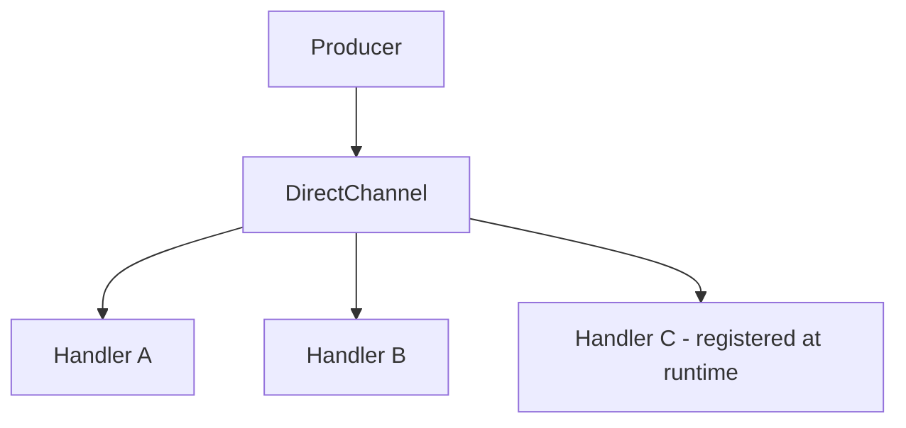
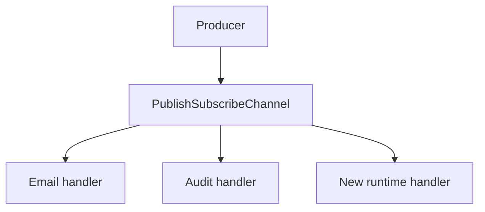
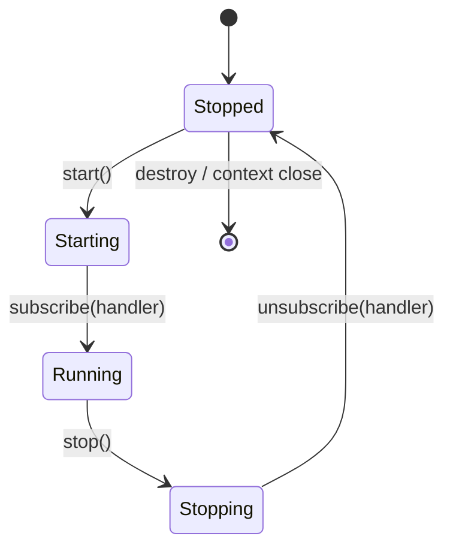

# Changing Subscriptions at Runtime

In Spring Integration, a channel can have subscribers registered when the application context starts, but there are also cases where the subscriber count changes while the application is running. For example, a newly activated tenant needs to receive events, a plugin is loaded into the system, a connection needs an additional handler, or a flow must stop receiving messages when a resource ends.

To manage those scenarios, you must distinguish **channel subscriptions** from **endpoint lifecycle**. `SubscribableChannel` allows registering and unregistering a `MessageHandler` directly. Spring-managed endpoints automatically subscribe when started and unsubscribe when stopped. Dynamic flows can be created and removed via `IntegrationFlowContext`. These three mechanisms are related, yet they have different management scopes.

## 1. Which Channels Support Subscriptions?

Not every channel has subscribers. Spring Integration has two key channel families:

- `SubscribableChannel` pushes messages to registered handlers. Examples include `DirectChannel`, `ExecutorChannel`, and `PublishSubscribeChannel`.
- `PollableChannel` holds messages for consumers to actively call `receive()`. Examples include `QueueChannel` and `PriorityChannel`.

| Channel | Message Delivery Mechanism | Has `subscribe()`/`unsubscribe()`? | When Consumers Change |
| --- | --- | --- | --- |
| `DirectChannel` | Dispatches to one subscriber. | Yes | The subscriber set used for subsequent dispatches changes. |
| `ExecutorChannel` | Dispatches to one subscriber via an executor. | Yes | Subscriber is selected at dispatch time; already submitted tasks can still run. |
| `PublishSubscribeChannel` | Broadcasts to all subscribers. | Yes | The recipient set for subsequent broadcasts changes. |
| `QueueChannel` | Consumers call `receive()` to take messages from the queue. | No | Manage the poller/consumer endpoint; messages may remain in the queue when the endpoint stops. |
| `PriorityChannel` | Consumers call `receive()` in priority order. | No | Manage the poller/consumer endpoint. |

`subscribe()` is an API on `SubscribableChannel`, not a general API on every `MessageChannel`. Calling `subscribe()` on a channel that does not support subscriptions indicates a design confusion between event-driven dispatch and polling.

## 2. Registering and Unregistering MessageHandler Directly

`SubscribableChannel` declares two operations:

```java
boolean subscribe(MessageHandler handler);
boolean unsubscribe(MessageHandler handler);
```

Example registering a handler on a channel:

```java
@Configuration
class EventChannelConfiguration {

    @Bean
    SubscribableChannel applicationEvents() {
        return new PublishSubscribeChannel();
    }
}

@Component
class RuntimeHandlerRegistry {

    private final SubscribableChannel applicationEvents;
    private final Map<String, MessageHandler> handlers = new HashMap<>();

    RuntimeHandlerRegistry(
            @Qualifier("applicationEvents") SubscribableChannel applicationEvents) {
        this.applicationEvents = applicationEvents;
    }

    synchronized void register(String key, MessageHandler handler) {
        if (handlers.containsKey(key)) {
            throw new IllegalStateException("Handler already registered: " + key);
        }
        if (!applicationEvents.subscribe(handler)) {
            throw new IllegalStateException("Could not subscribe handler: " + key);
        }
        handlers.put(key, handler);
    }

    synchronized void unregister(String key) {
        MessageHandler handler = handlers.get(key);
        if (handler != null) {
            if (!applicationEvents.unsubscribe(handler)) {
                throw new IllegalStateException("Handler was not subscribed: " + key);
            }
            handlers.remove(key);
        }
    }
}
```

This example keeps the exact registered `MessageHandler` instance so it can be unregistered later. Do not create a new lambda when calling `unsubscribe()` and expect the channel to recognize it as the previous handler. Keep a reference to the exact object passed to `subscribe()`.

Return value semantics:

- `subscribe(handler)` returns `true` when the handler is added to the subscriber set; returns `false` if it could not be added, for example when the handler is already registered.
- `unsubscribe(handler)` returns `true` when the handler is removed; returns `false` if the handler is not in the subscriber set.

The registry in the example uses `synchronized` so checking the key, subscribing, and updating the map execute atomically with respect to threads calling the manager. If used in a cluster, this map only manages the current process; each node must receive configuration and register its own subscribers.

### What Lifecycle Does a Direct Handler Have?

Calling `channel.subscribe(handler)` only registers the handler with the dispatcher. It does not turn the handler into a Spring bean, inject dependencies, or invoke `start()`/`stop()` on that object. If the handler is already a Spring bean implementing `Lifecycle`/`SmartLifecycle`, the application context can manage the bean's lifecycle under that contract; subscribing/unsubscribing remains a separate operation and does not automatically start/stop the bean. If the handler owns resources or has its own lifecycle, coordinate the two lifecycles explicitly.

When subscribing directly, the application is also responsible for maintaining the registry, avoiding duplicate registrations, unsubscribing the exact instance, and cleaning up on context shutdown. For an endpoint with advice, metrics, or a complex lifecycle, let Spring Integration manage the endpoint instead of manually registering a raw handler.

## 3. Subscription Changes Behavior by Dispatcher Type

Adding or removing a subscriber has different implications depending on the channel.

### DirectChannel: Point-to-Point and Load Balancing

`DirectChannel` uses a unicast dispatcher. When there are multiple subscribers, each message is delivered to one subscriber chosen by the load-balancing strategy; the default is round-robin. Adding a subscriber changes the set of handlers eligible for subsequent messages. Removing a subscriber excludes that handler from subsequent dispatches.



If the channel has three handlers, a message is not broadcast to all three. The dispatcher selects one handler. If the handlers represent workers of the same type, this is competing consumers/load balancing. If they represent three distinct tasks, `DirectChannel` is not the broadcast option.

When the subscriber set changes, the round-robin cycle and which handler is picked for subsequent messages can shift. Do not assume that a particular tenant or message type will always go to the same subscriber just because that subscriber was registered earlier. If you need routing by tenant or message type, use a router with explicit conditions.

### PublishSubscribeChannel: Broadcast

`PublishSubscribeChannel` dispatches messages to all currently registered subscribers. Adding a new handler means subsequent broadcast messages are also sent to that handler; removing a handler means subsequent broadcasts no longer go to it.



If `applySequence` is enabled, the channel can attach correlation/sequence metadata to copies. Changing the subscriber count also changes the broadcast recipient count. Therefore, a downstream aggregator should not assume a group always has the same element count if subscriptions can change at runtime. If each broadcast requires a fixed recipient set, snapshot/version the subscriber set for that execution or generate separate correlation metadata.

### ExecutorChannel: Already Submitted Tasks Remain Active

`ExecutorChannel` uses a unicast dispatcher but executes invocations via a `TaskExecutor`. Once a handler is selected and a task has been submitted to the executor, calling `unsubscribe(handler)` does not cancel pending or running tasks. Unsubscribing only affects dispatches occurring after the handler is removed from the subscriber set.

This also applies to a `PublishSubscribeChannel` with an executor: messages already broadcast and subscriber tasks already submitted can still continue running after a subscriber unsubscribes. If you need to guarantee no work is still running before closing resources, implement an application-level drain/quiescence protocol.

## 4. Event-Driven Endpoints Auto-Subscribe by Lifecycle

In Spring-managed flows, applications typically do not call `subscribe()` directly. `EventDrivenConsumer` is the endpoint connecting a `SubscribableChannel` to a `MessageHandler`. When the endpoint starts, it registers the handler on the channel; when the endpoint stops, it unsubscribes.



This is why endpoints can start/stop while the channel remains alive. The channel manages the subscriber set; the endpoint manages when the handler joins or leaves that set.

Java DSL example:

```java
@Bean
IntegrationFlow auditFlow(AuditHandler auditHandler) {
    return IntegrationFlow.from("events.input")
        .handle(auditHandler, "handle")
        .get();
}
```

Spring Integration creates an endpoint for the handler and manages its subscription according to the flow/context lifecycle. When the endpoint stops, the channel no longer dispatches new messages to it. When the endpoint starts again, it re-subscribes.

### PollingConsumer Is Not a PollableChannel Subscriber

With `QueueChannel`, the consumer endpoint does not call `subscribe()`. `PollingConsumer` is triggered by a poller and calls `receive()` on the channel. Stopping the endpoint/poller stops polling; messages already in the queue typically remain for other consumers or for when the endpoint restarts, depending on queue/store semantics.

Do not use `channel.unsubscribe()` to stop a `PollingConsumer`. Control the lifecycle of the endpoint or the registration holding that endpoint. For broker message-driven adapters, lifecycle also ties into the broker's listener container/connection; use the corresponding adapter management mechanism.

## 5. Dynamic IntegrationFlow via IntegrationFlowContext

When you need to add an entire pipeline at runtime, `IntegrationFlowContext` is more suitable than manually subscribing a single handler. It registers the flow and its related components in the application context, returning a registration handle to control lifecycle.

```java
@Component
class TenantFlowRegistry {

    private final IntegrationFlowContext flowContext;
    private final SubscribableChannel tenantEvents;
    private final Map<String, IntegrationFlowContext.IntegrationFlowRegistration>
        registrations = new ConcurrentHashMap<>();

    TenantFlowRegistry(IntegrationFlowContext flowContext,
                       @Qualifier("tenantEvents") SubscribableChannel tenantEvents) {
        this.flowContext = flowContext;
        this.tenantEvents = tenantEvents;
    }

    synchronized void register(String tenantId, TenantEventHandler handler) {
        if (registrations.containsKey(tenantId)) {
            throw new IllegalStateException("Tenant flow already exists: " + tenantId);
        }

        String flowId = "tenant-" + tenantId + "-events";
        IntegrationFlow flow = IntegrationFlow.from(tenantEvents)
            .handle(handler, "handle")
            .get();

        IntegrationFlowContext.IntegrationFlowRegistration registration =
            flowContext.registration(flow)
                .id(flowId)
                .useFlowIdAsPrefix()
                .register();

        registrations.put(tenantId, registration);
    }

    synchronized void unregister(String tenantId) {
        IntegrationFlowContext.IntegrationFlowRegistration registration =
            registrations.remove(tenantId);
        if (registration != null) {
            registration.destroy();
        }
    }
}
```

This example registers a per-tenant flow on the same `SubscribableChannel`. Each flow has its own endpoint; with `DirectChannel`, endpoints compete for messages via load balancing; with `PublishSubscribeChannel`, each flow receives a copy of the message. Choose the channel based on desired semantics.

`IntegrationFlowRegistration` provides lifecycle operations such as `start()`, `stop()`, and `destroy()`:

- `stop()` stops the flow's endpoints while keeping the registration so it can be restarted.
- `start()` restarts the endpoints according to the registration lifecycle.
- `destroy()` removes the flow and components registered with it from the context. After destroy, the registration is no longer an active flow that can be restarted.

The flow ID must be unique in the context. `useFlowIdAsPrefix()` prevents component names generated by the flow from colliding with other flows. Store registrations by tenant/resource key so the right flow is destroyed when the resource ends.

If a flow should start from a dedicated per-tenant channel, create a per-tenant channel and register the flow from that channel. If all tenants listen on a shared broadcast channel, ensure handlers verify the tenant themselves or use a router to send messages only to the matching tenant; simply naming the flow ID by tenant does not filter messages automatically.

## 6. Which API to Choose for Runtime Changes?

| Requirement | Appropriate Mechanism | Who Manages Cleanup? |
| --- | --- | --- |
| Add/remove a simple `MessageHandler` on an event-driven channel | `SubscribableChannel.subscribe()` / `unsubscribe()` | Application registry. |
| Start/stop an endpoint already created by Spring | `Lifecycle`/`SmartLifecycle` or `IntegrationFlowRegistration.start()`/`stop()` | Spring context or registration manager. |
| Add/remove a multi-endpoint pipeline | `IntegrationFlowContext` | Application holds registration and calls `destroy()`. |
| Stop a consumer reading from `QueueChannel` | Stop the `PollingConsumer`/flow containing the poller | Endpoint/registration lifecycle. |
| Stop a broker listener | Inbound adapter/listener container lifecycle | Adapter/container and broker configuration. |
| Route messages to handlers by tenant/type | Router or runtime routing map | Registry/router configuration. |

If you only need to toggle an existing endpoint, consider stopping/starting the endpoint rather than manually adding a second raw subscriber. If you need to alter flow topology, use `IntegrationFlowContext`. If you only need a simple callback and can manage its lifecycle yourself, `subscribe()` suffices.

## 7. Safely Swapping Subscribers While Messages Are Flowing

Replacing a subscriber is not merely two subscribe/unsubscribe calls. While the registry updates, producers may still be sending messages. You must decide whether to tolerate a window where both handlers receive messages, a window with no handler, or require a controlled handoff.

### Two Basic Replacement Approaches

**Subscribe new first, unsubscribe old second:** avoids a gap with no subscribers, but with `PublishSubscribeChannel` there is a window where both old and new handlers receive messages. If side effects are not idempotent, duplicate processing can occur.

**Unsubscribe old first, subscribe new second:** prevents both handlers receiving during the transition, but creates a window where the channel lacks that handler. Messages sent during this gap may be dropped or cause `send()` to fail depending on the channel and `minSubscribers`.

There is no universal atomic replace operation on `SubscribableChannel`. If neither duplicates nor gaps are acceptable, pause producers, drain in-flight messages, and then swap subscriptions; or use a stable proxy handler and swap its delegate via `AtomicReference`.

### Stable Delegating Handler

One way to reduce subscription churn is to register a fixed handler. This handler holds a reference to the current implementation:

```java
final class DelegatingMessageHandler implements MessageHandler {

    private final AtomicReference<MessageHandler> delegate =
        new AtomicReference<>();

    void replace(MessageHandler next) {
        delegate.set(Objects.requireNonNull(next));
    }

    @Override
    public void handleMessage(Message<?> message) {
        MessageHandler current = delegate.get();
        if (current == null) {
            throw new MessageDeliveryException(message, "No active delegate");
        }
        current.handleMessage(message);
    }
}
```

The channel subscribes `DelegatingMessageHandler` only once. When swapping implementations, call `replace()` instead of unsubscribe/subscribe. An invocation that already read the old delegate can still continue running; if you must wait for the old implementation to finish before closing resources, track in-flight invocation counts or use a dedicated drain mechanism.

## 8. Race Conditions and In-Flight Messages

Changing subscriptions concurrently with dispatching is a concurrent runtime operation. Several scenarios must be accounted for:

- A producer may have already started dispatching before unsubscribe. The handler may still be invoked during that dispatch.
- With an executor-backed channel, tasks already submitted may start or continue after unsubscribe completes.
- An endpoint may be actively processing a message when `stop()` is called. Stopping the subscription prevents new messages from arriving; it does not necessarily interrupt a running invocation.
- If a handler's resources are closed immediately after unsubscribe, an in-flight invocation may access closed resources.
- When re-subscribing the same handler, avoid having two different endpoints or registrations simultaneously own that handler.

A safe drain procedure typically includes:

1. Marking the handler/tenant as `DRAINING` so routing policies stop sending new work.
2. Stopping dispatch to the handler via unsubscribe or stopping the endpoint.
3. Waiting within a bounded timeout for in-flight invocation count to reach 0.
4. Closing resources owned by the handler.
5. Removing the registration from the registry and recording the removed state.

Do not use `Thread.sleep()` as a drain mechanism. Use counters/conditions, completion futures, semaphores, or adapter lifecycle hooks to know accurately when active work has finished. When the drain timeout expires, have an explicit policy: keep waiting, cancel in a controlled way, or log an incomplete shutdown.

## 9. Errors and Inactive Subscribers

If `DirectChannel` has no subscribers, sending can fail depending on channel and dispatcher configuration. With `PublishSubscribeChannel`, `minSubscribers` defines the minimum subscriber count required for dispatch to be considered successful. When runtime subscriptions change, this setting helps detect channels that unexpectedly lost consumers.

When a handler throws an exception:

- With synchronous dispatch, the exception can propagate back to the sender and affect the current dispatch.
- With an executor-backed channel, errors raised in workers cannot return to the sender's call stack after task acceptance; appropriate error handling/error channel configuration is needed.
- Unsubscribing a handler is not retry, does not handle failed messages, and does not automatically recover messages already pulled from a queue.

If endpoints are Spring-managed, prefer configuring an error channel, retry advice, and endpoint lifecycle. If registering raw handlers, the registry must specify who receives errors, how failed messages are logged, and whether subsequent messages continue to be accepted.

## 10. QueueChannel and Subscription Lifecycle Are Different Matters

`QueueChannel` does not maintain a subscriber list. Producers send messages into the queue; consumer endpoints pull messages using `receive()`. Consequently:

- Stopping a polling endpoint does not remove a subscriber because there is no subscription on the channel.
- Messages already in the queue typically persist when the endpoint stops, depending on queue/store implementation.
- Restarting the poller lets the endpoint resume receiving remaining messages.
- With an in-memory queue, messages are not guaranteed to survive process restarts.
- With a persistent `MessageStore`, durability and transactions depend on the implementation, database, and transaction manager.

If you need to add a consumer at runtime for a queue, create/start a polling endpoint or dynamic flow. Do not call `subscribe()` on `QueueChannel`.

## 11. Registry, Idempotency, and Multi-Tenant Management

When subscriber counts vary by tenant, device, or plugin, the registry should store resource keys and corresponding management handles. A registry may need these states:

| State | Meaning | Allowed Actions |
| --- | --- | --- |
| `REGISTERING` | Creating endpoint/subscription. | Do not accept new requests for the resource yet. |
| `ACTIVE` | Subscriber is registered and ready. | Allow dispatching. |
| `DRAINING` | Stopping new work and waiting for in-flight work. | Do not route new messages. |
| `STOPPED` | Endpoint stopped, registration kept for restart. | Can be started per policy. |
| `DESTROYED` | Registration removed from context. | Must create a new registration to become active again. |

Important principles:

- Use unique, stable, normalized IDs; never use arbitrary unvalidated request strings directly as bean/flow IDs.
- Ensure register/unregister operations are idempotent or return clear status on repeated calls.
- Only mark `ACTIVE` after subscribe/register succeeds.
- If a registration step fails partway through, roll back already created registration parts to avoid orphan handlers.
- Do not subscribe per message; subscriptions belong to the tenant/plugin/connection lifecycle.
- Track subscriber count, registration count, creation timestamps, and registration age.
- In a cluster, subscriptions are local state within each application context. You need mechanisms to synchronize configuration and route messages to nodes hosting the appropriate subscribers.

## 12. Diagnosing Unexpected Subscription Behavior

| Symptom | Possible Cause | What to Check |
| --- | --- | --- |
| `subscribe()` returns `false` | Handler is already registered or dispatcher refuses more handlers. | Check registry and current subscriber count. |
| `unsubscribe()` returns `false` | Different instance passed or handler already removed. | Store and reuse the exact subscribed object. |
| DirectChannel sends to another handler after adding subscriber | Round-robin/load balancing redistributes across the subscriber set. | Check channel semantics; use a router if affinity is needed. |
| PublishSubscribeChannel still runs old handler after unsubscribe | Dispatch already started or executor task was submitted earlier. | Track in-flight tasks and perform draining. |
| New handler receives no messages | Subscribed to a different channel instance, endpoint not started, or producer sends to wrong channel. | Verify bean identity, flow input, and registration state. |
| QueueChannel still holds messages when endpoint stops | Queue stores messages independently of poller lifecycle. | Check queue/store and polling endpoint state. |
| Dynamic flow hits duplicate component ID | Flow ID is not unique or component prefix is missing. | Assign unique IDs and use `useFlowIdAsPrefix()`. |
| Tenant removed yet handler still accesses resources | Subscription removed while in-flight invocations have not finished. | Drain before closing resources. |
| Subscriber count grows over time | Repeated registration or missing unsubscribe/destroy. | Track registry by key, invoke cleanup on lifecycle exit. |
| One node receives messages while another does not | Dynamic subscription was only created in one application context. | Synchronize configuration and routing across nodes. |

When debugging, record channel bean name/identity, handler or endpoint ID, flow ID, tenant/resource key, subscribe/unsubscribe/start/stop/destroy timestamps, thread name, and message ID. For executor channels, also record task submission, start, and completion timestamps to identify tasks in-flight after unsubscribe.

## 13. Procedure for Changing Subscriptions at Runtime

1. Determine whether the channel is a `SubscribableChannel` or `PollableChannel` and understand its dispatcher.
2. Choose between managing raw handlers, endpoint lifecycle, or dynamic flow registration.
3. Build handlers/flows with Spring-managed dependencies; choose a unique ID for the resource.
4. Perform registration under a synchronized registry and handle duplicate registrations.
5. Transition the resource state to `ACTIVE` only after registration succeeds.
6. When removing, block new routing, stop/unsubscribe, and drain in-flight invocations.
7. Close resources only after the handler is no longer processing messages.
8. Call `destroy()` on dynamic flows if they do not need to restart; keep registrations if merely pausing.
9. Monitor subscriber count, registration count, dispatch errors, and drain duration.
10. Test races between send/register/unregister, executor overload, and shutdown.

## 14. Key Takeaways

- `SubscribableChannel` supports `subscribe()`/`unsubscribe()`; `PollableChannel` is consumed via `receive()` and pollers.
- `DirectChannel` picks one subscriber; `PublishSubscribeChannel` broadcasts to all subscribers; `ExecutorChannel` hands off invocations to an executor.
- Spring-managed event-driven endpoints auto-subscribe on start and auto-unsubscribe on stop.
- `IntegrationFlowContext` manages dynamic flow registration/removal; `stop()` retains the registration for restart, while `destroy()` removes the flow from the context.
- Unsubscribing prevents new dispatches but does not cancel already in-flight invocations or submitted tasks.
- Never close handler resources before draining finishes; there is no universal atomic replace for subscriptions.
- Subscriptions are local state per node's application context; clusters require separate synchronization of registrations and routing.

## References

- [Spring Integration Reference — Message Channels](https://docs.spring.io/spring-integration/reference/channel.html)
- [Spring Integration Reference — Channel Implementations](https://docs.spring.io/spring-integration/reference/channel/implementations.html)
- [Spring Integration Reference — Messaging Endpoints](https://docs.spring.io/spring-integration/reference/messaging-endpoints.html)
- [Spring Integration Reference — Dynamic and Runtime Integration Flows](https://docs.spring.io/spring-integration/reference/dsl/java-runtime-flows.html)
- [Spring Integration API — SubscribableChannel](https://docs.spring.io/spring-integration/api/org/springframework/integration/SubscribableChannel.html)
