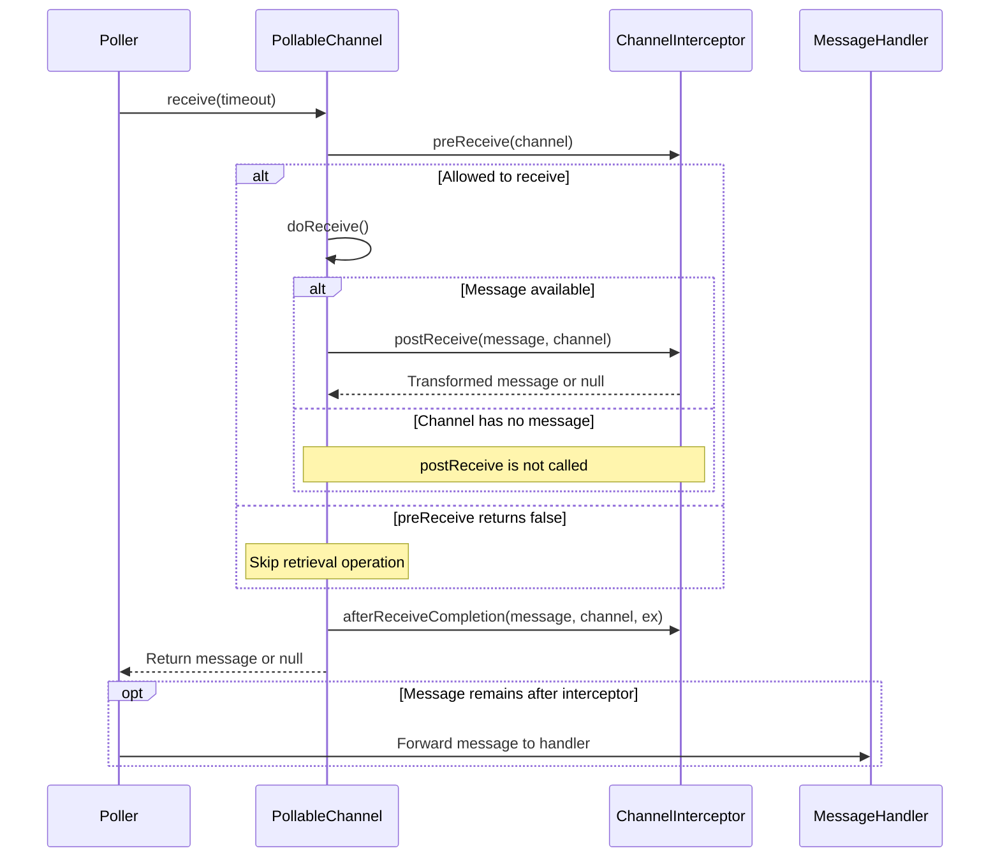

# preReceive, postReceive, and afterReceiveCompletion

In Spring Integration, a poller retrieves messages from a `PollableChannel` using the `receive()` operation. `ChannelInterceptor` provides three callbacks to control and observe the exact window during which the channel performs the receive operation: `preReceive`, `postReceive`, and `afterReceiveCompletion`.

These three callbacks are useful when you need to veto a poll attempt, add metadata to a newly retrieved message, record the receive outcome, or clean up resources bound to the poller thread. They belong to the **channel message-receiving** lifecycle. They do not wrap the entire processing within the message handler. Within the scope of Spring Integration Runtime, distinguishing this boundary helps accurately diagnose the behavior of pollers, consumers, threads, and message flow performance.

## 1. Which Channels Do Receive Callbacks Apply To?

These callbacks apply to pull-based channels, where the consumer proactively calls `receive()`. Common examples are `QueueChannel`, `PriorityChannel`, and `RendezvousChannel`.

Push-based channels, such as `DirectChannel` and `PublishSubscribeChannel`, deliver messages to subscribers when a message is sent. They do not perform a `receive()` operation, so these three receive callbacks do not run on those channels.

A `ChannelInterceptor` can be registered directly on a channel using `addInterceptor(...)`, or configured as a global channel interceptor. The examples in this article use direct registration to make it clear which channel owns the interceptor.

## 2. Role and Ordering of Each Callback

| Callback | Timing | Return value | Effect |
|---|---|---|---|
| `preReceive(channel)` | Before the channel retrieves a message | `boolean` | `false` cancels the current receive attempt; the channel does not perform the retrieval |
| `postReceive(message, channel)` | After a message is retrieved | `Message<?>` | Can return a transformed message or return `null` to drop the message from the flow |
| `afterReceiveCompletion(message, channel, ex)` | When the receive attempt finishes | `void` | Records outcomes, releases resources, or cleans up context; `ex` indicates whether an exception occurred |

When a channel has multiple interceptors, `preReceive` and `postReceive` run in registration order. Each `postReceive` receives the result returned by the previous callback. If a callback returns `null`, the message processing chain stops there.

`postReceive` only runs when the retrieval operation returns a non-null message. If the channel has no message, this callback is skipped. `afterReceiveCompletion` is the completion phase of the receive attempt: it is invoked when the attempt ends, even when no message was available or an exception occurred. Interceptors that participated in the receive attempt are completed in reverse registration order. When there is no exception, `ex` is `null`.

### Progression of a Poll Attempt



The key point in the diagram is that `afterReceiveCompletion` runs before `receive()` returns the result to the poller. Only after that does the poller forward the message to the message handler. Therefore, this callback is not a signal that the handler has finished processing the message.

## 3. Implementing an Interceptor for Receive Attempts

The following example logs the receive outcome and adds an `observedAt` header to the message. Creating a new message with `MessageBuilder` preserves Spring Messaging's immutable message model.

```java
import java.time.Instant;

import org.slf4j.Logger;
import org.slf4j.LoggerFactory;
import org.springframework.messaging.Message;
import org.springframework.messaging.MessageChannel;
import org.springframework.messaging.support.ChannelInterceptor;
import org.springframework.messaging.support.MessageBuilder;

public final class ReceiveObservationInterceptor implements ChannelInterceptor {

    private static final Logger log =
            LoggerFactory.getLogger(ReceiveObservationInterceptor.class);

    @Override
    public boolean preReceive(MessageChannel channel) {
        log.debug("Starting receive from channel {}", channel);
        return true;
    }

    @Override
    public Message<?> postReceive(Message<?> message, MessageChannel channel) {
        return MessageBuilder.fromMessage(message)
                .setHeader("observedAt", Instant.now())
                .build();
    }

    @Override
    public void afterReceiveCompletion(
            Message<?> message, MessageChannel channel, Exception ex) {

        if (ex != null) {
            log.warn("Failed to receive message from channel {}", channel, ex);
        } else if (message == null) {
            log.debug("Receive attempt from channel {} returned no message", channel);
        } else {
            log.debug("Receive attempt from channel {} completed", channel);
        }
    }
}
```

Registering the interceptor on a `QueueChannel`:

```java
import org.springframework.context.annotation.Bean;
import org.springframework.integration.channel.QueueChannel;

@Bean
QueueChannel ordersChannel(ReceiveObservationInterceptor interceptor) {
    QueueChannel channel = new QueueChannel();
    channel.addInterceptor(interceptor);
    return channel;
}
```

When a poller receives a message from `ordersChannel`, `preReceive` is called before the retrieval operation. If a message is retrieved, `postReceive` adds the header. Then `afterReceiveCompletion` records the outcome, and `receive()` returns the updated message to the poller.

The example above uses `afterReceiveCompletion` to observe the outcome. If you want to measure timing, define the measurement scope clearly: the duration across these three callbacks reflects only the channel receive attempt, not the time the handler spends processing the message.

## 4. Choosing a Callback by Purpose

### Use `preReceive` to Decide Whether to Execute the Receive

This callback only receives `MessageChannel`; there is no message yet to inspect payloads or headers. It fits channel-level conditions, such as a flag enabling message consumption or a policy temporarily pausing polling.

If it returns `false`, the current receive attempt ends without pulling a message from the channel. To the poller, the receive result is `null`; this is not automatically an exception or a retry mechanism. The poller may try again on the next poll according to its polling configuration.

Do not use `preReceive` to validate individual message contents because the content has not been retrieved at this point. Payload-based validation should happen after the message has been received, at an appropriate component in the flow.

### Use `postReceive` to Transform or Filter Messages

This callback receives the message just retrieved from the channel. Suitable tasks include adding observation headers, normalizing metadata, or applying a lightweight filter before the message reaches the poller.

Return a new message if you need to modify headers or content. Returning `null` blocks the message from the rest of the flow. Treat this as message filtering/dropping behavior, not a retry mechanism. For example, with `QueueChannel`, the message retrieval has already happened before `postReceive` is called; the interceptor does not automatically put a filtered message back into the queue. If rollback or retry is needed, design it based on transactions, a message store, and a retry mechanism suited to the channel in use.

### Use `afterReceiveCompletion` to Finalize Interceptor Work

This callback is suitable for recording the final outcome of the receive operation, updating metrics, closing resources, or cleaning up temporary thread-bound data. Inspect both `message` and `ex`:

- `message != null`: the receive attempt still has a message after the `postReceive` chain.
- `message == null` and `ex == null`: no message was returned; this could be due to an empty channel, `preReceive` blocking the attempt, or a `postReceive` filtering the message.
- `ex != null`: the receive operation encountered an exception; the callback can record the error before the exception continues propagating to the caller.

Do not infer the cause solely from `message == null`; if you need to distinguish empty polls, blocked receives, and filtered messages, record the corresponding state in the callback that decided that behavior.

## 5. Operational Limits to Keep in Mind

**Time scope.** `afterReceiveCompletion` runs as soon as the `receive()` operation finishes, before the poller invokes the handler. If you place data into a `ThreadLocal` in `preReceive` or `postReceive` and clear it in `afterReceiveCompletion`, the handler will not see that data. To wrap handler execution time, use an appropriate advice or endpoint/handler interceptor mechanism.

**Empty polls.** A poller may call `receive()` many times when the queue has no messages. `postReceive` does not run in this case, but the completion phase is still invoked. Avoid overly verbose logging for every empty poll if the polling frequency is high; prefer metrics or controlled logging.

**Performance impact.** Callbacks run synchronously on the thread executing the receive operation. Network queries, database calls, or heavy processing inside an interceptor increase poll duration and reduce consumer throughput. Keep callbacks short, bounded by timeouts, and avoid hard-to-recover business side effects.

**Thread safety.** A single interceptor may be shared by multiple consumers or pollers. Do not keep state specific to one receive attempt in a shared mutable field without proper synchronization. For thread-bound temporary data, always clean up in `afterReceiveCompletion`, even when an exception occurs.

**Right interceptor boundary.** The three callbacks in this article only observe the receive phase of a `PollableChannel`. If you need to intercept or transform messages when sending, look at `preSend` and `postSend`. If you need to measure business processing duration, manage handler retries, or catch errors after the handler runs, place that logic in the corresponding endpoint, handler, advice chain, or error flow.

When diagnosing why a message did not reach a handler, verify in order whether the channel is a `PollableChannel`, whether `preReceive` allowed receiving, whether `receive()` retrieved a message, whether `postReceive` returned a non-null message, and whether an exception appeared in `afterReceiveCompletion`. This verification sequence determines whether the message was blocked before retrieval, absent from the channel, filtered after retrieval, or encountered an error during the receive operation.
