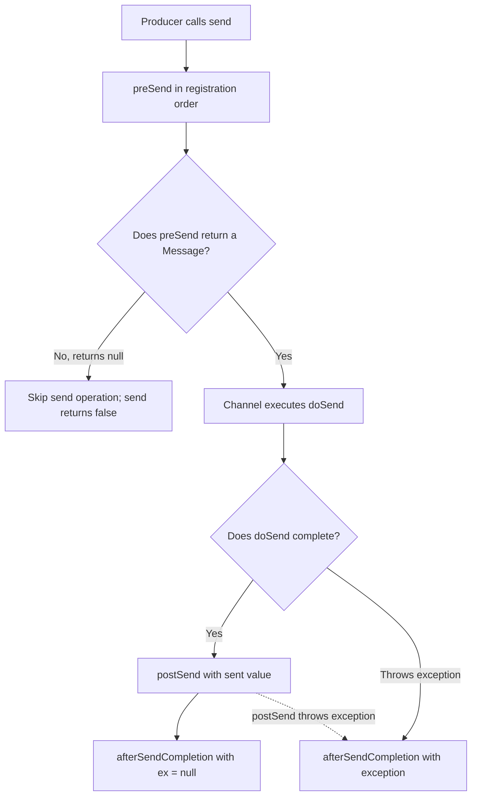

# Interceptor Exceptions and Their Impact on Send

In Spring Integration, `MessageChannel.send()` is the boundary where a producer hands a `Message` to a channel. `ChannelInterceptor` can inspect or transform messages before sending, observe the send outcome, and clean up resources after the operation completes. Because interceptors run directly on the send path, an exception in any callback can alter the outcome received by the producer.

This lesson belongs to the `SPRING_INTEGRATION_RUNTIME` module, focusing on how Spring Integration executes and coordinates message flows across channels, endpoints, consumers, pollers, and executors. When analyzing send errors, you must identify both the interceptor callback and the channel type in use: the same handler exception may be returned to the producer via `DirectChannel`, yet appear only on the asynchronous error handling path when messages travel through `QueueChannel` or `ExecutorChannel`.

After this lesson, you will be able to:

- Describe the order and meaning of `preSend`, `postSend`, and `afterSendCompletion`.
- Distinguish blocked sends, sends returning `false`, and sends failing with an exception.
- Predict whether an exception propagates back to the producer or is handled on the consumer flow.
- Design interceptors for auditing, tracing, and cleanup without distorting send outcomes.
- Diagnose the impact of exceptions on transactions, retries, and duplicate message processing risks.

## 1. Lifecycle of a Send Operation

For a channel extending `AbstractMessageChannel`, the typical send path looks like this:



The three key callbacks serve distinct roles:

| Callback | Timing | Meaning |
|---|---|---|
| `preSend(message, channel)` | Before the channel executes the send | Inspect, enrich, or replace the message. Return `null` to intentionally prevent the send. |
| `postSend(message, channel, sent)` | After the send operation returns | Observe the boolean result of the send operation. This callback does not run if the send operation throws an exception. |
| `afterSendCompletion(message, channel, sent, ex)` | When the send ends, even with an exception | Clean up resources and record the final outcome. `ex` indicates an exception raised during sending or an earlier callback. |

Interceptors have `preSend` called in registration order. `afterSendCompletion` is called in reverse order, similar to unwinding previously opened layers. The completion callback is only called for interceptors whose `preSend` completed normally and returned a `Message`. If a `preSend` returns `null`, earlier interceptors are still completed; the interceptor returning `null` is not considered to have opened successfully.

`postSend` receives `sent`, which is the boolean result of the channel's send operation. `sent = true` means the channel accepted the message according to that channel's semantics. It does not automatically prove that downstream handlers have completed business processing.

## 2. How Exceptions in Each Callback Affect Send

### Exception in `preSend`

If `preSend` throws an exception, the channel has not yet invoked the actual send (`doSend`). Interceptors that previously completed `preSend` have `afterSendCompletion` called for cleanup with the exception details. The interceptor throwing the exception did not complete `preSend`, so its own completion callback is not invoked.

The producer receives an exception from the `send()` call. Spring Integration may wrap send exceptions into a `MessagingException`, commonly `MessageDeliveryException` for send errors not already belonging to the `MessagingException` hierarchy. Therefore, when handling errors in the caller layer, inspect the root cause (`cause`) rather than relying only on the outermost exception class.

Use exceptions in `preSend` for genuine errors, such as an invalid required header or a security policy violation. If you want to intentionally filter a message and accept a `false` send result, return `null`. These two approaches have different operational meanings: one reports an error, while the other actively cancels the send.

### `preSend` Returning `null`

When an interceptor returns `null`, Spring Integration does not invoke `doSend` and `send()` returns `false`. This is not an exception. Earlier interceptors that ran successfully still have `afterSendCompletion` called to release resources.

Do not return `null` merely to hide a technical error. If producers need to distinguish policy-filtered messages from messages not sent due to a full channel or timeout, record the filter reason with a dedicated metric/log or use an explicit rejection flow.

### Exception During the Channel's Send Operation

If `doSend` or synchronous dispatch throws an exception, `postSend` is not invoked because the send operation never returned a boolean value. `afterSendCompletion` is invoked for interceptors that passed `preSend`, with `ex` containing the exception.

A common example is `DirectChannel` invoking a handler directly on the producer's thread and the handler throwing an error. The exception propagates back through the send call. This behaves just like a synchronous Java method call.

### Exception in `postSend`

`postSend` runs only after the send operation returns `true` or `false`. If this callback throws an exception, the producer may still observe a failed send, even though the channel already accepted the message before the callback ran. Subsequent `postSend` callbacks may not execute; `afterSendCompletion` remains the cleanup point for interceptors that passed `preSend`.

This is the scenario most prone to causing duplicate sends. For example, `DirectChannel` called the handler and the handler successfully persisted data; then an audit interceptor in `postSend` encountered a logging error and threw an exception. The producer sees `send()` fail and retries, even though the initial business work already occurred.

Therefore, `postSend` should perform fault-tolerant observation work. If auditing or metrics fail, handle those errors separately and avoid turning an already-accepted send into an unintended failed send.

### Exception in `afterSendCompletion`

`afterSendCompletion` is suited for cleanup, closing tracing scopes, and recording outcomes. The callback receives `sent` along with `ex`, allowing it to distinguish successful sends, sends returning `false`, and sends ending in an exception.

In Spring Integration's `AbstractMessageChannel` implementation, exceptions thrown from completion callbacks are logged while the cleanup chain continues. Do not rely on this callback to report business errors to the producer. Keep the callback short, defensive, and handle cleanup errors internally if needed.

## 3. `send()` Returning `false` vs. Throwing an Exception

`MessageChannel.send()` returns a boolean. Interpreting the result properly prevents mistaken retries:

| Result | Interpretation | Investigation direction |
|---|---|---|
| `true` | The channel accepted the message according to its semantics | Check downstream consumer processing state if business confirmation is needed. |
| `false` | The send was not executed successfully; may be due to an interceptor returning `null`, timeout, or thread interruption | Check `preSend`, channel capacity, timeout, and thread state. |
| Throws exception | An interceptor or channel encountered an error during send/dispatch | Inspect the stack trace, root cause exception, and the last callback that ran. |

With a capacity-bounded `QueueChannel`, the producer may have to wait for space. Sending with a finite timeout returns `false` if time expires before the message enters the queue. A timeout of `0` requests an immediate attempt without waiting. Calling `send(message)` without a timeout may block indefinitely on a full queue, depending on the channel.

Do not equate `false` with an exception. If the producer only retries on exceptions, a filtered or timed-out send may be skipped. Conversely, if it retries every exception, the producer may resend a message the channel already accepted before an observation callback threw an error.

## 4. Channel Type Determines Where Exceptions Go

The channel defines the thread boundary between producer and consumer. This boundary directly determines whether the producer can receive exceptions from the handler.

| Channel | Send behavior | Impact of handler exceptions |
|---|---|---|
| `DirectChannel` | Synchronous dispatch on the thread calling `send()` | Exceptions from the handler can propagate back to the producer. `postSend` does not run if dispatch throws an exception. |
| `QueueChannel` | Enqueues the message; consumer retrieves later via `receive()` or poller | `send() = true` only confirms the queue accepted the message. Processing errors occur later in the consumer/poller and require error handling on that flow. |
| `ExecutorChannel` | Hands off dispatch to a `TaskExecutor` | The handler usually runs on another thread. `send()` may already have returned successfully before the handler throws an exception; the producer's transaction does not automatically span into the handler. |
| `PublishSubscribeChannel` | Sends to multiple subscribers; may be synchronous or executor-backed | Without an executor, exceptions can propagate back to the caller. With an executor, processing errors are routed via an `ErrorHandler`, typically `MessagePublishingErrorHandler`, to the appropriate `errorChannel`. |

With `QueueChannel`, the consumer's poller typically runs on a scheduler-managed thread. Handler exceptions therefore belong to that poller execution, no longer on the call stack of the producer that sent the message earlier. Spring Integration supports publishing an `ErrorMessage` to the channel specified in the message's `errorChannel` header; if no matching header is present, error handling can fall back to the global `errorChannel`.

With `ExecutorChannel`, the executor separates the sending thread from the processing thread. Handler exceptions inside async tasks are handled by Spring Integration's error handling mechanism and may be published as an `ErrorMessage` to the channel in the `errorChannel` header or the global `errorChannel`. If the executor rejects the task due to overload, the rejection error may surface immediately at send time depending on executor configuration. Distinguish task submission failures from exceptions thrown after the handler starts running.

`PublishSubscribeChannel` configured with an executor can also use an error handler to send errors to `errorChannel`. Without an executor configured, handlers run on the sender's thread and exceptions are thrown directly back to the caller; async error handlers do not replace that synchronous behavior.

## 5. Transactions and Retries When Interceptors Throw Errors

With `DirectChannel`, producer and handler run on the same thread. If both participate in the same transaction configured at the caller or endpoint layer, a propagating exception can cause the transaction to roll back per the transaction manager's rollback policy. However, rollback depends on transaction boundaries and participating resource types; it does not automatically undo an HTTP call, email, or side effects outside the database.

With `ExecutorChannel` or `QueueChannel`, producer and consumer typically operate on different threads and in different transactions. An active transaction on the producer does not automatically propagate to an asynchronous handler. If message durability is needed, configure a message store/queue and transactions aligned with the backing store, and design processing transactions on the consumer side.

When retrying, determine whether the exception occurred before or after the channel accepted the message:

1. Errors in `preSend` typically occur before the channel receives the message. Fix the cause or route the message to an appropriate rejection flow before retrying.
2. Errors in `doSend` may mean the channel has not accepted the message, though you must inspect the specific channel type and exception.
3. Errors in `postSend` occur after the send operation has returned. You cannot assume the message was not delivered.
4. Handler errors on an asynchronous channel occur after the producer finished sending. Retrying at the producer is not an automatic way to recover that processing attempt.

To prevent duplicate processing, use idempotency keys or stable message IDs/correlation IDs, store processing state in storage with appropriate consistency guarantees, and design handlers so resending a message does not repeat side effects. Retries should have bounded attempts, backoff, and classification of retryable errors; do not retry every `MessageDeliveryException` indefinitely.

## 6. Example of a Safe Interceptor

The following example registers a global interceptor for channels whose bean names match `orders.*`. The interceptor only observes messages, send outcomes, and exceptions. It does not mutate payloads or throw exceptions if the logging system fails.

```java
import org.slf4j.Logger;
import org.slf4j.LoggerFactory;
import org.springframework.context.annotation.Bean;
import org.springframework.context.annotation.Configuration;
import org.springframework.integration.config.GlobalChannelInterceptor;
import org.springframework.messaging.Message;
import org.springframework.messaging.MessageChannel;
import org.springframework.messaging.support.ChannelInterceptor;

@Configuration
class OrderChannelInterceptorConfiguration {

    private static final Logger log = LoggerFactory.getLogger(
            OrderChannelInterceptorConfiguration.class);

    @Bean
    @GlobalChannelInterceptor(patterns = "orders.*")
    ChannelInterceptor orderAuditInterceptor() {
        return new ChannelInterceptor() {

            @Override
            public Message<?> preSend(Message<?> message, MessageChannel channel) {
                log.debug("preSend channel={}, messageId={}",
                        channel, message.getHeaders().getId());
                return message;
            }

            @Override
            public void postSend(Message<?> message, MessageChannel channel,
                                 boolean sent) {
                if (!sent) {
                    log.warn("Message was not accepted: channel={}, messageId={}",
                            channel, message.getHeaders().getId());
                }
            }

            @Override
            public void afterSendCompletion(Message<?> message, MessageChannel channel,
                                            boolean sent, Exception ex) {
                if (ex != null) {
                    log.error("Send failed: channel={}, messageId={}",
                            channel, message.getHeaders().getId(), ex);
                }
            }
        };
    }
}
```

Practical principles when writing interceptors:

- Keep callbacks fast and non-blocking. Interceptors sit on the send path, so a slow database query or HTTP call increases latency across the entire flow.
- Only return `null` when policy genuinely intends to drop the message. If a message is invalid and needs an error response, throw a meaningful exception or route to a rejection flow.
- Never use `postSend` to claim business processing completed. With queues or executors, the callback only observes the send/dispatch operation.
- Never let logging, tracing, or metrics errors mask the original exception. Observation tasks should have independent fault tolerance.
- Log `messageId`, correlation ID, channel name, thread, `sent`, and exceptions. Avoid logging sensitive payloads.

## 7. Diagnosing Issues by Symptom

When a flow reports a send failure, inspect in the following order:

1. **Identify the outcome of the `send()` call.** Note explicitly whether the caller received `true`, `false`, or an exception. Do not lump all three into a single "send failed" status.
2. **Find the last callback that ran.** Having `preSend` without `postSend` usually suggests an error in `preSend` or during the send operation. Having `postSend` followed by an error may indicate an issue in an observation interceptor after the channel returned its result.
3. **Read `ex` in `afterSendCompletion`.** Record the root exception and the entire cause chain. Cross-reference with producer logs to see whether the error was thrown synchronously or appeared on another thread.
4. **Check channel type and thread name.** If the handler runs on an executor or poller thread, the producer cannot catch delayed processing exceptions with a `try/catch` around `send()`.
5. **Check for overload.** For queues, inspect capacity, queue depth, wait times, and consumer throughput. For executors, inspect active threads, task queues, and rejection policies.
6. **Check the error flow.** Verify that the endpoint has an appropriate error handler, the message carries the necessary `errorChannel` header, and the global `errorChannel` has a subscriber handling errors.
7. **Evaluate retries and idempotency.** Before retrying, verify whether the channel already accepted the message or the handler already produced side effects.

A helpful interceptor log set should let you correlate events by the same `messageId` or correlation ID. For example, `preSend` at 10:00:00.010, `postSend(sent=true)` at 10:00:00.012, and a handler error on thread `task-3` at 10:00:00.080 show that the producer sent successfully before the consumer failed.

## 8. Common Design Mistakes

- **Treating `send() = true` as business processing success.** With queues/executors, this value usually only confirms message acceptance or dispatch.
- **Assuming every handler exception returns to the producer.** That is true only when the handler actually runs synchronously on the same call stack, as is typical with `DirectChannel`.
- **Throwing exceptions from `postSend` to report audit failures.** Doing so can cause callers to retry a message that was already accepted.
- **Using `null` to represent data errors.** The producer only sees `false`, with no exception cause to classify.
- **Retrying every send error.** Blind retries can produce duplicate side effects, especially when exceptions occur after the channel accepted the message.
- **Putting heavy processing inside interceptors.** This raises latency, ties up threads, and can bottleneck pollers or executors.

## 9. Key Takeaways

`preSend` decides whether a message proceeds; `postSend` observes the boolean result after the send operation; `afterSendCompletion` handles cleanup and receives exceptions. An exception carries different meaning depending on whether it happens before the channel accepts the message, during dispatch, or after the message has been accepted. When diagnosing, always combine interceptor lifecycle with channel semantics, execution threads, transactions, and retry policies.

## References

- [Spring Integration Reference — Message Channels](https://docs.spring.io/spring-integration/docs/latest-ga/reference/html/channel.html)
- [Spring Integration Reference — Error Handling](https://docs.spring.io/spring-integration/reference/7.0/error-handling.html)
- [Spring Framework API — ChannelInterceptor](https://docs.spring.io/spring-framework/docs/current/javadoc-api/org/springframework/messaging/support/ChannelInterceptor.html)
