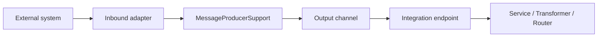

# MessageProducerSupport and Output Channels

In Spring Integration, a message producer receives data from an external system and converts that data into a Spring `Message<?>` to feed into an integration flow. For event-driven producers, `MessageProducerSupport` is the foundational support class: it provides output channel configuration, message sending methods, and endpoint lifecycle integration with Spring.

The output channel is the boundary between the producer and the rest of the flow. The producer is responsible for creating messages that conform to the contract and sending them to the configured channel. The channel decides how messages are forwarded: synchronous processing, handoff to an executor, buffering in a queue, or broadcasting to multiple subscribers. Clearly understanding this boundary prevents the producer from managing threading itself or retrying at the wrong layer.

## 1. Position of MessageProducerSupport in the Message Flow

A message producer is typically an inbound adapter. It receives data from an API, socket, SDK, listener, or an event-driven source, then creates a message and sends it to the output channel.



`MessageProducerSupport` is suitable for adapters that receive callbacks or events from an external source. It is the base class for the adapter to configure the output channel and send messages according to the endpoint lifecycle.

Distinguish between the following three components:

| Component | Responsibility | How data is obtained |
| --- | --- | --- |
| `MessageProducerSupport` | Supports endpoints emitting messages to an output channel | Typically receives a callback/event and calls `sendMessage()` |
| `MessageSource<T>` | Supplies messages on demand | Poller calls `receive()`; may return `null` if no data is available yet |
| `SourcePollingChannelAdapter` | Coordinates polling a `MessageSource` and sending the result to a channel | Calls `receive()` according to the poller trigger |

There is no need to create a poller for a producer that already receives callbacks from an external system. Conversely, a source that only exposes a `poll()` operation is usually a better fit for `MessageSource` and `SourcePollingChannelAdapter` than manually creating a background thread inside `MessageProducerSupport`.

## 2. What Does the Output Channel Do?

The output channel is the destination that receives messages created by the producer. The producer can configure a `MessageChannel` directly or configure a channel name for Spring to resolve from the application context. In the `MessageProducerSupport` API, the commonly used configurations are `setOutputChannel(...)` and `setOutputChannelName(...)`.

Example of configuring a channel directly:

```java
@Bean
DirectChannel externalEvents() {
    return new DirectChannel();
}

@Bean
CustomEventAdapter customEventAdapter(
        ExternalClient client,
        @Qualifier("externalEvents") MessageChannel outputChannel) {

    CustomEventAdapter adapter = new CustomEventAdapter(client);
    adapter.setOutputChannel(outputChannel);
    return adapter;
}
```

If configured by name, the adapter can use `setOutputChannelName("externalEvents")`; this name must match the channel bean registered in the context. Explicit channel configuration allows wiring errors to be detected at startup instead of waiting until runtime when a message arrives and discovering there is no destination to send to.

Each producer typically has one fixed output channel. If you need to route by event type, tenant, or business attribute, send to a common input channel and place a `Router` in the next step. Avoid turning the producer's callback into the place that holds all routing and business logic.

## 3. Creating a Custom Producer with MessageProducerSupport

Suppose an external SDK provides a callback when an `ExternalEvent` occurs. The adapter needs to register the listener on start, unregister the listener on stop, and send the event as a Spring message.

```java
public final class CustomEventAdapter extends MessageProducerSupport {

    private final ExternalClient client;
    private final Consumer<ExternalEvent> listener = this::publish;

    public CustomEventAdapter(ExternalClient client) {
        this.client = client;
    }

    @Override
    protected void doStart() {
        client.addListener(listener);
    }

    @Override
    protected void doStop() {
        client.removeListener(listener);
    }

    private void publish(ExternalEvent event) {
        Message<ExternalEvent> message = MessageBuilder
                .withPayload(event)
                .setHeader("source", "external-sdk")
                .setHeader("eventType", event.type())
                .build();

        sendMessage(message);
    }
}
```

`doStart()` and `doStop()` are lifecycle hooks for subclasses to enable or disable event reception. `sendMessage()` forwards the message to the output channel configured on the producer. The example uses the hypothetical API `addListener`/`removeListener`; when integrating a real SDK, replace them with the corresponding subscription registration and cancellation APIs.

Declare the adapter as a bean so Spring manages its lifecycle:

```java
@Bean
CustomEventAdapter customEventAdapter(
        ExternalClient client,
        @Qualifier("externalEvents") MessageChannel outputChannel) {

    CustomEventAdapter adapter = new CustomEventAdapter(client);
    adapter.setOutputChannel(outputChannel);
    return adapter;
}
```

When the application context starts, the endpoint is started according to its lifecycle configuration. When the context stops, the endpoint calls `doStop()` to unregister the listener. If the SDK returns a subscription handle instead of requiring the listener to be passed again, store that handle and close the exact handle in `doStop()`.

## 4. Who Owns the Client and External Resources?

A producer typically uses a client to register a listener or read data. You must clearly determine which bean owns the client:

- If the adapter creates and owns the client itself, the adapter must close the client when destroyed.
- If the client is a shared Spring bean or connection pool managed by another bean, the adapter only registers/unregisters the listener; the bean that owns the client is responsible for closing it.
- If the subscription has its own lifecycle, cancel the subscription when the producer stops, even if the client continues to be used by other adapters.

Example when the adapter owns the subscription handle:

```java
public final class CustomEventAdapter extends MessageProducerSupport {

    private final ExternalClient client;
    private volatile AutoCloseable subscription;

    public CustomEventAdapter(ExternalClient client) {
        this.client = client;
    }

    @Override
    protected synchronized void doStart() {
        if (this.subscription == null) {
            this.subscription = client.subscribe(this::publish);
        }
    }

    @Override
    protected synchronized void doStop() {
        AutoCloseable current = this.subscription;
        this.subscription = null;
        if (current != null) {
            try {
                current.close();
            }
            catch (Exception ex) {
                throw new IllegalStateException(
                        "Unable to cancel external event subscription", ex);
            }
        }
    }

    private void publish(ExternalEvent event) {
        sendMessage(MessageBuilder.withPayload(event).build());
    }
}
```

This code snippet illustrates holding a subscription handle and canceling it on stop. Adjust exception handling according to the actual API: some SDKs provide an unsubscribe operation that does not throw a checked exception, while others require waiting for an in-flight callback to finish. Do not close the client in `doStop()` if the client is shared outside the adapter.

Start/stop lifecycle methods may be called multiple times during the lifetime of the application. Therefore, listener registration and cancellation logic should be idempotent or guarded so duplicate listeners are not registered when the endpoint is restarted. If registration fails midway, clean up any created resources before throwing the error out.

## 5. Creating a Contract-Compliant Message Before Sending

The producer converts transport data into a `Message<?>`. The payload should represent the normalized business data or event. Headers contain metadata for routing, correlation, tracing, or diagnostics.

```java
private void publish(ExternalEvent event) {
    Message<DomainEvent> message = MessageBuilder
            .withPayload(mapToDomainEvent(event))
            .setHeader("eventId", event.id())
            .setHeader("correlationId", event.correlationId())
            .setHeader("sourceSystem", "partner-gateway")
            .build();

    sendMessage(message);
}
```

A few rules:

- Use a stable ID from the source for `eventId` if the source provides one, so consumers can detect duplicate messages.
- Preserve `correlationId` across steps belonging to the same business operation; do not generate a new ID at every adapter if you want to trace the same flow.
- Put only necessary metadata into headers; avoid copying tokens, credentials, or sensitive payloads into logs/headers.
- Normalize payload types at the producer so downstream components do not have to handle multiple different transport formats.
- Prefer immutable payloads to prevent multiple consumers from mutating the same object after sending.

If data mapping is complex, extract it into a mapper or transformer that can be tested independently. The callback should do minimal work: identify the event, convert it into a message, and send it to the channel.

## 6. The Output Channel Determines Delivery Semantics

`MessageProducerSupport` does not decide whether a message is processed synchronously or asynchronously. That depends on the type of channel configured:

| Output channel | What happens when the producer sends | Consequence for the producer |
| --- | --- | --- |
| `DirectChannel` | The dispatcher invokes the subscriber synchronously on the sending thread | Errors from the handler can propagate back to the `sendMessage()`/callback call |
| `ExecutorChannel` | The dispatcher hands off work to a `TaskExecutor` | The callback usually only knows about sending/handing off the task; errors occurring later in the worker thread need separate error handling |
| `QueueChannel` | The message is stored in a queue for a consumer/poller to pick up later | Backpressure or timeout may occur if the queue is bounded and full |
| `PublishSubscribeChannel` | The message is broadcast to all subscribers | A single message may trigger multiple branches; the payload should be immutable and branches need to be idempotent |

For example, if the adapter sends to a `DirectChannel`, the SDK callback may be held while the handler executes a database query or HTTP call. If sending to an `ExecutorChannel`, the callback may finish earlier, but you need to manage the executor, queue, and asynchronous errors. If sending to a `QueueChannel`, the producer is decoupled from consumer speed within the queue capacity; when the queue is full, sending policies and timeouts become critical.

Do not conclude that the producer has finished processing an event just because `sendMessage()` returns. With an asynchronous channel, that usually only means the message was accepted or the task was handed off according to the channel's semantics. To know when business processing completes, you need acknowledgments, a reply channel, processing state, or consumer-side metrics.

## 7. Send Timeout, Send Failures, and Error Channel

Sending a message can fail because the output channel does not exist, there is no subscriber, the queue is full, the executor rejects the task, or a subscriber throws an exception. You need to classify errors by channel and by when they occur.

`MessageProducerSupport` provides send and error-handling configuration appropriate for the Spring Integration version in use, including the output channel, send timeout, and error channel. When an adapter needs to bound the time spent waiting to send, configure a send timeout rather than letting the external source's callback block indefinitely. The timeout value and timeout behavior depend on the channel type and messaging template configuration.

If the producer is configured with an error channel, inspect how the implementation creates and sends an `ErrorMessage` when an error occurs on the producer's send path. An error channel does not automatically turn an error into a durable message; if errors must survive restarts, use a persistent queue/store or a dead-letter mechanism with persistence. With `ExecutorChannel`, errors arising after the worker begins processing typically belong to the worker/flow's error handling and cannot be assumed to return to the producer's callback.

Some error-handling principles:

- Do not swallow exceptions in a callback and only write a generic log entry. Log the `eventId`, error type, and retry/acknowledgment decision.
- Only retry when you know the source can redeliver the event or the producer can hold unacknowledged events.
- Use an idempotency key so consumers tolerate redelivery or duplicate callbacks.
- If an error is due to output channel configuration, fail fast at startup or on the first received event and emit a contextual alert.
- Set appropriate timeouts so callbacks do not occupy SDK threads for too long.
- Distinguish errors sending to the channel from downstream processing errors after the message has already been accepted.

## 8. Lifecycle and Graceful Shutdown

When the application stops, the producer should stop receiving new events before required downstream resources are closed. A typical sequence:

1. Stop or cancel the external source's subscription/listener.
2. Prevent new callbacks from starting; if supported by the SDK, wait for in-flight callbacks to finish.
3. Track and wait for tasks already submitted to an executor or queue according to the application's timeout.
4. Allow consumers to finish transactions or acknowledgments according to policy.
5. Close the subscription, session, or client owned by the adapter.
6. Close shared clients in their owning beans according to Spring's lifecycle order.

`stop()` does not guarantee that every queue is automatically drained. With `ExecutorChannel`, tasks may still remain in the executor after the adapter has stopped receiving events. With `QueueChannel`, messages may still remain in the queue after the producer stops. You need to configure shutdown behavior on the executor, consumer, and broker according to the system's delivery requirements.

If an endpoint needs to be started conditionally, you can set `autoStartup=false` and invoke lifecycle start after the client, schema, or connection is ready. When multiple endpoints depend on one another, use a lifecycle phase so consumers are ready before producers and producers stop before consumers. Phase only controls start/stop ordering; it does not replace draining, acknowledgments, or transactions.

## 9. Testing Adapters and Output Channels

Producer testing should be split into two layers: verifying that the adapter builds the right message and verifying that the channel receives the message with the expected semantics.

Example using `QueueChannel` to verify emitted messages:

```java
@Test
void shouldPublishExternalEventToOutputChannel() {
    QueueChannel output = new QueueChannel();
    ExternalClient client = new StubExternalClient();
    CustomEventAdapter adapter = new CustomEventAdapter(client);
    adapter.setOutputChannel(output);

    adapter.start();
    try {
        client.emit(new ExternalEvent("evt-42", "ORDER_CREATED"));

        Message<?> received = output.receive(1000);
        assertNotNull(received);
        assertEquals("evt-42", received.getHeaders().get("eventId"));
    }
    finally {
        adapter.stop();
    }
}
```

The stub client in tests needs to accurately simulate the listener registration/cancellation protocol. Beyond the happy path, you should test:

1. The adapter does not start two listeners when started repeatedly.
2. Stopping unregisters the listener and new callbacks are no longer emitted into the flow.
3. Restarting registers a new listener exactly once.
4. An unconfigured output channel produces a diagnosable error.
5. A full channel or rejected executor task is handled according to the timeout/error policy.
6. A callback sending the same `eventId` twice leaves the consumer idempotent.
7. Errors in asynchronous workers are observed in the corresponding error flow.

Do not only test that `sendMessage()` was called. Verify the payload, headers, number of messages received, and behavior when the adapter stops. For asynchronous callbacks, use a latch or synchronization mechanism in tests instead of `Thread.sleep` to avoid flaky tests.

## 10. Runtime Diagnostics

When a producer does not emit messages or messages do not reach the consumer, inspect in order:

| Symptom | Check |
| --- | --- |
| No callbacks from source | Is the endpoint running; is the listener registered; are the client connection and subscription healthy |
| Callback runs but no message appears | Does the producer call `sendMessage()`; is the output channel configured and pointing to the right bean |
| `DirectChannel` sends slowly | Is the subscriber processing synchronously for too long; is there I/O or locking inside the handler |
| `ExecutorChannel` queue grows | Does the pool have enough workers; are tasks blocked; are queue capacity and rejection policy appropriate |
| `QueueChannel` is full | Is the consumer polling; are `maxMessagesPerPoll`, processing time, and queue capacity appropriate |
| Message appears multiple times | Is the source redelivering; was the callback registered multiple times; is the consumer idempotent |
| Stopped but threads remain | Did the listener unsubscribe; are in-flight callbacks awaited; does the executor have unfinished tasks |

Logs should include `eventId`, `messageId`, `correlationId`, producer name, output channel, thread name, and send timestamp. Metrics should track callback count, sent message count, send failures, timeouts, queue depth, active tasks, processing duration, and redelivery count. Do not log full payloads by default because they may contain sensitive data.

## 11. Checklist When Implementing MessageProducerSupport

1. Identify the event source and the listener registration/cancellation API.
2. Choose `MessageProducerSupport` for event-driven adapters; choose `MessageSource` with a poller for polling sources.
3. Configure the output channel explicitly by bean or channel name.
4. Create contract-compliant payloads and headers; use stable IDs to support idempotency.
5. Keep callbacks short and avoid performing heavy business logic directly on the source thread.
6. Determine the synchronous/asynchronous semantics of the output channel and configure appropriate executors/queues.
7. Design send timeout, error channel, retry, and acknowledgment according to the source's capabilities.
8. Register and unregister listeners properly with the lifecycle; close only resources owned by the adapter.
9. Test start/stop/restart, send failures, duplicate callbacks, and graceful shutdown.
10. Monitor endpoint status, source connectivity, sent message counts, and downstream processing results.

`MessageProducerSupport` standardizes endpoint lifecycle and message sending for event-driven adapters. The producer still must clearly define the message contract, resource ownership, and error handling. The output channel then determines whether the message is processed directly, handed off to an executor, queued, or broadcast to multiple branches; properly understanding these two responsibilities is the foundation for operating reliable producers.
