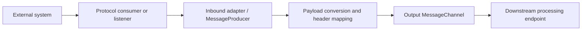

# MessageProducer Creating Messages from External Sources

In Spring Integration Runtime, an integration flow often begins with data arriving from another system: a message broker, a TCP-sending application, an IoT device, an HTTP service, or a periodically polled data source. The component receiving external data converts that data into a Spring Integration `Message<?>` and places the message onto a channel for downstream endpoints to process.

`MessageProducer` is the concept on the side that emits messages into the flow. It enables the runtime to bridge a protocol's data-receiving mechanism with Spring Integration's unified message model. As a result, subsequent steps can process messages via channels, transformers, routers, or service activators without needing to know which broker or device the data originally came from.

## 1. From External Data to a Spring Message

A Spring Integration message has two main parts:

- **Payload**: the business data, such as an `Order`, a JSON string, a byte array, or file content.
- **Headers**: accompanying metadata, such as `id`, `timestamp`, content type information, correlation, sender source, or an external message ID.

A message is an immutable envelope. When you need to change the payload or add metadata, the flow creates a new message instead of mutating the existing one. `MessageBuilder` is the standard way to construct messages in application code:

```java
Message<OrderReceived> message = MessageBuilder
    .withPayload(orderReceived)
    .setHeader("sourceSystem", "partner-a")
    .setHeader("externalMessageId", externalMessageId)
    .build();
```

Spring Integration manages system headers such as `id` and `timestamp`. Applications should use their own clearly named headers for custom metadata, avoiding overwriting system headers or stuffing all business data into headers.

A typical data ingestion flow has the following steps:



The inbound adapter is responsible for protocol details: registering listeners, receiving data, converting data types, and sending messages to the channel. Downstream endpoints only need to understand `Message<?>` and the channel contract.

## 2. Distinguishing Between Push and Pull Models

Spring Integration supports two common ways to retrieve data from external sources. Choosing the right adapter type is essential because the way the runtime triggers data reception differs.

| Characteristic | Message-driven producer (push) | Polling source (pull) |
|---|---|---|
| Typical component | Listener-based inbound adapter implementing the `MessageProducer` contract | `MessageSource<?>` executed by `SourcePollingChannelAdapter` |
| Who initiates each receive | Events arriving from a broker, socket, or external system | Spring Integration's poller calls the source on a schedule |
| Poller | Usually no poller is needed | Requires a poller to define the interval and fetch count |
| Examples | JMS message-driven adapter, TCP inbound adapter, MQTT message-driven adapter | File inbound adapter, JDBC inbound adapter, or custom `MessageSource` |
| Things to watch | Number of listeners, concurrency, acknowledgment, and channel capacity | Poll interval, max messages per poll, and state of already-read data |

In the push model, the adapter's listener is registered with the external source. When an event arrives, the listener converts the data into a Spring Message and sends it to the output channel. Do not add a poller simply because the flow starts with an inbound adapter; check which type of adapter is being used.

In the pull model, `MessageSource.receive()` is called by `SourcePollingChannelAdapter`. The poller determines when to invoke it, the interval between invocations, and the maximum number of messages per poll. `MessageSource` is not synonymous with `MessageProducer`: a source supplies messages when asked, whereas a producer pushes messages into the flow when events occur.

## 3. Declaring an Inbound Producer with Java DSL

The following example receives messages from the JMS destination `orders.in`. The message-driven adapter manages listening to the broker, converting the JMS message into a Spring Message, and sending the message to the `ordersInbound` channel.

```java
@Configuration
@EnableIntegration
public class OrderIngressConfiguration {

    @Bean
    public MessageChannel ordersInbound() {
        return new DirectChannel();
    }

    @Bean
    public IntegrationFlow ordersFromBroker(ConnectionFactory connectionFactory) {
        return IntegrationFlow
            .from(Jms.messageDrivenChannelAdapter(connectionFactory)
                .destination("orders.in"))
            .enrichHeaders(headers -> headers.header("sourceSystem", "jms"))
            .channel("ordersInbound")
            .get();
    }
}
```

This flow illustrates the boundary between the adapter and business processing:

1. `Jms.messageDrivenChannelAdapter(...)` creates an endpoint that receives messages in an event-driven manner from a JMS listener container.
2. `.destination("orders.in")` selects the destination the endpoint subscribes to.
3. The adapter converts the JMS message into a Spring Integration `Message<?>`. Payload conversion and JMS property mapping depend on the converter and header mapper configured on the adapter.
4. `.enrichHeaders(...)` adds metadata indicating the message arrived from JMS.
5. `.channel("ordersInbound")` forwards the message to subscribers of the channel.

Another flow can subscribe to process messages from this channel:

```java
@Bean
public IntegrationFlow processInboundOrders(OrderApplicationService orderApplicationService) {
    return IntegrationFlow.from("ordersInbound")
        .handle(OrderReceived.class, (order, headers) -> {
            // Call the application service to validate and process the order.
            orderApplicationService.accept(order);
            return null;
        })
        .get();
}
```

Spring injects the application service into the bean method parameter. The key point is that the inbound adapter is only responsible for receiving and feeding messages into the flow; business rules belong to downstream processing endpoints.

## 4. Payload Conversion and Header Mapping

Data received from an external protocol does not always have the Java type expected by the flow. The adapter may need a message converter to transform JSON, text, byte arrays, or protocol objects into an appropriate payload. The header mapper decides which protocol metadata is placed into the Spring Message headers.

When designing the conversion step, clearly determine:

- **Output payload type**: whether subsequent endpoints expect a DTO, string, byte array, or another type.
- **Decoding rules**: charset, content type, schema, or message version.
- **Metadata to preserve**: broker message ID, topic, routing key, correlation ID, source creation timestamp, and sending system name.
- **Metadata to drop or normalize**: headers unused by the application, inconsistent header names, or values inappropriate to propagate across internal boundaries.
- **Conversion errors**: malformed data must enter an observable and recoverable error-handling path.

For example, if a partner sends JSON containing `eventId`, `orderId`, and `occurredAt`, the adapter or transformer can deserialize the JSON into `OrderReceived`, keep `eventId` in a header named `externalMessageId`, and leave the business fields in the payload. This organization allows routers and observability tools to use metadata without deserializing the payload.

Do not assume that every external protocol header is mapped automatically. Check the specific adapter's converter and header mapper, especially when you need to preserve correlation IDs, reply destinations, or properties needed for acknowledgment.

## 5. The Channel Decides How Messages Are Forwarded

After the producer creates a message, the output channel determines how the message reaches the next endpoint. The channel type directly affects threading, buffering, and behavior under increased load.

| Channel | How messages are transferred | Impact when used with an inbound producer |
|---|---|---|
| `DirectChannel` | Calls the subscriber synchronously on the sending thread | Slow downstream processing can slow down the listener or receiving thread |
| `ExecutorChannel` | Dispatches processing through an executor | Decouples receiving and processing threads; requires managing the executor, ordering, and asynchronous error handling |
| `QueueChannel` | Stores messages in a queue for consumers to receive later | Creates a buffer; requires bounded capacity and a consumer/poller to pull messages out |

The JMS example above uses `DirectChannel`. Because subscriber processing runs synchronously, the listener thread may have to wait for processing to complete. This is easy to reason about and useful when keeping the processing flow simple, but a slow handler can reduce message ingestion throughput.

If using `ExecutorChannel`, configure an appropriately bounded executor and define clearly what happens when the work queue is full. Offloading processing to another thread also changes transaction boundaries and where exceptions are raised.

If using `QueueChannel`, a consumer must receive messages from it. When the consumer is implemented as a polling endpoint, configure a poller for that endpoint. A `QueueChannel` does not process messages on its own simply because a producer has placed messages into the queue.

For fast sources, coordinate listener concurrency, endpoint processing capacity, channel capacity, and the source's retry policy. Increasing the number of listeners without increasing downstream processing capacity may simply shift the bottleneck to the channel or database.

## 6. Acknowledgment, Transactions, and Duplicate Messages

The fact that an adapter has received a message from a broker does not automatically mean downstream business processing completed successfully. When acknowledgment occurs depends on the adapter type, listener container configuration, and active transaction.

When message processing must be transactional, clearly define which operations the transaction covers: receiving the message, sending to the channel, updating the database, and acknowledging with the broker. Do not assume a database transaction automatically spans the broker as well. With an asynchronous channel, the processing endpoint may run after the receiving thread has finished; in that case, transaction boundaries must be designed separately.

Even when the broker supports reliable delivery, the application should still prepare for redelivered messages. A handler may have written data successfully, only for the acknowledgment to fail, causing the broker to redeliver the message. Use an idempotency key such as `externalMessageId` or `eventId`, persist appropriate processing markers, and ensure business operations tolerate duplicate deliveries.

For messages requiring retry, distinguish transient errors (timeouts, unavailable downstream services) from data errors (invalid schema, missing required fields). Apply bounded retries with appropriate backoff for transient errors; unprocessable messages should be routed to a dead-letter destination or manual handling workflow according to system policy.

## 7. Error Handling at the Inbound Boundary

Errors can occur before or after a message is placed onto a channel:

- Errors connecting to or registering a listener with the external source.
- Decoding, converter, or header mapper errors.
- Errors when the producer sends a message to the output channel.
- Errors in downstream transformers, routers, or service activators.

Spring Integration represents message errors using `ErrorMessage`; the payload is typically a `MessagingException` containing the cause and, when available, the failing message (`failedMessage`). You can configure an error channel on the appropriate adapter or endpoint to centralize error observation and handling. With asynchronous processing, check the error channel of the component actually executing the work, because exceptions may arise on a thread different from the receiving thread.

An error-handling policy should answer three questions: which errors are retried, at most how many times they are retried, and where failed messages are ultimately stored or routed. Logs should include `messageId`, `externalMessageId`, correlation ID, and source name so an event can be traced across multiple endpoints. Avoid logging sensitive payloads or uncontrolled full header dumps.

## 8. Producer Lifecycle and Operations

An inbound adapter is an endpoint managed by Spring Integration. When the application context starts, the endpoint is started according to its lifecycle configuration; when the context stops, the endpoint is stopped to release listeners, connections, or protocol resources. Endpoints typically expose lifecycle attributes such as `autoStartup` and `phase` through Spring's lifecycle mechanism.

When you need to toggle an endpoint based on application state, use Spring Integration's lifecycle management rather than spawning custom listener threads outside the container. For dynamically registered flows, `IntegrationFlowContext` allows registering and removing flows at runtime; when removing a flow, ensure the producer and associated resources are also properly stopped.

Operational signals to monitor include:

- Endpoint state and connectivity to the broker or source system.
- Number of messages received, number of messages sent to the channel, and number of conversion/send errors.
- Latency from reception to completion, along with queue depth if the channel buffers messages.
- Retry counts, dead-lettered messages, and duplicate deliveries.
- Number of active listeners/threads and executor health.

If messages do not appear in the flow, check in turn: endpoint status, source connection and subscription, converter logs, whether the output channel has subscribers or consumers, and only then downstream handlers. Tracing boundary by boundary helps identify whether messages stopped at ingestion, conversion, or processing.

## 9. Testing Inbound Producers

Data conversion and external source connectivity should be tested separately. For conversion tests, feed sample data into the converter or mapper component and assert the expected payload and headers. For integration tests, use an appropriate test broker or container to confirm that the adapter actually receives messages, sends them to the right channel, and honors acknowledgment settings.

A `QueueChannel` can serve as a capture point in flow tests to verify emitted messages:

```java
QueueChannel captured = new QueueChannel();

// Send a test message through the flow entry point, then inspect the captured message.
Message<?> actual = captured.receive(1_000);
assertThat(actual).isNotNull();
```

The snippet above only illustrates receiving a message from the queue; a complete test needs to wire `captured` to the flow's output channel and send input data before calling `receive`. Do not test only that the endpoint started: verify the payload, headers, behavior with malformed data, and ability to handle duplicate deliveries.

## 10. Common Design Mistakes

| Symptom | Possible cause | What to check |
|---|---|---|
| No messages enter the flow | Endpoint not started, wrong destination/topic, or listener not registered | Lifecycle state, subscription configuration, and connection logs |
| Polling endpoint does not run | Missing poller or improper poller configuration | Confirm `MessageSource` is used and inspect the endpoint's poller |
| Listener slows down under increased load | `DirectChannel` invokes processing synchronously and the downstream handler is slow | Measure handler duration, check concurrency, and consider an appropriate channel/executor |
| Messages enter channel but are not processed | `QueueChannel` has no consumer or poller | Inspect consumers, pollers, and queue depth |
| Message errors loop indefinitely | Unbounded retries or data errors treated as transient errors | Classify errors, bound retries, and configure dead-letter handling |
| Business operation executes twice | Source redelivers message or acknowledgment fails after processing | Use an idempotency key and inspect transaction boundaries |
| Cannot trace sender source | Header mapper drops metadata or logs lack correlation | Standardize headers and log required identifiers |

When designing a producer, determine upfront the message source, push vs. pull model, payload type, metadata to preserve, output channel, and error policy. These decisions form a stable input contract for the entire IntegrationFlow and enable the runtime to coordinate messages visibly and controllably under load spikes or external source outages.
