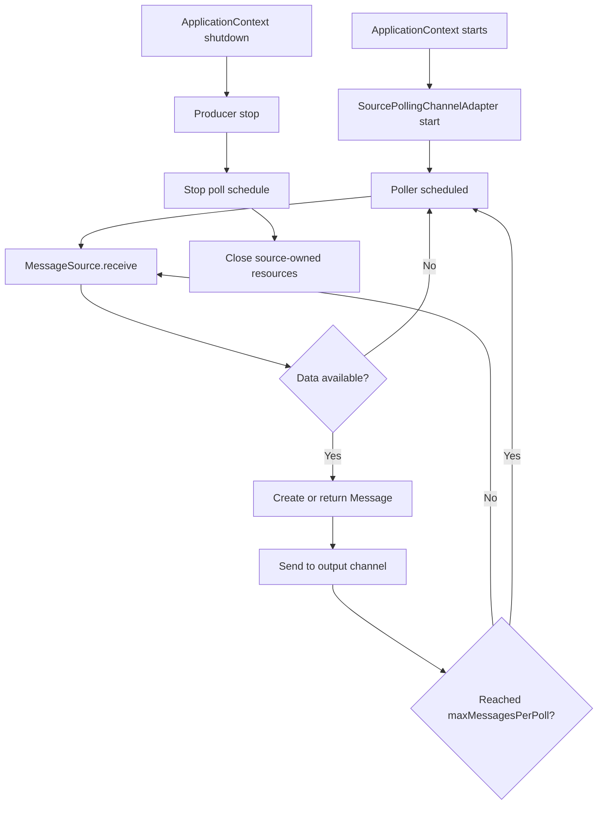

# Producer Lifecycle and Source Resources

In Spring Integration, a message producer is the point that brings data from the outside into a message flow. A producer can actively fetch data on a schedule, or receive callbacks from an event-emitting system. Either way, the producer has a lifecycle bound to `ApplicationContext`: initialized, started, paused or stopped, and releasing resources when the application shuts down.

Proper lifecycle management prevents issues such as pollers still running during application shutdown, leaked clients or streams, two producers reading from the same source, or messages lost when stopping mid-flight. It is important to distinguish the lifecycles of the **producer endpoint**, the **MessageSource**, and the **resources used by the source**. These three are related, but they do not necessarily share the same start/stop/close mechanism.

## 1. Producer in the Message Flow

A producer is typically placed at the entrance of an integration flow. It converts data from a file, database, HTTP, message broker, or external API into a Spring `Message<?>`, and then sends the message to the output channel.

Spring Integration has two main producer styles:

| Producer style | Operating mechanism | Typical components |
| --- | --- | --- |
| Polling inbound adapter | Periodically invokes the source to fetch data; the source returns a message or `null` if no data is available yet | `MessageSource`, `SourcePollingChannelAdapter`, `Poller` |
| Event-driven/message-driven inbound adapter | Receives callbacks or messages from an external system's listener/container and sends them to the channel | Message-driven adapter, listener container, `MessageProducerSupport` |

A polling flow typically looks like this:



With an event-driven producer, the external system calls the listener or adapter when an event occurs. There is no scheduled `receive()` loop, but the adapter and listener container must still be started and stopped at the right times.

## 2. Distinguishing Endpoint, Source, and Resource

Three common layers of responsibility:

| Object | Responsibility | Typical lifecycle |
| --- | --- | --- |
| Producer endpoint | Coordinates receiving data and sending messages to the channel | Managed by Spring via `Lifecycle`/`SmartLifecycle`; has `start()`, `stop()`, and running state |
| `MessageSource<T>` | Supplies a message when `receive()` is called | May be a stateless object, or may hold state or own resources that must be closed |
| Source resource | Connection, stream, file handle, client, listener, or session used by the source | Must be closed or disposed of by its rightful owner when no longer needed |

`MessageSource<T>` is a contract for fetching messages, not a guarantee that the source manages its own thread or closes all resources automatically. The `receive()` method returns a `Message<T>` when data is available, and returns `null` when no message is currently present. A custom source must clearly define whether it holds long-lived resources or only opens resources during each `receive()` call.

The producer endpoint has its own lifecycle. For example, `SourcePollingChannelAdapter` coordinates the polling schedule and invokes the source. When the endpoint stops, the polling schedule stops; that does not mean every object referenced by the source is automatically closed. Cleanup also depends on the source type and how the bean is declared.

## 3. Spring-Managed Lifecycle

Spring Integration endpoints typically integrate with the Spring lifecycle. During `ApplicationContext` startup, endpoints are initialized and endpoints configured for auto-startup are started. When the context closes, Spring invokes stop in phase order and then destroys beans to release resources.

Key attributes to pay attention to:

- **`autoStartup`:** determines whether the endpoint starts automatically when the context starts. Can be set to `false` if waiting for configuration, connectivity, or other operational conditions.
- **`phase`:** controls the start/stop order of beans implementing `SmartLifecycle`. Beans with a lower phase start first; on stop, the order is reversed. Usually consumers should be ready before producers start emitting messages, and producers should stop first so consumers have time to finish remaining work.
- **`start()` / `stop()`:** enables or disables endpoint activity at runtime. Stopping an endpoint does not destroy the bean; the endpoint can be restarted if the implementation supports it.
- **`isRunning()`:** indicates whether the endpoint is running according to its lifecycle state. This state does not prove the external source is healthy or messages are being processed successfully.
- **`destroy()`:** cleanup step when the bean is destroyed. This is where resources owned by the bean are released; `stop()` should not be used as a substitute for closing resources.

Example of declaring an endpoint that runs only when controlled explicitly:

```java
@Bean
@InboundChannelAdapter(
        channel = "incomingEvents",
        autoStartup = "false",
        poller = @Poller(fixedDelay = "1000"))
public MessageSource<Event> eventSource(EventRepository repository) {
    return new RepositoryEventMessageSource(repository);
}
```

In this example, the endpoint does not start polling automatically as soon as the context starts. A management component can call `start()` after the application completes its preparation steps. When controlling runtime behavior, interact with the lifecycle endpoint/bean registered in the context rather than creating a second poller against the same source.

### Start and Stop Ordering

Suppose a flow has a consumer that needs to be ready before the producer emits messages. You can assign a lower phase to the consumer and a higher phase to the producer. On start, the consumer starts first; on stop, the producer stops before the consumer. This reduces the chance of messages being sent to an unready endpoint or the producer continuing to generate messages while the consumer has already stopped.

Phase is not a queue-draining mechanism and does not replace bean dependencies. If a producer depends on a specific client or resource, declare the dependency via constructor injection and let Spring manage the bean. When shutdown must wait for processing to finish, configure timeouts and graceful shutdown policies appropriate for the executor, listener container, or broker in use.

## 4. Lifecycle of Polling Producers and Pollers

A polling inbound adapter combines a `MessageSource` with `SourcePollingChannelAdapter`. The poller decides when to call the source and how many messages at most to fetch per cycle.

Example using Java DSL:

```java
@Bean
IntegrationFlow inboundEvents(MessageSource<Event> eventSource) {
    return IntegrationFlow.from(eventSource,
                    endpoint -> endpoint.poller(
                            Pollers.fixedDelay(Duration.ofSeconds(1))
                                    .maxMessagesPerPoll(20)))
            .channel("incomingEvents")
            .get();
}
```

In this configuration:

- `fixedDelay` sets the pause between polls relative to the completion time of the previous cycle.
- `fixedRate` can be used when scheduling should be based on the start time of cycles; you must account for processing time and potential overlapping tasks depending on the executor/configuration.
- `initialDelay` delays the first poll if preparation time is needed.
- `maxMessagesPerPoll` limits the number of messages fetched in one cycle. A value of `-1` can be used to keep fetching until the source has no more data; be cautious with continuous sources that always have data, as a single cycle may occupy a long time.
- `taskExecutor` can offload poll execution to an executor. It affects the execution thread and concurrency; it does not automatically make the source thread-safe.

Do not confuse `maxMessagesPerPoll` with the number of consumers or threads. It is a limit on how many times the source is called in a single poll cycle. If you want to increase throughput, evaluate processing time, executor settings, source and downstream capacity, and verify whether the source supports concurrent `receive()` calls.

Another way to declare this is using `@InboundChannelAdapter` with `@Poller`:

```java
@Bean
@InboundChannelAdapter(
        channel = "incomingEvents",
        poller = @Poller(
                fixedDelay = "1000",
                maxMessagesPerPoll = "20"))
public MessageSource<Event> eventSource(EventRepository repository) {
    return new RepositoryEventMessageSource(repository);
}
```

Choose one way to create the endpoint for each source. Do not both declare an adapter annotation and create another `IntegrationFlow.from(source, ...)` polling the same source instance, unless the source is explicitly designed for multiple concurrent consumers.

## 5. Lifecycle of Event-Driven Producers

With a message-driven inbound adapter, the external system actively emits events. For example, JMS or a broker can use a listener container to receive messages. The adapter typically manages the listener container and sends received messages to the output channel.

The lifecycle can be understood in the following steps:

1. Spring initializes the adapter, container, and connection factory according to declared dependencies.
2. When the adapter starts, the listener container begins receiving messages or registers callbacks with the source.
3. When a message arrives, the adapter converts transport data into a Spring `Message<?>` and sends it to the channel.
4. When the adapter stops, the listener/container stops receiving further messages according to the transport's mechanism.
5. When the context closes, connections, sessions, or clients owned by beans are released.

For this type of producer, there is no `MessageSource.receive()` polled on a schedule. Inspect the lifecycle state of the adapter and corresponding listener container. If the container supports acknowledgment, consumer concurrency, or graceful shutdown, those settings directly affect whether in-flight messages are acknowledged, redelivered, or awaited to completion.

Do not close a shared connection factory from inside an adapter if the factory is owned by the context or used by multiple endpoints. The adapter should only stop the listener/container it manages; the bean owning the connection factory will release it in its own lifecycle.

## 6. Managing Resources Used by MessageSource

There are two common resource ownership models.

### Resources Scoped to a Single receive Call

If the source opens a file stream, HTTP response body, or reader during a `receive()` call, close the resource as soon as processing finishes using `try-with-resources` or `finally`:

```java
public Message<String> receive() {
    try (InputStream input = resource.getInputStream()) {
        String value = readNextValue(input);
        if (value == null) {
            return null;
        }
        return MessageBuilder.withPayload(value).build();
    }
    catch (IOException ex) {
        throw new MessageSourceException("Unable to read resource", ex);
    }
}
```

This snippet illustrates the ownership principle: the stream is opened during the poll and closed within the same poll, even when reading fails. Do not keep a stream open across multiple cycles if the source lacks a clear protocol for managing read position, timeouts, and cleanup.

### Resources Living for the Bean Lifecycle

If the source holds a long-lived client, session, or watcher, the bean must have an explicit closing mechanism. For example:

```java
public final class RemoteEventMessageSource
        implements MessageSource<RemoteEvent>, AutoCloseable {

    private final RemoteClient client;
    private volatile boolean closed;

    public RemoteEventMessageSource(RemoteClient client) {
        this.client = client;
    }

    @Override
    public Message<RemoteEvent> receive() {
        if (closed) {
            return null;
        }

        RemoteEvent event = client.poll();
        return event == null
                ? null
                : MessageBuilder.withPayload(event).build();
    }

    @Override
    public void close() {
        closed = true;
        client.close();
    }
}
```

Register the source as a bean and specify the cleanup method:

```java
@Bean(destroyMethod = "close")
RemoteEventMessageSource remoteEventSource(RemoteClient client) {
    return new RemoteEventMessageSource(client);
}
```

This example assumes the source owns `RemoteClient`. If the client is a shared bean or connection pool managed by another bean, do not close it in `RemoteEventMessageSource`; let the owning bean perform cleanup. At the same time, ensure the endpoint stops polling before the client is closed to avoid `receive()` running against an already-disposed client.

Spring `Resource` usually describes a location or way to access data such as a file, classpath entry, or URL. The `Resource` object itself is not synonymous with an open stream. When calling `getInputStream()`, the returned stream must be closed according to proper ownership. Distinguishing these two concepts prevents accidentally leaking file handles or closing a shared resource prematurely.

## 7. Managing Sources by Data Type

| Source | What to manage | Cleanup and reliability tips |
| --- | --- | --- |
| File system | Directory scanner, file filter, file lock, content-reading stream | Close the stream after each read; release locks upon completion; use appropriate filters/persistent metadata to avoid duplicate reads or missed files after restart |
| JDBC/database | `DataSource`, transactions, cursors or statements if managed manually | Prefer `JdbcTemplate`/adapters for connection management; if opening JDBC resources manually, close `ResultSet`, `Statement`, and `Connection` in proper order |
| HTTP/remote API | HTTP client, connection pool, response body, timeout | Close response bodies; use a bean-managed client; dispose of the client/pool when the owning bean closes |
| JMS/message broker | Connection factory, listener container, session, and acknowledgment | Stop the container via lifecycle; let the bean owning the factory close connections; clearly define acknowledgment/redelivery |
| Watcher or continuous stream | Threads, subscriptions, sockets, or long-lived handles | Unsubscribe, wake up blocked threads if needed, wait for threads to terminate, then close handles |

For file sources, distinguish between **discovering a file** and **reading file contents**. A `FileReadingMessageSource` may emit a `File` object; a subsequent step in the flow opens the stream to read its contents. Do not assume the source has already opened a stream just because it created a message containing a `File`. Accept-once filters, scanners, and file lockers have their own state; choose policies matching restart and deduplication requirements.

For JDBC, adapters/sources usually fetch data through a `DataSource`. When using a Spring-managed connection pool, do not close the pool on every poll. Distinguish a connection borrowed from the pool from the pool itself, which lives for the duration of the application. When transactions are needed, configure a transaction manager and appropriate transaction scope around read/mark-processed operations.

## 8. Stop, Restart, and Graceful Shutdown

`stop()` is the signal to stop the endpoint. For a polling producer, it prevents subsequent polls from being scheduled. For an event-driven producer, it tells the adapter/listener container to stop receiving events. However, stopping the endpoint does not automatically guarantee that all received messages have finished processing, queues are drained, or side effects are committed.

A controlled shutdown procedure typically includes:

1. Stopping new message creation upstream or stopping the producer endpoint first.
2. Waiting for in-flight tasks to finish within a configured timeout.
3. Allowing consumers to process remaining messages in queues if application policy requires draining.
4. Confirming or rolling back transactions/acknowledgments according to the source mechanism.
5. Stopping executors, listener containers, and pollers in dependency order.
6. Closing clients, streams, connections, or resources owned by beans.

If producers and consumers use separate executors, configure shutdown timeouts and task-waiting policies for each executor. When messages are sent via `ExecutorChannel`, a successful send from the producer usually only confirms the task was handed off according to the executor configuration; it does not prove a worker has finished processing. Monitor active tasks and pending queues before closing resources needed by workers.

Restart also requires attention to source state. If a source reads from files or a database and marks items as fetched, define where the marker commits relative to message processing. If marked too early, downstream errors can lose data; if marked too late, restarts may replay data. Designing consumer idempotency and clear checkpoint/acknowledgment mechanisms is usually more important than attempting to guarantee absolute once-only execution.

## 9. Transactions, Retries, and Producer Errors

Errors can occur across several stages:

- `receive()` fails while accessing the source.
- The source returns a message, but sending to the output channel fails.
- A downstream handler throws an error after the message has been sent.
- A resource is closed while a poll or callback is still running.

Identify which boundary the error occurred at before configuring retries. Retrying a source call may return the same data, new data, or nothing at all, depending on the source. Retrying a message send may cause duplicates if the first send partially succeeded. Therefore, use stable source IDs, idempotency keys, or checkpoints to recognize already-processed messages.

Poller transactions can be configured via transaction advice/transaction managers when the source supports it. However, not every resource can be rolled back. Reading a file, calling HTTP, or receiving a broker callback does not automatically become transactional just because the flow has transaction advice. With brokers, use acknowledgment/transactions supported by the broker adapter. With files, establish marker conventions or move files after successful processing. With databases, reading and updating processing status should sit inside an appropriate transaction.

If errors occur in a polling endpoint, configure error handling on the poller and monitor endpoint logs/metrics. If errors arise during asynchronous processing, exceptions may be wrapped into an `ErrorMessage` on an error channel according to configuration; the producer will not necessarily receive the exception synchronously. Do not treat `errorChannel` as a durable storage mechanism without an appropriate backing queue/store.

## 10. Observing Runtime State

An endpoint's `isRunning()` status only reflects the endpoint's lifecycle. To know whether a producer is genuinely operating well, also monitor:

- Last poll timestamp and duration of a single `receive()` call.
- Counts of messages created, successfully sent, empty polls, and errors.
- Queue depth or queued tasks when an executor or queue-backed channel is present.
- Age of the oldest message and latency from when the source detected data to when the consumer processed it.
- Retry counts, redeliveries, duplicates, and messages entering error flows.
- Connection state, timeouts, and errors of external clients/resources.
- Active threads and threads blocked during shutdown.

When you need to stop or restart an endpoint, operate on the lifecycle bean registered in the context and verify its state afterward. Avoid calling `receive()` manually on the same source managed by a poller, as this can cause two execution paths to compete for data or corrupt checkpoints.

## 11. Safe Producer Design Checklist

1. Determine whether the producer is polling or event-driven; do not attach a poller to a source that already uses listener callbacks unless the adapter requires it.
2. Identify which endpoint owns the source and how many consumers each source has.
3. Choose `autoStartup`, `phase`, triggers, and message limits according to the source's capabilities.
4. Determine which resources live per `receive()` call and which live for the bean lifecycle.
5. Close streams/responses/statements immediately after use; close clients or watchers in the owning bean's cleanup.
6. Define behavior when `receive()` returns `null`, when the source errors, and when channel sending fails.
7. Design transactions, acknowledgments, checkpoints, retries, and idempotency according to the actual source semantics.
8. Test stop/restart during active polling and while downstream processing is in flight.
9. Monitor both lifecycle state and connection health as well as message processing progress.

A producer is well-managed when its endpoint can start and stop in an orderly way, its source has clear data-retrieval rules, and every resource is closed by its rightful owner. When these three aspects are designed cleanly and separately, the message flow is far easier to operate, restart, and troubleshoot.
