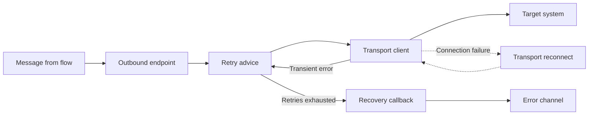
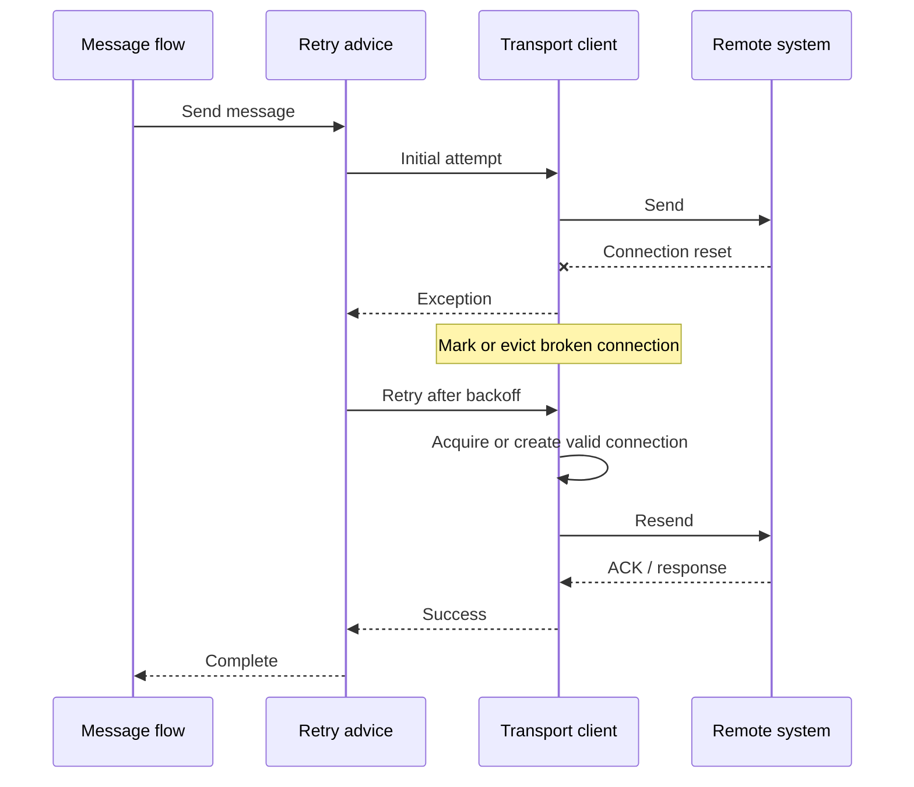

# Producer Retry and Reconnect

In Spring Integration, a producer is often an outbound adapter or outbound gateway that sends messages to an external system such as an HTTP service, broker, TCP server, FTP/SFTP server, or another integration service. When the destination is temporarily unavailable, the producer needs an appropriate retry policy; when the physical connection is closed or broken, the transport client or connection factory must restore the connection.

These two concerns are related but distinct. **Retry** repeats the send operation after a failure. **Reconnect** re-establishes the connection to the target system. Retry does not automatically guarantee a connection has been recreated, and reconnect does not automatically resend a failed message. A reliable producer coordinates both with timeouts, error flows, idempotency, and message persistence.

## 1. Defining the Producer Boundary

Spring Integration provides two common outbound endpoint styles:

- **Outbound channel adapter**: sends a message out and produces no reply message for the flow. For example: publishing a record to a broker or writing a file to a remote server.
- **Outbound gateway**: sends a request and waits for a response. For example: calling an HTTP API or sending a TCP request and awaiting the reply.

Errors can occur when establishing a connection, writing data, waiting for a response, or reading the result. With a gateway, failing to receive a response does not prove the target system did not execute the operation. The server may have committed the change while the response was lost in transit.

An outbound endpoint typically invokes a transport client through a message handler. The processing boundary can be visualized as follows:



Retry advice wraps the endpoint invocation. How the underlying connection is restored depends on the transport client or connection factory used by the endpoint.

## 2. Retrying at the Outbound Endpoint

Spring Integration provides `RequestHandlerRetryAdvice` to retry when a message handler throws an exception. This advice is typically attached to the outbound processing endpoint. It uses Spring Retry's `RetryTemplate` to define which exceptions are retryable, the maximum number of attempts, and the wait interval between attempts.

A retry policy should clearly define:

| Component | Question to answer |
|---|---|
| Retryable exceptions | Which failures are likely transient, such as timeouts or temporary connection errors? |
| Max attempts | What is the maximum total number of calls, including the initial attempt? |
| Backoff | How long to wait before each subsequent attempt? |
| Recovery | Once attempts are exhausted, where are the message and exception routed? |
| Timeout budget | Does the total wait time fit within the flow's SLA? |

Do not retry every exception. Configuration errors, malformed data, authentication failures, or invalid requests usually do not resolve themselves on retry. Retrying such errors only increases load and delays addressing the true root cause.

### Configuring Bounded Retries

The following example configures up to four attempts with exponential backoff. The listed exceptions are retryable in this example; other exceptions are excluded from this retry policy.

```java
import java.net.ConnectException;
import java.net.SocketTimeoutException;
import java.util.Map;

import org.springframework.context.annotation.Bean;
import org.springframework.integration.handler.advice.ErrorMessageSendingRecoverer;
import org.springframework.integration.handler.advice.RequestHandlerRetryAdvice;
import org.springframework.messaging.MessageChannel;
import org.springframework.retry.policy.SimpleRetryPolicy;
import org.springframework.retry.support.RetryTemplate;
import org.springframework.retry.backoff.ExponentialBackOffPolicy;

@Bean
RequestHandlerRetryAdvice producerRetryAdvice(
        MessageChannel producerErrors) {

    Map<Class<? extends Throwable>, Boolean> retryable =
            Map.of(
                SocketTimeoutException.class, true,
                ConnectException.class, true
            );

    SimpleRetryPolicy retryPolicy =
            new SimpleRetryPolicy(4, retryable, true);

    ExponentialBackOffPolicy backOff =
            new ExponentialBackOffPolicy();
    backOff.setInitialInterval(200);
    backOff.setMultiplier(2.0);
    backOff.setMaxInterval(2_000);

    RetryTemplate retryTemplate = new RetryTemplate();
    retryTemplate.setRetryPolicy(retryPolicy);
    retryTemplate.setBackOffPolicy(backOff);

    RequestHandlerRetryAdvice advice = new RequestHandlerRetryAdvice();
    advice.setRetryTemplate(retryTemplate);
    advice.setRecoveryCallback(
            new ErrorMessageSendingRecoverer(producerErrors));

    return advice;
}
```

`maxAttempts = 4` means one initial invocation and up to three retries. With backoff starting at 200 ms and doubling, the wait between attempts grows progressively without exceeding 2,000 ms. Actual elapsed time also includes the duration of each transport client call and its timeout.

This snippet uses standard Java exceptions for illustration. When applying it to a specific transport, include the exact exception types thrown by the actual client. A client may wrap `SocketTimeoutException` inside another exception; the `traverseCauses` parameter on `SimpleRetryPolicy` enables inspecting the cause chain.

Spring Retry must be on the classpath to use `RetryTemplate` and retry advice. In projects using dependency management, choose a Spring Retry version compatible with the project's Spring Integration version.

### Attaching Advice to an Outbound Gateway

The example below attaches retry advice to an HTTP outbound gateway. The same configuration pattern applies to other outbound handlers supporting an advice chain.

```java
import org.springframework.context.annotation.Bean;
import org.springframework.integration.dsl.IntegrationFlow;
import org.springframework.integration.dsl.http.Http;
import org.springframework.http.HttpMethod;

@Bean
IntegrationFlow publishOrdersFlow(
        RequestHandlerRetryAdvice producerRetryAdvice) {

    return IntegrationFlow.from("ordersToPublish")
            .handle(
                Http.outboundGateway("https://partner.example/api/orders")
                    .httpMethod(HttpMethod.POST)
                    .expectedResponseType(String.class),
                endpoint -> endpoint.advice(producerRetryAdvice))
            .get();
}
```

When the outbound handler throws an exception matched by the retry policy, the advice re-invokes the handler according to the configured attempts and backoff. If an attempt succeeds, the result continues down the flow. If all attempts fail, the recovery callback is invoked.

## 3. Handling When Retries Are Exhausted

The example above uses `ErrorMessageSendingRecoverer` to send an `ErrorMessage` to the `producerErrors` channel. The error message carries details about the original message and the last exception. The error-handling flow can log, emit metrics, persist the message to an error store, or escalate to a manual handling workflow.

Declaring the channel and a simple error flow:

```java
import org.springframework.context.annotation.Bean;
import org.springframework.integration.channel.DirectChannel;
import org.springframework.integration.dsl.IntegrationFlow;
import org.springframework.messaging.MessageChannel;

@Bean
MessageChannel producerErrors() {
    return new DirectChannel();
}

@Bean
IntegrationFlow producerErrorFlow() {
    return IntegrationFlow.from("producerErrors")
            .handle(message -> {
                // Log, persist the error, and alert according to operational policy.
            })
            .get();
}
```

In production applications, the error flow should capture enough context for investigation and replay: message identifier, target destination, timestamp, attempt count, exception, and correlation ID. Avoid logging sensitive payloads unless appropriate data-protection policies are in place.

Distinguish three outcomes:

- **Retry succeeded:** the endpoint completed the call and the message continues along the flow.
- **Recovery handled it:** the callback takes over after attempts are exhausted; subsequent behavior depends on the callback's outcome.
- **Error continues propagating:** the exception propagates to the caller and can be handled by a poller, error channel, or transaction according to the flow configuration.

Sending an error message does not mean the message has been durably persisted. If you must guarantee no message loss when the application stops, use a durable store or an appropriate outbox rather than relying solely on logs or in-memory channels.

## 4. Reconnect Belongs to the Transport Client

Retry advice re-invokes the handler. Reconnect is managed by the transport client, connection factory, or protocol library. Exact configuration differs across HTTP, TCP, JMS, AMQP, Kafka, MQTT, and file adapters.

When a connection breaks, the transport mechanism may detect the failure immediately during a send, detect it during connection validation, or only discover it on the next use. Depending on the client, a new connection may be created automatically, created on the next request, or require application lifecycle control.

When configuring reconnect, determine:

1. Which component owns the connection and manages the pool or connection cache?
2. Which errors cause a connection to be marked broken or evicted from the pool?
3. Which component creates replacement connections, and is there backoff or an attempt limit?
4. When connectivity recovers, are pending messages resent by retry advice, the broker, or a replay mechanism?
5. Where are connection open, close, and error events observed?

Do not assume an outbound endpoint always opens a fresh connection after an exception. If the client retains a broken connection in a pool, subsequent retries may keep failing. Configure and test broken-connection eviction, new connection creation, and send resumption according to the documentation of the transport in use.

### Coordinating Retry and Reconnect

A typical recovery sequence proceeds as follows:



This is a conceptual model. Whether the client actually establishes a new connection on the next attempt must be verified for the specific transport. Retry advice does not directly control connection creation.

If the target system stays down for an extended period, continuous retrying can place heavy load on both the application and the recovering system. Use progressive backoff, bounded attempts, reasonable timeouts, and a circuit breaker or temporary producer pause when appropriate. When connectivity recovers, ramp replay traffic gradually to avoid sudden traffic spikes.

## 5. Avoiding Duplicates During Retries

A dangerous scenario occurs when the client sends a request, the server executes the business operation, but the ACK or response is lost. The producer sees a timeout and resends. The target system may execute the same operation twice.

Thus, retries introduce the possibility of duplicate delivery. Systems requiring reliability generally must be designed assuming a message can be delivered more than once (at-least-once); retries themselves also do not guarantee a message cannot be lost. Never infer exactly-once semantics simply because an endpoint retries or connections recover.

Common safeguards include:

- Attach a stable idempotency key to each operation, such as `orderId` or `eventId`; keep the same key across all attempts.
- Require the target system to detect duplicate requests and return the already-processed result instead of executing side effects again.
- For consumers you control, record processed message markers in the same transaction as business updates whenever possible.
- Use a transactional outbox when database changes must stay synchronized with message publishing. A worker reading the outbox can resend after failures without losing the intent to emit the event.
- Clearly define whether ACK means the transport received bytes, the broker accepted the message, or the server-side business transaction committed. These acknowledgment levels are not equivalent.

Never generate a new idempotency key on each retry attempt. If the key changes, the target system will treat each attempt as a distinct operation.

## 6. Coordinating with Transactions, Pollers, and Executors

Synchronous retries hold the outbound-calling thread during each call, backoff wait, and retry. If the endpoint runs inside a poller, retries can stretch the duration of a single poll cycle, reducing consumption throughput and holding thread resources longer.

Calculate the time budget for the entire flow:

T_total = sum(request time) + sum(backoff time) + processing time

Each `T_request` needs a bounded timeout. If the client has no timeout, a single attempt can hang longer than the entire expected budget. Total retry time must also fit within poller schedules, transaction timeouts, SLAs, and the message's validity window.

Key points to verify:

- **Transactions:** a local database transaction does not automatically roll back side effects that already happened on a remote system. Wrap sends in a transaction only when the transport and configuration genuinely support those semantics.
- **Broker redelivery:** if a consumer transaction rolls back, the broker may redeliver the message. Combining broker redelivery with retry advice can create multiplied retry layers.
- **Executors:** if a flow hands off to an asynchronous executor, exceptions may happen on another thread after the initial send step has returned. Retry advice placed at the boundary cannot wrap failures occurring beyond that boundary.
- **Throughput:** multiple producers retrying simultaneously can trigger thundering herds. Jittered backoff, concurrency limits, and circuit breakers help prevent clients from retrying in lockstep.
- **Shutdown:** when the application stops, decide whether messages awaiting retry are retained, routed to an error flow, or aborted. If messages must survive restarts, use a persistent queue, message store, or appropriate outbox.

Do not configure independent retries at every layer without computing the total number of sends. For instance, four attempts at the endpoint combined with five attempts inside the client can produce up to twenty transport calls for a single message. Designate one layer as the primary retry coordinator and document explicit limits for any remaining layers.

## 7. Diagnosing Producers Failing to Send Messages

When a producer fails, gather evidence at the exact boundary instead of merely increasing retry counts.

| Symptom | What to inspect |
|---|---|
| Fails on the very first attempt | DNS, target address, authentication, permissions, endpoint configuration, and exception type |
| Times out though target may have processed it | ACK/response, idempotency key, target-side logs, and duplicate delivery handling |
| Every retry fails with connection errors | Connection pool/cache, connection state, reconnect policy, and recovery time |
| Retry does not trigger | Whether advice is attached to the right endpoint, whether the exception matches the retry policy, and whether the call is synchronous |
| Retry runs for too long | Max attempts, backoff, per-call timeout, transaction timeout, and SLA |
| Messages land on the error channel | Final exception, recovery callback, persistence state, and replay capability |
| Traffic spikes sharply when target recovers | Backoff, jitter, concurrency, circuit breaker, and replay rate |

Record metrics for send counts, retry counts, recovery counts, reconnect counts, send latency, backoff wait time, and pending message counts. Use a correlation ID or message ID to correlate logs across the producer, transport client, and target system.

In testing, simulate at minimum three scenarios: the target fails temporarily and then recovers; the target fails continuously until recovery is invoked; and the target processes the request but the response is lost. The last case verifies whether the idempotency policy prevents duplicate side effects.

A well-operated producer must answer four questions: which errors are retried, where connections are restored, how messages are handled once retries are exhausted, and how resending is prevented from causing duplicate side effects.
