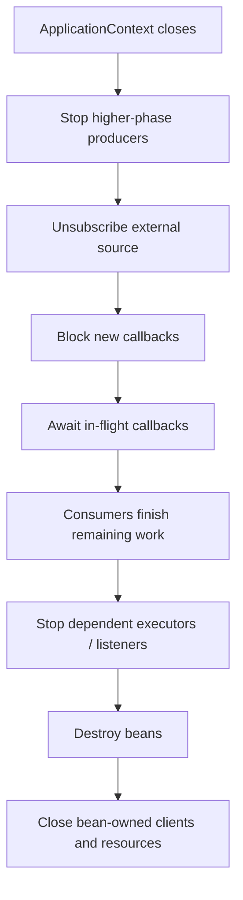

# Closing Producers Properly When the Context Stops

A message producer typically receives callbacks from an external system, creates a Spring `Message<?>`, and sends it to an output channel. When `ApplicationContext` stops, the producer must stop receiving new events, handle in-flight callbacks in a controlled way, and properly release resources it owns. Closing the client or connection immediately can cause an in-flight callback to send a message through a stopped channel or access an already-disposed resource.

In Spring Integration, endpoints are managed by the Spring lifecycle. For custom producers based on `MessageProducerSupport`, enabling and disabling the external source is typically placed in `doStart()` and `doStop()`. However, stopping an endpoint, waiting for in-flight work, and closing a client are distinct steps. Shutdown design should specify ordering, timeouts, and behavior when completion is not possible within the allotted time.

## 1. Distinguishing stop, destroy, and close

These three operations serve different purposes:

| Operation | Purpose | Example |
| --- | --- | --- |
| `stop()` | Halts endpoint activity at runtime; can be restarted if the implementation supports it | Stopping a listener or poller from emitting new messages |
| `destroy()` | Spring destroys the bean when the context closes or the bean is removed | Cleaning up final endpoint state and dependencies owned by the bean |
| `close()` | Closes a specific resource according to its API | Closing a subscription handle, socket, client, or stream |

These three operations should not be treated as synonymous. A producer may stop a listener in `doStop()` while keeping a shared HTTP client open so the endpoint can restart. A subscription handle can be closed on stop, whereas a client connection pool is closed only when the bean owning the pool is destroyed. Conversely, if a producer creates and owns its own dedicated client, it must close that client during final cleanup.

`MessageProducerSupport` provides the endpoint foundation and lifecycle hooks. Subclasses must properly integrate with the external source inside these hooks while respecting established resource ownership. Never close a shared client bean merely because one producer stopped.

## 2. Shutdown Ordering via Lifecycle Phases

Spring manages beans implementing `Lifecycle`/`SmartLifecycle` when `ApplicationContext` starts and closes. `SmartLifecycle` provides a `phase` to order activity:

- On start, lower phases are started first.
- On stop, the order is reversed: higher phases are stopped first.
- `autoStartup` controls whether the bean starts automatically during context startup.
- `isRunning()` reports the lifecycle status advertised by the endpoint; it does not prove the external client is healthy or all messages have finished processing.

With an inbound producer feeding internal consumers, you typically want consumers ready before the producer receives events. During shutdown, you want the producer to stop emitting events first, and consumers to stop afterward once they have had a chance to finish remaining work.



Phase only controls start/stop ordering among lifecycle beans. It does not drain `QueueChannel`, wait for all executor tasks, or acknowledge messages with a broker. Those responsibilities must be configured on the respective components.

## 3. Shutdown Sequence of an Event-Driven Producer

A safe shutdown procedure typically includes the following steps:

1. Mark the producer as stopping so new callbacks cannot begin new work.
2. Unregister the listener/subscription at the external source to prevent new events from being delivered to the adapter.
3. Wait a bounded time for callbacks already in progress to complete.
4. Handle or record messages already submitted to an executor/queue but not yet finished, according to application policy.
5. Stop consumers or executors in dependency order.
6. Close clients, sessions, sockets, or resources actually owned by the producer.

The ordering between step 1 and step 2 matters. The external source may emit a callback concurrently with unsubscribing. A stopping flag on the producer acts as a gate so late callbacks do not begin new work. Unsubscribing then halts subsequent callbacks at the source. Finally, an in-flight callback counter tells you when resources used by callbacks can safely be released.

## 4. Blocking New Callbacks and Tracking In-Flight Callbacks

The example below illustrates an adapter managing a subscription. The `ExternalClient` API is illustrative; substitute your SDK's actual subscribe/unsubscribe APIs.

```java
public final class CustomEventAdapter extends MessageProducerSupport {

    private final ExternalClient client;
    private final ReentrantLock lock = new ReentrantLock();
    private final Condition noCallbacks = lock.newCondition();

    private AutoCloseable subscription;
    private boolean accepting;
    private int inFlight;

    public CustomEventAdapter(ExternalClient client) {
        this.client = client;
    }

    @Override
    protected void doStart() {
        lock.lock();
        try {
            if (accepting) {
                return;
            }
            accepting = true;
        }
        finally {
            lock.unlock();
        }

        try {
            AutoCloseable newSubscription = client.subscribe(this::onEvent);
            lock.lock();
            try {
                subscription = newSubscription;
            }
            finally {
                lock.unlock();
            }
        }
        catch (RuntimeException ex) {
            lock.lock();
            try {
                accepting = false;
            }
            finally {
                lock.unlock();
            }
            throw ex;
        }
    }

    private void onEvent(ExternalEvent event) {
        lock.lock();
        try {
            if (!accepting) {
                return;
            }
            inFlight++;
        }
        finally {
            lock.unlock();
        }

        try {
            sendMessage(MessageBuilder.withPayload(event).build());
        }
        finally {
            lock.lock();
            try {
                inFlight--;
                if (inFlight == 0) {
                    noCallbacks.signalAll();
                }
            }
            finally {
                lock.unlock();
            }
        }
    }

    @Override
    protected void doStop() {
        AutoCloseable current;
        lock.lock();
        try {
            accepting = false;
            current = subscription;
            subscription = null;
        }
        finally {
            lock.unlock();
        }

        closeQuietly(current);
        awaitCallbacks(Duration.ofSeconds(10));
    }

    private void awaitCallbacks(Duration timeout) {
        long remaining = timeout.toNanos();
        lock.lock();
        try {
            while (inFlight > 0 && remaining > 0) {
                remaining = noCallbacks.awaitNanos(remaining);
            }
            if (inFlight > 0) {
                // Emit metrics/logs so operations know shutdown timed out.
            }
        }
        catch (InterruptedException ex) {
            Thread.currentThread().interrupt();
        }
        finally {
            lock.unlock();
        }
    }

    private void closeQuietly(AutoCloseable closeable) {
        if (closeable == null) {
            return;
        }
        try {
            closeable.close();
        }
        catch (Exception ex) {
            // Log with context; do not swallow shutdown failures silently.
        }
    }
}
```

The example focuses on three ideas: gating new callbacks, canceling the subscription, and awaiting callbacks that already started. Production code should add proper unsubscribe error handling, metrics for remaining in-flight callbacks, and a timeout expiration policy. If `subscribe()` can invoke a callback right before returning the subscription handle, guard start/stop state against races; you can use a dedicated lifecycle lock or a subscription API supporting atomic registration.

One critical detail: never wait for in-flight callbacks if a callback itself is calling `stop()` on the same producer, as it would wait on itself and deadlock. If the SDK can invoke stop from a callback thread, hand off the stop request to another lifecycle management thread.

## 5. Using the Stop Callback for Asynchronous Shutdown

`SmartLifecycle` provides a `stop(Runnable callback)` overload so a bean can notify the lifecycle processor when asynchronous stopping completes. This is useful when unsubscribing or waiting for tasks must occur on a separate thread rather than blocking the thread coordinating shutdown.

An asynchronous implementation must obey this contract:

- Prevent new work from being accepted as soon as stopping begins.
- Perform unsubscription and wait for in-flight work on a shutdown management worker.
- Invoke the callback only after the bean has reached its stopped state according to policy.
- Always invoke the callback on the completion path, even when cleanup fails, while logging errors clearly.
- Bound the wait with a timeout so shutdown cannot hang indefinitely.

When extending `MessageProducerSupport`, check how the base class implements lifecycle and which hooks your Spring Integration version provides before overriding lifecycle methods. Do not add a second `SmartLifecycle` for the same adapter if that causes Spring to see two controllers managing start/stop for the same source.

## 6. Handling In-Flight Messages and Queued Messages

Stopping a producer only prevents the source from emitting more messages. It does not guarantee that messages already sent into the flow have completed. Distinguish these states:

| State | Example | How to handle on shutdown |
| --- | --- | --- |
| Callback not yet started | Event still sitting in the external source | Unsubscribe or stop the listener; let the source retain or redeliver per protocol |
| Callback running | Mapping an event or calling `sendMessage()` | Wait boundedly or record timeout; do not close resources used by the callback |
| Task handed to executor | `ExecutorChannel` accepted the task but the handler has not finished | Stop accepting new tasks, await the executor up to a timeout, and handle remaining tasks per policy |
| Message in `QueueChannel` | Message waiting for poller/consumer | Keep the queue and consumer alive long enough to drain if needed; ensure persistence if the queue must survive restarts |
| Message processed by consumer but unacked | Broker awaiting acknowledgment | Ack after commit or let the broker redeliver per chosen semantics |

With `DirectChannel`, handlers typically run synchronously on the sending thread; when `sendMessage()` returns normally, synchronous processing has finished. With `ExecutorChannel`, the send call may return once the task is handed off while the handler is still running. With `QueueChannel`, messages can remain in the queue after the producer stops. Each type needs its own shutdown policy.

If draining a queue is required, stop the producer first, keep the consumer running, observe queue depth reaching 0, and only then stop the consumer. Set a deadline for draining; if the queue cannot reach 0 within the allowed time, explicitly decide whether to retain a durable queue, spill messages to storage, or accept redelivery. Never purge a queue just to shut down faster.

## 7. Acknowledgments, Transactions, and Duplicates During Stop

An event-driven producer may receive an event from a broker, call `sendMessage()`, and then acknowledge the event with the broker. When acknowledgment happens determines whether the broker can redeliver the message if the application stops unexpectedly.

- Acking before downstream processing completes can lose messages if the application crashes after the ack.
- Acking after the business transaction commits is generally safer, though crashing between commit and ack can cause the broker to redeliver the message.
- Therefore, consumers need an idempotency key or inbox/unique constraint to handle duplicates safely.
- Absolute once-only processing cannot be assumed simply by waiting for callbacks in `doStop()`.

Transactions protect only operations participating in the corresponding transaction manager. An HTTP API or file system does not automatically roll back with a database transaction. For broker sources, use acknowledgments/transactions supported by the adapter and broker; for databases, consider recording processing status in the business transaction; for files, use markers or move files after successful processing.

If a shutdown timeout occurs while a message is unacked, letting the source redeliver according to its semantics is usually safer than acking an incomplete message. This works reliably only when consumers are idempotent and do not create duplicate side effects.

## 8. Closing Resources by Their Rightful Owner

Ownership rules should be reflected clearly in bean configuration:

| Resource | Typical owner | When to close |
| --- | --- | --- |
| Listener registration/subscription handle | Producer adapter | When the producer stops |
| Dedicated HTTP client for an adapter | Producer adapter | When the bean is destroyed or per declared lifecycle |
| Shared HTTP client/connection pool | Client or connection pool bean | When the owning bean is destroyed |
| JDBC connection borrowed from a pool | Returned to pool by transaction manager/JDBC template | At the end of the transaction or JDBC operation |
| Dedicated executor for an adapter | Executor bean or adapter depending on configuration | After stopping submissions and awaiting tasks up to timeout |
| File stream/HTTP response body | Code opening the resource | Closed immediately after reading/writing via `try-with-resources` |

Do not close a connection pool in `doStop()` if other adapters still use it. Do not hold a file stream open across multiple polls without a checkpoint and cleanup protocol. When a resource has multiple consumers, inject it as a dependency and let the owning bean close it in the Spring lifecycle.

## 9. Configuring Timeouts and Stop Ordering

A production system should set explicit wait budgets for each stage:

- Time for the external source to unregister the listener.
- Time to await in-flight callbacks.
- Time to drain queues or executors.
- Time for listener containers and clients to close connections.
- Total shutdown time permitted by the deployment environment.

Do not set every individual timeout equal to the application's entire shutdown window. Partition the time budget so steps can finish ahead of the overall deadline while leaving margin for cleanup. If a step times out, log exact counts of remaining callbacks/tasks/messages and the next action taken.

In Spring, lifecycle processors can configure a timeout per shutdown phase. Tune it to the realistic combined duration of beans in that phase. If a bean's synchronous stop runs too long, it can block the shutdown thread; for long waits, consider asynchronous stop callbacks or isolating drain work into a dedicated lifecycle component.

## 10. Testing Shutdown and Restart

Lifecycle tests need deterministic control over when callbacks start and finish. Use `CountDownLatch`, `Phaser`, or fake clients to create deterministic scenarios instead of relying on `Thread.sleep`.

Key test cases:

1. **Stop while idle:** producer unsubscribes, receives no new callbacks, and closes the exact subscription handle.
2. **Stop while callback is running:** the active callback is awaited within the timeout; resources are not closed before the callback completes.
3. **Callback arriving after unsubscribe:** the stopping flag rejects new callbacks; no messages are emitted after the producer stops.
4. **Timeout:** a callback hangs past the deadline; the producer emits metrics/logs and shutdown proceeds according to policy.
5. **Unsubscribe failure:** the error is logged and cleanup of remaining resources still runs.
6. **Start-stop-start:** no duplicate listener registration, no reuse of closed subscription handles.
7. **Queue/executor backlog:** verify drain, retention, or redelivery policies behave as designed.
8. **Broker acknowledgment:** crashing or stopping between processing and ack leads to the intended redelivery/idempotency behavior.

Example testing stop while a callback is in progress:

```java
@Test
void stopWaitsForCallbackInProgress() throws Exception {
    CountDownLatch callbackStarted = new CountDownLatch(1);
    CountDownLatch releaseCallback = new CountDownLatch(1);
    StubExternalClient client = new StubExternalClient();
    DirectChannel output = new DirectChannel();
    output.subscribe(message -> {
        callbackStarted.countDown();
        try {
            releaseCallback.await();
        }
        catch (InterruptedException ex) {
            Thread.currentThread().interrupt();
            throw new MessageHandlingException(message, ex);
        }
    });

    CustomEventAdapter adapter = new CustomEventAdapter(client);
    adapter.setOutputChannel(output);
    adapter.start();

    ExecutorService stopExecutor = Executors.newSingleThreadExecutor();
    try {
        client.emitAsync(new ExternalEvent("evt-1"));
        assertTrue(callbackStarted.await(1, TimeUnit.SECONDS));

        Future<?> stopping = stopExecutor.submit(adapter::stop);
        assertFalse(stopping.isDone());
        releaseCallback.countDown();
        stopping.get(2, TimeUnit.SECONDS);
    }
    finally {
        releaseCallback.countDown();
        adapter.stop();
        stopExecutor.shutdownNow();
        assertTrue(stopExecutor.awaitTermination(2, TimeUnit.SECONDS));
    }
}
```

`StubExternalClient.emitAsync()` needs to invoke the registered listener on another thread. The `DirectChannel` handler deliberately waits on a latch to hold the callback in flight; the test verifies `stop()` does not finish until the handler is released. In a real test suite, also clean up any executor used by the stub to dispatch callbacks in `finally`.

## 11. Observing Shutdown at Runtime

When stopping a producer, record at minimum:

- Endpoint name and start/stop timestamps.
- Number of in-flight callbacks when stop began and number remaining at timeout.
- Unsubscribe/close outcome for the subscription.
- Executor active tasks and queue depth.
- Remaining messages in queues and age of the oldest message.
- Counts of acked, unacked, or potentially redelivered messages.
- Duration of each shutdown phase and total context close duration.
- Cleanup errors, timeouts, and threads still alive after context closure.

Avoid logging payloads or tokens. Use `eventId`, `messageId`, `correlationId`, and channel name to correlate logs. If an endpoint reports `isRunning() == false` yet SDK threads remain alive, check whether the listener unsubscribed, whether the SDK has a blocked callback, and whether the client owns dedicated threads that must be closed.

## 12. Checklist for Closing Producers Properly

1. Identify who owns listeners, subscriptions, clients, executors, and connection pools.
2. Assign lifecycle phases so producers stop before dependent consumers.
3. On stop, gate new callbacks first, then unsubscribe the external source.
4. Track and await in-flight callbacks for a bounded duration.
5. Handle executor tasks and queued messages per drain or redelivery policy.
6. Ack only once corresponding processing conditions are complete; design idempotency for duplicates.
7. Close resources according to their rightful owners and the proper stop/destroy stage.
8. Configure per-phase timeouts, log timeouts, and never wait indefinitely.
9. Test stop, restart, late callbacks, unsubscribe failures, and crashes between processing and ack.
10. Monitor endpoint state along with callbacks/tasks/messages still remaining after shutdown.

A producer is closed properly when it stops accepting new events, in-flight work is handled under a clear deadline, and every resource is released by its rightful owner. Stopping the endpoint is only part of the process; queues, executors, acknowledgments, and external clients all require matching lifecycle policies.
