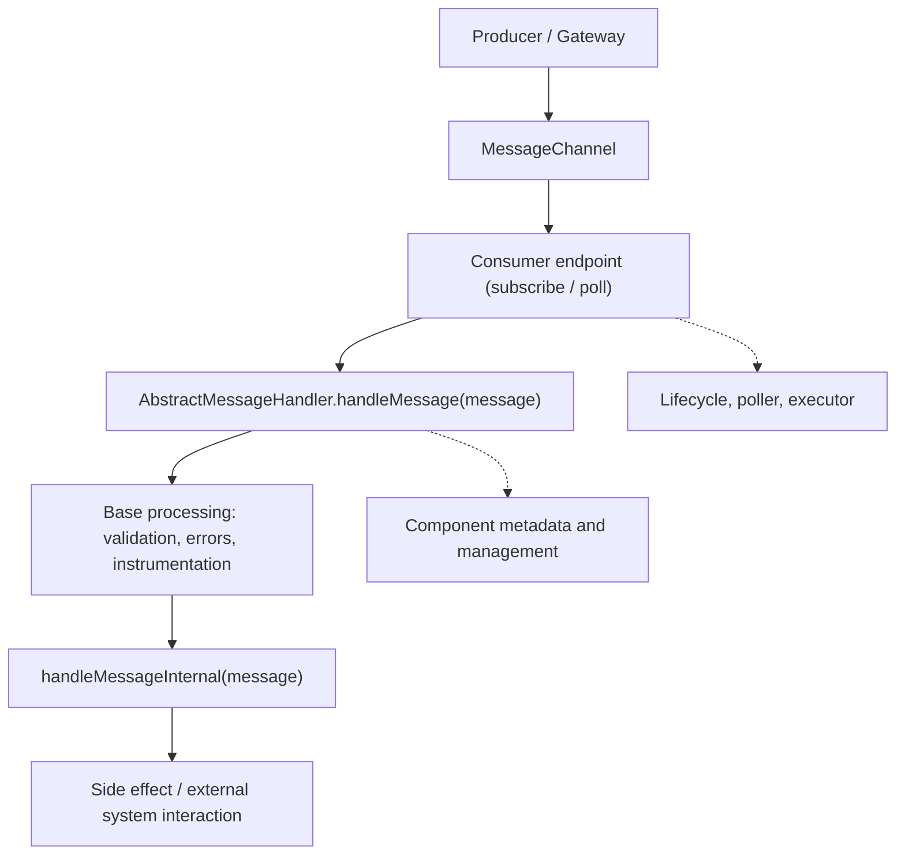

# AbstractMessageHandler and Component Metadata in Spring Integration

## Objectives and Scope

In a message flow, channels transport messages, the **consumer endpoint** decides when to pass a message to a handler, and the **message handler** performs the business or integration action. The `org.springframework.integration.handler.AbstractMessageHandler` class is a common foundation for many Spring Integration handlers; **component metadata** helps identify, manage, and observe these components at runtime.

This lesson belongs to the **Message handler** chapter of the **SPRING_INTEGRATION_RUNTIME** module. After this lesson, you will be able to:

- Explain the path from `MessageChannel` and consumer endpoint to `handleMessage()` and `handleMessageInternal()`.
- Distinguish `MessageHandler`, `AbstractMessageHandler`, `AbstractMessageProducingHandler`, and reply-producing handlers.
- Write a custom handler with clear metadata, register it in the Spring context, and send a test message.
- Correctly interpret bean name, component name, component type, endpoint ID, managed name/type, and component source/description.
- Use metadata in message history, Integration Graph, metrics/tracing, and troubleshooting.
- Understand the limits of metadata: component names and types do not automatically enable polling, concurrency, transactions, retries, correlation, or message stores.

API examples follow the Spring Framework 6.x / Spring Integration 6.5.x line (Java 17+); when using another version, cross-reference the corresponding API/Javadoc.

## 1. Where Does AbstractMessageHandler Sit in the Runtime?

Spring Messaging's `MessageHandler` has a core contract:

```java
public interface MessageHandler {
    void handleMessage(Message<?> message) throws MessagingException;
}
```

Applications can implement this interface directly. Spring Integration provides base classes to avoid duplicating message validation, exception handling, component info, and runtime observation mechanisms.



This path reveals two important boundaries:

1. **The endpoint** owns receiving messages from the channel. With `DirectChannel`, the handler method typically runs on the thread calling `send()`; with `ExecutorChannel` or a polling endpoint, the thread depends on the executor/poller.
2. **The handler** owns processing the message. `AbstractMessageHandler` provides a `public` `handleMessage()` method and requires subclasses to implement the `protected` `handleMessageInternal()` method.

A handler can receive multiple messages from an endpoint, but creating a handler bean by itself does not subscribe it to a channel. You must configure a consumer endpoint or subscribe a `MessageHandler` to an appropriate `SubscribableChannel`.

### Inheritance Hierarchy Worth Remembering

```text
IntegrationObjectSupport
  └─ MessageHandlerSupport
       ├─ AbstractMessageHandler
       │    ├─ AbstractMessageProducingHandler
       │    │    └─ AbstractReplyProducingMessageHandler
       │    ├─ LoggingHandler
       │    ├─ MethodInvokingMessageHandler
       │    └─ ... other handlers
       └─ AbstractReactiveMessageHandler
```

This is a simplified diagram of representative branches, not an exhaustive list of every subclass. Each layer adds responsibilities:

| Layer | Key Responsibilities |
|---|---|
| `IntegrationObjectSupport` | Access to `BeanFactory`/`ApplicationContext` when needed; supports initialization, `NamedComponent`, and metadata (name, type, source, description). |
| `MessageHandlerSupport` | Foundation for management/tracking, logging, metrics/observation, ordering, and standardizing basic error cases. |
| `AbstractMessageHandler` | Implements the `MessageHandler` contract, delegating specialized logic to `handleMessageInternal`; in Spring Integration 6.x it is also a Reactive Streams subscriber. |
| `AbstractMessageProducingHandler` | Adds mechanisms for creating/sending output messages and managing output channels, send timeouts, and header propagation. |
| `AbstractReplyProducingMessageHandler` | Common base for handlers producing replies in a request/reply model, typically used by transformers and service activators. |

**Not every handler emits a reply.** `handleMessageInternal(Message<?>)` has a `void` return type; handlers that send downstream messages do so via the producing-handler branch API or via an appropriate channel. Do not expect a `return value` from `handleMessage()`.

## 2. The AbstractMessageHandler Contract

In Spring Integration 6.5.x, the two directly relevant extension points are:

```java
public abstract class AbstractMessageHandler
        extends MessageHandlerSupport implements MessageHandler {

    @Override
    public void handleMessage(Message<?> message) {
        // Common processing framework managed by the framework.
    }

    protected abstract void handleMessageInternal(Message<?> message);
}
```

The snippet above is an *API structure description*, not the full internal source code of the framework. When writing a subclass, you implement `handleMessageInternal`, **and do not call the internal method directly from outside**.

The base processing inherited from `MessageHandlerSupport`/`AbstractMessageHandler` performs steps depending on configuration and version, including:

- Validating that the input message is valid and does not have a `null` payload.
- Handling and normalizing exceptions (especially checked exceptions) into appropriate messaging errors.
- Attaching logging/metrics/observation when the corresponding registry and management are configured.
- Invoking the subclass's custom implementation.

`AbstractMessageHandler` also provides `onSubscribe`, `onNext`, `onError`, and `onComplete` from the Reactive Streams subscriber in the 6.x line. The presence of these methods **does not automatically move the handler to another thread**, nor does it turn every channel into a reactive pipeline. Threading and backpressure must be evaluated based on the actual integration path.

### Handler Initialization

`IntegrationObjectSupport` implements `InitializingBean`: `afterPropertiesSet()` is `final`, and subclasses can extend the initialization step via `onInit()`.

```java
@Override
protected void onInit() {
    super.onInit();
    // Validate configuration or prepare required resources.
}
```

If the bean is managed by Spring, Spring invokes lifecycle initialization. If you instantiate it manually with `new` outside the context, you must manage configuration and lifecycle yourself; do not assume dependencies on `BeanFactory`/`TaskScheduler` are already available.

## 3. What Is Component Metadata?

**Component metadata** describes a *runtime component* — for example, "this is the handler that records audits for orders." It differs from **message headers**, which describe *a specific message* — for example, `correlationId=order-42`. These two types of data exist at two independent layers:

```text
Component (rarely changes across messages)
  beanName        = orderAudit.handler
  componentName   = orderAudit.handler
  componentType   = order-audit-handler
  managedName     = orders.audit
  description     = Records order processing audit trail

Message #1                             Message #2
  id = UUID-A                           id = UUID-B
  payload = "ORD-100"                    payload = "ORD-200"
  correlationId = "batch-7"              correlationId = "batch-8"
```

### Properties and APIs

| Property/API | Meaning | Primary Source/API |
|---|---|---|
| `getBeanName()` | Bean name injected by Spring via `BeanNameAware`. | `IntegrationObjectSupport` |
| `setComponentName(String)`, `getComponentName()` | Logical identity of the component. If not explicitly set, `getComponentName()` defaults to the bean name when available. | `NamedComponent` / `IntegrationObjectSupport` |
| `getComponentType()` | Functional type of the component; subclasses can override this to provide a meaningful identifier string. | `NamedComponent` / `MessageHandlerSupport` |
| `setComponentDescription(String)`, `getComponentDescription()` | Human-readable description; may be derived from the bean definition if not explicitly set. | `ComponentSourceAware` / `IntegrationObjectSupport` |
| `setComponentSource(Object)`, `getComponentSource()` | Configuration source that created the bean; may be bean definition source metadata or `null`. | `ComponentSourceAware` |
| `setManagedName(String)` / `getManagedName()` | Management name/identifier under the `IntegrationManagement` mechanism. | `MessageHandlerSupport` |
| `setManagedType(String)` / `getManagedType()` | Type used by the management mechanism; distinct from a Java `Class<?>`. | `MessageHandlerSupport` |
| `getIntegrationPatternType()` | The Enterprise Integration Pattern type implemented by the component, if provided by the framework. | `IntegrationPattern` |
| `setOrder(int)` / `getOrder()` | Processing order when the dispatching mechanism supports ordering. | `Orderable` / `MessageHandlerSupport` |
| `setLoggingEnabled(boolean)` | Enables/disables certain debug logging in the managed component; does not replace logger configuration or exception handling. | `IntegrationManagement` |

Two points are easily confused:

- `beanName` is the container identifier, whereas `componentName` can be set differently. For metrics/history, which name is used also depends on how the handler is registered and how tracking is configured.
- `componentType`, `managedType`, and `integrationPatternType` **are not the same value**. A component type string for display/observation does not by itself establish business behavior or message-transfer contracts.

Because these properties are used for labeling and observation, choose **stable names that do not contain customer IDs or per-message IDs**. Creating a new component for every message will cause metrics cardinality to explode and make the graph hard to analyze.

## 4. How Does an Endpoint ID Differ from a Handler Bean Name?

For a consuming endpoint, Spring Integration typically has at least:

- **Consumer endpoint**: receives messages from the input channel and manages the subscribe/poll lifecycle.
- **Message handler**: processes the messages passed to it by the endpoint.

A bean with `@ServiceActivator` on a POJO method may generate a different automatic name than a `@Bean` returning a `MessageHandler`. When you need diagnostic-friendly names, you can attach `@EndpointId` to explicitly set the **consumer** ID, while `@Bean` names the **handler**:

```java
@Bean("orderAudit.handler")
@EndpointId("orderAudit")
@ServiceActivator(inputChannel = "auditInput")
public MessageHandler orderAuditHandler() {
    return new OrderAuditHandler();
}
```

In this declaration, `orderAudit` is the consumer endpoint ID, while `orderAudit.handler` is the handler bean name. For handlers not in the `AbstractReplyProducingMessageHandler` branch, the framework may additionally create a `ReplyProducingMessageHandlerWrapper` to satisfy endpoint mechanics; therefore, a flow sometimes has an extra `.wrapper` bean. This is not a new message handler you registered to process the same message a second time.

**Lifecycle** methods such as `start()`, `stop()`, and `isRunning()` belong to the consumer endpoint (typically `SmartLifecycle`); you cannot conclude a handler is actively receiving messages just because the handler bean exists or `getComponentName()` returns the expected name. When using a dynamic `IntegrationFlow`, check endpoint registration and state separately.

## 5. Runnable Example: Custom Handler with Metadata

Scenario: a flow receives order IDs and the handler records an audit entry. No reply is needed; the consumer and handler have separate IDs. The example illustrates Spring Integration Java configuration (with `spring-integration-core` and a Spring context).

```java
import org.springframework.context.SmartLifecycle;
import org.springframework.context.annotation.AnnotationConfigApplicationContext;
import org.springframework.context.annotation.Bean;
import org.springframework.context.annotation.Configuration;
import org.springframework.integration.annotation.EndpointId;
import org.springframework.integration.annotation.ServiceActivator;
import org.springframework.integration.channel.DirectChannel;
import org.springframework.integration.config.EnableIntegration;
import org.springframework.integration.handler.AbstractMessageHandler;
import org.springframework.messaging.Message;
import org.springframework.messaging.MessageChannel;
import org.springframework.messaging.MessageHandler;
import org.springframework.messaging.MessageHandlingException;
import org.springframework.messaging.support.MessageBuilder;

@Configuration
@EnableIntegration
public class AuditExample {

    @Bean
    public MessageChannel auditInput() {
        return new DirectChannel();
    }

    @Bean("orderAudit.handler")
    @EndpointId("orderAudit")
    @ServiceActivator(inputChannel = "auditInput")
    public MessageHandler orderAuditHandler() {
        OrderAuditHandler handler = new OrderAuditHandler();

        // Component metadata, kept stable throughout the lifecycle:
        handler.setComponentName("orderAudit.handler");
        handler.setComponentDescription("Records audit trail by order ID");
        handler.setManagedName("orders.audit");
        handler.setManagedType("custom-audit");
        return handler;
    }

    public static class OrderAuditHandler extends AbstractMessageHandler {

        @Override
        public String getComponentType() {
            return "order-audit-handler";
        }

        @Override
        protected void handleMessageInternal(Message<?> message) {
            if (!(message.getPayload() instanceof String orderId)
                    || orderId.isBlank()) {
                throw new MessageHandlingException(
                        message, "Payload must be an order ID");
            }

            Object correlationId = message.getHeaders().get("correlationId");
            System.out.printf(
                    "AUDIT order=%s correlation=%s%n",
                    orderId, correlationId);
            // In a real system: invoke an injected AuditRepository/Client.
        }
    }

    public static void main(String[] args) {
        try (var ctx =
                new AnnotationConfigApplicationContext(AuditExample.class)) {

            OrderAuditHandler handler =
                    (OrderAuditHandler) ctx.getBean("orderAudit.handler");
            SmartLifecycle endpoint =
                    ctx.getBean("orderAudit", SmartLifecycle.class);

            System.out.println(handler.getBeanName());
            System.out.println(handler.getComponentName());
            System.out.println(handler.getComponentType());
            System.out.println(handler.getManagedName());
            System.out.println("endpoint running = " + endpoint.isRunning());

            MessageChannel input =
                    ctx.getBean("auditInput", MessageChannel.class);

            input.send(MessageBuilder.withPayload("ORD-100")
                    .setHeader("correlationId", "batch-7")
                    .build());
        }
    }
}
```

Expected output in a standard configuration:

```text
orderAudit.handler
orderAudit.handler
order-audit-handler
orders.audit
endpoint running = true
AUDIT order=ORD-100 correlation=batch-7
```

What happens?

1. Spring creates `auditInput` and the `orderAudit.handler` bean, while processing the annotation into the `orderAudit` consumer endpoint.
2. The consumer subscribes to `DirectChannel` while running.
3. `send()` delivers the message to the consumer, then to `AbstractMessageHandler.handleMessage()`.
4. The framework invokes `OrderAuditHandler.handleMessageInternal()`; the handler validates the payload and logs the audit entry.
5. The method returns `void`; there is no reply channel. A reply message does not appear merely because `@ServiceActivator` is present.

Note: `OrderAuditHandler` uses Java 17 pattern matching. A real-world handler typically receives an `AuditRepository` via constructor injection instead of using `System.out`, and must ensure side effects are not duplicated on retries.

### Testing Input Errors

Replace `"ORD-100"` with `""`. `OrderAuditHandler` will throw a `MessageHandlingException` attached to the failed message. Over `DirectChannel`, the error usually propagates back to the `send()` caller thread; if switched to an executor/poller, the error-handling path may differ.

```java
try {
    input.send(MessageBuilder.withPayload("").build());
} catch (org.springframework.messaging.MessagingException ex) {
    System.err.println("handler failed: " + ex.getMessage());
}
```

Do not use `null` to simulate an empty payload: the messaging system and standard builders reject `null` payloads right at message construction time. To test business validation, use data with the wrong type, empty values, invalid format, or business rule violations.

## 6. Customizing Behavior at the Right Layer

### 6.1. When to Extend AbstractMessageHandler?

This is appropriate when the handler's logic primarily performs a **side effect** such as writing a file, calling an external client, emitting an event to another service, or updating a database, and you want to receive `Message<?>` directly.

If you only need to invoke a plain Java service, `@ServiceActivator` on a POJO method is usually simpler. If the handler must emit output/reply messages following Spring Integration semantics, look at `AbstractMessageProducingHandler` / `AbstractReplyProducingMessageHandler` or the appropriate `.handle()` DSL. Avoid reimplementing `replyChannel`, header propagation, and send timeout handling that the producing branch already provides.

| Need | Implementation Approach |
|---|---|
| Business logic from payload | POJO `@ServiceActivator` or Java DSL `.handle(...)`. |
| Side effect needing direct control over `Message<?>` | Subclass `AbstractMessageHandler` or implement `MessageHandler`. |
| Producing a reply message and sending to an output channel | Handler from the `AbstractMessageProducingHandler` branch or an endpoint with reply semantics. |
| Transforming payload | `@Transformer` / appropriate transformer, avoiding manually sending replies inside a non-producing handler. |
| Errors requiring retry, transaction, circuit breaker | Configure advice or transactions on the appropriate handler/endpoint, combined with idempotency. |

### 6.2. Constructor and onInit

If a custom handler has required dependencies, prefer constructor injection:

```java
public final class AuditHandler extends AbstractMessageHandler {

    private final AuditRepository repository;

    public AuditHandler(AuditRepository repository) {
        this.repository = java.util.Objects.requireNonNull(repository);
    }

    @Override
    public String getComponentType() {
        return "audit-handler";
    }

    @Override
    protected void handleMessageInternal(Message<?> message) {
        repository.save(String.valueOf(message.getPayload()));
    }
}
```

In this second example, `AuditRepository` is an application-defined interface; the code only illustrates design direction, not a standalone runnable example. To validate other runtime configuration (such as a required expression or mapping), a subclass can override `onInit()` and call `super.onInit()`. Do not override `afterPropertiesSet()` because that method is `final` on the superclass.

### 6.3. Thread Safety

Spring typically manages handlers as singletons. Two messages can enter a handler concurrently if upstream supports concurrent execution or has multiple producers. Do not store per-message temporary state in mutable fields:

```java
// Unsafe if multiple threads invoke the handler concurrently:
private String currentOrderId;

@Override
protected void handleMessageInternal(Message<?> message) {
    currentOrderId = (String) message.getPayload();
    // Slow I/O calls here can easily mix values across messages.
}
```

Replace this with method-local variables, immutable structures, or synchronization when truly necessary. Switching from `DirectChannel` to `ExecutorChannel` does not change the `handleMessage()` contract, but it can expose race conditions.

## 7. How Component Metadata Aids Runtime Observation

### 7.1. Message History

Enable message history in configuration:

```java
@Configuration
@EnableIntegration
@org.springframework.integration.config.EnableMessageHistory
class HistoryConfig {
    // Declare channels/handlers/endpoints here.
}
```

When history is properly configured, named components within the tracked scope append a history header, helping determine where a message has traveled. Typical entries carry details like `name`, `type`, and `timestamp`. You can restrict tracking by component name/pattern:

```java
@EnableMessageHistory("orderAudit*", "payment*")
```

This illustrates the annotation parameter; you should use a single unified `@EnableMessageHistory` configuration in the `ApplicationContext`, rather than declaring it in multiple places for the same flow.

Reading history if present:

```java
import org.springframework.integration.history.MessageHistory;

MessageHistory history = message.getHeaders()
        .get(MessageHistory.HEADER_NAME, MessageHistory.class);

if (history != null) {
    System.out.println(history);
}
```

A handler is not guaranteed to appear in history solely because it has `getComponentName()`: it also depends on the tracking mechanism and the selected component list. History is a **path trail**, not a durable message store or a full distributed trace. Since Spring Integration 6.3, history maintenance has been improved to be append-only; if you build custom fan-out outside framework components, remember to clone history when concurrent branching is needed.

### 7.2. Metrics and Micrometer Observation

`AbstractMessageHandler` inherits `IntegrationManagement` capabilities from `MessageHandlerSupport`. When integrated with the right registry and management configuration, component names become useful metadata for tagging measurements.

Two related but distinct modes:

| Mechanism | How It Works | Key Takeaways |
|---|---|---|
| Micrometer meters | With a `MeterRegistry` and proper metrics configuration, provides timers for handlers, tags identifying the handler, and outcome/exception. | 6.x documentation example: timer `spring.integration.send` with `type=handler` and `name=<componentName>`. |
| Micrometer Observation (6.0+) | Uses `ObservationRegistry`, `@EnableIntegrationManagement`, and `observationPatterns` to select observed components; can combine metrics and tracing via `ObservationHandler`. | Handler observation uses convention `spring.integration.handler`, with tags `spring.integration.name` and `spring.integration.type`. |

`@EnableIntegrationManagement` does not automatically enable tracing for all handlers: an `ObservationRegistry` and pattern selection are required. Per the documentation's default configuration, components are not automatically instrumented by Observation merely because a registry is present. `AbstractMessageHandler.setObservationConvention(...)` lets you customize the convention when adjusting observation behavior.

An example enabling observation for all supported components (only use when the application has configured an `ObservationRegistry` and corresponding handlers):

```java
@Configuration
@EnableIntegration
@org.springframework.integration.config.EnableIntegrationManagement(
        observationPatterns = "*")
class ObservabilityConfig {
    // ObservationRegistry is configured as a Spring bean in an appropriate place.
}
```

**Production choice:** bound the cardinality of metric tag values. Use fixed component names like `orderAudit.handler` instead of `orderAudit-ORD-100`. If you want to trace errors for a specific order ID, use log/correlation/trace IDs at the message level instead of embedding order IDs into component names.

### 7.3. Integration Graph

`IntegrationGraphServer` provides a diagram of runtime components (channels, endpoints, handlers, and their relationships) when declared/configured in the context. In the 6.x line, this class is in the `org.springframework.integration.graph` package.

- `getGraph()` retrieves the cached graph structure along with accessible dynamic state/metrics information.
- `rebuild()` reconstructs the graph if the system registers or removes flows/components at runtime.

Conceptual example when the graph server bean is configured:

```java
import org.springframework.integration.graph.IntegrationGraphServer;

// graphServer is a bean injected from the Spring context.
var graph = graphServer.getGraph();

// After registering/unregistering a dynamic IntegrationFlow:
var refreshedGraph = graphServer.rebuild();
```

This snippet assumes the `graphServer` variable is already injected, to illustrate diagnostic operations. Authorization is needed if exposing the graph over HTTP/management because endpoint/channel names can reveal system topology.

**Metadata only helps with identification.** The graph does not prove that a specific message passed through a handler; use message history/traces/logs to see the actual path, or inspect counters/timers to verify activity.

## 8. Metadata, Lifecycle, Transactions, and Errors

Put metadata in the right context within the runtime module:

| Runtime Concern | Primary Controlling Actor | How Does Metadata Help? |
|---|---|---|
| Was the handler called? | Subscription, running endpoint, channel, and poller | Find the exact endpoint and handler by ID; cross-reference graph/logs. |
| Which thread is running the method? | `DirectChannel`, `ExecutorChannel`, poller, executor | Identify the handler when logging thread names and execution times. |
| Start/stop a flow | `SmartLifecycle` endpoint, `IntegrationFlowContext` | Names the consumer to start/stop; the handler name is not an on/off switch. |
| Is the transaction committed/rolled back? | Transaction boundary at caller, poller, advice/handler | Label the handler in logs/metrics to investigate transaction boundaries. |
| Retries and final errors | Retry advice, transport/source mechanism, error channel | Pinpoint the failing handler and aggregate metrics per component. |
| Message storage / correlation | Message store, aggregator/resequencer, message headers | Trace the processing component; component metadata does not replace correlation keys. |
| Performance | Queue, executor, I/O, handler code, downstream | Separate queue wait time from handler execution time via metrics/traces. |

### Synchronous vs. Asynchronous

- `DirectChannel` typically invokes `handleMessage()` on the sending thread, so exceptions can propagate back to the caller and any existing thread-bound transaction can encompass the handler if configured appropriately.
- `ExecutorChannel` introduces a thread boundary; the producer's transaction and `ThreadLocal` values do not automatically carry over.
- `QueueChannel` with a poller runs on the poller's schedule and transaction context, independent of the handler's name.
- Handlers do not have an `isRunning()` method like a lifecycle endpoint; a bean with valid metadata can still **receive no messages** if the consumer is stopped or the channel is empty.

### Exceptions and errorChannel

When `handleMessageInternal()` throws an exception, the base processing layer may wrap/normalize it into a `MessagingException`; preserving the failed message and cause is helpful for diagnostics.

- In a synchronous flow, the caller can observe the exception directly at `send()`.
- With an asynchronous consumer, exceptions are typically handled by the consuming component and error flow, potentially producing an `ErrorMessage` sent to `errorChannel` when configured and supported by the transport.
- Enabling retries means the handler can be invoked multiple times for the same message. If the handler writes to a DB or calls external systems, it must be designed idempotently; metadata does nothing to prevent duplicate processing.

Disabling logging via `setLoggingEnabled(false)` does not disable the handler, suppress errors, or replace configuration for routing exceptions. Only use this property when reducing debug logging overhead for components in high-volume flows.

## 9. Troubleshooting Using Component Metadata

If "a message was sent but the handler did not run," check in order:

1. **Verify identity:** print `getBeanName()`, `getComponentName()`, and `getComponentType()` of the handler; locate the corresponding endpoint ID bean.
2. **Check wiring:** is the input channel name exact? Is the consumer endpoint subscribed to the right channel or polling the right source?
3. **Check lifecycle:** is the endpoint's `SmartLifecycle.isRunning()` returning `true`? If using a dynamic flow, is its registration still active?
4. **Check transport and threads:** is the channel synchronous or asynchronous, are messages backing up in a queue, or does the executor have a backlog?
5. **Read the exception chain:** was the error thrown from handler code or dispatch infrastructure? Is retry/error channel hiding errors from the caller?
6. **Cross-check observability:** the graph shows topology; message history/traces show the path; metrics show invocation counts and durations if enabled.
7. **Check correlation/transactions:** if you suspect lost replies, stalled aggregation, or rollbacks, inspect message headers/stores and transaction boundaries rather than changing `componentName`.

Some easily confused symptoms and causes:

| Symptom | Proper Interpretation |
|---|---|
| `getBeanName()` and `getComponentName()` differ | Likely because the component name was set explicitly; it does not mean two handlers are registered. |
| A `orderAudit.handler.wrapper` bean exists | Likely a framework-created wrapper for the endpoint; verify its role before concluding the handler is invoked twice. |
| Graph includes the handler, but endpoint `isRunning()` is false | The component exists, but the consumer is stopped, so no new invocations occur through that endpoint. |
| Message history does not contain the handler name | Tracking may not be enabled or the component is not matched by the pattern; graph and history serve different purposes. |
| Metrics show no data for the handler | Check the registry, management configuration, observation patterns, and whether messages actually passed through. |
| After switching to an executor, the caller does not catch errors | Exceptions occur on a different worker thread; check the error channel/logs/observations. |
| Messages are processed multiple times | Check retries, redelivery, acknowledgments, concurrency, and idempotency; component names do not control invocation counts. |

### Practice Exercises

1. Run `AuditExample`; record the handler bean name, component name, component type, managed name, and endpoint state.
2. Change `setComponentName("orderAudit.handler")` to another fixed name. Compare `getBeanName()` with `getComponentName()`; keep `@EndpointId("orderAudit")` and observe that the consumer ID stays unchanged.
3. Try passing an invalid payload; identify where the exception surfaces when using `DirectChannel`.
4. Enable `@EnableMessageHistory` and send a message through an additional transformer or bridge; observe how history changes and how tracking patterns affect it.
5. When Micrometer/`ObservationRegistry` is available, configure an instrumented handler and compare the component name/type tags against the configured metadata.
6. Add an upstream poller/executor; print `Thread.currentThread().getName()` inside the handler to see what orchestrates the method call.
7. Stop the `orderAudit` consumer endpoint in a test environment and inspect message send behavior. Some channels may report no subscribers; queue-based channels hold messages waiting to be polled.

You do not need to rename a handler per order for tracking: use message IDs and correlation IDs in logs/traces, while keeping component names/types consistent across the entire message flow.

## 10. Production Deployment Checklist

- [ ] Each handler has a clear purpose, well-scoped responsibility, and transparent payload/header contract.
- [ ] Endpoint IDs and handler bean names follow a consistent naming convention, easy to look up in logs and graphs.
- [ ] Component name/type/managed name use stable values that can be attached as metric tags without causing cardinality spikes.
- [ ] Handlers are stateless or thread-safe under the current executor/poller configuration.
- [ ] Exceptions, retries, transactions, and idempotency are verified via integration tests through real channels.
- [ ] Endpoint status and queue/executor health are monitored separately from handler metadata.
- [ ] When using dynamic `IntegrationFlow`, update/rebuild the graph if topology changes; include proper stop/start and cleanup routines.
- [ ] Enable message history/metrics/tracing selectively to balance diagnostic visibility with runtime overhead.

## References

- [AbstractMessageHandler — Spring Integration 6.5.x Javadoc](https://docs.spring.io/spring-integration/docs/6.5.x/api/org/springframework/integration/handler/AbstractMessageHandler.html)
- [MessageHandlerSupport — Spring Integration 6.5.x Javadoc](https://docs.spring.io/spring-integration/docs/6.5.x/api/org/springframework/integration/handler/MessageHandlerSupport.html)
- [IntegrationObjectSupport — Spring Integration 6.5.x Javadoc](https://docs.spring.io/spring-integration/docs/6.5.x/api/org/springframework/integration/context/IntegrationObjectSupport.html)
- [Spring Integration Reference — Endpoint bean names and `@EndpointId`](https://docs.spring.io/spring-integration/reference/6.5/overview.html)
- [Spring Integration Reference — Message History](https://docs.spring.io/spring-integration/reference/6.5/message-history.html)
- [Spring Integration Reference — Metrics and Management](https://docs.spring.io/spring-integration/reference/6.5/metrics.html)
- [Spring Integration Reference — Integration Graph](https://docs.spring.io/spring-integration/reference/6.5/graph.html)

**Takeaway:** `AbstractMessageHandler` provides the skeleton for processing a `Message<?>`; `handleMessageInternal()` is where subclasses perform their action. Component metadata answers **"which component is this?"**; channels, endpoints, pollers, executors, and management configuration answer **"how is that component being invoked and is it currently running?"**.
