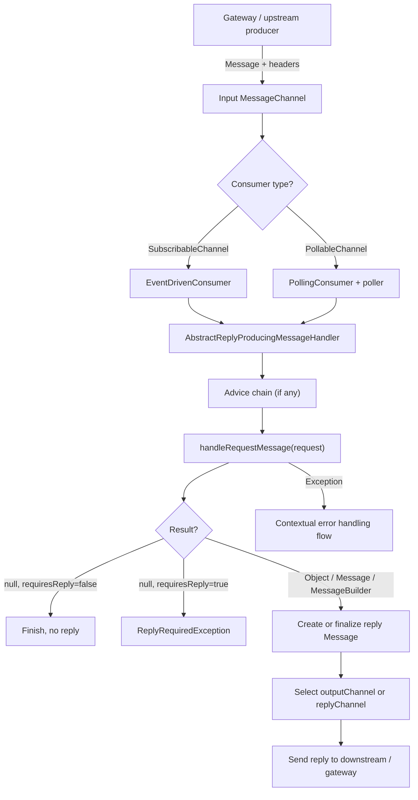

# AbstractReplyProducingMessageEndpoint: Reply Creation and Sending Mechanism in Spring Integration

## 1. Position of This Topic in the Runtime

In Spring Integration, a **message endpoint** connects a `MessageChannel` to processing logic. A consumer retrieves or receives messages from the channel; a `MessageHandler` performs the processing; and some handlers can produce a reply message. This lesson focuses on the request–reply lifecycle, how the framework routes replies, error handling, and the runtime effects of threads, transactions, and retries.

**Naming clarification:** `AbstractReplyProducingMessageEndpoint` is the **topic name** in the curriculum, not a published abstract class name in the Spring Integration API. The corresponding class is **`org.springframework.integration.handler.AbstractReplyProducingMessageHandler`**. Separate the two concepts:

- **Consumer/endpoint:** `EventDrivenConsumer` or `PollingConsumer` connects an input channel to a handler and manages subscribing/polling and starting/stopping.
- **Reply-producing handler:** receives a `Message<?>`, invokes business logic, and creates and sends a reply if one is produced. The base class `AbstractReplyProducingMessageHandler` is where specialized handlers inherit this behavior.

Inheritance chain to remember:

```text
AbstractMessageHandler
  └── AbstractMessageProducingHandler
        └── AbstractReplyProducingMessageHandler
              ├── ServiceActivatingHandler
              ├── MessageTransformingHandler
              ├── BridgeHandler
              └── many other outbound gateways/handlers
```

`AbstractReplyProducingMessageHandler` is an **abstract class** and should not be instantiated directly. Most applications use `@ServiceActivator` or Java DSL `.handle(...)`; only extend this class when you need to write a reusable handler with custom processing mechanics.

### Objectives After This Lesson

1. Distinguish channel, endpoint/consumer, handler, and reply channel during execution.
2. Accurately predict when a reply is produced, not produced, or an error is thrown.
3. Intentionally configure `requiresReply`, `outputChannel`, advice, async, and header propagation.
4. Diagnose gateway timeouts, transaction/thread mismatches, duplicate retry operations, and lost correlation.

## 2. Execution Flow from Request to Reply



In execution order:

1. The consumer receives the message: directly subscribed to a `SubscribableChannel` or polled from a `PollableChannel`. Which thread it runs on depends on the channel, poller, and executor, **not** on the handler class name.
2. `handleMessage(Message<?>)` leads to the base class's `handleMessageInternal(...)` method. This is the shared orchestration logic, declared `final` so subclasses cannot alter the core sequence.
3. The framework applies `adviceChain` (if configured) around the request-handling call and invokes the extension method `handleRequestMessage(Message<?>)`.
4. If it returns `null`, the flow ends silently when `requiresReply=false`; otherwise it throws `ReplyRequiredException`.
5. If a value is returned, the framework converts the result into a reply message and determines the destination. The value can be a plain Java payload, a `Message<?>`, or a `MessageBuilder`.
6. Sending the reply may block, throw an exception, or complete asynchronously depending on the channel type and processing result. The handler does not create a new poller, executor, or transaction by itself.

**Distinguish two kinds of "no data":** `null` is the signal not to produce a reply; an empty string `""`, `Optional.empty()`, an empty list, or another payload is still **a return value** and does not by default mean no reply. Do not return `null` arbitrarily if the gateway side always expects a response.

## 3. Key Extension Points and Configurations

| Component | Runtime Role | Notes |
|---|---|---|
| `handleRequestMessage(Message<?>)` | `protected abstract` method for subclasses to process the request | Returns `Object`, `Message`, `MessageBuilder`, or `null`; do not manually send a reply again if returning it to the framework. |
| `handleMessageInternal(Message<?>)` | Orchestrates the call and result processing | `final`; subclasses do not override this method. |
| `setRequiresReply(boolean)` | Enforces a contract requiring a reply | Defaults to `false`; `true` + `null` result → `ReplyRequiredException`. |
| `setAdviceChain(List<Advice>)` | Wraps request processing with advice | Suitable for retry, circuit breaker, tracing at the handler; does not implicitly cover all downstream steps. |
| `setOutputChannel(...)` / `setOutputChannelName(...)` | Specifies a static reply destination | Takes higher precedence than the request's `replyChannel` header. |
| `setSendTimeout(long)` | Limits the wait time when sending to a potentially blocking channel | Different from the **gateway reply wait timeout**; `DirectChannel` does not use this timeout to bound business logic execution time. |
| `setAsync(boolean)` | Handles `CompletableFuture` or reactive `Publisher` replies asynchronously | Not a switch that spawns threads for every handler. |
| `setNotPropagatedHeaders(...)` | Blocks copying request headers matching patterns | Does not remove headers explicitly set on a returned `Message`; also verify correlation preservation requirements. |

### Reply Channel Selection Rules

When a handler returns a non-`null` result, the reply destination is typically chosen in this order:

1. The `outputChannel` configured directly on the handler/endpoint, if present.
2. The `replyChannel` in the **request message** (which may be a `MessageChannel` or a `String` channel name that needs to be resolved).
3. If the request has no `replyChannel` and the result is a `Message`, the `replyChannel` from that **reply message** may be used.

If there is no valid destination to send the reply, or the channel name cannot be resolved, sending the reply fails (for example, `DestinationResolutionException`). A misconfigured `outputChannel` is often why a gateway times out even though business logic returned a result.

```text
With outputChannel = "audit.out":
  request.replyChannel = temporaryGatewayReplyChannel
  handler returns "OK"
  => reply is sent to audit.out, not automatically back to the gateway

Without outputChannel configured:
  request.replyChannel = temporaryGatewayReplyChannel
  handler returns "OK"
  => reply goes back to temporaryGatewayReplyChannel
```

If you intentionally want to **discard** the result at the end of a flow, you can direct output to `nullChannel`. Distinguish this from accidentally losing the reply path. In genuine request–reply, never point replies to `nullChannel` if the caller is still waiting.

### Headers, Message ID, and Correlation

- When a method returns a **plain payload**, Spring Integration constructs a reply `Message` and normally copies appropriate headers from the request.
- When returning a complete `Message<?>`, a service-activator-style handler may still copy missing request headers onto the reply. To strip unwanted headers, use a `HeaderFilter` at an explicit step or configure propagation appropriately.
- Headers such as `replyChannel` and `errorChannel` carry orchestration semantics; removing them at the wrong time breaks request–reply or error handling. `correlationId` and `sequenceNumber` may be used by splitter/aggregator patterns, but this handler class **does not automatically generate a new `correlationId` for each request**.
- A reply is a new message, so do not assume the reply's `id` always matches the request's `id`. To correlate business transactions, pass a header such as `orderId`/`traceId` and verify it on both sides.

## 4. Practical Example: Gateway Calling a Service Activator

Example with Spring Boot and `spring-boot-starter-integration`. The classes below can reside in the same package; add corresponding imports when implementing. `@IntegrationComponentScan` registers the gateway interface; `@EnableIntegration` enables Spring Integration configuration when not already auto-configured.

```java
@SpringBootApplication
@EnableIntegration
@IntegrationComponentScan
public class StockApplication {
    public static void main(String[] args) {
        SpringApplication.run(StockApplication.class, args);
    }
}

@MessagingGateway
interface StockGateway {
    @Gateway(requestChannel = "stock.requests")
    String lookup(String sku);
}

@Component
class StockService {
    @ServiceActivator(inputChannel = "stock.requests", requiresReply = "true")
    public String lookup(String sku) {
        if (sku == null || sku.isBlank()) {
            return null; // Violates requiresReply => ReplyRequiredException.
        }
        return "available:" + sku;
    }
}
```

**Calling `stockGateway.lookup("SKU-42")` proceeds as follows:**

1. The gateway creates a request with payload `"SKU-42"` and attaches a temporary reply channel to the headers.
2. `stock.requests` is received by the service activator's consumer; the handler invokes `StockService.lookup`.
3. The string `"available:SKU-42"` is wrapped into a reply `Message`; since no `outputChannel` is declared, the handler uses the reply channel from the request.
4. The gateway receives the reply and returns the payload as a `String` to the caller.

With a blank SKU, the service returns `null`; `requiresReply="true"` surfaces the error closer to its origin rather than just waiting for a gateway timeout. Note: if an upstream component actively filters out or drops the request before the handler, configuring `requiresReply` on **this handler** cannot detect a message that never reached it.

### Writing a Custom Handler Using the Base Class

When you need to process `Message<?>` directly, you can extend `AbstractReplyProducingMessageHandler`:

```java
import org.springframework.integration.handler.AbstractReplyProducingMessageHandler;
import org.springframework.integration.dsl.IntegrationFlow;
import org.springframework.messaging.Message;
import org.springframework.messaging.support.MessageBuilder;
import org.springframework.context.annotation.Bean;
import org.springframework.context.annotation.Configuration;

final class StockHandler extends AbstractReplyProducingMessageHandler {
    @Override
    protected Object handleRequestMessage(Message<?> request) {
        String sku = (String) request.getPayload();

        if (sku.isBlank()) {
            return null;
        }

        return MessageBuilder.withPayload("available:" + sku)
                .setHeader("stockSource", "cache")
                .build();
    }
}

@Configuration
class StockFlowConfig {
    @Bean
    StockHandler stockHandler() {
        StockHandler handler = new StockHandler();
        handler.setRequiresReply(true);
        return handler;
    }

    @Bean
    IntegrationFlow stockFlow(StockHandler handler) {
        return IntegrationFlow.from("stock.requests")
                .handle(handler)
                .get();
    }
}
```

This is an **alternative** to `StockService` in the previous example; register only one consumer to handle requests in the exercise. On a channel with multiple competing subscribers, a request might go to a different handler and the outcome becomes unpredictable.

In the subclass, you only implement `handleRequestMessage` and return an object. Creating the reply message, copying appropriate headers, and sending to the reply channel are handled by the base class. Do not manually call `send` inside the method and also return a reply, as doing so easily causes duplicate responses.

## 5. Synchronous Replies, Async, and Threading Effects

**`DirectChannel`:** the consumer typically invokes the handler immediately on the sending thread. If the handler is slow, the corresponding `send()`/gateway call can slow down; exceptions can propagate along the synchronous call stack. A thread-bound transaction can span steps using `DirectChannel`.

**`ExecutorChannel`:** the dispatcher hands off processing to an executor. The caller sending the message can return before the business handler finishes running. Thread-local transactions and context do not automatically cross this boundary; downstream exceptions usually must be handled where the async work runs, such as via an appropriate `errorChannel`/error flow.

**`QueueChannel` + poller:** the queue holds messages for a polling consumer to actively `receive()` on a schedule and up to a per-poll message limit. The poller is part of the endpoint, not a feature of `AbstractReplyProducingMessageHandler`. Time a message spends waiting in the queue is also added to the latency perceived by the gateway.

**Returning `CompletableFuture`/`Publisher`:** with `async=true` configured appropriately, the handler can send the reply when the asynchronous result completes; the future/publisher object itself is not treated as a plain payload. If using async without an appropriate reply destination/error mechanism, the gateway can time out before the future completes. Async replies do not fix CPU saturation or exhausted thread pools. Some reactive configurations may enable async automatically, so check the version and output channel type.

| Scenario | Execution Boundary | Impact |
|---|---|---|
| `DirectChannel` → handler → `DirectChannel` | Same thread across synchronous steps | Exceptions propagate directly; thread-bound transactions can be preserved. |
| `ExecutorChannel` → handler | Dispatched via executor | Does not implicitly share the sender's transaction/context. |
| `QueueChannel` → polling consumer | Message waits, poller processes later | Introduces queue latency and poller throughput limits. |
| Handler returns `CompletableFuture` with async enabled | Responds when the future completes | Requires appropriate caller timeout and error routing. |

**Two distinct timeouts:** the handler's `sendTimeout` limits how long to wait when **sending a reply to a potentially blocking channel** (such as a full `QueueChannel`); the gateway's `replyTimeout` limits how long to wait to **receive a reply**. Increasing one does not fix slow processing, broken routing, or deadlocks.

## 6. Advice, Retries, Transactions, and Error Handling

### What Processing Segment Does Advice Wrap?

`setAdviceChain(...)` configures AOP advice around the `handleRequestMessage` operation. For a service activator, you can declare:

```java
@ServiceActivator(inputChannel = "stock.requests",
                  requiresReply = "true",
                  adviceChain = "retryAdvice")
public String lookup(String sku) {
    return remoteStockClient.lookup(sku);
}

@Bean
RequestHandlerRetryAdvice retryAdvice() {
    return new RequestHandlerRetryAdvice();
}
```

This example assumes `remoteStockClient` exists and corresponding imports are added. `RequestHandlerRetryAdvice` applies retries when processing fails; configure attempts, backoff, and recovery callbacks per system policy. **Retries repeat the business invocation**, so operations that update data or dispatch transactions must be idempotent or use a deduplication key. Do not assume this advice rolls back side effects already committed in a prior attempt.

The scope of advice on a handler differs from advice/transactions across the entire integration flow. When you need to retry the entire delivery over a redelivery-capable source (JMS/Kafka/queue), you must examine inbound adapter semantics, acknowledgments, transactions, and stateful retry; do not merely attach retry on the handler and assume it is safe.

### Exception Paths

| Symptom | Typical Cause | How to Check |
|---|---|---|
| `ReplyRequiredException` | Handler returned `null` while `requiresReply=true` | Inspect processing branches and reply contract. |
| `DestinationResolutionException` | Name-based `replyChannel` header cannot be resolved | Check channel bean names, headers, and static output channel. |
| `MessageDeliveryException` | Reply channel cannot accept the message or send timed out | Check subscribers, queue capacity, and `sendTimeout`. |
| Gateway times out, handler logs success | Reply was routed to another channel, lost, or finished too late | Trace from request ID/correlation to reply channel; compare with `replyTimeout`. |
| One message triggers multiple executions | Retries, redelivery, or duplicate upstream senders | Log idempotency keys, attempt counts, and redelivery sources. |

In a **synchronous** flow, exceptions can propagate back to the caller. In an **asynchronous** flow, where exceptions are caught depends on the executor, poller, or inbound adapter; `errorChannel` is used when a matching error flow exists. An `errorChannel` header does not mean **every** exception on every thread is automatically routed there. Always identify thread boundaries and the component owning error handling.

For transactions, the operational rule is: transactions are thread-bound. If logic needs atomic DB writes + message dispatch, identify where the transaction begins, whether it commits before or after the reply is sent, and how to handle cases where the caller times out after the business operation already committed. Crossing an `ExecutorChannel` or `QueueChannel` introduces a boundary that requires separate transaction/acknowledgment configuration.

## 7. Runtime Diagnostics: Tracing the Message

When the system exhibits request–reply failures, use a checklist following **the journey of a single request**:

1. **At the caller/gateway:** record business ID, send timestamp, `requestChannel`, timeout, and expected reply type.
2. **At the input channel/consumer:** verify the message was actually received; inspect channel type (direct, executor, or pollable), subscriber count, and endpoint running state.
3. **At the handler:** verify `handleRequestMessage` was invoked, input/payload are valid, whether advice/retry ran, and whether the result was `null`.
4. **At reply routing:** record the resolved `outputChannel` or `replyChannel`; check headers after transformations, whether the channel has subscribers, and whether it is full.
5. **At the gateway:** check whether the reply arrived late, was sent to a different gateway, or was never created. Correlate logs and metrics using the same business correlation ID.

Metrics for messages received/sent, processing duration, and channel/handler observations can be collected via Spring Integration management/Micrometer when configured accordingly. Do not look only at CPU or method duration: backlog in `QueueChannel`, executor queues, polling intervals, network I/O, and retry backoff all contribute to total wait time.

### Common Design Mistakes

- **Configuring a static output channel incompatible with a gateway**: replies branch off elsewhere. Solution: keep routing via the request's `replyChannel` when returning directly; or provide an explicit bridge.
- **Returning `null` in RPC without requiring a reply**: mysterious gateway timeouts. Solution: enable `requiresReply` and establish a clear contract for "not found."
- **Using an executor and assuming the same transaction**: downstream failures occur after upstream commits. Solution: design transactions at each boundary with appropriate compensation/redelivery.
- **Retrying a non-idempotent method**: can write to the DB or send commands multiple times. Solution: idempotency keys, unique constraints, or business deduplication.
- **Stripping headers arbitrarily**: loses `replyChannel`, `errorChannel`, `correlationId`. Solution: preserve headers needed by the flow and filter deliberately at system boundaries.
- **Using `sendTimeout` to fix gateway timeouts**: the two timeouts apply to different operations. Solution: measure each segment and fix the bottleneck in the right place.

## 8. Self-Check Exercises

**Exercise 1 — No reply.** A `@MessagingGateway` calls a service activator, and the service returns `null`. Predict the difference between `requiresReply=false` and `requiresReply=true`.  
**Answer:** With `false`, the handler finishes without sending a reply and the gateway may wait until its timeout depending on configuration; with `true`, the handler throws `ReplyRequiredException` at processing time.

**Exercise 2 — Where does the reply go?** The request carries `replyChannel=temporaryGatewayChannel`, while the handler sets `outputChannel=archiveChannel`.  
**Answer:** The reply goes to `archiveChannel`. The gateway does not automatically receive the reply unless another flow sends it back to the channel the gateway is waiting on.

**Exercise 3 — Split transaction.** A flow handles a DB transaction and then forwards to an `ExecutorChannel`. The downstream consumer fails. Is upstream guaranteed to roll back?  
**Answer:** No. The executor thread is typically different from the sender's thread, so the sender-bound transaction does not propagate automatically. A transaction and error-handling strategy aligned to each boundary is required.

**Exercise 4 — Extending the framework.** You want a handler that reads the payload, returns a `Message<?>` with header `stockSource`, and keeps standard reply mechanics. Which method should you override?  
**Answer:** Override `handleRequestMessage(Message<?>)` in a subclass of `AbstractReplyProducingMessageHandler`; do not override `handleMessageInternal` (`final`), and do not manually send a duplicate reply.

**Exercise 5 — Performance measurement.** The business method runs in only 20 ms, yet the gateway takes 3 seconds.  
**Investigation hints:** Waiting in a queue/poller/executor, retries/backoff, blocked reply channel, network, or late reply; measure timestamps at each stage instead of attributing all latency to the method.

## Official References

- [AbstractReplyProducingMessageHandler API (Spring Integration 6.5.x)](https://docs.spring.io/spring-integration/docs/6.5.x/api/org/springframework/integration/handler/AbstractReplyProducingMessageHandler.html)
- [AbstractMessageProducingHandler API (Spring Integration 6.5.x)](https://docs.spring.io/spring-integration/docs/6.5.x/api/org/springframework/integration/handler/AbstractMessageProducingHandler.html)
- [Service Activator — Request/Reply, Header Propagation](https://docs.spring.io/spring-integration/reference/service-activator.html)
- [Message Endpoints — Event-driven and Polling Consumers](https://docs.spring.io/spring-integration/reference/endpoint.html)
- [Message Channels — ExecutorChannel](https://docs.spring.io/spring-integration/reference/channel/configuration.html)
- [Transaction Boundaries](https://docs.spring.io/spring-integration/reference/transactions.html)
- [Request Handler Advice and Retry](https://docs.spring.io/spring-integration/reference/handler-advice/classes.html)
