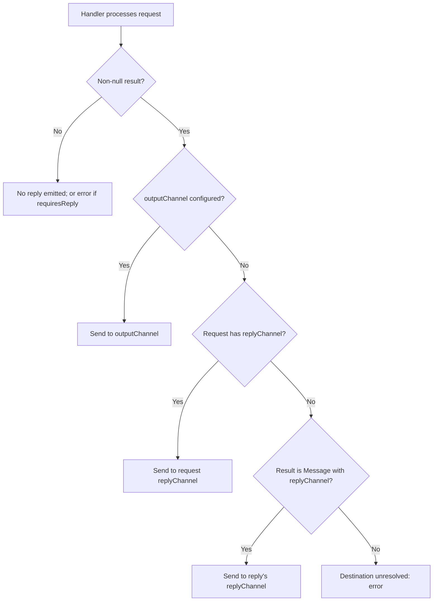
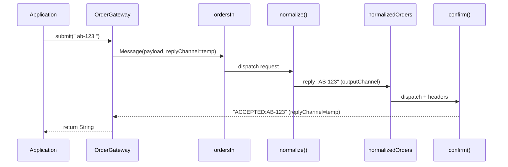

# Reply Messages and Output Channels in Spring Integration

## 1. Objectives and Runtime Context

In the `SPRING_INTEGRATION_RUNTIME` module, we need to understand how Spring Integration runs and orchestrates message flows across **channels, endpoints, consumers, pollers, and executors**, as well as how those mechanics affect transactions, retries, errors, correlation, and performance. This lesson focuses on a decision that occurs right after **a message handler finishes processing its input**: whether the result becomes a **reply message**, and if so, **which channel** the framework sends it to.

After this lesson, you will be able to:

- Distinguish a handler method's return value, a reply `Message<?>`, an endpoint's `outputChannel`, and a request's `replyChannel` header.
- Correctly explain the precedence order Spring Integration uses to pick where to send a reply.
- Configure a handler chain with an intermediate step and a final step returning results to a messaging gateway.
- Predict behavior when a handler returns `null`/`void`, when the target channel does not exist, or when the gateway times out.
- Trace a reply through `DirectChannel`, `ExecutorChannel`, or a polled flow without confusing replies with `correlationId` or `errorChannel`.

**Running scenario:** an application calls `OrderGateway.submit(" ab-123 ")`. The first step normalizes the order code, and the next step confirms the order. The application wants to receive the string `ACCEPTED:AB-123` from the gateway, even though the handlers live inside the message flow and do not directly call methods on the caller.

## 2. Four Easily Confused Concepts

| Concept | Where It Appears | Runtime Role |
|---|---|---|
| **Return value** (`String`, DTO, `Message<?>`, etc.) | Service/handler method | Data produced by the handler after processing the request. Having a return value **does not yet mean** a reply has been successfully sent. |
| **Reply message** | Created or used by the endpoint from the handler result | The forwarded `Message<?>`, containing `payload` and `headers`; if the handler returns a plain payload, the framework can wrap it into a message. |
| **`outputChannel`** | Endpoint/handler configuration (e.g., `@ServiceActivator(outputChannel = "next")`) | A fixed destination defined by the flow to send the endpoint's output, usually to the next step. |
| **`replyChannel` header** | Request `headers`, e.g., `MessageHeaders.REPLY_CHANNEL` | *Return address*: the address where the processor sends the result back to the requester. Gateways typically supply this address. |

A basic `MessageHandler` has a `handleMessage(Message<?>)` method returning `void`, yet many Spring Integration handlers—such as **service activators**, **transformers**, and certain **outbound gateways**—are *reply-producing handlers*: they process a message and can emit a new message downstream. Therefore, do not infer that `handleMessage()` must have a return type for a reply to exist. Check the **contract of the specific endpoint** and how it emits results.

`inputChannel` specifies where the handler **receives from**. `outputChannel` specifies **where the result is sent**. The `replyChannel` header specifies **where the request expects the answer**. The latter two destinations can differ and must not be treated as synonymous.

## 3. How Does Spring Integration Choose the Reply Channel?

For a common reply-producing endpoint like a **Service Activator**, once the method returns a non-`null` result, destination selection follows this order:

1. If the endpoint has a **configured `outputChannel`**, send the reply to that channel.
2. If there is no `outputChannel`, try **`replyChannel` in the original request's headers**. The header can contain a `MessageChannel` object or a `String` channel name for the framework to resolve.
3. If the request does not carry a `replyChannel` and **the result itself is a `Message<?>`**, the framework can also inspect `replyChannel` on that result message.
4. If there is still no valid destination, sending the reply **cannot complete** and the flow reports an error. An unresolvable channel name can raise `DestinationResolutionException`.

This order applies to the reply-producing endpoints described here; for **routers, filters, outbound channel adapters**, or endpoints with specialized contracts, read that endpoint type's semantics before generalizing.



Note two things:

- **`outputChannel` takes precedence over the request's `replyChannel`**. An intermediate handler can receive a request from a gateway and still send its output to the next handler instead of returning early to the gateway.
- **This selects the destination address, not the execution thread.** `DirectChannel` typically invokes the consumer on the same thread; `ExecutorChannel` hands off work to an executor; `QueueChannel` waits for a poller/consumer to receive. The reply destination and when the reply completes are two independent concerns.

### Three Quick Scenarios

| Configuration/Result | Actual Destination | Consequence |
|---|---|---|
| Handler A: `outputChannel = "stageB"`; request has `replyChannel = temp` | `stageB` | Handler B continues processing; the gateway **has not yet** received A's result. |
| Handler B: no `outputChannel` configured; request has `replyChannel = temp` | `temp` | The reply returns to the waiting gateway. |
| Handler B: returns `null`; `requiresReply = false` | Not sent | The gateway may receive no reply and must handle the missing result case. |

## 4. Complete Request–Reply Flow Using Annotations

The following example uses **Spring Integration Java annotations**. Place `FlowConfig`, `OrderGateway`, and `OrderHandlers` in separate Java files within the same package, with `spring-integration-core` and the required Spring dependencies. `@EnableIntegration` enables Integration infrastructure; `@IntegrationComponentScan` registers the gateway interface; `@MessageEndpoint` allows Spring to scan the handler class.

**`FlowConfig.java` — channel declarations:**

```java
package example.integration;

import org.springframework.context.annotation.Bean;
import org.springframework.context.annotation.ComponentScan;
import org.springframework.context.annotation.Configuration;
import org.springframework.integration.annotation.IntegrationComponentScan;
import org.springframework.integration.channel.DirectChannel;
import org.springframework.integration.config.EnableIntegration;
import org.springframework.messaging.MessageChannel;

@Configuration
@EnableIntegration
@ComponentScan(basePackageClasses = OrderHandlers.class)
@IntegrationComponentScan(basePackageClasses = OrderGateway.class)
public class FlowConfig {

    @Bean
    public MessageChannel ordersIn() {
        return new DirectChannel();
    }

    @Bean
    public MessageChannel normalizedOrders() {
        return new DirectChannel();
    }
}
```

**`OrderGateway.java` — application call into the message flow:**

```java
package example.integration;

import org.springframework.integration.annotation.Gateway;
import org.springframework.integration.annotation.MessagingGateway;

@MessagingGateway
public interface OrderGateway {

    @Gateway(requestChannel = "ordersIn", replyTimeout = 3000)
    String submit(String orderCode);
}
```

**`OrderHandlers.java` — intermediate step and final reply step:**

```java
package example.integration;

import java.util.Locale;
import org.springframework.integration.annotation.MessageEndpoint;
import org.springframework.integration.annotation.ServiceActivator;

@MessageEndpoint
public class OrderHandlers {

    @ServiceActivator(
        inputChannel = "ordersIn",
        outputChannel = "normalizedOrders",
        requiresReply = "true"
    )
    public String normalize(String orderCode) {
        return orderCode.trim().toUpperCase(Locale.ROOT);
    }

    @ServiceActivator(
        inputChannel = "normalizedOrders",
        requiresReply = "true"
    )
    public String confirm(String normalizedOrder) {
        return "ACCEPTED:" + normalizedOrder;
    }
}
```

Invoke from a Spring-managed application bean:

```java
String response = orderGateway.submit(" ab-123 ");
// response == "ACCEPTED:AB-123"
```

**Runtime sequence:**



1. The gateway builds a request message and typically attaches a **temporary reply channel** to the `replyChannel` header to wait for that call's result.
2. `normalize()` returns `"AB-123"`. The endpoint builds a reply message, preserves necessary headers, and because `outputChannel = "normalizedOrders"` is set, sends it to the next step.
3. `confirm()` returns `"ACCEPTED:AB-123"`. This endpoint **has no** `outputChannel`; it uses the `replyChannel` propagated with the request to deliver the result back to the gateway.
4. The gateway receives the reply and returns the payload matching the declared return type of `submit()`.

**Try modifying it to see precedence clearly:** if you set `outputChannel = "auditOnly"` on `confirm()`, the result is sent to `auditOnly`; it **does not automatically** return to the gateway's temporary reply channel. If `auditOnly` has no appropriate consumer, the flow may fail; if it has a consumer that does not return a reply, the gateway call may wait until timeout. When you want to continue processing and eventually return to the gateway, add an appropriate handler/bridge at the end of the branch.

## 5. Payload, Message, and Headers When Creating a Reply

A service activator can return a **payload** (`String`, DTO, etc.) or a **complete `Message<?>`**:

```java
@ServiceActivator(inputChannel = "calculateIn")
public String calculate(String request) {
    return "result:" + request;
}

// Or, when you need to explicitly set headers on the reply:
@ServiceActivator(inputChannel = "calculateIn")
public Message<String> calculateWithHeader(String request) {
    return MessageBuilder.withPayload("result:" + request)
            .setHeader("resultType", "computed")
            .build();
}
```

*These two methods illustrate alternative approaches; do not register both simultaneously as competing consumers on the same `calculateIn` in a simple request–reply example.* The second snippet requires `org.springframework.messaging.Message` and `org.springframework.messaging.support.MessageBuilder`.

With a POJO-method-based **service activator**, when returning a plain payload, the framework creates a reply message and **copies appropriate request headers**. When returning a pre-built `Message<?>`, the service activator also supplements the reply with missing request headers. Therefore:

- `replyChannel` and `errorChannel` headers typically flow through service activators; this is what allows the final handler to send the response back to the right gateway.
- If you try to remove a header merely by creating a new `Message<?>` without it, the header may **be re-added**. To strip headers in a flow, use a `HeaderFilter` or a transformation step with an explicit header policy.
- Never assume every transformer, adapter, or serialization/deserialization step preserves headers the same way a service activator does. In particular, a header holding a `MessageChannel` **object** cannot always be sent across a broker or stored long-term.

`replyChannel` is the **return address**; `correlationId` (if present) is the **message linkage marker** in correlation scenarios like aggregators/splitters. A reply going to the right `replyChannel` does not mean every correlation problem is solved. When multiple requests can be in flight concurrently, preserve the required business/correlation headers and verify how adapters or gateways map them.

## 6. When Is There No Reply?

### Handler Returns `null` or `void`

If a service activator method returns `null` or has return type `void`, by default it **does not emit a reply message**. This makes sense for one-way processing such as writing audit logs, sending notifications, or performing actions that need no response. However, if the input came from a synchronous gateway whose method is waiting for a value, having no reply leaves the request–reply contract unfulfilled.

For an endpoint that must return a result, set `requiresReply = "true"` on `@ServiceActivator`. When the method returns `null`, Spring Integration throws `ReplyRequiredException`, turning a "silent" condition into a diagnosable error. Depending on the synchronous/asynchronous path and error flow configuration, the error propagates to the caller or routes through the associated error handling mechanism.

### Intentionally Discarding the Result

Spring Integration provides `nullChannel` to **receive and discard messages**. For instance, a service activator returns a value, yet you want to terminate the branch there:

```java
@ServiceActivator(inputChannel = "auditIn", outputChannel = "nullChannel")
public String writeAudit(String event) {
    // Record the audit and return a value the flow does not need.
    return "AUDITED:" + event;
}
```

This is an explicit *discard* intent. If a gateway is waiting for this very message, sending to `nullChannel` means the gateway **will not receive a reply**; use this only when the contract permits one-way handling or another branch is responsible for replying.

### There Is a Reply, but No Target Destination

A handler that returns a value without a configured `outputChannel`, while the request lacks a `replyChannel` and the returned message carries no valid return address, has **no destination**. This is a configuration/design error distinct from returning `null`: data exists, yet there is nowhere to send it. Similarly, if the `replyChannel` header contains an incorrect or unresolvable channel name, sending the reply fails.

## 7. How Threading, Pollers, and Timeouts Interact

**The channel determines how messages are handed off; it does not alter reply destination selection rules.** However, the channel heavily affects when the caller receives the result.

| Flow Structure | What Typically Happens | Things to Watch |
|---|---|---|
| `Gateway → DirectChannel → Handler → replyChannel` | Handler runs synchronously on the sending thread; reply may be ready before the send call completes. | A slow handler blocks the caller thread; `replyTimeout` does not interrupt a handler running on the same thread. |
| `Gateway → ExecutorChannel → Handler → replyChannel` | Message is handed off to an executor; gateway waits for reply while handler runs on another thread. | Timeouts can cause the gateway to return while a late reply arrives later; define how late results are logged, dropped, or handled. |
| `Gateway → QueueChannel → Polling consumer → replyChannel` | Request sits in the queue until the poller fetches it for processing. | Poller interval, backlog, and consumer throughput add to latency; the return address must survive the wait. |

Three commonly confused timeouts:

- **Gateway `requestTimeout`:** limits how long to wait when sending the request if the send channel can block (e.g., a full queue).
- **Gateway `replyTimeout`:** limits **waiting to receive the reply** after the request has been sent/handed off. If the entire flow runs synchronously and has not returned control to the gateway, this setting cannot force a running handler to stop mid-execution.
- **Reply-producing endpoint `sendTimeout`:** wait time when **sending the reply to a target channel** that can block; it is not business logic execution time or gateway reply wait time.

Default values and boundary behaviors can vary across versions, gateway types, and adapter types. In production, set timeouts explicitly based on SLAs and verify against your project's exact version.

**Across brokers, stores, or restarts:** a gateway's temporary reply channel is typically an internal, short-lived object. Do not assume you can serialize a raw `MessageChannel` object over JMS/AMQP or keep it long-term in a message store. Spring Integration provides `HeaderChannelRegistry`/channel-to-string header conversion to represent channel addresses as lookup-friendly strings, but you must configure registry lifecycle, expiration, and cross-process reply models appropriately. A reply arriving after the caller timed out or the old process stopped **has no guarantee** of reaching the original caller.

## 8. Diagnosing a Lost Reply

Suppose `submit()` times out, or logs show the handler returned a value yet the application received no result. Trace the flow in exact order:

1. **Check whether the handler actually returned a result.** `null`, `void`, a filter dropping the message, an exception before returning, and `requiresReply` are the cases to distinguish.
2. **Inspect the `outputChannel` of the endpoint producing the result.** If specified, the reply goes there first; do not look only at the `replyChannel` header and assume the reply returns to the gateway.
3. **Inspect the `replyChannel` header right before the final handler.** Does the header exist, and is it a channel object or a channel name? Was it dropped in a transform, header filter, broker conversion, or store recovery?
4. **Check the destination channel and consumer.** Is the channel name registered? Are there subscribers on a `DirectChannel`? Is a queue full or backed up? Is the poller running?
5. **Check thread boundaries and timeouts.** Trace timestamps for gateway send, handler start/end, reply send, and gateway expiration; compare against executor queues and poller delays.
6. **Check the error flow and logs.** Look for `ReplyRequiredException`, `DestinationResolutionException`, message delivery errors, business errors, or `ErrorMessage` on `errorChannel` if asynchronous error handling is configured.

You can observe flows using a **channel interceptor/wire tap**, logging at handler entry and exit, channel/handler metrics, and a safe business correlation ID to stitch logs across threads. Avoid logging full sensitive payloads or mistaking `replyChannel` for a business reconciliation correlation value.

### Quick Symptom Reference

| Symptom | Likely Cause | How to Check |
|---|---|---|
| Handler A returns properly, gateway still gets no result | A has an `outputChannel` to step B, but B does not emit a reply. | Inspect the final step and whether the return address still reaches B. |
| `ReplyRequiredException` error | Handler has `requiresReply = "true"` but returned `null`. | Check which business branch produced no result. |
| `DestinationResolutionException` | String-based `replyChannel` cannot be resolved, or reply destination is invalid. | Compare channel names, bean registry, and runtime headers. |
| Reply arrives after caller expired | Slow executor/poller, backlog, or timeout too short. | Compare timestamps across gateway, queue, handler; define a late-reply policy. |
| Wrong reply or missing correlation info | Adapter/transformer dropped headers or mapped them incorrectly. | Inspect headers at each boundary and header copy/filter rules. |

## 9. Verifiable Practice Exercise

Starting from the `OrderGateway` example in section 4, make small incremental changes and observe outputs and logs:

1. Call `submit(" ab-123 ")` and confirm you receive `ACCEPTED:AB-123`.
2. Verify `outputChannel = "normalizedOrders"` on `normalize()` as in the example; confirm the first reply goes to `confirm()` and the gateway only receives the final result.
3. Replace `confirm()` with a method returning `null` while `requiresReply = "true"`; identify the exception and error path.
4. Restore the reply; insert an `ExecutorChannel` boundary at the intermediate step, add controlled slow processing, and set a finite `replyTimeout`. Compare **actual processing time** with **gateway wait time**.
5. Switch the final destination to `nullChannel` in a dedicated one-way branch test; explain why `submit()` cannot still expect to receive `ACCEPTED:AB-123`.

When evaluating the exercise, do not check only the output payload. Record **which channel received the reply**, **the `replyChannel` header at the final step**, **the execution thread**, and **when the gateway finished**. These four traces are essential to properly explain runtime behavior.

## 10. Takeaways for Message Flow Design

- Use **`outputChannel`** to intentionally connect steps in the flow topology.
- Let the **final handler** of a request–reply flow use the request's `replyChannel` when returning to a gateway; preserve the return address through intermediate steps.
- Use **`requiresReply`** when the contract strictly requires a result; `null`/`void` fits one-way operations.
- Use **`nullChannel`** when explicitly discarding a reply and the caller does not wait for that value.
- Examine header propagation, actual channels, executors/pollers, timeouts, and error flows together when troubleshooting. A method returning normally **does not prove** the reply reached its recipient.

### Official References

- [Spring Integration Reference — Service Activator](https://docs.spring.io/spring-integration/reference/service-activator.html): reply destination selection order, `requiresReply`, `nullChannel`, how replies and headers are constructed.
- [Spring Integration Reference — Messaging Gateways](https://docs.spring.io/spring-integration/reference/gateway.html): temporary reply channel, request/reply timeouts, and late-reply behavior.
- [Spring Integration Reference — Annotation Support](https://docs.spring.io/spring-integration/reference/configuration/annotations.html): `@ServiceActivator`, `@MessagingGateway`, `@IntegrationComponentScan`.
- [Spring Integration Reference — Content Enricher](https://docs.spring.io/spring-integration/reference/content-enrichment.html): `HeaderChannelRegistry` and converting channel headers to strings for message persistence/transmission.
