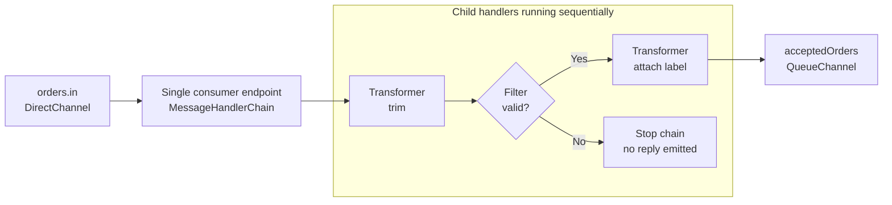

# MessageHandlerChain and Chained Handlers in a Single Endpoint

## 1. Context: Why Do We Need `MessageHandlerChain`?

In Spring Integration, a **message** carries a payload and headers; a **channel** transports messages; a **consumer endpoint** receives messages from a channel and invokes a **message handler** to process them. A typical `IntegrationFlow` consists of several sequential endpoints: a transformer normalizing data, a filter checking conditions, a service activator calling business logic, and then forwarding the result to another channel.

When these steps always go together, run sequentially, and do not need separate channels or endpoint configurations in between, Spring Integration provides **`MessageHandlerChain`** (`org.springframework.integration.handler.MessageHandlerChain`). A chain is a *composite message handler*: from the outside, **a single consumer endpoint** invokes one handler; inside, that handler orchestrates its child handlers in declared order.

For example, upon receiving an order code, an application must perform three consecutive steps: trim whitespace, validate the format, and attach a confirmation label. Using a chain represents these three steps as a single processing unit while keeping each step's logic separate.

> **Lesson scope:** how a chain behaves at runtime, how to write it in Java DSL, reply/blocking rules, effects of channels–pollers–executors, lifecycle, errors, transactions, retries, and signs indicating when to split a chain into multiple endpoints.

## 2. Structure and Message Path



Progression for an accepted message:

1. The producer sends a message to `orders.in`. In this example, it is a `DirectChannel`, so the consumer is invoked immediately on the sending thread.
2. The consumer endpoint hands the message to `MessageHandlerChain`.
3. The first handler processes it; if it produces a reply, the chain passes that reply to the next handler via an **internal, synchronous** forwarding mechanism. The subsequent handler receives the previous handler's output, including its payload and preserved headers.
4. The final handler produces a reply for the endpoint to send to the output channel (or the flow's reply channel mechanism, depending on configuration).

A chain does not merge multiple handlers into a single function: each handler retains its own responsibilities and message-handling rules. It also **does not spawn new threads, queues, or transactions** for each step. In a standard synchronous configuration, the steps are invoked sequentially on the same call stack.

### Replies Are a Critical Condition

`MessageHandlerChain` relies on each step's output to trigger the next step. Therefore:

- **Intermediate steps** should be reply-producing handlers, such as transformers or value-returning service activators. If an intermediate step consumes a message without returning a result, the chain cannot proceed along the expected sequence.
- **The final step** can return a reply to send outward or be a side-effect-only handler if the flow's purpose ends there.
- **A filter** returning `false` blocks the message. By default, a filter can drop a message without throwing an exception; a discard branch or exception-throwing mode can be configured if business rules require it.
- **A handler returning `null`** can cause the flow to emit no reply; on a handler with `requiresReply`, missing replies can raise an error. Do not equate `null` with a filter's rejection behavior.

Do not view `MessageHandlerChain` as a container for an arbitrary list of tasks: the reply chain and each handler's semantics determine whether downstream steps actually run.

## 3. Java DSL Example: Normalize, Filter, and Forward Results

Assume Spring Integration is enabled in the application. The flow below receives order code strings on `orders.in`, accepts only the `ORD-` format followed by four digits, and pushes the labeled string to `acceptedOrders`.

```java
import java.util.Locale;

import org.springframework.context.annotation.Bean;
import org.springframework.context.annotation.Configuration;
import org.springframework.integration.channel.QueueChannel;
import org.springframework.integration.dsl.IntegrationFlow;

@Configuration
public class OrderFlowConfig {

    @Bean
    QueueChannel acceptedOrders() {
        // QueueChannel serves to read results in this example; data here lives in memory.
        return new QueueChannel(100);
    }

    @Bean
    IntegrationFlow orderFlow() {
        return IntegrationFlow.from("orders.in")
            .chain(c -> c
                .transform(String.class, String::trim)
                .filter(String.class, code -> code.matches("ORD-\\d{4}"))
                .transform(String.class, code ->
                    "VALID:" + code.toUpperCase(Locale.ROOT)))
            .channel("acceptedOrders")
            .get();
    }
}
```

`IntegrationFlow.from("orders.in")` uses the input channel of that name; if no bean with that name exists yet, the DSL can register an appropriate channel for the flow configuration. `chain(...)` creates one endpoint containing three child handlers, while `channel("acceptedOrders")` specifies where the final reply is sent. In this example, `QueueChannel` is declared explicitly so results can be retrieved with `receive`.

You can verify the behavior once the application has started:

```java
MessageChannel input = context.getBean("orders.in", MessageChannel.class);
PollableChannel output = context.getBean("acceptedOrders", PollableChannel.class);

input.send(new GenericMessage<>("  ORD-2026  "));
Message<?> result = output.receive(1_000);
// result != null; result.getPayload().equals("VALID:ORD-2026")

input.send(new GenericMessage<>("  INVALID  "));
Message<?> rejected = output.receive(100);
// rejected == null if no other messages remain in the queue
```

The test snippet uses `MessageChannel`, `PollableChannel`, and `Message<?>` from `org.springframework.messaging` and `GenericMessage` from `org.springframework.messaging.support`; `context` is the running `ApplicationContext`. With a `DirectChannel` input, `send(...)` can return successfully because the message was delivered to the endpoint **even if the filter subsequently drops it**. To verify whether an order was accepted, check the corresponding reply or business event; do not use the boolean return value of `send` as a data validation outcome.

### Writing It Without a Chain

```java
IntegrationFlow.from("orders.in")
    .transform(String.class, String::trim)
    .filter(String.class, code -> code.matches("ORD-\\d{4}"))
    .transform(String.class, code -> "VALID:" + code)
    .channel("acceptedOrders")
    .get();
```

Both versions follow a similar business processing path, but the non-`chain` version declares **separate consumer endpoints** for each step, with channel links between endpoints (the DSL can auto-create intermediate channels). The `chain` version groups the child handlers behind a single consumer endpoint. This affects how endpoint configuration is attached, runtime observability, and choosing synchronous/asynchronous boundaries.

## 4. How Does `MessageHandlerChain` Differ from Independent Endpoints?

| Criterion | Handlers Inside a `MessageHandlerChain` | Independent Endpoints in a Flow |
| --- | --- | --- |
| Unit receiving messages from a channel | A single consumer endpoint at the head of the chain | Each step is its own consumer endpoint |
| Ordering | Sequential in child handler order | Follows the channel/endpoint topology |
| Channels between steps | Internal forwarding, no need to declare separate application channels | Can specify `DirectChannel`, `QueueChannel`, `ExecutorChannel`, etc. at each boundary |
| Pollers/executors between steps | Cannot configure separate pollers or executors per child handler | Can design asynchronous or pollable boundaries per step |
| Tracking and lifecycle | Control/identification mainly at the enclosing chain endpoint level | Easy to identify, monitor, and start/stop individual endpoints |
| Retries/transactions | Easy to apply a policy wrapping the whole segment; must account for side effects of earlier steps | Easy to choose different policies per endpoint |
| Best fit | Short, linear, synchronous processing segment | Steps with differing operational, load, or recovery requirements |

For instance, if a transformer simply normalizes data and a filter performs basic checks, a chain is usually concise. If an external API call needs independent retries, a downstream step needs a durable queue, or one processor must scale separately, independent endpoints give finer control.

## 5. Threads, Pollers, and Executors: Who Really Orchestrates the Chain?

**The chain does not determine the execution thread**; how messages reach the consumer endpoint determines it.

| Configuration Upstream of the Chain | What Triggers the Chain? | Runtime Consequence |
| --- | --- | --- |
| `DirectChannel` | The thread calling `send` | Synchronous steps hold the producer's thread until completion or error. |
| `PollableChannel` with a polling consumer | The poller fetches messages on schedule and invokes the endpoint | Read rate depends on the poll schedule, `maxMessagesPerPoll`, and the poller's task executor configuration if any. |
| `ExecutorChannel` | A task executor dispatches messages to the consumer | Introduces a thread boundary before the chain; steps **inside** the chain still run sequentially on the assigned thread unless a handler hands off asynchronously. |

For example, with a consumer polling from a queue, adding three handlers to a chain **does not create three pollers**. Only the endpoint wrapping the chain needs a poller. Likewise, placing an `ExecutorChannel` *before* the chain introduces one asynchronous boundary rather than making the three child handlers run in parallel.

A chain taking roughly `15 ms + 40 ms + 5 ms = 60 ms` across three synchronous steps holds the processing thread for around 60 ms per message (excluding overhead). With a single processing thread, theoretical throughput can hardly exceed roughly `1 / 0.060 ≈ 16.7 messages/second`; in practice it also depends on I/O, contention, and consumer count. Adding workers can improve throughput when the steps allow concurrent execution, but a chain does not provide that parallelism on its own.

**Signs to consider splitting endpoints:** a handler waits long on HTTP/database I/O, steps need different concurrency levels, a queue is needed to relieve *backpressure*, or an individual component must be started/stopped independently. Place explicit channel boundaries before/after that step, then verify message ordering and potential message loss across asynchronous boundaries.

## 6. Errors, Transactions, Retries, and Correlation

### Where Do Errors Go?

In a synchronous chain, unhandled exceptions in a child handler typically propagate back up through `MessageHandlerChain`, the consumer endpoint, and the caller. However, how errors surface **depends on where the message was dispatched**:

- A producer sending directly over `DirectChannel` can usually catch the exception right at `send`/gateway call.
- With a poller or executor, errors may be turned into an `ErrorMessage` by task/poller error handling and sent to a configured error channel. Do not assume every exception on every `DirectChannel` is automatically routed to the global `errorChannel`.
- A filter dropping a message conditionally is typically a normal business branch, distinct from a handler throwing an exception; if auditing or rejection responses are required, configure an explicit discard channel or exception mode.

When diagnosing issues, locate the failing handler and `failedMessage` inside `MessagingException` (if present), and correlate the message ID, correlation ID, and timestamp received at the endpoint. Do not treat the chain as an opaque black box.

### Does a Transaction Span the Entire Chain?

If the endpoint is invoked within an active transaction and the handlers continue on the **same thread**, operations backed by the same transaction manager can participate in that transaction. For instance, if a polling consumer starts a transaction and runs a synchronous chain: an uncaught exception can cause the transaction to roll back per configuration. **The chain itself does not create a transaction** and cannot make HTTP calls or non-transactional external actions rollback-capable. An `ExecutorChannel` boundary or asynchronous work typically severs thread-bound transaction propagation.

### Which Part Does a Retry Re-run?

If retry advice is placed at the **endpoint/chain level**, a retry may re-execute **the entire sequence**. Suppose the first handler sent an email and the second handler fails: retrying the whole chain can send the email again. Therefore, enforce idempotency rules, appropriate transactions, or split endpoints so retries target only the repeatable step. When failed messages must move to a recovery queue, clearly design where retries terminate and where failed messages go.

### Headers and Correlation

The chain forwards `Message<?>`, so messages carry headers such as `id`, `timestamp`, `replyChannel`, `errorChannel`, or relevant business/correlation headers. Transformers returning a **payload** are typically wrapped by the framework into a reply message with appropriate header propagation; handlers constructing a new `Message<?>` manually must ensure required headers are preserved. **The chain does not automatically assign business correlation IDs**. If the flow includes a splitter/aggregator, monitor `correlationId`, `sequenceNumber`, `sequenceSize`, and message group state; complex stateful components are often easier to operate as explicit endpoints outside a simple linear chain.

## 7. Lifecycle and Runtime Observability

Configuration-wise, an endpoint wrapping a chain has running/stopped states. When managing an `IntegrationFlow` across the application lifecycle or registering dynamic flows via `IntegrationFlowContext`, that flow/endpoint is typically controlled as a single unit. Do not assume you can stop just the second transformer inside a chain without affecting other steps. Stopping an endpoint also does not mean in-flight work is immediately aborted; how messages drain and tasks finish depends on the channel, poller, and adapter.

For operations and diagnostics:

1. **Assign meaningful names/IDs** to the flow or enclosing chain endpoint, along with input/output channel names, for easy lookup in logs and the integration graph.
2. **Measure end-to-end latency** and, when needed, measure slow handlers individually via timers or logs tagged with a correlation ID. Metrics on the outer chain endpoint do not necessarily reveal which inner step consumes the time.
3. **Monitor producers, pollers/executors, and queues**: if `QueueChannel` depth grows or a worker pool saturates, identify the bottleneck upstream, inside, or downstream of the chain.
4. **Compare filter rejection rates and error rates**: both can result in missing output, yet their remedies differ.
5. **Inspect message headers at meaningful boundaries**. In flows relying on correlation, dropped headers can prevent results from aggregating even when payload-processing steps look right.

An in-memory `QueueChannel` like the one in section 3 is only suitable for demonstrations or scenarios that tolerate data loss on process shutdown; it does not provide durability like a message broker or persistent message store. When recovery across restarts is required, design a message store/broker and explicit acknowledgment policy rather than relying on a chain for durability.

## 8. Common Misconceptions

| Symptom | Causes to Check | How to Verify or Fix |
| --- | --- | --- |
| `send` succeeds but there is no output | Filter dropped the message; handler produced no reply; output went to another channel | Test valid input, check filter/discard, check `outputChannel` and `replyChannel` config. |
| Message stops mid-chain | An intermediate handler only performs side effects, returns `null`, or throws an exception | Ensure intermediate steps produce replies; move one-way handlers to the end or split endpoints. |
| Low throughput despite multiple handlers | Chain is sequential; producer/poller/executor lacks concurrency or has slow I/O | Measure per-handler duration and thread usage; choose async boundaries intentionally. |
| Retries cause duplicate actions | Retry wraps the whole chain so pre-failure steps re-run | Add idempotency or narrow retries to the appropriate endpoint. |
| Sender sees no exception | There is an executor/poller boundary or logic handled errors elsewhere | Inspect error channels/task executors and correlate message IDs. |
| Metadata/correlation is lost | A handler constructed a new message and dropped needed headers | Preserve/copy required headers when creating replies; test messages carrying correlation IDs. |
| Cannot manage individual steps independently | Handlers live inside a single chain-wrapping endpoint | Split into identified endpoints if independent lifecycle/monitoring/retry is needed. |

## 9. Practice Exercise and Self-Check Questions

**Practice:** use the flow from section 3 and send `" ORD-2026 "`, `"ERR-2026"`, and `"ORD-9"` one by one. After each send, inspect `acceptedOrders` and explain why the message was emitted or dropped. Next, insert a handler with a slow call before the final step; measure `send` duration when the input is `DirectChannel`. Switch the boundary **before the chain** to `ExecutorChannel`, then measure producer return time and when output appears. Finally, trigger an error in the last step, test chain-level retries with a simulated side effect in the first step, and observe which steps are re-invoked. When experimenting, never use real side effects such as sending emails or charging payments.

Answer these questions on your own before moving to the next topic:

1. Why do three handlers in a `MessageHandlerChain` typically correspond to one consumer endpoint yet still execute three business processing steps?
2. How does an intermediate step returning no reply affect downstream steps?
3. Why does placing an `ExecutorChannel` before a chain not make its internal handlers run in parallel?
4. When a later handler fails, what risk does retrying the entire chain pose to earlier handlers?
5. When should you split a chain to have separate channels, pollers, transactions, or observability?

`MessageHandlerChain` is most useful when steps form **a short, linear, synchronous processing segment**. Choose chains based on real operational boundaries: whenever a step needs its own polling schedule, thread pool, retry policy, state, or delivery guarantee, consider representing it as an independent endpoint.
