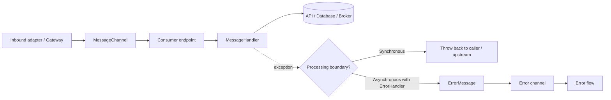
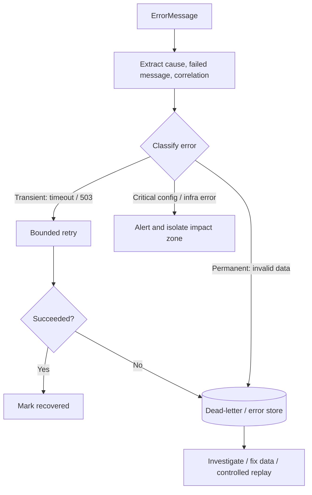

# Handler Exceptions and Error Flows in Spring Integration

## Learning Objectives

In an integration system, `MessageHandler` is often where API calls, database writes, data transformations, or cross-system message sends happen. These operations can fail. What matters is not only **which exception the handler throws**, but also **which thread the handler runs on, where the processing boundary lies, and who is responsible for receiving the error**.

After this lesson, you will be able to:

- Distinguish errors propagated back to the sender from errors wrapped into an `ErrorMessage` and published to an error channel.
- Explain the effect of `DirectChannel`, `ExecutorChannel`, pollers, and gateways on exception paths.
- Build an error flow capable of classifying errors, preserving correlation, logging with context, and routing errors requiring further handling to an appropriate store or queue.
- Decide when to retry, when to roll back, and when to stop retrying and send a message to an error-handling flow.
- Diagnose cases where the handler failed yet the caller saw `send()` succeed, the error channel received nothing, or requests timed out.

The scope is the **Spring Integration runtime**: message flows, channels, endpoints, consumers, pollers, executors, transactions, retries, and actual runtime state. This is an in-depth section of the **Message handler** chapter, focusing on **Handler Exceptions and Error Flows**.

## 1. Where Do Exceptions Occur in a Message Flow?

A simple flow may consist of an inbound adapter or gateway, channel, consumer endpoint, `MessageHandler`, and a downstream system:



In Spring Integration, a message-consuming endpoint may invoke a handler directly on the sender's thread or on a thread provided by an executor/poller. If the handler throws an error, whether **the exception propagates** or **an `ErrorMessage` is emitted** depends on how the message reached the endpoint.

Do not conflate three distinct events:

1. `MessageChannel.send(message)` completes: the channel accepted or handed off the message according to the channel's contract.
2. Handler execution finishes: business logic inside the handler may succeed or subsequently throw an error.
3. Business operation is durably confirmed: the transaction committed, the broker acknowledged, or state was persisted. This also depends on adapters, transactions, and each resource's acknowledgment mechanism.

Specifically, a successful `send()` call into an `ExecutorChannel` **does not prove** the handler on another thread succeeded.

## 2. Synchronous vs. Asynchronous Boundaries Determine the Error Path

| How Handler Is Invoked | Handler Execution Thread | When Handler Throws an Exception | What to Check |
| --- | --- | --- | --- |
| `DirectChannel` and synchronous handler chain | Usually the thread calling `send()` | Exception usually propagates back up the call stack to the sender; may be wrapped in `MessagingException` | Caller `try/catch`, open transactions, gateway configuration if present |
| `PublishSubscribeChannel` without an executor | Usually on the publisher's thread | Subscriber exception may propagate to the publisher; outcome depends on dispatch strategy and `ignoreFailures` setting | Number of subscribers and dispatch configuration |
| `ExecutorChannel` | Thread from a `TaskExecutor` | Sender is no longer on the same call stack to catch the error; dispatcher/executor error handling may publish an `ErrorMessage` | `ErrorHandler`, `errorChannel` header, default error channel, executor task acceptance |
| `PublishSubscribeChannel` with an executor | Thread managed by the executor | Asynchronous subscriber errors are handled on the executor side, typically via an error handler | Executor, subscribers, `ErrorMessage` routing |
| Endpoints pulling messages via poller (`QueueChannel`, inbound polling adapter, etc.) | Scheduler/poller thread | Errors occur during a poll cycle; usually passed to the poller's error handler, which by default can publish an `ErrorMessage` | Poller config, transactions, error handler, message source, and ack mechanism |
| Request/reply gateway | Depends on the flow behind the gateway | Gateway has its own timeout and error handling policy; an error channel configured on the gateway can convert errors into replies/exceptions | Gateway `errorChannel`, `replyChannel`, timeouts, and return type |

The word "usually" is deliberate: channels/endpoints can be customized. To determine the actual path, start with **which endpoint invokes the handler** and **who owns that thread**.

### 2.1. `DirectChannel`: Errors Unwind Up the Call Stack

Suppose `orders.input` is a `DirectChannel` and the handler throws `IllegalArgumentException`:

```java
@Bean
IntegrationFlow directOrdersFlow() {
    return IntegrationFlow.from("orders.input")
            .handle((Message<?> message) -> {
                throw new IllegalArgumentException("Missing orderId");
            })
            .get();
}
```

When the caller invokes `ordersInput.send(message)`, the handler runs in the same synchronous call chain. The exception can propagate back to `send()` (usually as a `MessageHandlingException` or another `MessagingException` holding the root cause):

```java
try {
    ordersInput.send(request);
} catch (MessagingException exception) {
    // Inspect exception.getCause() and exception.getFailedMessage().
    // Decide on rollback, returning an error to the caller, or handling at the business boundary.
}
```

Merely adding an `errorChannel` header to a message **does not automatically** turn every synchronous exception into an `ErrorMessage`. Something must actively catch the exception and send the error message, such as an error handler at an asynchronous boundary, an appropriately configured gateway, or recovery advice.

### 2.2. `ExecutorChannel`: Caller and Handler Are Not on the Same Thread

```text
HTTP request thread             si-worker-1 thread
-------------------             ------------------
send(message)
    |
    +--> ExecutorChannel ------> handle(message)
    |                                |
send() returns                   throw exception
                                     |
                                ErrorHandler
                                     |
                                 ErrorMessage
                                     |
                                error channel
```

Once the executor accepts the task, an error occurring in the handler cannot "fly back" to the already-finished `send()` stack frame. In standard Spring Integration configurations, `MessagePublishingErrorHandler` at the asynchronous boundary wraps the error and sends it to the error channel. However, the executor rejecting the task at submission time (`RejectedExecutionException`) is a **dispatch-time error**, which can surface differently from a processing error occurring after task acceptance.

### 2.3. Poller: Errors Belong to the Poll Cycle and Managed Resources

A poller retrieves messages from a source and invokes the flow. If the handler throws an exception, the poller can forward the error to an error handler, while the poll cycle's transaction determines rollback/commit per configuration. Separate **fetching a message from the source** from **committing the business work**; different sources (DB, JMS, files, in-memory queues) do not share the same redelivery guarantees.

When replacing `DirectChannel` with `QueueChannel` plus a polling consumer, you introduce another thread boundary and can alter error visibility, transactions, and processing latency. This is a runtime behavioral change, not just a DSL structural tweak.

## 3. How Do `MessagingException` and `ErrorMessage` Differ?

### 3.1. Thrown Exceptions

Common classes:

- `MessagingException`: exception family carrying message-processing context; `getFailedMessage()` can reveal the message tied to the failure.
- `MessageHandlingException`: error while a handler processes a message; usually has the business exception as its `cause`.
- `MessageDeliveryException` or `MessageDispatchingException`: error delivering/dispatching a message, e.g., no matching consumer found or dispatch failed.
- Business exceptions such as `IllegalArgumentException`, `IOException` (wrapped when needed), `DataAccessException`, or HTTP client errors: classify the true error nature from the `cause` chain, not just the outermost wrapper class.

There is no single exception type across all handlers: adapters and handlers can wrap errors before Spring Integration processes them further.

### 3.2. Error Messages Sent to a Channel

`ErrorMessage` is a `Message<Throwable>`; **its payload is a `Throwable` object**, not the original business message payload. Properties to inspect:

| Data | How to Access | Meaning |
| --- | --- | --- |
| Error | `errorMessage.getPayload()` | Caught exception; follow `getCause()` to find the root error |
| Original message | `errorMessage.getOriginalMessage()` | Source context if provided by the `ErrorMessage` creation mechanism |
| Failed message | `((MessagingException) error).getFailedMessage()` | The message attached to the exception, if the exception is a `MessagingException` |
| Error message headers | `errorMessage.getHeaders()` | Metadata of the `ErrorMessage` itself; not implicitly identical to business headers |
| Business headers | `original.getHeaders()` or `failed.getHeaders()` | `correlationId`, `replyChannel`, `errorChannel`, trace ID, tenant ID, etc., if carried along |

`getOriginalMessage()` and `getFailedMessage()` **can be `null`** or point to messages at different points in the flow. For instance, a transformer may have created a new message before the error occurred. Therefore, capture context at the inbound boundary, propagate correlation across steps, and handle missing data gracefully.

### 3.3. How Is the Error Channel Chosen?

In the standard error publishing model, the handler resolves the destination by priority:

1. The `errorChannel` header on the message being processed, if present and resolvable to a suitable channel (either a `MessageChannel` object or a channel name).
2. The application's default error channel, typically the bean named `errorChannel`.

Spring Integration usually registers a default `errorChannel` along with a logging error handler. Seeing a stack trace in the logs **does not mean** recovery or persistent error storage for replay exists. If the application must treat error handling as part of its business contract, build an explicit error consumer/flow and watch for errors when dispatching to the error channel (such as an unresolvable channel name or missing subscribers).

## 4. Complete Example: Asynchronous Handler and Dedicated Error Flow

The following Spring Integration 6.x / Spring Framework 6.x example illustrates a handler running on an executor. Each request carries header `errorChannel = workErrors` to route errors to a dedicated flow. Here `System.err` is used for learning purposes; production applications should use a structured logger along with reliable error persistence.

```java
import org.springframework.beans.factory.annotation.Qualifier;
import org.springframework.context.annotation.Bean;
import org.springframework.context.annotation.Configuration;
import org.springframework.core.task.TaskExecutor;
import org.springframework.integration.channel.DirectChannel;
import org.springframework.integration.config.EnableIntegration;
import org.springframework.integration.dsl.IntegrationFlow;
import org.springframework.integration.dsl.MessageChannels;
import org.springframework.messaging.Message;
import org.springframework.messaging.MessageChannel;
import org.springframework.messaging.MessagingException;
import org.springframework.messaging.support.ErrorMessage;
import org.springframework.scheduling.concurrent.ThreadPoolTaskExecutor;

@Configuration
@EnableIntegration
class WorkIntegrationConfiguration {

    @Bean("workInput")
    MessageChannel workInput() {
        return new DirectChannel();
    }

    @Bean("workErrors")
    MessageChannel workErrors() {
        return new DirectChannel();
    }

    @Bean("workerExecutor")
    ThreadPoolTaskExecutor workerExecutor() {
        ThreadPoolTaskExecutor pool = new ThreadPoolTaskExecutor();
        pool.setCorePoolSize(2);
        pool.setMaxPoolSize(4);
        pool.setQueueCapacity(50);
        pool.setThreadNamePrefix("si-worker-");
        pool.initialize();
        return pool;
    }

    @Bean
    IntegrationFlow workFlow(
            @Qualifier("workInput") MessageChannel input,
            @Qualifier("workerExecutor") TaskExecutor executor) {
        return IntegrationFlow.from(input)
                .channel(MessageChannels.executor(executor))
                .handle((Message<?> message) -> {
                    // Simulate API/DB failure to process the request.
                    throw new IllegalStateException("Downstream unavailable");
                })
                .get();
    }

    @Bean
    IntegrationFlow workErrorFlow(
            @Qualifier("workErrors") MessageChannel errors) {
        return IntegrationFlow.from(errors)
                .handle((Message<?> message) -> {
                    ErrorMessage error = (ErrorMessage) message;
                    Throwable cause = error.getPayload();

                    Message<?> original = error.getOriginalMessage();
                    if (original == null && cause instanceof MessagingException ex) {
                        original = ex.getFailedMessage();
                    }

                    Object correlationId = original == null
                            ? "unknown"
                            : original.getHeaders().get("correlationId");

                    // Demo: production should use structured logging and persist error records.
                    System.err.printf("correlation=%s, error=%s%n",
                            correlationId, cause.toString());
                })
                .get();
    }
}
```

A producer can send a message as follows:

```java
import org.springframework.messaging.Message;
import org.springframework.messaging.MessageChannel;
import org.springframework.messaging.MessageHeaders;
import org.springframework.messaging.support.MessageBuilder;

void submit(MessageChannel workInput) {
    Message<String> request = MessageBuilder.withPayload("order-42")
            .setHeader("correlationId", "trace-order-42")
            .setHeader(MessageHeaders.ERROR_CHANNEL, "workErrors")
            .build();

    workInput.send(request); // Dispatcher accepted the task; handler may fail later.
}
```

**Reading the runtime flow:**

1. The producer sends a message to `workInput` (`DirectChannel`).
2. The flow passes the message to the `ExecutorChannel` configured with `workerExecutor`.
3. The handler runs on `si-worker-*` and throws `IllegalStateException`.
4. Error handling at the executor boundary publishes an `ErrorMessage`, preferring `workErrors` because the message carries that header.
5. The consumer on `workErrors` inspects the exception, extracts message/correlation details if available, and records the error.

The `correlationId` header in this example is just an illustrative field name. In flows using Spring Integration's built-in correlation/sequence mechanisms, you can read the corresponding headers via `IntegrationMessageHeaderAccessor` instead of inventing new conventions.

**Try changing one detail:** remove `.channel(MessageChannels.executor(executor))` so the handler runs synchronously behind `workInput`. Then the handler throws the exception back to the producer's thread; do not expect `workErrors` to automatically receive the same `ErrorMessage` as in the asynchronous case.

> Operational note: this example only proves error propagation. If errors must survive application restarts or require guaranteed reprocessing, merely logging or pushing to an in-memory channel is insufficient. You need a durable error store (such as a DB table or a broker supporting dead-letter queues) and idempotency mechanisms.

## 5. Designing an Intentional Error Flow

An error flow is itself a message flow: it has channels, subscribers, handlers, and optionally routers, transformers, and outbound adapters. It requires a clear contract: which errors are resolved, which are retried, and which must be routed for investigation or replay.



A practical processing order:

1. **Standardize metadata:** capture exception class, root cause, timestamp, message ID, correlation ID, flow/endpoint name, destination, attempt count, and essential source info. Redact sensitive data before logging.
2. **Classify:** transient errors (timeouts, rate limits, connection drops), permanent errors (bad schema, missing required fields), software/configuration bugs, and unknown errors.
3. **Apply policies:** bounded retries/backoff if the operation is safe; route unrecoverable errors to an error store or dead-letter queue; trigger alerts when thresholds are exceeded.
4. **Preserve traceability:** use correlation IDs and stable business identifiers to trace a message's path across multiple endpoints.
5. **Define completion criteria:** handling an error successfully means recording/recovering per contract; it does not implicitly mean the original business action succeeded.

### Why Shouldn't All Errors Go into One Generic Handler?

An error handler that merely prints stack traces makes it hard to distinguish malformed messages needing data fixes, transient API outages needing retries, and system-wide bugs needing urgent alerts. In larger flows, route by exception type/endpoint while keeping a fallback branch for unknown errors. Never route solely by exception message strings, since message text often changes across library versions or locales/environments.

### Global `errorChannel` vs. Business-Specific Error Channels

| Approach | Best Fit When | Risks to Manage |
| --- | --- | --- |
| Default `errorChannel` | Capturing technical errors lacking a specialized route; application-wide fallback | Hard to apply one retry policy, priority, and security level to all errors |
| `errorChannel` header on messages | A specific producer or request needs a custom policy; context must survive until a worker runs | Header can be lost/replaced when creating new messages; destination may not exist |
| Dedicated error channel per adapter, gateway, or poller | Inbound source has its own ack, timeout, and error semantics | Must understand interactions with that source's transaction/ack behavior |

Do not just name a channel; register a consumer capable of handling error messages and verify messages actually arrive there. If an error channel is a `DirectChannel`, the error flow's consumer runs synchronously on the thread publishing the error. If the error flow is slow or throws another exception, it can stall or complicate error handling on that thread. Offload error flows to an executor/broker when justified and capacity is controlled.

## 6. How Do Retries, Recovery, and Error Channels Interact?

Retries and error flows address two different phases:

- **Handler-level retry**: repeats a recoverable operation before declaring the message finally failed. Spring Integration provides `RequestHandlerRetryAdvice` to apply retries around handler calls, typically configured with Spring Retry and backoff policies.
- **Recovery after retries are exhausted**: can return a fallback value, rethrow the final error, or invoke a recovery callback (such as routing errors to an error channel). The recovery strategy determines whether downstream observes an exception or an `ErrorMessage`.
- **Broker/poller-level retry**: the inbound source may also redeliver messages after rollback, negative acknowledgment, or visibility timeout; this is a separate layer from in-handler retries. Enabling both can multiply total downstream calls beyond expectations.

Example: a handler calls a payment system with a policy of up to 3 attempts per processing pass; after 3 failures, it publishes an `ErrorMessage` containing `orderId`, `correlationId`, attempt count, and persists an error record. However, if the broker subsequently redelivers the message 4 times, total downstream requests can reach 12. The payment system must enforce an idempotency key, and you must clearly define which layer owns retries.

A retry policy should answer:

| Question | Application Guidance |
| --- | --- |
| Is the error truly transient? | Retry timeouts/503/429 per policy; do not auto-retry validation failures |
| Is the operation idempotent? | Use business keys/idempotency keys when side effects exist |
| What are the bounds? | Max attempts, total duration, backoff with jitter, avoiding retry storms |
| What happens when retries exhaust? | Rethrow so transaction/broker boundaries decide, or send to an error store/DLQ via intentional recovery |
| Who acknowledges the source message? | Inspect actual commit/ack mechanics; do not infer acknowledgment from an error flow logging the error |

Especially with request/reply gateways, if recovery advice swallows an exception and returns `null` without producing a valid reply, the caller may wait until timeout. Explicitly define how errors are returned in the request/reply protocol.

## 7. Transactions and Rollbacks When a Handler Throws an Exception

Transactions in the runtime are scoped by thread and participating resources. An exception triggers rollback only when it **crosses an appropriate transaction boundary** and rollback rules apply.

### 7.1. Synchronous Flow Within One Transaction

```text
Service @Transactional
    -> DirectChannel
        -> Handler writes DB
        -> Handler throws RuntimeException
    <- exception propagates back
Transaction interceptor marks rollback (if policy applies)
```

If the entire call remains on the same thread/transaction, an exception unwinding out of the transactional scope can trigger a rollback. However, if an error handler catches the error and returns normally inside that scope, the transaction manager may no longer see the exception to roll back automatically. In that case, trigger rollback explicitly per policy rather than relying on error logging.

### 7.2. Flow Across an Executor

`ExecutorChannel` hands work off to another thread. Worker threads normally **do not inherit transactions bound to the caller's thread**. Thus, a transaction in an HTTP service wrapping `send()` does not automatically wrap the handler executing later. If the handler needs a transaction, start the transaction at the endpoint/handler or use an appropriate transaction mechanism on the worker side.

### 7.3. Pollers and Message Sources

A poller can run within a transaction for each poll cycle. When a handler fails, the source's outcome depends on whether the message source and downstream resources participate in that transaction. For sources that do not support rollback/ack, emitting an `ErrorMessage` does not restore the consumed message. For sources supporting redelivery, account for duplicate deliveries and idempotency.

**Practical rule:** write down three checkpoints for each flow: "where is the message received?", "on which thread does the transaction start/end?", and "who is responsible for acking or redelivering when the handler fails?". This uncovers flawed assumptions about exactly-once delivery.

## 8. Correlation and Error Tracing in Production

When a message passes through transformers, splitters, aggregators, routers, or executors, an error is usually only actionable if it can be traced back to the original business request. Standardize these fields:

| Field | Purpose | Example |
| --- | --- | --- |
| `businessKey` | Identify the business entity and prevent duplicate processing | `order-42` |
| `correlationId` | Link messages/branches belonging to the same request | `trace-order-42` |
| `messageId` | Distinguish a specific Spring `Message` instance | Message UUID |
| `endpointId` | Pinpoint which handler threw the error | `reserveInventory.handler` |
| `attempt` | Track execution count across retries/redeliveries | `3` |
| `exceptionType` / `rootCause` | Classify errors and aggregate metrics | `SocketTimeoutException` |
| `occurredAt` | Correlate logs/traces/metrics | UTC timestamp |

Spring Integration provides standard message headers, and several patterns (splitter/aggregator) use correlation/sequence headers. Distinguish **message ID** (which can change when creating a new message) from **business key/correlation ID** that the system intentionally preserves throughout the flow.

When using Micrometer/Observation/tracing, attach endpoint, channel, and correlation attributes to traces/spans per configured observability policy. Never dump full payloads or tokens/PII into logs, metric tags, or error stores. For failed messages, store enough metadata for lookup plus a safe reference to the payload when replay is required.

## 9. Symptom-Based Troubleshooting

| Symptom | Possible Causes | First Checks |
| --- | --- | --- |
| `send()` returns normally yet task fails | Handler runs behind `ExecutorChannel` or a poller | Thread names, executor, consumer-side logs/error flow |
| Handler threw yet `errorChannel` received nothing | Flow is completely synchronous; no error-publishing component present | Channel/endpoint topology and `ErrorHandler` placement |
| Errors appear only in default logs | Default error channel has a logging subscriber but no business recovery | Is there a dedicated error handler/flow, DLQ, or error store? |
| Gateway waits then times out | Async flow produced no reply; recovery swallowed exception; reply channel lost | Gateway timeout, `replyChannel`, recovery policy, message headers |
| Message processed multiple times | Handler retries combined with adapter/broker redelivery | Attempt counts per layer, transactions, idempotency keys |
| Error has a message but lacks `correlationId` | Headers were not copied or new message creation dropped context | `originalMessage`, `failedMessage`, transformers, and message builders |
| Error flow backs up | Error handler does slow I/O, synchronous channel, or executor exhausted | Queue depth, active threads, lag, error throughput |
| Error turns into another dispatch failure | Misnamed/unsubscribed error channel; error flow itself throws | Bean/channel names, subscribers, secondary exceptions |

To investigate performance and threading, monitor at minimum messages in/out, errors per endpoint, processing times, executor active/queued/rejected task counts, poll rates, retry counts, and DLQ/error store size. Use thread name + correlation ID logs to stitch together steps executing on different threads.

### Incident Investigation Sequence

1. Pick one failing `businessKey` and find its `correlationId`.
2. Identify the handler and endpoint that threw the error; record both the root exception and wrappers.
3. Map the traversed channels, marking `DirectChannel`, `ExecutorChannel`, `QueueChannel`, gateways, and pollers.
4. Locate transaction boundaries and ack/redelivery policies; compare attempt counts at the handler vs. message source.
5. Check the `errorChannel` header, actual consumers, DLQ/error store, and any secondary errors while the error flow ran.
6. Determine whether the request succeeded, is still pending, needs replay, or requires data repair; verify against durable business state.

## 10. Guided Practice

**Exercise A — Comparing synchronous and asynchronous paths.** Create a flow with a handler that always throws `IllegalStateException`. First wire it with `DirectChannel`, send via `MessageChannel.send()`, and observe the caller's exception. Next insert `ExecutorChannel`, configure a consumer on `workErrors`, send a message with the `errorChannel` header, and record thread names, event order, `ErrorMessage` type, `originalMessage`, and `failedMessage`.

Expected outcome: the synchronous version propagates the error on the producer's call stack; the asynchronous version handles the error on the worker side and can emit an `ErrorMessage`. Note cases where original message info is absent to avoid assuming full correlation is always present.

**Exercise B — Bounded retries.** Replace the handler with a fake downstream that fails twice then succeeds on the third try; configure `RequestHandlerRetryAdvice` with max attempts and backoff. Record actual execution counts. Next make the downstream always fail; verify the outcome once retries exhaust and confirm the chosen policy: rethrowing to the boundary or publishing an error via a recovery callback.

Expected outcome: successful retries need no final error record; exhausted retries produce a clear failure signal. If broker redelivery is added, verify total invocation counts to avoid unintended retry multiplication.

**Exercise C — Investigating error flows inside transactions.** Use a handler that writes to the DB and then throws, running sequentially with `DirectChannel`, `ExecutorChannel`, and a polled consumer. Record thread IDs, transaction start/end times, whether the DB record committed/rolled back, source state, and the `ErrorMessage` path.

Expected outcome: catching an exception or seeing an `ErrorMessage` does not by itself determine transaction outcome; inspect transactional boundaries and participating resources.

**Exercise D — Operating an error flow.** Design an error record containing business key, correlation ID, endpoint, exception class, attempt, timestamp, status, and payload reference. Add deduplication when replaying the same business key, alerts for system errors, and a dashboard tracking errors by endpoint. Also test cases where the error store or the error flow itself is unavailable.

## 11. Self-Check Questions

1. Why is adding an `errorChannel` header insufficient for a `DirectChannel` to automatically emit an `ErrorMessage` whenever a handler throws?
2. An HTTP request calls `send()` on an `ExecutorChannel` and succeeds; what does that prove about the business outcome?
3. When `ErrorMessage.getOriginalMessage()` returns `null`, where do you look next for the failed message/context?
4. Why can handler-level retries combined with broker redeliveries produce more side effects than expected?
5. Why can catching an exception and logging it alter a synchronous transaction's rollback decision?
6. How can a request/reply gateway time out if recovery swallowed an exception without producing a reply?

**Takeaway:** `throw exception` describes a failure at the handler; `error flow` describes how that failure is observed and handled afterward. To design this properly, always identify **threads, channels, error handlers, transactions, retries, and correlation** before deciding where errors go and whether messages can be reprocessed.
