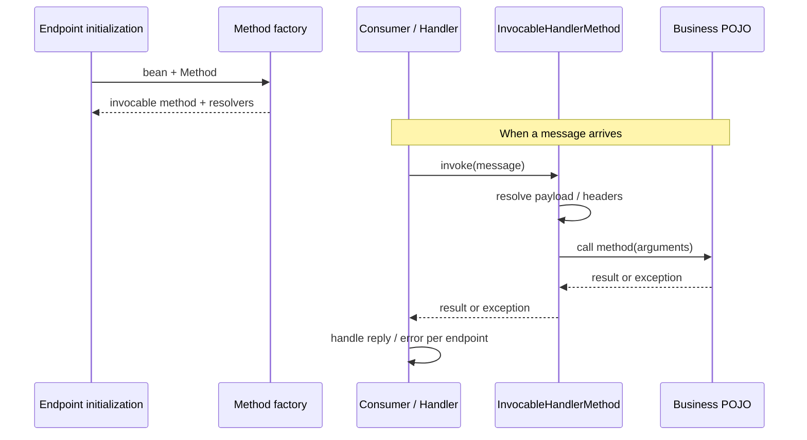

# MessageHandlerMethodFactory and Method Invocation in Spring Integration

## Lesson Objectives

In a Spring Integration application, a message travels through a `MessageChannel` to reach a consumer endpoint. The endpoint can invoke a plain Java method (POJO) even though that method knows nothing about the messaging infrastructure. The **method invocation** mechanism is responsible for selecting the method, extracting the payload/headers, converting types, invoking the method, and handing the result back to the endpoint.

After this lesson, you will be able to:

- Explain the roles of `MessageHandlerMethodFactory`, `InvocableHandlerMethod`, and argument resolvers (`HandlerMethodArgumentResolver`).
- Distinguish between **preparing a method** and **invoking a method per message**, as well as between invocation and routing a reply into a channel.
- Write a service activator that accepts `@Payload`, `@Header`, `@Headers`, or the full `Message<?>`.
- Proactively select, configure, and verify type conversion, validation, SpEL, error handling, and concurrency behavior.
- Diagnose errors at the boundary between channels, endpoints, message handlers, and POJOs.

Scope: this topic belongs to the **Handler adapter** chapter of the **SPRING_INTEGRATION_RUNTIME** module. The focus is on how the runtime connects Java method invocations to the message flow; pollers, executors, transactions, retries, and correlation are discussed where they directly affect invocation.

## 1. Why Is Method Invocation Needed?

Suppose a business service only has the following method:

```java
public String quote(String sku, String region) {
    return region + ":" + sku;
}
```

Meanwhile, an incoming message has the following shape:

```text
payload = "P100"
headers = {
  region: "VN",
  correlationId: "req-17",
  ...
}
```

If developers wrote consumers manually, they would have to unwrap the message, read headers, convert types, look up the appropriate method, invoke it, build a reply message, and send it to a channel. Spring Integration separates these responsibilities:

1. **Channel/consumer endpoint** decides *when* a message is available to process.
2. **Message handler and method invoker** decide *which method* to call with *which arguments*.
3. **Business POJO** only declares the required parameters and returns the result.
4. **Endpoint reply mechanism** handles the return value, selects the output/reply channel, and forwards the next message.

A factory that creates a callable method object does not mean an endpoint is running. The factory does not subscribe to channels, create pollers, switch threads, retry, or commit transactions on its own.

### Message Flow Diagram


With a `DirectChannel`, most of the steps above typically run on the thread calling `send()`. With an `ExecutorChannel`, processing work is handed off to an executor. With a `QueueChannel`, a poller retrieves the message and invokes the handler on a poller thread. This is a choice of the channel/consumer, not of `MessageHandlerMethodFactory`.

## 2. Classes and Responsibilities

| Component | Package / Source | Responsibility |
|---|---|---|
| `MessageHandlerMethodFactory` | `org.springframework.messaging.handler.annotation.support` (Spring Messaging) | Contract for creating an `InvocableHandlerMethod` from a bean and a `java.lang.reflect.Method`. |
| `DefaultMessageHandlerMethodFactory` | Same package, Spring Messaging | Configures standard argument resolvers, converters, conversion service, and validator. |
| `IntegrationMessageHandlerMethodFactory` | `org.springframework.integration.handler.support` (Spring Integration 6.0+) | Extends the default factory for Spring Integration's method invocation model. |
| `InvocableHandlerMethod` | `org.springframework.messaging.handler.invocation` | Accepts a message, resolves arguments from resolvers, and actually invokes the method. |
| `IntegrationInvocableHandlerMethod` | `org.springframework.integration.handler.support` (6.0+) | Invocable method variant serving Spring Integration's requirements. |
| `HandlerMethodArgumentResolver` | `org.springframework.messaging.handler.invocation` | Determines whether a parameter is supported and returns the parameter value for the current message. |
| `MessagingMethodInvokerHelper` | `org.springframework.integration.handler.support` | Internal helper in the POJO invocation branch that coordinates method selection/invocation with payload and headers. |

The class names look similar, but their layers of responsibility differ:

- **Factory** prepares invocation capability: it knows the bean, the `Method`, and the resolvers.
- **Invocable handler method** invokes the method in the context of a specific `Message<?>`; the result is the returned Java value.
- **Spring Integration handler/endpoint** decides whether a reply is required, wraps the return value into a message when needed, and sends it along the flow.

A minimal view of the factory interface:

```java
public interface MessageHandlerMethodFactory {
    InvocableHandlerMethod createInvocableHandlerMethod(
            Object bean, java.lang.reflect.Method method);
}
```

Do not confuse the synchronous `org.springframework.messaging.handler.invocation.InvocableHandlerMethod` discussed here with the `...invocation.reactive.InvocableHandlerMethod` variant: their APIs and invocation return types are different.

### Two Phases of an Invocation

**Configuration/initialization phase:** Spring identifies the target bean and method, prepares resolvers/converters, and constructs the invocable method (internal details depend on endpoint type and version). Manually instantiating a factory requires calling `afterPropertiesSet()` after setting properties.

**Message-receiving phase:** Each incoming message is passed to the invocation; parameter values are resolved from that message's payload and headers. The method executes and either returns a result or throws an exception. The return value is subsequently handled by the endpoint.



## 3. Argument Resolution Mechanism

A method does not have to accept `Message<?>`. Spring can combine multiple data sources:

```java
public String handle(
        @Payload String sku,
        @Header("region") String region,
        @Header(name = "priority", required = false) Integer priority,
        @Headers Map<String, Object> allHeaders) {
    return region + ":" + sku;
}
```

| Parameter Type | Where Value Comes From | Practical Notes |
|---|---|---|
| `String sku` or `@Payload String sku` | Message payload | Payload type must match or be convertible. `@Payload` makes the intent clearer. |
| `@Header("region") String region` | Header named `region` | Requires the header to be present by default; you can set `required = false`. |
| `@Headers Map<String, Object> headers` | Header map | Useful when reading multiple pieces of metadata; avoid mutating the header structure directly. |
| `Message<?> message` | The entire message | Contains payload, headers, and metadata; couples business logic more closely to Spring Messaging. |
| `@Payload("payload.customerId") ...` | Expression on the message | Accesses nested properties; note that this invocation path may use SpEL. |
| Parameter requiring type conversion | Resolver combined with converter/service | Converters cannot automatically construct arbitrary types; configure properly and validate input data. |

Resolvers are evaluated by their support capability and configured order. When no suitable resolver matches, the runtime cannot build the argument array, so invocation fails *before* running the method body. If a resolver supports the parameter but cannot convert the payload/header to the required Java type, the error occurs during argument resolution.

For example, if a message carries `payload = "abc"` while the method requires `@Payload Integer count`, you cannot assume conversion will succeed. If the method requires `@Header("tenantId")` and the header is missing, check the incoming message contract before looking for bugs in business logic.

### Selecting a Method When a Bean Has Multiple Methods

When the user specifies the method explicitly—such as in Java DSL `.handle(shippingHandler, "calculate")`—the target is unambiguous. When the framework must choose among overloads or multiple eligible methods, payload type compatibility, annotations, and endpoint configuration affect the selection.

- Prefer clear signatures and do not rely on implicit conversion between closely related overloads.
- If dispatching by payload type, test every input type as well as unmatched cases.
- Spring Integration supports `@org.springframework.integration.annotation.Default` for a fallback method in appropriate payload-type handler-selection scenarios; it is not a mechanism for catching exceptions thrown inside a method.

Do not assume every method-selection branch runs through the *same* invocable object; it depends on endpoint declaration style, annotations, Java DSL, and framework version.

## 4. Complete Example: message -> POJO -> reply

The example below uses Spring Integration Java configuration with a synchronous input channel and a queue output channel. It can run with a compatible Spring Framework/Spring Integration setup containing the `spring-integration-core` dependency and a basic Spring context.

```java
import org.springframework.context.annotation.AnnotationConfigApplicationContext;
import org.springframework.context.annotation.Bean;
import org.springframework.context.annotation.Configuration;
import org.springframework.integration.annotation.ServiceActivator;
import org.springframework.integration.channel.DirectChannel;
import org.springframework.integration.channel.QueueChannel;
import org.springframework.integration.config.EnableIntegration;
import org.springframework.messaging.Message;
import org.springframework.messaging.MessageChannel;
import org.springframework.messaging.PollableChannel;
import org.springframework.messaging.handler.annotation.Header;
import org.springframework.messaging.handler.annotation.Payload;
import org.springframework.messaging.support.MessageBuilder;

@Configuration
@EnableIntegration
public class ShippingFlowConfig {

    @Bean
    public MessageChannel shippingRequests() {
        return new DirectChannel();
    }

    @Bean
    public PollableChannel shippingReplies() {
        return new QueueChannel();
    }

    @Bean
    public ShippingHandler shippingHandler() {
        return new ShippingHandler();
    }

    public static class ShippingHandler {
        @ServiceActivator(
                inputChannel = "shippingRequests",
                outputChannel = "shippingReplies")
        public String calculate(
                @Payload String sku,
                @Header("region") String region) {
            return region + ":" + sku;
        }
    }

    public static void main(String[] args) {
        try (var context =
                new AnnotationConfigApplicationContext(ShippingFlowConfig.class)) {

            MessageChannel input =
                    context.getBean("shippingRequests", MessageChannel.class);
            PollableChannel output =
                    context.getBean("shippingReplies", PollableChannel.class);

            input.send(MessageBuilder.withPayload("P100")
                    .setHeader("region", "VN")
                    .setHeader("correlationId", "req-17")
                    .build());

            Message<?> reply = output.receive(1_000);
            System.out.println(reply == null ? "timeout" : reply.getPayload());
            // Expected output: VN:P100
        }
    }
}
```

How the example executes:

1. `input.send(...)` sends a message containing payload `P100` and header `region=VN`.
2. `DirectChannel` delivers the message to the `@ServiceActivator` consumer endpoint on the synchronous call chain.
3. The runtime maps the payload to `sku` and the `region` header to `region`.
4. POJO `calculate("P100", "VN")` returns `"VN:P100"`.
5. The service activator wraps the non-`null` return value into a reply and sends it to `shippingReplies`.
6. `QueueChannel.receive(...)` retrieves the result for the program.

The `correlationId` header illustrates metadata used for tracing; it does not automatically cause two independent messages to be aggregated or correlated as replies. In real flows, ensure components preserve/propagate headers and apply an appropriate correlation strategy when using aggregators, gateways, or complex request/reply patterns.

If the method returns `void` or `null`, the service activator normally finishes without producing a reply. When the endpoint is configured with `requiresReply = true`, having no reply raises `ReplyRequiredException`. If no output channel is specified, the request/reply mechanism can use the message's `replyChannel` header when appropriate.

### Calling Directly via the Factory to See the API Boundary

This is an API-level example that creates no consumer endpoint or message flow. It shows exactly what the factory creates and what `invoke(message)` subsequently returns:

```java
import java.lang.reflect.Method;
import org.springframework.integration.handler.support.IntegrationMessageHandlerMethodFactory;
import org.springframework.messaging.handler.annotation.Header;
import org.springframework.messaging.handler.annotation.Payload;
import org.springframework.messaging.handler.invocation.InvocableHandlerMethod;
import org.springframework.messaging.support.MessageBuilder;

public class ManualInvocation {

    public static class Target {
        public String format(
                @Payload String sku,
                @Header("region") String region) {
            return region + ":" + sku;
        }
    }

    public static void main(String[] args) throws Exception {
        Target target = new Target();
        Method method =
                Target.class.getMethod("format", String.class, String.class);

        IntegrationMessageHandlerMethodFactory factory =
                new IntegrationMessageHandlerMethodFactory();
        factory.afterPropertiesSet();

        InvocableHandlerMethod invocable =
                factory.createInvocableHandlerMethod(target, method);

        Object result = invocable.invoke(
                MessageBuilder.withPayload("P100")
                        .setHeader("region", "VN")
                        .build());

        System.out.println(result); // VN:P100
    }
}
```

Here, `result` is simply the `Object` returned by the Java method. **No reply is automatically sent**, because this example creates neither a Spring Integration service activator nor an output channel. Likewise, calling `factory.createInvocableHandlerMethod(...)` per message adds unnecessary preparation overhead; an invocable method is designed to be reusable.

## 5. Customizing Factory, Conversion, and Validation

`DefaultMessageHandlerMethodFactory` supports common extension points:

- `setMessageConverter(...)`: customizes conversion from message content to the type required by a parameter.
- `setConversionService(...)`: supports type conversion, such as converting header or payload values from `String` to the target type.
- `setValidator(...)`: applies a validator to `@Payload` parameters when validation is active.
- `setCustomArgumentResolvers(...)`: adds resolvers for specialized parameter signatures.
- `setArgumentResolvers(...)`: replaces the *entire* default resolver list, so use with caution.

`IntegrationMessageHandlerMethodFactory` extends the default class to support Spring Integration's parameter requirements and invocation model. In 6.x releases, the support package also includes resolvers related to `Collection`, `Map`, and payload expressions; therefore, you should not assume the standard Spring Messaging factory is always equivalent to the integration factory.

Example initialization order when **manually instantiating** a factory (for illustration; when managed as a Spring bean, the lifecycle initialization is handled by the container):

```java
IntegrationMessageHandlerMethodFactory factory =
        new IntegrationMessageHandlerMethodFactory();

factory.setConversionService(myConversionService);
// Only when the application truly needs custom converters:
// factory.setMessageConverter(myMessageConverter);
// factory.setValidator(myValidator);
// factory.setCustomArgumentResolvers(myResolvers);

factory.afterPropertiesSet();
```

An important point is that *having a factory exist as a bean* does not mean every endpoint will automatically pick up that bean. To customize invocation for a specific endpoint type, check the configuration API provided by that endpoint/adapter in your framework version. Avoid replacing the global resolver list when only one parameter type needs special handling.

### When Should You Use a Custom Resolver?

Suppose a handler wants to receive a `TenantContext` object derived from the `tenantId` header without repeating tenant lookup logic in every method. A `HandlerMethodArgumentResolver` can (1) recognize the `TenantContext` parameter, (2) read the header, (3) query a registry, and (4) return the target object. You must verify missing-header cases, nonexistent tenants, security, and thread safety.

If you only need to read a header and call another service, the simpler `@Header("tenantId") String tenantId` approach is usually easier to reason about. Complex argument resolvers can hide I/O lookups and make invocation latency harder to spot.

### Method Invocation and SpEL

Since Spring Integration 5.0, whenever possible, POJO calls typically use `InvocableHandlerMethod` instead of interpreted SpEL. Certain parameter forms—especially nested property access expressions like `@Payload("payload.customer.id")`—may go through the SpEL branch; the framework has fallback mechanisms for cases that cannot be handled directly by an invocable method.

You can request SpEL per method:

```java
import org.springframework.integration.annotation.ServiceActivator;
import org.springframework.integration.annotation.UseSpelInvoker;
import org.springframework.messaging.handler.annotation.Payload;

@UseSpelInvoker
@ServiceActivator(inputChannel = "requests")
public String process(@Payload String value) {
    return value.trim();
}
```

Use `@UseSpelInvoker` only if you genuinely need compatibility with specific expression/signature handling or have measured a benefit; do not assume SpEL is always faster or that every path is compiled. Actual performance differences depend on business logic and the `compilerMode` setting.

## 6. Interaction with Threads, Transactions, Retries, and Lifecycle

The method factory **does not** determine when messages are consumed or how many threads are used. However, the execution environment of an invocation directly affects correctness:

| Message Consumption Environment | Method Execution Thread | What to Watch Out For |
|---|---|---|
| `DirectChannel` | Usually the producer thread sending the message | Method errors and latency directly affect the `send()` call; synchronous transactions can share the same thread. |
| `ExecutorChannel` | Worker from `TaskExecutor` | Introduces an async boundary; producer thread-local context/transactions do not automatically propagate to workers. |
| `QueueChannel` + poller | Poller thread | Governed by polling schedule, `maxMessagesPerPoll`, concurrency, and poller transaction handling. |
| Handler performing slow processing or I/O | Thread supplied by the consumer | Requires concurrency limits and control over timeouts, queues/backpressure. |

Transactions only apply within configured transaction boundaries; a POJO call does not start a transaction on its own. When transactions are needed for poller, gateway, or handler processing, apply transaction management at the appropriate layer and pay attention to thread-handoff boundaries.

Retries are also not a feature of `MessageHandlerMethodFactory`. They can be added using appropriate handler advice (for example `RequestHandlerRetryAdvice`) or via the source/broker's retry mechanism. You must decide the behavior for repeated failures: idempotency, dead-letter/error flows, retry counts, and backoff/wait times.

When managing `IntegrationFlow` dynamically, starting/stopping an endpoint controls message consumption. A previously prepared invocable method does not indicate that the endpoint is `running`. If the channel/endpoint is stopped, no new invocations will arrive along that path; in-flight invocations finish according to the semantics of the involved components and executor.

## 7. Common Errors and Diagnostic Approach

Separating errors by *phase* saves more time than just reading the bottom of a stack trace:

| Symptom | Where to Check | Remediation |
|---|---|---|
| Method is never invoked | Channel, subscription, endpoint lifecycle, poller | Verify the exact input channel, presence of a consumer, running poller, and that messages actually arrive. |
| Cannot select method / ambiguous overload | Handler configuration and Java signatures | Specify the method explicitly or make Java signatures unambiguous. |
| `MethodArgumentResolutionException` or argument resolution error | Resolver, `@Payload`, `@Header` | Check payload type, missing headers, and parameter annotations. |
| `MessageConversionException` or similar conversion error | `MessageConverter` / `ConversionService` | Compare the actual data type against the type expected by the method; configure a compatible converter. |
| Validation failure | `@Payload`, `@Validated`/`@Valid`, and validator | Check input constraints and the configured validator; note that a default validator may perform no useful validation. |
| Method runs but no reply appears | Return value, `requiresReply`, output/reply channel | Check `null`/`void` returns, reply routing, receive timeout, and errors when sending the reply. |
| Same input fails only under high load | Shared mutable state in bean, executor, queue, I/O | Verify service thread safety, concurrency limits, and processing time. |
| Errors appear only after switching to async | Transaction/thread context, error channel, correlation | Place transaction boundaries appropriately; inspect the error flow and reply correlation mechanism. |

**Distinguish two error groups:**

- **Before/at method call:** arguments cannot be resolved, types cannot be converted, or reflection cannot invoke the target. The business method may not have started yet.
- **Inside the method:** business code throws an exception, or an I/O/transaction operation fails. The exception may be wrapped by the endpoint into a `MessagingException` or handled according to endpoint and transport configuration.

On a synchronous path through `DirectChannel`, exceptions usually propagate back to the caller. On an async path, errors can be published as an `ErrorMessage` to `errorChannel` if the endpoint/consumer's error handling is configured and supported; do not assume the caller of `send()` will catch exceptions thrown on another thread.

When logging diagnostics, prioritize endpoint ID, payload type, method name, message ID, correlation ID, and the exception chain. Avoid logging full payloads if they contain sensitive data. Distinguish business `correlationId` from the message's own ID; do not rely on processing order to match replies when parallel executors or pollers are involved.

### Self-Check Scenarios

Use the `ShippingFlowConfig` example above and vary the inputs to observe behavior:

1. **Happy path:** send `P100` with `region=VN`; receive reply `VN:P100`.
2. **Missing header:** omit `region`. Observe how argument resolution fails before `calculate` runs.
3. **No reply:** change `calculate` to return `null`. Observe `receive(1_000)` returning no new message; if `requiresReply=true` is configured, observe the resulting exception.
4. **Switch to async:** change the input channel to `ExecutorChannel` with a managed executor. Log thread names in both the handler and caller, and identify where exceptions are caught as well as the transaction boundary.
5. **Increase concurrency:** create a handler using a shared mutable variable and send multiple messages concurrently; observe race conditions and fix them with a stateless design or proper synchronization.

In real applications, write integration tests that send real messages through channels and verify payloads, headers, reply routing, exceptions, and concurrency; unit testing the POJO directly misses many issues at the adapter/invocation layer.

## 8. Design Principles

- Write business-handling POJOs with small, strongly typed signatures; add `Message<?>` only when the full metadata is truly needed.
- Finalize the payload/header contract between steps before adding custom converters or resolvers.
- Clearly separate **argument resolution and method invocation** from **reply routing, retries, transactions, and error routing**.
- Keep handlers stateless or thread-safe if channels/executors allow concurrent execution.
- Reuse configured factories and invocable methods; avoid creating them repeatedly per message.
- When optimizing performance, measure channel/queue wait time, argument resolution/conversion, business method execution, and reply sending separately. Invocation is rarely the bottleneck if the method mostly waits on I/O.

## References

- [Spring Messaging — `MessageHandlerMethodFactory`](https://docs.spring.io/spring-framework/docs/6.2.x/javadoc-api/org/springframework/messaging/handler/annotation/support/MessageHandlerMethodFactory.html)
- [Spring Messaging — `DefaultMessageHandlerMethodFactory`](https://docs.spring.io/spring-framework/docs/6.2.x/javadoc-api/org/springframework/messaging/handler/annotation/support/DefaultMessageHandlerMethodFactory.html)
- [Spring Integration — `IntegrationMessageHandlerMethodFactory`](https://docs.spring.io/spring-integration/docs/6.5.x/api/org/springframework/integration/handler/support/IntegrationMessageHandlerMethodFactory.html)
- [Spring Integration — `MessagingMethodInvokerHelper`](https://docs.spring.io/spring-integration/docs/6.5.x/api/org/springframework/integration/handler/support/MessagingMethodInvokerHelper.html)
- [Spring Integration Reference — Overview, POJO method invocation](https://docs.spring.io/spring-integration/reference/overview.html)
- [Spring Integration Reference — Service Activator](https://docs.spring.io/spring-integration/reference/service-activator.html)

**Takeaway:** `MessageHandlerMethodFactory` prepares how to invoke a Java method from a `Message<?>`; endpoints and channels decide when messages arrive, which thread executes them, whether a reply is produced, and where errors go.
