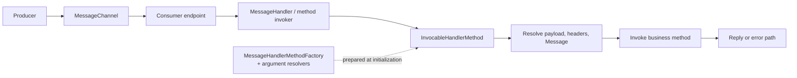
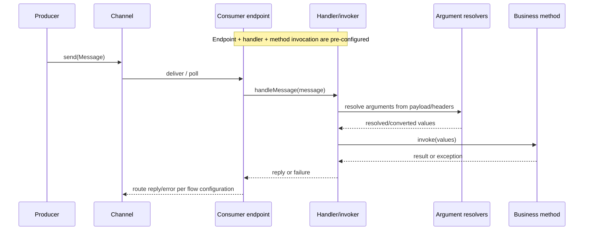

# MessageHandlerMethodFactoryResolver: Handler Invocation Resolution Mechanism

## 1. Where Does This Topic Sit in the Spring Integration Runtime?

In the **Spring Integration Runtime**, a message travels through a `MessageChannel`, is received by a `ConsumerEndpoint`, and is passed to a `MessageHandler`. When the handler is a Java method on a POJO—such as a method annotated with `@ServiceActivator`—the framework must determine **which method to invoke** and **what values to pass into each parameter** before executing business logic.

The topic name **`MessageHandlerMethodFactoryResolver`** is used to study this mechanism. Be clear about one distinction: in the public API of Spring Framework/Spring Integration 6.x, **there is no documented standard type named `MessageHandlerMethodFactoryResolver`**. The actual components to look up are:

- `MessageHandlerMethodFactory`: interface that creates an `InvocableHandlerMethod` for an identified bean and `Method`.
- `DefaultMessageHandlerMethodFactory`: default implementation in Spring Messaging; prepares the `HandlerMethodArgumentResolver` list.
- `IntegrationMessageHandlerMethodFactory`: extended implementation for Spring Integration, available since version 6.0.
- `HandlerMethodArgumentResolver`: strategy that extracts and converts a parameter from `Message<?>`.
- `MessagingMethodInvokerHelper`: helper component that invokes a method on the target object using payload and headers in Spring Integration.

If a custom codebase defines a class named `MessageHandlerMethodFactoryResolver`, you must inspect its contract and how it is invoked in **that codebase**; do not assume that class is a framework API.

**Lesson objectives:** understand the boundary between locating a method, creating an invoker, resolving arguments, and running an endpoint; be able to build a small flow to test payload/headers, explain conversion errors, and diagnose retries, transactions, threads, and correlation from a runtime perspective.

## 2. Responsibility Model

| Component | Responsible For | Not Responsible For |
|---|---|---|
| `MessageChannel` (`DirectChannel`, `ExecutorChannel`, `QueueChannel`, …) | Delivering or storing messages, affecting how consumers receive them and the execution thread | Deciding how `@Header` maps to Java parameters |
| Consumer endpoint (`EventDrivenConsumer`, `PollingConsumer`, …) | Subscribing to/polling messages, managing the lifecycle of the consumption point | Converting JSON into business objects on its own |
| `MessageHandler` / POJO method invoker | Performing message processing and optionally producing a reply | Determining the scheduler for the entire flow |
| `MessageHandlerMethodFactory` | Creating an `InvocableHandlerMethod` configured with appropriate argument resolvers | Routing messages to channels, starting transactions, executing retries |
| `HandlerMethodArgumentResolver` | Determining whether a parameter is supported and retrieving its corresponding value | Selecting the consumer endpoint or guaranteeing exactly-once processing |
| `MessageConverter`, `ConversionService`, `Validator` | Supporting type conversion and data validation when configured | Making the entire message flow safe against invalid data on its own |

**Two key phases:**

1. **At configuration/initialization time:** Spring Integration parses annotation/DSL configuration, wires the endpoint to the handler, and prepares the invocation path to the target method. The factory creates an `InvocableHandlerMethod` for the bean/method and configures resolvers; method selection and caching details depend on handler type and version.
2. **When a message arrives:** the consumer delivers the message to the handler; resolvers pick value sources for parameters, apply conversion/validation if needed, and then invoke the business method. The return value (if any) is handled according to the handler/endpoint reply rules.

`MessageHandlerMethodFactory` is **not** responsible for choosing among all overloaded methods on its own. Finding/selecting the target method involves handler configuration and `MessagingMethodInvokerHelper`; the factory receives a bean and a `Method` to build the corresponding invoker.



This diagram is conceptual: different handlers have different optimizations and execution branches, especially when Spring Integration has to use SpEL for certain expression/method forms.

## 3. APIs and Their Relationships

### 3.1. The `MessageHandlerMethodFactory` Interface

Core signature:

```java
// org.springframework.messaging.handler.annotation.support.MessageHandlerMethodFactory
InvocableHandlerMethod createInvocableHandlerMethod(Object bean, Method method);
```

The factory takes a **bean instance** and a **reflection Method**. The result is an object that knows how to extract arguments from a `Message<?>` and invoke the method; it is not a standalone `MessageHandler` that automatically subscribes to a channel.

### 3.2. `DefaultMessageHandlerMethodFactory` and `IntegrationMessageHandlerMethodFactory`

`DefaultMessageHandlerMethodFactory` belongs to Spring Messaging and exposes useful configuration points:

- `setMessageConverter(MessageConverter)`: converts the payload into the type required by the method.
- `setConversionService(ConversionService)`: adjusts payload or header type conversion when supported by the resolver.
- `setValidator(Validator)`: provides constraint validation for payloads annotated for validation.
- `setCustomArgumentResolvers(List<HandlerMethodArgumentResolver>)`: appends custom resolvers **after** resolvers for standard types.
- `setArgumentResolvers(List<HandlerMethodArgumentResolver>)`: replaces the **entire** resolver list, suited for advanced cases but easy to break default behavior if standard resolvers are omitted.

`IntegrationMessageHandlerMethodFactory` (`org.springframework.integration.handler.support`) extends the class above and adds Spring Integration-specific handling, such as parameter types related to payload expressions and maps/collections. It provides the constructors `IntegrationMessageHandlerMethodFactory()` and `IntegrationMessageHandlerMethodFactory(boolean listCapable)`; list-handling semantics depend on the handler context and should not be enabled merely because business data happens to be a `List`.

Do not confuse this factory with `ConsumerEndpointFactoryBean`, which builds a consumer endpoint from an input channel/handler configuration.

### 3.3. Which Resolver Handles Each Parameter?

Example business method:

```java
public String accept(
        @Payload String orderId,
        @Header("tenantId") String tenantId,
        @Headers Map<String, Object> headers) {
    return tenantId + ":" + orderId;
}
```

| Declaration Style | Expected Value Source | What to Check |
|---|---|---|
| `@Payload String orderId` | `message.getPayload()` | Does the payload have the right type or can it be converted? |
| `@Header("tenantId") String tenantId` | Header `tenantId` | Does the header exist and have a compatible type? |
| `@Headers Map<String, Object> headers` | Set of message headers | Used to read metadata; avoid logging sensitive data |
| `Message<Order> message` | Entire `Message<?>` | Retains both payload and headers; watch generic types |
| `@Payload(expression = "...")` | Expression-evaluated value | Check SpEL syntax, property path, and version-specific invocation behavior |
| Collection/map in aggregator | May be a collection of messages/payloads/group metadata | Must account for handler type, resolver, and `listCapable` behavior |

Documented concrete resolvers include `PayloadMethodArgumentResolver`, `HeaderMethodArgumentResolver`, `HeadersMethodArgumentResolver` (Spring Messaging), and `PayloadExpressionArgumentResolver`, `PayloadsArgumentResolver`, `CollectionArgumentResolver`, `MapArgumentResolver` (Spring Integration). **There is no single resolver that handles every parameter**.

## 4. Hands-On Example: POJO Service Activator

The example uses Spring Integration 6.x, Java 17 or later, and the `spring-integration-core` dependency. Imports are written in full to distinguish Spring Messaging classes from Spring Integration classes.

```java
import org.springframework.context.annotation.Bean;
import org.springframework.context.annotation.Configuration;
import org.springframework.integration.annotation.ServiceActivator;
import org.springframework.integration.channel.DirectChannel;
import org.springframework.integration.channel.QueueChannel;
import org.springframework.integration.config.EnableIntegration;
import org.springframework.messaging.MessageChannel;
import org.springframework.messaging.PollableChannel;
import org.springframework.messaging.handler.annotation.Header;
import org.springframework.messaging.handler.annotation.Payload;
import org.springframework.stereotype.Component;

@Configuration
@EnableIntegration
class OrderFlowConfig {

    @Bean(name = "orders.input")
    MessageChannel orderInput() {
        return new DirectChannel();
    }

    @Bean(name = "orders.output")
    PollableChannel orderOutput() {
        return new QueueChannel();
    }
}

@Component
class OrderService {

    @ServiceActivator(
        inputChannel = "orders.input",
        outputChannel = "orders.output"
    )
    public String handle(
            @Payload String orderId,
            @Header(name = "tenantId", required = false) String tenantId) {

        if (orderId.isBlank()) {
            throw new IllegalArgumentException("orderId must not be blank");
        }

        String tenant = tenantId == null ? "public" : tenantId;
        return "accepted:" + tenant + ":" + orderId;
    }
}
```

Requirement: `OrderFlowConfig` and `OrderService` must fall within the application's component-scan scope. If using Spring Boot, configure the Spring Integration components appropriately and avoid duplicating unnecessary infrastructure declarations.

Sending a message and reading the result in a snippet with `ApplicationContext context`:

```java
import org.springframework.messaging.Message;
import org.springframework.messaging.MessageChannel;
import org.springframework.messaging.PollableChannel;
import org.springframework.messaging.support.MessageBuilder;

MessageChannel input =
        context.getBean("orders.input", MessageChannel.class);
PollableChannel output =
        context.getBean("orders.output", PollableChannel.class);

Message<String> request = MessageBuilder.withPayload("A-101")
        .setHeader("tenantId", "shop-7")
        .build();

boolean sent = input.send(request);
Message<?> reply = output.receive(1_000);

System.out.println(sent);                 // true if sent successfully
System.out.println(reply.getPayload());   // accepted:shop-7:A-101
```

Step-by-step walkthrough:

1. The producer builds a `Message<String>` with payload `"A-101"` and header `tenantId`.
2. `DirectChannel` invokes the subscriber directly on the sending thread unless another component shifts execution.
3. `ServiceActivatingHandler` coordinates invoking `OrderService.handle`; argument mapping extracts `orderId` from the payload and `tenantId` from headers.
4. The method returns a string. Because `outputChannel` is declared, the reply is sent to `orders.output`.
5. `QueueChannel` buffers the reply so `receive(1_000)` can retrieve it. The timeout parameter is in milliseconds; if no reply arrives, the result can be `null`, so application code should check before reading the payload.

If the `tenantId` header is omitted, the method receives `null` because `required = false` and returns the `public` prefix. If `@Header("tenantId")` is used with its default required behavior, a message missing the header fails during argument resolution, before the method body runs.

**Lifecycle note:** this example has a single consumer on `DirectChannel`. Replacing `DirectChannel` with `ExecutorChannel` allows the handler to run on an executor thread; using `QueueChannel` as the **input** requires a matching poller/consumer to pull messages. The factory and argument resolvers do not decide that.

## 5. Isolating the Factory to Observe Method Invocation

This is an **API-level** probe that highlights the factory and resolvers without setting up a full integration flow:

```java
import java.lang.reflect.Method;

import org.springframework.integration.handler.support.IntegrationMessageHandlerMethodFactory;
import org.springframework.messaging.handler.annotation.Header;
import org.springframework.messaging.handler.annotation.Payload;
import org.springframework.messaging.handler.invocation.InvocableHandlerMethod;
import org.springframework.messaging.support.MessageBuilder;

public class HandlerFactoryProbe {

    public static class Handler {
        public String handle(@Payload String payload,
                             @Header("tenantId") String tenantId) {
            return tenantId + "/" + payload;
        }
    }

    public static void main(String[] args) throws Exception {
        Handler target = new Handler();
        Method method = Handler.class.getMethod(
                "handle", String.class, String.class);

        IntegrationMessageHandlerMethodFactory factory =
                new IntegrationMessageHandlerMethodFactory();
        factory.afterPropertiesSet(); // initialize argument resolvers

        InvocableHandlerMethod invocable =
                factory.createInvocableHandlerMethod(target, method);

        Object result = invocable.invoke(
                MessageBuilder.withPayload("PO-9")
                        .setHeader("tenantId", "acme")
                        .build());

        System.out.println(result); // acme/PO-9
    }
}
```

Read this snippet in two layers:

- **Preparation layer:** locate the `Method` via reflection, configure the factory, call `afterPropertiesSet()`, and create the `InvocableHandlerMethod`.
- **Execution layer:** call `invoke(message)`; the resolvers obtain arguments from the message and invoke the method.

Here `getMethod(...)` has already identified the method explicitly. Do not think of `createInvocableHandlerMethod(...)` as a filter that scans for all eligible methods on a bean. In a DI-managed application, Spring invokes the initialization callback instead of the manual call above; this probe simply instantiates the factory outside a container.

## 6. Customizing Resolution, Conversion, and Validation

### 6.1. When Should You Customize?

Suppose a system attaches a customer code in the `x-customer-id` header, yet you want handlers to receive a `CustomerContext` object. There are two approaches:

- Use `@Header("x-customer-id") String id` and call a lookup service in business code: simple, transparent, and easy to test.
- Write a custom `HandlerMethodArgumentResolver` for `CustomerContext` if many endpoints share the same mapping rule; then configure it on the factory **actually used by those handlers**.

The factory lets you register custom resolvers:

```java
IntegrationMessageHandlerMethodFactory factory =
        new IntegrationMessageHandlerMethodFactory();

factory.setCustomArgumentResolvers(
        java.util.List.of(new CustomerContextArgumentResolver()));
factory.afterPropertiesSet();
```

`CustomerContextArgumentResolver` in the example is merely an **application-defined class**; to make it work you must implement `supportsParameter(MethodParameter)` and `resolveArgument(MethodParameter, Message<?>)` per your Spring Messaging version's `HandlerMethodArgumentResolver` contract. Creating a custom factory with `new` **does not automatically switch every running `@ServiceActivator` to that factory**. Wiring must follow the actual extension points of your version and handler type.

When a custom resolver targets a type already claimed earlier by a built-in resolver, `setCustomArgumentResolvers` does not necessarily override selection order. In that case, inspect list ordering and consider `setArgumentResolvers` including all essential resolvers.

### 6.2. Conversion Is Not Domain Mapping

If the payload is a `String` containing JSON while the method expects `OrderCommand`, the resolver works only if a compatible `MessageConverter` is present. Spring Integration does not inherently know every JSON schema, content-type, or business object format in your application.

A more controllable approach is to place an explicit transformer/converter before the handler:

```text
Bytes/JSON -> MessageConverter or Transformer -> OrderCommand -> @ServiceActivator
```

Distinguish these roles:

- `MessageConverter` determines how to convert the message payload.
- `ConversionService` supports converting simple values (such as string headers to numbers) according to registered conversion rules.
- `@Payload` and `@Header` specify where to extract data; they do not replace serializers or schema validation.

### 6.3. Validation Must Be Enabled in the Right Place

`@Valid`/`@Validated` only take effect when the pipeline has a configured validator. Per the Javadoc, `DefaultMessageHandlerMethodFactory` does not perform business validation by default unless a `Validator` is configured. Also verify that the factory bean actually holds that validator. Business data validation failures should not be masked by unbounded consumer retries.

## 7. Overloads, SpEL, and Versions

Spring Integration may select methods based on payload or annotations, depending on configuration. Some POJO calls use `InvocableHandlerMethod`; certain cases, such as complex parameter dereference expressions, can still go through SpEL. Therefore:

- Avoid multiple overloads with the same name taking mutually convertible payload types (`String`, `Object`, similar DTOs).
- Prefer explicit method names, parameter types, and annotations in critical flows.
- If using `@Payload(expression = "payload.foo")`, test with the actual payload type and verify which method is selected.
- Check documentation for your exact version: `IntegrationMessageHandlerMethodFactory` was introduced in Spring Integration **6.0**; do not copy 6.x API configuration into 5.x and expect it to compile.
- Do not write `MessageHandlerMethodFactoryResolver` as a Java import unless the project itself defines that class.

Since Spring Integration 5.0, the framework prefers invoking POJOs via `InvocableHandlerMethod` when possible, with SpEL fallback for certain cases. Exact details may vary by version and handler type.

## 8. Placing Resolution in the Broader Runtime Picture



### Channels, Threads, and Transactions

With `DirectChannel`, the handler call normally runs synchronously on the sending thread; an active thread-bound transaction can span synchronous steps. With `ExecutorChannel`, the message is handed to an executor, introducing a thread boundary that typically does not automatically propagate thread-bound transactions. With `QueueChannel` and `PollingConsumer`, message retrieval depends on the poller and the polling task's transaction.

Resolvers only prepare arguments. They **do not start transactions**, **do not decide commit/rollback**, **do not schedule pollers**, and **do not transfer `ThreadLocal`**. If your system suffers lost transaction scope, trace the channel, executor, poller, and endpoint transaction advice first.

### Retries and Error Channels

If a required `@Header` is missing, conversion fails, the method throws an exception, or validation fails, message processing can fail. How the failure surfaces depends on the consumer:

- Synchronous paths may propagate the exception back to the caller sending the message.
- Asynchronous or polling paths may publish an `ErrorMessage` to an error channel or be handled by a configured error handler/advice.
- Retries occur only when the flow configures a retry mechanism; argument resolvers do not retry on their own.
- Sending failed messages to a dead-letter store or recoverer is a flow decision, not a factory responsibility.

For permanent data errors (missing header, invalid payload schema), repeated retries generally do not help. For transient infrastructure errors, retries with backoff and idempotency may be necessary.

### Message Stores and Correlation

`MessageStore` typically serves queues, message groups, or aggregation components—not where the factory stores method parameters. Headers such as `correlationId`, `sequenceNumber`, and `sequenceSize` help splitters/aggregators link messages together; they do not automatically appear on every message. If a handler needs the header:

```java
public void consume(
        @Payload String payload,
        @Header(name = "correlationId", required = false) Object correlationId) {
    // If null: message arrived without the correlationId header.
}
```

Reading a correlation header does not mean the framework guarantees exactly-once message processing. You must check header origin, message grouping, message store, timeout/release strategies, and deduplication strategies.

## 9. Diagnosing Common Issues

| Symptom | Likely Cause | How to Isolate |
|---|---|---|
| `No suitable resolver` or unable to resolve method parameter | Parameter type is not supported by resolvers; missing annotation or unconfigured resolver | Check method signature, annotations, and the resolver list of the factory **actually in use** |
| Missing required header | Producer did not set header or an interceptor modified headers | Log header names and transform/split points; try `required = false` if business logic permits |
| `MessageConversionException` or type mismatch | Payload/header cannot be converted to the method's expected type | Inspect actual runtime class, `contentType`, converter, and conversion service |
| Handler is never called | Endpoint not started, wrong channel name, no subscriber, poller not running | Inspect endpoint bean, `SmartLifecycle`, channel wiring, poller state |
| Reply never arrives | Method returns `void`/`null`, wrong output channel, downstream not reading, timeout | Check return value and reply/output channel config; inspect the queue |
| Thread differs from expectations | `ExecutorChannel`, task executor, or poller in play | Log thread names in producer, channel interceptor, and handler |
| Endless retries for the same message | Permanent data error retried like a transient error | Classify exceptions; configure appropriate recovery/DLQ |
| Intermittent wrong results with overloads | Method selection depends on payload type or conversion | Reduce overloads, use explicit signatures/annotations, test payload types |

A practical, concise troubleshooting workflow:

1. Log `messageId`, channel name, payload type, and key headers at the **entry point**; mask sensitive information.
2. Verify whether the endpoint is running and subscribed to/polling the right channel.
3. Once execution reaches the handler, check the actual method selected, each parameter, resolver, conversion, and validation.
4. Read the **root cause** in the stack trace rather than only the outer wrapper exception.
5. Cross-check threads, timeouts, transactions, retry advice, error channels, and message stores if the issue occurs only under load or on poll cycles.

## 10. Self-Check Exercises

1. Run the `OrderService` example with and without `tenantId`. Explain why `required = false` changes the outcome.
2. Change the payload from `"A-101"` to an `OrderCommand` object while keeping the method parameter as `String`. Observe conversion behavior, then add an appropriate transformer.
3. Switch `orders.input` to an `ExecutorChannel` and configure an executor. Log the thread name before `send` and inside `handle`; analyze the transaction boundary.
4. Keep `QueueChannel` as the **input**, add a poller, and vary the polling interval to observe latency.
5. Trigger both a missing required header error and a business method exception; distinguish where the exception surfaces in synchronous vs. asynchronous flows.
6. Use the `HandlerFactoryProbe` snippet to see why `MessageHandlerMethodFactory` takes an already resolved `Method`, then explain which component selects the method in a real service activator.

## 11. Operational Takeaways

Whenever you see the name **MessageHandlerMethodFactoryResolver** in diagrams or code, clarify whether the author means the **factory creating the method invoker**, the **resolver mapping parameters**, or a **custom class**. Those are three distinct responsibilities.

In Spring Integration, invoking a POJO with payload and headers is just one small link in the runtime chain. An accurate diagnosis always places that link within **channel -> endpoint -> handler -> method invocation**, then checks threads, lifecycle, replies, errors, transactions, and correlation on the component that actually owns each responsibility.

### Reference Documentation

- [Spring Integration 6.5.x: `IntegrationMessageHandlerMethodFactory` API](https://www.springframework.org/spring-integration/docs/6.5.x/api/org/springframework/integration/handler/support/IntegrationMessageHandlerMethodFactory.html).
- [Spring Integration 6.5.x: `handler.support` classes](https://www.springframework.org/spring-integration/docs/6.5.x/api/org/springframework/integration/handler/support/package-summary.html).
- [Spring Integration Reference: Overview](https://docs.spring.io/spring-integration/reference/overview.html), especially how POJO handlers and `InvocableHandlerMethod` operate.
- [Spring Integration Reference: Service Activator](https://docs.spring.io/spring-integration/reference/service-activator.html).
- [Spring Framework 6.2.x: `DefaultMessageHandlerMethodFactory` Javadoc](https://docs.spring.io/spring-framework/docs/6.2.x/javadoc-api/org/springframework/messaging/handler/annotation/support/DefaultMessageHandlerMethodFactory.html).
