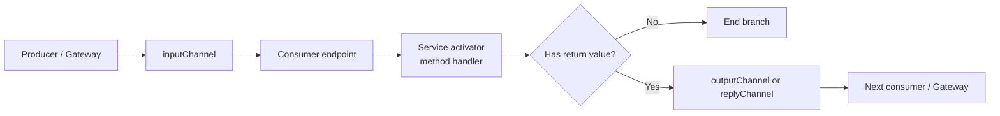

# `@ServiceActivator` and Method Handlers in Spring Integration

## 1. Objectives and Runtime Context

In Spring Integration, a **message** carries a `payload` and `headers` across `MessageChannel`s. A channel only handles message delivery; to execute business logic, the flow needs an **endpoint** that receives the message and invokes processing code. `@ServiceActivator` is a common declarative way to attach a plain Java method (POJO method) to that endpoint.

After this lesson, you will be able to:

- Explain why `@ServiceActivator` serves as the bridge between a message flow and a business method.
- Write method handlers that accept a payload, a full `Message<?>`, or specific headers.
- Distinguish one-way processing from request–reply; choose `inputChannel`, `outputChannel`, and `requiresReply` for the right purpose.
- Understand how `DirectChannel`, `ExecutorChannel`, `QueueChannel`, and pollers affect the handler's execution thread.
- Diagnose missing replies, payload type mismatches, destination routing errors, handler exceptions, and common runtime issues.

The scope here is the **Spring Integration Runtime**, specifically the *handler adapter* mechanism: the framework handles receiving/interpreting messages and invoking the method, while the business method focuses on the data to process. Concepts like transactions, retries, message stores, lifecycle, and correlation are tied in where they directly affect the handler.

## 2. Where Does a Service Activator Sit in the Message Flow?

`@ServiceActivator` marks a method on a Spring-managed bean as a handler for messages from an input channel. When a message arrives, the framework creates/configures an endpoint, receives the message, and dispatches the call through the corresponding method invocation mechanism. For typical service methods, the handler relies on `ServiceActivatingHandler` and the method-invoking infrastructure; the application does not have to write a custom `MessageHandler` to unwrap payloads and headers.



Three components commonly confused with one another:

| Component | Responsibility |
| --- | --- |
| `MessageChannel` | Transports messages and determines delivery semantics (same thread, via executor, queued, etc.). |
| Consumer endpoint | Subscribes to or polls messages; coordinates calls to the handler and manages lifecycle. |
| Method handler | Executes business rules; reads payload/headers and optionally returns a result. |

`@ServiceActivator` **does not create its own thread** and **does not automatically guarantee transactions, retries, or durable message storage**. Those properties depend on the channels, pollers, advice, transaction managers, and flow configuration surrounding the endpoint.

## 3. Declaring a Method with `@ServiceActivator`

Minimal example:

```java
import org.springframework.integration.annotation.MessageEndpoint;
import org.springframework.integration.annotation.ServiceActivator;

@MessageEndpoint
public class PriceHandler {

    @ServiceActivator(inputChannel = "priceRequests",
                      outputChannel = "priceResults")
    public long calculate(long basePrice) {
        return Math.round(basePrice * 1.1);
    }
}
```

Explanation:

1. `@MessageEndpoint` is a stereotype allowing Spring component scanning to register the bean (can be replaced with `@Component`).
2. `@ServiceActivator` designates the method invoked when the endpoint receives a message from `priceRequests`.
3. The argument `long basePrice` is mapped by the framework from the **payload** (assuming compatible types).
4. The `long` return value is wrapped into a reply message and sent to `priceResults`.

Common attributes:

| Attribute | Meaning and Notes |
| --- | --- |
| `inputChannel` | Name of the input channel; for subscribable channels the endpoint subscribes directly; pollable channels require a poller. |
| `outputChannel` | Target channel for replies, taking precedence over the request's `replyChannel` header. |
| `requiresReply` | Configuration string such as `"true"`; if enabled and the method returns `null`, the framework throws `ReplyRequiredException`. |
| `poller` | Polling schedule when receiving from a `PollableChannel`, such as `QueueChannel`. |
| `adviceChain` | List of advice beans wrapping the handler invocation, useful for retries or cross-cutting behavior. |
| `autoStartup`, `phase` | Endpoint lifecycle settings following the `SmartLifecycle` mechanism. |
| `sendTimeout` | Timeout when waiting to send a reply to the output channel if the send operation may block. |
| `async` | Asynchronous result-handling mode (check return types and configuration for your framework version). |

Channel names must match the flow configuration. The framework may implicitly register a `DirectChannel` if no bean exists for `inputChannel`, but in critical flows you should declare channels explicitly to avoid assuming the wrong threading, buffering, or durability semantics.

### The Method Must Belong to a Spring-Managed Bean

Putting the annotation on a method of an object instantiated with `new` and not registered with Spring will **not** cause an endpoint to appear automatically. Let Spring manage the bean via `@Component`, `@MessageEndpoint`, `@Bean`, or equivalent registration, and ensure Spring Integration annotation infrastructure is enabled.

In plain Java configuration, `@EnableIntegration` activates annotation processing infrastructure. For `@MessagingGateway` interfaces, `@IntegrationComponentScan` scans and registers interfaces that standard `@ComponentScan` does not pick up as classes.

## 4. Method Parameter Mapping Mechanism

A handler should generally accept a **strongly typed payload** to separate business logic from message transport details. When metadata is needed, declare header parameters explicitly.

| Method Signature | Data Received | When to Use |
| --- | --- | --- |
| `handle(Order order)` | Payload of type `Order` | Business logic mainly processes domain data. |
| `handle(Message<Order> message)` | Full message including payload and headers | Need access to broad metadata or protocol control. |
| `handle(@Payload Order order, @Header("traceId") String traceId)` | Payload and a specific header | Need correlation/tracing or tenant metadata. |
| `handle(@Headers Map<String, Object> headers)` | Set of headers | Inspecting/routing based on multiple headers. |
| `handle()` | No arguments | Only need to know a message arrived, e.g., triggers or event counters. |

Example:

```java
import java.util.Map;
import org.springframework.integration.annotation.MessageEndpoint;
import org.springframework.integration.annotation.ServiceActivator;
import org.springframework.messaging.handler.annotation.Header;
import org.springframework.messaging.handler.annotation.Headers;
import org.springframework.messaging.handler.annotation.Payload;

@MessageEndpoint
public class AuditHandler {

    @ServiceActivator(inputChannel = "auditRequests")
    public void audit(
            @Payload Order order,
            @Header(value = "traceId", required = false) String traceId,
            @Headers Map<String, Object> headers) {
        // Handle event recording according to application rules.
        // Do not log all headers if they contain sensitive data.
        System.out.println("Order=" + order.code() + ", traceId=" + traceId);
    }
}
```

`@Header(required = false)` suits optional headers; a required header that is missing causes an argument resolution error. If the payload does not match the method's expected type and no suitable conversion exists, method invocation also fails. Producers, channels, and consumers must therefore agree on a *message contract*.

Avoid creating multiple overloaded handler methods with ambiguous parameter types expecting the framework to always pick the right one. For a method annotated with `@ServiceActivator`, declaring one specific signature is easier to read, test, and diagnose. In configuration styles referencing a POJO without naming a method, the framework may select a method based on payload type or fall back to `Message<?>`; that is a different selection mechanism and should not be confused with targeting an annotated method directly.

## 5. Return Value Rules and Reply Routing

A service activator can operate **one-way** (fire-and-forget at the method level) or **request–reply**:

- Returning `void` or `null`: by default the endpoint emits no reply; the flow may terminate here.
- Returning a regular object: the framework uses that object as the payload of the reply message.
- Returning `Message<?>`: the caller controls the declared payload and headers, after which Spring Integration also applies service activator header-merging rules.

When a non-`null` reply is produced, the destination is determined in priority order:

1. `outputChannel` declared on the endpoint, if present.
2. The `replyChannel` header of the original request.
3. In some cases where the request had no `replyChannel` and the result is a `Message<?>`, the framework checks `replyChannel` on the returned message.

If the handler returns a result but no destination can be resolved, the flow can fail during destination resolution. A gateway awaiting a reply can also time out if the processing branch ends without producing one.

Two-style example:

```java
// Create a reply to send explicitly to the next step.
@ServiceActivator(inputChannel = "validateIn",
                  outputChannel = "persistIn",
                  requiresReply = "true")
public ValidatedOrder validate(Order order) {
    return new ValidatedOrder(order.code(), order.quantity());
}

// One-way processing; void return produces no reply.
@ServiceActivator(inputChannel = "auditIn")
public void writeAudit(AuditEvent event) {
    auditRepository.save(event);
}
```

These two methods illustrate the API; `ValidatedOrder`, `AuditEvent`, and `auditRepository` are application-defined types/beans.

If you intentionally want to discard a result from a method that still returns an object, set `outputChannel = "nullChannel"` (a special channel provided by Spring Integration). When an operation **must** produce a reply, use `requiresReply = "true"` so `null` fails immediately at the handler instead of leaving an upstream caller waiting until timeout.

### Note When Returning a Full `Message<?>`

In a service activator, headers from the request may be **copied into the reply if the reply does not already contain them**. Therefore, intentionally omitting a header from a returned `Message<?>` does not automatically remove the original header. Use a `HeaderFilter` in the flow when headers must be stripped, or a transformer if the primary goal is transforming messages with full header control.

Regarding correlation, `correlationId` (or an application-defined header) is useful for logging and coordination, but `@ServiceActivator` **does not automatically group multiple messages together**. Grouping and waiting for a complete set of messages belong to endpoints such as aggregators and an associated message store if used.

## 6. Complete Example: Gateway -> Channel -> Method Handler -> Reply

Suppose a system receives orders through a Java interface, validates quantities, and returns a receipt. The example uses Java 17+ (for `record`), Spring Integration Core, and Spring Context, with classes placed in package `demo.integration`; each public type lives in its own file.

**`IntegrationConfiguration.java` — infrastructure and channels**

```java
package demo.integration;

import org.springframework.context.annotation.Bean;
import org.springframework.context.annotation.ComponentScan;
import org.springframework.context.annotation.Configuration;
import org.springframework.integration.annotation.IntegrationComponentScan;
import org.springframework.integration.channel.DirectChannel;
import org.springframework.integration.config.EnableIntegration;
import org.springframework.messaging.MessageChannel;

@Configuration
@EnableIntegration
@ComponentScan(basePackageClasses = OrderHandler.class)
@IntegrationComponentScan(basePackageClasses = OrderGateway.class)
public class IntegrationConfiguration {

    @Bean
    public MessageChannel ordersIn() {
        return new DirectChannel();
    }
}
```

**`Order.java` and `Receipt.java` — message models**

```java
package demo.integration;

public record Order(String code, int quantity) {}
```

```java
package demo.integration;

public record Receipt(String code, String decision) {}
```

**`OrderHandler.java` — consumer-side business logic**

```java
package demo.integration;

import org.springframework.integration.annotation.MessageEndpoint;
import org.springframework.integration.annotation.ServiceActivator;

@MessageEndpoint
public class OrderHandler {

    @ServiceActivator(inputChannel = "ordersIn", requiresReply = "true")
    public Receipt confirm(Order order) {
        if (order.quantity() <= 0) {
            throw new IllegalArgumentException("quantity must be positive");
        }
        return new Receipt(order.code(), "ACCEPTED");
    }
}
```

**`OrderGateway.java` — producer-side interface**

```java
package demo.integration;

import org.springframework.integration.annotation.MessagingGateway;

@MessagingGateway(defaultRequestChannel = "ordersIn")
public interface OrderGateway {
    Receipt submit(Order order);
}
```

**`Demo.java` — running in a plain Java context**

```java
package demo.integration;

import org.springframework.context.annotation.AnnotationConfigApplicationContext;

public class Demo {
    public static void main(String[] args) {
        try (var context =
                     new AnnotationConfigApplicationContext(IntegrationConfiguration.class)) {
            OrderGateway gateway = context.getBean(OrderGateway.class);
            Receipt receipt = gateway.submit(new Order("SO-42", 3));
            System.out.println(receipt);
            // Receipt[code=SO-42, decision=ACCEPTED]
        }
    }
}
```

**Actual execution trace:**

1. `OrderGateway.submit(...)` creates a request message containing `Order` and reply destination details managed by the gateway.
2. The message enters `ordersIn`. `DirectChannel` delivers the message synchronously to the consumer endpoint.
3. The adapter extracts the `Order` payload and invokes `OrderHandler.confirm(Order)` on the current thread.
4. The method returns `Receipt`; with no fixed `outputChannel`, the service activator sends the reply to the request's `replyChannel`.
5. The gateway receives the reply and returns `Receipt` to the caller; the caller never has to touch `Message<?>`.

On the error path, `quantity <= 0` causes an exception from the handler; with a synchronous `DirectChannel`, the gateway caller typically sees the error propagate back up the call stack (possibly wrapped in a messaging exception). Do not assume errors are automatically turned into successful business replies.

## 7. How Synchronous Channels, Executors, and Pollers Change Execution

The method annotation does not choose the thread. **The input channel type** is the primary factor:

| Input Channel | Who Triggers the Handler? | Consequence |
| --- | --- | --- |
| `DirectChannel` | Producer/upstream thread | Synchronous call; slow handlers slow down the producer; exceptions typically propagate back to the caller. |
| `ExecutorChannel` | Worker thread from `TaskExecutor` | Introduces an async boundary; monitor queues, thread pools, saturation, and error routing. |
| `QueueChannel` (`PollableChannel`) | Poller periodically fetching messages | Buffered; requires poller configuration, throughput sizing, and storage policy. |

Poller example:

```java
import org.springframework.integration.annotation.Poller;
import org.springframework.integration.annotation.ServiceActivator;

@ServiceActivator(
        inputChannel = "queuedOrders",
        poller = @Poller(fixedDelay = "1000", maxMessagesPerPoll = "5"))
public void consume(Order order) {
    process(order);
}
```

This example assumes `queuedOrders` is declared as a `QueueChannel` or compatible `PollableChannel`. The poller checks the queue on schedule and pulls up to the configured number of messages per poll. Adding a poller to a `DirectChannel` flow mismatches the model; conversely, a pollable input without a poller or default poller will not work as expected.

`QueueChannel` is in-memory by default and is **not** durable across restarts. If message recovery is required, consider a persistent `MessageStore` and corresponding channel setup. Switching from `DirectChannel` to `ExecutorChannel` or a pollable channel also changes exception boundaries, transactions, and thread-local context (such as MDC/tracing context).

### Service Activator `async` Is Not the Same as `ExecutorChannel`

For a handler returning `CompletableFuture<?>`, configuring async mode lets the reply be emitted when the future completes, releasing the handler-calling thread earlier. That differs from how `ExecutorChannel` dispatches the **handler invocation itself** to a worker thread from the start. Without enabling async mode appropriately, the future itself may be treated as the reply payload instead of waiting for its completed value. Always verify your Spring Integration version and caller contract before using async handlers.

## 8. Transactions, Retries, and Errors at Method Handlers

Handlers commonly call databases, HTTP APIs, message brokers, or external services. These operations can fail; the runtime does not automatically provide exactly-once guarantees simply because `@ServiceActivator` is present.

**Transactions:** If a handler runs inside a transaction started by a poller or a synchronous upstream call, be clear on which steps the transaction boundary actually covers. When threads split across an executor, a transaction bound to the old thread does not automatically follow; configure transactions on the new branch if required. For databases, consider idempotency and commit boundaries.

**Retries:** Advice can be attached to the endpoint, or retries can be placed in the service layer. Retries re-execute the method, so side effects such as charging payments, sending emails, or inserting records can repeat without an idempotency key. Distinguish transient retryable errors from bad input data that should be rejected or routed to a dead-letter flow.

**Error handling:**

- On synchronous flows via `DirectChannel`, method exceptions typically propagate back to the sender/gateway.
- On thread-switching or polled flows, errors are typically routed into framework-configured error handling, potentially becoming an `ErrorMessage` on `errorChannel`. Exact behavior depends on the endpoint, error handler, and channel setup.
- `requiresReply` only checks for a missing reply; it is not a catch-all mechanism that converts exceptions into business responses.

When designing an error flow, capture the **original message**, failure cause, `traceId`/`correlationId`, and attempt count; avoid logging sensitive payloads or headers. Decisions around retries, dead-lettering, alerting, or returning errors must follow business requirements.

## 9. Lifecycle and Endpoint Control

A method annotated with `@ServiceActivator` becomes part of an endpoint configuration in the `ApplicationContext`. Endpoints participate in lifecycle management (`SmartLifecycle`: auto-start, stop, phase). This matters when you want to pause consumers while keeping producers/channels intact, or ensure components start in a specific order.

If the application uses `IntegrationFlowContext` to register flows dynamically, lifecycle is also tied to the registered flow object; declaring a static annotated method **does not automatically make it a flow that can be arbitrarily registered/removed via `IntegrationFlowContext`**. Manage the lifecycle of the endpoints/flows you actually create.

When troubleshooting, verify that the endpoint is registered, running, bound to the right `inputChannel`, and wired with the appropriate subscription/poller before assuming the method itself is broken.

## 10. Common Errors and Diagnostic Techniques

| Symptom | Possible Cause | How to Check |
| --- | --- | --- |
| Method never executes | Bean not managed by Spring; annotation infrastructure not enabled; wrong channel name; endpoint not started | Check component scan, `@EnableIntegration`, endpoint bean, and configured channel. |
| Gateway waits and times out | Method returns `void`/`null`; reply sent to wrong channel; async branch incomplete | Trace `replyChannel`, `outputChannel`, return type, and gateway timeout. |
| `ReplyRequiredException` | `requiresReply = "true"` while method returns `null` | Inspect conditions returning `null`; ensure a reply is produced or adjust the contract. |
| Conversion / parameter resolution failure | Mismatched payload type; missing required header; incompatible conversion | Safely log payload type, header names, and handler signature; inspect converters. |
| Output goes to the wrong flow | Static `outputChannel` overrides `replyChannel`; typo in channel name | Map out the reply path; inspect target channel and subscribers. |
| Producer slows down with handler | Synchronous `DirectChannel` call; slow I/O in business logic | Measure method latency; consider executor/poller if compatible with the reply contract. |
| Multiple consumers but not everyone gets messages | `DirectChannel` dispatches to one subscriber per strategy rather than broadcasting | Use `PublishSubscribeChannel` when all subscribers must receive each message. |
| Message backlog grows | Poller runs infrequently, slow handler, saturated worker pool, or full queue | Measure backlog, throughput, `maxMessagesPerPoll`, and executor limits. |
| Same operation runs multiple times | Retries, redelivery, or duplicate producer sends | Apply idempotency keys; inspect retry attempts and transaction boundaries. |
| Header thought removed still appears | Service activator merges headers from the request | Use `HeaderFilter` or a transformer to remove headers explicitly. |

A concise diagnostic sequence:

1. Confirm **whether the message actually entered the input channel**.
2. Confirm **the consumer endpoint exists and is active**, with a poller if the channel is pollable.
3. Inspect **the execution thread, payload type, and headers** arriving at the method.
4. Check **the return value and reply destination**.
5. On failure, trace **exceptions/`errorChannel`**, transactions, retries, and message stores accordingly.

Track metrics for processed message counts, handler latency, errors, queue depth, and trace/correlation IDs. Counting how many times a method started is not enough to prove how many business operations committed successfully.

## 11. Choosing Service Activator vs. Other Endpoints

| Primary Need | Suitable Component |
| --- | --- |
| Invoke a business method on a message | `@ServiceActivator` or `IntegrationFlow.handle(...)` |
| Transform payload/headers into another representation | `@Transformer` / transformer endpoint |
| Choose the next branch conditionally | `@Router` / router |
| Allow or block messages based on a predicate | `@Filter` / filter |
| Split one message into multiple messages | `@Splitter` / splitter |
| Combine multiple messages by correlation and release strategy | `@Aggregator` / aggregator |

`@ServiceActivator` is very flexible, but avoid packing routing, filtering, aggregation, retries, and error handling into one giant method. Dedicated endpoints exist for those responsibilities so runtime behavior stays observable, controllable, and testable.

## 12. Post-Lesson Self-Check

1. A gateway sends a request into a `DirectChannel` and the method returns `Receipt` with no `outputChannel` configured. Where does the reply go, and why?
2. Why can a method returning `null` cause a gateway timeout even though the consumer threw no exception? What behavior does `requiresReply = "true"` change?
3. If you switch the input from `DirectChannel` to `QueueChannel`, what additional configuration becomes mandatory, and how does the handler execution thread change?
4. Why should you not assume a transaction on the sending thread continues into a method receiving messages via `ExecutorChannel`?
5. A handler returns `Message<?>` without setting one of the request's headers. Is that header guaranteed to vanish from the reply?
6. When observing a business operation run twice, in what order will you inspect retries, redelivery, and idempotency?

**Suggested hands-on exercise:** run the `OrderGateway` example from section 6 with a valid order, then try quantity `0`. Next, write a handler reading the `traceId` header, replace `DirectChannel` with an asynchronous channel, and compare threads, response times, and how errors surface. Finally, try a `QueueChannel` with a poller to see why throughput depends on poll rate and method execution time.

## References

- [Spring Integration Reference — Service Activator](https://docs.spring.io/spring-integration/reference/service-activator.html)
- [Spring Integration Reference — Annotation Support](https://docs.spring.io/spring-integration/reference/configuration/annotations.html)
- [Spring Integration Reference — Messaging Gateways](https://docs.spring.io/spring-integration/reference/gateway.html)
- [Spring Integration API — `@ServiceActivator`](https://docs.spring.io/spring-integration/docs/6.5.0/api/org/springframework/integration/annotation/ServiceActivator.html)
