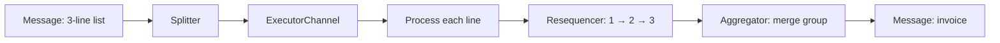

# `@Aggregator`, `@Resequencer`, and Method Endpoints in Spring Integration

## 1. The Problem: Multiple Messages In, One Result Out

In Spring Integration, a **message flow** typically consists of `MessageChannel`s connecting **endpoints** responsible for receiving, transforming, or forwarding `Message<?>`. When a request is split into multiple parts and processed in parallel, results can finish out of their original order. At that point, two operations must be distinguished:

- **Aggregator** collects messages belonging to the same group, waits until release conditions are met, and produces **one combined result message**.
- **Resequencer** temporarily buffers messages belonging to a sequence, orders them by `SEQUENCE_NUMBER`, and emits **each original message** in the right order.

Both components are stateful and require correlation and a release mechanism. They differ in **output shape**, so they cannot be used interchangeably at will.

> **Note on the topic title:** Spring Integration has an `@Aggregator` annotation, but **no `@Resequencer` annotation**. A resequencer is declared with Java DSL `.resequence()` or the XML element `<int:resequencer>`. Therefore, do not write `@Resequencer` as a compilable Java annotation.

Example: an order has three line items requiring price checks. Parallel processing might return line 3, then line 1, then line 2. To assemble an invoice in line-item order, the flow can resequence before aggregating.



In the `SPRING_INTEGRATION_RUNTIME` module, it is important to observe **when messages cross channels**, **which endpoint holds state**, **which thread runs the handler**, and **what decides when a group is released**.

## 2. What Do Method Endpoints and Handler Adapters Actually Do?

A **method endpoint** is a Java method turned into a message-processing point by Spring Integration, typically via annotations such as `@ServiceActivator`, `@Transformer`, `@Splitter`, and `@Aggregator`. The bean can be marked with `@MessageEndpoint`; this annotation is a stereotype discovered via Spring component scanning.

Typical method endpoint example:

```java
@MessageEndpoint
public class PaymentEndpoint {

    @ServiceActivator(
        inputChannel = "paymentRequests",
        outputChannel = "paymentResults")
    public PaymentResult authorize(
            PaymentRequest request,
            @Header("tenantId") String tenantId) {

        return paymentService.authorize(tenantId, request);
    }
}
```

Here, business code does not need to call `channel.receive()` or cast `Message<?>`. The infrastructure will:

1. Create the endpoint and `MessageHandler` corresponding to the annotation.
2. Subscribe a consumer on `paymentRequests`.
3. When a message arrives, select and invoke the target method; map `payload` to `PaymentRequest` and header `tenantId` to the `@Header`-annotated parameter.
4. Wrap the return value into a reply message and send it to `paymentResults`; if no output channel is configured, some endpoints can use the `replyChannel` header.

Invoking the method, converting arguments, and handling replies are handled by **message handlers / adapters** in the framework. For `@Aggregator`, method invocation has a crucial difference: the framework **does not invoke the method for every incoming message**; instead, it first collects messages into a `MessageGroup`, and invokes the aggregation method only when the group is released.

| Component | Input Received | Behavior | Typical Output |
| --- | --- | --- | --- |
| `@ServiceActivator` | One message | Runs business logic on a payload/header | No reply or one reply |
| `@Transformer` | One message | Transforms data | One transformed message |
| `@Splitter` | One message containing a collection | Splits into parts, usually adding sequence headers | Multiple messages |
| `@Aggregator` | Multiple messages in the same group over time | Correlate -> store -> release -> invoke merge method | One message per release |
| `.resequence()` | Multiple messages in the same sequence over time | Correlate -> store -> emit by sequence number | Multiple messages, preserving payloads |

**Important method signature note:** with `@Aggregator`, the method can receive a `List<T>` of payloads in the group (or a suitable message form). Do not confuse this `List<T>` with the payload of **a single** message entering a `@ServiceActivator`.

## 3. Lifecycle of a Group: Correlation, Store, Release, Output

An aggregator or resequencer must answer four questions:

1. **Correlation:** which group does this message belong to?
2. **Store:** which messages are currently held and which are still missing?
3. **Release:** when is the group ready to be processed/emitted?
4. **Expiry:** if the group never completes, how are timeouts, discards, or partial results handled?

When no custom strategy is configured, an aggregator typically uses three sequence headers produced by a splitter:

| Header | Meaning | Example |
| --- | --- | --- |
| `correlationId` / `IntegrationMessageHeaderAccessor.CORRELATION_ID` | Key grouping messages belonging to one processing batch | `batch-42` |
| `sequenceNumber` / `SEQUENCE_NUMBER` | Position of the message within the sequence | `2` |
| `sequenceSize` / `SEQUENCE_SIZE` | Total expected number of messages | `3` |

Example of three messages sharing `correlationId=batch-42`, `sequenceSize=3` arriving in order `3, 1, 2`:

```text
Time          Inbound msg       Held state                  Result
t1            #3                {3}                         Not released
t2            #1                {3, 1}                      Not released
t3            #2                {3, 1, 2}                   Group complete
Aggregator    —                 [1, 2, 3] (if sorted)       1 merged message
Resequencer   —                 [1, 2, 3]                   3 messages emitted in order
```

**Note on ordering:** an aggregator is only responsible for grouping and merging; do not assume every aggregator declaration guarantees the payload list is sorted by business criteria. If ordering matters, rely explicitly on `sequenceNumber` or place a resequencer before aggregation.

A message source with correlation but missing a matching `sequenceSize` can prevent the default release strategy from completing. With `PublishSubscribeChannel` or a recipient-list router, enable `applySequence` when downstream stages need sequence-based grouping; splitters provide sequence information by default for common cases.

## 4. `@Aggregator`: Writing a Merge Method

The following example merges processed strings into one result string. The `combine` method runs **once when the group is released**, even if individual parts passed through different threads.

```java
import java.util.List;
import org.springframework.integration.annotation.Aggregator;
import org.springframework.integration.annotation.MessageEndpoint;
import org.springframework.integration.annotation.ServiceActivator;

@MessageEndpoint
public class BatchResultEndpoint {

    @Aggregator(
        inputChannel = "partsToAggregate",
        outputChannel = "batchResults")
    public String combine(List<String> parts) {
        return String.join(" | ", parts);
    }

    @ServiceActivator(inputChannel = "batchResults")
    public void consume(String result) {
        System.out.println("Completed batch: " + result); // Illustration
    }
}
```

Spring discovers the bean, creates the aggregator handler, and subscribes a consumer to `partsToAggregate`. Once the group completes, group handling supplies the payloads to `combine`. The returned `String` becomes the payload of the message sent on `batchResults`.

If `outputChannel` is omitted, inspect the specific reply path: whether incoming messages have `replyChannel`, whether the endpoint requires a reply, and whether a consumer awaits the reply. An aggregated message can also keep or drop headers according to header-merging rules; do not assume every header from every part remains intact.

### Customizing Correlation and Release with Methods

Alongside `@Aggregator`, the framework supports the strategy annotations `@CorrelationStrategy` and `@ReleaseStrategy`. They allow grouping by business key and waiting on custom conditions when default sequence headers do not apply.

```java
import java.math.BigDecimal;
import java.util.List;
import org.springframework.integration.annotation.Aggregator;
import org.springframework.integration.annotation.CorrelationStrategy;
import org.springframework.integration.annotation.MessageEndpoint;
import org.springframework.integration.annotation.ReleaseStrategy;
import org.springframework.messaging.Message;

@MessageEndpoint
public class InvoiceEndpoint {

    @CorrelationStrategy
    public String byOrder(LineCalculated line) {
        return line.orderId();
    }

    @ReleaseStrategy
    public boolean hasEveryLine(List<Message<?>> group) {
        if (group.isEmpty()) {
            return false;
        }
        Object expected = group.get(0).getHeaders().get("expectedLines");
        return expected instanceof Integer count && group.size() == count;
    }

    @Aggregator(
        inputChannel = "lineCalculations",
        outputChannel = "invoices")
    public Invoice createInvoice(List<LineCalculated> lines) {
        String orderId = lines.get(0).orderId();
        BigDecimal total = lines.stream()
                .map(LineCalculated::amount)
                .reduce(BigDecimal.ZERO, BigDecimal::add);
        return new Invoice(orderId, total);
    }

    public record LineCalculated(String orderId, BigDecimal amount) {}
    public record Invoice(String orderId, BigDecimal total) {}
}
```

In this example, **the sender must attach an `expectedLines` header of type `Integer`** and ensure one message corresponds to one unique line. If the header is missing, the release strategy returns `false` and the group keeps waiting; configure timeout handling. If duplicate messages arrive, size-based counting can become inaccurate: in production, verify **unique line identifiers** and use an idempotent receiver or appropriate deduplication strategy.

Choose correlation keys that avoid mixing distinct processing runs of the same order: `orderId` alone may be insufficient if an order is retried, amended, or processed concurrently across revisions. A composite key such as `orderId + revision + attemptId` can be used per business requirements.

When no custom logic is needed, prefer the default correlation/release strategies. For complex conditions or when explicit `MessageGroupStore`, timeouts, and locking are required, Java DSL or configuring `AggregatingMessageHandler` usually gives clearer control than simple annotations.

## 5. Resequencer: No `@Resequencer`, Use Java DSL

A resequencer **does not aggregate payloads**. It holds messages sharing a correlation key and re-emits them ordered by `sequenceNumber`. For example, if three results arrive in order `3, 1, 2`, the resequencer emits `1, 2, 3`; downstream still receives **three** messages.

Java DSL uses `.resequence()`:

```java
@Bean
public IntegrationFlow restoreOrder() {
    return IntegrationFlow.from("processedParts")
            .resequence()
            .channel("orderedParts")
            .get();
}
```

With XML configuration (in namespace-based projects), the conceptual equivalent is:

```xml
<int:resequencer
    input-channel="processedParts"
    output-channel="orderedParts"/>
```

Both require incoming messages to carry valid correlation/sequence metadata. There is no `@Resequencer` annotation for a POJO method because the resequencer itself needs no custom payload-merging logic.

**Resequencer release strategy:** by default it can wait for the full sequence to complete. With `releasePartialSequences`, configuration can emit an already available **contiguous prefix** in order without waiting for the entire sequence. For instance, receiving `1, 2, 4` can emit `1, 2` while holding `4` to wait for `3`. Large sequence gaps or many incomplete groups increase stored messages and contiguous-sequence lookup cost.

A resequencer is useful when data must be processed in line, version, or step order within a short sequence. It is **not** a global sorter for the entire system; ordering applies **only within the same correlation group**. Asynchronous steps placed **after** a resequencer can scramble observed downstream order again.

## 6. Complete Example: Splitter -> Executor -> Resequencer -> Method Aggregator

This example demonstrates how endpoints coordinate at runtime. `batchInput` receives a `List<String>` payload such as `["a", "b", "c"]`. The splitter creates three messages with sequence headers. `ExecutorChannel` dispatches each message to a worker pool where thread speeds may differ. The resequencer restores order, and the `@Aggregator` method builds `"A | B | C"`.

```java
import java.util.Locale;
import org.springframework.context.annotation.Bean;
import org.springframework.context.annotation.Configuration;
import org.springframework.core.task.TaskExecutor;
import org.springframework.integration.config.EnableIntegration;
import org.springframework.integration.dsl.MessageChannels;
import org.springframework.integration.dsl.IntegrationFlow;
import org.springframework.scheduling.concurrent.ThreadPoolTaskExecutor;

@Configuration
@EnableIntegration
public class BatchFlowConfiguration {

    @Bean
    public TaskExecutor workerExecutor() {
        ThreadPoolTaskExecutor pool = new ThreadPoolTaskExecutor();
        pool.setCorePoolSize(4);
        pool.setMaxPoolSize(8);
        pool.setQueueCapacity(100);
        pool.setThreadNamePrefix("batch-worker-");
        pool.initialize();
        return pool;
    }

    @Bean
    public IntegrationFlow parallelBatchFlow(TaskExecutor workerExecutor) {
        return IntegrationFlow.from("batchInput")
                .split()
                .channel(MessageChannels.executor(workerExecutor))
                .transform(String.class, s -> s.toUpperCase(Locale.ROOT))
                .resequence()
                .channel("partsToAggregate")
                .get();
    }
}
```

Pair `BatchFlowConfiguration` with `BatchResultEndpoint` from section 4 within component-scan scope. Example sending data:

```java
import java.util.List;
import org.springframework.messaging.MessageChannel;
import org.springframework.messaging.support.MessageBuilder;

// "batchInput" is the channel declared by IntegrationFlow.
MessageChannel batchInput = applicationContext.getBean(
        "batchInput", MessageChannel.class);

batchInput.send(MessageBuilder
        .withPayload(List.of("a", "b", "c"))
        .build());

// BatchResultEndpoint.consume(...) receives: "A | B | C".
```

All examples use modern Spring Integration Java DSL APIs and Java 17+. The snippets show classes/configuration fragments to place inside a Spring application with the `spring-integration-core` dependency, with `BatchResultEndpoint` scanned into the application context.

**Notable runtime observations:**

- A `DirectChannel` preceding a splitter/consumer normally runs on the sending thread. `ExecutorChannel` switches to a thread supplied by `TaskExecutor`; the thread running the transformer may differ from the thread calling `send`.
- Both resequencer and aggregator maintain **separate state**: the resequencer holds messages awaiting order, while the aggregator holds messages awaiting release. If business logic only needs an order-independent combined result, omit the resequencer to reduce wait time and stored state.
- Returning from `batchInput.send(...)` does not mean parallel processing has finished. To obtain results synchronously, design an appropriate reply path/gateway and timeout.
- This example uses the default in-memory message store; do not treat it as a guarantee of group recovery across unexpected process crashes.

### When to Use DSL `.aggregate()` Instead of `@Aggregator`?

If default payload aggregation suffices, the entire flow can be written in the DSL:

```java
@Bean
public IntegrationFlow defaultAggregateFlow(TaskExecutor workerExecutor) {
    return IntegrationFlow.from("anotherBatchInput")
            .split()
            .channel(MessageChannels.executor(workerExecutor))
            .resequence()
            .aggregate()
            .channel("anotherBatchOutput")
            .get();
}
```

Unlike `combine`, default `.aggregate()` produces a `List` payload of the group's payloads. Use `@Aggregator` when you want to express merging logic as a Java method; use the DSL when you want fluent configuration of correlation/release/store/timeout inline with the flow definition. **Do not place two aggregators back to back** unless two independent aggregation stages are explicitly intended.

## 7. Threading, Pollers, Transactions, and Retries

### Which Thread Executes a Method Endpoint?

The `@Aggregator` annotation **does not create its own thread**. Execution threads depend on channel type and message arrival:

| Wiring Style | Typical Execution Thread / Cadence | Consequence |
| --- | --- | --- |
| `DirectChannel` | Consumer runs synchronously on the sender thread | Handler latency directly impacts the sender |
| `ExecutorChannel` | Handler runs on a thread pool | Enables parallel execution; completion order can vary |
| `QueueChannel` + poller | Consumer invoked periodically by a poller | Consumption rate depends on poll schedule, `maxMessagesPerPoll`, and executor |
| Timeout / scheduled expiry | May run on a `TaskScheduler` task | Release or discard may occur off the message-receiving thread |

Example of a method endpoint consuming a queue via a poller:

```java
@ServiceActivator(
    inputChannel = "queuedWork",
    poller = @Poller(fixedDelay = "500", maxMessagesPerPoll = "10"))
public void handleQueuedWork(WorkItem work) {
    process(work);
}
```

This example requires importing `org.springframework.integration.annotation.Poller`; `queuedWork` must be an appropriate pollable channel. **A poller pulls messages from a channel**, which is distinct from an aggregator/resequencer's **group timeout**. Configuring a poller does not cause incomplete groups to complete automatically.

### Transactions and Errors Under Asynchronous Execution

A transaction on the sending thread **does not automatically propagate** across `ExecutorChannel` to worker threads. Likewise, a transaction around each individual message intake does not inherently span the entire lifecycle of a `MessageGroup` that may live for seconds or hours.

- When durability is required, select a suitable `MessageGroupStore` (such as a persistent/JDBC store), define transaction boundaries around the relevant read/write operations, and test restart recovery behavior.
- Retrying an upstream step can cause the same message to reach the aggregator multiple times; define explicit deduplication and idempotency policies. Do not treat the default `MessageStore` as an end-to-end exactly-once guarantee.
- In synchronous processing, errors can propagate back to the caller. In async flows, errors typically follow an error channel/`ErrorMessage` or configured error handler. Attach correlation keys to traces so errors can be linked to their group.
- Exceptions thrown by a release strategy or aggregation method can leave a group incomplete or cause reprocessing depending on configuration. Keep merge operations safe under retries and avoid uncontrolled side effects inside `@Aggregator` methods.

When multiple application instances share a **persistent `MessageGroupStore`**, coordinate locking across instances (for example with an appropriate `LockRegistry`), manage multiple consumers, and ensure consistent correlation/release strategies. Putting the store in a database alone does not solve all concurrency contention.

## 8. Timeouts, Message Stores, and Late-Arriving Messages

Because aggregators and resequencers hold state, "waiting forever for a missing part" is a real operational risk. Common design choices include:

| Mechanism | Design Question to Decide |
| --- | --- |
| `MessageGroupStore` | Store groups in memory or persistently? Must groups survive restarts? |
| `groupTimeout` / timeout expression | How long should a group wait before timing out? |
| Partial result | On timeout, is an incomplete result acceptable? |
| Discard channel / error handling | Where are discarded messages or expired groups tracked? |
| Group expiry / cleanup | When are released state and markers for detecting late messages purged? |
| Group lock | Can multiple threads/instances update the same group concurrently? |

Suppose a business case expects three results, yet only `#1` and `#3` arrive: waiting forever for `#2` stalls the group. If partial results are emitted, downstream consumers must know the data is incomplete and not treat it as final. If discarded, there must be monitoring, valid retry/replay paths, or business notifications.

Distinguish **late-arriving messages** from **duplicate messages**. A closed group may need to retain metadata to recognize stragglers; deleting group state immediately upon release can let a stale message start a brand-new group under the same key. How group expiry is managed directly affects correctness during replays.

Plan capacity using **open groups x average messages per group x message size**, plus index/locking overhead and cleanup schedules. A resequencer with frequent sequence gaps is a particularly common source of growing memory usage and latency.

## 9. Runtime Observability and Diagnostics

When you suspect lost ordering, mis-grouped items, or "missing output," trace each stage step by step:

1. **Before the input channel:** verify the message was sent successfully with the right payload type; log `id`, `correlationId`, `sequenceNumber`, and `sequenceSize` at an appropriate log level.
2. **At the splitter/executor:** compare emission order with processing order; log thread names to expose async boundaries.
3. **At the aggregator/resequencer:** inspect group key, buffered message count, release condition, group age, timeouts, and duplicates; confirm custom strategies do not always return `false`.
4. **At the output channel:** verify subscribers exist and the reply path is valid. If output is a bounded `QueueChannel`, sends can block or time out if downstream stops consuming.
5. **At the error channel/monitoring:** correlate exceptions with correlation keys, failure points, and any retries executed.

Essential operational metrics include: open group count, oldest group age, `MessageGroupStore` size, timed-out/discarded group count, late-arrival count, time from first part to release, queue depth, executor active/queued/rejected counts, throughput, and error rate.

Quick debugging checklist:

| Symptom | Common Cause | Where to Check |
| --- | --- | --- |
| Merged output never appears | Missing `sequenceSize`, missing part, faulty release strategy | Trace every header and message count inside the group |
| Two orders mixed together | Correlation key too broad or non-unique | Include revision/attempt identifier in the key |
| Output out of order | Parallel executor without resequencing, or async step downstream | Check `.resequence()` placement and sequence headers |
| Memory/store grows steadily | Incomplete groups, missing/misconfigured timeout or cleanup | Track group age and expiry settings |
| Duplicate processing after retry | Message redelivered with non-idempotent side effects | Inspect message ID/deduplication and transaction boundaries |
| Blocked on output | Channel has no consumer, queue full, or send timeout | Check subscriptions, queue capacity, and send errors |

### Recommended Manual Experiments

1. Send a three-item list to verify `split -> resequence -> aggregate` produces a single result.
2. Intentionally make the third item run faster than the first; verify the resequencer output remains ordered.
3. Send three messages sharing a correlation key with sequence numbers `2, 1, 3`; verify grouping relies on headers rather than arrival timing.
4. Omit part `2` entirely and observe timeout and partial/discard behavior per your configuration.
5. Resend a message after a group completes and verify duplicate/late-arrival handling.
6. Run two groups concurrently with distinct correlation keys, verify no cross-contamination, and measure store size under higher load.

## 10. Choosing a Design by Requirement

- **Transform individual items only:** `@Transformer` or `@ServiceActivator`; no group state needed.
- **Combine results of a group:** `@Aggregator` or `.aggregate()`, with explicit correlation and release rules.
- **Keep individual messages while restoring order within a group:** `.resequence()`.
- **Parallel processing plus ordered merged output:** `split -> executor -> resequence -> aggregate`, or an aggregator with explicit sorting when appropriate.
- **Long-lived groups or crash recovery needed:** design persistent stores, timeouts, locking, and retry/dedup policies upfront.

The core runtime takeaway: **method endpoints are only the surface for invoking business code**; ordering, coordination, threading, state, and reliability live in **channels, consumer endpoints, strategies, message stores, schedulers, and executors**. Once that boundary is clear, choosing between annotations and DSL rests on desired runtime behavior rather than API names.

## References

- [Spring Integration — Annotation Support](https://docs.spring.io/spring-integration/reference/configuration/annotations.html)
- [Spring Integration — Aggregator](https://docs.spring.io/spring-integration/reference/aggregator.html)
- [Spring Integration — Resequencer](https://docs.spring.io/spring-integration/reference/resequencer.html)
- [Spring Integration — Java DSL: Aggregators and Resequencers](https://docs.spring.io/spring-integration/reference/dsl/java-aggregators.html)
