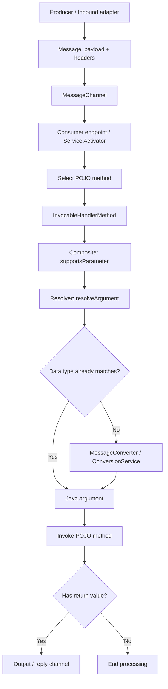

# MessageHandlerMethodArgumentResolver: Resolving Arguments for Message-Handling Methods

## 1. Concepts and API Names to Distinguish

In Spring Integration, a message travels through a **channel** to an **endpoint**; the endpoint can invoke a plain Java method (POJO) to process the payload and headers and return a result. Before calling the method, the runtime must determine which value each Java parameter receives from `Message<?>`. This task is handled by the **method argument resolver** layer.

> **Note on naming:** `MessageHandlerMethodArgumentResolver` is a topic name describing the mechanism, **not the name of a public class or interface** in the Spring Integration 6.5 API. The exact names to look up and `import` are `HandlerMethodArgumentResolver`, `MessageMethodArgumentResolver`, `PayloadMethodArgumentResolver`, and `IntegrationMessageHandlerMethodFactory`. Do not try to import `MessageHandlerMethodArgumentResolver` as a built-in class.

Different components play distinct roles:

| Component | Package | Responsibility |
| --- | --- | --- |
| `HandlerMethodArgumentResolver` | `org.springframework.messaging.handler.invocation` | Contract for selecting and extracting the value for **one** method parameter. |
| `HandlerMethodArgumentResolverComposite` | `org.springframework.messaging.handler.invocation` | Holds the list of resolvers and selects the resolver that supports a parameter. |
| `MessageMethodArgumentResolver` | `org.springframework.messaging.handler.annotation.support` | Resolves `Message<?>` parameters; can convert the payload according to its generic type. |
| `PayloadMethodArgumentResolver` | `org.springframework.messaging.handler.annotation.support` | Resolves payload parameters, considering `@Payload`, conversion, and validation as configured. |
| `HeaderMethodArgumentResolver` / `HeadersMethodArgumentResolver` | `org.springframework.messaging.handler.annotation.support` | Resolves `@Header` or `@Headers` parameters. |
| `IntegrationMessageHandlerMethodFactory` | `org.springframework.integration.handler.support` | Factory for Spring Integration (since 6.0), extending `DefaultMessageHandlerMethodFactory` to build methods with appropriate resolvers. |
| `InvocableHandlerMethod` / `IntegrationInvocableHandlerMethod` | Spring Messaging / Spring Integration | Invokes the target method after arguments are resolved. |

**Scope in the runtime module:** resolvers resolve the *method signature* at handler invocation time. They **do not** create messages, choose channels, schedule threads, run pollers, open transactions, or schedule retries. Those responsibilities belong to channels, consumer endpoints, executors, transaction interceptors, and flow advice.

## 2. Where Do Resolvers Sit in the Message Path?



The diagram illustrates the typical POJO method-handling branch; some endpoints use specialized handlers and bypass parts of this mechanism. Key sequence:

1. The producer sends `Message<?>` into a `MessageChannel`.
2. The consumer endpoint receives the message. With `DirectChannel`, handler execution normally runs on the sending thread; with `ExecutorChannel` or pollable channels, the execution thread depends on the executor/poller.
3. If the endpoint invokes a POJO, the runtime chooses an appropriate method (or uses the explicitly configured method), then prepares arguments for each parameter.
4. The composite queries resolvers in order: does `supportsParameter(MethodParameter)` accept this parameter? The selected resolver invokes `resolveArgument(MethodParameter, Message<?>)`.
5. The resolver may take the entire message, read a header, extract the payload, evaluate an expression, or invoke a converter to match the Java type. Once all arguments are ready, the method is called.
6. If the handler returns a result, the endpoint sends it to the output/reply channel as configured. If argument resolution or method invocation fails, the exception follows the current endpoint/channel error mechanism.

Two core SPI methods:

```java
public interface HandlerMethodArgumentResolver {
    boolean supportsParameter(MethodParameter parameter);

    Object resolveArgument(MethodParameter parameter, Message<?> message)
            throws Exception;
}
```

`supportsParameter` inspects the parameter's *declaration* metadata, whereas `resolveArgument` receives the **specific message for the current invocation**. Resolvers should check types and handle missing values explicitly; they should not depend on mutable state shared across messages.

## 3. How Does the Runtime Bind Common Parameters?

Suppose a message has payload `Order("ORD-42", 125_000)` and headers `traceId=t-123`, `priority=5`:

| Method Signature | Resolved Value | Notes |
| --- | --- | --- |
| `handle(Order order)` | Payload of type `Order` | Payload type is inferred from the POJO parameter; fits standard Service Activator usage. |
| `handle(@Payload Order order)` | Payload of type `Order` | Declares payload intent explicitly; conversion/validation may apply if configured. |
| `handle(Message<Order> message)` | Entire `Message` | Exposes both `getPayload()` and `getHeaders()`; generic payload type must match or have a compatible converter. |
| `handle(@Header("traceId") String traceId)` | Value of header `traceId` | Missing a required header causes an argument resolution error. |
| `handle(@Header(value = "traceId", required = false) String traceId)` | Header value or `null` | Use when metadata can be absent and business logic handles `null`. |
| `handle(@Headers Map<String, Object> headers)` | Header map | Do not assume modifying the map mutates the original message. |
| `handle(@Payload(expression = "payload.id") String id)` | `id` field of payload via SpEL | Spring Integration expression resolver evaluates in message context; check expression and result type. |

`Message<T>` and `T` parameters do not mean the same thing: the former requests the *message envelope*, while the latter requests the *payload*. When only business data is needed, using a POJO type or `@Payload` keeps the handler less coupled to Spring Messaging. When correlation, reply routing, or metadata is needed, use `@Header` or `Message<?>`.

For handlers with multiple parameters that could all look like payloads, use annotations to remove ambiguity. An explicitly named `@Header` is also easier to verify than inferring from Java parameter names. Additional Spring Integration resolvers support certain collection, map, and expression types; do not assume every collection parameter automatically binds the whole payload without checking the signature and flow.

## 4. End-to-End Example: Service Activator Receiving Payload and Header

The example below uses Spring Integration Java DSL and Java 17+, simulating a payment request. Via `.handle(service, "process")`, the endpoint explicitly designates the method to call; argument resolvers map the payload and trace header into the two parameters.

```java
import org.springframework.messaging.handler.annotation.Header;
import org.springframework.messaging.handler.annotation.Payload;
import org.springframework.stereotype.Component;

record Payment(String paymentId, long amount) {}
record PaymentReceipt(String paymentId, String status, String traceId) {}

@Component
class PaymentService {
    public PaymentReceipt process(
            @Payload Payment payment,
            @Header(value = "traceId", required = false) String traceId) {

        if (payment.amount() <= 0) {
            throw new IllegalArgumentException("amount must be positive");
        }
        return new PaymentReceipt(payment.paymentId(), "ACCEPTED", traceId);
    }
}
```

```java
import org.springframework.context.annotation.Bean;
import org.springframework.context.annotation.Configuration;
import org.springframework.integration.annotation.EnableIntegration;
import org.springframework.integration.channel.QueueChannel;
import org.springframework.integration.dsl.IntegrationFlow;
import org.springframework.messaging.PollableChannel;

@Configuration
@EnableIntegration
class PaymentFlowConfiguration {
    @Bean
    PollableChannel paymentResults() {
        return new QueueChannel();
    }

    @Bean
    IntegrationFlow paymentFlow(PaymentService paymentService) {
        return IntegrationFlow.from("paymentInput")
                .handle(paymentService, "process")
                .channel("paymentResults")
                .get();
    }
}
```

Sending a message and receiving the result from `QueueChannel` (e.g., inside a test with an `ApplicationContext`):

```java
import org.springframework.context.ApplicationContext;
import org.springframework.messaging.Message;
import org.springframework.messaging.MessageChannel;
import org.springframework.messaging.PollableChannel;
import org.springframework.messaging.support.MessageBuilder;

void exercise(ApplicationContext context) {
    MessageChannel input = context.getBean("paymentInput", MessageChannel.class);
    PollableChannel output = context.getBean("paymentResults", PollableChannel.class);

    input.send(MessageBuilder.withPayload(new Payment("PAY-42", 125_000))
            .setHeader("traceId", "t-123")
            .build());

    Message<?> received = output.receive(1_000);
    if (received == null) {
        throw new IllegalStateException("No payment receipt received");
    }
    PaymentReceipt receipt = (PaymentReceipt) received.getPayload();
    // paymentId=PAY-42, status=ACCEPTED, traceId=t-123
}
```

Analysis of this send: the payload is already a `Payment`, so no type conversion is needed; `@Header` extracts `"t-123"`; `PaymentService.process(...)` returns `PaymentReceipt`; the Service Activator wraps the result into a reply message and the flow places it on `paymentResults`. Here `send()` runs synchronously on the `DirectChannel` created by the DSL for the input, while `receive()` explicitly pulls the item from the output queue. If `amount <= 0`, the exception originates inside the method rather than in an argument resolver.

**Annotation variant:** you can mark the method with `@ServiceActivator(inputChannel = "paymentInput", outputChannel = "paymentResults")` and let the annotation create the endpoint. In that case, **do not simultaneously** declare `.handle(paymentService, "process")` for the same flow, as that can create two consumers competing on the same message.

## 5. Data Conversion: Do Not Confuse Resolving with Converting

The resolver decides **where a parameter comes from**. The converter decides **how that value can be transformed to the target type**. The two steps are related, not identical.

Suppose upstream delivers JSON as `byte[]` with header `contentType=application/json`, while the handler expects `Payment`. If an appropriate `MessageConverter` (such as a Jackson converter) is configured and the JSON structure matches, the runtime can convert `byte[]` into `Payment`. If the payload is already a `Payment`, conversion is typically unnecessary. Conversely, a message holding an arbitrary string when the handler expects `Payment` will still fail even though both the method and channel are valid.

Spring Integration supplies `ConfigurableCompositeMessageConverter` for method invocation, with default converters depending on classpath dependencies; a Jackson converter is present only when classpath conditions match. `contentType` is a hint to converters, not a guarantee that arbitrary strings or bytes can be decoded.

When customizing a dedicated converter for argument resolution, Spring Integration documentation references the bean named `integrationArgumentResolverMessageConverter` (constant `IntegrationContextUtils.ARGUMENT_RESOLVER_MESSAGE_CONVERTER_BEAN_NAME`). Distinguish this path's converter from converters inside HTTP/JMS/AMQP adapters: inbound adapters may already convert the message before it reaches the Service Activator.

To isolate conversion errors, check in order: what is the actual runtime payload, what type does the method expect, is `contentType` accurate, is the converter registered in the right place, and did conversion fail before or after the handler body started running.

## 6. When Should You Write a Custom `HandlerMethodArgumentResolver`?

Only write a custom resolver when many handlers share a binding rule that `@Header`, `@Payload`, `Message<?>`, or converters cannot express cleanly. For example, an application wants every method declaring a `TraceContext` parameter to receive an object built from the `traceId` header.

```java
import org.springframework.core.MethodParameter;
import org.springframework.messaging.Message;
import org.springframework.messaging.handler.invocation.HandlerMethodArgumentResolver;

record TraceContext(String traceId) {}

final class TraceContextResolver implements HandlerMethodArgumentResolver {
    @Override
    public boolean supportsParameter(MethodParameter parameter) {
        return parameter.getParameterType() == TraceContext.class;
    }

    @Override
    public Object resolveArgument(MethodParameter parameter, Message<?> message) {
        Object value = message.getHeaders().get("traceId");
        if (!(value instanceof String id) || id.isBlank()) {
            throw new IllegalArgumentException("Missing or invalid traceId header");
        }
        return new TraceContext(id);
    }
}
```

Here is an example **manually invoking the factory** to illustrate how to register and use the resolver (Spring Integration 6.x):

```java
import java.lang.reflect.Method;
import java.util.List;
import org.springframework.integration.handler.support.IntegrationMessageHandlerMethodFactory;
import org.springframework.messaging.support.MessageBuilder;

class TraceHandler {
    public String consume(TraceContext trace) {
        return "handled: " + trace.traceId();
    }
}

void invokeWithCustomResolver() throws Exception {
    var factory = new IntegrationMessageHandlerMethodFactory();
    factory.setCustomArgumentResolvers(List.of(new TraceContextResolver()));
    factory.afterPropertiesSet();

    TraceHandler bean = new TraceHandler();
    Method method = TraceHandler.class.getMethod("consume", TraceContext.class);
    var invocable = factory.createInvocableHandlerMethod(bean, method);

    Object result = invocable.invoke(MessageBuilder.withPayload("demo")
            .setHeader("traceId", "trace-42")
            .build());
    // result: "handled: trace-42"
}
```

`setCustomArgumentResolvers` adds the resolver to **the factory being used**. Instantiating a factory in code like above does not replace the factory managed for all `@ServiceActivator`/flows across the application. When integrating into a real app, wire the custom factory/resolver into the exact invocable-handler creation mechanism used by your endpoints; check the API and configuration approach for your version. Before choosing a custom resolver, consider using `@Header("traceId") String traceId` and constructing `TraceContext` inside the service—it is usually simpler and easier to maintain.

Key rules when writing a custom resolver:

- `supportsParameter` must match a sufficiently narrow parameter signature; avoid matching every `Object` or `String` and unintentionally stealing work from default resolvers.
- Never store `Message<?>` or resolved values from the current message in mutable fields on a singleton resolver; multiple messages may be handled concurrently.
- Handle nulls, wrong header types, and contextual error messages cleanly without leaking sensitive data into logs.
- If specialized payload conversion is needed, prefer `Converter`/`MessageConverter` instead of writing an argument resolver solely to convert payloads.

## 7. Errors, Threads, and Transactions at Runtime

| Symptom | Where It Usually Originates | Diagnostic Direction |
| --- | --- | --- |
| `No suitable resolver` or unable to bind parameter | Factory / resolver composite | Check method signature, annotations, and whether the resolver is registered on the factory actually invoking the method. |
| Missing required header | `HeaderMethodArgumentResolver` | Inspect actual headers upon entering the endpoint, header name, and `required`. |
| `MessageConversionException` or type error | Message converter / payload resolver | Compare `payload.getClass()`, target type, `contentType`, and the converter in use. |
| Handler throws business error | POJO method | Distinguish errors inside the method body from argument preparation errors; inspect the inner cause of `MessagingException` if wrapped. |
| Same handler runs on different threads | Channel / consumer / executor | Inspect `DirectChannel`, `ExecutorChannel`, poller, and thread boundaries; resolvers do not create threads. |
| Message processed repeatedly | Retry advice, inbound source, or redelivery | Check retry policy, acks, and transaction boundaries; resolvers do not retry on their own. |
| Reply never reaches destination | Output / reply channel | Check whether the handler returns `null`/`void`, `outputChannel`, `replyChannel`, timeouts, and channel subscribers. |

Important runtime distinctions to keep in mind:

- **`DirectChannel`:** the processing chain normally shares the call stack/thread with the sender. Parameter-binding failures can propagate back to `send()`; the caller's transaction can encompass processing if configured appropriately.
- **`ExecutorChannel`:** dispatching to an executor creates a thread boundary. Consumer errors do not necessarily surface directly in the `send()` call; monitor async error handling.
- **`QueueChannel` + poller:** the endpoint executes on a poller thread after pulling a message from the queue. Retries, redelivery, and transactions are governed by the poller, advice, message store, and message source; they cannot be inferred from resolvers alone.
- **Correlation:** `correlationId`, `sequenceNumber`, `sequenceSize`, `replyChannel`, and `errorChannel` are message headers managed by their respective components. Resolvers only read them when requested by a method; adding or removing them belongs in message transformation/enrichment steps.

When profiling performance, separate method execution time, conversion time, queue wait time, poller fetching, and executor dispatch. If JSON deserialization in a resolver/converter is the bottleneck, adding more threads may not address the root cause; measure payload size, conversion frequency, and object allocation cost. If the bottleneck is queue backlog or I/O inside the handler, changing resolvers will not help.

## 8. Hands-On Exercises and Self-Check Questions

**Exercise 1 — Bind a header strictly:** modify `PaymentService` so `traceId` is required (`@Header("traceId")`), send a message missing the header, and observe that the error occurs before the method body executes. Then switch back to `required = false` and handle `null`.

**Exercise 2 — Distinguish `Message<T>` from `T`:** replace `process(@Payload Payment payment, ...)` with a method accepting `Message<Payment>`, reading the same payload and `traceId` via `getHeaders()`. Compare the degree of coupling to messaging infrastructure.

**Exercise 3 — Test conversion:** send valid and invalid JSON with `contentType=application/json` to a method expecting `Payment`. Identify which converter is required, the payload type before sending, and where the failure occurs. Do not assume Jackson works automatically without verifying dependencies/converters.

**Exercise 4 — Thread boundaries:** compare a flow using `DirectChannel` against one using `ExecutorChannel` or queue + poller; log thread names when sending, entering the handler, and throwing an exception. Explain why resolvers do not choose the execution thread.

**Exercise 5 — Custom resolver:** extend `TraceContextResolver` to read an additional optional `tenantId` header. Write tests for a missing `traceId`, a mistyped `traceId`, and two messages processed concurrently without shared state.

Review questions:

1. How does `HandlerMethodArgumentResolver` differ from `MessageConverter`?
2. Why do `Message<Payment>` and `@Payload Payment` require different resolvers?
3. Why does instantiating `IntegrationMessageHandlerMethodFactory` manually not mean every endpoint in the application will use it?
4. How can a missing-header error surface differently on `DirectChannel` vs. `ExecutorChannel`?
5. When a JSON payload fails conversion, which layer should you inspect before increasing executor thread pool size?

## 9. Official Reference Sources

- Spring Integration, *Message Endpoints — Content Type Conversion*: https://docs.spring.io/spring-integration/reference/endpoint.html
- Spring Integration, *Service Activator*: https://docs.spring.io/spring-integration/reference/6.5/service-activator.html
- Spring Integration 6.5 API, `IntegrationMessageHandlerMethodFactory`: https://docs.spring.io/spring-integration/docs/6.5.0/api/org/springframework/integration/handler/support/IntegrationMessageHandlerMethodFactory.html
- Spring Framework 6.2 API, `HandlerMethodArgumentResolver`: https://docs.spring.io/spring-framework/docs/6.2.x-SNAPSHOT/javadoc-api/org/springframework/messaging/handler/invocation/HandlerMethodArgumentResolver.html
- Spring Framework 6.2 API, `MessageMethodArgumentResolver`: https://docs.spring.io/spring-framework/docs/6.2.16/javadoc-api/org/springframework/messaging/handler/annotation/support/MessageMethodArgumentResolver.html
- Spring Framework, `DefaultMessageHandlerMethodFactory` (how resolvers are built and registered): https://docs.spring.io/spring-framework/docs/current/javadoc-api/org/springframework/messaging/handler/annotation/support/DefaultMessageHandlerMethodFactory.html
