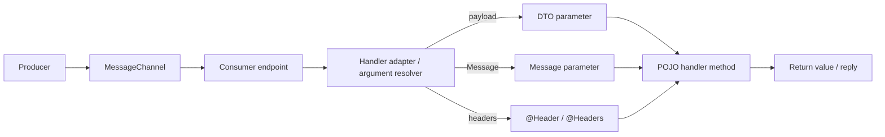
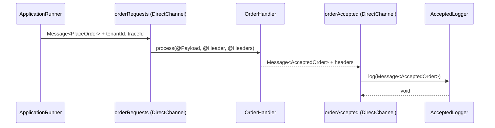

# Payload, Message, and Header Arguments

In the **Spring Integration runtime**, channels transport `Message<?>`, while endpoints receive messages and invoke business code. When an endpoint is wired to a **POJO handler**, the framework must decide what to pass into each Java parameter: just the payload, the entire `Message`, or one or more headers. This work is commonly called **argument resolution/binding** by the handler adapter.

This lesson belongs to the **Handler adapter** chapter and focuses on declaring and reading parameters on methods used with `@ServiceActivator`; similar rules also apply across many method-based endpoints such as transformers, filters, and routers. Understanding argument binding clearly helps you build message flows across channels, consumers, pollers, and executors without confusing metadata with business data; it also helps diagnose missing headers, payload type mismatches, correlation issues, and differences between method-invocation errors and runtime coordination errors.

## 1. From Message to Method Invocation

A Spring Integration message consists of two main parts:

```java
// Conceptual: abbreviated Spring Messaging signature
public interface Message<T> {
    T getPayload();
    MessageHeaders getHeaders();
}
```

- **Payload**: business data, such as `PlaceOrder`, JSON text, or `byte[]`.
- **Headers**: key–value metadata, such as `tenantId`, `traceId`, `correlationId`, `replyChannel`, or `errorChannel`. Standard headers `id` and `timestamp` are typically generated by the framework.
- **Message**: the envelope wrapping both payload and headers; channels physically transport `Message<?>`, even if a handler method only accepts a DTO.



The endpoint itself decides *when* the handler is invoked. For example, `DirectChannel` typically dispatches on the sending thread; `QueueChannel` requires a polling consumer or code explicitly calling `receive()`. Argument mapping happens **after the endpoint receives the message**, and does not alter the channel's delivery, transaction, or retry rules on its own.

## 2. Three Ways to Write Handler Parameters

Suppose a producer sends a message with payload `PlaceOrder("O-42", 150000)` and headers `tenantId="acme"`, `traceId="t-9"`.

| Method Signature | Data Passed In | When It Fits |
| --- | --- | --- |
| `handle(@Payload PlaceOrder order)` | Only the payload of type `PlaceOrder` | Business logic only cares about content |
| `handle(Message<PlaceOrder> message)` | Both payload and all headers | Logic must read or forward metadata directly |
| `handle(@Payload PlaceOrder order, @Header("tenantId") String tenant)` | Payload plus one selected header | Need a few explicitly named metadata values, easy to test |
| `handle(@Payload PlaceOrder order, @Headers Map<String, Object> headers)` | Payload plus the header map | Inspecting or flexibly handling multiple headers |

Examples of **independent signatures** (do not register all of them as consumers of the same channel in a sample application):

```java
import java.util.Map;
import org.springframework.messaging.Message;
import org.springframework.messaging.handler.annotation.Header;
import org.springframework.messaging.handler.annotation.Headers;
import org.springframework.messaging.handler.annotation.Payload;

record PlaceOrder(String orderId, long totalCents) {}

// 1. Business data only
void handlePayload(@Payload PlaceOrder order) {
    System.out.println(order.orderId());
}

// 2. Access both payload and metadata
void handleMessage(Message<PlaceOrder> message) {
    PlaceOrder order = message.getPayload();
    Object traceId = message.getHeaders().get("traceId");
    System.out.println(order.orderId() + " / " + traceId);
}

// 3. Select only needed headers
void handleArguments(
        @Payload PlaceOrder order,
        @Header("tenantId") String tenantId,
        @Header(name = "traceId", required = false) String traceId,
        @Headers Map<String, Object> allHeaders) {
    System.out.println(order.orderId() + " from " + tenantId);
}
```

These signatures illustrate **method declarations**; for the framework to invoke them in a real flow, attach them to an endpoint—such as `@ServiceActivator(inputChannel = "...")`—or configure a handler in the `IntegrationFlow` DSL.

## 3. `@Payload`: Extracting the Business Data

`@Payload` comes from `org.springframework.messaging.handler.annotation.Payload`. In standard usage, the annotation indicates which parameter receives the inbound message's **payload**:

```java
@ServiceActivator(inputChannel = "ordersInput")
public void process(@Payload PlaceOrder order) {
    validate(order);
    save(order);
}
```

*The example above assumes `validate`/`save` methods exist on the business service and `ordersInput` is configured.*

If a method has only **one payload-like parameter**, Spring Integration can usually infer the binding even without `@Payload`:

```java
@ServiceActivator(inputChannel = "ordersInput")
public void process(PlaceOrder order) {
    // This parameter is mapped from the payload when the method is unambiguous.
}
```

Still, writing `@Payload` explicitly helps when the method also takes headers, during signature reviews, or as the method evolves over time. Never assume every parameter type is compatible with the incoming payload:

- Payload is `PlaceOrder` and parameter is `PlaceOrder`: normally binds directly.
- Payload is a `String` containing JSON while parameter is `PlaceOrder`: an appropriate conversion mechanism must exist; changing the parameter type alone does not guarantee automatic JSON parsing.
- Payload is a DTO while the method asks for an unconvertible type: method selection/invocation can fail **before business code runs**.
- The payload inside a valid `Message` is normally non-`null`; `@Payload(required = false)` should not be used as a default pattern for sending "messages with null payloads."

In complex integration flows, clarify which step is responsible for deserializing/converting the payload and which step executes business logic. Converter configuration, content type, and endpoint type can all alter type conversion behavior.

## 4. `Message<T>`: Keeping the Full Context

When both payload and headers are needed, a method can accept `Message<T>` directly:

```java
import org.springframework.integration.annotation.ServiceActivator;
import org.springframework.messaging.Message;
import org.springframework.messaging.MessageHeaders;

@ServiceActivator(inputChannel = "ordersInput")
public void audit(Message<PlaceOrder> message) {
    PlaceOrder payload = message.getPayload();
    MessageHeaders headers = message.getHeaders();

    System.out.println("Order: " + payload.orderId());
    System.out.println("Message id: " + headers.getId());
    System.out.println("Trace: " + headers.get("traceId"));
}
```

This option is especially clear for auditing, correlation checks, error tracing, or gateways forwarding messages. The trade-off is that the service becomes aware of Spring Messaging's `Message`. If business logic only needs `PlaceOrder` and `tenantId`, a signature using `@Payload` + `@Header` usually keeps dependencies clearer and leaner.

A `Message` should not be treated as an object whose headers can be mutated in place. `MessageHeaders` is designed to be immutable at the API layer. To add or modify headers, build a **new message**:

```java
import org.springframework.messaging.Message;
import org.springframework.messaging.support.MessageBuilder;

Message<PlaceOrder> enriched = MessageBuilder
        .fromMessage(incomingMessage)
        .setHeader("processingStage", "validated")
        .build();
```

`incomingMessage` here is a previously received `Message<PlaceOrder>`. Building from an existing message preserves the payload and appropriate headers while creating a new message according to builder rules. Distinguish an "immutable message wrapper" from an "immutable payload": if the payload is a mutable Java object, the framework does not automatically deep-copy it.

## 5. `@Header`: Reading a Metadata Value by Name

`@Header` comes from `org.springframework.messaging.handler.annotation.Header`. It looks up a key in `MessageHeaders` and binds its value to the parameter:

```java
@ServiceActivator(inputChannel = "ordersInput")
public void process(
        @Payload PlaceOrder order,
        @Header("tenantId") String tenantId,
        @Header(name = "traceId", required = false) String traceId,
        @Header(name = "attempt", defaultValue = "0") Integer attempt) {

    System.out.printf(
            "order=%s tenant=%s trace=%s attempt=%d%n",
            order.orderId(), tenantId, traceId, attempt);
}
```

| Declaration | Meaning | Notes |
| --- | --- | --- |
| `@Header("tenantId") String tenant` | Required header named `tenantId` | Missing header typically fails resolution before the handler runs |
| `@Header(name = "traceId", required = false) String trace` | Optional header | Can receive `null`; handle safely |
| `@Header(name = "attempt", defaultValue = "0") Integer n` | Fallback default when header is absent | Converts the default string to the parameter type if conversion supports it |
| `@Header("correlationId") UUID correlation` | Reads a correlation key | Actual runtime type must match or be convertible |

Header names are case-sensitive at the key level. `tenantId` does not automatically match `tenantID`. Header values may be `String`, `UUID`, `Integer`, `MessageChannel`, or another Java type; if the declared parameter type does not match and no suitable converter exists, binding fails.

**Watch out with primitives:** `@Header(required = false) int attempt` cannot receive `null` when the value is missing. Use a wrapper type (`Integer`) or declare an appropriate default value. For critical tenant-identifying or correlation headers, validate presence and validity right at the message-intake boundary.

## 6. `@Headers`: Reading the Full Metadata Map

`@Headers` comes from `org.springframework.messaging.handler.annotation.Headers`; it is typically used with `Map<String, Object>`:

```java
@ServiceActivator(inputChannel = "ordersInput")
public void inspect(
        @Payload PlaceOrder order,
        @Headers Map<String, Object> metadata) {
    Object messageId = metadata.get("id");
    Object tenantId = metadata.get("tenantId");
    System.out.println(messageId + " -> " + tenantId);
}
```

Distinguish two easily confused annotations:

- `@Header("tenantId")`: extracts **one** value by name.
- `@Headers`: extracts the **map of headers**; does not take a header name argument.

Do not mutate `metadata` directly expecting the in-flight message to change automatically. When you need a copy with added headers, use `MessageBuilder` or a dedicated transformer/enricher. When you need nearly all metadata **and** the payload, `Message<T>` is usually a more natural choice than `@Payload` alongside a large map.

Some headers are **infrastructure headers**: `MessageHeaders.ID`, `MessageHeaders.TIMESTAMP`, `MessageHeaders.REPLY_CHANNEL`, `MessageHeaders.ERROR_CHANNEL`. Do not treat them as ordinary business attributes or modify them without understanding routing/error-handling behavior. Custom keys like `traceId` and `tenantId` may also originate from external inputs and should be validated before making authorization decisions.

## 7. Integration Example: Combining Payload, Header, and Message

The example below illustrates a flow running in a **Spring Boot application with `spring-boot-starter-integration`** (Java 17 or later). A producer sends `PlaceOrder` with headers. `@ServiceActivator` binds the parameters and returns `Message<AcceptedOrder>`, then a second consumer accepts **the full message** for logging.



```java
import java.util.Map;
import org.springframework.beans.factory.annotation.Qualifier;
import org.springframework.boot.ApplicationRunner;
import org.springframework.context.annotation.Bean;
import org.springframework.context.annotation.Configuration;
import org.springframework.integration.annotation.EnableIntegration;
import org.springframework.integration.annotation.ServiceActivator;
import org.springframework.integration.channel.DirectChannel;
import org.springframework.messaging.Message;
import org.springframework.messaging.MessageChannel;
import org.springframework.messaging.MessageHeaders;
import org.springframework.messaging.handler.annotation.Header;
import org.springframework.messaging.handler.annotation.Headers;
import org.springframework.messaging.handler.annotation.Payload;
import org.springframework.messaging.support.MessageBuilder;
import org.springframework.stereotype.Component;

record PlaceOrder(String orderId, long totalCents) {}
record AcceptedOrder(String orderId, String tenantId) {}

@Configuration
@EnableIntegration
class OrderFlowConfig {
    @Bean
    DirectChannel orderRequests() {
        return new DirectChannel();
    }

    @Bean
    DirectChannel orderAccepted() {
        return new DirectChannel();
    }

    @Bean
    ApplicationRunner demo(@Qualifier("orderRequests") MessageChannel requests) {
        return args -> {
            Message<PlaceOrder> request = MessageBuilder
                    .withPayload(new PlaceOrder("O-42", 150_000))
                    .setHeader("tenantId", "acme")
                    .setHeader("traceId", "t-9")
                    .build();
            requests.send(request);
        };
    }
}

@Component
class OrderHandler {
    @ServiceActivator(
            inputChannel = "orderRequests",
            outputChannel = "orderAccepted")
    public Message<AcceptedOrder> process(
            @Payload PlaceOrder order,
            @Header("tenantId") String tenantId,
            @Header(name = "traceId", required = false) String traceId,
            @Headers Map<String, Object> allHeaders) {

        if (order.totalCents() <= 0) {
            throw new IllegalArgumentException("totalCents must be positive");
        }

        System.out.println("Request id: " + allHeaders.get(MessageHeaders.ID));

        MessageBuilder<AcceptedOrder> reply = MessageBuilder
                .withPayload(new AcceptedOrder(order.orderId(), tenantId))
                .setHeader("tenantId", tenantId);

        if (traceId != null) {
            reply.setHeader("traceId", traceId);
        }
        return reply.build();
    }
}

@Component
class AcceptedLogger {
    @ServiceActivator(inputChannel = "orderAccepted")
    public void log(Message<AcceptedOrder> message) {
        System.out.println("Accepted: " + message.getPayload());
        System.out.println("Trace: " + message.getHeaders().get("traceId"));
    }
}
```

**How to read the execution flow:**

1. `ApplicationRunner` builds a `Message<PlaceOrder>`, sets `tenantId` and `traceId`, and sends it to `orderRequests`.
2. `DirectChannel` dispatches to `OrderHandler`'s endpoint. The adapter binds payload to `order`, the `tenantId` header to `tenantId`, the optional header to `traceId`, and the header map to `allHeaders`.
3. The handler validates the value, builds a reply message with an `AcceptedOrder` payload, and intentionally copies the two business headers to retain.
4. The endpoint forwards the reply to `orderAccepted`; `AcceptedLogger` reads both payload and metadata from `Message<AcceptedOrder>`.

With `DirectChannel` in this configuration, the handler invocation usually runs on **the producer's own thread**; exceptions from the handler can propagate back to the `send()` call (often via messaging exception wrapping). A successful return from `send()` only reflects dispatch according to channel semantics—not a guarantee of business transaction commit or crash recovery.

This example explicitly constructs `Message<AcceptedOrder>` to control outgoing headers. With some adapters/endpoints, when a method returns **only a payload**, the framework may carry certain request headers into the reply according to the handler's propagation policy. **Do not rely on guessing that all headers are kept or dropped**: check the endpoint type, excluded-header lists, relevant settings, and write tests asserting output messages.

## 8. Argument Binding with Pollers and Executors

The three parameter styles learned above **do not depend on whether the channel itself is push or poll**. Another example—a `QueueChannel` with a polling consumer:

```java
@ServiceActivator(
    inputChannel = "queuedOrders",
    poller = @Poller(fixedDelay = "250", maxMessagesPerPoll = "10"))
public void processQueued(
        @Payload PlaceOrder order,
        @Header("tenantId") String tenantId) {
    // The method still receives payload and header.
    // The endpoint actively polls the channel before invoking the method.
}
```

*This snippet illustrates a separate flow: `queuedOrders` must be defined as a pollable channel (such as `QueueChannel`), and `@Poller` must be imported.*

The crucial difference lies in timing and execution thread:

| Context | Who Triggers the Handler? | Runtime Consequence |
| --- | --- | --- |
| `DirectChannel` + service activator | Producer dispatches when sending message | Handler may run synchronously on the producer's call stack |
| `ExecutorChannel` + service activator | Task handed to an executor | Binding stays identical; execution thread, completion order, and where errors surface can differ |
| `QueueChannel` + polling service activator | `PollingConsumer` on a poll schedule | Messages wait until a poll cycle; handler errors occur after dequeueing |

Receiving `@Header("correlationId")` **does not guarantee** messages sharing a correlation key execute sequentially or on the same thread. Correlation is merely metadata; ordering or grouping guarantees must be engineered with aggregators, resequencers, partitioning, or appropriate synchronization.

## 9. Return Values, Header Propagation, and Correlation

A handler method can return:

- `void`: typically a terminal processing step that produces no reply for the endpoint.
- **Payload object** (`AcceptedOrder`, `String`, DTO...): the framework builds/routes a reply message per endpoint behavior.
- **`Message<?>`**: lets the method define both the payload and key headers of the reply.

When a reply must be sent, verify `outputChannel` or `replyChannel` configuration. If no consumer listens on the output, delivery failures can still happen even after argument binding and business logic succeed.

Common practical scenarios:

| Requirement | Suggested Approach |
| --- | --- |
| Preserve `tenantId` on reply | Set it explicitly on reply headers and test propagation |
| Trace request/reply | Propagate `traceId` or a consistent correlation key |
| Group multiple messages | Use `correlationId` paired with an aggregator/`MessageGroupStore` if required |
| Route message to another channel | Configure output/reply channel or an explicit router |
| Prevent leaking sensitive metadata | Pass only required headers across system boundaries |

Do not confuse **`MessageHeaders.ID`** (the identifier of one specific message) with a **business correlation ID** (a shared identifier across an event chain). When creating a new reply, the message ID can differ from the request ID; business correlation requires a dedicated header or tracing design.

## 10. Common Errors and Diagnostic Techniques

Handler adapters typically detect binding errors before the business method runs. Therefore, when execution "never enters the method," inspect input data and method signatures before suspecting internal algorithm bugs.

| Symptom | Common Cause | Check / Fix |
| --- | --- | --- |
| Method never invoked; missing `tenantId` reported | `@Header` is required by default, yet producer omitted the header | Check headers at send time, exact key name, or set `required = false` if truly optional |
| Type conversion error binding payload | Runtime payload is String/Map while method demands DTO | Check converters, deserialization step, `contentType`, and payload type entering handler |
| `ClassCastException` or header type mismatch | Header has a different runtime type than declared | Log runtime type, fix type or converter; avoid unsafe casts |
| Send succeeds but reply lacks `traceId` | Header propagation differs from expectation or custom reply omitted it | Inspect output message, propagation settings, and reply-building code |
| Error appears on poller/executor thread | Endpoint runs asynchronously from producer | Check error channel, advice, and consumer logs rather than only catching exceptions at sender |
| Messages with same `correlationId` processed out of order | Multiple consumers or parallel executor running | Check ordering requirements, partitioning/serialization, and retries |
| Handler finishes but downstream receives nothing | Wrong `outputChannel`, channel has no subscriber, or invalid routing/reply channel | Inspect topology and dispatch failures after method return |

To diagnose a binding error, log the **payload class name**, **list of header keys** (avoid logging full sensitive data), endpoint name, and message ID/correlation. For messages sitting in a `QueueChannel`, also monitor backlog depth, poller status, and receive timeouts to distinguish "not yet polled" from "polled but failed to bind."

### 10.1. Are Errors Automatically Retried or Rolled Back?

**Not automatically just because the method uses `@Payload` or `@Header`.** Argument resolvers do not define delivery guarantees. When a header is missing, a type mismatches, or the method throws an exception:

1. In a synchronous flow such as `DirectChannel`, the exception can propagate back to the sender.
2. In a polling/executor flow, the exception typically must be observed and handled within the consumer context (error handler, advice, or `errorChannel` depending on configuration).
3. If an in-memory `QueueChannel` has already dequeued the message, a binding error does not automatically put the message back on the queue.
4. Retries, transaction interceptors, persistent message stores, and idempotency determine reprocessing capability; a **database rollback alone** does not guarantee recovering a message from an in-RAM queue.

Distinguish **permanent invalid-data errors** (missing required header, malformed schema payload) from **transient errors** (503 API error, DB deadlock). Infinite retries on permanent binding errors turn one bad message into a prolonged operational incident.

## 11. Practice Exercises and Verification Questions

**Exercise 1 — Three signature styles.** Create a `DirectChannel` and three independent flows receiving `@Payload PlaceOrder`, `Message<PlaceOrder>`, and `@Payload PlaceOrder` with `@Header("tenantId")` respectively. Send the same payload and headers; verify each method receives the exact bound data.

**Exercise 2 — Required vs. optional headers.** Send a message without `tenantId`. Observe the error before business logic is invoked. Then switch to an optional header or set an explicit default and compare outcomes. Why is a tenant header sometimes not permitted to have a default?

**Exercise 3 — Reply and correlation.** Return `AcceptedOrder` first, then return `Message<AcceptedOrder>` containing `traceId` and `tenantId`. Attach a subscriber to the output channel to inspect actual headers. Distinguish the `id` headers of the two messages from the `traceId` used to connect the flow trace.

**Exercise 4 — Threads and errors.** Switch the input from `DirectChannel` to a `QueueChannel` with a poller while keeping the handler signature unchanged. Intentionally send a message missing a required header. Record the threads, errors received at the producer/poller, queue backlog before and after, and the configured error flow. Explain why changing the channel type does not change parameter-mapping rules yet changes where errors are observed.

## 12. Quick Self-Check

1. When a method only uses a business DTO, what is the simplest parameter style? -> `@Payload SomeDto` (or a clearly unambiguous DTO parameter).
2. When you need to read payload, `id`, `replyChannel`, and `traceId` together? -> `Message<SomeDto>`.
3. Need only a single `tenantId` header? -> `@Header("tenantId")`.
4. Need to inspect multiple headers flexibly? -> `@Headers Map<String, Object>`.
5. Does `@Header(required = false)` automatically make primitive types safe when missing? -> No; handle missing values or use an appropriate `defaultValue` or wrapper type.
6. Does successfully entering a handler adapter mean the database committed, the broker acked, or exactly-once processing occurred? -> No; those are properties of the full message flow and runtime configuration.

Core takeaway: **`@Payload` selects data, `@Header` selects one metadata entry, `@Headers` selects the metadata map, and `Message<T>` preserves the full context**. These signatures keep handlers focused on their responsibilities; reliable runtime operation still depends on configuring and observing channels, endpoints, pollers/executors, error flows, transactions, retries, and message stores.
