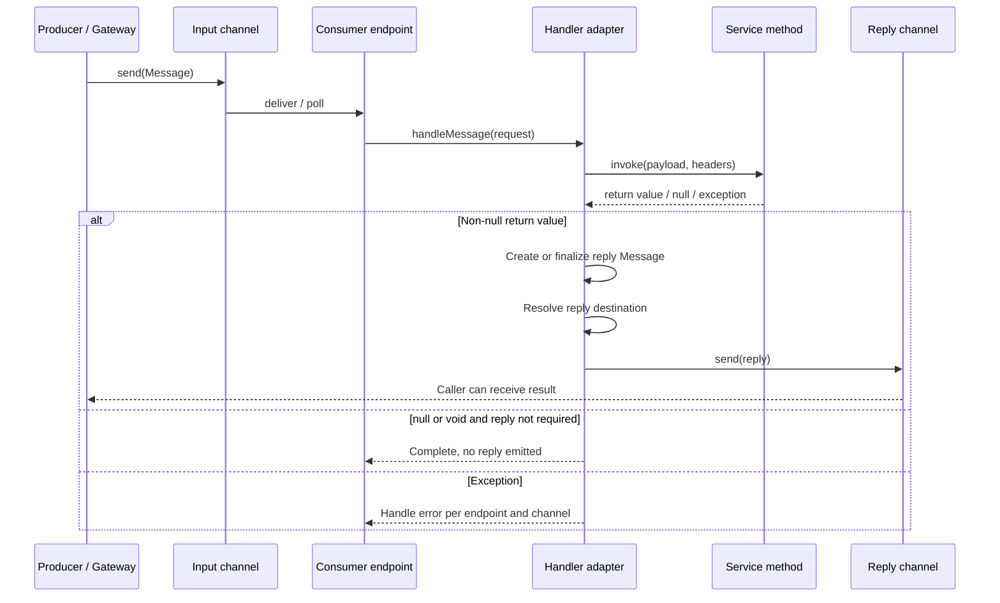
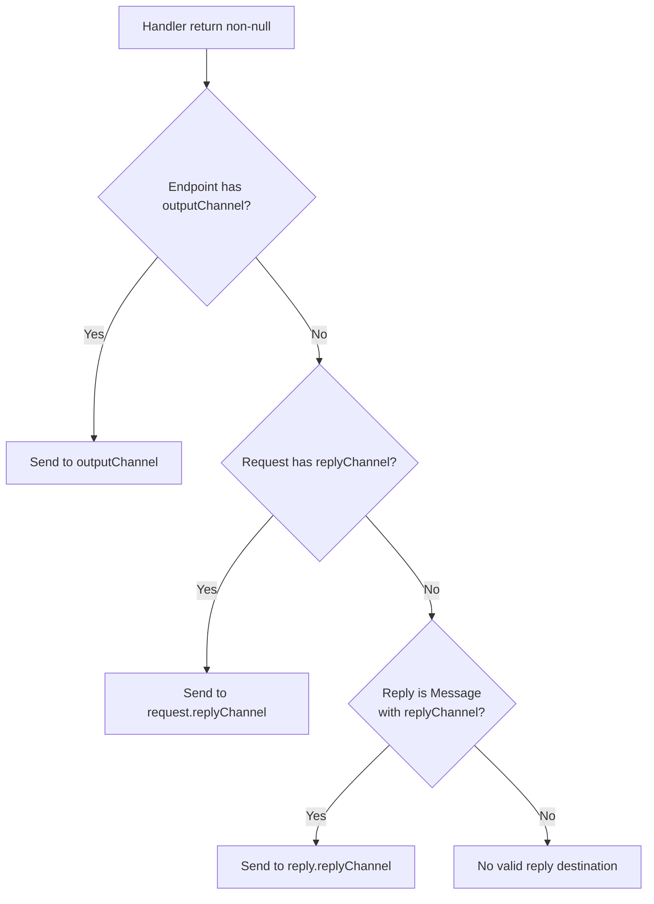
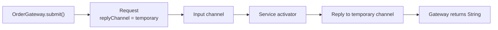

# Return Values and Reply Channels in Handler Adapters

## 1. Position in the Spring Integration Runtime

In the **Spring Integration Runtime**, a `MessageChannel` delivers a message to a consumer endpoint; the endpoint invokes a `MessageHandler`, which may be an adapter invoking a POJO method. When the method returns a value, the framework must decide **whether to emit a reply message, how to construct it, and where to send it**.

This is the **Return values and reply channels** topic of the **Handler adapter** chapter in `SPRING_INTEGRATION_RUNTIME`. These rules relate to how flows coordinate across channels, endpoints, consumers, pollers, and executors; they determine behavior when transactions, retries, error handling, message stores, correlation, or threading change.

After this lesson, readers will be able to:

1. Distinguish *return value*, *reply message*, and *reply channel*.
2. Know what happens when a method returns a payload, returns `Message<?>`, returns `null`, or returns `void`.
3. Understand the precedence between `outputChannel` and the `replyChannel` header to design request-reply flows intentionally.
4. Explain `requiresReply`, `nullChannel`, timeouts, routing errors, and header propagation.
5. Diagnose a flow where "the handler finished running yet the caller received no reply."

The scope focuses primarily on **service activators and typical reply-producing handlers** in Spring Integration 6.x. Specialized endpoints such as splitters, aggregators, reactive handlers, and remote gateways introduce additional rules.

## 2. Three Concepts to Keep Separate

| Concept | Example | Meaning |
|---|---|---|
| **Return value** of a Java method | `return "APPROVED";` | Business output at the method level |
| **Reply message** | `Message<String>` containing `APPROVED` and headers | Actual message sent out from the handler |
| **Reply channel** | Bean `orders.replies` or `replyChannel` header | Destination for the reply, not the reply content |

For an inbound message, the general execution flow is as follows:



**Having a valid return value is not enough to guarantee the caller received the result.** The reply must also have a valid destination and be accepted successfully by the channel/downstream consumer.

## 3. How Handler Adapters Process Return Values

### 3.1. Returning a Non-Null Payload

```java
@ServiceActivator(inputChannel = "orders.in", outputChannel = "orders.out")
public String approve(String orderId) {
    return "APPROVED:" + orderId;
}
```

When a method returns a non-`null` `String`, Spring Integration builds a reply `Message<?>` with that value as its payload. Another DTO or Java value can likewise become the payload. With service activators, request headers are generally propagated to the reply under rules that avoid overwriting headers already present and skip headers configured to be excluded.

### 3.2. Returning a Complete `Message<?>`

```java
@ServiceActivator(inputChannel = "orders.in", outputChannel = "orders.out")
public Message<String> approve(Message<String> request) {
    return MessageBuilder
            .withPayload("APPROVED:" + request.getPayload())
            .setHeader("decision", "approved")
            .build();
}
```

The method explicitly constructs a `Message` with payload and headers. **Specifically for service activators**, the framework still copies request headers that **do not yet exist** in the reply, according to its propagation policy. If the request carried `tenantId` and the reply builder did not set `tenantId`, that header typically reappears on the reply. The `decision` header set on the reply keeps the reply's value.

You cannot "delete" a header from a reply merely by omitting it in the builder. To strip headers at a flow boundary, use `HeaderFilter` or configure `notPropagatedHeaders` appropriately. A **Transformer** returning a complete `Message<?>` has different semantics: application code takes responsibility for the entire message and which headers to preserve.

`id` and `timestamp` are read-only headers managed by the default message builder and typically change when a new message is created. To trace business operations across multiple messages, explicitly design `correlationId` or `traceId`; do not rely on preserving the message ID.

### 3.3. Returning `null` or `void`

```java
@ServiceActivator(inputChannel = "audit.events")
public void audit(String event) {
    // Audit logging only, no business reply.
}
```

By default, a service activator returning `void` or `null` **emits no reply**. This fits one-way processing. If a caller uses a synchronous gateway expecting a result, having no reply can trigger a timeout or block until the configured timeout expires.

When a method **must** return a result, set `requiresReply`:

```java
@ServiceActivator(
        inputChannel = "orders.validate",
        outputChannel = "orders.validated",
        requiresReply = "true"
)
public String validate(String orderId) {
    return orderId.isBlank() ? null : "VALID:" + orderId;
}
```

`@ServiceActivator.requiresReply` is a **String** attribute, hence `"true"`. If the method returns `null` when required mode is enabled, the framework throws `ReplyRequiredException`. This flag neither supplies a default value nor guarantees that sending the reply succeeds.

### 3.4. Exceptions Differ from One-Way Completion

If a service method throws an exception, the handler did not finish successfully. With a synchronous `DirectChannel`, exceptions typically propagate back to the sender/gateway. On an `ExecutorChannel` or polling flow, errors may follow `ErrorMessage`, `errorChannel`, an error handler, or advice depending on configuration.

Do not equate **throwing an exception** with **returning `Message<Throwable>`**; gateways have specific rules when receiving `Throwable`/`ErrorMessage` payloads. Similarly, the `errorChannel` header is an error-handling channel, not a success reply path.

## 4. Precedence Order for Selecting the Reply Channel

For a standard service activator that **produced a non-null reply**, basic routing follows this order:

1. **`outputChannel` defined on the endpoint** takes highest priority.
2. No `outputChannel`: check `replyChannel` in **request headers**.
3. No `replyChannel` on the request and the return value is **`Message<?>`**: `replyChannel` on the **reply Message** may be checked.
4. No valid destination: sending the reply fails, potentially raising `DestinationResolutionException`.

Note: advanced features such as **routing slips** can govern destination selection in flows designed to use them. The precedence above applies to ordinary replies without a routing slip steering the path.



### 4.1. Data Types of the `replyChannel` Header

`MessageHeaders.REPLY_CHANNEL` can hold:

- **`MessageChannel` instance**: sends directly to the specified channel.
- **`String` channel name**: the framework attempts to resolve the name to a channel bean/registry entry.

If the channel name cannot be resolved, `DestinationResolutionException` typically occurs. Do not confuse the `replyChannel` header with the payload or `correlationId`.

### 4.2. `outputChannel` Can "Hijack" Replies from a Gateway

Suppose a gateway places a temporary reply channel in the request header, while the service activator sets `outputChannel = "audit.results"`. The handler will send the reply to **`audit.results`** first instead of the gateway's awaiting address. Without a downstream flow routing back from `audit.results` to the gateway, the caller will never receive the result.

This does not mean the handler behaved improperly. The **overall flow wiring** must ensure the return address is respected or has a path back to the gateway.

### 4.3. `nullChannel` to Intentionally Discard a Reply

Spring Integration provides a special channel named `nullChannel`. When a handler returns a value yet you want the flow to end, configure `outputChannel = "nullChannel"` to discard the message.

| Case | Outcome |
|---|---|
| `void` method or `return null` (default) | No reply created |
| Method returns `"OK"`, endpoint sends to `nullChannel` | Reply created, then discarded |
| Method returns `"OK"`, endpoint has `outputChannel` | Reply goes to the explicit channel |
| Method returns `"OK"`, no output channel but request has `replyChannel` | Reply follows the request return address |
| Method returns `null` and `requiresReply="true"` | `ReplyRequiredException` |
| Reply exists but destination cannot be resolved | Routing failure, distinct from `ReplyRequiredException` |

## 5. Practical Example: Two Routing Strategies

The example uses Spring Integration 6.x, Java 17+, and the `spring-integration-core` dependency. We create two `DirectChannel`s for sending requests and two `QueueChannel`s for reading replies:

- **fixed** branch: has a pre-configured output channel.
- **dynamic** branch: has no output channel, relying on the request's `replyChannel` header.

### 5.1. Java Configuration and Service Methods

```java
import org.springframework.context.annotation.Bean;
import org.springframework.context.annotation.Configuration;
import org.springframework.integration.annotation.ServiceActivator;
import org.springframework.integration.channel.DirectChannel;
import org.springframework.integration.channel.QueueChannel;
import org.springframework.integration.config.EnableIntegration;
import org.springframework.messaging.Message;
import org.springframework.messaging.handler.annotation.Header;
import org.springframework.messaging.handler.annotation.Payload;
import org.springframework.messaging.support.MessageBuilder;

@Configuration
@EnableIntegration
class ReplyRoutingConfig {

    @Bean("orders.fixed.in")
    DirectChannel fixedInput() {
        return new DirectChannel();
    }

    @Bean("orders.dynamic.in")
    DirectChannel dynamicInput() {
        return new DirectChannel();
    }

    @Bean("orders.fixed.out")
    QueueChannel fixedOutput() {
        return new QueueChannel();
    }

    @Bean("orders.header.out")
    QueueChannel headerOutput() {
        return new QueueChannel();
    }

    @Bean
    OrderReplyHandlers orderReplyHandlers() {
        return new OrderReplyHandlers();
    }
}

class OrderReplyHandlers {

    @ServiceActivator(
            inputChannel = "orders.fixed.in",
            outputChannel = "orders.fixed.out",
            requiresReply = "true")
    public String fixed(
            @Payload String orderId,
            @Header(name = "tenantId", required = false) String tenantId) {

        String tenant = tenantId == null ? "public" : tenantId;
        return "ACK:" + tenant + ":" + orderId;
    }

    @ServiceActivator(
            inputChannel = "orders.dynamic.in",
            requiresReply = "true")
    public Message<String> dynamic(Message<String> request) {

        return MessageBuilder
                .withPayload("DYN:" + request.getPayload())
                .setHeader("processedBy", "dynamicHandler")
                .build();
    }
}
```

`fixed()` returns only a payload; its reply destination is `orders.fixed.out`. `dynamic()` returns a `Message` with an added header; since no output is defined on the endpoint, its destination follows the request header. They use separate handlers and channels so they do not compete on the same input.

### 5.2. Running and Reading Replies

```java
import org.springframework.context.annotation.AnnotationConfigApplicationContext;
import org.springframework.integration.channel.QueueChannel;
import org.springframework.messaging.Message;
import org.springframework.messaging.MessageChannel;
import org.springframework.messaging.MessageHeaders;
import org.springframework.messaging.support.MessageBuilder;

public class ReplyRoutingDemo {

    public static void main(String[] args) {
        try (var context =
                new AnnotationConfigApplicationContext(ReplyRoutingConfig.class)) {

            MessageChannel fixedIn =
                    context.getBean("orders.fixed.in", MessageChannel.class);
            MessageChannel dynamicIn =
                    context.getBean("orders.dynamic.in", MessageChannel.class);

            QueueChannel fixedOut =
                    context.getBean("orders.fixed.out", QueueChannel.class);
            QueueChannel headerOut =
                    context.getBean("orders.header.out", QueueChannel.class);

            Message<String> request = MessageBuilder.withPayload("A-101")
                    .setHeader("tenantId", "shop-7")
                    .setHeader(MessageHeaders.REPLY_CHANNEL, headerOut)
                    .build();

            // Explicitly configured output wins over request.replyChannel.
            fixedIn.send(request);
            Message<?> fixedReply = fixedOut.receive(1_000);
            System.out.println(fixedReply.getPayload());
            // ACK:shop-7:A-101

            System.out.println(headerOut.receive(0) == null);
            // true: headerOut still has no reply

            // No endpoint output -> use request.replyChannel.
            dynamicIn.send(request);
            Message<?> dynamicReply = headerOut.receive(1_000);
            System.out.println(dynamicReply.getPayload());
            // DYN:A-101

            System.out.println(dynamicReply.getHeaders().get("processedBy"));
            // dynamicHandler
            System.out.println(dynamicReply.getHeaders().get("tenantId"));
            // shop-7: request header was propagated
        }
    }
}
```

In production code, **check `receive(timeout) != null`** before calling `getPayload()`. The demo output assumes the input was processed successfully.

`DirectChannel` delivers messages to the subscriber on the same thread when no asynchronous component intervenes. `QueueChannel` here serves as the **reply buffer** for the test to read from. If using `QueueChannel` as an **input**, configure a matching polling consumer/poller.

### 5.3. Reply Carrying Its Own `replyChannel` When Request Has None

The final case in the precedence order is shown by another method:

```java
@ServiceActivator(inputChannel = "orders.last.in")
public Message<String> last(String orderId) {
    return MessageBuilder.withPayload("DONE:" + orderId)
            .setHeader(MessageHeaders.REPLY_CHANNEL, "orders.last.out")
            .build();
}
```

When there is no `outputChannel`, the request has no `replyChannel`, and `orders.last.out` resolves to a valid channel, the reply can be sent there. Running this snippet standalone requires declaring the corresponding channels. This pattern fits when **routing is genuinely part of business logic**; most flows use explicit endpoint outputs or request return addresses.

## 6. Gateways Convert Replies into Caller Return Values

In real applications, callers typically prefer invoking a Java interface rather than manually building `Message` instances and calling `receive()`:

```java
import org.springframework.integration.annotation.Gateway;
import org.springframework.integration.annotation.MessagingGateway;

@MessagingGateway(defaultRequestChannel = "orders.dynamic.in")
public interface OrderGateway {

    @Gateway(replyTimeout = 3_000)
    String submit(String orderId);
}
```

Configuration discovers gateway interfaces via annotations, typically using `@IntegrationComponentScan`. Assuming the gateway flow runs through `orders.dynamic.in` and receives a reply with payload `"DYN:A-101"`, calling `submit("A-101")` returns that string.

**How it works:** a request-reply gateway usually creates a **temporary point-to-point reply channel**, puts it into the request's `replyChannel` header, and waits for the result. If the end of the flow has no explicit output channel, the service activator uses that header to return the reply to the right caller.



If the end of the flow configures an output channel to a fixed destination with **no path returning** to the temporary channel, the gateway will not receive the reply. An intermediate output channel can still be valid design as long as downstream steps eventually route the result back to the gateway.

### 6.1. Two Different Kinds of Timeouts

| Timeout | Applies To | When Useful |
|---|---|---|
| `requestTimeout` | Gateway sending the request | Channel may block on send, e.g., full bounded `QueueChannel` |
| `replyTimeout` | Gateway waiting for the result | Async flow, poller, network timeout, or branch returning no reply |
| `sendTimeout` on reply-producing handler | Sending reply to output destination | Output channel has bounded capacity and cannot accept immediately |
| Poller interval | Input polling cadence | Affects initial processing latency and backlog |

`@Gateway(replyTimeout = 3_000)` is **3,000 ms** in this example; set explicit limits aligned with your SLO instead of relying on defaults across gateway types or versions.

**Crucial distinction:** in a **fully synchronous** `DirectChannel` flow, the service method executes directly on the caller's thread. If the service method hangs, `replyTimeout` does not interrupt that synchronous call on its own: the reply wait timer only takes effect after control returns to the gateway. With `ExecutorChannel` or a poller creating a thread boundary, the caller can time out before the handler sends the reply.

When a reply arrives **after a timeout**, the caller may already have given up or retried. A timeout **is neither cancellation nor rollback** of downstream work. You must design for duplicates and idempotency rather than just raising timeouts.

### 6.2. One-Way Gateways and `nullChannel`

A gateway method returning `void` typically represents a one-way command. Since Spring Integration 5.4, when no explicit `replyChannel` header is present, a `void` gateway may set `replyChannel` to `nullChannel` to discard downstream results if any occur.

Unlike `void`, a gateway returning `String` requires a reply by contract. Do not change a gateway method to `void` merely to silence timeout errors when business logic actually needs the outcome.

## 7. Header Propagation, Correlation, and Reply Correctness

### 7.1. Which Metadata Should You Track?

| Header | Purpose | Risk If Misused |
|---|---|---|
| `replyChannel` | Reply destination address | Overwritten by static output; leaking stale return address to another branch |
| `errorChannel` | Error notification path per configured mechanism | Confused with success replies |
| `correlationId` | Links messages belonging to the same workflow/group | Group lost if header stripped, or non-unique business key used |
| `sequenceNumber`, `sequenceSize` | Supports split/aggregate processing | Group fails to release properly due to mismatched sequence data |
| `id`, `timestamp` | Per-message identifier and creation time | Should not serve as business keys across transformations |
| `tenantId`, `traceId` (custom) | Application context / observability | Uncontrolled propagation leaks context |

`replyChannel` **is not a correlation ID**. When a gateway uses a temporary reply channel, it handles routing the reply back to the right caller; when using an aggregator, you still need a correlation strategy, message group, release strategy, and potentially a `MessageStore`.

If multiple callers call `receive()` on **one shared `QueueChannel`**, caller A can receive caller B's reply. Never rely on queue FIFO ordering to match responses under concurrent load. A gateway with a per-request temporary reply channel, or an explicit correlation/demultiplexing strategy, is far safer.

### 7.2. Do Not Try to Delete Headers by "Not Copying"

For service activators returning `Message<?>`, the framework may automatically add missing request headers into the reply. Therefore:

- To **replace** a header, set the value explicitly on the reply message when allowed by the contract.
- To **strip** a header at a boundary, place a `HeaderFilter` in the flow or configure `notPropagatedHeaders`.
- To **preserve** the gateway's return address, do not accidentally strip `replyChannel` before the final reply-producing component uses it.
- To **hide sensitive metadata**, restrict propagation and log only needed fields rather than dumping entire messages.

Do not apply broad header blocking if the flow still depends on `correlationId`, `replyChannel`, or protocol-level headers.

## 8. How Threads, Transactions, Retries, and Lifecycle Interact

### 8.1. Thread Boundaries

- **`DirectChannel`:** subscribers run synchronously on the sending thread; the handler completes and normally sends the reply on the same call stack.
- **`ExecutorChannel`:** messages are handed off to an executor; across this thread boundary, account for reply arrival timing, executor queues, pool saturation, rejections, and timeouts.
- **`QueueChannel` + `PollingConsumer`:** inbound messages can wait in a queue/message store; the poller decides when processing begins, and workers may run on separate threads.
- **`PublishSubscribeChannel`:** multiple subscribers can receive the same message; if multiple branches emit replies, explicitly design how one request maps to expected replies.

Logging thread names at the producer, handler, and reply consumer confirms hand-off points. The `replyChannel` header does not transfer `ThreadLocal` or transaction context across threads.

### 8.2. Transaction Commit Does Not Mean Caller Received the Reply

A transaction may commit before the gateway sees the outcome, or sending the reply may fail after data updates succeed. Commit/rollback semantics depend on transaction advice, channels, pollers, data sources, and whether thread hand-offs occur.

For example, suppose a method saves `PAID` successfully, yet the reply output queue is full so `send` fails. If the caller retries after timing out, the method may run again. To prevent duplicate side effects:

1. Use a business key or idempotency key, such as `orderId`, backed by checkable processing state.
2. Clarify whether the transaction boundary covers both business processing and reply sending; do not assume XA/atomicity across DB and every transport.
3. Separate permanent business failures (invalid payload, missing channel) from transient infrastructure failures when configuring retry/backoff.
4. For strong delivery guarantees, consider outbox/inbox patterns, retries, and recovery. `replyChannel` alone never guarantees exactly-once execution.

### 8.3. Errors and Error Channels

On synchronous paths, exceptions can return to the producer. On polled/asynchronous paths, an error handler may publish an `ErrorMessage` to `errorChannel` or handle it via advice. Gateways have semantics to receive/propagate downstream errors back to the caller, though not every error turns into a normal reply.

Common failure scenarios:

- Handler produces no reply (`null`, `void`) while the caller waits.
- Reply destination cannot be resolved or channel name is wrong.
- Reply destination has incompatible subscriptions or capacity.
- Gateway times out before the reply arrives.
- Poller is stopped or executor backlog is large.
- Handler throws an exception and the error flow has no recovery returning to the caller.

`requiresReply` checks **only whether the method result is null**. It does not replace the safeguards above.

### 8.4. Message Stores, Queues, and State Observability

`MessageStore` can back persistent queues or store message groups for aggregators, but it is not a default reply archive for every handler. When investigating lost replies, check independently:

- Is the endpoint started? Are `SmartLifecycle` phase and `autoStartup` set properly?
- Does the input channel have a subscriber or polling consumer?
- Is the poller running steadily? Is message backlog growing?
- Is the executor queuing up, starved for threads, or rejecting tasks?
- Did the handler return `null`, a non-null value, or throw an exception?
- Which destination actually received the reply? Is a subscriber or consumer reading it?
- Did the gateway already time out before the reply arrived?

**Measure performance per segment**: time waiting in the input queue, time inside the handler, time sending the reply, and time waiting for the reply to be consumed. A single gateway call duration is not enough to blame the handler.

## 9. Diagnosing Common Symptoms

| Symptom | Likely Cause | First Investigation Step |
|---|---|---|
| Handler finishes logging yet gateway times out | Reply routed to `outputChannel` with no path back to gateway | Trace output destinations and the temporary reply channel |
| Method returns `null` with no exception | `requiresReply` defaults to false | Check return type, `requiresReply` setting, and one-way contract |
| `ReplyRequiredException` | `requiresReply=true`, method returned null | Inspect code paths returning null |
| `DestinationResolutionException` | Invalid `replyChannel` header, no valid output channel | Check bean names/channel resolvers and precedence rules |
| Stripped header "reappears" in reply | Service activator propagates missing request headers | Inspect `HeaderFilter` and `notPropagatedHeaders` |
| Reply appears on queue yet another caller receives it | Shared reply queue with multiple consumers | Use per-request return addresses or explicit correlation |
| Reply fails to send under heavy load | Bounded output queue full; downstream not consuming | Check capacity, `sendTimeout`, and consumer throughput |
| Fails only with executor/poller | Thread switch, backlog, transaction boundary, timeout | Log threads, poller cadence, and executor metrics |
| Duplicate execution after timeout | Caller/retry re-sent request after side effect committed | Add idempotency keys and checkable state |
| Aggregator never emits result | Group not released or correlation mismatch | Inspect message group, release strategy, and `MessageStore` |

**Quick debugging procedure:**

1. Log `messageId`, correlation/tracing ID, timestamp, and channel name when the request enters.
2. Verify the endpoint is running, has a subscriber/poller, and the handler actually ran.
3. Log **return value type**, null/void/exception, and `requiresReply`.
4. Determine the winning destination: endpoint output -> request reply header -> reply Message header.
5. Trace reply send outcome, queue depth, error paths, and header propagation.
6. Compare timestamps, thread names, gateway timeouts, and backlog depth before concluding "reply was lost."

## 10. Practical Exercises

1. **Channel precedence:** run the example in section 5. Confirm the fixed reply goes to `orders.fixed.out` even though the request header points to `orders.header.out`, while the dynamic reply goes to the header channel.
2. **Returning null:** modify `fixed()` to return `null` on blank input. Observe behavior with `requiresReply="true"` and without the flag.
3. **Invalid channel name:** remove the endpoint output and send a request with `replyChannel = "missing.channel"`. Explain the error and fix it with a valid channel bean.
4. **Shared `QueueChannel`:** run two producers sharing one reply queue; discuss the risk of stealing each other's replies and why gateways create temporary reply channels.
5. **Timeout with executor:** route one stage through an `ExecutorChannel` and make processing slower than the gateway's `replyTimeout`; record when the caller times out vs. when the handler completes, and explain late replies.
6. **Transactions and retries:** simulate a database update succeeding while sending the reply fails; propose an idempotency-key design to prevent duplicate side effects.
7. **Header propagation:** make a method return `Message<String>` setting only `decision` while the request carries `tenantId` and `traceId`. Check whether both headers appear in the reply; add a `HeaderFilter` to control propagation.

## 11. Reply Flow Design Checklist

- **One-way flow:** `void` method or no reply emitted; caller does not wait for a response.
- **Reply-required flow:** return a non-null value, consider `requiresReply=true`, and handle errors explicitly.
- **Fixed downstream pipeline:** use `outputChannel` or the next flow step.
- **Multi-caller request-reply:** leverage a gateway's temporary `replyChannel` or an explicit correlation strategy.
- **Intentionally discarding results:** route explicitly to `nullChannel`.
- **Async/polling:** measure latency, size `replyTimeout`, and manage backlogs and late replies.
- **With transactions/retries:** enforce idempotency and stay clear on where commits and reply sends occur.
- **Observability required:** log channels, message/correlation IDs, payload types, and per-stage timings without exposing sensitive data.

**Conclusion:** A return value is only the output of a handler method. To complete request-reply, Spring Integration must still build a reply message, choose the right reply channel, and deliver it successfully under real runtime conditions.

## 12. Official Documentation

- [Spring Integration 6.5 — Service Activator](https://docs.spring.io/spring-integration/reference/6.5/service-activator.html): return values, `outputChannel`, `replyChannel`, `nullChannel`, and `requiresReply`.
- [Spring Integration 6.5 — `ServiceActivator` Javadoc](https://docs.spring.io/spring-integration/docs/6.5.0/api/org/springframework/integration/annotation/ServiceActivator.html): `outputChannel`, `requiresReply`, and `sendTimeout` attributes.
- [Spring Integration Reference — Message](https://docs.spring.io/spring-integration/reference/message.html): header propagation, message headers, and `MessageBuilder`.
- [Spring Integration Reference — Messaging Gateways](https://docs.spring.io/spring-integration/reference/gateway.html): temporary reply channels, reply waiting, and timeout behavior.
- [Spring Integration 6.2.6 — `Gateway` Javadoc](https://docs.spring.io/spring-integration/docs/6.2.6/api/org/springframework/integration/annotation/Gateway.html): `replyTimeout`/`requestTimeout`.
