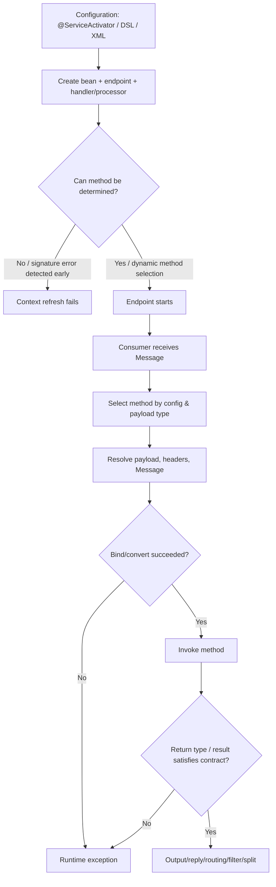

# Invalid Method Signatures and Initialization Errors

## 1. The Problem in Spring Integration Handler Adapters

In Spring Integration, many endpoints take a **POJO method** and turn it into a message-handling function: `@ServiceActivator`, `@Transformer`, `@Filter`, `@Router`, `@Splitter`, `@Aggregator`, or Java DSL configurations such as `.handle(bean, "methodName")`. Developers see only a Java method; the runtime must automatically decide **which method to call**, **which parameters come from payload/headers/message**, **what type conversions are needed**, and **how the return value is used**.

When a *method signature* violates conventions or is ambiguous, the application may fail to start; in other cases, startup succeeds yet **fails when the first message arrives**. This topic belongs to the **Handler adapter** chapter of the `SPRING_INTEGRATION_RUNTIME` module: understanding how Spring Integration runs and coordinates flows across channels, endpoints, consumers, pollers, and executors, while diagnosing errors, transactions, retries, correlation, and runtime state.

> **Scope:** This article focuses on *method-based message handling*—how adapters map messages onto user-written methods. This is not Spring MVC's `HandlerAdapter`; both frameworks have parameter-resolution mechanisms, yet their contracts differ. Examples and rules align with Spring Integration 6.5 documentation; exact exception names and detection timing may vary by version and configuration.

### After This Lesson, You Should Be Able To

- Identify which signatures are valid and which cases cause ambiguity around payloads, headers, or overloads.
- Distinguish bean/endpoint creation errors during context refresh from binding/invocation errors at message execution time.
- Write unambiguous signatures using `@Payload`, `@Header`, `@Headers`, and choose return types matching the EIP.
- Read stack traces to pinpoint the adapter, target method, offending message, and thread boundary.
- Fix signatures and verify flows without confusing signature errors with channel, transaction, or reply-routing issues.

## 2. How Adapters Map a Message to a Method



A helpful mental model:

1. **Configuration** selects the endpoint and target bean (via annotations, DSL, or XML), optionally specifying the method name.
2. **Handler/processor** components such as `MethodInvokingMessageProcessor` or related helpers perform mapping; Java DSL lambdas use different adapter mechanisms yet face the same input/output contract constraints.
3. **Consumer** connects the handler to a `SubscribableChannel` or `PollableChannel`. The consumer decides when a message arrives; the handler adapter decides what the Java call receives.
4. **Method invocation** resolves arguments and executes; the output is interpreted by the endpoint according to its EIP role: service activators build replies, filters decide pass/drop, routers choose channels, transformers return new payloads, and so on.

Looking at `@ServiceActivator(inputChannel = "orders.in")` alone is not enough to know whether the underlying method signature is valid. Conversely, the fact that a Java method compiles does not mean Spring Integration can infer its mapping.

### Two Points Where Errors Surface

| Phase | Common Errors | Symptoms |
|---|---|---|
| **Spring context initialization** | Specified method not found, invalid target bean, conflicting endpoint configuration, or signature already detected as ambiguous during setup | `ApplicationContext` fails to refresh; logs may wrap the cause in `BeanCreationException` or `BeanInitializationException`. |
| **During message processing** | Payload type mismatch, conversion failure, missing required header, overload unresolved for actual payload, contract-violating return value, or method throws | Endpoint may already be started; `MessagingException` or a related exception occurs during dispatch/invocation. |

**There is no rule that "every invalid signature fails at startup."** With dynamic method selection, the framework may only see the actual message payload at runtime; in that case, failures appear only after the flow runs. Lazy beans or dynamic endpoint registration also affect when errors appear.

## 3. Parameter Mapping Rules: What Is Valid?

Per *Message Mapping Rules and Conventions*, Spring Integration defines default rules; annotations make mappings explicit:

| Signature / Input | How the Adapter Interprets It |
|---|---|
| `String handle(String sku)` | Single parameter is the **payload**; a conversion service may apply if needed. |
| `String handle(Message<?> message)` | Parameter receives the **entire Message**: payload + headers. |
| `String handle()` | Message acts as a trigger signal with no data passed to the method. Valid for event-style service activators. |
| `String handle(String sku, @Header("tenant") String tenant)` | `sku` is the payload; `tenant` comes from the header named `tenant`. |
| `String handle(@Payload String sku, @Headers Map<String,Object> headers)` | Explicit mapping of payload and the full header map. |
| `String handle(String sku, Map<String,Object> headers)` | Special convention may bind the `Map` parameter to headers when another parameter is clearly the payload; prefer `@Headers` to avoid relying on inference. |
| `String handle(Map<String,Object> value)` | **Easy to misinterpret:** if the payload is a `Map`, the framework prefers the payload; otherwise it may map to headers. |

### Case 1 — Two Unannotated Parameters Causing Ambiguity

**Wrong:**

```java
import org.springframework.integration.annotation.ServiceActivator;

public class OrderHandler {
    @ServiceActivator(inputChannel = "orders.in")
    public String accept(String sku, int quantity) {
        return sku + ":" + quantity;
    }
}
```

Both `sku` and `quantity` could be interpreted as payload candidates; there is no basis to treat one parameter as a header. The Java compiler accepts it, yet Spring Integration's mapping is insufficiently unambiguous and can throw an exception when resolving the invocation.

**Right:**

```java
import org.springframework.integration.annotation.ServiceActivator;
import org.springframework.messaging.handler.annotation.Header;
import org.springframework.messaging.handler.annotation.Payload;
import org.springframework.stereotype.Component;

@Component
public class OrderHandler {
    @ServiceActivator(inputChannel = "orders.in", requiresReply = "true")
    public String accept(
            @Payload String sku,
            @Header("quantity") Integer quantity) {
        if (quantity <= 0) {
            throw new IllegalArgumentException("quantity must be positive");
        }
        return "accepted:" + sku + ":" + quantity;
    }
}
```

Here `sku` explicitly comes from the payload and `quantity` from a header. Since `@Header` defaults to `required=true`, if a message lacks the `quantity` header, the failure occurs during argument resolution **before** the `accept()` body executes. That is distinct from the `IllegalArgumentException` thrown by business logic when `quantity <= 0`.

**Do not mix annotations from the wrong framework.** Spring MVC annotations such as `@RequestParam` or `@PathVariable` do not map handler parameters in integration flows. For Spring Integration handler adapters, use `@Payload`, `@Header`, and `@Headers`.

### Case 2 — Two Unannotated `Map` Parameters

**Wrong / ambiguous:**

```java
public String accept(Map<String, Object> left,
                     Map<String, Object> right) {
    return "done";
}
```

Either `Map` could be interpreted as payload or headers; parameter order is not a mapping contract.

**Fix when the business payload itself is a `Map`:**

```java
public String accept(@Payload Map<String, Object> order,
                     @Headers Map<String, Object> headers) {
    Object region = headers.get("region");
    return order.get("sku") + "@" + region;
}
```

**Fix when only one header is needed:** Use `@Header("region") String region` for a tighter data contract than accepting an entire map.

### Case 3 — Overloaded Methods with Multiple Valid Candidates

Suppose configuration specifies the method name `handle` while the bean defines:

```java
public String handle(String sku) {
    return "one:" + sku;
}

public String handle(String sku, Map<String, Object> headers) {
    return "two:" + sku;
}
```

Both methods share the same name and both can accept a `String` payload, so overloading can produce an **ambiguous method** error. If overloads are distinguishable by payload type, the framework can sometimes select dynamically; however, never rely on declaration order, parameter names, or hope the JVM picks correctly.

**Preferred fix:** use a single target method per endpoint or give methods distinct names and specify the method explicitly:

```java
public String acceptSku(String sku) {
    return "accepted:" + sku;
}

public String auditSku(String sku, @Headers Map<String, Object> headers) {
    return "audited:" + sku;
}
```

```java
@Bean
IntegrationFlow orderFlow(OrderService orderService) {
    return IntegrationFlow.from("orders.in")
            .handle(orderService, "acceptSku")
            .get();
}
```

Here `OrderService` is a bean exposing `acceptSku`. Do not simultaneously register another `@ServiceActivator(inputChannel="orders.in")` handling the same requests unintentionally: multiple consumers on a point-to-point channel can send messages to a different endpoint than expected.

### Case 4 — Headers, Conversion, and Actual Runtime Payloads

Even an unambiguous signature can still **fail when receiving a message**:

```java
@ServiceActivator(inputChannel = "orders.in")
public String accept(@Payload OrderRequest request,
                     @Header("tenant") String tenant) {
    return tenant + ":" + request.sku();
}
```

Suppose `OrderRequest` is a Java record:

```java
public record OrderRequest(String sku, int quantity) {}
```

Cases to distinguish:

- Payload is `OrderRequest` and header `tenant` exists: binds normally.
- Payload is `String` with no matching converter from `String` to `OrderRequest`: conversion/argument resolution error occurs before the method executes.
- Header `tenant` is missing: `@Header` is required by default; binding fails.
- Header `tenant` has an incompatible type that cannot be converted to `String`/declared type: conversion can fail.
- The business method itself throws an exception: resolution succeeded; the error lies inside the method or its dependencies.

To make a header optional, use `@Header(value = "tenant", required = false) String tenant` and handle `null` explicitly, or use `Optional<String>` per your contract. Never turn a business-required field into optional merely to avoid exceptions.

## 4. Valid Signature Yet Invalid Adapter Contract

**Parameter mapping** and **return-value semantics** are two separate checks. A method can accept valid arguments while returning something invalid for the endpoint's role.

| EIP / Annotation | Notable Input / Output Contract | Easy-to-Make Mistake |
|---|---|---|
| `@ServiceActivator` | Can accept payload, `Message`, headers; `void` or `null` is valid for one-way processing; enable `requiresReply=true` when a reply is mandatory | `void process(...)` in a request–reply flow expecting a response; configuring `requiresReply` conflicting with `void` can fail initialization/selection depending on setup. |
| `@Transformer` | Must return a non-`null` value or `Message<?>`; transformers must produce an output message | `return null;` triggers `MessageTransformationException` at runtime. |
| `@Filter` | Selector method must return `boolean` or `Boolean` | `String accept(String sku)` violates the filter contract. |
| `@Router` | Must return a `MessageChannel` or `String` channel name, either single or collection | Returning an arbitrary business object or an unresolvable channel name. |
| `@InboundChannelAdapter` | Source method takes no parameters and has a non-`void` return type | `@InboundChannelAdapter String read(String id)`: an inbound source has no inbound message to bind `id`. |
| `@Aggregator` / `@Splitter` | Signature and return value must fit **grouping** or **splitting** semantics respectively | Reusing a generic POJO signature like a service activator without checking aggregator/splitter contracts. |

**Filter illustration:**

```java
// WRONG: returns String, whereas @Filter requires boolean/Boolean.
@Filter(inputChannel = "orders.filter", outputChannel = "orders.valid")
public String valid(String sku) {
    return sku;
}

// RIGHT: returns accept/reject decision.
@Filter(inputChannel = "orders.filter", outputChannel = "orders.valid")
public boolean valid(String sku) {
    return sku != null && !sku.isBlank();
}
```

These are **two mutually exclusive illustrative versions**—do not declare both filters in the same application configuration.

**Inbound source illustration:**

```java
// WRONG: source has no request message to extract id from.
@InboundChannelAdapter(value = "source.out", poller = @Poller(fixedDelay = "1000"))
public String next(String id) {
    return id;
}

// RIGHT: no parameters; value is polled from source state/service.
@InboundChannelAdapter(value = "source.out", poller = @Poller(fixedDelay = "1000"))
public String next() {
    return fetchNextItem();
}
```

`fetchNextItem()` is an application-defined source method. Source-type endpoints are driven by `SourcePollingChannelAdapter` and a poller, with no inbound payload like a service activator.

**Note on `@Transformer` vs. `@ServiceActivator`:** For a transformer, `null` is an error because it must transform a message into a valid output message. For a service activator, `null` can mean "no reply" when `requiresReply=false`. When the caller is a gateway awaiting a response, both the return type and `requiresReply` must accurately reflect the business contract.

## 5. Initialization Errors: Finding the Real Cause in Stack Traces

A startup error may show an outer wrapper such as:

```text
ApplicationContext failed to start
  BeanCreationException: Error creating bean 'orderHandler...'
    ... nested exception / cause ...
      IllegalArgumentException: method mapping is ambiguous
```

This is a **conceptual representation** of a cause chain, not a verbatim Spring Integration exception message. Exact bean names and inner exception types depend on implementation and version.

### Investigation Procedure When Context Fails to Start

1. Find the deepest **root cause** under `Caused by`—do not stop at `BeanCreationException`.
2. Identify which bean and endpoint are involved. For annotated EIP methods, the framework commonly generates endpoint bean names such as `componentName.methodName.serviceActivator` with a `.handler` suffix on the handler; these can be customized with `@EndpointId`.
3. Open the exact target bean method: check method name, access modifier, overloads, annotations, return type, parameter annotations, and proxied interfaces.
4. Compare against the EIP contract. For ambiguous multi-parameter signatures, add explicit mappings; for multiple overloads matching the same payload, select a distinct method.
5. If the bean depends on other beans, verify the exact error caused by those dependencies. Do not blame every `BeanCreationException` on "bad signature."
6. After fixing, **restart/recreate the context** to verify endpoint creation; only then send sample messages to test runtime behavior.

Non-signature errors can also appear during startup: missing bean names, circular dependencies, invalid channel wiring, two endpoints attempting to share one mutable handler, or invalid SpEL expressions. Always inspect the root cause rather than tweaking signatures blindly.

### Why Can Errors "Only Fail on Deployment"?

- Developers only unit-tested isolated bean config without scanning the package holding `@MessageEndpoint` / `@Component`.
- Beans are lazy and initialize only when dynamic flows are registered.
- A different library or proxy setup changes how methods are introspected (e.g., interface method vs. concrete implementation).
- Production runtime actually delivers payloads that trigger overload ambiguity or conversion failures.
- Headers present in tests are missing from upstream production producers.

Separate checks for **context initialization**, **endpoint startup**, and **message-driven handler invocation** using corresponding log and metric evidence.

## 6. Post-Startup Failures: Not Every Error Is Initialization

When the first message reaches a method, Spring Integration can throw at one of three points:

1. **Method selection:** no overload matches the payload, or multiple overloads match equally.
2. **Argument resolution / binding:** required `@Header` missing, payload conversion failed, or `Message<?>` structure violates the contract.
3. **Execution / post-processing:** method throws an exception; `@Transformer` returns `null`; `@Router` returns an unresolvable channel; reply routing fails.

Common symptoms in stack traces (not every failure contains all of these):

| Clue | Preliminary Meaning | Next Check |
|---|---|---|
| `MethodArgumentResolutionException` or argument resolution error | Unable to bind a parameter of the target method | `@Payload`, `@Header`, `@Headers`, required headers, and payload type. |
| `ConversionFailedException` / `MessageConversionException` | Unable to convert source value to parameter type | Actual payload, content type, `integrationConversionService`, and registered converters. |
| `IllegalArgumentException` / ambiguous mapping error | Invalid method mapping or non-unique selection | Overloads, annotations, and configured method names. |
| `MessageHandlingException` | Error during message handling; usually wraps a cause | Inspect `failedMessage` and cause instead of fixing based on the outer wrapper name. |
| `ReplyRequiredException` | Handler required to return a reply yet returned `null` | Return branches, `requiresReply`, and gateway contract. |
| `MessageTransformationException` | Transformer failed to produce a valid result or threw | Ensure the transformer returns a non-`null` value. |
| Gateway timeout | No reply arrived in time | May be caused by missing reply, broken route, slow poller, or saturated executor; timeout alone does not prove a bad signature. |

### Threads, Transactions, Pollers, and Error Channels Surface Errors Differently

- **`DirectChannel`:** normally dispatches synchronously on the sender thread; handler exceptions can propagate back to the caller.
- **`ExecutorChannel`:** dispatches via an executor; the caller may already have returned from `send` before the handler fails. Error handling and thread-local transactions must be examined on the execution thread.
- **`QueueChannel` + `PollingConsumer`:** errors surface only when the poller pulls a message. If the poller is not started or backlog is high, seeing no handler logs does not mean the signature is valid.
- **`errorChannel`:** can handle exceptions turned into `ErrorMessage` at the error-catching boundary, typically in compatible async/poller flows. It does not fix bean initialization errors and does not automatically receive every exception on every thread.
- **Retry advice:** helpful for transient failures such as I/O blips, yet retrying an ambiguous signature or missing required header multiple times **will not make the error go away**. Fix the mapping or message contract first.

If business logic has side effects (DB writes, event publishing), each retry can repeat those side effects; consider idempotency keys and transaction boundaries. Do not enable unbounded retries just to "mask errors" when the root cause is static configuration.

## 7. Hands-On Lab: Reproducing and Fixing Errors in a Request–Reply Flow

### Step A — Write an Ambiguous Method

```java
import org.springframework.integration.annotation.ServiceActivator;
import org.springframework.stereotype.Component;

@Component
class ShippingService {
    @ServiceActivator(inputChannel = "shipping.requests")
    public String ship(String orderId, int priority) {
        return orderId + "-priority-" + priority;
    }
}
```

**Prediction:** Both parameters are unannotated; the mapper cannot tell whether `orderId` or `priority` is the payload. Whether the error surfaces at initialization or invocation time should be verified against your exact Spring Integration version.

### Step B — Fix the Signature and Clarify the Contract

Replace the method in Step A with:

```java
import org.springframework.integration.annotation.ServiceActivator;
import org.springframework.messaging.handler.annotation.Header;
import org.springframework.messaging.handler.annotation.Payload;
import org.springframework.stereotype.Component;

@Component
class ShippingService {
    @ServiceActivator(inputChannel = "shipping.requests", requiresReply = "true")
    public String ship(@Payload String orderId,
                       @Header("priority") int priority) {
        return orderId + "-priority-" + priority;
    }
}
```

**Illustrative input:**

```text
Channel: shipping.requests
Payload (String): "ORD-123"
Headers: priority=2
Expected reply payload: "ORD-123-priority-2"
```

For a request–reply flow, the sender or gateway must supply an appropriate `replyChannel`. Example using `MessagingTemplate` to send a message after the context starts and the service activator is registered:

```java
import org.springframework.context.ApplicationContext;
import org.springframework.messaging.Message;
import org.springframework.messaging.MessageChannel;
import org.springframework.messaging.core.MessagingTemplate;
import org.springframework.messaging.support.MessageBuilder;

// context: running ApplicationContext containing the ShippingService endpoint.
MessageChannel requestChannel =
        context.getBean("shipping.requests", MessageChannel.class);

Message<String> request = MessageBuilder.withPayload("ORD-123")
        .setHeader("priority", 2)
        .build();

MessagingTemplate template = new MessagingTemplate();
Message<?> reply = template.sendAndReceive(requestChannel, request);

System.out.println(reply == null ? "<no reply>" : reply.getPayload());
// ORD-123-priority-2 if endpoint and reply routing are configured properly.
```

`MessagingTemplate.sendAndReceive(...)` supports request–reply via a temporary reply channel, so calling code does not have to configure `replyChannel` manually. In a Spring Boot application, ensure `ShippingService` is scanned and Spring Integration annotation processing is enabled (e.g., via `@EnableIntegration` or auto-configuration). The snippet can live inside a runner or test where `context` is available.

### Step C — Three Experiments to Distinguish Failure Types

**Experiment 1 — Missing header:** omit `.setHeader("priority", 2)`. With required `@Header("priority")`, the handler never receives the required argument; inspect the root cause exception and verify the method body never executed.

**Experiment 2 — Wrong header type:** set `priority="urgent"` while the method expects `int`. Without a matching converter, failure happens during conversion; enforce the producer contract instead of adding permissive coercions everywhere.

**Experiment 3 — Method returns `null`:** change the return value to `null` while keeping `requiresReply="true"`. Argument resolution succeeds completely, yet the service activator throws `ReplyRequiredException`. This is a **reply contract error**, not a parameter error.

### Step D — Test Execution Boundaries

Replace the synchronous input channel with an executor-backed channel or queue + poller **in a separate practice setup**. Keep the missing-header error and observe: which thread produces the stack trace, whether the caller receives the exception directly, and whether an `ErrorMessage` appears on the configured error flow. Changing threads alters how errors are observed, but never makes an invalid signature valid.

## 8. Investigation Checklist for "Invalid Method Signature"

Follow a fixed checklist to avoid fixing the wrong root cause:

1. **When did the error occur?** Context refresh, `IntegrationFlow` startup, first message sent, or after a poller ran?
2. **Which bean/endpoint?** Extract the bean name from the stack trace, look up `@EndpointId` or generated annotation names, and verify the target class behind any proxy.
3. **Which method was selected?** Was the method named explicitly in `.handle(bean, "name")` / XML, or discovered via annotations? Are there same-name overloads or multiple methods accepting the same payload?
4. **Is the signature sufficiently annotated?** Only one payload source; put `@Payload` on the payload, `@Header` on specific headers, and `@Headers` on the map; never rely on parameter-name inference.
5. **What are the real payload and headers?** Log Java runtime types, not only `toString()`; check required headers, `contentType`, and the conversion service.
6. **Does the EIP contract hold?** `@Filter` returns boolean, `@Transformer` never returns `null`, inbound sources take no parameters, `@Router` returns valid destinations.
7. **What is the root cause?** Inspect `Caused by`, `failedMessage`, method signature, and channel; do not guess from outer wrapper exceptions.
8. **Threads, error paths, and transactions?** Confirm whether the channel is direct/executor/queue, the endpoint is started, pollers are running, and errors route to an error flow if expected.
9. **Fix and verify?** Test startup + a valid message + a missing-header message + a wrong-type message; verify errors fail at the right boundary and replies return as expected.

### Things to Avoid

- Changing every parameter to `Object` to silence resolution errors: this destroys contract checking and pushes failures into business logic.
- Removing `@Header(required=true)` when a header is genuinely required: makes data-contract violations harder to catch.
- Adding another overload taking the same payload type: usually worsens ambiguity.
- Simply raising gateway timeouts when the method is never actually invoked or never emits a reply.
- Enabling retries for static configuration errors: wastes resources, risks duplicate side effects, and never fixes the root cause.

## 9. Self-Assessment Questions

**Question 1.** `public String process(String id, int size)` expects a `String` request payload and a `size` header. Why is this signature ambiguous?  
**Answer:** Neither parameter is annotated, so the framework cannot uniquely determine which parameter represents the payload. Fix it to `process(@Payload String id, @Header("size") int size)`.

**Question 2.** A `@Filter` method returns the string `"true"`. Does the Java code compile, and where does it fail?  
**Answer:** Java compiles, yet the filter method violates the boolean/`Boolean` contract. Change the return type and expression to `boolean`. Exactly when the framework reports the error depends on initialization/invocation behavior.

**Question 3.** The context starts cleanly, yet a message with a `Map` payload is sent to `handle(Map value)`. Is the adapter guaranteed to bind headers?  
**Answer:** No. Mapping rules prefer the payload when the payload is a `Map`; use `@Headers Map<...>` to bind headers unambiguously.

**Question 4.** `@ServiceActivator` returns `null` with `requiresReply=true` after completing processing. Is that a binding error?  
**Answer:** No. That is a reply-required error (`ReplyRequiredException`); input binding and method invocation already succeeded.

**Question 5.** A handler downstream of an `ExecutorChannel` throws an exception due to a missing `@Header`. Why does the caller not necessarily see the exception directly?  
**Answer:** The handler executes on a separate executor thread. Inspect error handling across the dispatch boundary and configured error channel, while also fixing the header contract.

## 10. References

- [Spring Integration 6.5 — Message Mapping Rules and Conventions](https://docs.spring.io/spring-integration/reference/6.5/configuration/message-mapping-rules.html): mapping rules, `Map`, overloads, and ambiguity.
- [Spring Integration 6.5 — Annotation Support](https://docs.spring.io/spring-integration/reference/6.5/configuration/annotations.html): `@Payload`, `@Header`, `@Headers`, beans/endpoints, and lifecycle.
- [Spring Integration 6.5 — Service Activator](https://docs.spring.io/spring-integration/reference/6.5/service-activator.html): method selection, `requiresReply`, and output handling.
- [Spring Integration 6.5 — Filter](https://docs.spring.io/spring-integration/reference/6.5/filter.html): boolean contract.
- [Spring Integration 6.5 — Transformer](https://docs.spring.io/spring-integration/reference/6.5/transformer.html): non-`null` contract.
- [Spring Integration 6.5 — Router with Annotations](https://docs.spring.io/spring-integration/reference/6.5/router/annotation.html): return types permitted for routing.
- [Spring Integration 6.5 API — MethodInvokingMessageProcessor](https://docs.spring.io/spring-integration/docs/6.5.x/api/org/springframework/integration/handler/MethodInvokingMessageProcessor.html): method invocation mechanics inside `MessageProcessor`.
