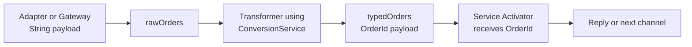
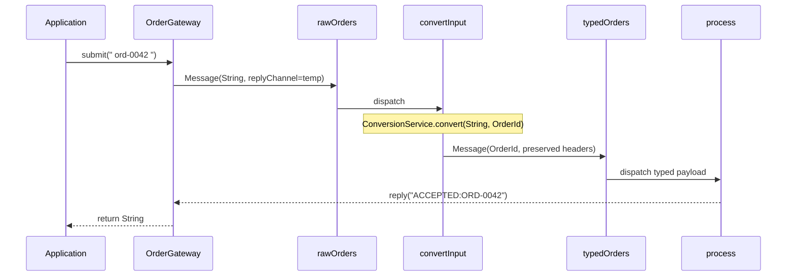
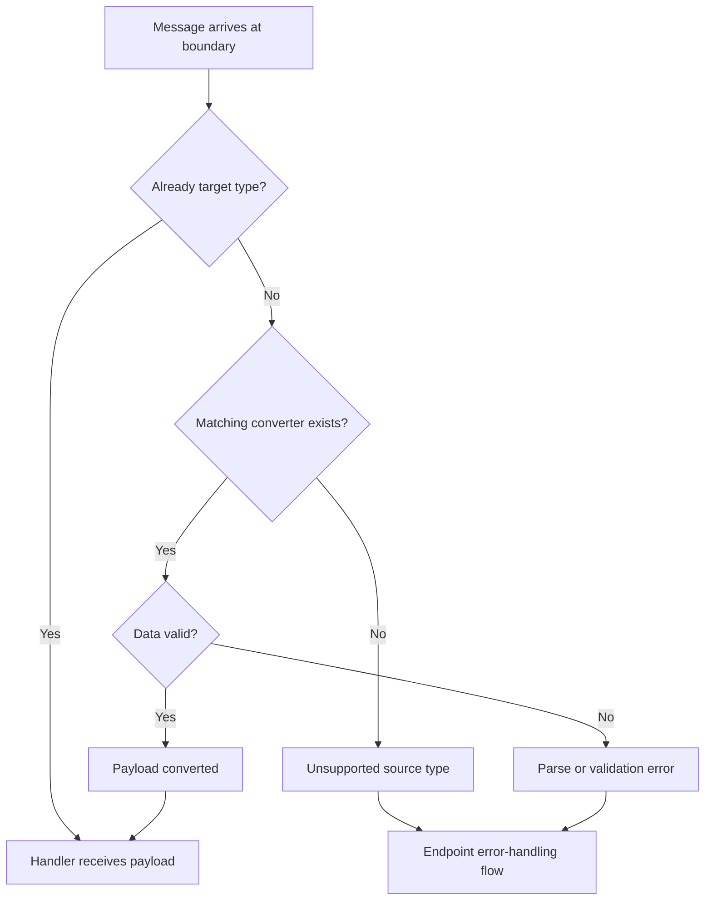

# ConversionService at the Message Boundary in Spring Integration

## 1. Objectives and Real-World Scenario

In `SPRING_INTEGRATION_RUNTIME`, a message travels through a **channel**, is processed by an **endpoint/consumer**, may switch threads via an **executor**, or wait for a **poller** to fetch it from a queue. Across those components, the `payload` often does not have the same Java type: an adapter receives a string from HTTP or a file, a business step expects an `OrderId` or `OrderCommand`, and an external system needs JSON or a byte array. A **message boundary** is the boundary where one component sends a `Message<?>` to the next component, and where the **accepted data type** must be clearly defined.

This lesson explains the role of Spring `ConversionService` at such boundaries, how it works alongside transformers, converters, and handler contracts, and connects them to **reply, error, transaction, retry, and threading** concerns in the Spring Integration runtime.

After completing this lesson, you will be able to:

- Distinguish between `ConversionService`, `Converter`, `GenericConverter`, `MessageConverter`, transformers, and codecs/serialization.
- Identify the right place for type conversion so handlers receive payloads according to their published contract.
- Write a custom converter and use `ConversionService` inside `@Transformer` to create an explicit boundary.
- Distinguish between successful conversion, unsupported types, and malformed data; handle errors without letting the flow silently drop messages.
- Explain the impact of conversion on headers, channels, gateways, executors, pollers, transactions, and retries.

**Running scenario:** a gateway receives `" ord-0042 "` as a `String`; the business step only accepts `OrderId("ORD-0042")`. We convert at the `rawOrders → typedOrders` boundary so the business step does not need to trim, validate the format, and re-parse in every place.

## 2. What Does `ConversionService` Solve?

`org.springframework.core.convert.ConversionService` is an API for converting **a Java value from a source type to a target type**. Two common operations are:

```java
boolean supported = conversionService.canConvert(String.class, OrderId.class);
OrderId id = conversionService.convert(" ord-0042 ", OrderId.class);
```

`ConversionService` looks up a registered conversion rule, runs the matching rule, and returns the target object. Those rules are typically implemented as `Converter<S, T>`; more complex cases can use `ConverterFactory` or `GenericConverter`. `DefaultConversionService` is a built-in implementation containing many common Spring Framework converters; you can register domain converters with `addConverter(...)`.

### Comparing Layers of Responsibility

| Mechanism | Primary Input and Output | When to Choose? |
|---|---|---|
| `ConversionService` + `Converter<S,T>` | **Java values** `S → T` | Normalizing internal types: `String → OrderId`, `String → Enum`, numeric types, date/time types... |
| `MessageConverter` | **Message/payload** and message context | A component needs to convert with awareness of `Message<?>`, headers, or protocol content types. |
| Spring Integration `Transformer` | **Message at a flow step → output message** | You want a conversion step with its own input/output channels, logging, metrics, retry, and isolated testing. |
| Serialization / codec (JSON, XML, Avro...) | **External representation** (bytes/text) ↔ objects | Reading/writing protocols, schemas, charsets, content types; requires an appropriate serializer/deserializer. |
| Handler method argument conversion | Payload → method parameter | Can be performed by the framework if the endpoint's resolver/message converter supports it and is configured. |

**Key point:** `ConversionService` itself **does not send messages** and does not decide `replyChannel` or `errorChannel`. It takes a **value** to convert. Extracting the payload from a message, preserving headers, choosing the next channel, and emitting errors belong to the endpoint/adapter/transformer using it.

For example, just because a message has a `contentType: application/json` header **does not mean** Spring automatically uses `ConversionService` to parse arbitrary JSON into a DTO. To do that, you need a properly configured JSON `MessageConverter`, transformer, or decoder; `ConversionService` can only do it if you explicitly register a corresponding rule.

## 3. Where Does `ConversionService` Sit in the Message Flow?



A typical message consists of a **payload and headers**. In the diagram above, `ConversionService` participates only in the `String → OrderId` step; `@Transformer` is the endpoint that receives the message from `rawOrders`, invokes the converter, creates the resulting message, and sends it to `typedOrders`. Routing headers such as `replyChannel`, `errorChannel`, and tracing information must be preserved according to the transformer's contract so the final step returns the result to the right destination.

**Not every channel automatically invokes a converter.** By default, `DirectChannel` mainly dispatches messages to subscribers; `ExecutorChannel` hands off processing to an executor; `QueueChannel` holds messages for a polling consumer to retrieve. When you want to guarantee type conversion, you have three clear strategies:

1. **Explicit boundary via transformer**: best suited when you need control over validation, errors, and observability at a domain boundary.
2. **Conversion during handler parameter binding**: convenient for endpoints that support input type conversion, but depends on message converter/argument resolver configuration; do not rely on it implicitly when the contract is critical.
3. **Type checking on the channel**: some Spring Integration channels support a `datatype` constraint and can use a conversion service to convert to an accepted type if a suitable converter exists. This is a channel-level safeguard; its scope and failure behavior should be verified for the specific channel and configuration.

Spring Integration has a shared infrastructure conversion service concept, typically identified by the bean name **`integrationConversionService`**. Registering a converter with that service enables components **designed to use it** to perform conversion; it does not make every adapter/channel/handler in the application automatically invoke the converter. In the example below, we use a dedicated service and invoke it explicitly so boundary behavior is easy to verify and avoids unintended side effects on application-wide conversion.

## 4. Complete Example: `String → OrderId` at the Boundary

The example uses **Spring Integration 6.x and Java 17+**, `spring-integration-core`, along with Spring Context. Split each snippet below into a Java file in the `example.integration` package. The gateway returns the final result; the intermediate transformer and handler use `DirectChannel`, so by default the processing flow is synchronous.

### Step 1 — Declare the Domain Type

**`OrderId.java`**

```java
package example.integration;

public record OrderId(String value) { }
```

`OrderId` prevents the business layer from having to accept arbitrary strings. Format validation can be checked directly in the converter or in the value object constructor if you want to enforce invariants across every creation path.

### Step 2 — Configure Channels and Conversion Service

**`OrderFlowConfiguration.java`**

```java
package example.integration;

import java.util.Locale;
import org.springframework.context.annotation.Bean;
import org.springframework.context.annotation.ComponentScan;
import org.springframework.context.annotation.Configuration;
import org.springframework.core.convert.ConversionService;
import org.springframework.core.convert.support.DefaultConversionService;
import org.springframework.integration.annotation.IntegrationComponentScan;
import org.springframework.integration.channel.DirectChannel;
import org.springframework.integration.config.EnableIntegration;
import org.springframework.messaging.MessageChannel;

@Configuration
@EnableIntegration
@ComponentScan(basePackageClasses = OrderBoundary.class)
@IntegrationComponentScan(basePackageClasses = OrderGateway.class)
public class OrderFlowConfiguration {

    @Bean
    public MessageChannel rawOrders() {
        return new DirectChannel();
    }

    @Bean
    public MessageChannel typedOrders() {
        return new DirectChannel();
    }

    @Bean("orderBoundaryConversionService")
    public ConversionService orderBoundaryConversionService() {
        DefaultConversionService service = new DefaultConversionService();

        service.addConverter(String.class, OrderId.class, source -> {
            String normalized = source.trim().toUpperCase(Locale.ROOT);
            if (!normalized.matches("ORD-[0-9]{4}")) {
                throw new IllegalArgumentException(
                    "Order ID must match ORD- followed by 4 digits"
                );
            }
            return new OrderId(normalized);
        });

        return service;
    }
}
```

`DefaultConversionService` already includes many basic conversions; the new converter defines how to convert `String` to `OrderId`. Normalizing with `Locale.ROOT` ensures the result does not depend on the server's locale. The regex is used as a contract example; a production system may require stricter rules.

### Step 3 — Place the Transformer at the Boundary

**`OrderBoundary.java`**

```java
package example.integration;

import java.util.Objects;
import org.springframework.beans.factory.annotation.Qualifier;
import org.springframework.core.convert.ConversionService;
import org.springframework.integration.annotation.MessageEndpoint;
import org.springframework.integration.annotation.ServiceActivator;
import org.springframework.integration.annotation.Transformer;

@MessageEndpoint
public class OrderBoundary {

    private final ConversionService conversionService;

    public OrderBoundary(
            @Qualifier("orderBoundaryConversionService")
            ConversionService conversionService) {
        this.conversionService = conversionService;
    }

    @Transformer(inputChannel = "rawOrders", outputChannel = "typedOrders")
    public OrderId convertInput(String raw) {
        OrderId id = conversionService.convert(raw, OrderId.class);
        return Objects.requireNonNull(id, "Converter returned null OrderId");
    }

    @ServiceActivator(inputChannel = "typedOrders", requiresReply = "true")
    public String process(OrderId id) {
        return "ACCEPTED:" + id.value();
    }
}
```

Here `@Transformer` receives a `String` payload, calls `ConversionService`, and sends an `OrderId` payload to `typedOrders`. `@ServiceActivator` only accepts `OrderId` and executes business logic. `requiresReply = "true"` requires the final handler to produce a result; if it returns `null`, Spring Integration reports an error instead of letting the gateway wait silently.

### Step 4 — Invoke via a Messaging Gateway

**`OrderGateway.java`**

```java
package example.integration;

import org.springframework.integration.annotation.Gateway;
import org.springframework.integration.annotation.MessagingGateway;

@MessagingGateway
public interface OrderGateway {

    @Gateway(requestChannel = "rawOrders", replyTimeout = 5000)
    String submit(String rawOrderId);
}
```

Invoke in a Spring application:

```java
String reply = orderGateway.submit(" ord-0042 ");
// "ACCEPTED:ORD-0042"
```

**Why does the reply still return to the gateway?** The gateway attaches a return address to the request. The transformer forwards the result to `typedOrders`, while the endpoint's reply-building mechanism preserves the appropriate request headers. The final handler has no `outputChannel` configured, so the result can return to the request's `replyChannel`. If a step constructs a new message manually, serializes across an external system, or filters headers, verify whether `replyChannel` remains valid beyond that boundary.



## 5. What `ConversionService` Does Not Solve on Its Own

### Type Conversion Is Not Domain Validation

`canConvert(String.class, OrderId.class)` returns `true` when the service finds a converter capable of handling the **type pair**. It **does not check whether the value** `"ORD-ABC"` is valid. That value can still trigger a `ConversionFailedException` when the converter executes because the data is malformed. If a converter returns `null` when it cannot parse, distinguish that convention clearly from throwing an exception; for a boundary requiring an `OrderId`, fail-fast is usually easier to diagnose.

```java
boolean knownType = conversionService.canConvert(String.class, OrderId.class);
// true, because the String -> OrderId converter is registered.

OrderId valid = conversionService.convert("ord-0042", OrderId.class);
// OrderId("ORD-0042")

OrderId invalid = conversionService.convert("unparseable", OrderId.class);
// The converter throws an error; ConversionService may wrap it in ConversionFailedException.
```

### Payload Conversion Is Not Full Message Conversion

`Message<OrderId>` also has `headers`. `ConversionService` takes a `String` and returns an `OrderId`; it has no responsibility for copying headers; the surrounding **transformer** is responsible for creating the outbound message. Headers like `replyChannel`, `errorChannel`, `correlationId`, and trace context only survive if the pipeline preserves or maps them intentionally.

Do not store a temporary `MessageChannel` Java object to pass through a broker like a regular data field. For cross-process boundaries, you need an appropriate adapter, an addressable reply destination, request–reply correlation, and dedicated expiration/recovery policies. Converting a `String` into a DTO **does not** solve message correlation.

### Type Conversion Is Not Serialization

Consider these three payloads:

| Actual Payload | Java Type | What Is Needed to Get `OrderId`? |
|---|---|---|
| `"ord-0042"` | `String` | `Converter<String, OrderId>` as in the example. |
| `{"id":"ORD-0042"}` | `String` containing JSON | An appropriate JSON parser/converter, object mapping, then (if needed) domain conversion. |
| Byte array of JSON | `byte[]` | Decode bytes and charset/content type, deserialize, then validate the object. |

Spring Integration uses many adapters and components with their own `MessageConverter`. For example, components reading HTTP/JMS/AMQP data may have to handle the `contentType` header, encoding, type mapping, or sender-specific formats. Do not lump everything into a single `Converter<String, Object>` that catches every input type; separate **protocol decoding**, **domain type conversion**, and **validation** into testable responsibilities.

### Generic Types Can Lose Element Type Information

Converting to `List.class` only describes the raw `List` type; the `List<OrderId>` element type is no longer represented in `Class<List>`. For generic element-by-element conversion, Spring provides `TypeDescriptor` to describe both the container and element type. At critical boundaries, define a strongly typed DTO or pass full generic type information to avoid lists containing wrong element types that are only discovered late.

## 6. Integrating Conversion with Channels and Handlers

**Channel boundary.** A channel can declare a set of accepted payload types (`datatype`) in supported Spring Integration configurations. If a payload is not of the expected type and a valid converter exists, the runtime can convert it; if it cannot be converted, sending the message may be rejected. Keep in mind that this is **channel-level type checking/conversion**, distinct from an explicit transformer, and is not a default property of every channel.

**Handler boundary.** POJO method-based endpoints have an argument resolver and message converter system. A method declaring `process(OrderId)` states the contract clearly, but how the framework converts a `String` into an `OrderId` to invoke the method depends on the configured mechanisms. If the application can receive multiple input formats or needs consistent parse error handling, placing a transformer step before the handler reduces implicit behavior.

**Adapter boundary.** An adapter is where external data formats meet the message model. With HTTP, JMS, AMQP, Kafka, or file adapters, decide whether to parse bytes/JSON in the adapter or in a transformer immediately after the adapter. Distinguish between a conversion error before a message enters a channel and an error inside a transformer already admitted into the flow: where the error occurs determines the error channel, logging, and retry scope.

**Gateway boundary.** A messaging gateway maps a Java call to a request message and reply message. Calling `String submit(String)` in the example initially sends a `String` payload; the gateway does not automatically infer that you want `OrderId` unless you configure conversion in the appropriate place. With request–reply gateways, conversion must not lose the return address between steps.

## 7. Handling Conversion Errors at Runtime

Errors can arise in three distinct categories:

| Scenario | Example | Handling Approach |
|---|---|---|
| No matching rule | `byte[] → OrderId` with no registered converter | Add decoding/`MessageConverter` or register an appropriate converter; verify the source/target pair. |
| Converter exists, but data is invalid | `"ORDER-XYZ"` does not match `ORD-[0-9]{4}` | Return a structured validation error and record the invalid input; retrying the same payload is usually unhelpful. |
| Conversion succeeds, but reply/header routing fails | Handler finishes, yet gateway times out | Check `outputChannel`, `replyChannel`, threads, poller, and timeouts; this is not necessarily a converter bug. |

With the Spring Framework API, a missing converter error may surface as `ConverterNotFoundException`; an error during conversion execution is typically `ConversionFailedException` (with a root cause). When running inside a Spring Integration endpoint, the exception may also be **wrapped in `MessagingException` or a handler exception**. Therefore, inspect both the **root cause** and the endpoint emitting the error rather than filtering by a single exception class name.

### How Do Synchronous and Asynchronous Flows Differ?

- **Synchronous `DirectChannel`:** the transformer runs on the dispatch call stack; conversion errors can propagate back to the caller/gateway. If wrapped in an outer transaction and the exception propagates to the transactional boundary, the transaction can roll back according to configured rules.
- **`ExecutorChannel` or polling consumer:** conversion runs on another thread or during a poll cycle. The caller may have already returned; errors must be observed through the **endpoint's error handling** and an appropriate `errorChannel`. Do not assume every async error is thrown directly back to the gateway's calling thread.
- **Retry:** place advice/retry on the specific segment that can fail. Permanent data errors such as malformed IDs should be classified as **non-retryable** or routed to a business error branch; infinite retries only clog the queue. Transient errors such as temporary configuration-source failures may warrant retry, depending on the actual contract.

For flows consuming messages from a queue/broker, acknowledgment, rollback, or redelivery behavior depends on the transaction semantics of the listener/poller and adapter. `ConversionService` does not roll back or requeue messages on its own. If a retry re-executes steps that already had side effects, idempotency is required to avoid processing an order twice.

## 8. Threading, Performance, and Observing Conversion

In the `rawOrders → transformer → typedOrders` flow using `DirectChannel`, each message is converted **on the dispatching thread**. A converter that takes 100 ms to parse data adds directly to the synchronous gateway's latency. If replaced with `ExecutorChannel` or `QueueChannel` plus a poller, conversion may run on a different thread; processing capacity and queue backlog then affect latency, timeouts, message ordering, and memory pressure.



To diagnose slow conversion or sporadic errors, observe:

1. **Before/after types:** payload class at the transformer's input and output, along with the expected target type.
2. **Conversion duration:** transformer latency separately from queue/poller wait time, handler time, and gateway reply wait time.
3. **Error rate by cause:** missing converter, schema/format mismatch, invalid business data, external service failure.
4. **Runtime path:** channel names, relevant business ID/correlation ID, thread/executor, timestamp of failure, and the `errorChannel` receiving the error (if any).

Do not log full sensitive payloads, tokens, or message headers containing credentials. Instead, log **types**, **schema/version**, parse error codes, safe correlation IDs, and a masked representation of the data. Converters are typically reused many times; prefer singleton beans and avoid instantiating heavy parsers/validators per message, while sharing stateful converters only if their implementation is thread-safe.

## 9. Practice and Verification

Test directly with the example above or write an integration test using `AnnotationConfigApplicationContext`:

```java
import org.springframework.context.annotation.AnnotationConfigApplicationContext;

try (var context = new AnnotationConfigApplicationContext(
        OrderFlowConfiguration.class)) {
    OrderGateway gateway = context.getBean(OrderGateway.class);
    String result = gateway.submit(" ord-0042 ");
    assert "ACCEPTED:ORD-0042".equals(result);
}
```

Note that Java's `assert` statement is only executed when the JVM has assertions enabled (`-ea`); in real tests, use JUnit `assertEquals(...)` so checks do not depend on JVM flags.

Scenarios to test:

| Input or Change | Expected Result | What to Observe |
|---|---|---|
| `" ord-0042 "` | `OrderId("ORD-0042")`, reply `ACCEPTED:ORD-0042` | Conversion runs once at the transformer; handler receives a strong type. |
| `"ORD-X"` | Conversion/validation error | Root cause states invalid format; business handler is not invoked. |
| Remove `String → OrderId` converter | No matching rule | Error path and ability to detect missing configuration. |
| Replace `typedOrders` with an executor-backed channel | Handler runs on another thread | Inspect gateway wait time, thread names, and `replyChannel` header. |
| Transformer returns a new message that drops the return address | Gateway may fail to receive the reply | Compare headers before/after the boundary; do not misattribute this to conversion. |

**Analysis exercise:** an adapter receives JSON `byte[]`, the handler expects `OrderId`, the queue has a backlog, and the gateway times out. Identify three distinct measurements: (1) time to deserialize bytes/JSON, (2) time for `String/DTO → OrderId`, and (3) queue/poller wait time. Explain why merely increasing `replyTimeout` cannot fix schema mismatches or a missing converter.

## 10. Design Principles for a Solid Conversion Boundary

- **Lock down the type contract at the boundary.** Clearly define `source type`, `target type`, `null`-handling rules, and validation standards; avoid forcing business handlers to guess payload types.
- **Use the right tool for each responsibility.** `ConversionService` for type conversion, `MessageConverter`/codecs for external formats, and a transformer for a conversion step in the flow.
- **Preserve required metadata.** Verify `replyChannel`, `errorChannel`, and correlation as messages traverse multiple steps or cross process boundaries.
- **Classify errors by recoverability.** Missing converter configuration, invalid data, and infrastructure failures require different handling; never apply unconditional retries.
- **Measure at each boundary.** Spring Integration runtime latency is the sum of conversion time, handler execution, channel dispatch, executor queues, and pollers; looking at the converter method alone is rarely enough.

### Official Documentation for Further Reading

- [Spring Framework — Spring Type Conversion](https://docs.spring.io/spring-framework/reference/core/validation/convert.html): `ConversionService`, `Converter`, `ConverterFactory`, `GenericConverter`, `TypeDescriptor`.
- [Spring Framework — Spring Messaging](https://docs.spring.io/spring-framework/reference/integration.html): messages, headers, and core messaging mechanisms.
- [Spring Integration Reference](https://docs.spring.io/spring-integration/reference/): message flows, transformers, message channels, endpoints, and error-handling mechanisms.
