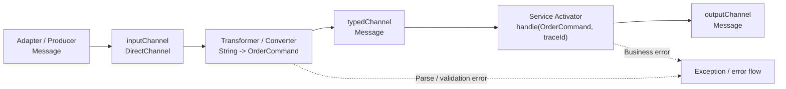
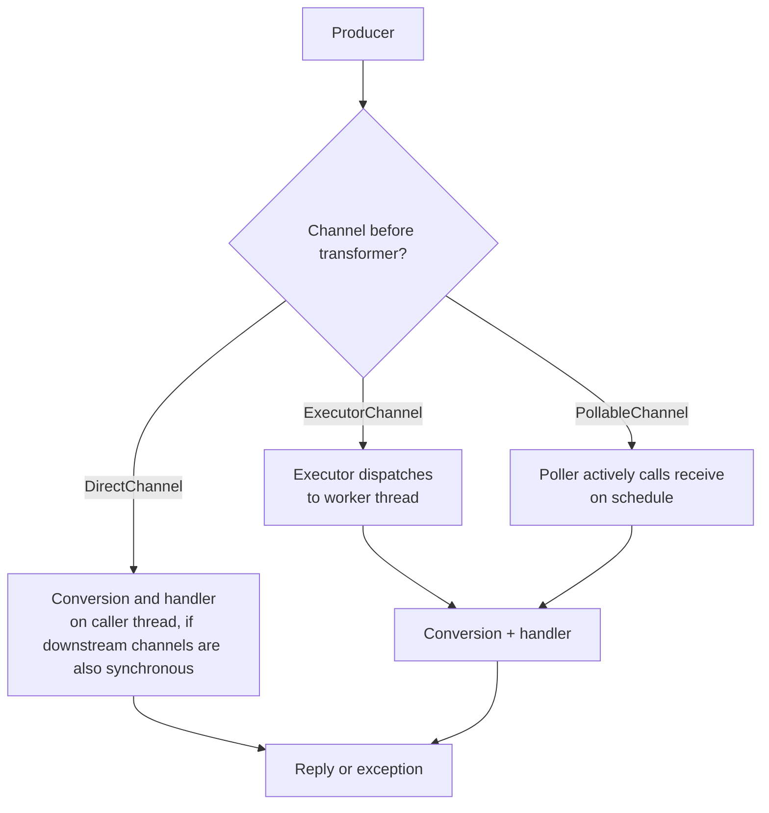

# Payload Type Converter and Handler Input

## 1. The Runtime Problem to Solve

A message in Spring Integration consists of a **payload** (the data to be processed) and **headers** (accompanying metadata). A channel delivers the message to a consumer endpoint; the endpoint then invokes a handler, typically a transformer, filter, service activator, or business method on a bean. The challenge arises when **the payload type received by the handler does not match the parameter type expected by the handler**.

For example, an HTTP adapter receives JSON as a `String`, but the order-processing method expects an `OrderCommand`. Or an adapter has decoded the message into `byte[]`, while the handler needs a `String`. There is no universal rule guaranteeing that every payload is automatically converted into an arbitrary Java type.

Within **SPRING_INTEGRATION_RUNTIME**, three responsibilities should be clearly distinguished:

1. **Payload type conversion** from the incoming type to the type required by business logic.
2. **Binding handler input parameters**: extracting the payload, headers, or the entire message to pass into the method.
3. **Runtime coordination**: determining which thread the conversion step runs on, where errors arise, whether retries re-run business logic as well, and whether correlation metadata remains intact.

> This topic belongs to the **Conversion** chapter. The goal is to control the data type contract between channels and handlers so errors do not surface only when real messages flow through the pipeline.

## 2. Viewing the Full Data Path



A **payload type converter** is logic that transforms data from one type to another. Conversion can be performed **explicitly** by a transformer in the flow or **implicitly** through a conversion mechanism configured for handler invocation. **Handler input** is how the framework selects values to pass to each parameter when invoking the method.

Example of a message before the conversion step:

```text
payload = "ORD-2026,3"          // String
headers.traceId = "req-71"
headers.correlationId = "batch-8"
```

After the desired conversion step:

```text
payload = OrderCommand("ORD-2026", 3)
headers.traceId = "req-71"
headers.correlationId = "batch-8"
```

The payload changes from `String` to `OrderCommand`, while essential business headers must be preserved intact. The framework generally supports forwarding headers with standard transformers, though handlers that build new messages manually must still verify their header-copying policy.

## 3. Distinguishing Commonly Confused Mechanisms

| Mechanism | What Does It Solve? | When to Use It? |
| --- | --- | --- |
| **Transformer in IntegrationFlow** | Converts `Message<P>` into a message with a different payload type at an explicit step | You want to parse, validate, normalize, or record conversion errors as an independent step. |
| **Spring `ConversionService` / `Converter<S,T>`** | Converts between Java types when a converter is registered and the invocation context requests conversion | Reusable conversions across multiple places, such as numeric strings to numbers or one domain type to another. |
| **`MessageConverter`** | Converts between a message and a target object using payload/headers, depending on the converter | Handling payloads in JSON, text, byte arrays, or protocol-specific formats. |
| **Method argument resolution** | Binds `@Payload`, `@Header`, `@Headers`, `Message<?>` to handler parameters | When Spring Integration invokes a method with multiple input data sources. |
| **Channel with datatype constraints** | Checks or assists type conversion according to the channel's policy, depending on configuration | When you need a type contract at a channel boundary; does not replace business validation. |

Two notes:

- **`@Payload` is not an arbitrary JSON parser or mapper directive**. It designates the payload as the parameter source. Whether automatic conversion succeeds depends on the resolver, converter, and actual configuration.
- **The `contentType` header does not automatically turn a payload into a POJO**. It is metadata that helps a compatible converter decide how to read the message when that converter is actually used.

In systems with multiple adapters, actively define payload types at each boundary rather than assuming the framework will always convert them correctly.

## 4. Handler Input: Where Does Spring Get Parameters?

Spring Integration supports invoking **POJO methods** via service activators, transformers, and endpoints that support method invocation. Common signatures:

```java
// Receives payload only; the handler method should declare the exact type it actually needs.
public AcceptedOrder handle(@Payload OrderCommand command) { /* ... */ }

// Receives payload and a header.
public AcceptedOrder handle(
        @Payload OrderCommand command,
        @Header(name = "traceId", required = false) String traceId) { /* ... */ }

// Receives the full message when both headers and payload need to be inspected together.
public AcceptedOrder handle(Message<OrderCommand> message) { /* ... */ }

// Receives the map of headers.
public AcceptedOrder handle(
        @Payload OrderCommand command,
        @Headers Map<String, Object> headers) { /* ... */ }
```

The `@Payload`, `@Header`, and `@Headers` annotations are in `org.springframework.messaging.handler.annotation`; `Message<?>` is in `org.springframework.messaging`.

| Handler Input | Value Provided | What to Check |
| --- | --- | --- |
| `@Payload OrderCommand command` | The message payload | The payload is already an `OrderCommand` or a suitable conversion mechanism exists. |
| `@Header("traceId") String traceId` | Header named `traceId` | Whether the header exists and its type is convertible; use `required=false` if it may be absent. |
| `@Headers Map<String,Object> headers` | Map of headers | Do not assume every header is a `String`. |
| `Message<OrderCommand> message` | The entire message | Need to call `getPayload()`, `getHeaders()`, and decide business behavior manually. |

If only the payload is needed, **prefer a method accepting the concrete domain type**; if tracing/correlation is needed, add the specific headers used. Accepting the full `Message<?>` is useful when constructing replies or inspecting metadata, but couples the handler more tightly to messaging primitives.

## 5. Java DSL Example: Explicit Payload Conversion Before Invoking the Handler

Problem: receive text formatted as `ORD-2026,3`, convert it into an order containing an ID and quantity; the service activator accepts the order and sends the result to a queue for observation.

```java
import org.springframework.context.annotation.Bean;
import org.springframework.context.annotation.Configuration;
import org.springframework.integration.annotation.ServiceActivator;
import org.springframework.integration.channel.DirectChannel;
import org.springframework.integration.channel.QueueChannel;
import org.springframework.integration.config.EnableIntegration;
import org.springframework.integration.dsl.IntegrationFlow;
import org.springframework.messaging.MessageChannel;
import org.springframework.messaging.PollableChannel;
import org.springframework.messaging.handler.annotation.Header;
import org.springframework.messaging.handler.annotation.Payload;

@Configuration
@EnableIntegration
public class OrderConversionFlow {

    public record OrderCommand(String orderId, int quantity) {}
    public record AcceptedOrder(String orderId, int quantity, String traceId) {}

    @Bean("orders.raw")
    MessageChannel rawOrders() {
        return new DirectChannel();
    }

    @Bean("orders.typed")
    MessageChannel typedOrders() {
        return new DirectChannel();
    }

    @Bean("orders.accepted")
    PollableChannel acceptedOrders() {
        // Use an in-memory queue for illustration; not durable storage.
        return new QueueChannel(100);
    }

    @Bean
    IntegrationFlow convertIncomingOrder() {
        return IntegrationFlow.from("orders.raw")
            .transform(String.class, this::parseOrder)
            .channel("orders.typed")
            .get();
    }

    private OrderCommand parseOrder(String raw) {
        String[] parts = raw.split(",", -1);
        if (parts.length != 2) {
            throw new IllegalArgumentException(
                "Valid format: <orderId>,<quantity>");
        }

        String orderId = parts[0].trim();
        if (!orderId.matches("ORD-\\d{4}")) {
            throw new IllegalArgumentException("Invalid order ID");
        }

        int quantity = Integer.parseInt(parts[1].trim());
        if (quantity <= 0) {
            throw new IllegalArgumentException("Quantity must be positive");
        }
        return new OrderCommand(orderId, quantity);
    }

    @ServiceActivator(
        inputChannel = "orders.typed",
        outputChannel = "orders.accepted"
    )
    public AcceptedOrder accept(
            @Payload OrderCommand order,
            @Header(name = "traceId", required = false) String traceId) {
        return new AcceptedOrder(order.orderId(), order.quantity(), traceId);
    }
}
```

In this example:

1. Messages entering `orders.raw` carry a `String` payload.
2. The `parseOrder` transformer converts the payload to `OrderCommand` or throws an exception if malformed.
3. The transformer's output flows through `orders.typed` to the service activator.
4. The resolver extracts `OrderCommand` from the payload and `traceId` from the header.
5. The method returns `AcceptedOrder`, which is sent to `orders.accepted`.

This is **explicit conversion**: the handler's input contract is clear and parsing occupies a well-defined spot in the integration graph. If the initial adapter already produces a valid `OrderCommand`, the transformer can be omitted; there is no need to convert twice.

### Sending a Message and Receiving the Result

The following verification snippet assumes `context` is an `ApplicationContext` started with the configuration above:

```java
import org.springframework.messaging.Message;
import org.springframework.messaging.MessageChannel;
import org.springframework.messaging.PollableChannel;
import org.springframework.messaging.support.MessageBuilder;

MessageChannel input = context.getBean("orders.raw", MessageChannel.class);
PollableChannel output = context.getBean(
    "orders.accepted", PollableChannel.class);

input.send(MessageBuilder.withPayload("ORD-2026,3")
    .setHeader("traceId", "req-71")
    .build());

Message<?> reply = output.receive(1_000);
if (reply == null) {
    throw new AssertionError("No reply received");
}

OrderConversionFlow.AcceptedOrder accepted =
    (OrderConversionFlow.AcceptedOrder) reply.getPayload();
// accepted.orderId() = "ORD-2026"
// accepted.quantity() = 3
// accepted.traceId() = "req-71"
```

Try sending `"ORD-2026,abc"`. The `parseOrder` step throws `NumberFormatException`; with the two synchronous `DirectChannel` channels configured here, the exception can propagate back to the `input.send(...)` call. No new `AcceptedOrder` is created for this failed message.

The example uses Java `record` (Java 16+). If your system uses an older Java version, replace the records with POJOs having constructors and getters.

## 6. When to Use a Registered Converter Instead of a Transformer?

Separate two questions:

**Question A — Do we want to change the payload at a specific step in the flow?** Using a transformer is easier to read: input is `String`, output is `OrderCommand`, and failures stay at the conversion step. Placing a transformer also lets you measure parsing time separately and apply error policies at the right boundary.

**Question B — Does the system already have a general type conversion rule?** For instance, converting `"42"` to `Integer` or mapping enum values by convention. A `ConversionService` with registered `Converter<S,T>` beans can reuse this rule whenever the framework actually requests type conversion.

Example of a plain Spring converter:

```java
import org.springframework.core.convert.converter.Converter;

public final class StringToOrderCommand
        implements Converter<String, OrderConversionFlow.OrderCommand> {
    @Override
    public OrderConversionFlow.OrderCommand convert(String source) {
        String[] fields = source.split(",", -1);
        if (fields.length != 2) {
            throw new IllegalArgumentException("Invalid order format");
        }
        String id = fields[0].trim();
        int quantity = Integer.parseInt(fields[1].trim());
        if (!id.matches("ORD-\\d{4}") || quantity <= 0) {
            throw new IllegalArgumentException("Invalid order data");
        }
        return new OrderConversionFlow.OrderCommand(id, quantity);
    }
}
```

This is a **converter definition**, not configuration that automatically applies the converter to every handler. For the framework to use it automatically, the converter must be registered in the `ConversionService` referenced by the actual processing mechanism (in Spring Integration, via the integration conversion service and converter registration mechanism). Without proper configuration, simply declaring a `Converter` class does not alter the message flow.

Avoid registering a global converter just to "fix" a handler receiving the wrong payload. When parsing rules depend on business logic, validation, sender identity, or schema versions, a dedicated transformer usually provides better observability and control.

### `MessageConverter` for Message Formats

`MessageConverter` (for example, a JSON-capable converter) typically needs additional metadata about the message format, potentially including the `contentType` header. Key cases to watch for:

- `byte[]` and `String` require an agreed charset.
- JSON requires a schema/target type and an appropriate parsing library; syntactically valid JSON is not necessarily business-valid.
- A `contentType: application/json` header helps select a converter when configured, but **does not automatically turn a `String` into a domain object**.
- The converter used for inbound/outbound messages on each transport may differ from the converter used when Spring invokes a POJO handler.

With diverse JSON payloads or multi-transport interactions, explicitly declare conversion at the adapter or transformer, validate schema/version, and record errors right at the boundary.

## 7. Payload Types and Contracts Between Endpoints

Break down the flow into these checkpoints:

| Point in Flow | Input Type | Output Type | Contract to Verify |
| --- | --- | --- | --- |
| Inbound adapter | HTTP body, Kafka record, or file bytes | `String` / `byte[]` / POJO | Charset, contentType, serialization. |
| Transformer | `String` | `OrderCommand` | Data structure, quantity, valid ID. |
| Service activator | `OrderCommand` and headers | `AcceptedOrder` | Business rules, idempotency key. |
| Outbound adapter | `AcceptedOrder` | JSON / bytes / record | Target format and outbound metadata. |

**Generics do not provide an absolute runtime guarantee** for payloads on a `MessageChannel`. If another producer sends a `String` directly to `orders.typed`, the handler expecting `OrderCommand` may encounter a conversion error or invocation error. Channel datatype constraints, if used, must be configured and tested; they do not replace detailed validation.

Also distinguish **type incompatibility** from **invalid values**:

- `ClassCastException` or `MessageConversionException` usually suggests the payload does not match the parameter/converter.
- `NumberFormatException` suggests numeric content could not be parsed.
- `IllegalArgumentException` thrown by domain logic may mean a validation rule failed.
- JSON parser errors may be wrapped in different exceptions depending on the library/adapter.

When inspecting logs, read both the **root cause** and the **offending message**, rather than treating every failure as "message conversion failed".

## 8. Threads, Transactions, Retries, and Error Handling

Conversion does not dictate the threading model: **channels and endpoints** decide where processing steps execute.



**Synchronous path:** When a producer sends to a `DirectChannel` and downstream steps are also synchronous, parsing and the handler run on the caller's thread. If parsing fails and no other exception handling exists, the error can return directly to the producer inside `send(...)` or the gateway call.

**Asynchronous path:** With an `ExecutorChannel` or poller, exceptions may be handled on the worker/poller and turned into an `ErrorMessage` on the configured error channel. Do not assume the `send` caller always sees errors once execution has been handed off to another thread.

**Transactions:** Conversion and the handler can participate in the same active transaction if they share the thread and operations are compatible with the transaction manager. Transformers and converters themselves do not create transactions; handing off via an executor can lose thread-bound transactions. Failing validation before writing data helps prevent unnecessary side effects.

**Retries:** If retry advice is applied to an endpoint containing both parsing and business logic, or to a flow segment, every step within the advice's scope can be re-executed. If a parse failure cannot be resolved by retrying (e.g., `"abc"` is not a number), repeated retries only add load. Separate **non-recoverable bad-data errors** from **transient errors** like external service timeouts, and apply bounded retries only to the appropriate class.

**Message stores:** A standard `QueueChannel` stores messages in memory; converting a payload into a POJO does not mean the message is durably persisted. If recovery after restart is required, design a persistent queue/message store or persistence-backed broker and ensure the converted payload type is serializable.

## 9. Headers, Correlation, and Replies After Conversion

Headers that commonly matter when observing runtime behavior:

| Header | Common Meaning | Pitfall to Avoid |
| --- | --- | --- |
| `id`, `timestamp` | Unique identifier and timestamp of each Spring message | Do not assume the ID stays unchanged after creating new messages. |
| `replyChannel` | Return address for request/reply | Do not strip it if a gateway is waiting for a reply. |
| `errorChannel` | Error destination for the message/flow when matching error routing is active | Do not assume every exception automatically routes here. |
| `correlationId` | Groups related messages | Keep intact across splitters, aggregators, or multiple branches. |
| `sequenceNumber`, `sequenceSize` | Order and size of a message sequence | Do not modify arbitrarily when an aggregator relies on them. |
| `traceId` (custom) | Tracks business execution journey | Forward consistently across boundaries and log uniformly. |

A transformer returning an object typically relies on framework support to copy permitted headers from the request message to the reply message. When building `Message<?>` manually, do not assume all original headers are carried over automatically. For example, when constructing a message after conversion:

```java
Message<OrderConversionFlow.OrderCommand> converted =
    MessageBuilder.withPayload(parsedOrder)
        .copyHeaders(incoming.getHeaders())
        .build();
```

This copies eligible headers from `incoming` when creating a message with a new payload; framework-managed headers such as message ID/timestamp follow the builder's policy. Conversely, `new GenericMessage<>(parsedOrder)` creates a fresh message without copying custom headers from the old message. When correlation or reply routing is required, losing headers can leave a request hanging indefinitely or prevent an aggregator from correlating messages.

## 10. Diagnosing Conversion and Handler Input Failures

| Symptom | Possible Cause | What to Check |
| --- | --- | --- |
| Handler is never called | Upstream transformer threw an exception; filter dropped the message; channel has no consumer | Verify each boundary and identify the last endpoint that received the message. |
| `MessageConversionException` | No compatible converter or misconfigured converter | Print actual `payload.getClass()`, method parameter types, and converter configuration. |
| `ClassCastException` | Premature casting or message sent to the wrong channel | Avoid casting before type checks; use an explicit transformer. |
| `NumberFormatException` | Malformed numeric data | Log masked input data and parsing rules; return an appropriate validation error. |
| `@Header` fails to resolve value | Missing header or wrong header name | Inspect actual headers; use `required=false` when optional. |
| JSON parses, but handler rejects data | Mismatched POJO/schema or inaccurate business validation | Check schema, field types, version, and null/default policies. |
| Conversion succeeds, but no reply arrives | Handler returned `null`, missing output channel, or no consumer | Distinguish one-way vs. request/reply handlers; observe output. |
| Error appears only after switching to an executor | Error handled on another thread; metadata/transaction context changed | Inspect error channel, executor logs, and transaction boundaries. |
| Correlation lost after transform | New message failed to preserve required headers | Compare headers before and after the conversion step. |
| Throughput drops sharply | Heavy parser/validation, blocking calls, or excessive data copying | Measure latency/concurrency; profilers and queue depth help pinpoint bottlenecks. |

A short diagnostic workflow:

1. Record the **input channel**, **payload class**, required headers, and **handler method signature**.
2. Confirm a transformer/converter is configured at the right position before the handler.
3. Test with one valid payload, one structurally invalid payload, and one business-rule-invalid payload; observe how errors differ.
4. Check whether errors occur on the producer, poller, or executor worker thread.
5. If the flow uses retries, identify exactly which steps re-run and whether messages can be redelivered after a restart.

## 11. Practice Exercises and Self-Check Questions

**Exercise 1 – Receive the right type:** Use the Section 5 example with `"ORD-2026,3"` and header `traceId=req-71`. Verify the handler receives `OrderCommand` instead of `String`, the reply contains `AcceptedOrder`, and `traceId` is not lost.

**Exercise 2 – Classify errors:** Send `"ORD-2026,abc"`, `"BAD-2026,3"`, `"ORD-2026,-1"`, and `"ORD-2026,3,extra"` in turn. Predict which exception occurs at the parse step and explain why infinite retries should not be used.

**Exercise 3 – Observe threads:** Run the flow over `DirectChannel`, measuring `send` duration and the parsing thread name. Then place an `ExecutorChannel` before the transformer with an explicitly configured executor, and record differences in thread names, when `send` returns, and where exceptions are handled.

**Exercise 4 – Preserve correlation:** Add header `correlationId=batch-8` and write a transformer that constructs a new message manually. Compare outputs before and after using `MessageBuilder.withPayload(parsedOrder).copyHeaders(incoming.getHeaders())`.

**Self-check questions:**

1. When does `@Payload OrderCommand` work even if the initial inbound payload is `String`? What conditions must hold?
2. Why is `contentType=application/json` alone insufficient to guarantee a handler receives a POJO?
3. What are the differences between an explicit transformer, a registered converter, and an argument resolver?
4. In the example, does a conversion error occur before or after the handler's side effects? How does this inform retry design?
5. When switching from `DirectChannel` to `ExecutorChannel`, which assumptions about exceptions, transactions, and latency change?

**Operational principle:** Explicitly define payload types at every channel–endpoint boundary, convert and validate before entering side-effecting business logic, preserve headers needed for replies and correlation, and choose your conversion mechanism based on observability, reuse, and error-recovery requirements.
