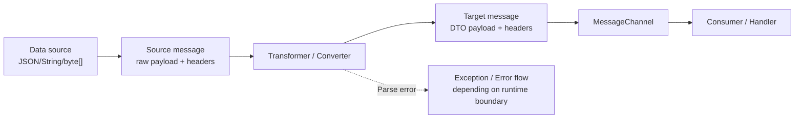
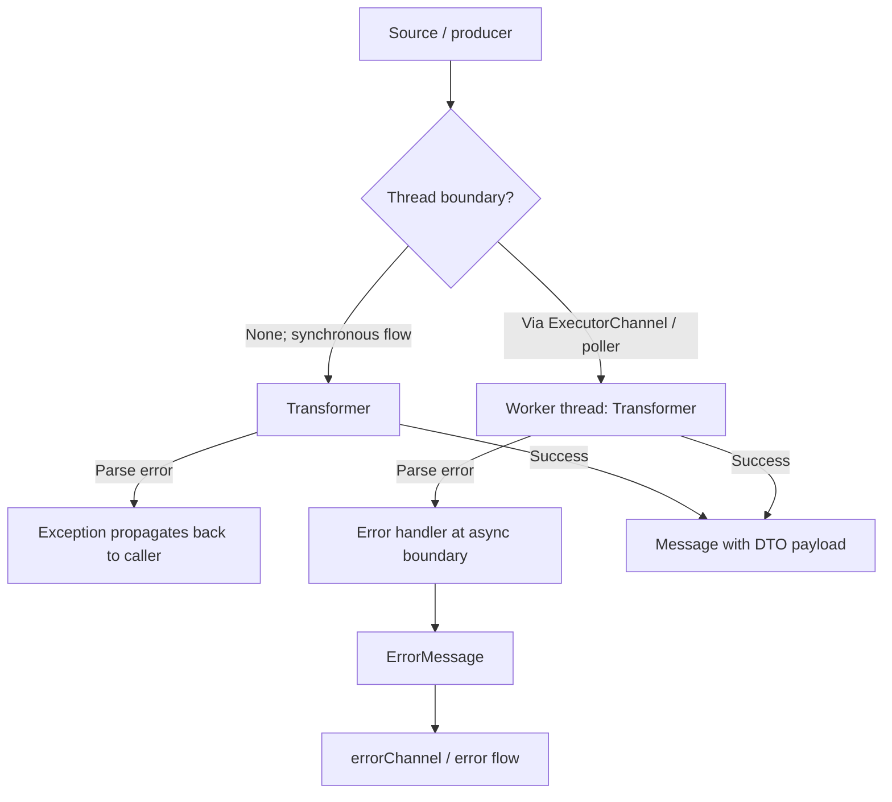

# GenericMessage with a Converted Payload in Spring Integration

## Learning Objectives

In Spring Integration, a message is more than data traveling over a channel. It consists of a **payload** and **headers**; endpoints read, transform, and forward messages throughout the runtime execution of an integration flow. When data arrives as a `String` or `byte[]` and is converted into a DTO, number, date/time, or domain type, the result is typically a new `Message<T>`, which can be realized with `GenericMessage<T>`.

This lesson belongs to the **Conversion** chapter of the **SPRING_INTEGRATION_RUNTIME** module, focusing on **GenericMessage with a converted payload**. Beyond constructing the message, we examine its path across channels, transformers, consumers, error flows, and executors: what successful conversion means, which headers must be preserved, and how to prove downstream endpoints actually receive the expected type.

After this lesson, you will be able to:

- Distinguish between `GenericMessage<T>`, `Message<T>`, the payload, and data conversion mechanisms.
- Construct a `GenericMessage` containing a converted payload, preserve necessary business headers, and avoid mistakenly reusing message identifiers.
- Recognize when Spring Integration builds the outbound message automatically from a transformer versus when you must construct a `GenericMessage` explicitly.
- Handle conversion errors and track correlation, reply/error channels, transactions, threading, and runtime performance.
- Verify the real payload type at the consumer and diagnose misconversion or duplicate conversion scenarios.

## 1. From Raw Payload to Converted Message

Consider a system receiving JSON over HTTP/JMS that needs to turn it into an order:

```json
{
  "orderId": "ORD-42",
  "amount": 120000
}
```

Initially, a message may carry the entire JSON as a `String`:

```text
Message<String>
  payload = "{\"orderId\":\"ORD-42\",\"amount\":120000}"
  headers = {
    correlationId = "corr-42",
    contentType   = "application/json",
    id            = <incoming message id>,
    timestamp     = <creation timestamp>
  }
```

After parsing, the payload becomes an `OrderCommand` object; the new message wraps that object:

```text
Message<OrderCommand>
  payload = OrderCommand(orderId="ORD-42", amount=120000)
  headers = {
    correlationId = "corr-42",
    id            = <new message id>,
    timestamp     = <new message creation timestamp>
  }
```



**Core point:** `GenericMessage` **does not parse or cast the payload on its own**. It is an implementation of the `Message<T>` interface used to wrap a payload and headers. Conversion occurs **before** creating the new message, or is performed by a transformer/converter in the pipeline that then packages the result.

### 1.1. Four Easily Confused Concepts

| Component | Primary Role | Example |
| --- | --- | --- |
| `Message<T>` | Contract representing payload and headers | `Message<OrderCommand>` |
| `GenericMessage<T>` | Common `Message<T>` implementation | `new GenericMessage<>(order, headers)` |
| `MessageConverter` or `ConversionService` | Converts a value from one type/format to another when configured and invoked | `String` → `Integer`, custom values via registered converters |
| Transformer / `@Transformer` | An endpoint in an integration flow that transforms a message/payload and emits the result downstream | JSON `String` → `OrderCommand` |

A transformer may use `ObjectMapper`, `ConversionService`, or application logic to convert the payload. Conversely, a `MessageConverter` may be invoked by the framework where an appropriate type-conversion mechanism is active. Do not assume every channel automatically parses JSON or converts `String` to a DTO merely because the consumer's generic type is `Message<OrderCommand>`.

### 1.2. What Are the Runtime Limits of Generic Types?

`Message<OrderCommand>` lets Java authors express the intended type and get compile-time checking. However, generic types are largely erased at runtime (*type erasure*). No conversion happens from casting alone:

```java
Message<String> raw = new GenericMessage<>("{\"orderId\":\"ORD-42\"}");

// Wrong: only bypasses compile-time type checking, does NOT parse JSON.
@SuppressWarnings("unchecked")
Message<OrderCommand> wrong = (Message<OrderCommand>) (Message<?>) raw;

// At this point the actual payload is still String, which can throw ClassCastException.
OrderCommand order = wrong.getPayload();
```

The true type must be checked on the **payload object**: `message.getPayload().getClass()`, or `instanceof` against the expected DTO. Besides `GenericMessage`, the runtime can also create `ErrorMessage` or other `Message` implementations; downstream code should prefer the `Message<T>` interface unless a specific implementation API is required.

## 2. Creating a GenericMessage with a Converted Payload

### 2.1. Creating a Message from an Existing DTO

```java
import java.math.BigDecimal;
import java.util.Map;
import org.springframework.messaging.Message;
import org.springframework.messaging.support.GenericMessage;

record OrderCommand(String orderId, BigDecimal amount) {}

OrderCommand order = new OrderCommand(
        "ORD-42",
        new BigDecimal("120000")
);

Message<OrderCommand> message = new GenericMessage<>(
        order,
        Map.of("correlationId", "corr-42", "sourceSystem", "checkout")
);

System.out.println(message.getPayload().orderId()); // ORD-42
System.out.println(message.getPayload().getClass()); // class ...OrderCommand
System.out.println(message.getHeaders().get("correlationId")); // corr-42
```

In this snippet, the `OrderCommand` object was already instantiated beforehand; the `GenericMessage` constructor only wraps the object and header map. No JSON conversion happens in the constructor.

Key properties:

- `new GenericMessage<>(payload)` accepts a payload and generates required headers.
- `new GenericMessage<>(payload, headers)` also accepts a header map; the message uses a `MessageHeaders` structure that cannot be directly mutated after construction.
- The payload must be **non-`null`**; `GenericMessage` does not use `null` to represent empty content. How an empty transformer/gateway result is handled depends on each endpoint's contract.
- `MessageHeaders` is immutable by API, yet **the payload object itself may still be mutable**. If you use a `List`, `Map`, or mutable DTO shared across multiple threads, `GenericMessage` itself does not protect against race conditions.

### 2.2. Converting from JSON String to DTO and Creating GenericMessage

Example using Jackson `ObjectMapper` (requires the Jackson dependency and a configured `ObjectMapper` in the application):

```java
import com.fasterxml.jackson.core.JsonProcessingException;
import com.fasterxml.jackson.databind.ObjectMapper;
import java.math.BigDecimal;
import java.util.HashMap;
import java.util.Map;
import org.springframework.messaging.Message;
import org.springframework.messaging.MessageHeaders;
import org.springframework.messaging.support.GenericMessage;
import org.springframework.messaging.support.MessageBuilder;
import org.springframework.util.MimeTypeUtils;

record OrderCommand(String orderId, BigDecimal amount) {}

static Message<OrderCommand> convert(
        Message<String> incoming,
        ObjectMapper mapper) throws JsonProcessingException {

    // 1. Perform actual value conversion: JSON String -> DTO.
    OrderCommand parsed = mapper.readValue(
            incoming.getPayload(), OrderCommand.class);

    // 2. Select headers to forward.
    Map<String, Object> headers = new HashMap<>(incoming.getHeaders());

    // 3. New message ID/timestamp generated by MessageHeaders.
    headers.remove(MessageHeaders.ID);
    headers.remove(MessageHeaders.TIMESTAMP);

    // 4. Payload is no longer a JSON String: avoid misleading metadata.
    headers.remove(MessageHeaders.CONTENT_TYPE);

    // 5. Return message with payload typed as OrderCommand.
    return new GenericMessage<>(parsed, headers);
}

static void demo(ObjectMapper mapper) throws JsonProcessingException {
    Message<String> incoming = MessageBuilder
            .withPayload("{\"orderId\":\"ORD-42\",\"amount\":120000}")
            .setHeader("correlationId", "corr-42")
            .setHeader(MessageHeaders.CONTENT_TYPE, MimeTypeUtils.APPLICATION_JSON)
            .build();

    Message<OrderCommand> converted = convert(incoming, mapper);

    System.out.println(converted.getPayload().amount()); // 120000
    System.out.println(converted.getHeaders().get("correlationId")); // corr-42
    System.out.println(converted.getHeaders().getId()); // new id
}
```

`GenericMessage` is constructed **after** `ObjectMapper.readValue(...)` returns the `OrderCommand` object. If the JSON has syntax errors or fails DTO mapping, `readValue` throws an exception and no target message is created.

Here we copy the header map and remove `id` and `timestamp` so the new message receives a fresh ID and timestamp, while keeping `correlationId` because it ties to the business transaction throughout the flow. Never use the source message's `MessageHeaders.ID` as a durable correlation ID: one business request can spawn multiple distinct messages.

Removing `contentType` is an intentional choice in this example: the payload is no longer a JSON string; if a downstream step later serializes the DTO back to JSON for outbound delivery, attach the appropriate metadata at the serialization/outbound step. Depending on an integration adapter's convention, `contentType` may mean "desired wire format," so deciding whether to keep or update it must follow the actual contract.

### 2.3. When Should You Use MessageBuilder?

When only a few headers need to be preserved, `MessageBuilder` states intent more clearly than copying everything:

```java
import org.springframework.messaging.Message;
import org.springframework.messaging.support.MessageBuilder;

Message<OrderCommand> converted = MessageBuilder
        .withPayload(order)
        .setHeader("correlationId", incoming.getHeaders().get("correlationId"))
        .setHeader("sourceSystem", incoming.getHeaders().get("sourceSystem"))
        .build();
```

This also yields a new `Message<OrderCommand>`. With Spring Messaging's default `MessageBuilder`, regular messages are built using `GenericMessage`. Still, downstream code should depend on the `Message` interface, since frameworks/adapters can use other implementations.

If a flow uses a splitter/aggregator, reply channel, error channel, or custom coordinator, **do not accidentally strip** meaningful headers. Conversely, do not blindly copy all external source headers into a trusted internal system. Design an explicit header allowlist across each boundary.

## 3. How Does the Converted Message Differ from the Original?

| Property | Before Parsing | After Parsing in the Example | What to Watch For |
| --- | --- | --- | --- |
| Actual payload type | `String` | `OrderCommand` | Check with `instanceof`/`getClass()`, not just declared generics |
| Payload value | JSON text | Java record/DTO | DTO may or may not be validated; successful parsing does not imply business validity |
| `id` / `timestamp` | From source message | Newly generated after removing the old two headers | Trace message chains via correlation/business keys |
| `correlationId` | `corr-42` | `corr-42` | Maintain to link logs, error records, and related messages |
| `contentType` | `application/json` | Removed in the example | Ensure metadata matches how downstream expects to interpret the payload |
| `replyChannel` / `errorChannel` | May be attached by gateway/producer | Preserved if headers are copied and contract requires it | Be cautious across trust boundaries or different channels/brokers |
| `sequenceNumber` / `sequenceSize` | May exist after a splitter | Preserved if copied | Critical when message groups must be correlated by an aggregator |

In practice, a *logical business event* can pass through multiple message layers. Distinguish two identifiers:

- **Message ID:** identifies a single message instance; usually serves framework-scoped tracking.
- **Business key/correlation ID:** defined by the application to link steps and ensure safe replay, e.g., `ORD-42`, `corr-42`.

Do not assume every transformer or framework feature always copies the exact same set of headers. Whether a transformer returns a payload or a full `Message<?>`, the transformer's header policy, the message-building component, and interceptors can all influence the result.

## 4. How Does GenericMessage Appear in IntegrationFlow?

### 4.1. Transformer Returns Payload: Framework Builds the Downstream Message

The common approach is for a transformer to return the **converted value** rather than manually instantiating `GenericMessage`:

```java
import com.fasterxml.jackson.core.JsonProcessingException;
import com.fasterxml.jackson.databind.ObjectMapper;
import java.math.BigDecimal;
import org.springframework.context.annotation.Bean;
import org.springframework.context.annotation.Configuration;
import org.springframework.integration.channel.DirectChannel;
import org.springframework.integration.config.EnableIntegration;
import org.springframework.integration.dsl.IntegrationFlow;
import org.springframework.messaging.Message;
import org.springframework.messaging.MessageChannel;

record OrderCommand(String orderId, BigDecimal amount) {}

@Configuration
@EnableIntegration
class OrderFlowConfig {

    @Bean("ordersRaw")
    MessageChannel ordersRaw() {
        return new DirectChannel();
    }

    @Bean
    IntegrationFlow orderFlow(ObjectMapper mapper) {
        return IntegrationFlow.from("ordersRaw")
                .transform(String.class, json -> {
                    try {
                        return mapper.readValue(json, OrderCommand.class);
                    } catch (JsonProcessingException ex) {
                        throw new IllegalArgumentException("Invalid order JSON", ex);
                    }
                })
                .handle((Message<?> message) -> {
                    // Here payload is the value returned by the transformer: OrderCommand.
                    OrderCommand order = (OrderCommand) message.getPayload();
                    System.out.println("Received order: " + order.orderId());
                    System.out.println("correlationId="
                            + message.getHeaders().get("correlationId"));
                })
                .get();
    }
}
```

Logical path:

```text
send(Message<String>)
   -> ordersRaw (DirectChannel)
   -> transformer: String -> OrderCommand
   -> message built/adjusted by Spring Integration
   -> handler receives Message<?> with OrderCommand payload
```

With a standard transformer, the framework constructs the output message and forwards required headers. Do not rely on `message.getClass() == GenericMessage.class`: what business logic needs is **the right payload type and headers matching the contract**.

In the `DirectChannel` example, the transformer and handler typically run on the caller's thread. If the transformer throws an exception, the error can propagate back to `send()` instead of automatically turning into an `ErrorMessage`.

### 4.2. Transformer Returns `Message<OrderCommand>`: Explicit Header Control

When you need explicit control over which headers the new message carries, use `@Transformer` and return a `GenericMessage`:

```java
import com.fasterxml.jackson.core.JsonProcessingException;
import com.fasterxml.jackson.databind.ObjectMapper;
import java.util.HashMap;
import java.util.Map;
import org.springframework.integration.annotation.Transformer;
import org.springframework.messaging.Message;
import org.springframework.messaging.MessageHeaders;
import org.springframework.messaging.support.GenericMessage;
import org.springframework.stereotype.Component;

@Component
class OrderParser {
    private final ObjectMapper mapper;

    OrderParser(ObjectMapper mapper) {
        this.mapper = mapper;
    }

    @Transformer(inputChannel = "ordersRaw", outputChannel = "ordersTyped")
    public Message<OrderCommand> parseOrder(Message<String> input) {
        try {
            OrderCommand order = mapper.readValue(
                    input.getPayload(), OrderCommand.class);

            Map<String, Object> headers = new HashMap<>(input.getHeaders());
            headers.remove(MessageHeaders.ID);
            headers.remove(MessageHeaders.TIMESTAMP);
            headers.remove(MessageHeaders.CONTENT_TYPE);

            return new GenericMessage<>(order, headers);
        } catch (JsonProcessingException ex) {
            throw new IllegalArgumentException("Malformed order message", ex);
        }
    }
}
```

`ordersRaw` and `ordersTyped` are two application channels; configure them so the transformer has valid input and output consumers. This is an **alternative implementation** to the Java DSL example in Section 4.1—do not register both transformers on the same input in one test flow. This example intentionally returns a full `Message<OrderCommand>` so the header policy is governed by code. For typical flows, returning the payload directly is cleaner and more idiomatic.

If you choose `@ServiceActivator(inputChannel = "ordersTyped")` and declare a `Message<OrderCommand>` parameter, remember that it is a **type expectation** for the consumer. Upstream bugs can leave the payload as `String` if the transformer is bypassed or another producer sends directly to `ordersTyped`. Verify at runtime and design clear data boundaries.

### 4.3. Channel Datatypes and Conversion Services

Spring Integration supports declaring payload datatype constraints on a channel and can use a conversion service/message converter to attempt data conversion before dispatching the message. However:

1. A channel checks/converts types only according to its **actual configuration**; a plain `DirectChannel` does not parse arbitrary JSON payloads by default.
2. Spring `ConversionService` requires a registered converter for the source/target type pair. Having a `String` and an arbitrary Java record does not magically teach the framework the JSON schema.
3. JSON serialization/deserialization requires an appropriate JSON transformer or converter, such as a configured Jackson integration component.
4. If conversion happens only when the framework binds a consumer's **method parameter**, you cannot assume the upstream message itself already converted its payload into a DTO. Inspect the exact place where the outbound message is constructed.

Therefore, when reading code, locate the exact conversion point—transformer, adapter/converter, datatype-configured channel, or method argument binder—before determining who creates the `GenericMessage`.

## 5. Common Pitfalls When Working with GenericMessage After Conversion

### 5.1. Confusing Casting with Conversion

```java
Message<String> input = new GenericMessage<>("{\"orderId\":\"ORD-42\"}");

// Does not convert JSON to DTO:
Message<OrderCommand> unsafe = (Message<OrderCommand>) (Message<?>) input;
```

You must invoke a real parser/converter. If runtime validation is needed, check:

```java
Object payload = incoming.getPayload();
if (!(payload instanceof OrderCommand order)) {
    throw new IllegalArgumentException(
            "Expected OrderCommand but got " + payload.getClass().getName());
}
```

### 5.2. Mutable Payloads Causing Consumers to Observe Different Data

```java
List<String> items = new ArrayList<>(List.of("A"));
Message<List<String>> msg = new GenericMessage<>(items);

items.add("B"); // The payload inside msg also observes the mutation.
```

If a message is broadcast to multiple subscribers or dispatched to an `ExecutorChannel`, mutable payloads make race conditions much harder to investigate. Prefer immutable DTOs, `record` types, and immutable collections, and never mutate a payload after publishing.

### 5.3. Dropping Headers and Breaking Correlation or Reply/Error Flows

```java
// Payload converts fine, but all business headers from incoming are lost:
Message<OrderCommand> output = new GenericMessage<>(parsed);
```

This is harmless in an isolated one-way flow, but breaks flows when a message came from a gateway with `replyChannel`, traverses a splitter/aggregator, or needs to route failures via `errorChannel`. Define the contract: which correlation, reply/error channel, or sequence headers to keep and at what scope, while avoiding leaking sensitive internal headers to external systems.

### 5.4. Leaving Stale Format Metadata After Changing the Payload

For example, `incoming` specifies `contentType=application/json` while the downstream payload is `OrderCommand`. If a consumer treats that header as describing the **current data format**, it may try to deserialize again or select the wrong converter. Keeping, updating, or removing `contentType` must stay consistent with each adapter's contract.

### 5.5. Catching Exceptions and Returning Empty Values

A converter can throw `JsonProcessingException`, `ConversionFailedException`, or other library-specific exceptions. If you catch the error and return `null` without an explicit contract, the transformer may stop emitting messages or a gateway waiting for a reply may time out. If invalid messages should be dropped, establish an explicit discard/recovery policy and track discarded message counts.

### 5.6. Mixing Syntax Validation with Business Validation

JSON `{"orderId":"ORD-42","amount":-10}` can parse into `OrderCommand` cleanly yet violate payment business rules. Conversion only confirms that data can be represented as the target type; business validation must verify `orderId`, `amount`, state rules, and additional invariants.

## 6. Where Do Conversion Errors Go at Runtime?

Where conversion sits relative to thread boundaries determines who observes the exception:



- **Synchronous flow** via `DirectChannel`: if the converter/transformer throws an exception, the `send()` caller typically sees the exception on its call stack, potentially wrapped in `MessagingException` or a transformer exception.
- **Executor/poller flow**: errors occurring after a thread boundary are usually handled by that boundary's error handler, which can build an `ErrorMessage` and send it to the designated or default error channel.
- **Gateway flow**: inspect `replyChannel`, `errorChannel`, reply timeouts, and how errors are mapped to replies or exceptions. Parse failures do not automatically guarantee the caller receives an immediate synchronous error.

Example handling `ErrorMessage` in an error flow:

```java
import org.springframework.messaging.Message;
import org.springframework.messaging.MessagingException;
import org.springframework.messaging.support.ErrorMessage;

void onConversionError(ErrorMessage error) {
    Throwable failure = error.getPayload();

    Message<?> original = error.getOriginalMessage();
    if (original == null && failure instanceof MessagingException ex) {
        original = ex.getFailedMessage();
    }

    Object correlationId = original == null
            ? "unknown"
            : original.getHeaders().get("correlationId");

    System.err.printf("correlation=%s error=%s%n",
            correlationId, failure.toString());
}
```

`ErrorMessage.getOriginalMessage()` and `MessagingException.getFailedMessage()` may be absent or reflect two different points in the flow. In production, error records should capture the business key/correlation ID, endpoint name, error category, root cause, timestamp, retry status, and a safe payload reference; avoid logging raw sensitive data verbatim.

**Retry decisions:** transient connection failures to an external schema/lookup service may be worth retrying; malformed JSON or invalid field types generally cannot be fixed simply by trying again. If retries are configured both in a handler and in a broker/poller, execution counts multiply and can trigger duplicate side effects. Use an idempotency key for data writes or external service calls.

**Rollback decisions:** conversion inside a synchronous transaction can propagate exceptions out to the transaction boundary and trigger rollback per policy. When conversion runs after an `ExecutorChannel`, the caller's transaction typically does not propagate to the worker thread; identify the worker/poller's actual transaction and the source's ack/redelivery behavior. A successfully logged error flow does not prove the source message rolled back or can be replayed.

## 7. Verifying That the Payload Actually Converted

Do not rely solely on a `Message<OrderCommand>` signature. At the consuming endpoint, verify both type and critical fields:

```java
void consume(Message<?> message) {
    Object payload = message.getPayload();

    if (!(payload instanceof OrderCommand order)) {
        throw new IllegalStateException(
                "Expected OrderCommand, got " + payload.getClass().getName());
    }

    if (order.orderId() == null || order.orderId().isBlank()) {
        throw new IllegalArgumentException("orderId is required");
    }

    System.out.printf("messageId=%s correlation=%s orderId=%s%n",
            message.getHeaders().getId(),
            message.getHeaders().get("correlationId"),
            order.orderId());
}
```

Here is a minimal test matrix:

| Case | Input Payload | Expected After Conversion | What to Observe |
| --- | --- | --- | --- |
| Valid | JSON with valid `orderId`, `amount` | `OrderCommand` with accurate values | `getPayload().getClass()`, correlation header |
| Malformed JSON | JSON string missing a closing brace | No target message produced | Whether exception reaches caller or error flow |
| Schema mismatch | `amount` is an unexpected JSON object | Parser errors or validation policy decides | Root exception, failed message |
| Syntactically valid, business-invalid | `amount=-10` | May construct DTO then fail validator | Distinguish parse failure from validation failure |
| Headers to keep | Includes `correlationId`, `replyChannel` | Headers preserved per contract | Gateway receives reply and trace matches |
| Headers to drop | `contentType` describing old JSON String | Header removed/updated upon DTO conversion | Consumer does not invoke the wrong converter |
| Asynchronous | Message passes through executor before parser | DTO on worker or `ErrorMessage` | Thread name, error channel, and queue depth |

For automated tests, verify **payload values**, **payload type**, **preserved/removed headers**, and **error paths**. Example using `convert(...)` from Section 2:

```java
Message<String> input = MessageBuilder.withPayload(
        "{\"orderId\":\"ORD-42\",\"amount\":120000}")
        .setHeader("correlationId", "corr-42")
        .build();

Message<OrderCommand> result = convert(input, new ObjectMapper());

assert result.getPayload() instanceof OrderCommand;
assert "ORD-42".equals(result.getPayload().orderId());
assert "corr-42".equals(result.getHeaders().get("correlationId"));
assert !result.getHeaders().getId().equals(input.getHeaders().getId());
```

In real projects, replace Java `assert` with JUnit/AssertJ assertions so checks always execute even when the JVM runs without `-ea`.

## 8. Threading, Performance, and Flow Lifecycle

Conversion looks simple, yet it can be the most CPU- and memory-intensive step in a pipeline:

- **Payload size:** parsing large JSON/XML increases object allocation and GC pressure; measure input sizes and parse durations, avoiding unnecessary `byte[]`/`String` copies.
- **Threading:** a transformer before `ExecutorChannel` runs on the upstream thread; placed after, it runs on a worker thread. Choose placement based on throughput capacity and responsiveness requirements while monitoring queue capacity, active threads, and rejected tasks.
- **Thread safety:** `ObjectMapper` is generally safe to share once configured; do not mutate shared instance configuration during processing. Immutable DTOs are safer when shared across subscribers.
- **Backpressure:** if conversion is fast while downstream is slow, queues can fill up; if conversion is slow on a `DirectChannel`, callers block longer. Monitor throughput, processing time, and executor saturation.
- **Lifecycle:** when starting/stopping or dynamically registering/deregistering an `IntegrationFlow`, verify transformers and consumers are started, channels have subscribers, and no in-flight messages remain before changing schemas. Changing DTOs/schemas in a running flow requires compatibility rules for producers and backlogged messages in queues/stores.

In systems with a message store, persist converted payloads only when serialization is supported and schema versions remain readable. Wrapping a Java DTO in `GenericMessage` does not automatically make a message durable across restarts; durability depends on the persistence adapter, serializer, broker, and transaction configuration.

Useful metrics for a conversion flow include: input count, successful conversions, parse errors, validation errors, conversion latency percentiles, queue depth, active/rejected threads, retry count, and DLQ count. Attach correlation/business keys to logs and traces; avoid using technical message IDs as the sole linking key.

## 9. Practice Scenarios

### Exercise A — Convert JSON String to `GenericMessage<OrderCommand>`

1. Create a `Message<String>` containing order JSON, `correlationId`, and `contentType`.
2. Use `ObjectMapper` to parse the `OrderCommand` DTO.
3. Build a `GenericMessage<OrderCommand>` with an explicit header policy: keep correlation, generate a new message ID, drop the old content type.
4. Verify the actual payload type, `amount` value, correlation ID, and that the two message IDs differ.

**Expected:** downstream can call `order.amount()` without re-parsing JSON; business trace data stays attached to the new message.

### Exercise B — Compare Two Transformer Styles

Implement two flows receiving the same JSON: the first returns `OrderCommand` from the transformer so the framework constructs the message; the second returns `GenericMessage<OrderCommand>` directly. For each flow, record payload type, headers, message ID, and exception path on invalid JSON.

**Expected:** both yield a strongly typed domain payload; header management depends on how the message is created and how the transformer is configured.

### Exercise C — Move the Executor Boundary

Measure `send()` duration and thread names across two layouts:

```text
Layout 1: producer -> transformer -> ExecutorChannel -> handler
Layout 2: producer -> ExecutorChannel -> transformer -> handler
```

Have the parser throw an exception on malformed JSON. Identify which caller observes the error, which error channel receives it, and which thread spends CPU parsing.

**Expected:** moving the executor shifts which thread executes conversion and changes the exception path; a `GenericMessage` itself does not manage threading.

### Exercise D — Handle Schema Evolution and Replay

Place a `v1` message missing a new field into a queue/store; deploy a `v2` consumer requiring the new field. Design how to identify `schemaVersion`, apply valid defaults, or route incompatible messages to a DLQ. Prove that replay does not create duplicate orders using a business key/idempotency key.

**Expected:** payload conversion, durable persistence, and schema compatibility are designed together.

## 10. Self-Check Questions

1. Why can `new GenericMessage<>(jsonString)` not produce an `OrderCommand` payload on its own?
2. Does a `Message<OrderCommand>` variable signature guarantee the runtime payload is that DTO? Why or why not?
3. When building a new message from a parsed payload, which headers should usually be kept for correlation and which should you consider dropping so a fresh message ID is generated?
4. What is the difference between a transformer returning a DTO and a transformer returning `GenericMessage<DTO>`?
5. If a parse error occurs before versus after an `ExecutorChannel`, how differently do the caller and error flow observe the exception?
6. Why can mutable payload bugs still happen even though `GenericMessage` has immutable headers?
7. When storing `GenericMessage<OrderCommand>` in a message store, what requirements apply to serializers, schema versions, and replay?
8. Does successfully parsing JSON into a DTO guarantee that the DTO is business-valid and the transaction committed?

**Takeaway:** `GenericMessage` is the **message envelope** carrying a converted payload and headers. True conversion success must be demonstrated by **the right runtime payload object**, **headers honoring the contract**, **downstream receiving the message**, and **error, transaction, and correlation policies aligned** with the Spring Integration runtime.
