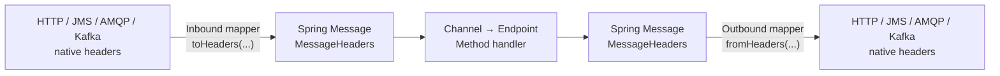
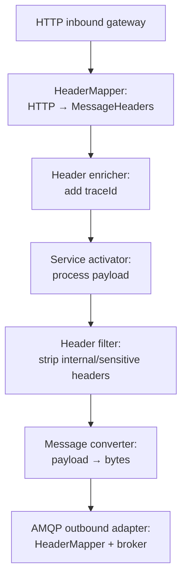
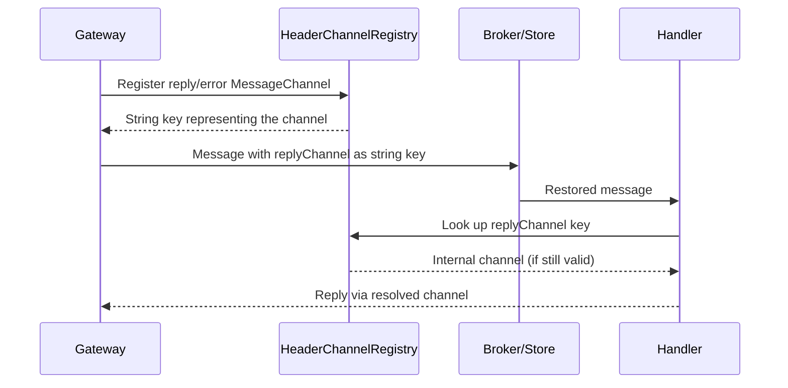

# Header Types and Header Mappers in Spring Integration

## 1. Objectives and Runtime Position

In the **Spring Integration Runtime**, a `Message<T>` consists of a **payload** carrying business data and **headers** carrying metadata for processing, routing, and cross-system exchange. Headers can hold correlation IDs, content types, tracing metadata, reply channels, or protocol-specific properties for HTTP, JMS, AMQP, or Kafka.

A message traveling within the JVM can keep header values as Java objects. However, when crossing HTTP, a broker, or a message store, the target system may only support strings, byte arrays, or a narrower set of types. A **header mapper** is responsible for translating metadata across that boundary according to each adapter's rules.

After this lesson, you will be able to:

- Understand the meaning of **header name** and **header value type**, including special system headers.
- Read and construct properly typed headers with `MessageHeaders`, `MessageBuilder`, and `@Header`.
- Explain `HeaderMapper<T>`, inbound/outbound directions, and how to filter headers crossing a protocol boundary.
- Distinguish header mapping from payload conversion, header enrichment, and header filtering.
- Understand HTTP, JMS, AMQP, and Kafka examples and their impact on correlation, reply/error channels, retries, and message stores.
- Diagnose missing headers, type changes, transport rejections, or broken request–reply flows.

This topic belongs to the **Conversion** chapter, scoped specifically to **header types and header mappers**. Concepts such as endpoints, consumers, pollers, executors, and transactions appear where they affect message runtime behavior; a header mapper does not replace those components.

## 2. What Is a Header Type Actually?

`MessageHeaders` models metadata as a `Map<String, Object>` mapping:

- **Header name** (`String`): e.g., `"traceId"`, `"contentType"`, `"replyChannel"`.
- **Header value** (`Object`): may be `String`, `UUID`, `Long`, `Integer`, `MimeType`, `MessageChannel`, or an application-defined object.
- **Header type** in this lesson means the **Java type of the value**, not the header name and not automatically the payload's data type.

For example, `"attempt" → Integer(2)` differs from `"attempt" → String("2")`. The two values look identical in logs, yet a consumer reading an `Integer` cannot treat a `String` as the same contract without a conversion step.

| Header | Typical Type Inside a Spring Message | Role |
| --- | --- | --- |
| `id` (`MessageHeaders.ID`) | `UUID` | Identifies a single message instance; managed by the framework. |
| `timestamp` (`MessageHeaders.TIMESTAMP`) | `Long` | Message creation time; managed by the framework. |
| `replyChannel` (`MessageHeaders.REPLY_CHANNEL`) | `MessageChannel` or `String` | Reply destination when no higher-priority output channel is set. |
| `errorChannel` (`MessageHeaders.ERROR_CHANNEL`) | `MessageChannel` or `String` | Error-handling destination when the runtime uses corresponding error routing. |
| `priority` | `Integer` | Used in priority-aware components such as `PriorityChannel`. |
| `contentType` | Component/adapter dependent; typically `MimeType`, `MediaType`, or another representation | Hints at content format when converting and exchanging payloads. |
| `correlationId` | Producer/flow dependent, often `UUID` or `String` | Associates messages belonging to the same processing chain or group. |
| `traceId`, `tenantId` (custom) | Follows the contract agreed by the application | Tracing, partitioning processing, business rules. |

Note: **`contentType` is not a mechanism that automatically infers every Java payload type**. It is metadata; converters/transformers read that metadata according to their capabilities and configuration. Similarly, having a header named `correlationId` does not cause the framework to aggregate messages automatically—you still need an aggregator and release strategy to group messages.

### Message Headers Are Effectively Immutable

`MessageHeaders` exposes a `Map`-like API, but does not support `put`, `remove`, or `clear` directly. To change a header, build a **new message** using `MessageBuilder` or a dedicated endpoint. An object referenced by a header value may still be mutable, so prefer small, immutable values.

```java
import java.util.UUID;
import org.springframework.messaging.Message;
import org.springframework.messaging.MessageHeaders;
import org.springframework.messaging.support.MessageBuilder;

public class HeaderTypesDemo {
    public static void main(String[] args) {
        Message<String> message = MessageBuilder.withPayload("order-42")
                .setHeader("traceId", "tr-42")
                .setHeader("attempt", 2)
                .setHeader("batchKey", UUID.randomUUID())
                .build();

        String traceId = message.getHeaders().get("traceId", String.class);
        Integer attempt = message.getHeaders().get("attempt", Integer.class);
        UUID messageId = message.getHeaders().getId();
        Long createdAt = message.getHeaders().getTimestamp();

        System.out.println(traceId + " / " + attempt + " / " + messageId);

        // Modify metadata by creating a new message.
        Message<String> next = MessageBuilder.fromMessage(message)
                .setHeader("attempt", 3)
                .build();

        // message.getHeaders().put("attempt", 3); // UnsupportedOperationException
    }
}
```

Calling `get(name, Class<T>)` explicitly expresses the type the consumer expects; if the value is incompatible, avoid arbitrary casts. When crossing an out-of-JVM adapter, verify the type **after receiving it** rather than assuming it remains identical to the original type.

## 3. At Which Boundary Does a Header Mapper Operate?

`org.springframework.integration.mapping.HeaderMapper<T>` is the mapping strategy between `MessageHeaders` and another system's native metadata type (`T`):

```java
public interface HeaderMapper<T> {
    void fromHeaders(MessageHeaders headers, T target);
    Map<String, Object> toHeaders(T source);
}
```

Read the API method names from the perspective of the **Spring Integration message**:

| Method | Direction | Result |
| --- | --- | --- |
| `toHeaders(T source)` | Native headers/properties → Spring Integration | Returns `Map<String,Object>` to populate the internal message. |
| `fromHeaders(MessageHeaders headers, T target)` | Spring Integration → Native headers/properties | Populates metadata onto an existing native object. |

In many request–reply protocols, mapper classes provide separate APIs for requests and replies (e.g., `RequestReplyHeaderMapper<T>`), because request and response headers are not identical.



**Header mappers run at adapter boundaries**, not automatically on every `DirectChannel`, `ExecutorChannel`, or `QueueChannel`. When a message only travels between internal endpoints, it can retain header values directly as Java objects. Choosing channels/pollers/executors determines threads and pacing, whereas the mapper determines which headers and in what representation cross into or out of a protocol.

### Three Questions to Answer When Mapping Headers

1. **Which names are allowed to map?** For instance, only `X-Trace-Id`, `contentType`, `correlationId`, or everything except internal headers?
2. **How are values represented?** For example, `UUID` → `String` in JMS, `Object` → JSON/`byte[]` in Kafka, `String`/`List<String>` in HTTP.
3. **Which direction is mapped?** Inbound HTTP requests differ from outbound HTTP responses; JMS/AMQP also have read-only or broker-managed properties.

Do not treat going from an internal message out to a transport and back as a **round trip preserving every name and every type**. Mappers can actively filter, rename, merge values, or convert types.

## 4. Distinguishing Four Header-Related Mechanisms

| Mechanism | Purpose | Example |
| --- | --- | --- |
| `HeaderMapper` | Maps metadata between a Spring Message and another protocol/system | `X-Trace-Id` ↔ HTTP header; `jms_correlationId` ↔ JMS property. |
| `MessageConverter` or transformer | Converts payload/body between representations | Object → JSON bytes; JMS message body → object. |
| Header enricher | Adds/updates metadata **inside the flow** | Assigns `traceId` if missing; adds `tenantId`. |
| Header filter | Strips metadata that should not propagate further | Removes `Authorization`, `Cookie`, or internal headers before an outbound adapter. |

A real flow may need all four:



`HeaderMapper` does not handle general payload conversion, and `MessageConverter` does not dictate the entire header policy. Keeping these roles separate helps you locate the right place to fix missing attributes or malformed payloads.

## 5. Example 1 — Selecting Headers for HTTP Outbound

`DefaultHttpHeaderMapper` in the Spring Integration HTTP module maps between `org.springframework.http.HttpHeaders` and `MessageHeaders`. The `outboundMapper()` factory fits outbound HTTP adapters/gateways; `inboundMapper()` fits inbound HTTP adapters/gateways. They handle requests and responses in the endpoint's direction.

Suppose a flow sends a request to an external service with trace header `X-Trace-Id` while withholding `tenantInternalKey`:

```java
import org.springframework.http.HttpHeaders;
import org.springframework.integration.http.support.DefaultHttpHeaderMapper;
import org.springframework.messaging.Message;
import org.springframework.messaging.support.MessageBuilder;

public class HttpHeadersMappingDemo {

    public static void main(String[] args) {
        Message<String> request = MessageBuilder.withPayload("request body")
                .setHeader("X-Trace-Id", "tr-42")
                .setHeader("tenantInternalKey", "do-not-send")
                .build();

        DefaultHttpHeaderMapper mapper = DefaultHttpHeaderMapper.outboundMapper();

        // Explicit list configured to carry the chosen header
        // and standard HTTP request headers.
        mapper.setOutboundHeaderNames("HTTP_REQUEST_HEADERS", "X-Trace-Id");

        HttpHeaders wireHeaders = new HttpHeaders();
        mapper.fromHeaders(request.getHeaders(), wireHeaders);

        System.out.println(wireHeaders.getFirst("X-Trace-Id")); // tr-42
        System.out.println(wireHeaders.containsKey("tenantInternalKey")); // false
    }
}
```

Key points:

- `setOutboundHeaderNames(...)` controls which headers are considered when mapping from a message to an HTTP request; you can specify exact names or API-supported wildcards.
- When **replacing** the default list, include the corresponding shortcut pattern such as `HTTP_REQUEST_HEADERS` if standard HTTP headers are still required.
- Inbound and outbound lists are separate policies. For inbound HTTP, use `setInboundHeaderNames(...)` to control which headers are admitted into the flow.
- This is a direct demo of the mapper. In an application, the adapter/gateway is wired with a mapper or equivalent mapping properties; you do not call `fromHeaders(...)` manually on every HTTP call.

Further reading: [Spring Integration — HTTP Header Mappings](https://docs.spring.io/spring-integration/reference/http/header-mapping.html).

### Inbound HTTP Case

A service receives an HTTP request with headers:

```http
POST /orders HTTP/1.1
Content-Type: application/json
X-Trace-Id: tr-42
```

After inbound mapping, the flow can read `X-Trace-Id` as a header value in `MessageHeaders`. The actual name and value received depend on the mapper, mapped-headers policy, and HTTP framework normalization rules. If downstream does not see this header, inspect **inbound mapper configuration** before modifying the business handler.

Example in a service activator:

```java
import org.springframework.integration.annotation.MessageEndpoint;
import org.springframework.integration.annotation.ServiceActivator;
import org.springframework.messaging.handler.annotation.Header;
import org.springframework.messaging.handler.annotation.Payload;

@MessageEndpoint
public class OrderHandler {

    @ServiceActivator(inputChannel = "ordersIn")
    public void handle(@Payload String orderJson,
                       @Header(name = "X-Trace-Id", required = false) String traceId) {
        System.out.println("traceId=" + traceId);
        // Process orderJson in the business layer.
    }
}
```

The `@Header` annotation reads a header from the **already constructed Spring Message**. It does not control the HTTP header mapper and does not automatically turn an arbitrary byte array or object into the desired Java type. Define the producer–consumer type contract explicitly.

## 6. Example 2 — JMS: Header Types Constrained by the Protocol

JMS has two metadata groups:

- **JMS API headers** such as `JMSCorrelationID` and `JMSReplyTo`, each with its own API and semantics.
- **Message properties** defined by the application, supporting only the type set defined by the JMS specification (typically primitives, wrappers, and `String`).

`DefaultJmsHeaderMapper` maps between JMS metadata and Spring Messages. Because JMS does not allow arbitrary Java objects in properties, an internal header such as `UUID` or a complex object may need to be converted to `String` or another supported representation before sending.

Distinguish two concepts:

| Spring Header | Relationship to JMS | Meaning |
| --- | --- | --- |
| `correlationId` | Mapper may convert it into a string-typed property | Used for flow correlation/aggregation; its type after inbound mapping may differ from the original. |
| `jms_correlationId` | Corresponds to `JMSCorrelationID` | Typically used by a JMS gateway to correlate requests with replies. |

If the caller uses a `UUID` as `correlationId` inside the JVM and receives a `String` back across a JMS boundary, `get("correlationId", UUID.class)` will not match. Either standardize on `String` from the start or convert in a controlled manner on the receiving side.

**Never blindly send a `replyChannel` of type `MessageChannel` over JMS.** It is an in-JVM object, not a reply address on a broker. For distributed request–reply, use JMS gateway/reply-destination/correlation configuration. If you must persist or restore internal channels across a serialization boundary, study `HeaderChannelRegistry` in Section 9.

See [Spring Integration — JMS Support](https://docs.spring.io/spring-integration/reference/jms.html).

## 7. Example 3 — AMQP: Mapping Properties and Broker-Managed Headers

AMQP messages carry `MessageProperties` along with custom headers. Spring Integration provides `DefaultAmqpHeaderMapper` to bridge them with `MessageHeaders`.

Points to pay attention to:

1. Metadata such as content type, correlation ID, routing key, or delivery state can appear as `amqp_*` headers; do not automatically equate them with application headers of the same name.
2. Headers attached by the broker upon **receive** (such as received exchange/routing key or delivery tag) do not necessarily make sense when sending a message **out**.
3. Overly broad wildcard mappings can accidentally re-emit internal or broker-specific headers; default policies and exclusion lists vary across mappers, adapters, and versions.
4. When turning an HTTP request into an AMQP message, establish an explicit contract for trace/correlation headers rather than assuming every HTTP header copies cleanly to the broker.

Example directional configuration in a flow:

```text
HTTP inbound
  headers: X-Trace-Id, Authorization, Content-Type
       |
       v
Header enricher: correlationId = "SO-42"
       |
       v
Header filter: remove Authorization and unnecessary HTTP headers
       |
       v
AMQP outbound: map allowed headers + AMQP properties
```

Do not use `*` to forward all headers unless you understand which headers will leave and how the broker handles them. See [Spring Integration — AMQP Message Headers](https://docs.spring.io/spring-integration/reference/6.2/amqp/message-headers.html).

## 8. Example 4 — Kafka: Java-Typed Metadata and `byte[]` on the Wire

Kafka record headers are fundamentally `String key` and `byte[] value` pairs. Meanwhile, headers on a Spring Message can be any `Object`. Consequently, type conversion is even more pronounced.

Spring for Apache Kafka provides `KafkaHeaderMapper` and implementations such as `JsonKafkaHeaderMapper` and `SimpleKafkaHeaderMapper` (from **Spring Kafka**; not Spring Integration Core's `HeaderMapper<T>` interface). Bridges/adapters use them depending on the messaging converter configuration.

- **Simple mapper:** values may arrive back as `byte[]`; consumers must understand the charset/format.
- **JSON mapper:** can store type metadata in the technical header `spring_json_header_types` to restore corresponding Java types on read.
- **Trust boundary:** externally received type metadata must never be treated as safe permission to deserialize arbitrary classes. Configure narrow trusted packages and agree on schemas between producer and consumer.

Illustrative example (not an invariant dump for every configuration):

```text
In JVM (Spring Message):
    traceId  -> String("tr-42")
    attempt  -> Integer(2)

On Kafka:
    traceId  -> UTF-8 byte[] or JSON-encoded bytes (depending on mapper)
    attempt  -> byte[] containing representation chosen by mapper
    spring_json_header_types -> type metadata (if using JSON mapper)

Back to Spring Message:
    attempt -> may be Integer, String, or byte[]
               depending on header mapper and received type metadata
```

Never assume `KafkaHeaders.CORRELATION_ID`, `jms_correlationId`, and a custom `correlationId` header share the same namespace or semantics. If a flow crosses multiple transports, introduce a normalization layer for header names and types at each boundary. See [Spring Kafka — Message Headers](https://docs.spring.io/spring-kafka/reference/kafka/headers.html).

## 9. `replyChannel`, `errorChannel`, and HeaderChannelRegistry

The `replyChannel` and `errorChannel` headers can hold references to live `MessageChannel` instances inside the JVM. These are special runtime metadata: a service activator or gateway relies on them to return replies or report errors.

The problem arises when a message must be **durably stored** or **sent over a serializing transport**: an in-memory channel reference is not a network address and may not be serializable.

`HeaderChannelRegistry` converts channel headers into **lookup string keys** and stores the mapping in a registry so the runtime can resolve the channel later within a compatible environment:



Conditions and limitations:

- The registry solves **channel references within a runtime that has the matching registry**; it does not replace reply destination addressing across an arbitrary distributed system.
- Mappings have expiration/eviction policies. A late reply arriving after the entry expires may fail to resolve.
- If recovery across restarts or communication across multiple instances is required, design reply routing and correlation around the broker/gateway's capabilities; do not assume a local registry handles it.

Only convert channel headers to strings using the official mechanism when genuinely needed and when you understand the registry's lifetime guarantees. See [Spring Integration — Header Channel Registry](https://docs.spring.io/spring-integration/reference/content-enrichment.html).

## 10. How Correlation, Retries, Transactions, and Message Stores Depend on Headers

Header mapping modifies *control data* that other endpoints rely on. A mistake here can surface far from the source:

**Correlation and aggregation:** if `correlationId` turns from a `UUID` into a `String`, two sides may no longer treat them as the same key. Aggregators need a correlation strategy that normalizes names and types across adapters.

**Request–reply:** if a mapper strips `replyChannel` or a service emits an unresolvable header, the gateway can time out even though the method finished. With brokers, adapter reply destination/`JMSCorrelationID` or correlation settings are what actually govern delivery.

**Retries and idempotency:** a redelivered event can carry the same business key while receiving a brand-new Spring Message `id`. Use a stable business/event ID (in payload or header per contract) to prevent duplicate processing; never expect `MessageHeaders.ID` to survive unchanged across transports.

**Transactions and threading:** a mapper only transforms metadata; it does not carry a thread's transaction context. Across an `ExecutorChannel`, poller, or broker, configure transactions at the right boundary; never rely on headers to implicitly "transfer" a transaction to another thread.

**Message stores:** before serializing into JDBC/Redis/queues, confirm header types are compatible with the serializer, schema, and class loader; consider stripping heavy or non-durable Java objects. When using channel headers, evaluate `HeaderChannelRegistry`, timeouts, and recovery behavior.

**Error flows:** error handlers may need trace/correlation IDs to link exceptions back to original messages. If headers carry PII/secrets, log only approved values.

## 11. Principles for Designing a Header Contract

A header contract should explicitly specify:

| Attribute | Contract Example | Rationale |
| --- | --- | --- |
| Name | `traceId` internally, `X-Trace-Id` over HTTP | Makes renaming rules clear at each boundary. |
| In-JVM type | `String` | Prevents drift among `UUID`, `String`, `byte[]`. |
| Wire representation | UTF-8 string | Polyglot services can decode easily. |
| Required vs. optional | `traceId` optional inbound, generated if missing | Reduces failures from missing metadata. |
| Trust boundary | Do not accept internal routing headers from external clients | Prevents header injection and flow-control tampering. |
| Lifetime | Scoped to one request or one business transaction | Controls retention and logging. |
| Propagation | Forward only to services needing tracing; never forward secret tokens | Limits data exposure. |

Prefer portable types across systems: `String`, integers, booleans, and well-formatted identifiers. Avoid sending full domain objects, Spring beans, database sessions, connections, large exceptions, or channel references outside the JVM.

Allow only headers with a clear business purpose across boundaries. Be especially careful with `Authorization`, `Cookie`, unverified user identities, `replyChannel`, `errorChannel`, internal broker headers, system routing metadata, and deserialization type metadata. When custom values are allowed, bound their size and validate inputs.

## 12. Diagnosing Failures While Running a Message Flow

| Symptom | Where to Inspect | Appropriate Resolution |
| --- | --- | --- |
| Handler does not see `traceId` | Does inbound mapper map the header? Exact name/case? Did a header filter drop it? | Inspect native data right at inbound and compare with `MessageHeaders`; add approved mapping. |
| Method expects `Integer` but receives `String`/`byte[]` | Producer contract; JMS/Kafka header mapper; charset/JSON type metadata | Normalize types at the boundary and validate format before invoking the handler. |
| Outbound HTTP misses a custom header | `setOutboundHeaderNames`; is the mapper wired to the gateway? | Explicitly list allowed names or wildcards; retain standard header shortcut patterns if needed. |
| JMS property type error | Header holds `UUID` or an unsupported object in JMS | Convert to `String`/JMS-supported type; use an appropriate mapper. |
| Broker rejects or overwrites metadata | Sending broker-managed or transport-specific headers | Strip invalid headers; separate inbound delivery metadata from outbound properties. |
| Reply arrives yet gateway times out | Lost `replyChannel`, expired registry entry, wrong correlation/reply destination | Trace from gateway to reply; verify registry TTL and protocol reply mapping. |
| Correlation/aggregation fails to group | Group key changed name or type | Normalize correlation keys before the aggregator; check `UUID` vs `String`. |
| Sensitive data appears in header logs | Overly broad wildcard mapper, logging full messages | Apply allowlists, filter before outbound, and redact in logs. |
| Message store fails to serialize | Header contains runtime object or serializer-incompatible class | Filter/convert headers before storing; avoid local channel references. |
| Header "disappears" after an endpoint | Endpoint header propagation/suppression, transformer returning a new message | Inspect which endpoint builds a new message and its header copy/filter policy. |

An effective diagnostic workflow:

1. **Capture state on both sides of the boundary:** native headers before the mapper and `MessageHeaders` after the mapper, using safe logging or fixture tests.
2. **Confirm mapping direction:** inbound/outbound, request/reply, channel names, and the endpoint actually using the mapper.
3. **Compare names, types, and values:** do not just compare logged string representations; `Integer(2)` and `String("2")` are different contracts.
4. **Trace subsequent transformations:** enrichers, filters, transformers, reply-building handlers, message converters, and protocol adapters.
5. **Check runtime across async boundaries:** correlation, reply destinations, error channels, pollers/executors, timeouts, retries, and message stores.

In production, monitor mapping/conversion error counts, adapter latency, header sizes, gateway timeout rates, retry counts, and backlogs. Unusually large headers can increase serialization, network, storage, and logging overhead even when payloads are tiny.

## 13. Practice Exercises and Self-Check Questions

### Practice: Verifying Types and Mapping Policies

1. Create a `Message<String>` carrying `traceId = "tr-42"`, `attempt = 2` (`Integer`), and `tenantInternalKey = "do-not-send"`.
2. Use `DefaultHttpHeaderMapper.outboundMapper()` as in Section 5 to map only `X-Trace-Id`. Verify `HttpHeaders` contains the trace ID and excludes the tenant internal key.
3. Write code reading `attempt` as an `Integer`, then simulate crossing a transport by replacing it with `"2"` or `byte[]`. Add an explicit parse/validation step before calling business logic.
4. Add an inbound flow passing through a `QueueChannel` and poller, confirming that thread differences do not change the header type contract on their own; boundary mappers and serialization are what need scrutiny.
5. Test a reply flow with an explicit correlation ID; observe the failure when deliberately changing its type or filtering out the correlation header.

### Self-Check

1. Is the `contentType` header necessarily the Java `Class<?>` of the payload? Why or why not?
2. Which directions do `toHeaders(...)` and `fromHeaders(...)` represent from Spring Integration's perspective?
3. Why can `setOutboundHeaderNames(...)` cause standard HTTP headers to disappear if configured incompletely?
4. Which request–reply header should not be serialized directly as a Java object over JMS?
5. Why can a `correlationId` of type `UUID` before sending arrive as a `String` after JMS?
6. What does Kafka's header type metadata assist with, and why should you not trust arbitrary Java classes specified by external data?
7. If a message reached the service activator yet the gateway timed out, where would you check mapping, channel registry, and correlation?
8. When a header disappears after a transformer, why can you not immediately blame the outbound header mapper?

## 14. References

- [Spring Integration Reference — Message, MessageHeaders, and Header Propagation](https://docs.spring.io/spring-integration/reference/message.html)
- [Spring Integration API — HeaderMapper](https://docs.spring.io/spring-integration/docs/6.1.7/api/org/springframework/integration/mapping/HeaderMapper.html)
- [Spring Integration Reference — HTTP Header Mappings](https://docs.spring.io/spring-integration/reference/http/header-mapping.html)
- [Spring Integration API — DefaultHttpHeaderMapper](https://docs.spring.io/spring-integration/docs/6.4.2/api/org/springframework/integration/http/support/DefaultHttpHeaderMapper.html)
- [Spring Integration Reference — JMS Support](https://docs.spring.io/spring-integration/reference/jms.html)
- [Spring Integration Reference — AMQP Message Headers](https://docs.spring.io/spring-integration/reference/6.2/amqp/message-headers.html)
- [Spring Kafka Reference — Message Headers](https://docs.spring.io/spring-kafka/reference/kafka/headers.html)
- [Spring Integration Reference — Header Channel Registry](https://docs.spring.io/spring-integration/reference/content-enrichment.html)
