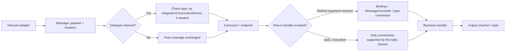

# Limits of Implicit Conversion in the Spring Integration Runtime

## 1. What Is Implicit Conversion, and Why Know Its Limits?

In Spring Integration, **implicit conversion** means the framework attempts to convert a value into the type needed by the next component even though the flow has no visible `transform()` step. For example, a message with a `String "42"` payload enters an endpoint expecting `Integer`, or passes through a channel that only accepts `Integer`. If a matching conversion mechanism exists at the **right place**, the runtime can convert the payload and continue processing.

The key point: **Spring Integration has no universal engine that automatically converts every message on every channel**. Type conversion depends on position in the flow, converter configuration, actual data types, metadata such as `contentType`, method invocation style, and library versions. Even a Java-level successful conversion does not guarantee business-valid data.

This topic belongs to the **Conversion** section of the **SPRING_INTEGRATION_RUNTIME** module. It helps explain why messages moving through channels, consumers, and endpoints are sometimes rejected, which thread handles errors, and how to design explicit conversion boundaries to reduce bugs, wasted retries, and runtime overhead.

After this lesson, you should be able to answer:

1. Is the runtime converting **at the channel, at method invocation, or in the adapter**?
2. Which values are converted by `ConversionService`, and which require a `MessageConverter` or transformer?
3. When conversion fails, does the error surface at `send()`, inside a poller/executor, or on an error channel?
4. When must you declare explicit conversion and validate incoming data?

## 2. Four Conversion Layers Commonly Confused with Each Other

| Layer | Location | Conversion Engine | Main Limitation |
| --- | --- | --- | --- |
| Java language conversion | In Java code, at compile time or runtime | Widening/boxing/unboxing, casts | Does not parse JSON or transform domain objects arbitrarily; not a Spring Integration mechanism. |
| Spring `ConversionService` | When a component explicitly invokes a converter | `Converter`, `ConverterFactory`, `GenericConverter` rules | Converts only supported type pairs; `ConversionService` instances in different contexts are not automatically the same bean. |
| Spring Messaging `MessageConverter` | Where a `Message<?>` is processed, e.g., argument resolver or adapter | Payload, target type, and possibly `contentType` header | Must be used by the **right component**; merely having `contentType` does not make every channel convert payloads. |
| Integration transformer | An explicit step in the flow (`@Transformer`, DSL `.transform(...)`) | Logic you write: parse, normalize, schema map, validate | Adds a step and needs error handling; in exchange, data flow is observable with explicit input/output contracts. |

**Two `ConversionService` beans to distinguish:**

- The Spring application's `conversionService` typically handles bean binding/configuration or other application needs.
- `integrationConversionService` is the bean Spring Integration uses at conversion-aware runtime points, such as datatype channels and payload type conversion. Converters can be registered via `@IntegrationConverter`/XML namespace; Spring Integration can create this service when needed. **Do not assume every converter registered for bean binding is automatically ready for message runtime.** You can configure sharing/aliasing if genuinely intentional and impact-assessed.

The following diagram highlights places where conversion **can** happen:



These steps are illustrative: not every flow uses datatype channels, SpEL, or converters. Adapters such as HTTP, JMS, and AMQP may also convert before a message enters the flow using **their own** converter configurations.

## 3. Real Limits of Implicit Conversion

### 3.1. Target Type Alone Is Not Enough: A Valid Conversion Path Must Exist

`"42"` can become an `Integer` if the processing point has a `String -> Integer` converter. However, `"42kg"` will not become an `Integer` merely by declaring an `Integer` parameter. Likewise, a `String` containing JSON does not turn into an `Order` without a JSON converter matching the target type, metadata, and configuration.

| Input Payload | Target Receiver | Likely Outcome | Must Not Assume |
| --- | --- | --- | --- |
| `Integer(42)` | `Number` parameter | Can be passed directly since `Integer` is a `Number`. | Any converter needs to run. |
| `String "42"` | `Integer` parameter | Can convert if the resolver/conversion service supports it. | Every endpoint auto-parses numbers. |
| `String "abc"` | `Integer` parameter | Converter may exist, yet parsing still fails. | Having a converter means every value is valid. |
| `String "{...}"` | `Order` parameter | Can convert via a JSON `MessageConverter` and compatible `contentType`. | Adding `contentType` header alone suffices. |
| `Map<String,Object>` | `Order` parameter | Needs an appropriate mapper or converter. | Framework natively understands schemas and builds arbitrary POJOs from `Map`. |
| `List<Map<...>>` | `List<Order>` | Depends on resolver/converter and generic type info. | Every element will be mapped or validated properly. |
| `byte[]` | `String` parameter | Depends on charset/converter and MIME type. | Bytes are always UTF-8 or text. |

**Type compatibility (assignable)** differs from **convertibility (convertible)**. `Number.class.isAssignableFrom(Integer.class)` is true; `Integer.class.isAssignableFrom(String.class)` is false. A converter step runs only when that component *supports and requires* conversion.

### 3.2. `contentType` Is Metadata, Not a Global Conversion Command

A `contentType=application/json` header helps some `MessageConverter` implementations decide how to read a payload. It **does not** add Jackson on its own, guarantee valid JSON, declare a schema version, or mean `MessageChannel.send()` must automatically deserialize.

Syntactically valid JSON can still violate business rules: `amount=-100`, unsupported `currency`, stale `eventVersion`, or missing identifiers. These require explicit validation/logic at application boundaries.

### 3.3. No Guarantee of Unbounded Chained Conversions

Suppose converters `A -> B` and `B -> C` exist. Do not assume every point in Spring Integration automatically discovers a multi-hop `A -> C` path, even though a given `ConversionService` may support chained conversions in certain cases. Converter ordering, `canConvert`, target type, null/exception behavior, and configuration together determine the outcome. Test the real conversion path instead of guessing from a bean list.

### 3.4. Generics, Overloads, `Map`, and Multiple Parameters Can Be Ambiguous

The signature `handle(String payload, int priority)` has two unannotated parameters; the runtime cannot tell which binds from payload and which from headers. Do not expect a converter to guess your business intent. Annotate explicitly:

```java
import org.springframework.messaging.handler.annotation.Header;
import org.springframework.messaging.handler.annotation.Payload;

public String handle(@Payload String payload,
                     @Header("priority") int priority) {
    return priority + ":" + payload;
}
```

Similarly, an unannotated `Map` has special binding rules: it may represent the payload if the payload is a `Map`, or headers in another context. This is **method argument mapping**, not simple type conversion. Use `@Payload`, `@Header`, and `@Headers` to declare exact data sources and avoid ambiguity.

### 3.5. Adapter Configuration in One Place Does Not Automatically Apply Elsewhere

An HTTP inbound gateway may use `HttpMessageConverter`, while a Service Activator uses handler argument resolvers and converters. JMS/AMQP consumers also have their own converters and transport formats. Likewise, an in-memory converted Java type does **not** guarantee a message can be serialized, stored in a persistent `MessageStore`, or sent over a broker without configuring a matching codec.

**Design rule:** never treat a successful conversion at an inbound adapter as proof that the same payload will be converted automatically after crossing a queue, poller, another gateway, or an external producer.

## 4. Limits at Datatype Channels

A datatype channel enforces a *payload type contract* directly at the channel. The following example allows only `Integer`, configured via `setDatatypes(Integer.class)`:

```java
import org.springframework.context.annotation.Bean;
import org.springframework.context.annotation.Configuration;
import org.springframework.integration.channel.QueueChannel;
import org.springframework.messaging.PollableChannel;

@Configuration
class NumberChannelConfig {
    @Bean
    PollableChannel integersOnly() {
        QueueChannel channel = new QueueChannel();
        channel.setDatatypes(Integer.class);
        return channel;
    }
}
```

Sending `new GenericMessage<>(42)` passes immediately. Sending `new GenericMessage<>("42")` depends on whether `integrationConversionService` is registered in the context and has a matching converter. Without one, the channel rejects `String`; with one, it *can* convert to `Integer` **before** placing the message into the queue.

Explicitly register a runtime converter (e.g., in application configuration):

```java
import org.springframework.context.annotation.Bean;
import org.springframework.core.convert.converter.Converter;
import org.springframework.integration.annotation.IntegrationConverter;

final class DecimalTextToInteger implements Converter<String, Integer> {
    @Override
    public Integer convert(String text) {
        return Integer.valueOf(text.trim());
    }
}

@Bean
@IntegrationConverter
Converter<String, Integer> decimalTextToInteger() {
    return new DecimalTextToInteger();
}
```

`@IntegrationConverter` in this example must sit on the `@Bean` method inside a Spring-managed `@Configuration` class. When infrastructure detects the converter and builds/uses `integrationConversionService`, it enables the datatype channel to convert `"42"` into `Integer(42)`. Sending `"42kg"` still fails with `NumberFormatException` or a wrapped exception. If an upstream `String` uses a different locale format (`"1.000,50"`), this converter will not understand it: capture formatting rules in the contract and handle them explicitly.

```java
import org.springframework.messaging.Message;
import org.springframework.messaging.PollableChannel;
import org.springframework.messaging.support.GenericMessage;

void demo(PollableChannel integersOnly) {
    integersOnly.send(new GenericMessage<>("42"));
    Message<?> accepted = integersOnly.receive(0);
    if (accepted != null) {
        // With an active converter: accepted.getPayload() instanceof Integer
    }
}
```

Do not interpret `setDatatypes(Integer.class)` as `@Valid` checking, JSON schema validation, or numeric range checks. The channel only enforces accepted Java types and optionally invokes its configured converter; it does not know whether `42` is a valid business quantity.

**Channel converters differ from method-invocation converters.** By default, datatype channels use `DefaultDatatypeChannelMessageConverter` and `integrationConversionService` if present. You can configure a dedicated `MessageConverter` on a channel to inspect headers as well, but you must wire it intentionally. Creating a `MessageConverter` for a JSON-receiving endpoint does not make datatype channels use it automatically.

## 5. Limits at Service Activators and Method Argument Resolvers

For POJO method invocations based on `InvocableHandlerMethod`, `HandlerMethodArgumentResolver` can use a `MessageConverter` to convert the payload to the parameter type. Spring Integration provides `ConfigurableCompositeMessageConverter`, iterating through a converter list; per Spring Integration 6.5 documentation, the default list (in order) comprises:

1. `MappingJackson2MessageConverter` **if** a suitable Jackson library is on the classpath.
2. `ByteArrayMessageConverter`.
3. `ObjectStringMessageConverter`.
4. `GenericMessageConverter`.

Example of a method that may be invoked with a converted payload:

```java
import org.springframework.integration.annotation.ServiceActivator;
import org.springframework.messaging.handler.annotation.Payload;

record Order(String id, long amount) {}

class OrderHandler {
    @ServiceActivator(inputChannel = "ordersIn")
    public void receive(@Payload Order order) {
        // Here: order is already an Order if binding/conversion succeeded.
    }
}
```

If `ordersIn` receives a JSON `byte[]` payload with a compatible `contentType` and a Jackson converter is active in the method-invocation branch, the payload **can** become an `Order`. Yet you cannot generalize that to every endpoint; consider the initial payload type, method selection, converter, MIME type, and actual JSON data. Receiving an `Order` in the method also does not mean its fields passed business validation.

**Important exception:** Spring Integration documentation explicitly notes that `contentType`-based `MessageConverter` resolution **does not apply to SpEL-based method invocation**; that branch only supports class-to-class payload type conversion. Switching an endpoint from default method invocation to a SpEL expression can alter conversion behavior even with the exact same message and method signature.

**Converter ordering matters:** the composite tries delegates in order and takes the first non-`null` result; an unsupported converter skips by returning `null`, whereas a converter throwing an exception during parsing is not guaranteed to fall back to the next converter. Test `contentType` and registration order directly instead of relying on reading the converter list.

## 6. Choosing an Explicit Transformer at Domain Data Boundaries

When data arrives from external systems or requires strict formatting/validation, convert inside an explicit step. For example, a payment pipeline only accepts positive currency strings with `.` decimal notation and at most two decimal places. Do not rely on implicit `String -> BigDecimal`, because a generic converter cannot enforce these business rules.

```java
import java.math.BigDecimal;
import org.springframework.integration.annotation.ServiceActivator;
import org.springframework.integration.annotation.Transformer;
import org.springframework.messaging.handler.annotation.Payload;

class AmountEndpoints {
    @Transformer(inputChannel = "rawAmounts", outputChannel = "typedAmounts")
    public BigDecimal parse(@Payload String raw) {
        String normalized = raw.trim();
        if (!normalized.matches("[0-9]+(\\.[0-9]{1,2})?")) {
            throw new IllegalArgumentException("Invalid amount format: expected 0..2 decimals");
        }
        BigDecimal amount = new BigDecimal(normalized);
        if (amount.signum() <= 0) {
            throw new IllegalArgumentException("Amount must be positive");
        }
        return amount;
    }

    @ServiceActivator(inputChannel = "typedAmounts", outputChannel = "amountReceipts")
    public String record(BigDecimal amount) {
        return "ACCEPTED:" + amount.toPlainString();
    }
}
```

```java
import java.math.BigDecimal;
import org.springframework.context.annotation.Bean;
import org.springframework.context.annotation.Configuration;
import org.springframework.integration.annotation.EnableIntegration;
import org.springframework.integration.channel.DirectChannel;
import org.springframework.integration.channel.QueueChannel;
import org.springframework.messaging.MessageChannel;
import org.springframework.messaging.PollableChannel;

@Configuration
@EnableIntegration
class AmountFlowConfig {
    @Bean
    AmountEndpoints amountEndpoints() {
        return new AmountEndpoints();
    }

    @Bean
    MessageChannel rawAmounts() {
        return new DirectChannel();
    }

    @Bean
    MessageChannel typedAmounts() {
        DirectChannel channel = new DirectChannel();
        channel.setDatatypes(BigDecimal.class);
        return channel;
    }

    @Bean
    PollableChannel amountReceipts() {
        return new QueueChannel();
    }
}
```

Test sending through an application with an initialized context from the configuration above:

```java
import org.springframework.context.ApplicationContext;
import org.springframework.messaging.Message;
import org.springframework.messaging.MessageChannel;
import org.springframework.messaging.PollableChannel;
import org.springframework.messaging.support.MessageBuilder;

void sendExample(ApplicationContext context) {
    MessageChannel input = context.getBean("rawAmounts", MessageChannel.class);
    PollableChannel output = context.getBean("amountReceipts", PollableChannel.class);

    input.send(MessageBuilder.withPayload("125.50")
            .setHeader("correlationId", "payment-007")
            .build());

    Message<?> reply = output.receive(1_000);
    if (reply == null) {
        throw new IllegalStateException("No amount receipt");
    }
    // reply.getPayload().equals("ACCEPTED:125.50")
}
```

**Execution path:** `rawAmounts` → `@Transformer` (parse/validate) → `typedAmounts` (accepts only `BigDecimal`) → `@ServiceActivator` (process) → `amountReceipts` (queue holding replies). Sending `"125,50"` is rejected by `parse()` **before** reaching `typedAmounts`; sending a negative number is rejected by the validator; if the transformer were mistakenly changed to return a `String`, the datatype channel catches the mismatch. You can attach an `errorChannel`/advice as needed, though this validation failure does not automatically trigger business-policy retries.

The crucial lesson of this example is separating **syntax conversion**, **monetary validation**, and **the post-conversion type contract**. If multiple sources use different formats, give each source an appropriate adapter/transformer rather than building a global converter that silently accepts every locale.

## 7. Limits Related to Channels, Threading, Transactions, and Message Stores

Converters execute where the receiving/dispatching component requires them, so **when an error surfaces** depends on flow topology:

| Runtime Component | When Conversion Typically Runs | How the Caller Observes Errors |
| --- | --- | --- |
| Datatype `DirectChannel` | On channel send, before dispatch/during message validation. | Typically throws inside `send()` if conversion/type checking fails. |
| `DirectChannel` + Service Activator | When the consumer resolves arguments on message receipt. | For synchronous handlers, exceptions can propagate back to the `send()` thread. |
| `ExecutorChannel` | Channel send time and handler run time are separate; each conversion binds to its component. | Handler errors typically occur on an executor thread; sender may have already returned from `send()`. |
| `QueueChannel` + polling consumer | Channel may check type on `send()`; handler may convert after the poller retrieves the message. | Poll-time errors belong to poller/advice/error handling, not necessarily the original caller. |
| Inbound adapter/gateway | May convert inside the adapter before sending to a Spring Integration channel. | Depends on protocol, converter, ack/response mechanism, and adapter retry config. |
| Persistent `MessageStore` / broker | May require a serializer/codec on save or recovery. | Parsing to an in-memory POJO does not guarantee persistence/recovery of the same type; depends on store and schema. |

**Transactions:** across a chain of synchronous `DirectChannel`s, an open transaction can span conversion, handler execution, and persistence on the same call stack. Crossing an `ExecutorChannel` or poller does not propagate the sending thread's transaction to the receiving thread. Conversion failures in async consumers need dedicated rollback/redelivery policies if required.

**Retries:** retries make sense only for transient failures (I/O, timeouts, temporary resource shortages); malformed JSON, invalid numeric formats, or missing required fields rarely fix themselves on retry. Retrying permanent conversion errors creates poison messages, wastes CPU, and clogs queues. Separate error categories and design dead-letter/quarantine routes fitting your transport.

**Correlation:** headers such as `correlationId`, `sequenceNumber`, `replyChannel`, and `errorChannel` are not automatically converted into domain fields. When a converter or transformer builds a new `Message` instead of returning a payload, verify header preservation so correlation and reply targets are not lost. Changing the payload type alone does not replace correlation/aggregation mechanisms.

**Performance:** JSON parsing, object allocation, string handling, and validation incur CPU and allocation costs; trying multiple converters adds overhead. Measure latency at adapters, channels, converters/transformers, queues, and handlers. Never add threads simply to mask parse failures or datatype mismatches. With message stores, also measure payload size and serialization cost.

## 8. Diagnosing When Implicit Conversion Fails to Work

A practical investigation sequence:

1. **Inspect the true payload type:** safely log `message.getPayload().getClass().getName()` and payload size/characteristics without logging tokens, personal data, or sensitive JSON bodies.
2. **Locate the failure site:** datatype channel, method argument resolver, adapter converter, transformer, serializer, or inside handler logic?
3. **Check type expectations:** `setDatatypes(...)`, `@Payload`, `Message<T>`, method overloads, generics, and `@Header` types.
4. **Confirm which converter runs:** `integrationConversionService` or an endpoint/adapter `MessageConverter`? Is the bean in the right context/name, on the classpath, and in the right order?
5. **Inspect metadata/format:** `contentType`, charset, JSON shape, locale, number/date formats, schema version, null/missing fields, and size limits.
6. **Follow exception causes and threads:** root causes (parse errors, `ConversionFailedException`, `MessageConversionException`, etc.) may be wrapped in `MessageDeliveryException`/`MessagingException`. Across executors/pollers, inspect the error channel and worker thread, not just producer logs.
7. **Create a minimal deterministic test:** send one already-typed payload, one differently typed yet validly convertible payload, and one invalid payload; assert expected values/outcomes at each step.

Sample symptom table:

| Symptom | Common Cause | Layer-Appropriate Fix |
| --- | --- | --- |
| `expected ... datatypes ... but received ...` | Datatype channel received an incompatible payload and could not convert it. | Fix producer or register channel converter; consider an explicit transformer. |
| `No converter found` / `ConversionFailedException` | Missing converter pair or invalid input value. | Check `integrationConversionService`, classpath, target type, and actual value. |
| Failed binding `Order` from JSON | Incompatible `contentType`/Jackson/target type or invalid JSON payload. | Configure the right `MessageConverter`; use an explicit converter/transformer for complex schemas. |
| Method has multiple parameters and ambiguity error | Unclear where payload/headers should bind. | Add `@Payload`, `@Header`, `@Headers`, and disambiguate methods. |
| No error visible in `send()` | Flow uses an executor/poller; error happens on a worker thread. | Inspect error channel, advice, poller, retries, and correlation logs. |
| Message converts cleanly yet handler rejects it | Structurally valid type violating business rules. | Validate schema and business invariants at the domain boundary. |

## 9. Criteria for Choosing Implicit vs. Explicit Conversion

Use implicit conversion only when risk is low and behavior is proven: unambiguous type pairs, stable formats, no locale/schema subtleties, converters placed accurately, and predictable error handling. For instance, `String "42"` to `Integer` inside a tightly controlled internal pipeline.

Prefer an **explicit transformer** for external integrations, schema-governed JSON/XML/Avro, currency/date-time formatting, versioned payloads, business validation, precision control, or when conversion metrics are needed. When multiple producers feed a flow, establish clear contracts for `payloadType`, `contentType`, version, required fields, locale/time zone, and error policies at each source boundary.

Pre-production checklist:

- Identify who owns the parse/validation boundary and the exact post-boundary payload type.
- Keep converters narrow in scope; avoid global converters that silently alter unrelated flows.
- Write tests for valid inputs, syntax errors, overflow/precision, missing headers, schema evolution, and oversized messages.
- Track conversion failure rates by source/schema/version; separate permanent data errors from retryable infrastructure failures.
- For async/polling flows, verify error channels, message stores, redelivery, dead-letter routes, and correlation header preservation.

## 10. Exercises and Self-Check Questions

**Exercise 1 — Datatype channel:** create a `QueueChannel` accepting only `Integer`, and send three payloads: `Integer(7)`, `String "7"`, and `String "seven"`. Run in a context without a runtime converter and in a context with `@IntegrationConverter`. Record outcomes/exceptions for each case.

**Exercise 2 — Method binding:** write a Service Activator with `handle(@Payload String name, @Header("priority") int priority)`. Send messages with `priority` as an integer, a numeric string, and a non-numeric string. Observe header conversion and exception causes; explain why two unannotated parameters should be avoided.

**Exercise 3 — JSON:** send identical JSON to a method taking `Order` under two setups: with and without a suitable JSON converter. Test `contentType=application/json`, missing header, and JSON missing a required field. Distinguish *deserialization* from *business validation*.

**Exercise 4 — Explicit boundary:** extend `AmountEndpoints.parse()` to accept `VND` amounts with no fractional digits and `USD` amounts with up to two decimal places. Store currency as an enum in the result object. Prove `BigDecimal` is constructed with the right scale and invalid inputs are rejected.

**Exercise 5 — Threading and retry:** replace `rawAmounts` with an executor-backed flow or insert `QueueChannel` + poller. Log thread names before and after the transformer, send a malformed message, and locate where the error surfaces. Test bounded retries and explain why the same bad payload should not be retried indefinitely.

Self-check questions:

1. How does `integrationConversionService` differ from the `conversionService` used in bean binding?
2. Why does adding `contentType=application/json` to a message not guarantee a handler receives a POJO?
3. Does a datatype channel validate business data or the Java type of the payload?
4. When using SpEL method invocation, does `MessageConverter`-based conversion still apply identically to the `InvocableHandlerMethod` path?
5. Why can `send()` return before a handler's conversion error appears on an `ExecutorChannel`?

## 11. Official Documentation for Reference

- Spring Integration 6.5 — [Message Endpoints: Payload Type Conversion, Content Type Conversion](https://docs.spring.io/spring-integration/reference/6.5/endpoint.html).
- Spring Integration 6.5 — [Configuring Message Channels: Datatype Channel Configuration](https://docs.spring.io/spring-integration/reference/6.5/channel/configuration.html).
- Spring Integration 6.5 — [Message Mapping Rules and Conventions](https://docs.spring.io/spring-integration/reference/6.5/configuration/message-mapping-rules.html).
- Spring Integration 6.5 — [Service Activator](https://docs.spring.io/spring-integration/reference/6.5/service-activator.html).
- Spring Framework — [`ConversionService` API](https://docs.spring.io/spring-framework/docs/current/javadoc-api/org/springframework/core/convert/ConversionService.html).
