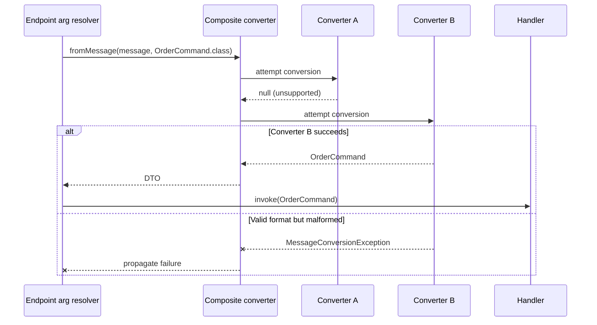
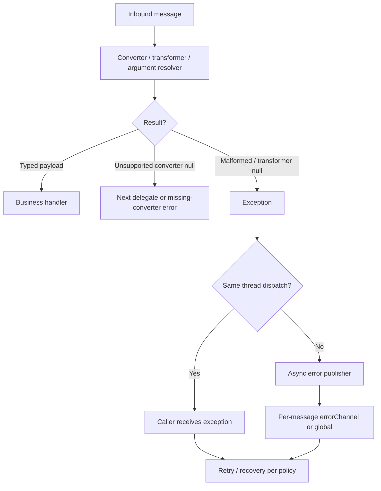

# Testing Converters by Payload Type and Null Handling in Spring Integration

## 1. Why Must Conversion Be Tested at Runtime?

In the **Conversion** chapter of the `SPRING_INTEGRATION_RUNTIME` module, messages pass through channels, endpoints, consumers, pollers, and executors; payloads can change representation before reaching the business handler. An inbound adapter might produce `Message<byte[]>`, while a service activator expects `OrderCommand`. A gateway might send a `String` containing JSON, while a transformer emits a DTO. If you only test the happy path, critical failures slip through easily: wrong payload type, wrong `contentType` header, mismatched character encoding, empty strings, malformed data, or methods returning `null`.

The most common source of confusion is that **`null` does not have a single meaning**. In Spring Messaging/Spring Integration:

- A standard `Message<?>` **cannot have a Java `null` payload**; constructing `GenericMessage<>(null)` is rejected.
- `MessageConverter.fromMessage(...)` may **return `null`** to signal *this converter does not handle* the requested payload/target/content type.
- A **transformer** is expected to produce an output; a transformer returning `null` raises `MessageTransformationException`.
- A **service activator** returning `null` or `void` can be valid when no reply is required, but if `requiresReply=true`, it is an error.
- A **filter** drops messages by returning false and `nullChannel` discards messages sent to it; neither turns a payload into Java `null`.

This lesson aims to help you design a **test matrix across payload types, headers, and null boundaries**, and apply it to Spring Integration flows so conversion failures do not turn into "vanishing messages" or infinite retries.

### Learning Objectives

After this lesson, you will be able to:

1. Distinguish `MessageConverter`, Spring `ConversionService`, transformers, and handler parameter resolution.
2. Write tests for `String`, `byte[]`, DTOs, unsupported types, valid/invalid `contentType`, empty payloads, and malformed inputs.
3. Verify exactly when a converter is allowed to return `null` versus when it must throw `MessageConversionException`.
4. Test transformers/service activators returning `null` through real endpoints rather than only calling POJO methods directly.
5. Distinguish synchronous conversion failures from error handling on executors/pollers.
6. Preserve message IDs/correlation/business keys across required steps and control sensitive error data in logs.
7. Design a test suite aligned with transactions, retries, message stores, and post-restart recovery.

## 2. Four Conversion Layers to Recognize

| Layer | API / Component | Input → Output | Error / Null Semantics |
|---|---|---|---|
| **Message conversion** | `org.springframework.messaging.converter.MessageConverter` | `Message<?>` ↔ deserialized value / serialized `Message<?>` | `fromMessage` or `toMessage` returns `null` when unsupported; may throw if data is recognized yet invalid |
| **General type conversion** | `org.springframework.core.convert.ConversionService` | Object of Java type A → Object of type B | May throw `ConversionFailedException`/`ConverterNotFoundException`; contract depends on converter |
| **Message transformation** | Spring Integration `Transformer` / `@Transformer` | Message → new payload or Message | Transformer returning `null` is treated as an error, not a filter |
| **Handler argument resolution** | `@ServiceActivator`, `@Transformer`-annotated methods, `PayloadArgumentResolver` | Inbound message → Java method parameter | May use conversion service/message converter; if unresolvable, handler fails to run as expected |

Spring Integration 5.0+ supports conversion when binding handler method arguments via `InvocableHandlerMethod` infrastructure. `ConfigurableCompositeMessageConverter` tries delegates in order, typically including Jackson (if on classpath), `ByteArrayMessageConverter`, `ObjectStringMessageConverter`, and `GenericMessageConverter`. The exact list and policy depend on project configuration and version; adding a Jackson dependency or custom converter can cause previously failing inputs to convert differently.

**Do not confuse calling `converter.fromMessage(...)` manually in a unit test with Spring Integration automatically using that converter for every handler.** To test real method argument conversion, register the converter in the argument resolver infrastructure or place an explicit conversion boundary in the flow, then send messages through real channels.

### Typical Path

```mermaid
flowchart LR
    A[Inbound adapter: byte[] / String] --> B[Message headers: contentType, eventId]
    B --> C{Conversion boundary}
    C -->|Valid| D[OrderCommand typed payload]
    C -->|Unsupported| E[Converter returns null / composite tries next delegate]
    C -->|Recognized malformed| F[MessageConversionException]
    D --> G[Service activator / business handler]
    E --> H{Another converter?}
    H -- Yes --> C
    H -- No --> I[Explicit reject / error handling]
    F --> I
```

A `null` return from **a single converter delegate** does not mean the endpoint "finished processing" or that the message should be dropped. The composite can try the next delegate. If no delegate succeeds, the calling layer must explicitly reject or handle the error.

## 3. Payload Type and Null Test Matrix

Use this matrix to design test cases before writing implementation code. Avoid relying on accidental behavior of a default converter when a business contract requires a strict format.

| Input Payload | Target Type | `contentType` | Expected Oracle |
|---|---|---|---|
| Properly formatted `String` | DTO | Valid, e.g., `text/x-order` | DTO with expected fields and business ID |
| Properly formatted `String` | Unsupported type, e.g., `Long` | Valid | Specialized converter returns `null` |
| `byte[]` | DTO | Valid, though converter only handles String | `null` or handled by a dedicated `byte[]` delegate per contract |
| Already-typed DTO | DTO | Appropriate | Not misparsed or needlessly re-converted |
| `String` with wrong MIME | DTO | `application/json` or missing | Not silently parsed by another parser |
| `String` with blank field | DTO | Valid | Informative validation/conversion error |
| Malformed `String` | DTO | Valid | `MessageConversionException`, not a silent drop |
| `""` or `"   "` | DTO | Valid | Distinguish empty, blank, and missing tokens; no NPE |
| `"null"` literal or JSON text `"null"` | DTO | Contract dependent | Do not confuse literal text with Java `null` |
| Java `null` payload | `Message<?>` | Any | Message construction rejected |
| Converter returns Java `null` | Method handler | Any | Verify fallback vs. conversion-failure contract |
| Transformer returns Java `null` | Output message | Any | `MessageTransformationException` |
| Service activator returns Java `null` | Reply | `requiresReply=false` | No reply sent; not a null-payload message |
| Service activator returns Java `null` | Reply | `requiresReply=true` | `ReplyRequiredException` |

This matrix highlights two distinct test groups: **data conversion capability** and **null-return semantics across components**. Do not write a single `null` test and treat both as covered.

## 4. A Spring Message Payload Cannot Be Java Null

`MessageHeaders` may omit a specific header; however, `Message.getPayload()` on a `GenericMessage` must be non-`null`.

JUnit 5 example:

```java
import org.junit.jupiter.api.Test;
import org.springframework.messaging.support.GenericMessage;
import org.springframework.messaging.support.MessageBuilder;

import static org.junit.jupiter.api.Assertions.*;

class MessageNullContractTest {

    @Test
    void rejectsActualNullPayload() {
        assertThrows(IllegalArgumentException.class,
                () -> new GenericMessage<>(null));

        assertThrows(IllegalArgumentException.class,
                () -> MessageBuilder.withPayload((String) null).build());
    }

    @Test
    void emptyStringIsStillARealPayload() {
        var message = MessageBuilder.withPayload("").build();

        assertNotNull(message.getPayload());
        assertEquals("", message.getPayload());
    }

    @Test
    void optionalEmptyIsNotJavaNull() {
        var message = MessageBuilder
                .withPayload(java.util.Optional.empty())
                .build();

        assertNotNull(message.getPayload());
    }
}
```

**What this proves:** an empty string, empty byte array, `Optional.empty()`, and JSON literal `"null"` are all **real payload values** when used to construct a message. They are not Java `null` payloads. If a serializer wants to represent "no value," that must be defined in the format/DTO/envelope rather than breaking the Spring `Message<?>` contract.

`NullChannel` is not a "message with a null payload" either. It is a special channel that accepts and discards messages; use it when you intentionally want no downstream reply. To drop messages conditionally, use a `Filter` rather than returning `null` from a transformer.

## 5. Designing a Converter with a Well-Defined Contract

Rather than depending on an unconfigured JSON mapper, we build a **small converter supporting one wire format** so every test branch is crystal clear.

Illustrative contract:

- Business payload: `OrderCommand(eventId, quantity)`.
- On-channel representation: `String` formatted as `eventId|quantity`, e.g., `"evt-301|4"`.
- Content type: `text/x-order`.
- Supports **String → OrderCommand** and **OrderCommand → String Message**.
- If target type or content type is outside the converter's scope: **return `null`** so another delegate can handle it.
- If the format is recognized yet values are invalid: **throw `MessageConversionException`**; never substitute a half-valid `OrderCommand`.
- `eventId` must not be blank or contain `|`, and `quantity` must be a positive integer.

### 5.1. Model

File `OrderCommand.java`:

```java
package example.integration;

public record OrderCommand(String eventId, int quantity) {}
```

### 5.2. MessageConverter Implementation

File `PipeOrderMessageConverter.java`, using Spring Messaging and Spring Core:

```java
package example.integration;

import org.springframework.messaging.Message;
import org.springframework.messaging.MessageHeaders;
import org.springframework.messaging.converter.MessageConversionException;
import org.springframework.messaging.converter.MessageConverter;
import org.springframework.messaging.support.MessageBuilder;
import org.springframework.util.MimeType;
import org.springframework.util.MimeTypeUtils;

public final class PipeOrderMessageConverter implements MessageConverter {

    private static final MimeType WIRE_TYPE =
            MimeTypeUtils.parseMimeType("text/x-order");

    @Override
    public Object fromMessage(Message<?> message, Class<?> targetClass) {
        if (targetClass != OrderCommand.class
                || !(message.getPayload() instanceof String raw)
                || !supported(message.getHeaders().get(
                        MessageHeaders.CONTENT_TYPE))) {
            // This converter is not responsible for that input.
            return null;
        }

        String[] parts = raw.split("\\|", -1);

        if (parts.length != 2
                || parts[0].isBlank()
                || parts[0].contains("|")) {
            throw new MessageConversionException(
                    message, "Invalid order wire format");
        }

        try {
            int quantity = Integer.parseInt(parts[1]);

            if (quantity <= 0) {
                throw new MessageConversionException(
                        message, "Quantity must be positive");
            }

            return new OrderCommand(parts[0], quantity);
        } catch (NumberFormatException invalidNumber) {
            throw new MessageConversionException(
                    message, "Quantity is not an integer", invalidNumber);
        }
    }

    @Override
    public Message<?> toMessage(Object payload, MessageHeaders headers) {
        if (!(payload instanceof OrderCommand command)) {
            return null;
        }

        if (headers != null
                && headers.containsKey(MessageHeaders.CONTENT_TYPE)
                && !supported(headers.get(MessageHeaders.CONTENT_TYPE))) {
            return null;
        }

        if (command.eventId() == null
                || command.eventId().isBlank()
                || command.eventId().contains("|")
                || command.quantity() <= 0) {
            throw new MessageConversionException(
                    "OrderCommand cannot be serialized");
        }

        MessageBuilder<String> builder = MessageBuilder.withPayload(
                command.eventId() + "|" + command.quantity());

        if (headers != null) {
            builder.copyHeaders(headers);
        }

        return builder
                .setHeader(MessageHeaders.CONTENT_TYPE, WIRE_TYPE)
                .build();
    }

    private boolean supported(Object contentTypeHeader) {
        if (contentTypeHeader instanceof MimeType mimeType) {
            return WIRE_TYPE.isCompatibleWith(mimeType);
        }

        if (contentTypeHeader instanceof String text) {
            try {
                return WIRE_TYPE.isCompatibleWith(
                        MimeTypeUtils.parseMimeType(text));
            } catch (IllegalArgumentException invalidMimeType) {
                return false;
            }
        }

        return false;
    }
}
```

**Scope explanation:**

1. `fromMessage` handles only `targetClass == OrderCommand.class` and `payload instanceof String`. For `byte[]` or `Map`, the converter returns `null` so another layer handles it or the endpoint reports "no converter".
2. `contentType` may arrive as a `MimeType` or a string; the example handles both, but **never guesses a format when the header is missing**.
3. `"evt-301|x"` is recognized by the converter yet has invalid content, so it throws. For `"evt-301|0"`, business validation rejects the quantity.
4. `toMessage` accepts only `OrderCommand`; data must be valid before building `Message<?>`.
5. The converter **does not log the raw payload** in the exception; error messages can be recorded on the error channel without exposing sensitive information.
6. When `headers` already carries a different `contentType`, the converter declines; when absent, it **explicitly sets** `text/x-order` on output.
7. `copyHeaders` preserves needed application headers when building a new message, though you must not assume every header is safe to send to a broker or across processes. Internal headers holding channel objects have their own lifecycle.

This is a **custom wire format for learning testing**, not a recommendation to invent a new protocol where systems already standardize on JSON/Avro/Protobuf. In production, use appropriate serializers/schemas, versioning, validation, and compatibility tests.

## 6. JUnit 5: Testing Each Payload Type

Tests must reflect the **converter contract** without conflating default Jackson or endpoint behavior. The example requires JUnit Jupiter; no Spring `ApplicationContext` startup is needed.

File `PipeOrderMessageConverterTest.java`:

```java
package example.integration;

import java.util.Map;
import java.util.stream.Stream;

import org.junit.jupiter.api.BeforeEach;
import org.junit.jupiter.api.Test;
import org.junit.jupiter.params.ParameterizedTest;
import org.junit.jupiter.params.provider.Arguments;
import org.junit.jupiter.params.provider.MethodSource;
import org.junit.jupiter.params.provider.ValueSource;
import org.springframework.messaging.Message;
import org.springframework.messaging.MessageHeaders;
import org.springframework.messaging.converter.MessageConversionException;
import org.springframework.messaging.support.MessageBuilder;
import org.springframework.util.MimeTypeUtils;

import static org.junit.jupiter.api.Assertions.*;

class PipeOrderMessageConverterTest {

    private PipeOrderMessageConverter converter;

    @BeforeEach
    void setup() {
        converter = new PipeOrderMessageConverter();
    }

    private static Message<?> raw(Object payload, Object contentType) {
        return MessageBuilder.withPayload(payload)
                .setHeader(MessageHeaders.CONTENT_TYPE, contentType)
                .build();
    }

    @Test
    void stringPayloadToTypedOrder() {
        Message<?> message = raw("evt-301|4", "text/x-order");

        OrderCommand order = assertInstanceOf(
                OrderCommand.class,
                converter.fromMessage(message, OrderCommand.class));

        assertEquals("evt-301", order.eventId());
        assertEquals(4, order.quantity());
    }

    @Test
    void acceptsMimeTypeObjectAsContentType() {
        Message<?> message = raw("evt-302|1",
                MimeTypeUtils.parseMimeType("text/x-order"));

        assertEquals(new OrderCommand("evt-302", 1),
                converter.fromMessage(message, OrderCommand.class));
    }

    static Stream<Arguments> unsupportedInputs() {
        return Stream.of(
                Arguments.of(raw("evt-303|3", "application/json"),
                        OrderCommand.class),
                Arguments.of(raw("evt-303|3", "text/x-order"),
                        Integer.class),
                Arguments.of(raw(new byte[] {1, 2, 3}, "text/x-order"),
                        OrderCommand.class),
                Arguments.of(raw(Map.of("id", "evt-303"),
                        "text/x-order"), OrderCommand.class),
                Arguments.of(raw("evt-303|3", "not a mime type"),
                        OrderCommand.class)
        );
    }

    @ParameterizedTest
    @MethodSource("unsupportedInputs")
    void returnsNullForUnsupportedConversion(
            Message<?> message, Class<?> targetClass) {
        assertNull(converter.fromMessage(message, targetClass));
    }

    @ParameterizedTest
    @ValueSource(strings = {
            "", "   ", "|3", "evt-303", "evt-303|",
            "evt-303|x", "evt-303|0", "evt-303|-2",
            "evt-303|1|extra"
    })
    void rejectsMalformedDataInSupportedFormat(String payload) {
        Message<?> message = raw(payload, "text/x-order");

        assertThrows(MessageConversionException.class,
                () -> converter.fromMessage(
                        message, OrderCommand.class));
    }

    @Test
    void toMessageRoundTripPreservesAllowedHeader() {
        MessageHeaders headers = new MessageHeaders(
                Map.of("traceId", "trace-301"));

        Message<?> serialized = converter.toMessage(
                new OrderCommand("evt-301", 4), headers);

        assertNotNull(serialized);
        assertEquals("evt-301|4", serialized.getPayload());
        assertEquals("trace-301", serialized.getHeaders().get("traceId"));
        assertEquals(new OrderCommand("evt-301", 4),
                converter.fromMessage(serialized, OrderCommand.class));
    }

    @Test
    void unsupportedOutboundTypeOrContentTypeReturnsNull() {
        assertNull(converter.toMessage(
                Map.of("eventId", "evt-301"), null));

        MessageHeaders jsonHeaders = new MessageHeaders(
                Map.of(MessageHeaders.CONTENT_TYPE,
                        MimeTypeUtils.APPLICATION_JSON));

        assertNull(converter.toMessage(
                new OrderCommand("evt-301", 4), jsonHeaders));
    }

    @Test
    void invalidTypedPayloadFailsExplicitly() {
        assertThrows(MessageConversionException.class,
                () -> converter.toMessage(
                        new OrderCommand("", 2), null));

        assertThrows(MessageConversionException.class,
                () -> converter.toMessage(
                        new OrderCommand("evt-301", 0), null));
    }

    @Test
    void missingContentTypeIsUnsupportedByThisConverter() {
        Message<?> message = MessageBuilder
                .withPayload("evt-304|2").build();

        assertNull(converter.fromMessage(
                message, OrderCommand.class));
    }

    @Test
    void emptyByteArrayIsNonNullButUnsupportedHere() {
        Message<?> message = raw(new byte[0], "text/x-order");

        assertNotNull(message.getPayload());
        assertNull(converter.fromMessage(
                message, OrderCommand.class));
    }

    @Test
    void literalNullTextIsNotJavaNull() {
        Message<?> message = raw("null", "text/x-order");

        assertThrows(MessageConversionException.class,
                () -> converter.fromMessage(
                        message, OrderCommand.class));
    }
}
```

### Expected Outcomes

- **Happy path:** parsed DTO has exact `eventId` and `quantity`, outbound round-trip reads back cleanly; `traceId` demonstrates context preservation.
- **Unsupported:** the converter returns Java `null` for wrong target, wrong payload type, and wrong MIME. That is the **intentional** contract of `MessageConverter`.
- **Invalid data in a recognized format:** the converter throws `MessageConversionException`; the test ensures malformed data is never turned into a dangerous "default" object.
- **Literal null:** `"null"` is a four-character string, not Java `null`; only a specific parser assigns meaning to it.
- **No Spring context started:** these tests verify the standalone implementation; they do not yet prove an adapter or argument resolver actually invokes the converter.

**Note:** imports and tests above target Spring Messaging on Spring Framework 6.x/7.x and JUnit Jupiter. Verify compatibility with your application's BOM; when managing dependencies, never mix incompatible Spring version lines.

## 7. Testing Composites and Converter Ordering

In Spring Integration, argument resolvers can use `ConfigurableCompositeMessageConverter`. A composite tries delegates in sequence; returning `null` lets the next delegate try. If a converter **throws an exception**, that is not "unsupported," and can halt the chain right at the failure.



### Minimum Cases to Test

| Condition | Oracle |
|---|---|
| Specialized converter placed **before** generic fallback | Custom format input is handled by the specialized converter |
| Specialized converter returns `null` for another MIME | Next delegate gets a chance if it supports that MIME |
| Specialized converter throws on malformed data | Error is not treated as "unsupported" and skipped |
| Jackson added to classpath | Verify converter ordering and output on real JSON input |
| Message payload is already the right DTO type | No unintended extra serialization/deserialization |
| Missing content type | Fallback follows chosen policy, without blindly assuming JSON |
| Wrong content type | Incompatible data is not silently accepted |

A simple source snippet illustrating Spring Messaging's composite class:

```java
import java.util.List;
import org.springframework.messaging.converter.CompositeMessageConverter;
import org.springframework.messaging.converter.MessageConverter;
import org.springframework.messaging.converter.StringMessageConverter;

MessageConverter composite = new CompositeMessageConverter(
        List.of(new PipeOrderMessageConverter(),
                new StringMessageConverter()));
```

In this snippet, `StringMessageConverter` handles its own supported types/`contentType`; do not assume an arbitrary input will convert to `OrderCommand`. If you need **Spring Integration's default converters** plus custom ones, configure `ConfigurableCompositeMessageConverter` / the argument resolver bean per your project's version instead of replacing the entire list without understanding the consequences.

## 8. Testing Conversion Inside a Real Endpoint

Converter unit tests can pass while the pipeline still fails because the converter is not registered or the endpoint calls a different method. To avoid this, place an **explicit** conversion boundary inside a `@ServiceActivator` and send messages through a `DirectChannel`.

### 8.1. Spring Integration Configuration

File `ConversionFlowConfig.java`:

```java
package example.integration;

import java.util.concurrent.atomic.AtomicInteger;

import org.springframework.context.annotation.Bean;
import org.springframework.context.annotation.Configuration;
import org.springframework.integration.annotation.ServiceActivator;
import org.springframework.integration.channel.DirectChannel;
import org.springframework.integration.config.EnableIntegration;
import org.springframework.messaging.Message;
import org.springframework.messaging.MessageChannel;
import org.springframework.messaging.converter.MessageConversionException;

@Configuration
@EnableIntegration
public class ConversionFlowConfig {

    @Bean("rawOrdersIn")
    public MessageChannel rawOrdersIn() {
        return new DirectChannel();
    }

    @Bean
    public PipeOrderMessageConverter pipeOrderMessageConverter() {
        return new PipeOrderMessageConverter();
    }

    @Bean
    public ReceivedOrders receivedOrders(
            PipeOrderMessageConverter converter) {
        return new ReceivedOrders(converter);
    }

    public static final class ReceivedOrders {
        private final PipeOrderMessageConverter converter;
        private final AtomicInteger accepted = new AtomicInteger();

        public ReceivedOrders(PipeOrderMessageConverter converter) {
            this.converter = converter;
        }

        @ServiceActivator(inputChannel = "rawOrdersIn")
        public void receive(Message<?> message) {
            Object converted = converter.fromMessage(
                    message, OrderCommand.class);

            if (!(converted instanceof OrderCommand order)) {
                throw new MessageConversionException(
                        message, "Unsupported order payload/contentType");
            }

            accepted.incrementAndGet();
            // Demo: invoke business service with order if needed.
        }

        public int acceptedCount() {
            return accepted.get();
        }
    }
}
```

In this code, the converter is invoked explicitly at an easily testable boundary rather than applied implicitly to every `@ServiceActivator`. For automatic method argument conversion, configure the argument resolver and `ConfigurableCompositeMessageConverter` using the exact bean name and conventions for your Spring Integration version.

### 8.2. JUnit Test Through a Real Channel

```java
package example.integration;

import org.junit.jupiter.api.Test;
import org.springframework.context.annotation.AnnotationConfigApplicationContext;
import org.springframework.messaging.MessageChannel;
import org.springframework.messaging.MessagingException;
import org.springframework.messaging.MessageHeaders;
import org.springframework.messaging.support.MessageBuilder;

import static org.junit.jupiter.api.Assertions.*;

class ConversionFlowTest {

    @Test
    void acceptsRecognizedPayloadAndRejectsWrongMime() {
        try (var context = new AnnotationConfigApplicationContext(
                ConversionFlowConfig.class)) {

            var input = context.getBean(
                    "rawOrdersIn", MessageChannel.class);
            var recorder = context.getBean(
                    ConversionFlowConfig.ReceivedOrders.class);

            assertTrue(input.send(MessageBuilder
                    .withPayload("evt-501|2")
                    .setHeader(MessageHeaders.CONTENT_TYPE, "text/x-order")
                    .build()));

            assertEquals(1, recorder.acceptedCount());

            assertThrows(MessagingException.class, () -> input.send(
                    MessageBuilder.withPayload("evt-502|2")
                            .setHeader(MessageHeaders.CONTENT_TYPE,
                                    "application/json")
                            .build()));

            // Business handler is not successfully invoked on the second send.
            assertEquals(1, recorder.acceptedCount());
        }
    }
}
```

On a `DirectChannel`, handler exceptions typically propagate back to `send(...)`, often wrapped in a `MessagingException` around the actual cause. Tests should inspect the **cause chain** when distinguishing `MessageConversionException` from other errors rather than asserting a fixed outer wrapper class across all setups.

**Do not over-extrapolate:** `acceptedCount()` is a demo counter. It does not prove a database committed or a broker acknowledged. In systems with real transactions and retries, assert final business state and idempotency by event ID.

## 9. Null from a Transformer Differs from Null from a Service Activator

Spring Integration requires a transformer to always produce an output. When `@Transformer` returns `null`, the framework throws `MessageTransformationException`. This protects against accidentally using a transformer to filter out messages.

A service activator behaves differently: with `requiresReply=false` (default), returning `null` represents **no reply**. When `requiresReply=true`, `null` triggers `ReplyRequiredException`. This is an **endpoint contract**, not a `MessageConverter` contract.

### 9.1. Endpoint Test Fixture

File `NullBoundaryConfig.java`:

```java
package example.integration;

import org.springframework.context.annotation.Bean;
import org.springframework.context.annotation.Configuration;
import org.springframework.integration.annotation.ServiceActivator;
import org.springframework.integration.annotation.Transformer;
import org.springframework.integration.channel.DirectChannel;
import org.springframework.integration.channel.QueueChannel;
import org.springframework.integration.config.EnableIntegration;

@Configuration
@EnableIntegration
public class NullBoundaryConfig {

    @Bean("transformIn")
    public DirectChannel transformIn() {
        return new DirectChannel();
    }

    @Bean("transformOut")
    public QueueChannel transformOut() {
        return new QueueChannel();
    }

    @Bean("optionalReplyIn")
    public DirectChannel optionalReplyIn() {
        return new DirectChannel();
    }

    @Bean("optionalReplyOut")
    public QueueChannel optionalReplyOut() {
        return new QueueChannel();
    }

    @Bean("requiredReplyIn")
    public DirectChannel requiredReplyIn() {
        return new DirectChannel();
    }

    @Bean("requiredReplyOut")
    public QueueChannel requiredReplyOut() {
        return new QueueChannel();
    }

    @Bean
    public NullEndpoints nullEndpoints() {
        return new NullEndpoints();
    }

    public static final class NullEndpoints {

        @Transformer(
                inputChannel = "transformIn",
                outputChannel = "transformOut")
        public String brokenTransformer(String text) {
            return null;
        }

        @ServiceActivator(
                inputChannel = "optionalReplyIn",
                outputChannel = "optionalReplyOut")
        public String noReplyNeeded(String text) {
            return null;
        }

        @ServiceActivator(
                inputChannel = "requiredReplyIn",
                outputChannel = "requiredReplyOut",
                requiresReply = "true")
        public String replyRequired(String text) {
            return null;
        }
    }
}
```

### 9.2. Explicit Assertions

```java
package example.integration;

import org.junit.jupiter.api.Test;
import org.springframework.context.annotation.AnnotationConfigApplicationContext;
import org.springframework.integration.channel.QueueChannel;
import org.springframework.messaging.MessagingException;
import org.springframework.messaging.support.MessageBuilder;

import static org.junit.jupiter.api.Assertions.*;

class NullBoundaryTest {

    @Test
    void transformerNullIsErrorButOptionalReplyCanBeAbsent() {
        try (var context = new AnnotationConfigApplicationContext(
                NullBoundaryConfig.class)) {

            var transformIn = context.getBean(
                    "transformIn",
                    org.springframework.messaging.MessageChannel.class);
            var transformOut = context.getBean(
                    "transformOut", QueueChannel.class);

            assertThrows(MessagingException.class,
                    () -> transformIn.send(
                            MessageBuilder.withPayload("value").build()));
            assertNull(transformOut.receive(0));

            var optionalIn = context.getBean(
                    "optionalReplyIn",
                    org.springframework.messaging.MessageChannel.class);
            var optionalOut = context.getBean(
                    "optionalReplyOut", QueueChannel.class);

            assertTrue(optionalIn.send(
                    MessageBuilder.withPayload("value").build()));
            assertNull(optionalOut.receive(0));

            var requiredIn = context.getBean(
                    "requiredReplyIn",
                    org.springframework.messaging.MessageChannel.class);

            assertThrows(MessagingException.class,
                    () -> requiredIn.send(
                            MessageBuilder.withPayload("value").build()));
        }
    }
}
```

These tests build real contexts and endpoints. Calling `brokenTransformer("value")` directly only proves the Java method returns `null`—it **does not prove** Spring Integration throws `MessageTransformationException`. Sending through the channel is the essential part of the runtime test.

In logs, `MessageTransformationException`/`ReplyRequiredException` may be wrapped by another `MessagingException` as it passes through dispatchers/proxies. For precise assertions, defensively traverse the root cause and `MessagingException.getFailedMessage()`. Avoid exact string matching on exception messages since wording can change across versions.

### Choosing the Right Option When "No Message" Is Desired

| Requirement | Component / Approach | Why |
|---|---|---|
| Drop a message conditionally | `Filter` | Clear pass/reject contract |
| No reply needed after a side effect | `ServiceActivator` returning `void` or `null`, `requiresReply=false` | Avoids faking a null payload |
| Reply required yet no result exists | `requiresReply=true` with error handling, or return a status result DTO | Prevents confusing gateway timeouts |
| Intentionally discard an emitted reply | Send to `nullChannel` | Dedicated discard channel without mutating payloads |
| Optional business payload | Envelope/DTO with nullable fields or intentional `Optional` support | Outer message still holds a non-null payload |
| Transformer cannot convert | Throw a clear error or branch/filter before the transformer | Transformers should not return null like filters |

## 10. Nulls, JSON, `byte[]`, and Real Adapter Payloads

The tests above use `text/x-order` to isolate behavior. In real production systems, sources often emit `byte[]` or `String` containing JSON. Additional boundaries become critical:

### 10.1. `"null"` Content in JSON

`"null"` as a JSON string is 4 bytes/characters representing a JSON null literal, **not the Java null of a Spring `Message<?>`**. A JSON mapper may return `null` at the parse layer; the application must then decide whether a target object is required or whether an envelope representing "no data" is acceptable. Never attempt `MessageBuilder.withPayload(null)`.

### 10.2. Empty Byte Arrays and Empty Strings

`new byte[0]` is not `null`, yet a standard JSON parser cannot parse empty input. `""` differs from `"{}"`, `"[]"`, `"null"`, and a populated object. With a record DTO, JSON fields may also be missing or null. Tests should distinguish:

| Content | Oracle to Define |
|---|---|
| `byte[0]` | Reject empty or define an explicit empty protocol; never assume an empty DTO |
| `""` | Reject blank, or accept if allowed by the business contract |
| `"{}"` | Parser may produce a DTO with default/null fields; requires bean validation |
| `"[]"` | Scalar DTO target or collection DTO? Must not silently coerce types |
| `"null"` | Parser may yield null; do not send as a null-payload `Message<?>` |
| `{"id":null}` | Validate required/nullable fields, not merely deserialization success |
| Invalid UTF-8 | Fail explicitly rather than silently substituting replacement characters under strict contracts |
| MIME/charset mismatch | Verify decoder and actual message `contentType` |

### 10.3. Charset and `contentType`

For `byte[] → String`, the charset must be determined by protocol/headers or a documented default; never use `new String(bytes)` relying on the host's default charset when data contains Vietnamese diacritics and must work across environments.

Explicit example:

```java
import java.nio.charset.StandardCharsets;

byte[] raw = "đơn-hàng".getBytes(StandardCharsets.UTF_8);
String decoded = new String(raw, StandardCharsets.UTF_8);

assertEquals("đơn-hàng", decoded);
```

In this snippet, `assertEquals` is from JUnit; real tests should simultaneously check `byte[]` from the adapter/broker and the `contentType` header, e.g., `application/json;charset=UTF-8`. If a source uses an unsupported charset or inconsistent headers, reject/quarantine with sufficient diagnostic info.

### 10.4. Generic Types and Schema Evolution

Converting to `List<OrderCommand>` is not the same as converting to `OrderCommand.class`. When generic types are required, use APIs/metadata such as `ResolvableType`, type hints, or target-aware converters; never pass raw `List.class` and assume elements are instantiated with the right type.

When deploying a new version, store old messages in `JdbcMessageStore` or a broker and read them back with the new version. Compatibility tests should cover:

1. Old version receives new fields added later; the new version handles them per policy.
2. New version renames/changes a field type; can backlogged messages from the old version still be read?
3. Are missing fields and explicit JSON nulls handled distinctly?
4. When `contentType` or schema ID is missing/wrong, does the error flow retain the business ID and raw payload safely?
5. With real PII data, do error logs/`failedMessage` leak sensitive data when a converter throws?

## 11. When Conversion Failures Traverse Channels and Error Channels

A converter throwing does not automatically mean the message lands on the global `errorChannel`. The error path depends on **dispatch boundaries**:

| Topology | Where Errors Can Surface | What Tests Should Assert |
|---|---|---|
| `DirectChannel` + synchronous service activator | Exception propagates back to `send()`, typically as `MessagingException`/cause | `assertThrows` at caller and unchanged business state |
| `ExecutorChannel` or async processing | Error on worker thread; error publisher may create an `ErrorMessage` | Send message with `errorChannel` header/error consumer using a bounded timeout |
| Poller + transactional store | Exception passes through advice/transaction/poller error handling | Business state rolls back; message stays/retries per store contract |
| Gateway with `requiresReply=true` | Conversion fails or endpoint produces no reply | Caller receives error/reply per contract, not merely "no message" |
| Broker adapter | Nack/requeue/DLQ per adapter and ack mode | Redelivery behavior and poison-message control |
| Transformer returning null | `MessageTransformationException` | No output; exact error path matches sync/async topology |



**Impact on transactions:** if conversion executes **before** the business service transaction opens, errors may never start that transaction. If conversion executes inside poller advice, an exception can roll back retrieving the message from a persistent queue per contract. Only a transaction manager bound to the right resource provides this guarantee.

**Impact on retries:** malformed payloads are usually **permanent errors** and should not be retried like transient DB timeouts. A poison message sitting forever in a durable queue can trap a poller in an infinite loop. Classify errors, bound attempt counts, route to DLQ/quarantine, and preserve security metadata.

## 12. Testing Retries and Idempotency Around Conversion

Split the pipeline into two phases:

```text
Payload validation/conversion -> business effect -> ack/reply
```

If the converter fails due to schema/malformed data, retrying the **exact same bytes** is usually pointless. If the business service fails transiently after successful conversion, retrying can make sense while keeping the business event ID stable.

| Failure Point | Handling Direction | What Tests Must Prove |
|---|---|---|
| Wrong MIME/unsupported type | Reject with clear error code or let composite try matching converter | Business handler is never called |
| Malformed protocol | Quarantine/DLQ, no tight loop | One final recovery event, no unbounded log amplification |
| Missing required field | Validation error, clear feedback | No "default" DTO constructed that triggers side effects |
| Transient DB timeout after conversion | Retry with bounded backoff | DTO/`eventId` stays stable; commits at most once |
| Crash after business commit before source ack | Broker redelivery | Idempotency ledger recognizes duplicate event |
| Converter/serializer version changes with backlog present | Compatibility test and migration | Old messages can still be read/replayed |

### Why Not Use Message UUID as an Idempotency Key?

A message recreated by a converter or transformer can receive a new `MessageHeaders.ID`. Broker redelivery or payload replay can also create a new message instance. Therefore, the business idempotency key should be the producer-supplied `eventId`, not the per-delivery `MessageHeaders.ID`.

### Do Not Retry Exceptions Just Because You See `MessageConversionException`

Retry classification must rely on **whether the cause is transient**. `MessageConversionException` typically indicates invalid data or a protocol mismatch; retry only with a clear reason (e.g., temporary schema registry outage) and a way to separate transient from permanent errors. Keep raw payloads in a restricted/quarantine store if needed for reconciliation, but never dump raw `byte[]` to console logs.

## 13. Concurrency, Mutable Payloads, and Thread Boundaries

A converter holding mutable state can cause data races when multiple messages enter an `ExecutorChannel` or multi-threaded poller. Tests must check:

- Is the converter **thread-safe** as a singleton bean? A properly configured `ObjectMapper` is usually safe to share, but never mutate mapper settings at runtime.
- Does the converter keep a "lastPayload" or shared mutable buffer? If so, two workers can overwrite each other's data.
- Can a `byte[]` payload be mutated by another handler or wire tap? If payload references are shared, a later converter may read modified bytes.
- An adapter emits a message on thread A while conversion/handler runs on thread B; `ThreadLocal` transactions from A do not automatically propagate to B.
- Does deserializing large messages repeatedly trigger GC/backpressure? Measure payload size, in-flight count, latency, and memory.

Anti-pattern example:

```java
// AVOID: mutable buffer shared across conversion calls.
class UnsafeDecoder {
    private final StringBuilder buffer = new StringBuilder();

    String decode(String raw) {
        buffer.setLength(0);
        buffer.append(raw);
        return buffer.toString();
    }
}
```

In a concurrency test, the same `UnsafeDecoder` can be hit by two threads simultaneously. The right approach is keeping state local to each invocation, or using stateless converters/parsers with explicit thread-safety guarantees.

**Note on filters/transformers:** converting a message into a DTO must not mutate the old message's payload object if mutable data is still used by another branch. When read-only safety is required, construct immutable DTOs and avoid mutating the source.

## 14. Writing Non-Flaky Tests

Pure converter tests should normally be **synchronous unit tests** with no sleep calls. When moving to integration tests:

- `DirectChannel` lets you assert immediately because the handler executes on the caller's stack.
- `QueueChannel.receive(timeout)` waits for outputs or `ErrorMessage` instances when async consumers exist.
- `CountDownLatch.await(timeout)` or bounded polling assertions handle executors/pollers deterministically.
- Isolate each test case in its own context or reset state cleanly; avoid sharing mutable singletons or static test counters.
- Avoid brittle full stack-trace/error-string assertions; assert the root-cause class and business event ID.
- Do not assert fixed message UUIDs across transformers; assert only headers **the application intentionally preserves**.
- For databases/brokers, assert **final state after commit/retry**, not just converter invocation counts.
- When injecting faults, use deterministic inputs, barriers/latches, or deterministic fake converters rather than random failures.

A lifecycle test using `QueueChannel` can follow this pattern:

```java
Message<?> result = outputChannel.receive(2_000);
assertNotNull(result, "Expected one converted message");
assertEquals(OrderCommand.class, result.getPayload().getClass());

assertNull(outputChannel.receive(0), "No duplicate reply");
```

This assumes `outputChannel` is a `QueueChannel` configured in the test. `receive(0)` is a non-blocking poll; in async flows, results may arrive later, so asserting "no duplicates within a window" requires tracking state/counters or waiting a bounded test window rather than concluding from a single immediate peek.

## 15. Minimum Pre-Deployment Test Matrix

- [ ] `MessageBuilder` rejects Java `null` payloads; empty strings and empty `byte[]` are handled distinctly.
- [ ] Valid `String` with matching `contentType` converts into a DTO with accurate fields.
- [ ] Wrong target type returns `null` from custom converters per contract.
- [ ] Wrong payload type (`byte[]`/`Map`) does not cause bad casts or unhelpful `ClassCastException`.
- [ ] Missing/wrong/invalid `contentType` has explicit behavior; no silent fallback to another format parser.
- [ ] Malformed values (blank, missing fields, invalid numbers, negatives, extra delimiters) throw categorized exceptions.
- [ ] Outbound DTO → serialized `Message` round-trip tested; verifies content type and application headers.
- [ ] Composite tries the next converter when a delegate returns `null`; precedence/ordering is tested.
- [ ] Real method argument conversion works when the argument resolver converter is properly registered.
- [ ] Transformer returning `null` raises an error rather than silently dropping messages.
- [ ] Service activator returning `null` produces no reply when `requiresReply=false`, and errors when `true`.
- [ ] `Filter` drop / `nullChannel` is used instead of emitting a `Message<?>` with a null payload.
- [ ] `DirectChannel` conversion failures propagate to the caller; async paths have tested error handling.
- [ ] Retries separate permanent malformed errors from transient errors; no poison-message loops.
- [ ] Business event IDs/correlation survive conversion/retry/replay; idempotency guards side effects.
- [ ] UTF-8, JSON null, missing fields, schema versions, and old backlogged data are tested.
- [ ] Error logs omit raw payloads, tokens, PII, and full `failedMessage` dumps.
- [ ] Conversion latency, message size, and GC are measured under higher concurrency and payload sizes.
- [ ] Contexts/executors/DBs/brokers are cleaned up between tests; no leaked threads.

## 16. Extended Practice Exercises

1. **Add `byte[]` support:** update `PipeOrderMessageConverter` to accept UTF-8 `byte[]` when the header is appropriate. Write tests against invalid UTF-8 and empty arrays without relying on the host's default charset.
2. **String vs. `MimeType` MIME headers:** create a parameterized test table covering `"text/x-order"`, `"text/plain"`, `"application/json"`, null headers, and malformed headers.
3. **Jackson DTO:** replace the pipe format with JSON and configure a Jackson converter. Test `"{}"`, `"null"`, missing `eventId`, null `quantity`, and unknown fields.
4. **Method argument resolution:** register the custom converter in Spring Integration's `ConfigurableCompositeMessageConverter`, create a `@ServiceActivator` taking `OrderCommand` directly, and send `Message<String>`. Prove the endpoint invokes the converter rather than calling it manually.
5. **Transformer vs. filter:** using `NullBoundaryConfig`, write a test for a `@Filter` rejecting messages and compare its outcome against a transformer returning null and a service activator returning null.
6. **Async errors:** change `rawOrdersIn` from `DirectChannel` to `ExecutorChannel`, send a malformed message with an `errorChannel` header pointing to a `QueueChannel`, and assert an `ErrorMessage` using `receive(timeout)`.
7. **Retry classification:** attach `RequestHandlerRetryAdvice` to the handler, exclude `MessageConversionException` from retries, and measure attempt counts for malformed vs. transient errors.
8. **Persistent backlog:** persist serialized messages from an old version into a test `JdbcChannelMessageStore`/broker and boot the new version; verify they still convert to the right type.
9. **Concurrency:** send 1,000 messages concurrently through a singleton converter (with bounded test load) and verify zero cross-contamination between event IDs.
10. **Security:** place a mock token/email inside a malformed payload, and verify logs/error channels omit raw values while retaining only safe event IDs and validation codes.

Result recording table:

| Field | Meaning |
|---|---|
| `payload.getClass()` | Actual runtime type, not just declared type |
| `targetClass` / generic hint | Required conversion target |
| `contentType` / charset | Requested format |
| Converter selected / order | Which delegate handled it |
| Outcome | Value, unsupported `null`, exception, or no reply |
| Channel/thread | Whether conversion ran before/after executor/poller |
| Business result | Whether handler ran, committed, or rolled back |
| Error destination | Caller exception, per-message `errorChannel`, global, DLQ |
| Correlation/event ID | Preserved for retry/recovery |
| Version | Dependency/serializer/schema compatibility |

## 17. Key Takeaways

- A Spring `Message<?>` **must carry a non-null Java payload**; `"null"`, empty strings, and empty collections remain distinct payloads.
- `MessageConverter` is allowed to return `null` when it **does not support** a type/`contentType`; recognized invalid data should be handled explicitly per contract. Returning `null` is **not** a universal way to drop a message.
- `@Transformer` returning `null` throws **`MessageTransformationException`**. `@ServiceActivator` may omit a reply when `requiresReply=false`; when `true`, `null` is an error.
- `ConfigurableCompositeMessageConverter` and argument resolvers try converters in order; write integration tests rather than unit-testing converters alone.
- Tests must cover **payload type × contentType × null/empty/malformed × endpoint boundary × error flow**, with an explicit expected outcome per cell.
- Conversion does not implement transactions, retries, persistence, or idempotency on its own. Those require testing against **real resources and topology**.
- When logging errors, keep only safe metadata and business identifiers; never print full payloads or `failedMessage`.

### Official References

- [Spring Framework Messaging — MessageConverter](https://docs.spring.io/spring-framework/docs/current/javadoc-api/org/springframework/messaging/converter/MessageConverter.html): `fromMessage`/`toMessage` contract, target type, `contentType`, and `null` return when unsupported.
- [Spring Framework Messaging — GenericMessage](https://docs.spring.io/spring-framework/docs/current/javadoc-api/org/springframework/messaging/support/GenericMessage.html): payload cannot be `null`.
- [Spring Integration Reference — Message Endpoints / Content Type Conversion](https://docs.spring.io/spring-integration/reference/endpoint.html): argument resolvers, `ConfigurableCompositeMessageConverter`, and delegate ordering.
- [Spring Integration Reference — Transformer](https://docs.spring.io/spring-integration/reference/transformer.html): transformers must not return `null` and differ from message filters.
- [Spring Integration Reference — Service Activator](https://docs.spring.io/spring-integration/reference/service-activator.html): `requiresReply`, method arguments, and `null` reply semantics.
- [Spring Integration Reference — Error Handling](https://docs.spring.io/spring-integration/reference/error-handling.html): synchronous/asynchronous errors, `ErrorMessage`, and `errorChannel`.
- [Spring Integration Reference — Testing Support](https://docs.spring.io/spring-integration/reference/testing.html): testing channels, endpoints, and Spring Integration Test utilities.
