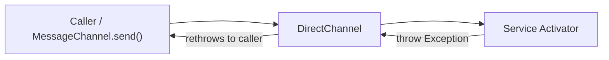
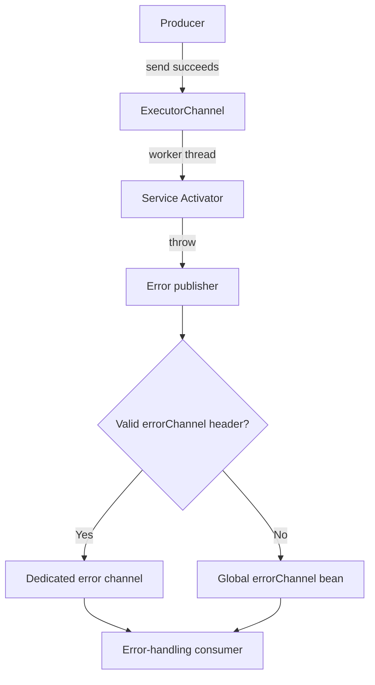

# ErrorMessage and ErrorChannel in Spring Integration

## 1. Why Is Error Handling in a Message Flow Different from Normal Method Calls?

In a plain Java application, if a `service.process(order)` call throws an exception, the caller can use `try/catch` on the **same call stack**. Spring Integration decouples producers and consumers with a `MessageChannel`; when using an `ExecutorChannel`, `QueueChannel`, or poller, the consumer often executes on a different thread. In that case, the sender may have received a successful `send()` result long before the handler encounters an error.

Spring Integration solves this by turning an error into **a message that can travel through a channel**:

- `ErrorMessage`: a message type specifically carrying an error; its `payload` is a `Throwable`.
- `errorChannel`: the header name specifying where a message's error should be sent, and also the bean name of the **global** error handling channel.
- Error handler: a component that catches exceptions in framework-coordinated contexts and publishes an `ErrorMessage` to the appropriate channel.
- Error consumer: an endpoint that receives an `ErrorMessage` to log, record metrics, route, build a business reply, or trigger recovery workflows.

This lesson belongs to the **Error runtime** chapter of the **SPRING_INTEGRATION_RUNTIME** module: the goal is not merely recognizing two APIs, but also understanding **which consumer throws the error**, **which thread catches it**, **which channel actually receives it**, and **how that error affects retries, transactions, and system state**.

> **Rule to remember:** Not every exception in a Spring application automatically goes into `errorChannel`. You must identify the **execution boundary** and the **Spring Integration component responsible for catching/publishing the exception**.

## 2. Comparing the Two Error Paths

### Synchronous flow: exception propagates back up the call stack



With a `DirectChannel`, the consumer usually runs on the same thread that sends the message. If the service activator throws `IllegalStateException`, the exception propagates back to the `send()` caller; the caller can catch it with `try/catch`. **Attaching the `errorChannel` header does not automatically turn every synchronous error into an `ErrorMessage`.**

### Asynchronous flow: sending an ErrorMessage through a channel



With an `ExecutorChannel`, the handler may throw an error on a thread from the pool. At that point, the original caller **cannot** directly catch the worker's error with a `try/catch` around `send()`. Spring Integration can wrap the exception in an `ErrorMessage` and send it through an error channel.

| Context | Where does the handler run? | Typical error behavior | Can the caller catch it directly? |
| --- | --- | --- | --- |
| `DirectChannel` | Sender's thread | Exception propagates back through `send()` | Yes |
| `ExecutorChannel` | Thread in `TaskExecutor` | `ErrorMessage` is published from the integration task | Usually no |
| `QueueChannel` + poller | Poller execution thread | Errors from the poller task are published via the error handler mechanism | Not through the earlier `send()` call |
| Synchronous gateway | Within the gateway-managed request/reply flow | By default, errors are thrown back to the gateway caller; a gateway error flow can be configured | Depends on configuration |
| Standalone `@Async` code / custom thread | Thread not necessarily managed by Spring Integration | Depends on the task's own error handler | Does not go through `errorChannel` by default |

Switching a channel from `DirectChannel` to `ExecutorChannel` for performance reasons entails a major change in **error semantics and transaction boundaries**.

## 3. Structure of ErrorMessage

`org.springframework.messaging.support.ErrorMessage` implements the `Message<Throwable>` interface. `ErrorMessage` uses the exception as its payload; that is why an error consumer can inspect the stack trace and trace back to the failing message.

Common data sources:

| Attribute | How to access | Meaning |
| --- | --- | --- |
| Error | `error.getPayload()` | The `Throwable` published to the error channel |
| Original message, if present | `error.getOriginalMessage()` | The message the publisher included in the context when creating the `ErrorMessage` |
| Failed message | `((MessagingException) cause).getFailedMessage()` | The message the framework attached to the `MessagingException` |
| ErrorMessage headers | `error.getHeaders()` | Headers of the **`ErrorMessage`**; not automatically identical to the original message's headers |
| Nested cause | `throwable.getCause()` | Root business, IO, validation exception, etc. |
| Correlation | `original.getHeaders().get("correlationId")` | Identifies the request/group, if upstream attached the header |

Some exceptions are wrapped by the framework in `MessagingException`, `MessageHandlingException`, or another `MessagingException` subtype. Therefore, `error.getPayload()` may be a wrapper; use `getCause()` to reach the appropriate business error.

```java
import org.springframework.messaging.Message;
import org.springframework.messaging.MessagingException;
import org.springframework.messaging.support.ErrorMessage;

public void inspect(ErrorMessage error) {
    Throwable failure = error.getPayload();

    // May be null if the ErrorMessage was created manually
    // or the publisher lacked the original message context.
    Message<?> original = error.getOriginalMessage();

    if (original == null && failure instanceof MessagingException messagingFailure) {
        original = messagingFailure.getFailedMessage();
    }

    String exceptionType = failure.getClass().getSimpleName();
    Object correlationId = original == null
            ? null
            : original.getHeaders().get("correlationId");

    System.out.println("Error type: " + exceptionType);
    System.out.println("Correlation: " + correlationId);
}
```

**Distinguishing `originalMessage` from `failedMessage`:** a flow with multiple transformers may create a new message at each step. The message known to the error publisher, the failed message held by `MessagingException`, and the initial request message **are not always the same object**. If end-to-end tracing is needed, proactively propagate `correlationId` or a stable `traceId`, rather than relying solely on message IDs.

### Creating an ErrorMessage manually when genuinely needed

In certain custom adapters or handling mechanisms, the application can explicitly create and publish an error:

```java
Message<?> request = MessageBuilder.withPayload("order-101").build();
Throwable exception = new IllegalArgumentException("Invalid order");

ErrorMessage error = new ErrorMessage(exception, request);
errorChannel.send(error);
```

This is **manual publishing**. It is useful when building custom adapters/tasks outside the framework, but should not be used to both publish and rethrow the exception carelessly, as that can report the error twice.

## 4. How Is the Error Channel Chosen?

For a framework component publishing an `ErrorMessage` in an asynchronous context, the common channel resolution order is:

1. Read the `MessageHeaders.ERROR_CHANNEL` header, equivalent to the name `"errorChannel"`, from the message being processed when the error occurred.
2. If the message **does not have an `errorChannel` header**, look up the global channel with **bean name `errorChannel`**. If the header exists but points to an invalid target, publishing may fail; do not assume it safely falls back.
3. If sending to the selected channel fails—for example, the destination is not found, there are no subscribers when required, or the error consumer itself throws—that is **another publish/dispatch error** that must be handled.

The header can point to a `MessageChannel` or reference a channel name that the system can resolve. Example of a message requiring custom business error handling:

```java
import org.springframework.messaging.Message;
import org.springframework.messaging.MessageChannel;
import org.springframework.messaging.MessageHeaders;
import org.springframework.messaging.support.MessageBuilder;

// "orderRequests" and "orderErrors" must be configured beans/channels.
Message<String> order = MessageBuilder.withPayload("invalid-101")
        .setHeader(MessageHeaders.ERROR_CHANNEL, "orderErrors")
        .setHeader("correlationId", "checkout-101")
        .build();

boolean accepted = orderRequests.send(order);
```

`accepted == true` only confirms that the channel accepted the message under the `send()` contract; **it does not prove that the worker processed it successfully**. On an `ExecutorChannel`, an exception can still occur afterward.

For flows passing through adapters, filters, routers, gateways, or pollers, check whether the `errorChannel` header is preserved/overwritten and which component actually publishes the error. Merely adding the header while using a plain `DirectChannel` does not guarantee that errors will route to this channel.

## 5. Global errorChannel: What Is Provided by Default?

Spring Integration pre-creates a global channel named **`errorChannel`** when standard Integration infrastructure is enabled. By default, it is a `PublishSubscribeChannel` with a `LoggingHandler` subscribed to log errors at the `ERROR` level.

This has several implications:

- An `ErrorMessage` can be delivered to **multiple subscribers** of the `PublishSubscribeChannel`. Do not assume by default that `errorChannel` is a single-consumer queue.
- By default, `PublishSubscribeChannel` dispatches synchronously to subscribers on the publishing thread unless configured with an executor. Very slow error handling can slow down the worker reporting the error.
- Default logging provides basic observability; **logging does not mean the message was retried, persisted, or sent to a dead-letter queue**.
- Modern versions of Spring Integration set `requireSubscribers=true` on the default error channel to avoid silently dropping errors when the channel has no subscribers. A failed error dispatch due to no subscribers can alter rollback/nack behavior on an inbound adapter, depending on the specific integration.

You can register additional endpoints to observe global errors:

```java
import org.springframework.integration.annotation.MessageEndpoint;
import org.springframework.integration.annotation.ServiceActivator;
import org.springframework.messaging.support.ErrorMessage;

@MessageEndpoint
public class GlobalErrorObserver {

    @ServiceActivator(inputChannel = "errorChannel")
    public void observe(ErrorMessage message) {
        Throwable problem = message.getPayload();
        // Record metrics / safe events; avoid logging sensitive data.
        System.err.println(problem.getClass().getSimpleName());
    }
}
```

In this example, `GlobalErrorObserver` must be discovered by component scanning. If you customize the `errorChannel` bean to be a `QueueChannel`, consumption, durability, and overload behavior **will differ** from the default; you must configure a poller for the consumer reading the queue and decide on capacity/timeout.

> **Best practice:** Only override the `errorChannel` bean when there is a clear requirement for dispatch, buffering, or durability. When adding consumers, do not assume logging and subscriber ordering remain unchanged if you completely replace the default channel.

## 6. Complete Example: ExecutorChannel and Per-Message ErrorMessage

Scenario: the application receives an order ID; a worker processes it asynchronously. An ID starting with `invalid-` throws an exception. Errors are routed to `orderErrors` via a header; messages without the header can use the global error channel.

### 6.1. Configuring channels, executor, and flow

```java
import org.springframework.context.annotation.Bean;
import org.springframework.context.annotation.Configuration;
import org.springframework.integration.channel.DirectChannel;
import org.springframework.integration.channel.PublishSubscribeChannel;
import org.springframework.integration.config.EnableIntegration;
import org.springframework.integration.dsl.IntegrationFlow;
import org.springframework.integration.dsl.MessageChannels;
import org.springframework.messaging.MessageChannel;
import org.springframework.scheduling.concurrent.ThreadPoolTaskExecutor;

@Configuration
@EnableIntegration
public class OrderFlowConfig {

    @Bean
    public MessageChannel orderRequests() {
        return new DirectChannel();
    }

    @Bean
    public MessageChannel orderErrors() {
        return new PublishSubscribeChannel();
    }

    @Bean
    public ThreadPoolTaskExecutor orderWorkerPool() {
        ThreadPoolTaskExecutor pool = new ThreadPoolTaskExecutor();
        pool.setCorePoolSize(2);
        pool.setMaxPoolSize(4);
        pool.setQueueCapacity(50);
        pool.setThreadNamePrefix("order-worker-");
        return pool;
    }

    @Bean
    public IntegrationFlow orderFlow(
            MessageChannel orderRequests,
            ThreadPoolTaskExecutor orderWorkerPool) {

        return IntegrationFlow.from(orderRequests)
                .channel(MessageChannels.executor(orderWorkerPool))
                .handle(String.class, (orderId, headers) -> {
                    if (orderId.startsWith("invalid-")) {
                        throw new IllegalArgumentException("Order rejected");
                    }

                    System.out.println(
                            "Processed: " + orderId
                            + ", thread: " + Thread.currentThread().getName());
                    return null; // One-way endpoint; produces no reply.
                })
                .get();
    }
}
```

Here, `@EnableIntegration` activates the framework infrastructure. `orderRequests` is an inbound `DirectChannel`, while `MessageChannels.executor(...)` shifts execution of the steps **after it** to `ThreadPoolTaskExecutor`. Spring manages the lifecycle of `ThreadPoolTaskExecutor` as a bean.

You do not need to write `try/catch` around the handler just to route errors to a channel: exceptions occurring in a Spring Integration task are already supported by the framework's error publishing mechanism. If the handler **catches and swallows the exception itself**, the framework will not see the error to publish it automatically.

### 6.2. Endpoint receiving ErrorMessage

```java
import org.slf4j.Logger;
import org.slf4j.LoggerFactory;
import org.springframework.integration.annotation.MessageEndpoint;
import org.springframework.integration.annotation.ServiceActivator;
import org.springframework.messaging.Message;
import org.springframework.messaging.MessagingException;
import org.springframework.messaging.support.ErrorMessage;

@MessageEndpoint
public class OrderErrorEndpoint {

    private static final Logger log =
            LoggerFactory.getLogger(OrderErrorEndpoint.class);

    @ServiceActivator(inputChannel = "orderErrors")
    public void onOrderError(ErrorMessage error) {
        Throwable failure = error.getPayload();

        Message<?> source = error.getOriginalMessage();
        if (source == null && failure instanceof MessagingException messagingException) {
            source = messagingException.getFailedMessage();
        }

        Object correlationId = source == null
                ? null
                : source.getHeaders().get("correlationId");

        log.error("Order failed; correlationId={}; errorType={}",
                correlationId,
                failure.getClass().getSimpleName(),
                failure);
    }
}
```

Register `OrderErrorEndpoint` within the application's component scan scope. `@ServiceActivator` receives an **`ErrorMessage` object** (not an order data payload), allowing it to extract the `Throwable` and associated context. In production, `log.error` can be replaced with recording an audit event, metrics, routing to a business error flow, or an appropriate dead-letter mechanism.

### 6.3. Sending verification messages

```java
import org.springframework.messaging.MessageChannel;
import org.springframework.messaging.MessageHeaders;
import org.springframework.messaging.support.MessageBuilder;

// Run in the application once ApplicationContext is available.
MessageChannel requests =
        applicationContext.getBean("orderRequests", MessageChannel.class);

requests.send(MessageBuilder.withPayload("invalid-101")
        .setHeader(MessageHeaders.ERROR_CHANNEL, "orderErrors")
        .setHeader("correlationId", "checkout-101")
        .build());

requests.send(MessageBuilder.withPayload("ok-102")
        .setHeader("correlationId", "checkout-102")
        .build());
```

**Expected result:** For `invalid-101`, the worker throws `IllegalArgumentException`, an `ErrorMessage` is published to `orderErrors`, and `onOrderError` logs an event with `correlationId=checkout-101`. For `ok-102`, the worker logs successful processing; no corresponding error message is emitted.

Do not use `try/catch` around `requests.send(...)` to test whether `invalid-101` failed, because the handler runs asynchronously. The order between the two log entries may also vary since multiple workers run concurrently.

### 6.4. Trying to replace ExecutorChannel with DirectChannel

If you remove the line:

```java
.channel(MessageChannels.executor(orderWorkerPool))
```

then the next endpoint can run synchronously on the call stack of `orderRequests.send(...)`. In this case, the same exception will typically propagate back to the caller, and the executor's error handler **is no longer** what converts it into an `ErrorMessage`. This difference is a good hands-on way to observe error boundaries.

## 7. ErrorMessage, Gateways, and Business Error Replies

A `@MessagingGateway` provides a Java-method-like API for clients. When calling a gateway in a normal request/reply flow, Spring Integration by default brings downstream errors back to the gateway and throws an exception to the caller. The gateway can unwrap `MessagingException` to expose the appropriate business exception.

If you want to transform an exception into a business reply (such as `OrderReply(accepted=false, ...)`), you can configure an error channel on the gateway:

```java
import org.springframework.integration.annotation.MessagingGateway;

@MessagingGateway(
    defaultRequestChannel = "checkoutRequests",
    errorChannel = "checkoutGatewayErrors")
public interface CheckoutGateway {
    CheckoutReply submit(CheckoutRequest request);
}
```

A handler on `checkoutGatewayErrors` can convert the `ErrorMessage` into a `CheckoutReply`, then return that message along the reply path established by the gateway. **A valid reply must be produced** if the interface expects a return value; merely logging the error without returning a reply can cause the gateway to wait until `replyTimeout` expires or finish without the expected result.

In a **one-way** gateway flow (a method returning `void`), the configured error channel can also be placed into the `errorChannel` header, so errors occurring after an `ExecutorChannel` still have a dedicated destination instead of falling back to the global channel.

If no `errorChannel` is declared on the gateway, the default rule is that errors are propagated back to the caller while the gateway manages the request/reply path. **Do not predict behavior solely from channel names**: check the gateway method return type, `replyTimeout`, the channel type at each step, and how the error flow produces a reply.

## 8. Pollers, Schedulers, and ErrorMessage

`QueueChannel` only stores messages; it does not execute a business handler itself. A `poller` actively retrieves messages from the queue and invokes the consumer. If the consumer throws an exception during a scheduled poller task, Spring Integration has a mechanism to publish an `ErrorMessage` via `MessagePublishingErrorHandler` used by the default `taskScheduler`.

Example:

```java
import org.springframework.integration.annotation.MessageEndpoint;
import org.springframework.integration.annotation.Poller;
import org.springframework.integration.annotation.ServiceActivator;

@MessageEndpoint
public class QueueConsumer {

    @ServiceActivator(
        inputChannel = "queuedOrders",
        poller = @Poller(fixedDelay = "1000", maxMessagesPerPoll = "5"))
    public void process(String orderId) {
        if (orderId.startsWith("invalid-")) {
            throw new IllegalStateException("Cannot process " + orderId);
        }
    }
}
```

This example requires the `queuedOrders` bean to be a `QueueChannel` or equivalent pollable channel. `fixedDelay` determines the polling interval; `maxMessagesPerPoll` limits the number of messages per poll. These attributes **do not mean** retry counts.

If you replace `taskScheduler` or manage your own scheduled tasks, check whether an appropriate `MessagePublishingErrorHandler` (the framework provides the `integrationMessagePublishingErrorHandler` bean) is still used. Exceptions from `ScheduledExecutorService` or standalone `@Async` code **do not automatically** go to Spring Integration's `errorChannel`.

When a poller involves transactions, the order of exception catching, rollback, message acknowledgment, error publishing, and re-delivery also depends on advice, the transaction manager, and the inbound source. Do not assume that having an error channel alone ensures successful retry or rollback.

## 9. Retry, Transactions, Dead-Letter, and Idempotency

`ErrorChannel` is **a transport mechanism for error information**, not a complete recovery strategy.

| Need | Related tool/mechanism | What must be decided |
| --- | --- | --- |
| Retry transient errors | `RequestHandlerRetryAdvice`, retry policy, backoff | At which step to retry, maximum attempts, which errors are retryable |
| Report errors after retries are exhausted | Recovery callback, e.g., `ErrorMessageSendingRecoverer` | Which channel to send errors to, whether original request info is needed |
| Data rollback | `TransactionInterceptor` / appropriate transaction manager | Exactly which operations the transaction covers |
| Durable error storage | Persistent queue/store, database, broker DLQ | What data is stored, retention, access, and replay |
| Prevent duplicate processing | Idempotent receiver, business key, unique constraint | Duplicates from retry, replay, or broker redelivery |
| Monitoring and alerting | Metrics, tracing, logs, alerts | Severity classification and alert thresholds |

For example, suppose a message fails after writing to the database: if the database transaction has already committed, publishing an `ErrorMessage` **does not automatically undo the commit**. Similarly, adding an `ExecutorChannel` crosses a thread boundary; an open transaction on the producer thread does not automatically transfer to the worker thread.

`RequestHandlerRetryAdvice` typically retries right around a handler before finishing with a recovery callback or rethrowing the exception. Use `ErrorMessageSendingRecoverer` when you need to publish an error after retries are exhausted, but configure the advice and policy explicitly. **Do not let handler retries and broker redelivery multiply endlessly**; set limits, ensure idempotency, and define a strategy for unrecoverable messages.

An error subscriber can forward data to a dead-letter destination for manual handling. However, **the default `errorChannel` is not a durable DLQ**: an internal channel may exist only in memory and does not guarantee messages survive a restart.

## 10. Error Publishing Strategies and Framework Extensions

Spring Integration provides several specialized components:

- `MessagePublishingErrorHandler`: catches errors from framework-dispatched tasks and sends an `ErrorMessage` to a message channel; especially relevant to schedulers/pollers and executors.
- `ErrorMessagePublisher`: general mechanism for publishing errors, usable when building custom adapters or recovery strategies.
- `ErrorMessageStrategy`: creates an `ErrorMessage` from an exception and context.
- `DefaultErrorMessageStrategy`: can retrieve the request message from the context and use it as `originalMessage`.
- `ErrorMessageExceptionTypeRouter`: branches error messages based on exception type, such as separating validation, timeout, and system errors.

`DefaultErrorMessageStrategy` can use `ErrorMessageUtils.INPUT_MESSAGE_CONTEXT_KEY` to retrieve the request message from `AttributeAccessor`. This is why `ErrorMessage.getOriginalMessage()` is useful in many flows. However, **not every error publisher has complete context**, so error-handling code should tolerate `null`.

Error routing should be based on **actionable errors**:

- Validation errors: return a business result or route to a non-retry channel.
- Transient timeout/IO errors: retry with backoff, then report an error if exhausted.
- Data/contract errors: quarantine, record context, and send an alert.
- Configuration errors or missing subscribers: prioritize operational alerts because multiple flows may be affected.

When implementing a router by exception type, note that the received exception may be a `MessageHandlingException` containing the actual cause in `cause`. Decide explicitly whether the router inspects the wrapper, the root cause, or the cause chain depending on version/configuration; otherwise, all errors may unexpectedly fall into a single catch-all branch.

## 11. Runtime Diagnostics: Where Did the Error Go, Where Was It Lost?

When a flow encounters an error but the handler on `errorChannel` does not run, check in this order:

1. **Thread boundary:** Is there an `ExecutorChannel` or a consumer running in a poller task? If everything uses `DirectChannel`, the exception may have returned synchronously to the caller.
2. **Message headers:** Does the failed message have an `errorChannel` header? Is its value a channel reference or a resolvable bean name? Was this header removed/overwritten by a transformer/router?
3. **Execution context:** Was the exception thrown out of the handler, or was it already handled earlier by a `try/catch`, advice, or interceptor?
4. **Target channel:** Does the bean exist, does it have subscribers, and does the consumer require a poller? If `PublishSubscribeChannel` is given a custom executor, is there a risk of task rejection?
5. **ErrorMessage contents:** What exception type is `payload`, what info do `originalMessage` or `failedMessage` have, and is the correlation ID still present?
6. **Dispatch capability:** Did a new exception occur while publishing the error or inside the error subscriber? Is an internal error in the error flow masking the original error?
7. **Message source:** Source systems (JMS, RabbitMQ, Kafka, HTTP, file poller, etc.) have different ack/commit/requeue semantics; check the semantics of the specific inbound adapter.

Common symptom table:

| Symptom | Likely cause | Verification |
| --- | --- | --- |
| `send()` throws an exception, no ErrorMessage seen | Flow runs synchronously through `DirectChannel` | Log current thread, try catching the exception directly |
| `send()` returns success, but business logic fails | Handler runs on an executor after `send()` | Trace worker threads and the error channel consumer |
| Only default error logs appear | No custom consumer registered, or error went to global `errorChannel` | Check channel beans and subscriptions |
| Errors do not appear on dedicated channel | `errorChannel` header missing, misspelled, or not preserved | Print headers right before the failing handler |
| ErrorMessage has no original message | Publisher lacked context, or ErrorMessage was manually created | Use `MessagingException.failedMessage` when available; propagate correlation ID |
| Error reported multiple times | Retry/redelivery, error consumer re-emitting, manual publish plus rethrow | Trace request ID + attempt number |
| Error messages vanish after restart | Using in-memory error channel without persistent store/DLQ | Check storage mechanism and source ack behavior |
| Secondary error during logging | Error consumer throws exception, wrong subscriber parameter type, channel dispatch failure | Catch/log internal errors appropriately; avoid publish loops |

### Actionable logging and metrics

Use structured logging for each handled error:

- `flowId` / component ID, `correlationId` or `traceId`, message ID (if available).
- Exception type, cause chain, thread name, retry attempt, and timestamp of the error.
- Target channel (`orderErrors` or `errorChannel`), error handling outcome, DLQ/replay status.
- Metrics: error count by flow and exception type; failed error publishes; retry counts; error subscriber latency; executor queue/rejections; age of pending messages.

Do not log full payloads, access tokens, or personal data just for context. For sensitive messages, log **permitted business identifiers**, hashes/correlation IDs, or sanitized attributes.

## 12. Hands-On Verification

A short lab can be carried out in the following sequence:

1. Run the `orderFlow` example and send `invalid-101` with `errorChannel=orderErrors`; verify the error endpoint receives the right `correlationId`.
2. Send a failing message **without** the `errorChannel` header; verify the error reaches the global `errorChannel` consumer/logging.
3. Remove `ExecutorChannel`, resend the failing message, and use `try/catch` around `send()` to observe synchronous behavior.
4. Change the handler to `catch` and only log; verify the framework does not generate another ErrorMessage when no exception escapes and no explicit publish logic runs.
5. Change `orderErrors` from `PublishSubscribeChannel` to an appropriate `QueueChannel` and configure a poller; observe dispatch, backpressure, and consumption.
6. Add bounded retry for transient errors, trigger an always-failing error, verify only one final action occurs after retries are exhausted, and ensure the operation is idempotent.
7. Simulate an error subscriber failing; observe the dispatch result and worker impact without creating an infinite loop between two error flows.

**Questions to ask before going to production:** Does this error go to the caller or to a message channel? Can it be swallowed across any thread handoff? Who owns the transaction and acknowledgment? When an error is published but there is no consumer or the consumer fails, where is the information retained?

## 13. Key Takeaways

`ErrorMessage` is a message containing a `Throwable`, allowing exceptions to become data that can travel through channels. `errorChannel` serves both as a per-message destination header and as the name of the global error channel; the default publishing mechanism is especially important in asynchronous processing and pollers.

The key design decision is not whether to name an `errorChannel`, but understanding the **call stack / thread**, **how exceptions are caught**, **how channels are resolved**, and **transactional consequences**. To build resilient systems, complement this with bounded retries, correlation metadata, idempotency, observability, and storage/replay strategies suited to the message source.

## References

- [Spring Integration Reference — Error Handling](https://docs.spring.io/spring-integration/reference/error-handling.html)
- [Spring Integration Reference — Messaging Gateways](https://docs.spring.io/spring-integration/reference/gateway.html)
- [Spring Integration Reference — Special Channels](https://docs.spring.io/spring-integration/reference/channel/special-channels.html)
- [Spring Integration Reference — Request Handler Advice](https://docs.spring.io/spring-integration/reference/handler-advice.html)
