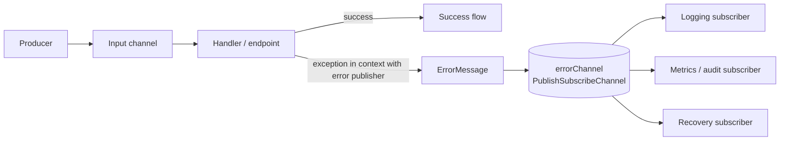
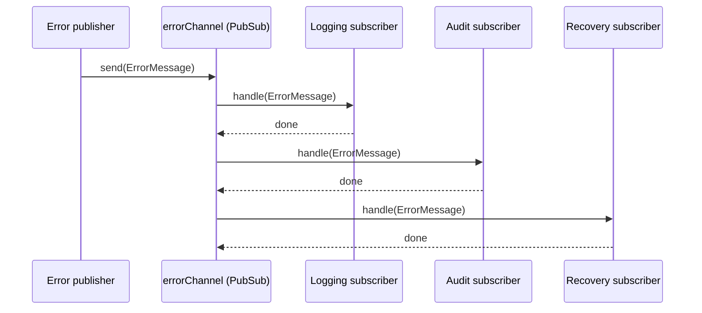
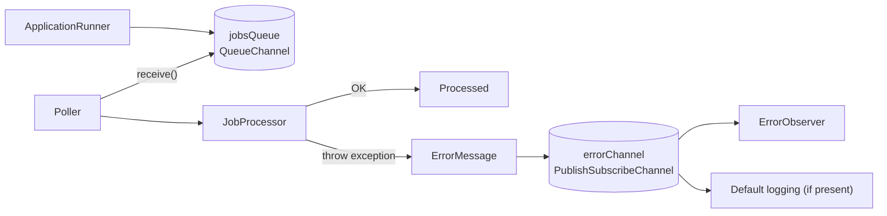
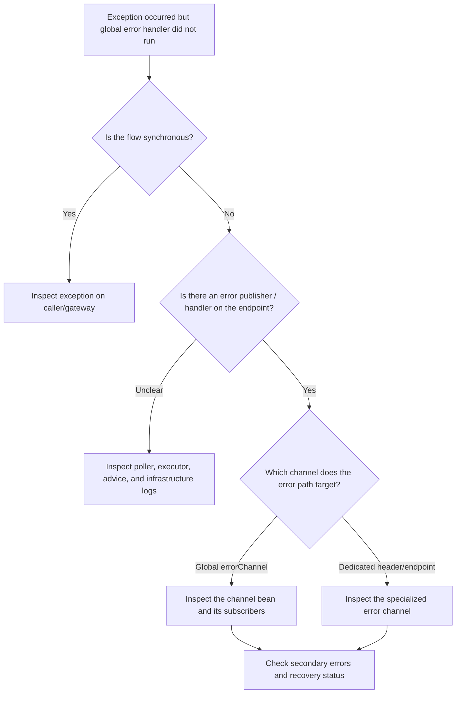

# Default error channel and PublishSubscribeChannel

In **Spring Integration runtime**, message-processing errors can occur in a handler, converter, router, gateway, or when calling an external system. For accurate diagnostics, you must distinguish **an exception thrown back up the call stack** from **an error converted into a message to be processed by an error flow**. Spring Integration provides a global error channel named `errorChannel`. With default infrastructure configuration, this channel is a `PublishSubscribeChannel`: an `ErrorMessage` sent to it can be delivered to multiple subscribers.

This lesson belongs to the **Error runtime** chapter and focuses on the questions: when does the default `errorChannel` exist, how does `PublishSubscribeChannel` distribute errors, when does the framework actually send errors there, and how to attach logging, alerting, monitoring, or recovery without distorting transaction, retry, and message delivery semantics.

## 1. Big Picture of the Error Flow

A business message has a payload and headers. When an endpoint fails, the framework can create a message **carrying the exception** for another endpoint to process:



**Important boundary:** the arrow from exception to `ErrorMessage` **does not exist unconditionally**. Behavior depends on the endpoint, execution thread, error handler, advice, and configuration. For instance, an error on a synchronous `DirectChannel` is typically thrown back to the sender rather than automatically emitted to the global `errorChannel`; an error occurring in a polling task or an asynchronous flow segment is typically handled by that context's error handler.

Two common paths:

| Execution context | Where the exception usually surfaces | Relationship to `errorChannel` |
| --- | --- | --- |
| `DirectChannel` with synchronous handler | Call stack invoking `send()` or the gateway | Usually thrown back to the caller; **does not automatically route** every exception to the global channel |
| `QueueChannel` + polling consumer | Thread coordinated by the poller/scheduler | Error handler can create and send an `ErrorMessage` to the error channel |
| `ExecutorChannel` or executor-handed segment | Worker thread | Async error-handling infrastructure can publish `ErrorMessage`; errors when submitting the task may appear immediately on the caller |
| Endpoint with dedicated error handling | Configured error handler/advice | May use a different error channel or specialized recovery |

Therefore, if a service activator throws an exception yet subscribers of `errorChannel` see nothing, the first step is to determine **whether the flow is running synchronously or asynchronously** and **who is responsible for catching the exception**.

## 2. What Is the Default `errorChannel`?

When Spring Integration infrastructure is enabled (for example via `@EnableIntegration` or the corresponding Spring Boot auto-configuration), the framework provides a **global error channel** under the bean name `errorChannel` if the application has not defined an alternative. The default channel is a `PublishSubscribeChannel`, typically accompanied by a framework-registered logging subscriber.

```text
Spring Integration infrastructure
└── bean: "errorChannel" (PublishSubscribeChannel)
    ├── default subscriber: LoggingHandler (logs errors)
    ├── application subscriber: ErrorAuditHandler (if registered)
    └── application subscriber: AlertHandler (if registered)
```

This has three practical implications:

1. **The name `errorChannel` is known to the infrastructure**; you do not need to create the channel manually for simple examples when the default configuration is active.
2. **One error message is broadcast to subscribers**, suitable for simultaneously logging, recording metrics, alerting, or storing recovery info. It is not a queue distributing each error to exactly one consumer.
3. **The default channel is not durable error storage**. Merely logging and moving on is error observation behavior, not a reliable retry or dead-letter mechanism.

Do not confuse `errorChannel` with business input channels, `replyChannel`, or `nullChannel`. `replyChannel` carries successful results; `errorChannel` represents the error-receiving path in scenarios where an error publishing mechanism is active. `nullChannel` is a sink for discarding messages, not a system for storing and processing errors.

### 2.1. Default logging subscriber

With the framework-provided global error channel, Spring Integration typically registers a `LoggingHandler` so errors are not silently dropped when no application handler is present yet. When adding new subscribers, **check whether the default logging subscriber remains active** according to your version/configuration. Do not assume that a custom handler replaces default logging, or that automatic logging means the business error has been handled.

If the application **defines its own `errorChannel` bean** or changes how error infrastructure is configured, subscribers and dispatch properties may differ from the default. In operations, inspect the actual configuration rather than relying solely on the bean name.

## 3. What Information Does `ErrorMessage` Carry?

`org.springframework.messaging.support.ErrorMessage` is a `Message<Throwable>`: **the payload itself is the exception**, not the original business payload.

```java
import org.springframework.messaging.Message;
import org.springframework.messaging.MessagingException;
import org.springframework.messaging.support.ErrorMessage;

void inspect(ErrorMessage errorMessage) {
    Throwable failure = errorMessage.getPayload();
    System.err.println("Error type: " + failure.getClass().getName());
    System.err.println("Reason: " + failure.getMessage());

    Message<?> failedMessage = null;
    if (failure instanceof MessagingException messagingException) {
        failedMessage = messagingException.getFailedMessage();
    }
    if (failedMessage == null) {
        failedMessage = errorMessage.getOriginalMessage();
    }
    if (failedMessage != null) {
        System.err.println("Failed message id: " + failedMessage.getHeaders().getId());
    }
}
```

Distinguish between:

| Component | Meaning | Notes |
| --- | --- | --- |
| `errorMessage.getPayload()` | `Throwable` describing the error | May be a `MessagingException` wrapping the business error |
| `MessagingException.getFailedMessage()` | Message associated with the failing step, if present | May be `null`; not every exception is a `MessagingException` |
| `errorMessage.getOriginalMessage()` | Original message if provided by publisher/strategy | May be `null`; not guaranteed across all flows |
| `errorMessage.getHeaders()` | Headers of the **error message** | Not identical by default to the original request's headers |
| `failure.getCause()` | Underlying cause if the exception is wrapped | May require walking the cause chain to find the root error |

For example, a handler throws `IllegalStateException`, while the consumer may receive a `MessageHandlingException` with `IllegalStateException` in `getCause()`. When classifying errors, inspect **the entire exception chain**; when correlation is needed, read metadata from the original or failed message when that data is present.

## 4. Why Use `PublishSubscribeChannel`?

`PublishSubscribeChannel` implements `SubscribableChannel` and sends the same message to **multiple subscribers** using a publish–subscribe mechanism. With `errorChannel`, a single error can serve multiple purposes at once:

- **Logging:** record the exception, endpoint, message ID, and correlation key for investigation.
- **Monitoring:** increment error counters by type, service, or consumer.
- **Alerting:** notify selectively when errors exceed severity thresholds.
- **Recovery:** store the failed message in a controlled store or trigger an appropriate remediation workflow.



The diagram shows the case of **synchronous dispatch where no subscriber throws an error**. By default, `PublishSubscribeChannel` does not require a dedicated executor: subscribers are invoked on the thread sending `ErrorMessage`. If the channel is configured with a `TaskExecutor`, dispatch can shift to other threads; completion ordering and how exceptions are observed may change.

| Characteristic | `PublishSubscribeChannel` | `QueueChannel` |
| --- | --- | --- |
| Consumer model | Sends to all eligible subscribers | Consumers call `receive()` competing to take messages |
| Processing speed | Can be affected by slow subscribers during synchronous dispatch | Producer/consumer are decoupled by a buffer |
| Message retention | Not persistent by default | Has a queue; in-memory by default, configurable with an appropriate store |
| Use for global error flow | Allows logging, metrics, alerting on the same error | Suitable if the intent is work distribution/buffering of errors, with different semantics |

**Publish–subscribe does not mean "guaranteed delivery to every subscriber."** In synchronous dispatch, an exception from one subscriber can affect invocation of subsequent subscribers depending on dispatcher error-handling configuration. When using an executor, you must manage exception catching, executor queue capacity, and shutdown. Having multiple subscribers also means each subscriber can produce its own side effects; recovery actions should therefore be idempotent or clearly coordinated.

### 4.1. `PublishSubscribeChannel` is not an error message broker

An `ErrorMessage` dispatched through the global channel does not persist to be "read later" via `receive()`. `PublishSubscribeChannel` is not a `PollableChannel`. When errors must survive restarts, **write a durable record** (database, message store, or external broker) in a controlled recovery flow, define a retry policy, and track processing state.

You cannot infer a `dead-letter queue`, processing acknowledgment (`ack`), or `exactly-once` guarantees merely because the application has an `errorChannel` bean.

## 5. Registering a Subscriber with `@ServiceActivator`

A simple way to handle the global error flow is to register a handler on the channel named `errorChannel`. The method can accept the `ErrorMessage` directly:

```java
import org.springframework.integration.annotation.ServiceActivator;
import org.springframework.messaging.Message;
import org.springframework.messaging.MessagingException;
import org.springframework.messaging.support.ErrorMessage;
import org.springframework.stereotype.Component;

@Component
public class ErrorAuditHandler {
    @ServiceActivator(inputChannel = "errorChannel")
    public void record(ErrorMessage errorMessage) {
        Throwable throwable = errorMessage.getPayload();

        Message<?> failed = null;
        if (throwable instanceof MessagingException exception) {
            failed = exception.getFailedMessage();
        }
        if (failed == null) {
            failed = errorMessage.getOriginalMessage();
        }

        String messageId = failed == null
                ? "unknown"
                : String.valueOf(failed.getHeaders().getId());
        Object traceId = failed == null
                ? null
                : failed.getHeaders().get("traceId");

        System.err.printf("messageId=%s traceId=%s error=%s%n",
                messageId, traceId, throwable.getClass().getSimpleName());
        // In production: call an appropriate audit/metrics service.
    }
}
```

Key points:

1. `@ServiceActivator(inputChannel = "errorChannel")` creates a consumer endpoint for that channel when Spring Integration initializes the context.
2. Because the channel is publish–subscribe, this handler **can receive the same error as the default logging subscriber**, if the logging subscriber remains registered.
3. `ErrorMessage` already carries the exception in its payload; there is no need to parse the business message payload to know what failed.
4. The example handler only observes the error; **it does not automatically cause the business message to be retried**.
5. Because the method returns no reply, `outputChannel` does not need to be declared for this audit task.

In real systems, avoid logging full payloads/headers because they may contain tokens, personal data, or sensitive business information. Use message IDs, trace/correlation IDs, and controlled error codes.

## 6. End-to-End Example: Error from a Polling Consumer to the Global Error Channel

The example below targets a **Spring Boot (Java 17+) application with `spring-boot-starter-integration`**. The application creates a `QueueChannel` and sends two jobs, one of which intentionally fails. A `@ServiceActivator` with a poller pulls messages from the queue and throws an exception. In Spring Integration's standard polling setup, error-handling infrastructure sends an `ErrorMessage` to the global `errorChannel`; the downstream subscriber receives the details to record them.



```java
import org.springframework.boot.ApplicationRunner;
import org.springframework.boot.SpringApplication;
import org.springframework.boot.autoconfigure.SpringBootApplication;
import org.springframework.context.annotation.Bean;
import org.springframework.integration.annotation.EnableIntegration;
import org.springframework.integration.annotation.Poller;
import org.springframework.integration.annotation.ServiceActivator;
import org.springframework.integration.channel.QueueChannel;
import org.springframework.messaging.Message;
import org.springframework.messaging.MessagingException;
import org.springframework.messaging.support.ErrorMessage;
import org.springframework.messaging.support.MessageBuilder;
import org.springframework.stereotype.Component;

@SpringBootApplication
@EnableIntegration
public class ErrorFlowDemo {
    public static void main(String[] args) {
        SpringApplication.run(ErrorFlowDemo.class, args);
    }

    @Bean
    QueueChannel jobsQueue() {
        return new QueueChannel(20);
    }

    @Bean
    ApplicationRunner publishSample(QueueChannel jobsQueue) {
        return args -> {
            jobsQueue.send(MessageBuilder.withPayload("JOB-OK")
                    .setHeader("traceId", "trace-ok").build());
            jobsQueue.send(MessageBuilder.withPayload("JOB-FAIL")
                    .setHeader("traceId", "trace-fail").build());
        };
    }
}

@Component
class JobProcessor {
    @ServiceActivator(
        inputChannel = "jobsQueue",
        poller = @Poller(fixedDelay = "300", maxMessagesPerPoll = "2")
    )
    public void process(Message<String> message) {
        String jobId = message.getPayload();
        System.out.println("Working on " + jobId);
        if ("JOB-FAIL".equals(jobId)) {
            throw new IllegalStateException("Simulated downstream failure");
        }
    }
}

@Component
class ErrorObserver {
    @ServiceActivator(inputChannel = "errorChannel")
    public void onError(ErrorMessage error) {
        Throwable throwable = error.getPayload();
        Message<?> failed = error.getOriginalMessage();
        if (throwable instanceof MessagingException messagingException
                && messagingException.getFailedMessage() != null) {
            failed = messagingException.getFailedMessage();
        }

        Object traceId = failed == null
                ? "unknown"
                : failed.getHeaders().get("traceId");
        System.err.printf("Error flow: traceId=%s, type=%s%n",
                traceId, throwable.getClass().getSimpleName());
    }
}
```

When run, expected behavior:

1. The producer places `JOB-OK` and `JOB-FAIL` into `jobsQueue`; the `send()` call only proves the queue accepted the jobs.
2. The poller calls `receive()` to pull each message and invoke `JobProcessor`.
3. `JOB-OK` completes; `JOB-FAIL` throws an error on the poller's processing thread.
4. The polling endpoint's error handler publishes the error as an `ErrorMessage` to the selected error channel. Because no dedicated channel is configured in the example, the usual target is the global `errorChannel`.
5. `ErrorObserver` reads the exception and attempts to trace the failed/original message to obtain `traceId`; the default logging subscriber may also log the error.

This example illustrates **the runtime error path**; it provides no retry, transaction, or durability guarantees. With a default RAM-backed `QueueChannel`, a dequeued message may no longer be in the queue after an exception; `ErrorObserver` receiving the error also does not automatically put the message back into the queue.

## 7. Dedicated Error Channels per Message or Endpoint

The global `errorChannel` is **a general fallback**, not a requirement that every error must pass through it. Spring Integration supports context-based error path selection, such as the message's `errorChannel` header or an endpoint's error handler configuration.

A message can carry a header pointing to a specialized error-handling channel:

```java
import org.springframework.messaging.Message;
import org.springframework.messaging.MessageHeaders;
import org.springframework.messaging.support.MessageBuilder;

Message<String> request = MessageBuilder.withPayload("JOB-42")
        .setHeader("traceId", "trace-42")
        .setHeader(MessageHeaders.ERROR_CHANNEL, "orderErrors")
        .build();
```

If the endpoint's error publishing mechanism supports reading the error-channel header from the failed/original message, this message's error can be sent to `orderErrors` instead of the global `errorChannel`. The channel name must reference an existing channel that resolves properly; when the API supports it, you can also configure the channel bean directly rather than via a string name.

Example registering a dedicated error channel and its consumer:

```java
import org.springframework.context.annotation.Bean;
import org.springframework.context.annotation.Configuration;
import org.springframework.integration.annotation.ServiceActivator;
import org.springframework.integration.channel.PublishSubscribeChannel;
import org.springframework.messaging.support.ErrorMessage;
import org.springframework.stereotype.Component;

@Configuration
class ErrorRoutingConfig {
    @Bean
    PublishSubscribeChannel orderErrors() {
        return new PublishSubscribeChannel();
    }
}

@Component
class OrderErrorHandler {
    @ServiceActivator(inputChannel = "orderErrors")
    public void handle(ErrorMessage message) {
        System.err.println("Order processing failed: "
                + message.getPayload().getMessage());
    }
}
```

**Do not treat setting the header as "catching every exception."** Synchronous errors can still be thrown directly to the caller; some sources/endpoints have their own error handling; channel selection and header lookup depend on the specific publisher. Test both success and failure paths using the exact channel types, pollers, and executors used in production.

### 7.1. Choosing global vs. dedicated channel?

| Scenario | Suggested design |
| --- | --- |
| Application-wide audit/metrics | Subscriber on the global `errorChannel` |
| Order errors needing a separate handling group | Dedicated `orderErrors`, received via header or endpoint configuration |
| Transient errors needing retries before failing | Retry advice/recoverer at the processing step, then emit error once attempts are exhausted |
| Data errors needing quarantine for manual repair | Error flow writes a durable record and processing status |
| Alerting must not slow down the main flow | Design async alerting, control overload, and handle errors inside the alert subscriber itself |

## 8. Failing Subscribers Can Cause Secondary Errors

Because the default global channel broadcasts to multiple subscribers, you must account for **failures inside the error flow itself**. For example, an audit handler calling a database times out:

```text
Business handler fails
    -> publish ErrorMessage
        -> errorChannel (PublishSubscribeChannel)
            -> audit subscriber -> database timeout
            -> metrics subscriber
            -> logging subscriber
```

With synchronous dispatch, if the audit subscriber throws an exception, the impact on subsequent subscribers depends on how the dispatcher handles errors and the registration order. `PublishSubscribeChannel` has options related to subscriber error handling (such as `ignoreFailures` in supported configurations), yet **ignoring subscriber errors** is not the same as handling or recovering the original business error.

Design suggestions:

- **Observer-only** subscribers should be short, bounded by timeouts, and tolerant of transient log/metrics system failures.
- If reliable storage of failed messages is required, treat writing recovery data as work with its own SLA, retries, and status confirmation.
- Avoid rethrowing and repeatedly sending the same error back into `errorChannel`; this easily creates an **error loop** or log storm.
- When multiple subscribers have side effects, define idempotency keys, ordering requirements, and ownership when one subscriber succeeds while another fails.
- Using an executor for the error channel can reduce blocking on the publisher thread, but increases the need to monitor saturation, task failures, and shutdown.

A broadcast error channel suits **fan-out** observation; reliable recovery typically requires durable state or a dedicated queue to coordinate who remediates each message.

## 9. Interaction with Transactions, Retries, and Message Stores

An error flow is **a failure-handling branch**, and does not automatically determine transactional outcomes.

| Component | Questions to answer | Relationship to `errorChannel` |
| --- | --- | --- |
| Retry advice | How many retries, which exceptions retry, what delay/backoff? | May publish only after retries are exhausted if a recoverer is configured accordingly |
| Transaction interceptor | Which message reception and resource operations belong to the same transaction? | Sending an error message does not automatically roll back or commit resources |
| In-memory `QueueChannel` | Is the message retained if the handler throws or the process crashes? | Error flow does not automatically put a dequeued message back into the queue |
| `MessageStore` or durable broker | Can messages be recovered across restarts? | Requires configuring persistence, acknowledgment, and retries per the store/broker's capabilities |
| Idempotency | Will re-running a job create duplicate side effects? | Recovery must be designed to be safe when replaying messages |

For instance, suppose payment was recorded in the DB but the HTTP response fails: `ErrorMessage` can record the exception, yet the system must use transaction boundaries and idempotency to avoid double-charging on retry. When the source is a broker with ack/nack or transactions, **recovery rules must be grounded in that adapter and broker**, not inferred from the global channel.

One way to categorize error handling:

1. **Transient failure** (HTTP 503, brief timeout): bounded retries, with backoff/jitter as needed.
2. **Permanent failure** (bad schema, missing required fields): route to an error flow to record and fix data; do not retry infinitely.
3. **Unknown/partial failure** (unclear downstream outcome): look up state and enforce idempotency before replaying.

## 10. Correlation and Runtime Observability

When an error occurs on a different thread from the producer, a stack trace log lacking context is rarely enough to trace the flow. Attach a **stable correlation key** per request or event group and preserve it across message transformation steps.

Signals to observe:

| Group | Signal | Used to distinguish |
| --- | --- | --- |
| Producer / gateway | `send()` success/failure; timeout | Whether the message was accepted or failed immediately on send |
| Poller / executor | Poll count, backlog, active threads, rejected tasks | Whether the error is queued or already ran on a worker |
| Handler | Endpoint name, handler latency, exception type | Which step failed |
| Error publisher | Whether `ErrorMessage` was created and sent to which channel | Whether the exception entered the error flow |
| `errorChannel` | Error message count, subscriber count, subscriber errors | How errors are distributed and recorded |
| Recovery | Records awaiting retry, retry attempts, final status | Whether the error was actually remediated or merely logged |

Diagnostic order:



**Do not use "no logs on `errorChannel`" to conclude "no errors occurred."** The error may have been thrown back to the sender thread, caught and returned via a gateway, retried and eventually succeeded, or routed to a dedicated error channel. Conversely, seeing error logs does not guarantee the data has been recovered.

## 11. Common Design Pitfalls

| Pitfall | Consequence | Fix |
| --- | --- | --- |
| Expecting synchronous `DirectChannel` to push every exception to the global channel | Error handler works, yet `errorChannel` subscribers receive nothing | Catch exceptions at caller/gateway or explicitly design an error publisher |
| Using `PublishSubscribeChannel` like a queue to call `receive()` | No receive semantics exist | Use a `PollableChannel`/message store when buffering is truly needed |
| Registering two subscribers and assuming each error goes to only one | One error triggers multiple side effects | Design fan-out explicitly; use another queue/dispatcher if competing consumers are needed |
| Error handler not checking `null` for failed/original message | Null pointer when handling a `Throwable` with no attached message | Be null-safe and extract correlation from wherever data is available |
| Slow or throwing alert subscriber | Can block the error publisher and disrupt fan-out | Add timeouts, isolate, and monitor subscribers |
| Only logging `ErrorMessage` and treating it as retried | Failed messages are never recovered | Design dedicated retry/recoverer/durable records |
| Routing error-flow failures back to the same `errorChannel` endlessly | Infinite loops and log storms | Isolate secondary errors, bound retries, enforce termination points |
| Defining a custom `errorChannel` bean while still assuming the default logger exists | Missing logs or altered dispatch | Check actual subscribers and add logging if needed |

## 12. Hands-On Verification Exercises

### Exercise 1 — Synchronous vs. polling

Create two flows whose handlers both throw `IllegalStateException`: one flow uses `DirectChannel`, the other uses `QueueChannel` with `@Poller`. Register `@ServiceActivator(inputChannel = "errorChannel")`. For each flow, record:

- The thread calling `send()`, the thread running the handler, and the thread running the error subscriber.
- Does the caller receive the exception?
- Is the global error channel subscriber invoked?
- Do failed/original message and `traceId` appear?

Explain why the two flows use **the same failing handler** yet expose exceptions at different observation points.

### Exercise 2 — `PublishSubscribeChannel` fan-out

Register two independent handlers on `errorChannel`: one logs a summary, the other increments a counter. Trigger an error through the polling endpoint. Observe both subscribers receiving the same `ErrorMessage`. In a test environment, make one subscriber throw an exception and inspect the secondary error path, dispatch behavior, and actual delivery order.

### Exercise 3 — Global vs. dedicated error channel

Create a `PublishSubscribeChannel` named `orderErrors` and a dedicated consumer. Using an endpoint that supports header-based error channels, send a message carrying `MessageHeaders.ERROR_CHANNEL` pointing to `orderErrors`; compare with a message without the header. Record which channel actually receives `ErrorMessage`. Explain why you cannot deduce routing rules for every endpoint from header names alone.

### Exercise 4 — Controlled recovery

Simulate a transient HTTP error and a permanent schema error. Configure bounded retries for the transient error; once attempts are exhausted, write a record to a recovery store with `messageId`, `correlationId`, error type, and attempt count. Verify that re-running creates no duplicate side effects. The goal is to distinguish **recording an error** from **successfully recovering a message**.

## 13. Self-Check Questions

1. What are the typical name and type of the global error channel? → `errorChannel`, defaulting to `PublishSubscribeChannel` when Spring Integration infrastructure provides default configuration.
2. What is the payload of `ErrorMessage`? → A `Throwable`; the failing business message can be accessed via `MessagingException.getFailedMessage()` or `getOriginalMessage()` when provided.
3. Do two subscribers of `errorChannel` split messages like competing consumers? → No; publish–subscribe delivers the same message to subscribers.
4. Is an error on a synchronous `DirectChannel` guaranteed to be published to the global `errorChannel`? → No; typically the exception propagates back to the caller.
5. Does a global channel subscriber logging an error mean the message was retried or rolled back? → No; transactions, retries, and recovery must be designed independently.
6. Why must you check both the message's error channel header and the endpoint's error handler? → Because they can determine the error's destination instead of the global fallback.

**Conclusion:** The global `errorChannel` and `PublishSubscribeChannel` provide a central point to **distribute and observe errors** in contexts with an `ErrorMessage` publishing mechanism. Achieving reliable error handling requires understanding the actual execution path through channels, endpoints, pollers, or executors; controlling exceptions within the error flow itself; and combining retries, transactions, durable storage, correlation, and recovery policies.
