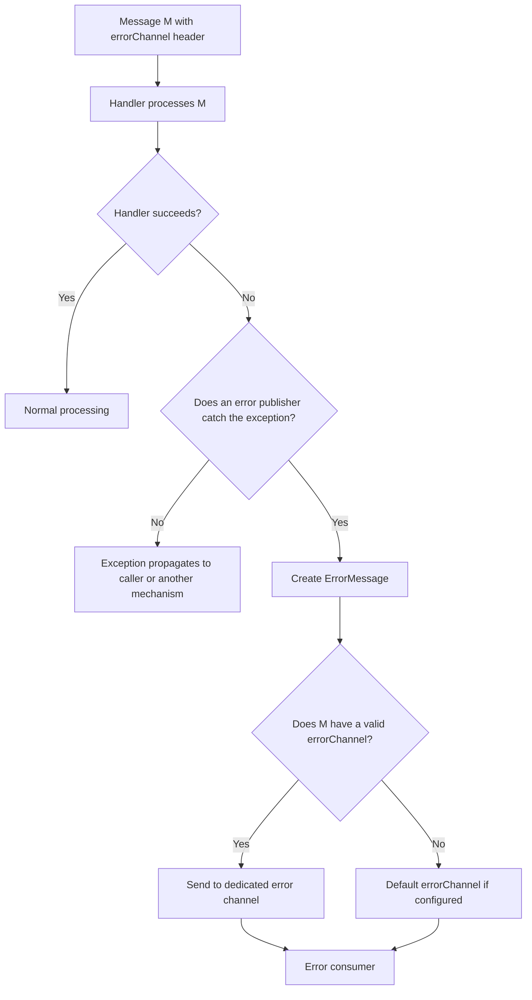
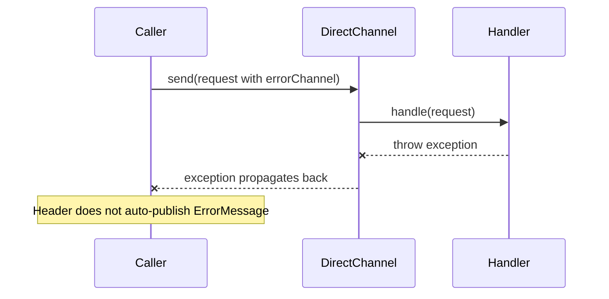
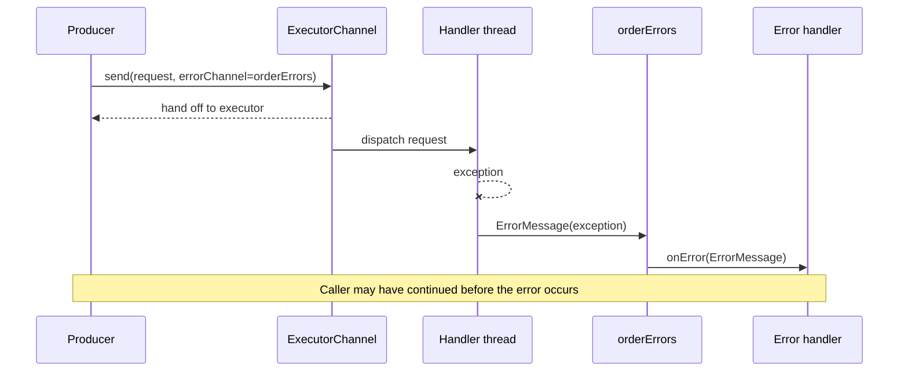

# Per-Message `errorChannel` Header in Spring Integration

## 1. Goal and Runtime Problem

In `SPRING_INTEGRATION_RUNTIME`, a message can pass through channels, endpoints, consumers, pollers, or executors and switch execution threads. When a handler throws an exception, error handling depends on **where the exception occurs**, **the endpoint's error-catching mechanism**, and **the error destination**. A particularly useful mechanism is attaching the `errorChannel` header to **individual messages** to specify a dedicated error destination for that specific execution.

Suppose the same `ordersIn` flow receives orders from multiple sources: regular requests should route errors to `orderErrors` to send notifications, while test requests should route errors to `testErrors` for observation. We do not need to duplicate the business processing flow: we can use **the same input channel and handler**, with each request carrying an appropriate `errorChannel`.

After this lesson, you should be able to:

- Understand what address the `errorChannel` header represents, who reads it, and how it differs from the global channel named `errorChannel`.
- Attach `MessageHeaders.ERROR_CHANNEL` using a `MessageChannel` instance or a channel name.
- Determine when an exception propagates back to the caller and when it is wrapped into an `ErrorMessage`.
- Locate `failedMessage`, correlation keys, and contextual data during asynchronous error handling.
- Design per-message error flows without losing headers or breaking transaction boundaries.

## 2. Distinguishing the Header, Error Message, and Global Channel

| Component | Nature | Role |
|---|---|---|
| `errorChannel` header | Header on the **request message**, key `MessageHeaders.ERROR_CHANNEL` (string value `"errorChannel"`) | Specifies the error-handling destination for that message when infrastructure catches and publishes the error. |
| Bean/channel named `errorChannel` | **Default global** error channel provided by the application/Spring Integration | General error sink when no dedicated error channel is resolved and the publisher falls back to the default. |
| `ErrorMessage` | A special `Message<Throwable>` | Carries the exception as its payload; may retain a link to the failing message. |
| `MessagingException.getFailedMessage()` | Message associated with the exception, if any | Allows reading the payload, headers, and tracking ID of the failed request. |
| `replyChannel` | Address header for returning **normal results** | Not an error-reporting channel; returning a fallback result requires explicit design. |

**Core point:** the `errorChannel` header is only an **error routing instruction**. Setting the header alone does not turn every exception into an `ErrorMessage`, nor does it guarantee the exception is handled if no component catches it and sends an error message.

The header name can be referenced via a constant:

```java
import org.springframework.messaging.MessageHeaders;

String headerName = MessageHeaders.ERROR_CHANNEL; // "errorChannel"
```

Meanwhile, `ErrorMessage` belongs to `org.springframework.messaging.support.ErrorMessage`. Do not confuse the `Throwable` payload inside `ErrorMessage` with the original request payload.

## 3. In What Order Is the `errorChannel` Header Applied?

For a **Spring Integration error message publishing mechanism** capable of inspecting the failing message (such as `MessagePublishingErrorHandler` in an asynchronous processing context), the typical sequence is:

1. A consumer, handler, or poller encounters an exception.
2. The error-handling mechanism catches the exception and creates an `ErrorMessage`. If an original/failed message is available, it is attached as error context.
3. The error publisher looks for **`errorChannel` in the headers of the failed/request message**.
4. If the header resolves to a valid channel, the publisher sends `ErrorMessage` to that channel.
5. If the message does not specify a dedicated error channel, the publisher may use the **default error channel**, typically the bean named `errorChannel`.
6. A consumer on the error channel receives `ErrorMessage` to log, alert, coordinate recovery, or perform compensation.



**Important scope note:** the sequence above describes **message-specific error routing** by an error publisher. An endpoint/gateway with its own error configuration, a poller using a custom error handler, or retry/recovery advice may determine routing under a different contract. Do not generalize that the `errorChannel` header always takes precedence over every component's own configuration.

The header supports two common value types:

- **`MessageChannel`:** an actual channel object, used directly within the same application context.
- **`String`:** a channel name for the framework to resolve, usually via a bean factory/channel resolver.

If you specify a nonexistent name, a channel with no subscribers, or sending fails, **the error-handling path itself can fail**. Do not assume Spring Integration will silently ignore a bad dedicated channel and fall back to the global channel in every case.

## 4. Why Do Thread Boundaries Determine Error Behavior?

### 4.1. Synchronous processing via `DirectChannel`

With a `DirectChannel`, calling `send()` usually invokes the handler on **the sender's thread**. If the handler throws an exception, the exception typically propagates back up the caller's call stack immediately at send time.



That means: **merely attaching `errorChannel` to a request on `DirectChannel` does not mean the exception will appear on that error channel.** For synchronous flows, the caller or gateway can catch the error directly; gateway/advice error configuration is what changes how exceptions enter an error flow.

### 4.2. Asynchronous processing via `ExecutorChannel`

With an `ExecutorChannel`, the sender usually hands the request off to an executor and continues, while the handler runs on another thread. An exception in the handler cannot propagate back onto the caller's already-unwound stack. This is where `MessagePublishingErrorHandler` becomes useful: the exception is converted into an `ErrorMessage` and sent to the relevant error channel.



Similarly, a `QueueChannel` with a polling consumer usually processes requests in a poll cycle on a different thread from the sender. However, **the poller must be configured and running**, the poller's error handler must publish errors via an appropriate mechanism, and the failing message must still retain sufficient header information.

| Structure | Where can errors surface? | Role of the `errorChannel` header |
|---|---|---|
| `DirectChannel → handler` | Directly on the caller's stack | Does not automatically replace synchronous exceptions with `ErrorMessage`. |
| `ExecutorChannel → handler` | Executor thread after enqueue/dispatch | Can be read by the error publisher to send `ErrorMessage` to the request's dedicated channel. |
| `QueueChannel → polling consumer` | Poller thread after dequeue | Depends on the polling endpoint's error-catching/publishing mechanism and message context. |
| Scheduled task source without a request message | Scheduler/poller thread | May have no failed message carrying a dedicated header; uses task/poller config or default. |

An error occurring **before** the work is handed off to the executor—such as task rejection because the pool/queue is full—can also be thrown directly from the send step. Always identify whether the failure happened during **sending**, **handler execution**, or **ErrorMessage publishing**.

## 5. Practical Example: Routing Each Order's Error to Its Specified Channel

This example runs in a Spring application with the `spring-integration-core` dependency. Place the classes below in the same `example.integration` package. We use `ExecutorChannel` to establish a clear thread boundary; the order handler returns `void` because the example focuses purely on **error routing**, without needing a normal reply.

### 5.1. Declaring the input channel, error channel, and executor

```java
package example.integration;

import org.springframework.context.annotation.Bean;
import org.springframework.context.annotation.ComponentScan;
import org.springframework.context.annotation.Configuration;
import org.springframework.integration.channel.DirectChannel;
import org.springframework.integration.channel.ExecutorChannel;
import org.springframework.integration.config.EnableIntegration;
import org.springframework.messaging.MessageChannel;
import org.springframework.scheduling.concurrent.ThreadPoolTaskExecutor;

@Configuration
@EnableIntegration
@ComponentScan(basePackageClasses = OrderHandlers.class)
public class ErrorFlowConfig {

    @Bean
    public ThreadPoolTaskExecutor orderExecutor() {
        ThreadPoolTaskExecutor executor = new ThreadPoolTaskExecutor();
        executor.setCorePoolSize(2);
        executor.setMaxPoolSize(4);
        executor.setQueueCapacity(50);
        executor.setThreadNamePrefix("order-flow-");
        return executor;
    }

    @Bean("ordersIn")
    public MessageChannel ordersIn(ThreadPoolTaskExecutor orderExecutor) {
        return new ExecutorChannel(orderExecutor);
    }

    @Bean("orderErrors")
    public MessageChannel orderErrors() {
        return new DirectChannel();
    }
}
```

`ThreadPoolTaskExecutor` is initialized by Spring according to the bean lifecycle. `ordersIn` accepts regular requests and shifts the handler onto an executor thread. `orderErrors` is a channel dedicated to receiving errors for marked requests.

### 5.2. Business handler and error handler

```java
package example.integration;

import org.springframework.integration.annotation.MessageEndpoint;
import org.springframework.integration.annotation.ServiceActivator;
import org.springframework.messaging.Message;
import org.springframework.messaging.MessagingException;
import org.springframework.messaging.support.ErrorMessage;

@MessageEndpoint
public class OrderHandlers {

    @ServiceActivator(inputChannel = "ordersIn")
    public void validateOrder(String orderId) {
        if (orderId.startsWith("BAD-")) {
            throw new IllegalArgumentException("Invalid order: " + orderId);
        }
        // Success: one-way processing in this example; no reply needed.
    }

    @ServiceActivator(inputChannel = "orderErrors")
    public void handleOrderError(ErrorMessage errorMessage) {
        Throwable failure = errorMessage.getPayload();

        Message<?> failed = failure instanceof MessagingException
                ? ((MessagingException) failure).getFailedMessage()
                : errorMessage.getOriginalMessage();

        Object traceId = failed == null
                ? "unknown"
                : failed.getHeaders().getOrDefault("traceId", "unknown");

        System.err.println("traceId=" + traceId
                + ", error=" + failure.getMessage());
    }
}
```

In this error flow, the **error message** is sent to `orderErrors`, while `traceId` comes from the **failed message** if the exception carries information about the failing message. In production, replace `System.err` with a structured logger or observability tool; log only non-sensitive data.

### 5.3. Attaching `errorChannel` to a specific request

The example below runs from a component that has access to `ApplicationContext context`:

```java
import org.springframework.context.ApplicationContext;
import org.springframework.messaging.Message;
import org.springframework.messaging.MessageChannel;
import org.springframework.messaging.MessageHeaders;
import org.springframework.messaging.support.MessageBuilder;

MessageChannel ordersIn =
        context.getBean("ordersIn", MessageChannel.class);
MessageChannel orderErrors =
        context.getBean("orderErrors", MessageChannel.class);

Message<String> request = MessageBuilder.withPayload("BAD-42")
        .setHeader(MessageHeaders.ERROR_CHANNEL, orderErrors)
        .setHeader("traceId", "T-42")
        .build();

boolean accepted = ordersIn.send(request);
System.out.println("accepted=" + accepted);
```

**Expected behavior:** `send()` accepts the request for handoff to the executor; `validateOrder()` then throws `IllegalArgumentException`; the infrastructure wraps the error in an `ErrorMessage` and the handler on `orderErrors` receives it, recovering `traceId = T-42`.

Do not equate `accepted == true` with successful business processing. It only indicates that sending the message was accepted under the channel's contract. If the executor or system shuts down before running the handler, or if error publishing fails, what you observe will differ.

You can use a **bean name** instead of a channel instance:

```java
Message<String> request = MessageBuilder.withPayload("BAD-42")
        .setHeader(MessageHeaders.ERROR_CHANNEL, "orderErrors")
        .setHeader("traceId", "T-42")
        .build();
```

Using a string is more convenient when messages cross serialization boundaries, but **the channel name must be resolvable at the point where the error is published**. The string `"orderErrors"` does not create a new channel by itself.

### 5.4. Two requests, two different error channels

The same handler can receive:

```text
Request A: payload=BAD-42, errorChannel=orderErrors, traceId=A
Request B: payload=BAD-99, errorChannel=testErrors,  traceId=B
```

If `testErrors` exists and has an error consumer, error A and error B will go to **two different handling endpoints**. This is per-message routing, not fixed per-handler routing. When using multiple channels, register the corresponding bean and consumer for each target.

## 6. What Does ErrorMessage Contain?

`ErrorMessage` is a `Message<Throwable>`, not an error message string. When handling it, you typically need to distinguish three layers of data:

1. **`errorMessage.getPayload()`:** the exception being reported; may be a `MessageHandlingException` or another `MessagingException` wrapping a root cause.
2. **`((MessagingException) throwable).getFailedMessage()`:** the message directly associated with the exception if attached by the publisher/handler.
3. **`errorMessage.getOriginalMessage()`:** the original context message if supplied by the `ErrorMessage` creation strategy.

Not every exception contains `failedMessage`. Not every `ErrorMessage` has `originalMessage`. Before logging or extracting headers, always check for `null` and inspect the exception's **cause chain** when analyzing the underlying failure.

Example helper method to find the deepest cause:

```java
private static Throwable rootCause(Throwable error) {
    Throwable current = error;
    while (current.getCause() != null && current.getCause() != current) {
        current = current.getCause();
    }
    return current;
}
```

**Trace and correlation:** `traceId` in the example is an application-defined business header. The `correlationId` header in splitters/aggregators has its own semantics; the `errorChannel` header is solely the error destination address. Do not use the channel address in place of a correlation ID when measuring metrics, searching logs, or correlating results.

## 7. How Do Headers Travel Through a Flow and When Are They Lost?

Many standard Spring Integration endpoints forward appropriate request headers to the output message. However, header preservation is not an absolute guarantee across every kind of adapter, transformer, header filter, format conversion, and external broker.

Example of a step manually building a message and accidentally dropping headers:

```java
Message<String> transformed = MessageBuilder
        .withPayload("normalized-" + incoming.getPayload())
        .build();
// Only creates a new payload; does not copy errorChannel/traceId.
```

If you want to preserve relevant headers in custom message-building code:

```java
Message<String> transformed = MessageBuilder
        .withPayload("normalized-" + incoming.getPayload())
        .copyHeadersIfAbsent(incoming.getHeaders())
        .build();
```

Both snippets assume `incoming` is a `Message<String>`. In practice, Spring Integration may automatically enrich or propagate headers at certain endpoints; inspect **the message after the endpoint boundary** before concluding that a header was lost.

**Transport boundaries:** a `MessageChannel` value is an in-JVM object. If a message must cross a persistent store, broker, or another process, do not assume you can serialize the channel object and reuse it after a restart. You can use `HeaderChannelRegistry` and a mechanism that converts channel headers to strings where supported by the architecture, or explicitly design error destinations on the receiving side.

**Lifetime:** a temporary channel, a channel name mapped through a registry, or an old application instance may expire before error handling finishes. For long-lived stored messages or delayed retries, define how destinations are restored and the policy for late-arriving errors.

## 8. Distinguishing the `errorChannel` Header from a Gateway's `errorChannel`

Spring Integration provides a **messaging gateway** to bridge synchronous Java calls with message flows. A gateway can provide its own error-channel configuration; do not confuse that configuration with setting a header on messages from any producer.

- **Normal request:** the gateway's `replyChannel` brings the business result back to the Java call.
- **Synchronous exception:** without a dedicated error-conversion mechanism, the exception can propagate directly back to the caller.
- **Gateway with an error flow:** depending on gateway configuration, errors can be turned into an `ErrorMessage` for the error flow, and the result of the error flow can be transformed into a reply/fallback under the gateway's contract.
- **Message header:** used by the corresponding error-publishing mechanism as the destination when handling a failure tied to that request.

A `void handleError(ErrorMessage error)` handler that only logs **does not automatically produce a reply** for a waiting gateway call. If the requirement is "the client receives a fallback result," design explicitly for **error → recovery result → reply** and test timeouts/correlation. If the requirement is "record errors after async processing," a one-way error handler like the example above is more appropriate.

## 9. What Do Retries, Transactions, and Recovery Change?

When combined with `RequestHandlerRetryAdvice` or an advice chain, an exception can be **retried right inside the endpoint**. Therefore, `ErrorMessage` is not necessarily published on the first failure. If a retry eventually succeeds, the flow may emit no error; if attempts are exhausted and the advice rethrows the exception, the error then reaches the boundary's error-publishing mechanism. A recovery callback may handle the error without rethrowing, leading to a different path.

Regarding transactions:

- An exception thrown inside a transaction can mark the transaction for rollback **if** it is still within the active transaction scope and rollback rules match.
- An error consumer running on a **different thread** or outside the original transaction does not automatically join the same transaction.
- "ErrorMessage was received" does not mean the business transaction rolled back, retries succeeded, or data was compensated.

When designing recovery, clearly define the final state of a message: failure logged, retried, moved to a dead-letter destination, error response returned, or compensated. Never use "a message arrived on the error channel" alone as proof of comprehensive error handling.

## 10. Diagnosing When the Header Is Present but Errors Go to the Wrong Place

| Symptom | Possibilities to check | Diagnostic action |
|---|---|---|
| `errorChannel` set, yet exception still thrown to caller | Handler runs synchronously via `DirectChannel`; no error publisher converts the exception to `ErrorMessage`. | Identify the handler's thread and where the exception is caught; test a controlled async flow. |
| Errors go to global `errorChannel` | Failing message lost its dedicated header, error has no failed message attached, or publisher uses default. | Log headers at the failing consumer; inspect `MessagingException.getFailedMessage()`. |
| No messages at the error consumer | Wrong channel selected, no subscribers, send to channel failed, retries still running, or error was recovered. | Check bean name, subscribers, advice chain, and error publisher logs. |
| `traceId` disappears | Header was not forwarded across a transformer, adapter, or transport. | Inspect headers at each boundary; check copy and serialization rules. |
| Gateway reply times out even though error handler logged | Error consumer handles one-way without producing a reply for the gateway. | Check the gateway contract and whether the error flow returns a valid fallback. |
| Secondary error while handling an error | Error consumer also throws an exception or the error channel is blocked. | Simplify the error consumer, log secondary errors separately, avoid error-handling loops. |

The investigation order should be: **(1)** identify the failing thread and endpoint, **(2)** determine which component catches the exception, **(3)** inspect `failedMessage`/headers at publish time, **(4)** check which error channel was resolved, **(5)** verify the consumer receiving `ErrorMessage`, **(6)** cross-check retries, timeouts, and transactions.

You can use wire taps, channel interceptors, logs with correlation/trace IDs, and metrics on channels/handlers to piece together the timeline. Avoid logging full payloads, secrets, or raw exceptions containing sensitive data.

## 11. Self-Verification Exercises

Starting from the `ErrorFlowConfig` and `OrderHandlers` example:

1. Send `BAD-42` with header `errorChannel = orderErrors`; confirm the error handler can recover `traceId = T-42`.
2. Send `OK-42` with the same header; the handler completes and **does not** emit an `ErrorMessage`.
3. Send `BAD-43` **without** `errorChannel`; observe how the default global `errorChannel` handles it (and register an appropriate error consumer if needed).
4. Change `ordersIn` from `ExecutorChannel` to `DirectChannel`; call `send()` inside a `try/catch`. Explain why the exception path changes.
5. Set the `errorChannel` header to a nonexistent bean name; compare the business handler's exception with the error raised **while routing the error**.
6. Add a message transformation step both with and without copying headers; print headers right before the final handler to pinpoint exactly when context is lost.
7. If the system has retries, configure a bounded attempt count and verify how many times the handler is invoked before an `ErrorMessage` is produced.

For each case, record at least: **thread**, **channel receiving the request**, **`errorChannel` header when the handler runs**, **where the exception is caught**, **channel receiving `ErrorMessage`**, and **transaction/retry status if applicable**. These observations help distinguish routing issues from business failures.

## 12. Design Rules to Remember

- Attach `MessageHeaders.ERROR_CHANNEL` when **individual messages need their own error-handling route**; you can pass a `MessageChannel` or channel name.
- The header only takes effect when the error-handling mechanism **can publish an `ErrorMessage`** and has sufficient message context; synchronous exceptions typically propagate straight back to the caller.
- The error consumer receives an **`ErrorMessage`**, whose payload is a **`Throwable`**. Read the failed message if available to extract headers and correlation IDs.
- Preserve headers across transformers, queues, adapters, brokers, or message stores; specifically verify JVM boundaries and channel lifecycles.
- Verify retries, transactions, timeouts, and fallback-reply policies **separately**. A successfully sent error message does not mean the caller received a response or that business state has been recovered.

### References

- [Spring Integration Reference — Error Handling](https://docs.spring.io/spring-integration/reference/error-handling.html): `ErrorMessage`, `errorChannel`, distinguishing synchronous/asynchronous errors.
- [Spring Integration Reference — ExecutorChannel](https://docs.spring.io/spring-integration/reference/channel/implementations.html): executor-backed channels and their effect on processing threads.
- [Spring Integration Reference — Messaging Gateways](https://docs.spring.io/spring-integration/reference/gateway.html): reply/error flows at Java call boundaries.
- [Spring Integration Reference — Retry Advice](https://docs.spring.io/spring-integration/reference/handler-advice/classes.html): advice, retry, and recovery for handlers.
