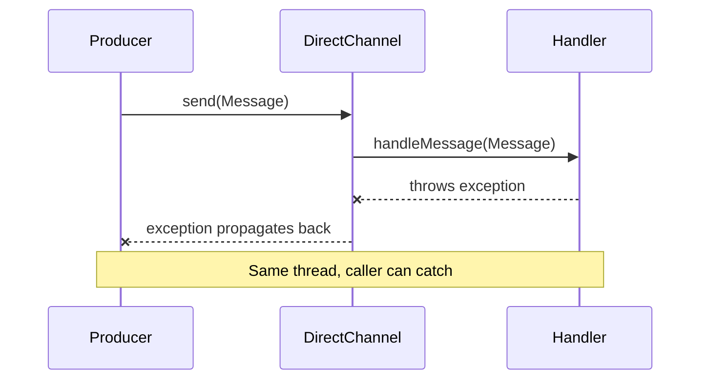
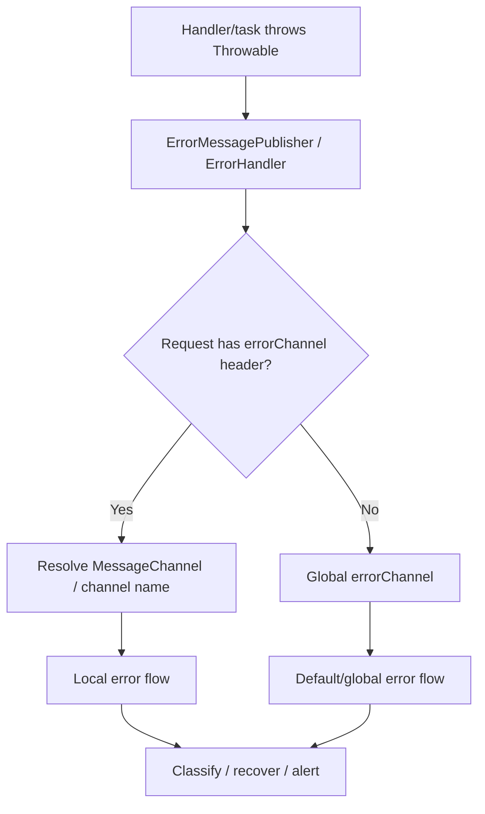
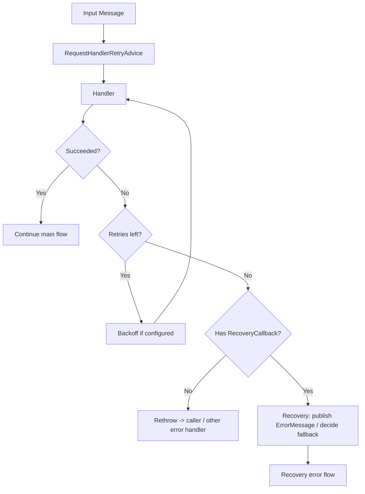

# Error Flows and Exception-Handling Handlers in Spring Integration

## Lesson Objectives

Spring Integration coordinates messages across channels, endpoints, consumers, pollers, and executors. When a handler throws an exception, how the error surfaces depends on **the executing thread**, the endpoint type, and the configured error-handling mechanism. Within the **SPRING_INTEGRATION_RUNTIME** module, the **Error runtime** chapter focuses on turning failures into a message flow branch that can be observed, routed, and recovered.

After this lesson, you will be able to:

- Explain the difference between an exception thrown directly to the caller and an error wrapped into an `ErrorMessage`.
- Trace how the runtime selects `errorChannel` from a message header or the global channel.
- Build error-handling handlers and exception-type routers without dropping or duplicating handling.
- Coordinate error flows with retries, recovery, transactions, pollers, executors, message stores, and correlation.
- Test both synchronous and asynchronous paths, and diagnose why an error does not reach the expected channel.

Examples use Spring Integration Java configuration syntax and Java 17+, suited to learning APIs of the Spring Integration 6.x line. Some default details vary across versions; verify against your actual library version in production.

## 1. Two Ways an Exception Leaves a Message Flow

Suppose a service activator processes orders:

```java
@ServiceActivator(inputChannel = "orders")
public void persist(String orderId) {
    if (orderId.startsWith("BAD")) {
        throw new IllegalArgumentException("Invalid order: " + orderId);
    }
    // Persist the order to the database.
}
```

There are two common error-handling paths.

### 1.1. Synchronous flow: exception propagates up the call stack



With the default `DirectChannel`, the handler typically runs directly on the sending thread. If the handler throws an exception without another catching or recovery mechanism, the `send()` call receives the exception. **Merely setting the `errorChannel` header on a message is not enough to automatically redirect synchronous errors to that channel.** When you need to alter handling, configure an explicit error-catching point such as a gateway error flow or advice with recovery.

### 1.2. Asynchronous flow: exception sent as a message

```mermaid
sequenceDiagram
    participant P as Producer
    participant Q as QueueChannel
    participant X as Poller / TaskExecutor
    participant H as Handler
    participant E as Error channel
    participant EH as Error handler
    P->>Q: send(Message)
    Q-->>P: accepted into queue
    X->>Q: poll()
    Q-->>X: Message
    X->>H: handleMessage(Message)
    H--xX: throws exception
    X->>E: publish ErrorMessage
    E->>EH: handle(ErrorMessage)
    Note over P,EH: Caller already returned from send(); error handled on separate branch
```

If an error occurs inside a framework-managed task via a `TaskExecutor` or a poller with an appropriate error handler, the runtime can create an `ErrorMessage` and send it to an error-handling channel. `ErrorMessage` has a `Throwable` payload. The `send()` caller cannot directly catch an error occurring later on another thread.

Avoid concluding that **every** executor, manually spawned thread, or external client automatically publishes `ErrorMessage`. That mechanism must be supported and configured by the Spring Integration message-producing/receiving component or task.

### Quick decision table

| Context | Where is the error usually observed? | Handling approach |
|---|---|---|
| `DirectChannel`, handler throws | Caller of `send()` / gateway | Catch exceptions at the boundary or configure gateway/advice. |
| `ExecutorChannel`, framework-managed task | Executor/dispatcher error-handling branch | Inspect `errorChannel` header, error handler, and subscribers. |
| `QueueChannel` with poller | Poller/task scheduler error handler | Read `ErrorMessage` on the error channel and check poller configuration. |
| Inbound adapter receiving from JMS/AMQP/Kafka | Adapter/container/broker plus optional error flow | Clearly define ack, nack, rollback, redelivery, and DLQ. |
| Handler manually spawns `new Thread(...)` and throws | New thread or `UncaughtExceptionHandler` | Add custom error-catching/publishing logic; the framework does not automatically detect arbitrary threads. |
| Failure inside error handler | Secondary exception on the error branch | Keep the error branch simple, with fallbacks and monitoring. |

**Key takeaway:** `errorChannel` is part of **message-based error handling**, not a JVM-wide catch-all mechanism.

## 2. What Does ErrorMessage Contain?

`org.springframework.messaging.support.ErrorMessage` is a type of `Message<Throwable>`:

```java
ErrorMessage errorMessage = /* received from an error channel */;

Throwable failure = errorMessage.getPayload();
Message<?> original = errorMessage.getOriginalMessage();

if (failure instanceof MessagingException messagingException) {
    Message<?> failed = messagingException.getFailedMessage();
    // failed may be null: only read when actually present.
}
```

Concepts to distinguish:

| Data | Meaning | Always present? |
|---|---|---|
| `ErrorMessage.getPayload()` | The published `Throwable`, which may be a wrapper like `MessageHandlingException`. | Yes, by ErrorMessage contract. |
| `ErrorMessage.getOriginalMessage()` | The input message linked to the error, if provided by the publisher/strategy. | No; may be `null`. |
| `MessagingException.getFailedMessage()` | The relevant message when the error occurred in the pipeline. | No; some errors lack a message context. |
| `Throwable.getCause()` | The underlying error inside one or more wrapper layers. | No; depends on the exception. |
| Headers of `ErrorMessage` itself | Metadata of the **new error message**, including its own message ID/timestamp. | Not necessarily identical to the input message's headers. |

Practical example:

```text
Input Message:
  id: 7fc...
  payload: "BAD-42"
  headers:
    correlationId: "batch-9"
    errorChannel: "orderErrors"

ErrorMessage:
  payload: MessageHandlingException
      cause: IllegalArgumentException("Invalid order: BAD-42")
      failedMessage: Input Message (if available)
  originalMessage: Input Message (if available)
  headers:
      id: new UUID
      timestamp: error publish time
```

Do not inspect only `errorMessage.getPayload().getClass()` to infer the business error: it may be a `MessageHandlingException` wrapping an `IllegalArgumentException`, a `MessagingException` wrapping a timeout, or a networking library wrapper. Inspect the **cause chain**.

### Avoiding context loss

When creating exceptions yourself in a custom handler, pass the message to the exception when possible:

```java
@Override
protected void handleMessageInternal(Message<?> message) {
    try {
        persist(message.getPayload());
    } catch (IllegalArgumentException ex) {
        throw new MessageHandlingException(
                message,
                "Cannot process order payload",
                ex);
    }
}
```

Here, `persist(...)` is an application-defined business service. The snippet illustrates wrapping an error; there is no need to re-wrap a `MessagingException` that already carries full context.

Also do not assume the entire original message can always be serialized or persisted directly in a database: payload/headers may hold non-serializable objects or sensitive data. When durable auditing is needed, extract the required fields under an explicit contract.

## 3. How Does the Runtime Choose the Error Channel?

For an error publisher supporting standard Spring Integration rules:

1. Check the `MessageHeaders.ERROR_CHANNEL` header (string name `errorChannel`) on the request message being processed.
2. If a valid value is present, send `ErrorMessage` to the specified `MessageChannel`, or resolve the channel name when the header is a `String`.
3. If no suitable error header is present, use the global channel with bean name `errorChannel` (`IntegrationContextUtils.ERROR_CHANNEL_BEAN_NAME`).



A header pointing to a nonexistent channel, a channel refusing messages, or a channel with no suitable consumer creates a **secondary publish error**. Do not assume the publisher always falls back to global when a header is present but fails to resolve: verify behavior for the specific publisher and configuration.

Example setting an error channel per message:

```java
Message<String> request =
        MessageBuilder.withPayload("BAD-42")
                .setHeader(MessageHeaders.ERROR_CHANNEL, "orderErrors")
                .setHeader("correlationId", "batch-9")
                .build();
```

You can also set a `MessageChannel` bean directly as the header value. Using a channel name is often more convenient when messages cross components with serialization, provided the resolver can still locate that name in the target context.

### Default global errorChannel

When Spring Integration is enabled, the framework provides the global `errorChannel` if the application has not defined a bean with that name. In standard default configurations, it is a `PublishSubscribeChannel` with a `LoggingHandler` subscribed to log at `ERROR` level. Because it is publish-subscribe, you can add your own error-handling handler while the logger stays active.

For the default `LoggingHandler`, subscription order is set low so application handlers get a chance to run first. With a synchronous `PublishSubscribeChannel`, an exception from one subscriber can affect remaining subscribers; if your error subscriber only observes, avoid throwing unnecessary exceptions.

Since Spring Integration 5.4.3, the default global channel uses `requireSubscribers=true` to avoid silently dropping error messages when no subscribers exist (for example during context shutdown). This can be changed via the `spring.integration.channels.error.requireSubscribers` integration property or custom channel configuration, though silently discarding errors usually makes operations harder to control.

If you declare:

```java
@Bean
public PollableChannel errorChannel() {
    return new QueueChannel(500);
}
```

then you have **replaced** the global channel configuration, no longer keeping the previous publish-subscribe semantics and default logger subscriber. With a `QueueChannel`, you must provide a consumer/poller to read the queue and define capacity, persistence, and queue-full policies.

## 4. End-to-End Example: Same Error, Two Execution Paths

The complete example below demonstrates a handler throwing errors on a `DirectChannel` and on a `QueueChannel` with a poller. Both share the same business rule, yet yield different observable outcomes.

```java
import org.springframework.context.annotation.AnnotationConfigApplicationContext;
import org.springframework.context.annotation.Bean;
import org.springframework.context.annotation.Configuration;
import org.springframework.integration.annotation.Poller;
import org.springframework.integration.annotation.ServiceActivator;
import org.springframework.integration.channel.DirectChannel;
import org.springframework.integration.channel.QueueChannel;
import org.springframework.integration.config.EnableIntegration;
import org.springframework.messaging.Message;
import org.springframework.messaging.MessageChannel;
import org.springframework.messaging.MessageHeaders;
import org.springframework.messaging.MessagingException;
import org.springframework.messaging.PollableChannel;
import org.springframework.messaging.support.ErrorMessage;
import org.springframework.messaging.support.MessageBuilder;

@Configuration
@EnableIntegration
public class ErrorFlowDemo {

    @Bean
    public MessageChannel syncOrders() {
        return new DirectChannel();
    }

    @Bean
    public PollableChannel queuedOrders() {
        return new QueueChannel(32);
    }

    @Bean
    public PollableChannel orderErrors() {
        return new QueueChannel(32);
    }

    @Bean
    public OrderProcessor orderProcessor() {
        return new OrderProcessor();
    }

    public static class OrderProcessor {

        @ServiceActivator(inputChannel = "syncOrders")
        public void processSync(String orderId) {
            validate(orderId);
        }

        @ServiceActivator(
                inputChannel = "queuedOrders",
                poller = @Poller(fixedDelay = "100", maxMessagesPerPoll = "1"))
        public void processQueued(String orderId) {
            validate(orderId);
        }

        private void validate(String orderId) {
            if (orderId.startsWith("BAD")) {
                throw new IllegalArgumentException("Invalid order: " + orderId);
            }
            System.out.println("ACCEPT " + orderId);
        }
    }

    public static void main(String[] args) {
        try (var context =
                new AnnotationConfigApplicationContext(ErrorFlowDemo.class)) {

            MessageChannel sync = context.getBean(
                    "syncOrders", MessageChannel.class);
            MessageChannel queued = context.getBean(
                    "queuedOrders", MessageChannel.class);
            PollableChannel errors = context.getBean(
                    "orderErrors", PollableChannel.class);

            // 1. Synchronous: exception propagates back to the caller.
            try {
                sync.send(MessageBuilder.withPayload("BAD-SYNC")
                        .setHeader(MessageHeaders.ERROR_CHANNEL, "orderErrors")
                        .build());
            } catch (MessagingException ex) {
                System.out.println("SYNC exception: "
                        + ex.getClass().getSimpleName());
            }

            // 2. Asynchronous: poller picks up and processes the message.
            queued.send(MessageBuilder.withPayload("BAD-QUEUED")
                    .setHeader(MessageHeaders.ERROR_CHANNEL, "orderErrors")
                    .setHeader("correlationId", "batch-9")
                    .build());

            Message<?> received = errors.receive(5_000);

            if (received instanceof ErrorMessage error) {
                Throwable failure = error.getPayload();
                System.out.println("ASYNC failure: "
                        + failure.getClass().getSimpleName());

                Message<?> original = error.getOriginalMessage();
                if (original == null && failure instanceof MessagingException ex) {
                    original = ex.getFailedMessage();
                }
                if (original != null) {
                    System.out.println("Original payload: "
                            + original.getPayload());
                    System.out.println("Correlation: "
                            + original.getHeaders().get("correlationId"));
                }
            } else {
                System.out.println("Did not receive ErrorMessage in time");
            }
        }
    }
}
```

**Expected outcome** under standard polling/error handler configuration:

- `sync.send(...)` throws the error back to the caller, even though the input message carries the `errorChannel` header. You may observe a wrapper exception such as `MessageHandlingException`.
- `queued.send(...)` places the message into the queue successfully; the caller thread returns from `send()`.
- The poller invokes `processQueued()`, fails, and publishes an `ErrorMessage` to `orderErrors`.
- `errors.receive(5_000)` retrieves the error; the outer `Throwable` class and how `originalMessage` is attached depend on the error-message creation path.
- The `correlationId=batch-9` header must be read from **the original message**, not from the newly generated ID of `ErrorMessage`.

This exercise assumes Spring Integration's default scheduler. If you supply a custom `TaskScheduler` or non-standard polling layer, verify that the scheduler's error handler is properly attached.

The `5_000 ms` timeout is the maximum wait used by the example to receive the error, not a guarantee that every system finishes within that window.

### Inspecting the exception structure

In an error handler, resolve the root exception with a depth limit to prevent custom cyclic cause chains:

```java
static Throwable rootCause(Throwable error) {
    Throwable current = error;
    int depth = 0;
    while (current.getCause() != null
            && current.getCause() != current
            && depth++ < 32) {
        current = current.getCause();
    }
    return current;
}
```

When classifying for routing, do not always rely solely on the root cause: `MessageHandlingException`, `IOException`, and internal exceptions can carry meaning at different layers. Prefer well-typed business exceptions; fall back to the root cause only when appropriate.

## 5. Building Handlers for the Error Flow

An error handler used in Spring Integration is usually a **message consumer** receiving `ErrorMessage` from an error channel. It can log, create an audit record, alert, send to a DLQ, or emit a compensating command.

Example with a Spring-managed bean (placed inside a `@Configuration` with `@Bean` or a scanned `@Component` class):

```java
import org.springframework.integration.annotation.ServiceActivator;
import org.springframework.messaging.Message;
import org.springframework.messaging.MessagingException;
import org.springframework.messaging.support.ErrorMessage;

public class ErrorAuditHandler {

    @ServiceActivator(inputChannel = "errorChannel")
    public void audit(ErrorMessage error) {
        Throwable failure = error.getPayload();
        Throwable cause = rootCause(failure);

        Message<?> failed = error.getOriginalMessage();
        if (failed == null && failure instanceof MessagingException ex) {
            failed = ex.getFailedMessage();
        }

        Object correlation = failed == null
                ? null
                : failed.getHeaders().get("correlationId");

        System.err.printf("type=%s correlation=%s reason=%s%n",
                cause.getClass().getName(),
                correlation,
                cause.getMessage());
    }

    private static Throwable rootCause(Throwable throwable) {
        Throwable current = throwable;
        while (current.getCause() != null
                && current.getCause() != current) {
            current = current.getCause();
        }
        return current;
    }
}
```

The handler above **illustrates the handler class**; you must register an `ErrorAuditHandler` bean in the context for the annotation to take effect. It receives errors **already sent by a publisher to `errorChannel`**; merely adding the annotation does not automatically convert synchronous exceptions into `ErrorMessage` instances.

### What should and should not be logged?

- **Do log:** timestamp, endpoint/handler ID, channel name, exception class, error code, message ID/correlation ID, retry attempt, trace ID, recovery outcome.
- **Be careful with:** payloads, tokens, credentials, PII, exception messages containing secret queries/URLs.
- **Have a fallback:** an error handler that repeatedly throws exceptions can destroy diagnostics. If writing error audits, define a clear policy when the audit repository itself fails.
- **For DLQs:** attach enough business info to support replay without relying on the entire `Throwable` being serializable.

### Handlers trying to return a reply can cause confusion

A handler that only logs and returns `void` **does not automatically produce a reply** for a waiting caller/gateway. If a gateway has an error flow with request/reply semantics, the error branch must decide whether to return a fallback result, propagate the exception, or terminate intentionally. Where a consumer uses `requiresReply`, returning `null` can trigger another error (`ReplyRequiredException`).

Do not arbitrarily turn every error into a success response: callers, transaction managers, and acknowledgment mechanisms may misinterpret the result.

## 6. Routing Errors by Exception

If an error channel receives multiple types of failures, use `ErrorMessageExceptionTypeRouter`. This router inspects the `Throwable` type in the payload and traverses its causes (`cause`) to find a matching channel mapping.

Java DSL example for a dedicated error flow:

```java
import java.net.SocketTimeoutException;
import org.springframework.context.annotation.Bean;
import org.springframework.integration.dsl.IntegrationFlow;

@Bean
public IntegrationFlow classifyErrors() {
    return IntegrationFlow.from("errorChannel")
            .routeByException(r -> r
                    .channelMapping(
                            IllegalArgumentException.class, "invalidOrders")
                    .channelMapping(
                            SocketTimeoutException.class, "temporaryFailures")
                    .defaultOutputChannel("unexpectedFailures"));
}
```

You also need to declare the three target channels along with their consumers. The example uses Java DSL's `routeByException(...)` (in supported Spring Integration versions). Exception-based routing differs from `PayloadTypeRouter`: it does not only inspect the `MessageHandlingException` wrapper, it also evaluates the hierarchy and cause chain. When mappings overlap between superclass and subclass, check **mapping ordering** according to the router rules in your version.

Classify errors by business decision:

| Error group | Example | Preferred action |
|---|---|---|
| Invalid data | `IllegalArgumentException`, schema/validation failure | Route to invalid/dead-letter flow; do not auto-retry with the same input. |
| Transient error | HTTP 503, timeout, connection reset | Bounded retry with backoff and jitter, then recovery/DLQ. |
| Configuration/wiring error | Unresolvable channel, missing required subscriber | Raise technical alert and fix configuration; blind retries are usually futile. |
| Transaction conflict | Deadlock or optimistic lock | Conditional retry aligned with transaction boundaries and idempotency. |
| Unclassified error | Unexpected exception or unknown wrapper | Record trace, alert, and send to investigation branch; avoid silently ignoring. |

Use fixed channel names based on **action category**, such as `temporaryFailures`, rather than creating a new channel per customer/message. This simplifies lifecycle management and metrics.

### When to use routing vs. handling in one handler?

- Use a **router** if each error group requires a distinct workflow (delayed retry, DLQ persistence, business notification, infrastructure alert).
- Use **a single error handler** if you only need logging/auditing with a small amount of classification logic.
- Use a **dedicated service** if mapping requires business logic or external data; do not cram heavy I/O into a router.

## 7. Error Publishers, Strategies, and Error Sources Outside Handlers

Sometimes failures occur in an adapter or library outside a consumer endpoint, so Spring Integration provides supporting components:

| Component | Role |
|---|---|
| `MessagePublishingErrorHandler` | `org.springframework.util.ErrorHandler` capable of sending exceptions as `ErrorMessage` to a channel. Used in appropriate scheduler/executor tasks. |
| `ErrorMessagePublisher` | General API for publishing `ErrorMessage` in integration contexts; extended or invoked by other components. |
| `ErrorMessageStrategy` | Builds an `ErrorMessage` from a `Throwable` and context. |
| `DefaultErrorMessageStrategy` | Attempts to set the request message from context as `ErrorMessage.originalMessage`. |
| `ErrorMessageUtils.INPUT_MESSAGE_CONTEXT_KEY` | Key used in `AttributeAccessor` to hold the original input message when the publisher has that context. |
| `ErrorMessageSendingRecoverer` | `RecoveryCallback` that sends the final failure to an error channel when using retry advice. |

Default polling tasks use `MessagePublishingErrorHandler` via the global `taskScheduler`. If the application supplies its own `TaskScheduler`, configure an appropriate error handler to preserve the error flow path. Spring Integration provides a bean named `integrationMessagePublishingErrorHandler` for this purpose.

**Not all errors are turned into `ErrorMessage` the same way.** A gateway or adapter may use its own strategy, roll back a transaction, rethrow to the transport, route to a broker-managed DLQ, or perform its own recovery. When diagnosing, inspect the configuration of **the component raising the error** before predicting its path.

## 8. Retry, Recovery, and Error Flows: Avoiding Duplicate Handling

Retry belongs to a different layer than error publishing:



Spring Integration provides `RequestHandlerRetryAdvice` and can attach `ErrorMessageSendingRecoverer` to publish errors after attempts are exhausted.

Example advice configuration (requires the retry dependency for your version):

```java
import org.springframework.context.annotation.Bean;
import org.springframework.integration.handler.advice.ErrorMessageSendingRecoverer;
import org.springframework.integration.handler.advice.RequestHandlerRetryAdvice;
import org.springframework.messaging.MessageChannel;

@Bean
public RequestHandlerRetryAdvice retryAdvice(
        MessageChannel recoveryErrors) {

    RequestHandlerRetryAdvice advice = new RequestHandlerRetryAdvice();
    advice.setRecoveryCallback(
            new ErrorMessageSendingRecoverer(recoveryErrors));
    return advice;
}
```

Applying the advice at an endpoint, for example:

```java
@ServiceActivator(
        inputChannel = "ordersToPersist",
        adviceChain = "retryAdvice")
public void persist(String payload) {
    // May throw when DB/remote service is temporarily unavailable.
}
```

Place these configuration snippets in an appropriate configuration/bean class, defining the `recoveryErrors` channel, `ordersToPersist` bean, and real business method. Retry counts, delay/backoff, and retryable exceptions must be configured per SLA; do not rely on defaults under strict operational requirements.

**Important pitfall:** When a `RecoveryCallback` handles the final error, it can *consume the exception* and return a substitute value (often `null`). Earlier stages in the flow may no longer see the original exception. For endpoints requiring a reply, `null` can trigger `ReplyRequiredException` or a gateway timeout. Always test reply and acknowledgment contracts accurately.

### Error flows differ from retry queues / DLQs

An `ErrorMessage` is a message published via Spring Integration mechanisms; that does **not** mean:

- Infinite retries or broker redelivery.
- Durable storage of all errors and payloads.
- A transaction spanning source, handler, and error storage.
- Exactly-once guarantees or automatic duplicate suppression.

To preserve failed messages across restarts, use a durable store or an appropriate source/transport DLQ/quarantine. If using a `QueueChannel` with a `MessageStore`, configure the message store and an explicit cleanup policy. If using only an in-memory `QueueChannel` like in the example, queued messages can be lost when the process stops.

### Advice for evaluating results and handling exceptions

`ExpressionEvaluatingRequestHandlerAdvice` allows evaluating expressions on success or failure; on the failure path, `#exception` is available and a message can be sent to a failure channel. This is a **handler-level advice mechanism**, not a complete replacement for executor/poller error channels.

Options like `trapException` or `returnFailureExpressionResult` alter how errors are thrown/returned. Use them intentionally, because "swallowing" an exception can cause the message source to ack/commit even though business processing did not succeed.

## 9. Transactions and Acknowledgments in Error Flows

Processing errors often intersect with transactions, retries, or inbound adapter acknowledgments.

Example: a poller fetches a message from an external system, the handler writes to the DB and throws an exception, while another branch wants to write to a DLQ. There are at least two potential transactions:

1. **Main processing transaction**: may encompass message retrieval, handler invocation, and DB writes, depending on the inbound adapter/poller/advice.
2. **Error storage transaction or operation**: publishing `ErrorMessage` or writing to a DLQ may happen within the same or a separate transaction, depending on configuration.

Logging an `ErrorMessage` successfully **does not prove** the main transaction rolled back, nor does it prove the broker will redeliver the message. Conversely, if recovery "swallowed" the error, a consumer may consider the work successful and acknowledge the message.

| Question | What to check |
|---|---|
| Did the DB roll back? | Transaction manager, transaction boundary, exception type, and propagation. |
| Will the broker redeliver? | Ack mode, exception propagation, adapter/container retry/requeue/DLQ policy. |
| Is the error durably stored? | Store/DLQ transaction, publisher confirms, and durability settings. |
| Could duplicate processing occur? | Idempotency key, business message ID, outbox/inbox, or deduplication. |
| What if the error handler also fails? | Rethrow/fallback/monitoring, acknowledgment state, and potential error loss. |

With `DirectChannel`, a transaction bound to the caller thread can span the handler. `ExecutorChannel` creates a thread boundary: the producer's transaction and `ThreadLocal` state do not automatically follow. With `QueueChannel` and a poller, check the boundary placed around the poller/task/handler. `MessageHandler` metadata alone does not start a transaction.

### Example safe strategy

An outbound call transiently fails after writing data:

- If the operation is **safe to re-invoke**: use a stable idempotency key such as order ID/event ID, bounded retries, and backoff.
- If the operation is **not easily reversible** (e.g., payment): persist transaction state, enforce idempotency on the partner side, and build controlled business compensation.
- If **input data is permanently invalid**: classify as invalid, do not auto-retry; store the reason and minimal context for investigation.

An error handler that "blindly retries the entire main flow" without limits easily causes loops, thread exhaustion, ballooning error counts, and duplicate processing.

## 10. Error Flows and Correlation

An error message carries a **different** identity from the original message. To correlate requests with failures:

1. Prefer `ErrorMessage.getOriginalMessage()` when available.
2. If the payload is a `MessagingException`, you can read `getFailedMessage()`.
3. Read business correlation keys, trace IDs, and sequence headers from the **original/failed message**.
4. If context is absent, use event info provided by the publisher/adapter: source ID, endpoint ID, exception class, timestamp. Do not fabricate a fake correlation ID and treat it as real correlation.

```java
static String correlationOf(ErrorMessage error) {
    Message<?> original = error.getOriginalMessage();

    if (original == null
            && error.getPayload() instanceof MessagingException ex) {
        original = ex.getFailedMessage();
    }

    if (original == null) {
        return "unavailable";
    }

    Object key = original.getHeaders().get("correlationId");
    return key == null ? "unavailable" : key.toString();
}
```

A `correlationId` header helps with investigation or lets an aggregator group messages per its configured strategy; it does not automatically create a relationship between two events or mark a group complete. In scatter-gather and aggregator flows, a failing branch must decide whether to emit compensation/partial results, pass the error into the group, or cancel the correlation group. Otherwise, an upstream gateway may wait for a reply until timeout.

Do not copy entire exceptions and payloads into headers of messages used for retries or client responses: risk of sensitive data exposure, serialization failure, and oversized messages.

## 11. Operating Error Flows at Runtime

### 11.1. Lifecycle and dynamic flow changes

If the error consumer stops while producers still emit error messages:

- `DirectChannel` may report no subscribers or throw a dispatch exception.
- `PublishSubscribeChannel` with `requireSubscribers=true` may fail when no subscribers exist.
- `QueueChannel` may keep accumulating messages until full or until the consumer restarts; if in-memory, messages do not survive restarts.

When registering/destroying `IntegrationFlow` dynamically with `IntegrationFlowContext`, verify that the error channel and error-receiving endpoint still exist. Changing IDs/channel names can leave `errorChannel` headers pointing to stale names. If using a graph server, rebuild the graph on topology changes for diagnostics.

### 11.2. Threads, performance, and backpressure

Error flows also consume resources. During widespread downstream failures, `ErrorMessage` volume can grow faster than error consumers can process.

Monitor:
- Throughput of both main and error flows, error rates by component and exception type.
- Queue depth, wait times, retry rates, and queued executor tasks.
- DLQ/audit write latency, failed error publishes, subscriber exceptions.
- Messages awaiting reply/correlation and transaction rollback counts.

When using the default `PublishSubscribeChannel`, multiple subscribers receive the same error message; each subscriber can cause side effects. Make audit and alerting idempotent, and never silently assume an `ErrorMessage` has only one consumer.

Avoid logging full stack traces on every retry attempt in high-throughput flows unless necessary: distinguish "attempt failed" from "retries exhausted" events, using sampling/rate limits and aggregated metrics.

### 11.3. Logging, metrics, and tracing

A useful error log needs sufficient context:

```text
time=...
flow=orderProcessing
handler=orderService
channel=queuedOrders
messageId=...
correlationId=batch-9
errorType=IllegalArgumentException
rootCause="Invalid order: BAD-QUEUED"
attempt=1
outcome=QUARANTINED
traceId=...
```

The `attempt` and `outcome` fields in the example are values **the application must supply or obtain from retry/tracing context** when available; they are not headers automatically added by Spring Integration.

Spring Integration/Micrometer metrics can help compare handler durations, outcomes, and error counts per component when management/observation is enabled. To identify individual events, use logs/traces with controlled IDs rather than putting order IDs into **metric tags**, avoiding unbounded cardinality.

## 12. Diagnosing When No ErrorMessage Appears

Follow a structured order instead of checking only the last error in the logs:

| Symptom | Check First | Explanation / Remediation |
|---|---|---|
| `send()` throws an exception, `errorChannel` empty | Is it a `DirectChannel` on the same thread? | Usually expected behavior; catch at caller or configure gateway/advice. |
| Poller fails, only scheduler log appears | Does `TaskScheduler` have `MessagePublishingErrorHandler`? | Attach a compatible error handler when replacing the default scheduler. |
| `errorChannel` header set, yet global receives the error | Was the header preserved up to the failing message? Did the publisher have original context? | Inspect message headers after transform/bridge steps and check the publisher. |
| Error channel cannot be resolved | Is the header value a bean name or an instance? | Fix the channel name or pass a `MessageChannel` from the right context. |
| Global error channel has no messages | Is the channel a `PublishSubscribeChannel`? Who subscribes? | If only the logger subscribes, the error was logged; there is no queue to call `receive()` on. |
| Error channel has a queue, nobody reads it | Is there a consumer/poller? Is the queue full? | Add a consumer, manage capacity and backing store. |
| `MessageDispatchingException` on app shutdown | `requireSubscribers` and subscriber lifecycle | Check stop/start ordering; avoid silently dropping errors. |
| Error processed multiple times | Multiple subscribers on pub-sub? Retry/redelivery active? | Check subscriber count, retry advice, and broker redelivery. |
| Gateway times out even though error handler logged | Does the error flow return a response per gateway contract? | Logging alone produces no reply; design an explicit fallback/exception response. |
| After recovery, broker does not redeliver | Did recovery swallow the exception and ack? | Check exact transaction/ack behavior rather than inferring from `ErrorMessage` delivery. |

For stack traces, inspect `MessagingException.getFailedMessage()`, the resource/source of `MessageHandlingException` when present, endpoint IDs, and the exception chain. Spring Integration 5.2+ also provides bean definition source metadata on certain exceptions to trace back to configuration sites.

## 13. Exercises and Testing Criteria

### Exercise 1 — Comparing synchronous and poller paths

Run `ErrorFlowDemo`:

1. Send `BAD-SYNC` through `DirectChannel`, confirming the caller catches the exception.
2. Send `BAD-QUEUED` through `QueueChannel`, confirming `send()` completes and `ErrorMessage` arrives at `orderErrors`.
3. Switch `MessageHeaders.ERROR_CHANNEL` from a channel name to a `MessageChannel` bean and confirm the publisher resolves it.
4. Send `OK-001`: verify that not every message emits an `ErrorMessage`.

Purpose: distinguish where errors surface, rather than checking only the exception class.

### Exercise 2 — Routing and recovery

1. Create `invalidOrders`, `temporaryFailures`, and `unexpectedFailures` along with their consumers.
2. Use `routeByException(...)`, trigger validation errors and simulated timeouts; confirm messages reach the right branches.
3. Attach `RequestHandlerRetryAdvice` to a handler with transient failures, using bounded backoff.
4. Once retries are exhausted, route to `recoveryErrors`; count handler invocations and confirm it **does not** retry infinitely.
5. Verify gateway behavior when recovery returns `null` versus when the error flow returns a substitute response.

### Exercise 3 — Transactions, correlation, and restarts

1. Send two messages with the same business correlation key that cause two independent errors. Ensure each `ErrorMessage` still links back to its corresponding input.
2. Simulate a handler writing data and then throwing an error: verify actual rollback rather than inferring from error logs.
3. Test broker redelivery or DLQ replay: enforce idempotency so duplicate records are not created.
4. Stop the consumer of a `QueueChannel` holding error messages; observe queue backlog. Restart the application to verify whether the system has a persistent message store.

### Suggested assertions for integration tests

```java
// Synchronous: assertThrows(MessagingException.class, () -> sync.send(badMessage));
// Asynchronous:
// Message<?> error = orderErrors.receive(5000);
// assertThat(error).isInstanceOf(ErrorMessage.class);
// assertThat(((ErrorMessage) error).getPayload()).isInstanceOf(Throwable.class);
// Verify originalMessage/failedMessage when publisher has context.
// Verify retry attempts, routing, no duplicate side effects, and acks.
```

The snippet above illustrates assertion guidance; add JUnit/AssertJ imports and wire the corresponding context/channels/messages in your test project. In CI runs, avoid arbitrary `Thread.sleep()` calls: wait for messages with bounded timeouts and clear termination conditions.

## 14. Error Flow Implementation Checklist

- [ ] Document whether each endpoint uses synchronous or asynchronous processing; identify who catches exceptions.
- [ ] Standardize the `errorChannel` header, global fallback, and stable channel names.
- [ ] Handlers receiving `ErrorMessage` inspect the `Throwable` payload, cause chain, and potentially null failed/original messages.
- [ ] Classify permanent, transient, configuration, and unknown errors with clear actions.
- [ ] Bound retries with backoff, idempotency, and final recovery; avoid error loops.
- [ ] Test transactions/ack/rollback/redelivery against real adapters and brokers.
- [ ] Error queues/stores have appropriate capacity, retention, dead-letter/replay policies, and access controls.
- [ ] Error consumers do not emit ignored secondary errors; include fallbacks and alerting.
- [ ] Extract correlation/trace IDs from the original message when present; do not confuse them with the new `ErrorMessage` ID.
- [ ] Monitor error rates, recovery times, queue backlogs, retry exhaustion, and context-loss events.
- [ ] Include error tests for `DirectChannel`, executors/pollers, gateways, and shutdown scenarios.

## References

- [Spring Integration Reference — Error Handling](https://docs.spring.io/spring-integration/reference/error-handling.html).
- [Spring Integration Reference — Provided Advice Classes (Retry and Recovery)](https://docs.spring.io/spring-integration/reference/handler-advice/classes.html).
- [Spring Integration Reference — Messaging Gateways, Error Handling](https://docs.spring.io/spring-integration/reference/gateway.html).
- [Spring Integration Reference — Router Implementations, Routing and Error Handling](https://docs.spring.io/spring-integration/reference/6.4/router/implementations.html).
- [Spring Integration 6.5.x Javadoc — ErrorMessageExceptionTypeRouter](https://docs.spring.io/spring-integration/docs/6.5.x/api/org/springframework/integration/router/ErrorMessageExceptionTypeRouter.html).
- [Spring Integration 6.5.x Javadoc — MessagePublishingErrorHandler](https://www.springframework.org/spring-integration/docs/6.5.x/api/org/springframework/integration/channel/MessagePublishingErrorHandler.html).
- [Spring Framework Javadoc — ErrorMessage](https://docs.spring.io/spring-framework/docs/6.2.x/javadoc-api/org/springframework/messaging/support/ErrorMessage.html).

**Remember:** An exception in Spring Integration does not automatically become an `ErrorMessage` in every situation. Identify the thread and endpoint raising the error, the rules for publishing to `errorChannel`, the consuming handler, the recovery outcome, and the impact on transactions/acks. Once these boundaries are clear, the error flow becomes a verifiable part of the runtime.
