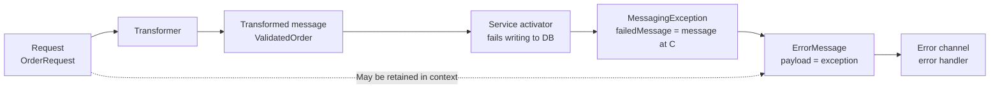
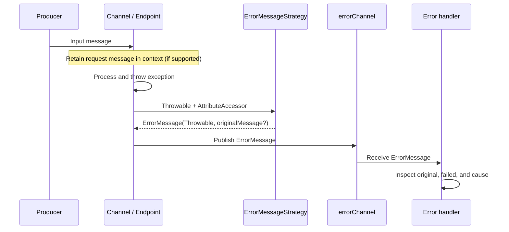

# Original Message in Spring Integration's ErrorMessage

## 1. Why Retain the Original Message When Handling Runtime Errors?

In **Spring Integration Runtime**, messages travel through channels, endpoints, consumers, pollers, and executors to carry out business steps. A failure can appear after multiple payload transformations, header additions/removals, or thread handoffs. At that point, knowing only the exception is rarely enough to answer: **which request initiated this processing chain?**

`ErrorMessage` provides a way to carry error information through a message flow. Beyond the exception in its payload, it **may** hold `originalMessage`, allowing error handlers to access the message that existed at **the point where the ErrorMessage was created**. This is critical data for diagnosing correlation, error routing, retries, and deciding whether compensation is needed.

Lesson objectives:

- Understand the relationship between `ErrorMessage`, `originalMessage`, and `MessagingException.failedMessage`.
- Know when `getOriginalMessage()` has a value and when it can be `null`.
- Know how Spring Integration constructs `ErrorMessage` via `ErrorMessageStrategy` and sends it through `errorChannel`.
- Write error handlers that safely read the message associated with an error.
- Recognize the difference between errors on `DirectChannel` and errors in executor/poller-backed flows.
- Relate the original message to transactions, retries, message stores, correlation, logging, and production incident troubleshooting.

Scope focuses on **`Original message in ErrorMessage`** within the **Error runtime** chapter. Other mechanisms are explained in terms of their role regarding message lifecycle and origin during failures.

## 2. Three Objects Easily Confused

Suppose an inbound request holds an `OrderRequest`, a transformer converts it into a `ValidatedOrder`, and then a database-writing handler fails.



When the strategy is provided with the initial request, the error handler can see **two distinct milestones**: the message at the beginning of the processing segment retained in context, and the message at the site where the error actually occurred.

| Object | How to Access | Meaning |
| --- | --- | --- |
| `ErrorMessage` | The message itself sent to the error flow | A new `Message<Throwable>` whose payload is the exception. |
| `ErrorMessage.getPayload()` | `Throwable` | The published error, typically a `MessagingException` or subclass. |
| `ErrorMessage.getOriginalMessage()` | `Message<?>` or `null` | The message that **the ErrorMessage creator** chose to record as original; depends on context and strategy. |
| `MessagingException.getFailedMessage()` | `Message<?>` or `null` | The message attached to the exception at **the failure point**, if the exception carries that info. |
| `ErrorMessage.getHeaders()` | `MessageHeaders` | Headers of **the new ErrorMessage**, not automatically the headers of the request or failed message. |

**Key point:** `originalMessage` is not guaranteed to be the very first message from the producer or the edge HTTP request. It is the message available at *the point in the stack where ErrorMessage was constructed*. `failedMessage` is the message attached to the exception. They may be the same object, carry different data, or one or both may be absent.

This definition reflects how Spring Framework describes `ErrorMessage`: original is an **optional** property; failed message belongs to the exception, especially when the exception is a `MessagingException`.

## 3. `ErrorMessage` API and Reading the Original Message

The class resides in `org.springframework.messaging.support.ErrorMessage` and extends `GenericMessage<Throwable>`. Notable constructors:

```java
new ErrorMessage(throwable);
new ErrorMessage(throwable, originalMessage);
new ErrorMessage(throwable, errorHeaders, originalMessage);
```

Here `errorHeaders` can be a `Map<String, Object>` or `MessageHeaders` depending on the overload. The constructor taking only `Throwable` **does not infer an original message**; to include this metadata, the creator or strategy must supply the right message.

### Standalone example: original differs from failed

The following Java snippet intentionally creates two distinct messages to highlight the API. This is a controlled simulation independent of any asynchronous error handler:

```java
import org.springframework.messaging.Message;
import org.springframework.messaging.MessageHandlingException;
import org.springframework.messaging.MessagingException;
import org.springframework.messaging.support.ErrorMessage;
import org.springframework.messaging.support.MessageBuilder;

public class OriginalVsFailedDemo {
    public static void main(String[] args) {
        // Message received at the start of the processing segment.
        Message<String> input = MessageBuilder.withPayload("ORDER-42")
                .setHeader("traceId", "trace-123")
                .build();

        // Message after a transformation step, where business logic fails.
        Message<Integer> transformed = MessageBuilder.withPayload(-1)
                .setHeader("traceId", "trace-123")
                .build();

        MessagingException failure = new MessageHandlingException(
                transformed,
                "quantity must be positive",
                new IllegalArgumentException("invalid quantity"));

        ErrorMessage error = new ErrorMessage(failure, input);

        Message<?> original = error.getOriginalMessage();
        Message<?> failed = ((MessagingException) error.getPayload())
                .getFailedMessage();

        System.out.println(original.getPayload()); // ORDER-42
        System.out.println(failed.getPayload());   // -1
        System.out.println(error.getPayload().getClass().getSimpleName());
        // MessageHandlingException
    }
}
```

Here `original` was explicitly passed by the application to the constructor; in real runtime execution, the `ErrorMessage` creation strategy determines whether the corresponding message can be supplied. Do not write code assuming `error.getOriginalMessage().getPayload()` is safe, because `getOriginalMessage()` can return `null`.

### Reading headers from the right message

```java
Message<?> original = error.getOriginalMessage();
Throwable failure = error.getPayload();

Object requestTrace = original == null
        ? null
        : original.getHeaders().get("traceId");

Object errorTrace = error.getHeaders().get("traceId");
```

`requestTrace` and `errorTrace` are not necessarily equal. `ErrorMessage` has its own `id` and `timestamp`, so comparing `error.getHeaders().getId()` against the request's ID is also insufficient to correlate business events.

## 4. How Is ErrorMessage Created?

Spring Integration provides components supporting error publishing:

- `ErrorMessagePublisher`: provides the capability to publish `ErrorMessage` to an error-handling channel.
- `ErrorMessageStrategy`: determines how to construct `ErrorMessage` from a `Throwable` and associated context.
- `DefaultErrorMessageStrategy`: default strategy capable of reading the request message from context to populate `originalMessage`.
- `MessagePublishingErrorHandler`: turns errors occurring in corresponding tasks into `ErrorMessage` and sends them over an error channel.
- `ErrorMessageSendingRecoverer`: a recovery callback capable of publishing `ErrorMessage` after retries fail, e.g., with `RequestHandlerRetryAdvice`.

An important detail in Spring Integration documentation: the input message is placed into `AttributeAccessor` under the key `ErrorMessageUtils.INPUT_MESSAGE_CONTEXT_KEY`. `DefaultErrorMessageStrategy` uses this value as `originalMessage` **when present**.



**There is no global guarantee** that every exception is converted by the framework into an `ErrorMessage` or that every `ErrorMessage` has an original message. This depends on where the exception is caught, the endpoint type, error handler, strategy, and context. If code explicitly calls `new ErrorMessage(cause)`, original defaults to `null`.

## 5. How Does the Original Message Relate to `errorChannel`?

`errorChannel` is **the error routing target**, whereas `originalMessage` is **the message origin attached for analysis**. These two concepts are independent:

1. When Spring Integration's error-handling mechanism publishes an `ErrorMessage`, it typically prioritizes the `errorChannel` header on the request being processed.
2. If no target header is present and the error handler supports this behavior, the framework sends to the global channel with bean name `errorChannel`.
3. The error flow subscribes to that channel to read the exception and message context.

The `errorChannel` header can hold a `String` channel name or a `MessageChannel` reference depending on context. **A valid `errorChannel` header does not guarantee `getOriginalMessage()` is non-null.** Conversely, having a non-null original message does not mean every error will automatically route to an error channel if execution is synchronous and the exception propagates back to the caller.

### Synchronous vs. asynchronous errors

| Scenario | Thread running the consumer | Typical error behavior |
| --- | --- | --- |
| `DirectChannel` | Message-sending thread | Exception typically propagates back to sender or gateway; does not publish `ErrorMessage` by default. |
| `ExecutorChannel` | Executor thread | Sender has moved on; thrown errors require error-handling mechanisms on the execution thread. |
| `QueueChannel` with poller | Poller thread | Poller can use `MessagePublishingErrorHandler` to publish errors. |
| Async `PublishSubscribeChannel` | Subscriber's executor thread | Channel's error handler can publish `ErrorMessage`; without an executor, errors typically propagate on the caller thread. |

When using a Spring Integration poller, the framework typically configures `MessagePublishingErrorHandler` on the integrated task scheduler. If you swap in a custom scheduler, verify which error handler is configured. With a plain `DirectChannel`, do not write tests expecting `ErrorMessage` by default; check exceptions at the caller or configure a dedicated gateway error flow.

This point is especially important when diagnosing threading: a producer succeeding in sending to `QueueChannel` only proves the message entered the queue—it does **not** prove the consumer processed it successfully.

## 6. Practical Example: Poller Fails and Error Flow Reads Original

This example uses Spring Integration Java/annotation configuration, split across files in the `demo.errorflow` package. Scenario: a producer sends an order ID through a `QueueChannel`; a poller retrieves the message and the handler method throws an exception; an error handler receives `ErrorMessage` if the runtime component publishes `ErrorMessage` as configured.

**`ErrorFlowConfiguration.java`**

```java
package demo.errorflow;

import org.springframework.context.annotation.Bean;
import org.springframework.context.annotation.ComponentScan;
import org.springframework.context.annotation.Configuration;
import org.springframework.integration.channel.DirectChannel;
import org.springframework.integration.channel.QueueChannel;
import org.springframework.integration.config.EnableIntegration;
import org.springframework.messaging.MessageChannel;

@Configuration
@EnableIntegration
@ComponentScan(basePackageClasses = OrderEndpoints.class)
public class ErrorFlowConfiguration {
    @Bean("ordersQueue")
    public QueueChannel ordersQueue() {
        return new QueueChannel();
    }

    @Bean("ordersErrors")
    public MessageChannel ordersErrors() {
        return new DirectChannel();
    }
}
```

**`OrderEndpoints.java`**

```java
package demo.errorflow;

import org.springframework.integration.annotation.MessageEndpoint;
import org.springframework.integration.annotation.Poller;
import org.springframework.integration.annotation.ServiceActivator;
import org.springframework.messaging.Message;
import org.springframework.messaging.MessagingException;
import org.springframework.messaging.support.ErrorMessage;

@MessageEndpoint
public class OrderEndpoints {

    @ServiceActivator(
            inputChannel = "ordersQueue",
            poller = @Poller(fixedDelay = "250", maxMessagesPerPoll = "5"))
    public void process(Message<String> request) {
        // Simulate a failure once the poller has received the message.
        throw new IllegalStateException("Database unavailable");
    }

    @ServiceActivator(inputChannel = "ordersErrors")
    public void onError(ErrorMessage error) {
        Throwable failure = error.getPayload();
        Message<?> original = error.getOriginalMessage();

        Message<?> failed = null;
        if (failure instanceof MessagingException messagingFailure) {
            failed = messagingFailure.getFailedMessage();
        }

        Object traceId = original != null
                ? original.getHeaders().get("traceId")
                : failed != null
                    ? failed.getHeaders().get("traceId")
                    : null;

        System.err.println(
                "errorType=" + failure.getClass().getSimpleName()
                + ", traceId=" + traceId
                + ", hasOriginal=" + (original != null)
                + ", hasFailed=" + (failed != null));

        // Production: classify error, record metrics, call appropriate DLQ/recovery.
        // Avoid logging full payloads/headers if they contain sensitive data.
    }
}
```

**`Demo.java`**

```java
package demo.errorflow;

import org.springframework.context.annotation.AnnotationConfigApplicationContext;
import org.springframework.integration.channel.QueueChannel;
import org.springframework.messaging.MessageHeaders;
import org.springframework.messaging.support.MessageBuilder;

public class Demo {
    public static void main(String[] args) throws Exception {
        try (var context =
                     new AnnotationConfigApplicationContext(ErrorFlowConfiguration.class)) {
            QueueChannel queue = context.getBean("ordersQueue", QueueChannel.class);

            queue.send(MessageBuilder.withPayload("ORDER-42")
                    .setHeader("traceId", "trace-123")
                    .setHeader(MessageHeaders.ERROR_CHANNEL, "ordersErrors")
                    .build());

            // send() returns after placing the message in the queue.
            // Observe logs/metrics in the error handler to confirm async processing occurred.
            Thread.sleep(1000); // For demonstration purposes only in this demo program.
        }
    }
}
```

Flow of events:

1. `Demo` sends a request into `ordersQueue` with `traceId` and `errorChannel` pointing to `ordersErrors`.
2. The poller receives the message and invokes `OrderEndpoints.process(...)`; the method throws `IllegalStateException`.
3. The poller's error-handling mechanism builds `ErrorMessage` and selects the error channel.
4. `OrderEndpoints.onError(...)` reads the `Throwable` from the payload, tries `originalMessage`, and checks `failedMessage` if needed.
5. The error handler inspects this information to decide on logging, metrics, retries, or dead-lettering.

This pattern demonstrates **how to handle optional data safely**, without promising that a strategy always supplies `original` or that an exception always includes `failedMessage`. Also do not use `Thread.sleep(...)` as a production testing approach; in automated tests, use proper synchronization (such as a latch) and bounded timeouts.

## 7. Reading Errors Safely When Exceptions Are Wrapped Across Multiple Layers

Typically, a business error such as `IllegalStateException` is wrapped inside `MessageHandlingException`, `MessagingException`, or another infrastructure exception. `ErrorMessage.getPayload()` is still a `Throwable`, not always the business exception directly.

When you need to search for the failed message across multiple cause layers, you can implement a helper:

```java
import java.util.Collections;
import java.util.IdentityHashMap;
import java.util.Set;
import org.springframework.messaging.Message;
import org.springframework.messaging.MessagingException;

public final class FailedMessageLookup {
    private FailedMessageLookup() {}

    public static Message<?> find(Throwable error) {
        Set<Throwable> visited =
                Collections.newSetFromMap(new IdentityHashMap<>());

        for (Throwable current = error;
                current != null && visited.add(current);
                current = current.getCause()) {

            if (current instanceof MessagingException exception
                    && exception.getFailedMessage() != null) {
                return exception.getFailedMessage();
            }
        }
        return null;
    }
}
```

Meaning:

- Only use `error.getOriginalMessage()` after checking for `null`.
- If `original` is absent, you can walk `MessagingException.getFailedMessage()` along the cause chain as a **diagnostic fallback**.
- Do not assume the two values are always identical. Once a transformer has changed the payload, they may refer to the same request only at the business level.
- If neither is present, log the exception class, endpoint, thread, timestamp, and external correlation context (if any), rather than fabricating a nonexistent message.

When multiple nested `MessagingException` layers each hold a failed message, which message to pick depends on your goal: the outer exception may represent a failure at the dispatch layer, while the inner exception reflects the specific handler step. The helper above returns **the first failed message found**, suitable for quick triage; deeper diagnostic tools can collect all milestones.

## 8. What Is the Original Message Used For?

### 8.1. Tracing and correlation

In an error handler, a `traceId` or business ID extracted from the original message links the failure back to the request before the flow generated intermediate messages. However:

- `MessageHeaders.ID` is each individual message's ID; transformation steps can generate new message IDs.
- `correlationId` is a header managed by flow components or the application, not automatically preserved across all protocol adapters.
- Accurate correlation across HTTP, AMQP, Kafka, JMS, and message stores requires an explicit **contract for naming, types, and propagation**.

An error handler can prioritize stable IDs such as `orderId` or `eventId`, accompanied by `traceId`, endpoint name, and exception type. Never arbitrarily use the `ErrorMessage`'s ID as a business idempotency key.

### 8.2. Retry and dead-lettering

`originalMessage` is useful when considering replaying a request or sending it to a dead-letter queue, yet **you should not automatically resend merely because `original` is present**. The input may have already executed successful side-effect steps before failing, such as calling a payment API and then failing while writing an audit record.

Before retrying, determine:

1. **Retry scope:** repeat only the failed handler or replay the entire flow?
2. **Transaction state:** did the DB roll back or partially commit?
3. **Idempotency:** does the message carry a stable business key to prevent duplicate processing?
4. **Backoff and retry budget:** are attempt limits and wait intervals enforced?
5. **Poison messages:** deterministic data errors need dead-lettering/validation rather than endless retries.

`ErrorMessageSendingRecoverer` can step in when retries are exhausted and the error must be sent to an error flow. "Handling" an `ErrorMessage` is an event in the recovery mechanism; it **does not verify** that the source transaction committed or the broker acknowledged.

### 8.3. Transactions and threading

When processing synchronously via `DirectChannel`, an exception can propagate back up the same call stack and open transaction (if any). When crossing an `ExecutorChannel` or poller, a different thread may handle the error and the original thread's transaction context does not normally carry over.

`originalMessage` carries reference data only—it is **not a transaction snapshot** or an object capable of rolling back an entire processing branch. To guarantee atomicity across systems, use appropriate transaction boundaries, outbox patterns, compensation, or sagas per business requirements.

### 8.4. Message stores and long-term error storage

If an error message is persisted into a message store or broker, `originalMessage` may contain:

- Java objects unsupported by the serializer;
- `replyChannel`/`errorChannel` headers referencing a local `MessageChannel`;
- Large payloads or sensitive data;
- Mutable objects whose state no longer reflects the payload at initial send time.

Do not treat `original` as a durable, immutable, complete snapshot of the inbound request. For long-term auditing/replay, it is better to store a **stable event envelope**: business ID, schema/version, ingestion timestamp, permitted data fields, status, and reason code. If channel headers must be stored, evaluate `HeaderChannelRegistry` or a dedicated reply architecture matching your transport's capabilities.

## 9. Common Misconceptions

| Misconception | Reality |
| --- | --- |
| "Whenever an exception occurs, an ErrorMessage is produced" | Exceptions on the caller thread may simply be thrown outward; an error-publishing component is required. |
| "ErrorMessage always contains originalMessage" | `originalMessage` is optional and may be `null`. |
| "Original is the very first request across the whole system" | Original reflects the context where ErrorMessage was constructed; it may be an intermediate message. |
| "Failed message always equals original" | Transformation, routing, or enrichment can make the two messages differ. |
| "Headers on ErrorMessage match input headers" | ErrorMessage is a distinct message with its own headers. |
| "ErrorMessage payload is the failing business payload" | `ErrorMessage`'s payload is a `Throwable`; the business payload lives in original/failed message if present. |
| "Sending to errorChannel means retry succeeded" | Receiving an error in the error flow says nothing about commit, ack, or recovery outcome. |
| "If original exists, replay is safe" | Replay can duplicate side effects and requires idempotency/transaction design. |
| "If traceId is in original, every downstream component sees it" | Headers may be filtered, mapped to another name/type, not propagated, or overwritten. |

## 10. Diagnosing Runtime Incidents

| Symptom | Possibilities to Check | Appropriate Action |
| --- | --- | --- |
| No ErrorMessage appears on `errorChannel` | Flow uses `DirectChannel` and exception returns to caller; wrong error channel; error handler lacks subscribers | Verify thread, channel, error handler, and gateway config first. |
| `getOriginalMessage() == null` | Strategy lacked input message in context; ErrorMessage was manually created without passing original | Check where ErrorMessage is built and `ErrorMessageStrategy`; use failed message as fallback if present. |
| Original exists, but payload differs from failed | An earlier transformer or endpoint altered the payload | Trace the transformation chain, compare IDs/headers and the failing step. |
| `getFailedMessage() == null` | Payload is not a `MessagingException`, exception omitted failed message, or another wrapper is used | Inspect the cause chain and where the exception was created. |
| Trace ID lost upon entering error handler | Header filtered out, mapper renamed/retyped it, or original is missing | Compare headers at each boundary; enforce an explicit correlation contract. |
| Error handler throws `ClassCastException` | Casting `Throwable` payload to a business type; casting original to the wrong type | Use `instanceof` and validate payload/header types. |
| Gateway times out despite seeing the error | Error flow failed to send reply to right target; error occurred on async branch; reply/error channels mismatched | Inspect routing and design an explicit error response for the gateway. |
| Retries cause duplicate data writes | Replay scope too broad, transaction partially committed, idempotency missing | Narrow retry scope, add a business idempotency key, use outbox/compensation if needed. |
| Message store fails to serialize error | Original/headers contain a local channel or non-serializable Java object | Store a compact envelope, filter/transform headers, or change storage mechanism if needed. |
| New ErrorMessage also fails during handling | Error subscriber throws exception; channel rejects messages; looping error flow | Check consumer ordering, the error flow's own error handler, and fail-safe policies. |

Recommended investigation sequence:

1. **Pinpoint when the error occurred:** producer send, channel dispatch, handler, poller, or broker adapter.
2. **Identify the thread:** same thread as caller or worker/poller; does any component publish `ErrorMessage`?
3. **Check the error destination:** `errorChannel` header on the active request and the global `errorChannel` bean.
4. **Inspect the three milestones:** exception payload, `originalMessage`, and `failedMessage`; note which is missing.
5. **Compare the message contract:** payload type, business key, correlation ID, transport headers, and transformer steps prior to failure.
6. **Assess side effects:** transaction rollback, retries already executed, broker ack/redelivery, external side effects.
7. **Choose remediation:** fix configuration, bounded retries, dead-lettering, compensation, or return a business error.

In production, useful metrics include `ErrorMessage` counts by endpoint/type, error flow latency, retry counts, dead-letter counts, queue/poller backlog depth, and gateway timeouts. Do not rely solely on `ErrorMessage` counts to measure total exceptions, because some errors never traverse an error channel or may be caught and handled directly by a handler.

## 11. Protecting Data When Using the Original Message

The original message helps investigation, yet it often holds the most sensitive data:

- Payloads may contain customer records, tokens, transaction contents, or personal information.
- Headers may contain `Authorization`, `Cookie`, internal routing info, or callback URLs.
- Exception messages and stack traces can also embed input data.

Only log **permitted fields** such as business IDs, trace/correlation IDs, error types, endpoints, and timestamps. When dead-lettering or auditing is needed, enforce appropriate data classification, retention, and access controls. Never use `System.err.println(original)` in production, as it can print the entire payload and headers. If a flow accepts external input, never trust client-supplied header values as authenticated identity or authorization.

## 12. Check-Your-Knowledge Questions and Hands-On Exercises

**Questions:**

1. How does `ErrorMessage.getOriginalMessage()` differ from `MessagingException.getFailedMessage()` when a flow includes a transformer?
2. Why is `ErrorMessage.getHeaders().getId()` not the ID of the failing request?
3. Does throwing an exception on a synchronous `DirectChannel` guarantee an `ErrorMessage` on the global `errorChannel`? Why?
4. Which message does `DefaultErrorMessageStrategy` retrieve via `ErrorMessageUtils.INPUT_MESSAGE_CONTEXT_KEY`, and what does it use it for?
5. If `original` is missing, how do you inspect `failedMessage` without causing a `NullPointerException`?
6. Why should you avoid automatically replaying `originalMessage` after a failure calling a payment service?
7. When an error flow sits behind a poller, how does it differ from handling errors on a gateway thread?
8. If `original` carries a `replyChannel` header referencing a local bean, what is the risk of serializing the entire `ErrorMessage`?

**Guided practice:**

1. Run `OriginalVsFailedDemo` from Section 3 and verify that `original` and `failed` hold different payloads.
2. Change it to `new ErrorMessage(failure)` and verify `getOriginalMessage() == null`.
3. Run the `QueueChannel` + poller sample in Section 6, observe the error handler, and try removing the `errorChannel` header to observe global fallback behavior.
4. Add a transformer before the handler and compare payload, headers, and message ID across all three locations.
5. Design error classification logic: validation error → dead-letter; transient DB failure → bounded retry; already-committed side effect → do not replay the entire flow automatically. Propose a business idempotency key.

## 13. References

- [Spring Integration Reference — Error Handling](https://docs.spring.io/spring-integration/reference/error-handling.html)
- [Spring Framework API — ErrorMessage](https://docs.spring.io/spring-framework/docs/current/javadoc-api/org/springframework/messaging/support/ErrorMessage.html)
- [Spring Framework API — MessagingException](https://docs.spring.io/spring-framework/docs/current/javadoc-api/org/springframework/messaging/MessagingException.html)
- [Spring Framework API — MessageHandlingException](https://docs.spring.io/spring-framework/docs/current/javadoc-api/org/springframework/messaging/MessageHandlingException.html)
- [Spring Integration Reference — Configuring Message Channels](https://docs.spring.io/spring-integration/reference/channel/configuration.html)
- [Spring Integration Reference — Message Publishing](https://docs.spring.io/spring-integration/reference/error-handling.html)
