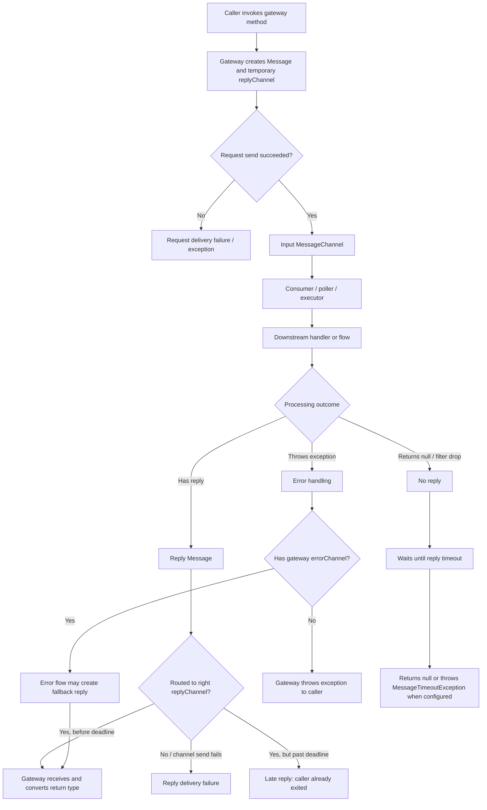
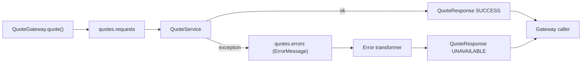

# Reply Failure Through a Gateway

## 1. What Is a Reply Failure and Where Does It Occur?

In Spring Integration, a **gateway** establishes a *request–reply* contract: the caller sends a request and expects a result or an exception. The gateway hides messaging infrastructure from the caller, yet it does not guarantee every request produces a reply. A flow may filter out a message, return `null`, process slowly, encounter connection errors, or send the reply to the wrong channel. When that happens, the caller observes a **reply failure**: no reply, a timed-out reply, an error returned instead of a result, or a reply that cannot be delivered to the caller.

In the `SPRING_INTEGRATION_RUNTIME` module, this lesson belongs to the **Error runtime** chapter. Its purpose is to understand the path through channels, endpoints/consumers, pollers, executors, and gateways, while applying knowledge of transactions, retries, errors, message stores, correlation, threading, and performance to trace incidents.

Three contexts using the word "gateway" should be distinguished:

| Gateway | Who sends the request? | Who expects the reply? | Example |
|---|---|---|---|
| **POJO messaging gateway** (`@MessagingGateway`, `GatewayProxyFactoryBean`) | Java caller inside the application | The Java method being invoked | `quoteGateway.calculate(order)` |
| **Inbound protocol gateway** | External client | HTTP/TCP/JMS/AMQP client | HTTP inbound gateway waiting for internal flow to build a response |
| **Outbound protocol gateway** | Internal message flow | Internal endpoint waiting for an external service's response | HTTP outbound gateway calling a REST API |

Specific timeouts, error channels, and correlation details for HTTP, JMS, TCP, etc., have their own characteristics. The core section below focuses on **POJO messaging gateways**, then extends diagnostics to inbound/outbound gateways.

### Learning outcomes

After this lesson, you will be able to:

1. Accurately describe the path of a request, reply, and error from a gateway through a message flow.
2. Distinguish **missing reply**, **late reply**, **failed reply delivery**, and **downstream exception**.
3. Predict the effects of `replyTimeout`, `requestTimeout`, `errorOnTimeout`, and `requiresReply`.
4. Configure `errorChannel` to return an error response matching the gateway's contract.
5. Diagnose timeouts when flows run over `DirectChannel`, `ExecutorChannel`, `QueueChannel`, and pollers.
6. Design correlation, idempotency, retries, and runtime observability to reduce misrouted or duplicate replies.

## 2. Request–Reply Lifecycle and Failure Points



**Core mechanism:** `GatewayProxyFactoryBean` creates a proxy for the interface; a method call becomes a request `Message<?>`. The gateway usually creates a point-to-point **temporary reply channel** and places it in the request's `replyChannel` header. Downstream handlers process the message and return a payload/`Message`; the framework sends the reply through the channel the gateway is waiting on. The gateway receives the payload or message and converts it to the method's return type.

**First four diagnostic questions:**

- Did the message **enter the request channel**?
- Did any handler **produce a reply or throw an exception**?
- **To which channel** was the reply/error sent?
- At that moment, was the gateway **still waiting for a reply** or had it timed out?

An exception inside a business method and a gateway failing to receive a reply are two distinct events. Spring Integration can turn an exception into an `ErrorMessage`; conversely, a flow completing normally without producing a reply still leaves the caller waiting until timeout.

## 3. Common Types of Reply Failures

| Symptom at caller | Possible cause | Evidence to look for |
|---|---|---|
| Returns `null` after waiting | Service returns `null`; filter drops; router has no output; slow executor/poller; misrouted reply | Handler logs, `replyChannel`, `replyTimeout`, queue depth, routing |
| `MessageTimeoutException` | `errorOnTimeout=true` and reply wait expired | Request/reply timestamps; exception cause; whether handler is still running |
| Business exception (e.g., `IllegalStateException`) | Downstream threw; gateway unwrapped or routed via error flow | `MessagingException.failedMessage`, `cause`, endpoint name |
| `ReplyRequiredException` | Handler has `requiresReply=true` yet returned `null` | Return branch and service activator configuration |
| `DestinationResolutionException` | Named reply channel cannot be resolved or misrouted | `replyChannel` / output channel header, bean names |
| `MessageDeliveryException` | Reply channel refused message (no subscribers, full, send error) | Send exception, capacity/channel type, subscribers |
| Handler succeeds, yet caller still times out | Static output channel overrode reply header; late reply; wrong correlation | Reply destination, timestamps, ID/correlation |
| HTTP client receives error/timeout | Inbound gateway produced no response, HTTP mapping error, or network client timeout | HTTP gateway logs, message flow, client/proxy timeouts |

Do not attribute every timeout to `ReplyRequiredException`. That exception only occurs at a handler where **`requiresReply` is enabled** and the handler was actually invoked and returned `null`.

### 3.1. Replies "swallowed" by filters, routers, or handlers

- `@ServiceActivator` returns `null` or is a `void` method: when a handler permits no reply, the flow terminates with no message sent back.
- `@Filter` rejects the message: if configured simply to drop, the gateway may keep waiting. For request–reply flows requiring fail-fast behavior, consider `throwExceptionOnRejection=true` (exact option name depends on DSL/annotation).
- `@Router` cannot resolve a destination or routes to a one-way branch: explicitly decide whether to throw an error or build a business response; for routers needing fail-fast behavior, enable resolution-required enforcement.
- `Aggregator` has not yet accumulated enough messages to release the group: the gateway can time out while the group sits in the message store. This is a **reply not yet ready** situation, different from complete processing failure.

**Contract to define:** will a request yield a success response, a structured error response, or an exception? A "not found" workflow should return an explicit business response instead of implicitly using `null` whenever the caller expects an answer.

### 3.2. Reply sent to the wrong channel

Gateways primarily rely on the request's `replyChannel`. However, a handler/endpoint configured with a static `outputChannel` may send its result there instead of back to the gateway's temporary channel. The `replyChannel` header can also be lost when constructing messages manually or crossing serialization/network boundaries.

```text
request:
  payload      = "ORD-17"
  replyChannel = temporary.gateway.reply

handler:
  outputChannel = "events.out"
  return        = "OK"

Result:
  "OK" is sent to events.out.
  The gateway only receives it if a separate flow routes the reply back to where it is waiting.
```

**Fix:** do not set a static output channel on a request–reply endpoint if you want dynamic `replyChannel` routing; or design a transparent bridge/routing path and preserve correlation. If the response crosses a broker/JMS/HTTP boundary, temporary channel objects **cannot be assumed serializable**; use the adapter/protocol's dedicated reply-address and correlation mechanism.

### 3.3. Reply arrives after the gateway has timed out

In asynchronous flows, the gateway may return `null`/a timeout exception before the handler finishes. A **late reply** does not retroactively make the earlier Java call succeed; depending on the channel implementation, sending the late reply may be ignored or fail because the consumer stopped waiting.

More dangerously, **business work may have committed successfully** while the caller believes the operation failed. A caller retry can create duplicate orders/transactions. You must use an idempotency key, queryable business status, or a reconciliation mechanism; merely raising timeouts does not eliminate network and concurrency uncertainty.

## 4. Gateway Timeouts: Two Different Clocks

A POJO gateway supports:

- `requestTimeout` / `defaultRequestTimeout`: bounds the time spent **sending the request to a potentially blocking channel**, such as a full `QueueChannel`. It does not measure total business method execution time.
- `replyTimeout` / `defaultReplyTimeout`: time spent **waiting to receive a reply** after the send phase; upon expiration it normally returns `null`. With `errorOnTimeout=true` (available since Spring Integration 6.2 for messaging gateways), a timeout can raise `MessageTimeoutException`.
- `sendTimeout` on a reply-producing handler: time spent **sending the reply to a potentially blocking channel**; it does not replace the gateway's `replyTimeout`.
- External service timeouts such as HTTP/JDBC: bound the I/O of the downstream step itself; to cap real business execution time, configure timeouts at the appropriate I/O or application layer.

> Documentation and timeout defaults vary across versions/gateway types; the Spring Integration 6.5 guide cites a 30-second timeout in the POJO gateway section, while other API/historical sections describe different values. For systems with SLAs, **declare timeouts explicitly**, verify against your runtime version, and distinguish POJO gateways from inbound HTTP/TCP/JMS gateways.

### 4.1. DirectChannel: replyTimeout cannot interrupt work running on the same thread

```text
t=0 ms    caller invokes gateway
t=1 ms    gateway sends request into DirectChannel
t=2 ms    handler starts 5-second sleep / blocking I/O
t=5000 ms handler returns reply
t=5001 ms gateway method completes

replyTimeout = 1000 ms does not cut short a 5-second synchronous handler.
```

Reason: sending the request on a `DirectChannel` **executes the handler on the same call stack**. The send call has not yet returned for the gateway to enter its reply-waiting phase; reply timeout is not an interrupt timer applied to arbitrary methods.

To bound downstream I/O, configure timeouts on the HTTP client, DB driver, or respective client. Moving the entire flow to async purely to get timeouts is not free: you must manage queues, thread pools, and late results.

### 4.2. ExecutorChannel/QueueChannel: replyTimeout takes effect once work is handed off

```text
t=0 ms    caller invokes gateway
t=2 ms    request is handed off to ExecutorChannel; send returns
t=3 ms    gateway begins waiting on reply channel
t=1003 ms replyTimeout = 1000 ms => returns null / timeout exception
t=2500 ms worker produces a late reply
```

With a `QueueChannel`, a poller may pick up the request many milliseconds or seconds later depending on backlog and polling schedule. Queue wait time **is included in request–reply latency**. A gateway with a 1-second timeout paired with a poller running every 5 seconds is an architectural mismatch, not a handler bug.

### 4.3. Behavior comparison

| Scenario | Synchronous DirectChannel | Handed off via executor/queue |
|---|---|---|
| Handler blocks for long time | Caller is blocked with the handler; `replyTimeout` does not interrupt it | Caller may hit `replyTimeout` while the worker is still running |
| Handler throws | Exception can propagate up the call stack to the gateway | Error is handled on the worker thread; framework can route `ErrorMessage` back to the gateway via an appropriate error path |
| Handler returns `null` | Caller waits until reply timeout (unless `requiresReply` throws early) | Same, plus dispatch/queue latency |
| Thread-bound transaction | Can share scope if properly configured | Does not automatically propagate caller transaction to worker |
| Reply arrives after caller timeout | Rare when fully synchronous; still possible if flow never replies | Common; requires handling duplicates and late completion |

**Do not equate:** reply timeout ≠ request timeout ≠ I/O timeout ≠ `Future.get()` timeout. Each measures a different segment.

## 5. Downstream Exceptions, ErrorMessage, and errorChannel

### 5.1. No gateway errorChannel configured

In a synchronous flow, the service activator throws an exception; Spring Integration can wrap it in a `MessagingException` with `failedMessage`, and then the gateway unwraps the appropriate exception and throws it to the caller. When the interface declares `throws MessagingException`, the caller can receive the exception carrying message context. Thus *a gateway method throwing an error* is an explicit failure response, **unlike** waiting for a reply until timeout.

In an asynchronous flow, exceptions cannot propagate back up the call stack of the handing-off thread. Spring Integration infrastructure provides a mechanism to publish `ErrorMessage`; if the gateway is still waiting and the error is routed correctly, it can receive the error and throw it to the caller. Not every custom `TaskExecutor` or manually spawned thread automatically includes this error bridge.

### 5.2. What does ErrorMessage contain?

- `ErrorMessage` is a `Message<Throwable>`; its payload is typically a `MessagingException` or an appropriate exception.
- `MessagingException.getFailedMessage()` (when present) identifies the message at the failure point. When exceptions are wrapped multiple layers deep, always inspect `cause`.
- `ErrorMessage.getOriginalMessage()` may be populated by an error message strategy to preserve the initial request; **do not assume this field is always present**.
- The `errorChannel` header can specify a dedicated error channel; if absent and the framework is on an error-publishing path, it typically uses the global `errorChannel`.
- The global `errorChannel` is normally a `PublishSubscribeChannel` with a logging handler. It suits observing async errors, but **does not automatically generate business responses** for gateway calls.

A message carrying a `Throwable` payload—even if returned by downstream as a "result"—can be interpreted by the gateway as **an error to throw**. If you want to return a *business error* as a valid response, use a structured `FailureResponse`/`Either` DTO; do not send a raw `Exception` as a success payload.

### 5.3. Configuring errorChannel to produce a fallback response

You can attach a dedicated `errorChannel` to a gateway and route errors through an error flow that builds a response matching the return type. This is useful when an internal API should return a status like `UNAVAILABLE` instead of throwing an exception.



**Key insight:** a gateway's `errorChannel` does not mean "just log errors." It can be a **request–reply error flow**: a transformer processes the error message and returns a substitute reply. If the error flow merely logs and finishes, the caller may still receive no reply and wait until timeout. If the error flow returns another `ErrorMessage`/`Throwable`, the gateway treats it as an error rather than success data.

## 6. Complete Example: Fail Fast and Return Structured Errors

Suppose a pricing system takes a `QuoteRequest` and returns a `QuoteResponse`. The example targets Spring Integration 6.5, Java 17, and Spring Boot with `spring-boot-starter-integration`. Classes are organized into corresponding files in the same package with appropriate imports and bean scanning.

### 6.1. Business contract

```java
public record QuoteRequest(String sku, int amount) {}

public record QuoteResponse(String status, long price, String message) {
    public static QuoteResponse ok(long price) {
        return new QuoteResponse("OK", price, "");
    }

    public static QuoteResponse unavailable() {
        return new QuoteResponse("UNAVAILABLE", -1L,
                "Pricing service temporarily unavailable");
    }
}
```

An error DTO helps the caller distinguish "could not price" from "received no reply." In production systems, use enum status types, stable error codes, and correlation IDs.

### 6.2. Gateway with explicit timeouts

```java
import org.springframework.integration.annotation.MessagingGateway;

@MessagingGateway(
        defaultRequestChannel = "quotes.requests",
        defaultRequestTimeout = "500",
        defaultReplyTimeout = "1500",
        errorChannel = "quotes.errors",
        errorOnTimeout = true
)
public interface QuoteGateway {
    QuoteResponse quote(QuoteRequest request);
}
```

Meaning:

- `defaultRequestTimeout="500"`: wait at most 500 ms to send the request when the channel can block.
- `defaultReplyTimeout="1500"`: wait at most 1500 ms for a reply after send returns control.
- `errorOnTimeout=true`: convert reply timeout into a timeout error rather than returning `null` directly. When `errorChannel` is configured, the error flow can turn this error into a response depending on the handling path.
- `errorChannel="quotes.errors"`: route gateway-handled exceptions to an application flow capable of producing a fallback.

In systems where the caller **must see the original exception**, omit `errorChannel` rather than accidentally converting all errors into `UNAVAILABLE`.

### 6.3. Handler returning a reply or throwing an exception

```java
import org.springframework.integration.annotation.ServiceActivator;
import org.springframework.stereotype.Component;

@Component
public class QuoteService {

    @ServiceActivator(inputChannel = "quotes.requests",
                      requiresReply = "true")
    public QuoteResponse quote(QuoteRequest request) {
        if (request.amount() <= 0) {
            throw new IllegalArgumentException("amount must be positive");
        }

        if ("BROKEN".equals(request.sku())) {
            throw new IllegalStateException("Upstream price lookup failed");
        }

        long price = 100L * request.amount();
        return QuoteResponse.ok(price);
    }
}
```

In this example, a valid request returns `QuoteResponse("OK", ...)`. A request with `sku="BROKEN"` throws an exception. `requiresReply="true"` also catches early if any future branch returns `null`. No static `outputChannel` is set on the handler, so replies use the gateway's `replyChannel` path.

### 6.4. Error flow generating a fallback

```java
import org.springframework.integration.annotation.Transformer;
import org.springframework.messaging.support.ErrorMessage;
import org.springframework.stereotype.Component;

@Component
public class QuoteErrorHandler {

    @Transformer(inputChannel = "quotes.errors")
    public QuoteResponse toFallback(ErrorMessage errorMessage) {
        Throwable failure = errorMessage.getPayload();
        // Log with traceId / orderId; avoid logging sensitive data.
        System.err.println("Quote failed: " + failure.getClass().getName());

        return QuoteResponse.unavailable();
    }
}
```

An `ErrorMessage` carrying the exception is converted by the transformer into **the reply's payload**. The gateway can return the substitute response if the error flow completes in time and routing aligns. In production, replace `System.err` with structured logging, classified error codes, and monitoring.

**Semantics warning:** For brevity, the example turns even validation `IllegalArgumentException` into `UNAVAILABLE`. In real designs, separate **business/client errors** (e.g., `INVALID_AMOUNT`) from **transient infrastructure errors** (e.g., upstream unavailable). Never mask programming bugs or retry all exceptions indiscriminately.

### 6.5. Enabling annotation infrastructure

If the project does not use auto-configuration that already registers Spring Integration, enable it and scan gateway interfaces:

```java
import org.springframework.boot.SpringApplication;
import org.springframework.boot.autoconfigure.SpringBootApplication;
import org.springframework.integration.annotation.IntegrationComponentScan;
import org.springframework.integration.config.EnableIntegration;

@SpringBootApplication
@EnableIntegration
@IntegrationComponentScan
public class QuoteApp {
    public static void main(String[] args) {
        SpringApplication.run(QuoteApp.class, args);
    }
}
```

**Register only one** component handling `quotes.requests` in the example. If multiple competing consumers subscribe to a point-to-point channel, messages can be dispatched to another endpoint, causing unpredictable behavior.

### 6.6. Expected test outcomes

| Input / condition | Expectation |
|---|---|
| `new QuoteRequest("A", 2)` | Response with `status="OK"` and `price=200` |
| `new QuoteRequest("BROKEN", 2)` | Handler throws; error flow converts failure into `UNAVAILABLE` response |
| `new QuoteRequest("A", 0)` | Handler throws validation error; illustrates current error flow also returning `UNAVAILABLE`—needs finer classification |
| Handler returns `null` with `requiresReply=true` | `ReplyRequiredException` enters the error-handling path |
| Handler takes longer than 1500 ms **and** flow uses an async channel | Can time out before reply arrives; with `errorOnTimeout=true` raises timeout error, which the error flow can turn into a fallback |
| Handler blocks 3 seconds on `DirectChannel` | `replyTimeout=1500` does not interrupt the handler running on the caller's thread |

**Practical tip:** Before switching the input channel to test async, keep the synchronous setup working; when switching to `ExecutorChannel` or `QueueChannel`, verify the error publisher and worker/poller lifecycle because async errors need a proper error path.

## 7. Second Exercise: Distinguishing Timeouts from Missing Replies

Create a minimal gateway **without an error flow** to observe baseline behavior:

```java
import org.springframework.integration.annotation.MessagingGateway;

@MessagingGateway(
        defaultRequestChannel = "demo.requests",
        defaultReplyTimeout = "700",
        errorOnTimeout = true
)
interface DemoGateway {
    String echo(String value);
}
```

Handler:

```java
import org.springframework.integration.annotation.ServiceActivator;
import org.springframework.stereotype.Component;

@Component
class DemoHandler {
    @ServiceActivator(inputChannel = "demo.requests",
                      requiresReply = "false")
    public String echo(String value) {
        if ("DROP".equals(value)) {
            return null;
        }
        if ("FAIL".equals(value)) {
            throw new IllegalStateException("simulated failure");
        }
        return "echo:" + value;
    }
}
```

**Case A — `echo("OK")`:** immediate reply, caller receives `"echo:OK"`.

**Case B — `echo("DROP")`:** handler returns `null` with `requiresReply=false`, no reply is sent; after entering the wait phase and exceeding timeout, the gateway throws a timeout error (if `errorOnTimeout=true`). Flip `requiresReply` to `true` to observe `ReplyRequiredException` instead of waiting until timeout.

**Case C — `echo("FAIL")`:** method throws an exception; with a synchronous direct flow and no dedicated `errorChannel`, the gateway typically unwraps and throws `IllegalStateException` to the caller.

**Case D — adding async:** move `demo.requests` onto an `ExecutorChannel` and make the handler sleep 1200 ms before returning a reply. The gateway can time out at 700 ms while the worker continues running. Collect timestamped logs for request, handler start, handler end, gateway return, and late reply.

A minimal JUnit test in a real application could look like:

```java
assertEquals("echo:OK", demoGateway.echo("OK"));

assertThrows(IllegalStateException.class,
        () -> demoGateway.echo("FAIL"));

// With errorOnTimeout=true and no converting error flow:
assertThrows(org.springframework.integration.MessageTimeoutException.class,
        () -> demoGateway.echo("DROP"));
```

The snippets above are **illustrative test scenarios** and should be placed in a test class with JUnit imports and an initialized bean context. When testing timeout errors on a specific version, assert the exception matching the public API contract your application actually receives (including possible wrappers/causes), and adjust assertions per gateway configuration.

## 8. Inbound and Outbound Gateways: Same Problem, Different Boundaries

### 8.1. Inbound gateway

An HTTP/TCP/JMS inbound gateway receives requests from external clients, sends them into an internal flow, and waits for a response to send back over the network. Common scenarios:

- Internal handler returns `null` or a filter drops the message: inbound gateway has no valid response.
- Flow crossing an executor exceeds reply timeout: inbound gateway times out while the worker is still active.
- Errors in the flow can go through the gateway's `errorChannel`, where a transformer builds a **compensation reply**.
- On inbound gateways supporting `errorOnTimeout`, timeouts can emit `MessageTimeoutException` instead of silently returning `null`; handle it in an error flow to build an appropriate response.
- Each protocol has its own timeouts and connection states. An HTTP client/proxy may time out **before** Spring Integration; TCP must preserve connections/correlation; JMS/AMQP involve reply destinations and correlation headers.

Do not mechanically apply POJO gateway `replyTimeout` settings to an HTTP inbound gateway: timeout start points, exception handling, and response codes can differ. When building HTTP APIs, map internal errors to HTTP status/body at **the right adapter** or error flow, while avoiding accidentally returning "200 OK" with an error payload.

### 8.2. Outbound gateway

An outbound gateway inside a flow sends requests to an external system (e.g., an HTTP outbound gateway), waits for a response, and emits a reply message back into the flow:

```text
App flow
  -> HTTP outbound gateway
  -> Remote HTTP service
  <- HTTP response or IOException/timeout
  -> downstream reply/error path
  -> POJO gateway caller (if outer flow uses request-reply)
```

There are at least **two timeout layers**: the HTTP client's connect/read timeout and the outer internal gateway's reply timeout. If the HTTP call blocks synchronously, lowering the outer gateway's `replyTimeout` **does not cancel the HTTP call** on the same thread. Configure connect/read/response timeouts on the HTTP client itself, and ensure business retries respect idempotency.

## 9. Correlation, Message Stores, Retries, and Transactions

### 9.1. Correlation: do not confuse business IDs with temporary replyChannel

Request–reply gateways within the same JVM can rely on a temporary reply channel per invocation. However, flows with **splitter + aggregator**, brokers, or serialization require clearer correlation relationships:

- `MessageHeaders.ID` is a technical message ID that can change when a new reply is constructed.
- `replyChannel`/`errorChannel` are routing headers and may be unsuitable for sending directly over the network or persisting durably.
- `correlationId` and `sequenceNumber` serve splitters/aggregators; use them only where that EIP needs them and ensure headers are preserved.
- Custom headers like `requestId`/`orderId` serve logging, idempotency, and business state lookup; avoid exposing secrets/PII in logs.
- Across brokers/protocols, use the adapter's reply-to/correlation ID mechanisms rather than sending a Java `MessageChannel` over the wire.

**Incident example:** the gateway expects `requestId=R-2`, while an aggregator groups by a leftover `correlationId=R-1` from another message. The group never releases or the reply gets associated with the wrong call. Fix correlation logic where messages are created/split/grouped, and test with concurrent requests.

### 9.2. Message stores do not rescue gateway timeouts

A `MessageGroupStore` holds aggregator group state, or a persistent channel stores messages for processing recovery. However, it **does not keep the Java thread waiting on the gateway alive forever**, nor does it re-invoke an already timed-out gateway call. When replies will arrive very late, consider shifting the API to a **submit job ID then poll status** or callback/event model instead of holding synchronous request–reply.

### 9.3. Retries can make callers think an action failed even when side effects succeeded

Suppose a handler:

1. Writes the order to the DB and commits successfully.
2. Sends a reply through a channel, yet the reply never reaches the gateway.
3. The caller times out and retries creating the order a second time.

Without an **idempotency key**, the DB may record duplicates. A better approach is a unique constraint on `requestId` that returns the result of the prior execution when an equivalent retry arrives.

`RequestHandlerRetryAdvice` only wraps its target handler/advice scope; it does not provide end-to-end or external-system exactly-once semantics. When using transactions, clarify whether commit happens before or after reply publishing; crossing an `ExecutorChannel`/poller establishes a thread boundary where transaction context does not automatically propagate. For multi-system transactions, consider outbox/inbox patterns, compensation, and reconciliation.

## 10. Diagnosing Reply Failures at Runtime

A classic incident is: the gateway was invoked, business logs say "SUCCESS", yet the caller times out. Measure each leg instead of inspecting only the final stack trace.

### 10.1. Minimum timestamps to track

| Milestone | Meaning |
|---|---|
| `t0 gateway invoked` | Caller initiates a request |
| `t1 request send returned` | Request handed off to channel / worker (if async) |
| `t2 handler started` | Business work starts, after queue/poller |
| `t3 handler finished` | Business work produced a result/exception |
| `t4 reply send attempted` | Sending reply; destination may be full/wrong |
| `t5 gateway returned` | Caller receives response, exception, or timeout |

Latency breakdown:

```text
queue_wait    = t2 - t1
business_time = t3 - t2
reply_path    = t5 - t3 (meaningful only if gateway has not timed out yet)
total_latency = t5 - t0
```

If retries occur, also track attempt counts and backoff. If the gateway times out before `t3`, do not use `t5-t3` as a metric since `t5` happened earlier.

### 10.2. Traceability matrix

| Observation | Check First | Action |
|---|---|---|
| No handler log appears | Input channel, endpoint state, consumer subscriber, poller running, queue backlog | Start endpoint/poller, fix channel routing or capacity |
| Handler logs "return null" | `requiresReply`, filter/router contract, gateway method return type | Enable fail fast or return a business response |
| Handler logs "SUCCESS", gateway times out | `replyChannel`, static output channel, header propagation, reply send logs | Fix route, preserve correlation |
| Fails only over executor | Timeout takes effect earlier; thread context/error publisher changed | Configure error flow, context propagation, and SLO-aligned timeouts |
| `ErrorMessage` appears on global `errorChannel`, gateway keeps waiting | Error did not return to gateway; failure occurred on another thread | Check `errorChannel` header and gateway error flow; do not merely add a global logger |
| Gateway returns error response even though upstream succeeded | Fallback error flow hides true cause | Classify errors, log cause/correlation, include business status |
| Multiple requests with same ID produce duplicate replies | Retry/redelivery, store, idempotency, and group release | Add deduplication, control groups and late replies |

### 10.3. Runtime observation

- Use structured logs at gateway boundaries, handlers, error flows, and reply routing; record `requestId`, channel, endpoint, thread, and timestamps.
- Monitor messages received/sent, handler durations, channel error counts, executor queue occupancy, poller lag, aggregator group sizes, and gateway timeout counts.
- Enable Spring Integration management/Micrometer/observation according to your version; do not assume metrics exist automatically if instrumentation is disabled.
- When seeing `MessagingException`, inspect `failedMessage`, `cause`, and bean/endpoint source; avoid dumping entire sensitive payloads.
- Verify `IntegrationFlow`/endpoints are **started**, especially dynamically registered or paused flows; if a flow is stopped, replies will never arrive.
- If using circuit breakers or bulkheads, log explicitly when requests are proactively rejected and return an immediate error response so callers do not wait pointlessly.

## 11. Design Checklist for More Resilient Gateways

1. **Choose clear semantics:** every request yields a success reply, a business error reply, or an exception; never use `null` as a generic error in result-expecting APIs.
2. **Declare timeouts explicitly** across layers: request channel send, gateway reply, I/O clients, upstream clients/proxies. Align them with your latency budget.
3. **Fail fast downstream**: set `requiresReply=true` on handlers that must reply; configure filters/routers to match contracts requiring error signaling.
4. **Preserve reply routing**: avoid overriding reply headers unnecessarily, preserve correlation, and use adapter reply mechanisms across network boundaries.
5. **Build proper error flows**: `ErrorMessage` can be logged, routed, or converted to a DTO; if callers should receive exceptions, return/throw `Throwable`/exceptions per your designed contract.
6. **Protect against late replies and retries**: idempotency keys, unique constraints, group store control, post-timeout reconciliation.
7. **Test at least 6 paths**: success, `null`, filter drop, thrown exception, async slow reply, downstream send failure; add gateway stop/restart cases if running dynamic flows.
8. **Measure actual runtime**: trace from caller to reply/error channel under the same request ID; observe queue/poller/executor behavior and transaction boundaries.

## 12. Self-Check Questions

**Question 1.** A gateway has `replyTimeout=1000`, and a synchronous handler runs for 5 seconds on `DirectChannel`. Will the gateway necessarily time out after exactly 1 second?  
**Answer:** No. The handler runs inside the same-thread send call, so reply timeout cannot interrupt that execution.

**Question 2.** A handler returns `null`. Why can the gateway time out even with no exception?  
**Answer:** If `requiresReply=false`, Spring Integration emits no reply message; the caller keeps waiting. Enable `requiresReply=true` to throw `ReplyRequiredException` immediately at the handler, or return a valid business response.

**Question 3.** A gateway has an `errorChannel`, but the error flow only logs. Is the caller guaranteed to receive a fallback?  
**Answer:** No. The error flow must emit a reply of the right type along the right route. Logging and ending produces no response for a request–reply call.

**Question 4.** A flow crosses `ExecutorChannel`; business work commits, yet the reply arrives after timeout. What harm can a caller retry cause?  
**Answer:** Risk of duplicate side effects. Use a business idempotency key, deduplication/unique constraints, and look up the state of the prior execution.

**Question 5.** A handler's reply gets sent to `audit.out` due to a static `outputChannel`, while the gateway waits on a temporary channel. Is this a timeout bug or a routing bug?  
**Answer:** The root cause is **routing**; timeout is only the symptom of the gateway not receiving its reply.

**Question 6.** Does `MessageTimeoutException` occur by default for every gateway reply timeout?  
**Answer:** No. On POJO gateways, `errorOnTimeout=true` makes timeouts throw instead of returning `null` by default; check the flag and your runtime version/configuration before assuming.

## 13. Official References

- [Spring Integration 6.5 — Messaging Gateways](https://docs.spring.io/spring-integration/reference/6.5/gateway.html): proxies, temporary reply channels, gateway error handling, timeouts, async, and missing-response cases.
- [Spring Integration 6.5 — Error Handling](https://docs.spring.io/spring-integration/reference/6.5/error-handling.html): `ErrorMessage`, `errorChannel`, sync/async, pollers, and error publishers.
- [Spring Integration 6.5 — Integration Endpoints](https://docs.spring.io/spring-integration/reference/6.5/endpoint-summary.html): distinguishing inbound/outbound gateways and `errorOnTimeout`.
- [Spring Integration 6.5 — Service Activator](https://docs.spring.io/spring-integration/reference/6.5/service-activator.html): `requiresReply`, result handling.
- [Spring Integration 6.5 — Messaging Channels](https://docs.spring.io/spring-integration/reference/6.5/channel.html): properties of channel types.
- [Spring Integration 6.5 — Transactions](https://docs.spring.io/spring-integration/reference/6.5/transactions.html): transaction boundaries and errors.
- [Spring Integration 6.5 — Aggregator](https://docs.spring.io/spring-integration/reference/6.5/aggregator.html): group state, release, and correlation.
