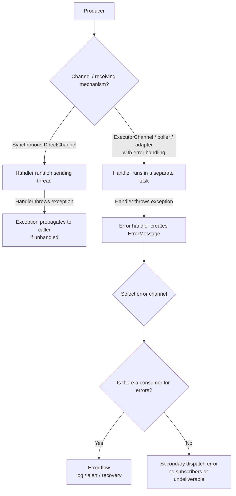

# Error Channel Has No Subscribers

## 1. Symptom and Meaning in Spring Integration Runtime

In Spring Integration, message-processing errors do not necessarily return to the producer. When a consumer runs **asynchronously** via an `ExecutorChannel`, poller, or an adapter with error handling, the framework can create an `ErrorMessage` and send it to an **error channel**. Another flow must receive this error message to log, alert, persist failure details, or coordinate recovery.

The **"error channel has no subscribers"** problem appears when an error message is sent to a channel that requires a registered consumer, yet at send time **no consumer is actively receiving from that channel**. A typical symptom looks like:

```text
org.springframework.messaging.MessageDeliveryException:
Dispatcher has no subscribers for channel '...orders.errors'
```

This message reflects **an error distributing the error message**, not necessarily the root cause of the original business failure. For example, an order-processing handler throws `IllegalStateException`; afterward, sending the `ErrorMessage` to `orders.errors` fails because the error-handling endpoint has not been started. Looking only for "no subscribers" can cause operators to miss the underlying business error.

Within **SPRING_INTEGRATION_RUNTIME**, the goal is to understand how channels, endpoints, consumers, pollers, and executors coordinate messages; identify error-handling branches, inspect `IntegrationFlow` lifecycles, choose appropriate retries/transactions/message stores, and diagnose threading, performance, and correlation IDs during incidents.

> **Distinction to make:** a `MessageChannel` can exist as a bean in the Spring context while **having no active subscribers**. Finding a bean named `orders.errors` does not prove anything is processing `ErrorMessage` instances sent through it.

## 2. What Are `ErrorMessage`, Error Channel, and Subscribers?

An `ErrorMessage` is a message with a **`Throwable` payload**. The payload is often a `MessagingException` holding the root cause and, if provided, `failedMessage`. Error handlers use this information to determine which message failed, at which handler, and whether recovery is needed.

Related components:

| Component | Role | What to Watch |
| --- | --- | --- |
| Business handler/endpoint | Processes the payload; may throw exceptions | This is the original error source. |
| `ErrorMessage` | Wraps a `Throwable` into a message | Do not confuse `ErrorMessage` with the failed business payload. |
| Error publisher / `ErrorHandler` | Sends `ErrorMessage` to an error-handling channel | Only occurs when the current execution path's error mechanism supports it. |
| `errorChannel` header | Specifies the error-handling destination attached to a message | May contain a `MessageChannel` reference or a channel name per resolution rules. |
| Global `errorChannel` | Error destination used when no specific target applies | Typically has a default logging subscriber in standard Spring Integration setups; check your actual app. |
| Subscriber / consumer endpoint | Registers a handler to receive messages from a subscribable channel | If the bean exists but the endpoint hasn't started, there may be no consumer yet. |

### How does an error message differ from a regular message?

```java
import org.springframework.messaging.Message;
import org.springframework.messaging.MessagingException;
import org.springframework.messaging.support.ErrorMessage;

void inspect(ErrorMessage errorMessage) {
    Throwable failure = errorMessage.getPayload();

    if (failure instanceof MessagingException messagingFailure) {
        Message<?> original = messagingFailure.getFailedMessage();
        if (original != null) {
            Object correlationId =
                original.getHeaders().get("correlationId");
            System.out.println("Failed message: " + original.getHeaders().getId());
            System.out.println("Correlation: " + correlationId);
        }
    }

    System.out.println("Cause: " + failure);
}
```

A business error may be wrapped by multiple exceptions. In real handlers, inspect the `Throwable`'s `cause` and `failedMessage` info (if present), while avoiding printing entire sensitive payloads into logs.

## 3. Exception Paths: Synchronous vs. Asynchronous



**Synchronous path:** With a `DirectChannel`, a `send()` call normally passes the message into the handler on the sending thread. If the handler throws an exception with no intervening handling layer, the exception propagates back to the producer or gateway. Never assume synchronous errors **are always published** to the global `errorChannel`.

**Asynchronous path:** When a message passes through an executor or poller, the caller may have already returned before the handler runs. When the handler fails, the executor/poller's or adapter's error-handling mechanism can publish an `ErrorMessage`. At that point, both **the business error** and **the error sending `ErrorMessage`** are typically recorded on the worker thread, not necessarily appearing on the producer's stack.

**Example event sequence:**

1. 10:00:00.001 — `orders.in` receives message `ORD-42`.
2. 10:00:00.003 — Worker runs handler; handler throws `IllegalStateException("DB timeout")`.
3. 10:00:00.004 — Error handler picks `orders.errors` from header.
4. 10:00:00.005 — `orders.errors` is a `DirectChannel` with no subscriber yet; publishing `ErrorMessage` fails.
5. 10:00:00.006 — Log records "Dispatcher has no subscribers"; without checking `cause` and `failedMessage`, the `DB timeout` error can be obscured.

Timestamps are illustrative; exact ordering and exception types depend on the channel, endpoint, and Spring Integration version.

## 4. "No Subscribers" Depends on Channel Type

Not all channels behave the same way when no receiver is present.

| Channel type used as error target | When there is no consumer/receiver | Operational consequence |
| --- | --- | --- |
| `DirectChannel` | No `MessageHandler` registered to dispatch to; typically yields "Dispatcher has no subscribers" | Error publishing fails immediately at dispatch time. |
| `ExecutorChannel` | Still requires a subscriber; dispatching through an executor does not create a consumer | May fail dispatch on the worker path, depending on executor and error handler config. |
| `PublishSubscribeChannel` | May deliver to nobody, or fail if configured to require subscribers | Check the missing-subscriber failure policy; do not infer solely from `send()`. |
| `QueueChannel` | **Does not use subscribe semantics**; messages enter the queue if capacity remains | Without a poller, messages sit waiting; once full, sends can time out or fail. |
| `NullChannel` | Discards messages by design | Reasonable if discarding intentionally, dangerous if used to "hide" important errors. |

Subtle point: "no subscribers" is directly a concept of **subscribable channels**. For `QueueChannel`, investigate **whether a poller/receiver is running and whether the queue is growing**, rather than checking subscriber count.

In some `PublishSubscribeChannel` configurations, having no subscribers can cause error messages to go unhandled without producing a dispatch error like `DirectChannel`. Design observation and error-checking policies suited to the channel type.

## 5. Distinguishing Local, Global, and Wrong Error Channel Destinations

Spring Integration has several ways to determine the error-handling target:

- **`errorChannel` header on the message:** typically prioritizes the message-attached error channel when supported by the error-publishing mechanism. Can be set via `MessageHeaders.ERROR_CHANNEL`.
- **Error channel configured on adapter/endpoint/poller:** can specify a dedicated destination for that inbound source or task.
- **Global `errorChannel`:** fallback choice in supporting publishing mechanisms when no specific target is present.

Exact precedence and channel name resolution depend on adapter/endpoint type and framework version; **do not assume the header always overrides every configuration**.

### Why does the default global channel usually still have a receiver?

In standard Spring Integration applications, the global `errorChannel` is typically a `PublishSubscribeChannel` with a default logging handler. This prevents asynchronous errors from disappearing completely when no custom error flow exists yet.

However, when an application **redeclares the `errorChannel` bean**, manually configures a `PublishSubscribeChannel`, routes errors to `orders.errors`, or manages dynamic flows, verify actual subscribers. The global channel's default logging subscriber is not guaranteed to exist on **every custom channel**.

Typical naming/wiring mistakes:

| Intended configuration | Actual configuration | Symptom |
| --- | --- | --- |
| Handler listens on `orders.errors` | Message header points to `order.errors` | Error flow receives nothing even though it is running. |
| Error flow receives from `orders.errors` | Message gets sent to global `errorChannel` | Dedicated error flow sees no errors; global may just log. |
| Error channel is `DirectChannel` | Error-handling flow has `autoStartup=false` or was stopped | Subscriber count may be 0 when an error happens. |
| Error handler expects `Throwable` | Handler assumes payload is `String` | Subscriber exists, yet fails again when processing `ErrorMessage`. |
| Header holds an unresolvable string name | No matching channel bean exists | Fails on routing/channel lookup, distinct from "no subscribers". |

Distinguish **channel does not exist**, **channel exists with no subscribers**, and **subscriber exists but the error handler itself throws an exception**. These are three different failures.

## 6. Minimal Reproduction: Unsubscribed `DirectChannel`

The standalone Java snippet below intentionally creates an error channel with no consumer:

```java
import org.springframework.integration.channel.DirectChannel;
import org.springframework.messaging.MessagingException;
import org.springframework.messaging.support.ErrorMessage;

public class MissingErrorSubscriberDemo {
    public static void main(String[] args) {
        DirectChannel errors = new DirectChannel();

        // ErrorMessage wraps a Throwable: root error is IllegalStateException.
        ErrorMessage errorMessage =
            new ErrorMessage(new IllegalStateException("Order processing failed"));

        try {
            errors.send(errorMessage);
        } catch (MessagingException dispatchFailure) {
            System.err.println(dispatchFailure.getMessage());
            // Typically seen: Dispatcher has no subscribers ...
        }
    }
}
```

Here, the message is sent **directly to the error channel** to isolate the cause. There is no business logic, poller, or executor in the example. The error occurs because `DirectChannel` requires at least one registered `MessageHandler` to dispatch to.

Adding a consumer via the `subscribe` API:

```java
errors.subscribe(message -> {
    Throwable error = (Throwable) message.getPayload();
    System.out.println("Error received: " + error.getMessage());
});

errors.send(new ErrorMessage(new IllegalStateException("Second error")));
```

The second snippet illustrates the fix in a simple Java program; `errors` is the variable from above. In real Spring Integration applications, register consumer endpoints via Java DSL or annotations so Spring manages lifecycle and configuration.

> Quick check for a `DirectChannel`: you can inspect `getSubscriberCount()` after the application/flow has started. Do not confuse the number of declared beans with the number of handlers actually subscribed to the dispatcher.

## 7. Java DSL Example: Business Failure with Subscribed vs. Unsubscribed Error Channels

This example uses `ExecutorChannel` for orders; when the business handler throws an exception, the async branch's error-publishing mechanism can locate the channel specified in the header.

```java
import org.springframework.context.annotation.Bean;
import org.springframework.context.annotation.Configuration;
import org.springframework.integration.channel.DirectChannel;
import org.springframework.integration.channel.ExecutorChannel;
import org.springframework.integration.config.EnableIntegration;
import org.springframework.integration.dsl.IntegrationFlow;
import org.springframework.messaging.Message;
import org.springframework.messaging.MessageChannel;
import org.springframework.messaging.MessagingException;
import org.springframework.scheduling.concurrent.ThreadPoolTaskExecutor;

@Configuration
@EnableIntegration
public class OrderErrorFlowConfig {

    @Bean
    ThreadPoolTaskExecutor orderExecutor() {
        ThreadPoolTaskExecutor executor = new ThreadPoolTaskExecutor();
        executor.setCorePoolSize(2);
        executor.setMaxPoolSize(2);
        executor.setQueueCapacity(20);
        executor.setThreadNamePrefix("orders-worker-");
        return executor;
    }

    @Bean("orders.in")
    MessageChannel ordersIn(ThreadPoolTaskExecutor orderExecutor) {
        return new ExecutorChannel(orderExecutor);
    }

    @Bean("orders.errors")
    DirectChannel ordersErrors() {
        return new DirectChannel();
    }

    @Bean("orders.orphanErrors")
    DirectChannel ordersOrphanErrors() {
        // Intentionally has no consumer to demonstrate the failure scenario.
        return new DirectChannel();
    }

    @Bean
    IntegrationFlow orderProcessing() {
        return IntegrationFlow.from("orders.in")
            .handle(String.class, (payload, headers) -> {
                throw new IllegalStateException(
                    "Unable to process order " + payload);
            })
            .get();
    }

    @Bean
    IntegrationFlow orderErrorHandling() {
        return IntegrationFlow.from("orders.errors")
            .handle(Throwable.class, (failure, headers) -> {
                System.err.println("Business error: " + failure);

                if (failure instanceof MessagingException messagingError) {
                    Message<?> failed = messagingError.getFailedMessage();
                    if (failed != null) {
                        Object traceId = failed.getHeaders().get("traceId");
                        System.err.println("traceId=" + traceId);
                    }
                }
                // One-way endpoint: produces no reply after handling.
                return null;
            })
            .get();
    }
}
```

The sample configuration defines **two error channels**:

- `orders.errors` has a consumer registered by the `orderErrorHandling` flow once started.
- `orders.orphanErrors` is a `DirectChannel` with no consumer; if an `ErrorMessage` is sent there, the dispatcher has nowhere to deliver it.

Sending a message whose header holds the error channel bean directly, avoiding string name resolution:

```java
import org.springframework.context.ApplicationContext;
import org.springframework.messaging.MessageChannel;
import org.springframework.messaging.MessageHeaders;
import org.springframework.messaging.support.MessageBuilder;

void sendOrder(ApplicationContext context, boolean routeToOrphan) {
    MessageChannel input = context.getBean(
        "orders.in", MessageChannel.class);

    MessageChannel errorDestination = context.getBean(
        routeToOrphan ? "orders.orphanErrors" : "orders.errors",
        MessageChannel.class);

    input.send(MessageBuilder.withPayload("ORD-2026")
        .setHeader("traceId", "req-71")
        .setHeader(MessageHeaders.ERROR_CHANNEL, errorDestination)
        .build());
}
```

Calling `sendOrder(context, false)` when endpoints are active routes the business handler's error to the error-handling flow via the `ExecutorChannel`/error handler mechanism. Calling `sendOrder(context, true)` can throw `MessageDeliveryException` on the worker path while publishing `ErrorMessage` because `orders.orphanErrors` has no subscribers. Do not expect asynchronous failures to always surface as exceptions from `input.send` on the producer side.

This demonstrates the error path; real systems require clear retry, alerting, and recovery policies rather than `System.err` in production.

## 8. Causes from IntegrationFlow and Endpoint Lifecycles

An error-receiving channel may work fine at startup yet lose subscribers after a runtime change. Cases to check:

1. **Flow not started:** the error-handling endpoint has `autoStartup=false` or is waiting to start. The channel bean exists, but the endpoint has not subscribed yet.
2. **Flow stopped:** a consumer endpoint unsubscribed from the subscribable channel when stopped, while producers keep emitting errors.
3. **Dynamic flow removed:** using `IntegrationFlowContext` to register/unregister dynamic flows; when the error-handler flow is removed, the error channel loses its receiver.
4. **Wrong instance/channel:** the consumer subscribed to a different channel bean even though names or construction look similar; sending to the other `DirectChannel` instance won't reach that flow.
5. **Improper startup order:** a producer/adapter ingests messages before the error flow is ready; failures appear only during startup/shutdown windows.
6. **Subscriber exists, yet error handling fails:** inspect handler errors, output/error flow configuration, and error loops; do not blame every failure on subscriber count.

If error handling is mandatory before accepting traffic, design proper lifecycle/startup ordering and readiness checks. When managing multiple flows with `IntegrationFlowContext`, coordinate start/stop by dependency rather than checking only "flow bean is registered."

For a `DirectChannel`, you can inspect at runtime:

```java
DirectChannel errorChannel = context.getBean(
    "orders.errors", DirectChannel.class);

int subscribers = errorChannel.getSubscriberCount();
System.out.println("Error channel consumer count: " + subscribers);
```

A value of 0 is a signal to investigate if the channel must have a consumer; a value greater than 0 **only proves handlers are registered**, not that they will handle errors successfully or store them durably.

## 9. Diagnosing on a Running System

When encountering "Dispatcher has no subscribers" in logs, investigate **both the original error and the secondary dispatch error** in order:

| Step | Question to Answer | Evidence to Collect |
| --- | --- | --- |
| 1. Identify the channel | Is the name after "channel" in the log `errorChannel`, `orders.errors`, or a business channel? | Bean name, channel class, integration graph. |
| 2. Identify the error source | Which exception caused `ErrorMessage` to be created? | Root cause, stack trace, `MessagingException.failedMessage`. |
| 3. Identify the thread | Did the error occur in the producer, poller, or executor worker? | Thread name, when producer returned, task executor logs. |
| 4. Check destination | Which `errorChannel` header did the message carry; does the adapter have its own error target? | Actual headers and error publisher configuration. |
| 5. Check consumer | Is the endpoint listening on the right channel and running? | Subscriber count (if applicable), lifecycle state, flow registration. |
| 6. Check channel type | Does the channel use a dispatcher or a queue? | `DirectChannel` / `PublishSubscribeChannel` / `QueueChannel`, queue depth. |
| 7. Check recovery | Was the failed message logged/stored/sent to DLQ or lost? | Handler logs, message store/broker, retry count, processing confirmation. |

Example investigation log correlated by **traceId** or **correlationId**:

```text
orders-worker-1 traceId=req-71 order=ORD-2026 exception=DB_TIMEOUT
orders-worker-1 traceId=req-71 errorChannel=orders.orphanErrors
orders-worker-1 ERROR Dispatcher has no subscribers ...
```

Two nearby error lines sharing the same `traceId` are not necessarily the same exception. With `ErrorMessage`, inspect `failedMessage` for the original business payload; inspect nested causes to separate business failure from dispatch failure.

### Checking metrics and state

- Measure messages arriving at the error channel, messages **received by the error handler**, error handler failures, and latency between failure time and handling time.
- With `QueueChannel`, monitor queue depth, poll rate, poller count, and queue wait latency. Having messages in the queue does not mean they have been processed.
- With `ExecutorChannel`, track executor queue occupancy, active threads, and rejected tasks; do not confuse missing subscribers with worker starvation or thread-pool task rejection.
- For flows with splitters/aggregators, preserve `correlationId`, `sequenceNumber`, and `sequenceSize` appropriately to pinpoint the failing message within a group. Do not assume `ErrorMessage` automatically copies all custom headers from the failed message.

## 10. Fixing Root Causes and Designing Recovery

### A. Ensure the error channel has a real subscriber

For critical error channels, register an **error-handling flow** as in Section 7, wire the exact input channel, and start the endpoint before producers accept traffic. If using a custom channel, explicitly decide whether **zero receivers** is acceptable or should fail immediately. Test end-to-end by deliberately triggering an exception and confirming the handler receives `Throwable`.

### B. Choose where to persist errors if message loss is unacceptable

If recovery across restarts is required, persist structured error info (message ID, correlation, cause, payload stripped of sensitive data) into durable storage or route to an appropriate dead-letter queue/broker. A plain in-memory `QueueChannel` does not guarantee durability across restarts even when `send()` returns true. With a persistent message store, verify serialization/deserialization compatibility of payloads and headers; not every exception object is suitable for direct persistence.

### C. Bound retries and ensure idempotency

Retrying the dispatch error (`ErrorMessage` failing to reach a subscriber) does not automatically fix the original business operation. Distinguish:

- **Transient business failures:** database or external service timeouts; eligible for bounded retries, backoff, and idempotency.
- **Invalid data:** parse/validation errors; typically reject, record the reason, and route to a dedicated review channel.
- **Error flow missing subscribers:** typically a configuration/lifecycle issue; fix routing or start the endpoint rather than retrying infinitely while the channel still has no receiver.

If a message is re-executed, actions performed prior to the failure (DB writes, API calls, notifications) may repeat. Design idempotency keys, transaction boundaries, and transport-level message acknowledgment policies.

### D. Evaluate transactions and acknowledgments separately

An error flow logging `ErrorMessage` **does not mean** the business transaction committed or the original message was properly acknowledged. On synchronous paths, transactions can roll back on exception. On asynchronous paths, executors usually introduce thread and transaction boundaries; pollers or inbound broker adapters have their own transaction/ack mechanisms. Determine the final state of the original message (ack, requeue, rollback, DLQ) rather than treating `send(ErrorMessage)` success as a business outcome.

### E. Avoid error loops

If the handler on `orders.errors` throws an exception as well, error handling may produce additional errors or secondary failure logs depending on topology. Avoid routing `ErrorMessage` back into the same failing channel without bounds. Error-handling handlers must be simple, observable, have fallbacks, and enforce bounded retries.

## 11. Misconceptions to Avoid

| Misconception | Correct Understanding |
| --- | --- |
| "No subscribers" means the channel bean does not exist | The channel can exist yet have no started consumer. |
| Declaring `errorChannel` means every error goes there | Synchronous errors can propagate to the caller; adapters/headers may select other targets. |
| The default global `errorChannel` always has 0 subscribers | It normally has a logging subscriber; verify actual configuration, especially when overriding the bean. |
| `send(ErrorMessage)` succeeding means the error is fixed | That only covers delivering the message to the channel; actual handling/recovery rests with the consumer. |
| Every channel throws "no subscribers" | `QueueChannel`, `PublishSubscribeChannel`, and `NullChannel` have different semantics. |
| No exception at the producer means no error occurred | Failures may occur on an executor/poller after the producer returns. |
| Retrying continuously solves errors | False when the cause is an unstarted error endpoint, wrong channel name, or missing handler. |
| Having a subscriber makes error handling completely safe | Consumers can still fail, queues may not be durable, or re-processing can cause duplicate side effects. |

## 12. Guided Practice Exercises

**Exercise 1 — Reproduce the missing-subscriber error.** Run the Java snippet in Section 6. Record the exception class and the "no subscribers" message; then add `subscribe` and resend. Explain why the dispatch error disappears the second time.

**Exercise 2 — Compare two error channels.** Boot the configuration from Section 7; call `sendOrder(context, false)` and `sendOrder(context, true)` in turn. Watch logs on `orders-worker-*`. Point out the original business error and what changes when the destination is `orders.orphanErrors`.

**Exercise 3 — Verify lifecycle behavior.** Stop the `orderErrorHandling` endpoint in a test environment via the application's lifecycle controls (without stopping the whole app). Check subscriber count and trigger an error message. Restart the endpoint and compare results. You do not need to alter channel beans to reproduce this.

**Exercise 4 — Compare channel types.** Replace the error channel in the test with `PublishSubscribeChannel` and `QueueChannel` (with and without an appropriate receiver). Observe the `send` return value, queue depth, and exceptions. Document the exact behavior for your framework version and configuration.

**Exercise 5 — Design recovery sizing.** Suppose an adapter reads 100 messages/second with a 2% business error rate; the error endpoint is stopped for 5 minutes. Estimate the number of error messages that must be stored for full recovery: `100 × 0.02 × 300 = 600` messages. Explain why merely increasing executor thread count does not solve this, and how to monitor queue/broker depth, retention, retries, and idempotency.

**Self-check questions:**

1. Why can an existing `DirectChannel` still report "Dispatcher has no subscribers"?
2. How do the initial failure and the failure to publish `ErrorMessage` relate? What do you inspect `failedMessage` for?
3. When does an exception propagate to the producer's `send()`, and when does it surface on a worker/poller?
4. Why is `QueueChannel` unsuitable for diagnosing via subscriber count?
5. Why is merely seeing the global `errorChannel` insufficient to conclude all error flows are working?
6. If error messages must not be lost on restart, what guarantees must be added beyond creating a consumer?

**Operational principle:** investigate the original exception source first, verify the exact channel receiving `ErrorMessage` and its consumer state at failure time, then choose the appropriate lifecycle/routing fix and recovery policy. When reliable error handling is required, verify delivery, processing, persistence, and retries of **the original message**, not just the existence of an error channel.
