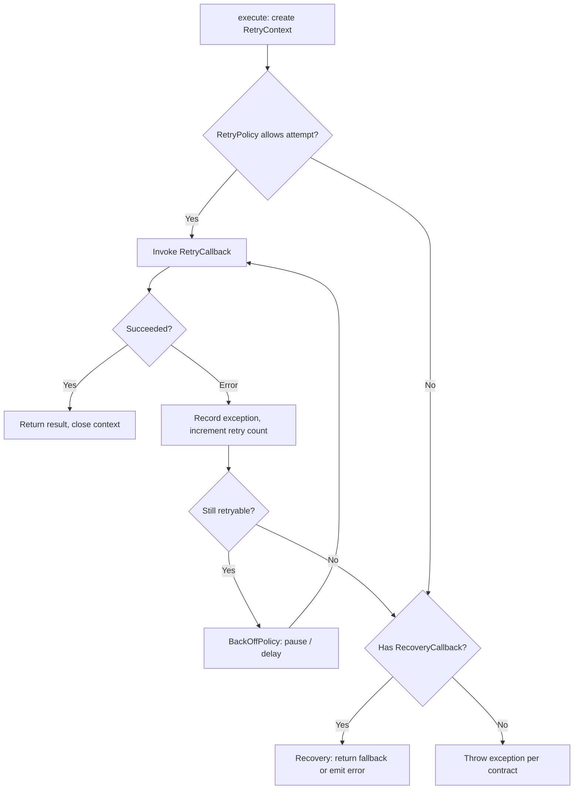
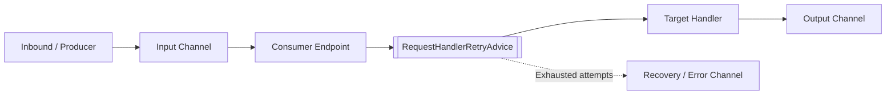

# RetryTemplate, RetryPolicy, and BackOffPolicy in Spring Integration Runtime

## 1. Context: Where in the Message Flow Should Retry Sit?

An integration system frequently encounters transient failures: a REST API returning an overload error, a database connection dropping momentarily, a partner service timing out, or a broker briefly disconnecting. **Retry** means re-executing a failed operation according to a bounded policy, expecting the transient cause to clear. Retrying incorrectly, however, can overload the service further, hold threads too long, create duplicate transactions, and trigger failing message loops.

In the **SPRING_INTEGRATION_RUNTIME** module, retry needs to be placed on the exact execution path: **channel → consumer endpoint → message handler → downstream channel**. Three key components from the *Spring Retry* project (used by Spring Integration 6.5) are:

| Component | Question it answers | Role |
| --- | --- | --- |
| `RetryTemplate` | **How is the retry executed?** | Coordinates the business callback, tracks `RetryContext`, consults the policy, waits per backoff, returns the result, or transitions to recovery. |
| `RetryPolicy` | **Should we retry? How many attempts at most?** | Decides based on exception type, attempt count, elapsed time, or state; options include `SimpleRetryPolicy`, `TimeoutRetryPolicy`. |
| `BackOffPolicy` | **How long to wait between two attempts?** | Governs the pause between retries: immediate, fixed, exponential, randomized. |

Alongside them is `RecoveryCallback`: **what to do once retries are no longer possible or permitted**. In Spring Integration, `RequestHandlerRetryAdvice` applies `RetryTemplate` to a specific handler. It does not automatically replay the entire IntegrationFlow or resend the message to the input.

> **Version scope:** This lesson uses the **Spring Integration 6.5.x + Spring Retry 2.x** APIs, such as `org.springframework.retry.*` packages and `RequestHandlerRetryAdvice.setRetryTemplate(...)`. Spring Integration 7.x changed the underlying retry foundation; when upgrading, always consult the documentation for the running version rather than copying configuration across branches.

## 2. Lifecycle of a `RetryTemplate.execute(...)` Call

`RetryTemplate` accepts a `RetryCallback` containing the operation to try, a `RetryPolicy`, and a `BackOffPolicy`. Each `execute(...)` call has its own `RetryContext` to record the failure count and the latest exception.



Important details to remember:

- `RetryContext.getRetryCount()` starts at **0** on the first attempt; after each recorded failure, this count increments.
- **`maxAttempts = 4` means at most four callback invocations in total: 1 initial attempt + 3 retries.** It does not mean four retries after the initial attempt.
- Backoff is typically invoked **between attempts**, not before the first attempt and not after attempts are exhausted.
- By default, Spring Retry 2.x `RetryTemplate` tries up to **3 attempts** with **no delay**. In production integrations, declare policies explicitly instead of relying on defaults.
- The callback may succeed on the first attempt, so there is no reason to sleep through backoff intervals if no error occurs.
- If no `RecoveryCallback` is configured, the last exception is rethrown; if recovery is present, its return value or behavior can change how the caller perceives failure.

## 3. Pure Spring Retry Example: Configuring `RetryTemplate`

The following example simulates reading transaction status from an external service. This is plain Java using **Spring Retry 2.x**, independent of channels and endpoints.

```java
import java.io.IOException;
import org.springframework.retry.support.RetryTemplate;

interface RemoteStatusApi {
    String fetchStatus(String paymentId) throws IOException;
}

class PaymentStatusClient {
    private final RemoteStatusApi remote;

    PaymentStatusClient(RemoteStatusApi remote) {
        this.remote = remote;
    }

    String readStatus(String paymentId) {
        RetryTemplate retry = RetryTemplate.builder()
                .maxAttempts(4)                      // 1 initial + 3 retries
                .exponentialBackoff(200L, 2.0, 1_000L) // milliseconds
                .retryOn(IOException.class)
                .build();

        return retry.execute(
                context -> remote.fetchStatus(paymentId),
                context -> {
                    throw new IllegalStateException(
                            "Cannot fetch status for " + paymentId,
                            context.getLastThrowable());
                });
    }
}
```

If all four attempts encounter `IOException`, the configured wait intervals are **200 ms, 400 ms, and 800 ms**. Total planned backoff is **1,400 ms**, excluding network call duration, callback processing, scheduling, and actual timer jitter. If the second attempt succeeds, it waits only 200 ms. If the failure is `IllegalArgumentException`, `retryOn(IOException.class)` does not treat it as retryable; recovery can still run immediately per the template's contract.

For deadline-bound requests, account for **network timeout**, each attempt's duration, total backoff time, and the caller/gateway deadline. Backoff does **not** impose a timeout on a hanging HTTP call. Configure timeouts on the network client first, then determine total retry limits.

### Configuring `RetryPolicy` and `BackOffPolicy` Separately via Setters

```java
import org.springframework.retry.backoff.ExponentialBackOffPolicy;
import org.springframework.retry.policy.SimpleRetryPolicy;
import org.springframework.retry.support.RetryTemplate;

SimpleRetryPolicy attempts = new SimpleRetryPolicy();
attempts.setMaxAttempts(4);

ExponentialBackOffPolicy delay = new ExponentialBackOffPolicy();
delay.setInitialInterval(200L);
delay.setMultiplier(2.0);
delay.setMaxInterval(1_000L);

RetryTemplate template = new RetryTemplate();
template.setRetryPolicy(attempts);
template.setBackOffPolicy(delay);
```

This snippet illustrates **each component's individual contract**, without restricting retries to `IOException` only: `SimpleRetryPolicy` by default classifies many exception types as retryable. To restrict exception types, use the builder's `retryOn(...)` or configure the policy's exception map/classifier.

## 4. Choosing `RetryPolicy`: Attempts, Exceptions, Time

`RetryPolicy` decides whether an operation may still be attempted. Several strategies exist:

| Policy / option | How it decides | Use cases |
| --- | --- | --- |
| `SimpleRetryPolicy` | Limits attempts, classifies exceptions. | Predictable transient errors such as `IOException`, timeouts. |
| `NeverRetryPolicy` | Never retries after failure. | Non-repeatable operations or permanently invalid data. |
| `AlwaysRetryPolicy` | Allows continued retries. | Use only with strict time/cancellation/circuit controls; very dangerous if unbounded. |
| `TimeoutRetryPolicy` | Allows retries within a time window. | When a time budget exists, though it does not replace per-I/O timeouts. |
| `CompositeRetryPolicy` | Combines multiple policies (e.g., attempts and time). | When multiple conditions must hold; verify optimistic/pessimistic flags when configuring. |
| `ExceptionClassifierRetryPolicy` | Selects a policy by exception type. | Different error classes requiring different retry limits. |

A sound policy usually distinguishes:

- **Transient errors:** conditional HTTP 429/503, connection resets, recoverable overload, database deadlocks with an explicit retry policy. Retryable, but must be bounded.
- **Permanent errors:** malformed JSON schema, missing required fields, invalid business requests, misconfigured authentication, certain HTTP 4xx codes. Stop early or route to an error flow.
- **Unknown errors:** do not blindly retry every `RuntimeException`. Classify based on the root cause and the remote system's contract.

When Spring Integration invokes a POJO handler, business exceptions may be wrapped in `MessagingException`. If a policy only specifies `retryOn(IOException.class)` and inspects **only the outermost exception**, it may fail to recognize the `IOException` inside. Spring Retry 2.x lets you enable cause-chain traversal:

```java
RetryTemplate retryTemplate = RetryTemplate.builder()
        .maxAttempts(4)
        .retryOn(java.io.IOException.class)
        .traversingCauses()
        .fixedBackoff(250L)
        .build();
```

With this configuration, the policy searches for `IOException` in the cause chain (if present). Traversing causes does not mean every exception is retried; classification still applies. Non-retryable errors can still go directly to recovery if the template has a recovery callback.

**Check the attempt-counting convention:** in Spring Retry 2.x, both `SimpleRetryPolicy(3)` and builder `maxAttempts(3)` **include the initial attempt**. Some libraries/brokers use `maxRetries` to mean *additional retries*; this is a common source of off-by-one bugs when stacking retry layers.

## 5. Choosing `BackOffPolicy`: Wait Intervals and Runtime Consequences

`BackOffPolicy` is a timing strategy between attempts, not an exception classifier. Common choices:

| Policy | Behavior between retries | Pros / cons |
| --- | --- | --- |
| `NoBackOffPolicy` | Retries immediately. | Fast for ultra-brief glitches, but easily piles load onto a struggling remote system. |
| `FixedBackOffPolicy` | Waits a fixed duration, e.g., 250 ms. | Predictable; synchronized clients may retry in lockstep. |
| `ExponentialBackOffPolicy` | Multiplies wait interval up to a cap. | Eases pressure during prolonged outages, but increases latency and holds workers. |
| `ExponentialRandomBackOffPolicy` | Exponential growth with randomness. | Reduces synchronized retry storms across clients; exact per-attempt timing is harder to predict. |
| `UniformRandomBackOffPolicy` | Picks a random pause between min and max. | Desynchronizes consumers; requires monitoring latency distribution. |

Example for exponential backoff: `initialInterval = 100 ms`, `multiplier = 2`, `maxInterval = 800 ms`:

```text
Attempt 1: call immediately; if it fails -> wait 100 ms
Attempt 2: call again; if it fails -> wait 200 ms
Attempt 3: call again; if it fails -> wait 400 ms
Attempt 4: call again; if it fails -> wait 800 ms
Attempt 5: call again; if it fails -> may terminate (if maxAttempts=5)
```

With `maxAttempts=5`, there are only **4 waits**. In Spring Retry 2.x, `BackOffPolicy.backOff(...)` typically blocks **the thread performing the retry**. This has consequences:

1. On a `DirectChannel`, the sender may be blocked for the entire retry duration; a synchronous gateway may time out before the handler finishes all attempts.
2. On an `ExecutorChannel`, a worker thread may be held sleeping; queued tasks grow when many messages retry simultaneously.
3. With `QueueChannel` and a poller, the polling thread may sleep between handler retries, reducing messages processed per second.
4. If a transaction is open in the same scope, holding the thread can unexpectedly prolong resource/lock retention; examine advice order and transaction boundaries.

At high throughput, asynchronous/scheduler-based retry, broker redelivery, or delay queues may be needed instead of `Thread.sleep` inside stateless retry. Those mechanisms have different acknowledgement, ordering, and duplication semantics and require dedicated design.

## 6. Integrating with Spring Integration: `RequestHandlerRetryAdvice`

`RequestHandlerRetryAdvice` is a **handler advice**. It wraps the invocation of **the configured handler**, not every endpoint in the flow. The example below uses `@ServiceActivator(adviceChain = "paymentRetryAdvice")`, meaning only calls to `submit(...)` are retried. This assumes Spring Integration 6.5, Spring Retry 2.x, and standard dependencies.

Define the message and a service simulating failures based on payment ID:

```java
import java.io.IOException;
import org.springframework.integration.annotation.ServiceActivator;
import org.springframework.messaging.handler.annotation.Payload;
import org.springframework.stereotype.Component;

record PaymentCommand(String paymentId, long amount) { }

@Component
class PaymentHandler {
    @ServiceActivator(
            inputChannel = "paymentCommands",
            adviceChain = "paymentRetryAdvice")
    public void submit(@Payload PaymentCommand command) throws IOException {
        if (command.paymentId().startsWith("fail-")) {
            throw new IOException("Simulated downstream outage");
        }
        // In a real app: call external API with timeout and idempotency key.
    }
}
```

Configure the two channels and the advice. `paymentRecovery` is a `QueueChannel` dedicated to observing recovery output; in production this would typically be a consumer emitting failure events, a dead-letter/quarantine store, or a manual intervention workflow:

```java
import org.springframework.beans.factory.annotation.Qualifier;
import org.springframework.context.annotation.Bean;
import org.springframework.context.annotation.Configuration;
import org.springframework.integration.annotation.EnableIntegration;
import org.springframework.integration.channel.DirectChannel;
import org.springframework.integration.channel.QueueChannel;
import org.springframework.integration.handler.advice.ErrorMessageSendingRecoverer;
import org.springframework.integration.handler.advice.RequestHandlerRetryAdvice;
import org.springframework.messaging.MessageChannel;
import org.springframework.messaging.PollableChannel;
import org.springframework.retry.support.RetryTemplate;

@Configuration
@EnableIntegration
class PaymentRetryConfiguration {
    @Bean
    MessageChannel paymentCommands() {
        return new DirectChannel();
    }

    @Bean
    PollableChannel paymentRecovery() {
        return new QueueChannel();
    }

    @Bean("paymentRetryAdvice")
    RequestHandlerRetryAdvice paymentRetryAdvice(
            @Qualifier("paymentRecovery") MessageChannel recoveryChannel) {

        RetryTemplate template = RetryTemplate.builder()
                .maxAttempts(4)                      // 4 attempts total
                .retryOn(java.io.IOException.class)
                .traversingCauses()
                .exponentialBackoff(200L, 2.0, 1_000L)
                .build();

        RequestHandlerRetryAdvice advice = new RequestHandlerRetryAdvice();
        advice.setRetryTemplate(template);
        advice.setRecoveryCallback(
                new ErrorMessageSendingRecoverer(recoveryChannel));
        return advice;
    }
}
```

Send a test message from an integration test with a running `ApplicationContext`:

```java
import org.springframework.context.ApplicationContext;
import org.springframework.messaging.Message;
import org.springframework.messaging.MessageChannel;
import org.springframework.messaging.PollableChannel;
import org.springframework.messaging.support.ErrorMessage;
import org.springframework.messaging.support.MessageBuilder;

void exercise(ApplicationContext context) {
    MessageChannel input =
            context.getBean("paymentCommands", MessageChannel.class);
    PollableChannel recovery =
            context.getBean("paymentRecovery", PollableChannel.class);

    input.send(MessageBuilder
            .withPayload(new PaymentCommand("fail-42", 100_000L))
            .setHeader("correlationId", "order-42")
            .build());

    Message<?> recovered = recovery.receive(3_000);
    if (!(recovered instanceof ErrorMessage error)) {
        throw new IllegalStateException("Expected retry recovery error");
    }
    Throwable cause = error.getPayload();
    // Inspect cause, failedMessage/correlationId per recovery contract.
}
```

Execution walkthrough:

1. `paymentCommands` is a `DirectChannel`, so the handler and stateless retries normally execute synchronously on the thread calling `send()`.
2. `submit(...)` throws `IOException`; the advice re-invokes the method according to `RetryTemplate`. With `maxAttempts=4` and exponential backoff, if failures persist there are three expected pauses: 200, 400, and 800 ms.
3. Once attempts are exhausted, `ErrorMessageSendingRecoverer` sends an `ErrorMessage` containing the exception and relevant context to `paymentRecovery`.
4. The recovery callback may return `null` to signal the failure was handled in its own way. Consequently, **`send()` can complete without throwing the final exception**; do not treat that as proof that the payment succeeded.

If **no** `RecoveryCallback` is configured, the exception after the final attempt is normally thrown back to the caller in a synchronous flow or handled by the source endpoint's error handling. An inbound `errorChannel` and `paymentRecovery` in this example have **different roles**: the former belongs to error publishing when an endpoint/adapter fails to receive/process, while the latter is the channel to which the recovery callback actively sends `ErrorMessage`.

> Do not add another `@ServiceActivator` consuming `paymentCommands` just to "watch errors"; with multiple subscribers on a `DirectChannel`, messages are typically dispatched to one selected consumer, not broadcast. Observe errors via `paymentRecovery` or an appropriate channel.

## 7. Recovery: Choosing Between Failing with Error, Fallback, or Rerouting

`RecoveryCallback<T>` receives `RetryContext` to decide what happens next after the policy can no longer retry. Options:

| Recovery | Behavior | Considerations |
| --- | --- | --- |
| No callback | Throws the remaining exception. | Caller/transaction/broker gets a chance to detect the error; upstream handling must be configured. |
| Return fallback value | Continues as if the callback returned an alternative result. | Can easily mask failures; use only when a fallback is genuinely valid for the business domain. |
| `ErrorMessageSendingRecoverer` | Publishes an `ErrorMessage` to a channel. | Needs a consumer, persistence, and alerts; do not confuse "sent to recovery" with "business processing succeeded." |
| Route message to dead-letter/quarantine | Persists error for inspection and controlled replay. | Must ensure durability, idempotency, and avoid retry loops on replay. |

A pure Java recovery callback can return a fallback value:

```java
String status = template.execute(
        context -> remote.fetchStatus("PAY-42"),
        context -> {
            // Only valid if the business contract allows a fallback status.
            return "UNKNOWN_REQUIRES_RECONCILIATION";
        });
```

However, **never** turn a failed debit/write command into `"SUCCESS"`. For operations with side effects, recovery should preserve enough context for reconciliation: business key, correlation ID, attempt count, error type, failure timestamp, and known remote state.

If an error is **non-retryable**, the policy may reject retries after the first failure. If a recovery callback is present, it can still handle the error immediately; this differs from assuming "recovery only runs after N attempts." Verify both attempt counts and terminal branches.

## 8. Stateless vs. Stateful Retry: Two Different Contracts

**Stateless retry** performs consecutive attempts within a single `RetryTemplate.execute(...)` call. Backoff blocks the thread during wait intervals. This fits when the caller can wait, the operation can be repeated, and redelivery from the message source is not needed.

**Stateful retry** stores retry state by a **stable key**, throws the exception back to the source after a failure, and relies on the source/broker to **redeliver the same work** to continue. Spring Integration 6.5 supports `RequestHandlerRetryAdvice.setRetryStateGenerator(...)`; a built-in implementation is `SpelExpressionRetryStateGenerator`. Example configuration specifically for a handler receiving redeliveries from a JMS source:

```java
import org.springframework.integration.handler.advice.RequestHandlerRetryAdvice;
import org.springframework.integration.handler.advice.SpelExpressionRetryStateGenerator;

RequestHandlerRetryAdvice stateful = new RequestHandlerRetryAdvice();
stateful.setRetryStateGenerator(
        new SpelExpressionRetryStateGenerator("headers['jms_messageId']"));
// Must be attached to a handler that actually receives redeliveries from a JMS source.
// retryTemplate and recoveryCallback can be configured similarly to stateless retry.
```

Use this only when the source **genuinely supports error propagation, rollback/nack, and redelivery**. Common pitfalls:

- Retry state is correlated via **stable message identity** across redeliveries; a `MessageHeaders.ID` regenerated on every delivery may no longer work as a key.
- `correlationId` may represent an entire group of messages rather than a single work item; choose the key according to the source's semantics instead of merging unrelated messages.
- Retry state may live in an in-memory cache subject to capacity and lifecycle limits; do not treat the default cache as durable storage across restarts.
- If the broker has its own retry/redelivery policy, **actual total attempts** are the product of all layers interacting; design consistent limits to avoid multiplying executions.
- Stateful retry does not replace transport transaction/ack semantics. Without redelivery, subsequent retries **will not happen on their own**.

A comparison table:

| Aspect | Stateless | Stateful |
| --- | --- | --- |
| What triggers the next retry? | `RetryTemplate` within the same invocation. | Message source redelivers; advice recognizes the same key. |
| Threading | Usually the same thread; sleeps between retries if backoff is set. | Each delivery may run on a different thread; error returns to source after each attempt. |
| Transactions | Multiple attempts can share one transaction scope if arranged that way. | Typically tied to rollback/ack followed by a new transaction on redelivery. |
| When appropriate? | Short I/O with timeouts where the caller can wait. | Message brokers with redelivery requiring reprocessing after rollback. |
| Risks | Holding threads/locks, caller timeouts, duplicate writes. | Wrong key, lost cache, premature/late dead-lettering, duplicate redelivery. |

## 9. How Does Retry Affect Channels, Pollers, Executors, and Transactions?

Where retry is placed determines what gets repeated:



**Handler advice** typically repeats only `Target Handler` (and effects occurring inside the handler), **not the message source, upstream channels, or the entire downstream chain**. If a failing handler is moved to a later endpoint, advice placed on an earlier endpoint is not guaranteed to catch failures in the later one. This is critical when placing retry and logging/advices across multiple positions in a flow.

| Execution site | Consequence when retry has delay |
| --- | --- |
| `DirectChannel` → handler | `send()` normally waits through all retries; can time out the caller. Unrecovered exceptions can propagate back up the same call stack. |
| `ExecutorChannel` → handler | Retries occur on executor workers; the producer may have finished `send()` before the handler fails. Errors/metrics must be captured on the worker. |
| `QueueChannel` → polling consumer | Retries in the handler hold the poller thread; backlog grows and throughput drops. Check poller configuration and `maxMessagesPerPoll`. |
| Inbound JMS/AMQP/Kafka adapter | Transport has its own ack, nack, offset, rollback, and redelivery. Retry advice must coordinate with the transport; handler recovery can alter the success/failure signal returned to the source. |
| Transaction interceptor | Advice order and transaction scope affect transaction count, rollback, and lock duration. Do not assume every attempt gets a fresh transaction. |

For example, if a transaction is opened **outside** retry advice, the first attempt may mark the transaction rollback-only; a subsequent attempt may succeed, yet the outer transaction still rolls back. If each attempt must run in an independent transaction, configure advice order and propagation properly and verify empirically. Conversely, sleeping for backoff inside a transaction can hold connections/locks longer than expected.

**Retry does not make operations with side effects safe to repeat.** An HTTP request may have already debited funds on the remote side before timing out, causing the caller to retry and debit a second time. Solutions include an **idempotency key**, unique constraints, transactional outbox/inbox, or reconciliation per business contract. `correlationId` helps tracing but does not guarantee idempotency.

### Relationship with `MessageStore`

`QueueChannel` can store messages in memory or use a durable message store; an aggregator also has a message group store. That is **distinct** from retry state in `RetryContext`. Storing messages does not automatically mean replaying the exact attempt count or ordering after recovery; nor is the retry state cache persisted to the message store. When using a persistent transport, design explicitly: which messages are acked, which are retried, which go to the DLQ, and how state is restored after a restart.

## 10. Bounding Retry with a Time Budget

A policy with only `maxAttempts` is insufficient when each I/O call can have a long timeout. Let:

- `N`: maximum attempts, including the initial attempt.
- `T_i`: duration of attempt `i` (including network timeout).
- `B_i`: backoff interval before the next attempt, at most `N - 1` intervals.

General duration:

```text
T_total ≈ sum(T_i, i = 1..N) + sum(B_i, i = 1..N-1) + overhead
```

For example, if `N = 4`, each HTTP call times out at 2 seconds, and backoff is `200/400/800 ms`, the worst-case total time is roughly **9.4 seconds** (4 × 2 s + 1.4 s), excluding scheduling. If the gateway waits at most 5 seconds for a reply, this policy is unsuitable even though `maxAttempts=4` sounds small.

Good control usually requires **per-I/O-call timeouts**, **max attempts**, **capped backoff with jitter**, **overall deadline**, and an appropriate fallback strategy. `TimeoutRetryPolicy` tracks the retry time budget but cannot abort a hung I/O call by itself; every client still needs its own timeout.

With synchronous backoff, Little's Law shows that in-flight work grows as average service time increases. For example, 100 messages/s where each failing message holds a thread for 3 seconds can require hundreds of active/waiting slots, exceeding available workers. Load tests must measure queue depth, active threads, rejected executions, and latency—not just total retry counts.

## 11. Observing and Diagnosing Retry at Runtime

Useful fields per attempt: business message key, `correlationId`, integration endpoint name, **root cause** exception, `retryCount`, attempt duration, planned backoff, and recovery outcome. Avoid logging payloads with sensitive data and avoid metric labels with per-message unique values.

A simple standalone check that runs whenever Spring Retry is on the classpath:

```java
import java.io.IOException;
import java.util.concurrent.atomic.AtomicInteger;
import org.springframework.retry.support.RetryTemplate;

AtomicInteger calls = new AtomicInteger();
RetryTemplate testRetry = RetryTemplate.builder()
        .maxAttempts(3)
        .retryOn(IOException.class)
        .noBackoff()
        .build();

String result = testRetry.execute(context -> {
    int n = calls.incrementAndGet();
    if (n <= 2) {
        throw new IOException("Transient failure " + n);
    }
    return "OK";
});

if (!"OK".equals(result) || calls.get() != 3) {
    throw new AssertionError("Expected exactly three attempts");
}
```

This test shows that `maxAttempts(3)` includes the initial attempt. You should also add checks for a non-retryable exception (e.g., `IllegalArgumentException`), the recovery path after the last attempt, exception cause traversal, and handler retry advice tests (to distinguish pure Java retry from retry inside a message flow).

When investigating in production, follow this sequence:

1. **Identify retry scope:** direct `RetryTemplate`, `RequestHandlerRetryAdvice` wrapping a handler, poller advice, or broker redelivery? Are multiple retry layers stacked?
2. **Inspect policy settings:** does `maxAttempts` include the initial attempt, are exceptions unwrapped to root cause, and is the error truly retryable?
3. **Check backoff:** interval cap, jitter, held threads, queue depth, gateway deadline, and per-request timeouts.
4. **Inspect terminal outcome:** exception propagated back, recovery callback returning fallback, `ErrorMessage` emitted, or broker ack/nack/dead-letter?
5. **Inspect business effects:** idempotency key, remote system logs, transaction rollback, duplicate records, and correlation preservation across attempts.
6. **Check runtime health:** is the poller still running, is the executor out of workers, does the message store have a backlog, or is there a poison-message loop?

Common symptoms and troubleshooting steps:

| Symptom | Possible cause | How to check |
| --- | --- | --- |
| Method runs only once despite `maxAttempts=4` | Exception classified as non-retryable, wrapped in `MessagingException`, or advice not attached to handler. | Check `adviceChain`, root cause, and `traversingCauses()`. |
| Four attempts run with no delay | `BackOffPolicy` not configured; defaults to no backoff. | Inspect the template actually wired into the advice, not just whether a bean exists. |
| `send()` does not throw despite business failure | Recovery callback sent `ErrorMessage` and returned a value/null. | Check recovery channel, consumer, and business state. |
| Throughput drops, threads held for long periods | Synchronous backoff inside executor/poller, long timeouts, many attempts. | Measure wait time, queue depth, worker utilization; consider deferred redelivery. |
| Message processed more times than expected | Handler retry combined with broker/adapter retry, redelivery after timeout. | Count attempts across **all layers**, check acks, transactions, and idempotency. |
| Stateful retry does not resume attempt count | Unstable key, source does not redeliver, cache replaced/lost. | Check message key, retry state, lifecycle, and transport redelivery. |
| Recovery loops continuously | Failure never terminated/acked, DLQ consumer re-sends without bound. | Isolate quarantine and replay in a controlled way; avoid creating a retry loop. |

## 12. Applying in Practice: Choosing Policies by Error Type

| Scenario | Retry? | Policy suggestion |
| --- | --- | --- |
| REST API returns transient 503; idempotent read | Bounded | 3–4 attempts, exponential backoff + jitter, per-request timeout, overall deadline. |
| HTTP 400 from invalid payload schema | No | Validate, log error/quarantine; do not waste retries. |
| Payment creation API times out after request is sent | Only with idempotency guarantees | Use idempotency key and reconciliation; retry alone does not prove the transaction did not complete. |
| JMS consumer hits transient error and source supports rollback | Conditional | Stateful retry or bounded broker redelivery, then DLQ. |
| Poller handles millions of msg/s and endpoint fails often | Cautiously | Avoid thread-blocking backoff; control concurrency, backpressure, and downstream health. |
| Application bug such as `NullPointerException` | Usually no | Log error, fix logic, analyze safe replay after fix. |

**Exercise 1 — Count attempts:** change `maxAttempts(3)` to 1 and 4 in the `AtomicInteger` example. Determine callback invocation counts, pause counts, and recovery conditions.

**Exercise 2 — Classify exceptions:** write a callback that throws `IOException` first and `IllegalArgumentException` next. Configure retry only on `IOException`; record the final attempt and recovery outcome. Wrap `IOException` in `MessagingException` and test with `traversingCauses()` enabled and disabled.

**Exercise 3 — Compare backoffs:** try `NoBackOffPolicy`, `FixedBackOffPolicy`, and `ExponentialBackOffPolicy` with the same attempt count. Measure elapsed time with a monotonic clock; compare expected vs. actual durations.

**Exercise 4 — Flow error path:** send `PaymentCommand("fail-42", ...)` to `paymentCommands`; verify there is exactly one `ErrorMessage` after retries and no business success. Remove the recovery callback to observe the exception on `DirectChannel`.

**Exercise 5 — Threads and transactions:** run the handler through an `ExecutorChannel` or polling consumer, logging thread names in producer/handler/recoverer. Test transactions under different advice orders and observe rollback-only behavior and connection hold times.

**Exercise 6 — Idempotency and redelivery:** create a unique business key for a payment command and simulate a timeout after the server persists data. Verify resending does not create two transactions and design the flow for when actual status is unknown.

**Self-check questions:**

1. Do `RetryPolicy` and `BackOffPolicy` decide the same thing?
2. With `maxAttempts=4`, how many callback invocations and how many backoffs occur at most?
3. When is `traversingCauses()` needed in Spring Integration?
4. Why can a recovery callback cause `send()` to complete even when the handler failed?
5. How do stateless retry and redelivery from JMS/Kafka differ?
6. Why does retrying a timed-out payment require idempotency and reconciliation?
7. Why might adding more threads fail to fix throughput when using synchronous backoff?

## 13. Official References

- Spring Integration **6.5** — [Provided Advice Classes: Retry Advice](https://docs.spring.io/spring-integration/reference/6.5/handler-advice/classes.html).
- Spring Integration **6.5** — [`RequestHandlerRetryAdvice` API](https://docs.spring.io/spring-integration/docs/6.5.0/api/org/springframework/integration/handler/advice/RequestHandlerRetryAdvice.html).
- Spring Integration **6.5** — [`ErrorMessageSendingRecoverer` API](https://docs.spring.io/spring-integration/docs/6.5.0/api/org/springframework/integration/handler/advice/ErrorMessageSendingRecoverer.html).
- Spring Integration **6.5** — [`@ServiceActivator` API (`adviceChain`)](https://docs.spring.io/spring-integration/docs/6.5.0/api/org/springframework/integration/annotation/ServiceActivator.html).
- Spring Retry **2.x** — [`RetryTemplate` API](https://docs.spring.io/spring-retry/docs/2.0.x/apidocs/spring.retry/org/springframework/retry/support/RetryTemplate.html).
- Spring Retry **2.x** — [`RetryTemplateBuilder` API](https://docs.spring.io/spring-retry/docs/2.0.x/apidocs/spring.retry/org/springframework/retry/support/RetryTemplateBuilder.html).
- Spring Retry **2.x** — [`SimpleRetryPolicy` API](https://docs.spring.io/spring-retry/docs/2.0.x/apidocs/spring.retry/org/springframework/retry/policy/SimpleRetryPolicy.html).
- Spring Retry **2.x** — [`BackOffPolicy` API](https://docs.spring.io/spring-retry/docs/2.0.x/apidocs/spring.retry/org/springframework/retry/backoff/BackOffPolicy.html).
