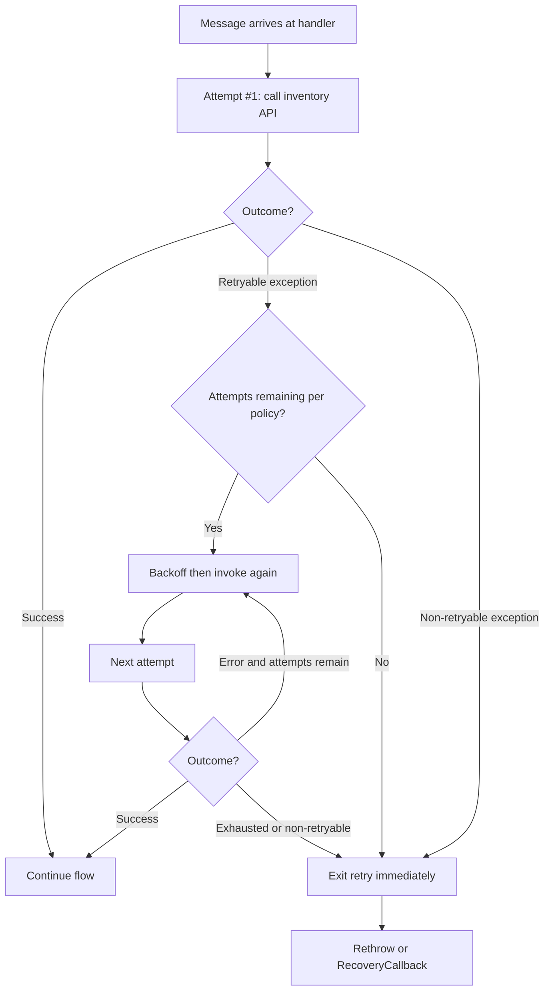
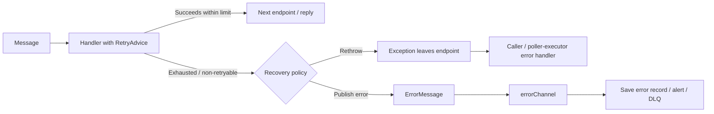

# Retry Attempts and Exception Classification in Spring Integration

## Lesson Objectives

In an integration flow, a handler can fail because an API returns HTTP 503, a database briefly loses connection, a message fails schema validation, or a programming bug occurs. Retrying every error wastes resources, creates traffic spikes, and risks duplicating side effects. Failing to retry a transient error can cause the system to miss a chance to process valid work.

The **Attempt counts and exception classification** lesson belongs to the **Retries and recovery** chapter of the **SPRING_INTEGRATION_RUNTIME** module. It is framed in the context of Spring Integration executing message flows across channels, endpoints, consumers, pollers, and executors, while examining transaction boundaries, error flows, message stores, correlation, and runtime diagnostics.

After this lesson, you will be able to:

- Distinguish **attempt**, **retry**, **redelivery**, and **replay**; accurately calculate handler/downstream invocation counts.
- Determine which exceptions should be retried, which must fail immediately, and how to handle framework-wrapped exceptions.
- Configure `RequestHandlerRetryAdvice` with `RetryTemplate`, retry policies, backoff policies, and recovery.
- Explain why the same retry configuration behaves differently when the handler is behind a `DirectChannel`, an `ExecutorChannel`, or a poller.
- Examine the impact of transactions, acks, idempotency, message stores, and correlation on duplicate failures.
- Design metrics and test scenarios to detect retries exceeding limits or retrying the wrong exception types.

## 1. How Many Times Is a Message "Tried"?

In Spring Retry, **an attempt is a single execution of the operation wrapped by the retry policy**. The initial attempt also counts toward `maxAttempts`. Only invocations **after the first failure** are retries in the narrow sense.

For example, suppose a handler calls an inventory service:



If `maxAttempts = 3` is configured:

| Outcome per invocation | Attempts executed | Retries | Result |
| --- | ---: | ---: | --- |
| Attempt 1 succeeds | 1 | 0 | Success |
| Attempt 1 transient error; Attempt 2 succeeds | 2 | 1 | Success |
| Attempts 1–2 transient errors; Attempt 3 succeeds | 3 | 2 | Success |
| All three attempts hit transient errors | 3 | 2 | Exhausted; run recovery or throw error |
| Attempt 1 is a non-retryable error | 1 | 0 | Fails immediately |
| Attempt 1 transient, Attempt 2 non-retryable | 2 | 1 | Stops immediately at attempt 2 |

Therefore, `maxAttempts = 1` means **invoke the operation once only, with zero retries**. This is a critical convention when configuring, reading logs, or writing tests. Do not interpret `maxAttempts = 3` as "three retries plus the initial run."

### 1.1. Handler Retry vs. Source Redelivery

Suppose an inbound adapter reads a message from a broker; within each processing turn, the handler retries up to three attempts. If the adapter/broker redelivers that same message four times, worst-case downstream calls can reach:

```text
4 message deliveries × 3 attempts/delivery = 12 downstream calls
```

**Retry** in `RequestHandlerRetryAdvice` re-invokes the handler within a single processing turn. **Redelivery** is when a source like JMS/AMQP/Kafka (depending on adapter and configuration) delivers the message for another processing turn after an error/rollback/nack. **Replay** is operations actively re-reading messages from an error store, DLQ, or historical log. These are three distinct loops that can occur together.

Accordingly, operational policy must answer separately: "At most how many attempts per processing turn?" and "At most how many times can the source redeliver?" No single `maxAttempts` number covers all three layers.

## 2. Classifying Exceptions Before Deciding to Retry

Each exception conveys information about the **cause**, but the retry decision is a **business and infrastructure policy**. The same exception type may be handled differently in two flows if the operations differ in safety/idempotency.

| Category | Examples | Starting policy | Rationale |
| --- | --- | --- | --- |
| Transient infrastructure errors | API 502/503/504, brief connection drop, `ConnectException` | Usually allow bounded retry with backoff | Source is likely to recover |
| Rate limiting | HTTP 429 | Retry within time budget; honor `Retry-After` when appropriate | Hammering increases overload |
| Resource contention | Deadlock/lock timeout, optimistic conflict | Conditional retry, usually repeating the **entire transaction unit** | State may change on the next attempt |
| Invalid data | Missing `orderId`, wrong type, missing required fields, validation failure | Do not retry the same unfixed payload | Data will not fix itself by calling again |
| Authentication/authorization | HTTP 401/403 | Do not retry blindly; retry only if a valid credential refresh step ran | Repeating the same token/config is usually futile |
| Resource not found | HTTP 404 | Usually no retry; exceptions apply only for known eventual consistency | Requires a clear contract with the source |
| Programming/configuration bugs | `NullPointerException`, `ClassCastException`, misconfigured channel | Stop, record, and alert | Retrying can mask bugs and waste CPU |
| Unknown errors | Unexpected `RuntimeException`, unlisted exceptions | Default to no retry until classified | Avoid runaway retries from an overly broad policy |

**Never catch every `Exception` or `Throwable` and retry**, and especially avoid retrying JVM `Error`s. Also avoid classifying solely via `exception.getMessage().contains("timeout")`: message strings can vary by client, version, or locale.

### 2.1. Classifying by Root Cause and Context

Spring Integration, adapters, and HTTP/DB clients may wrap application errors in `MessagingException`, `MessageHandlingException`, `MessageDeliveryException`, or custom wrappers. For example:

```text
MessageHandlingException
  └── RemoteCallException
       └── SocketTimeoutException
```

If a retry policy only inspects the outermost wrapper class, it might miss `SocketTimeoutException` or mistakenly retry a `MessageHandlingException` caused by a data type mismatch. There are two options:

1. **Normalize exceptions at the adapter boundary:** catch specific client errors and throw clearly named domain exceptions, such as `TemporaryInventoryFailure` or `InvalidOrderData`.
2. **Enable cause-chain traversal in the classifier:** if the policy supports `traverseCauses`, configure cause traversal appropriately. When both transient and permanent signals appear at different layers, establish explicit precedence instead of letting the classifier decide by accident.

Example:

```java
try {
    inventoryClient.reserve(orderId);
} catch (HttpServerErrorException ex) {
    throw new TemporaryInventoryFailure("Inventory API temporarily unavailable", ex);
} catch (HttpClientErrorException ex) {
    throw new InvalidOrderData("Inventory request rejected", ex);
}
```

This snippet illustrates normalization only; HTTP 429 also belongs to the 4xx family and usually needs its own policy branch, so **do not copy verbatim** collapsing all 4xx into permanent failures in a real application.

### 2.2. Classifying Based on Operation Safety

A read-only `GET` request is usually much safer to retry than a money transfer or order creation command. When a client sends a request and times out before receiving a response, you cannot assume the server did not process it. Re-sending a write command can create duplicate data.

For operations with side effects, require at least one of these safeguards: a stable idempotency key; a unique constraint on the business key; an upsert or status check; an API with a deduplication contract; or a purposefully designed compensating workflow. Without such guarantees, classifying an exception as "transient" is **not enough** to safely enable retry.

## 3. What Three Things Does a Retry Policy Decide?

A retry policy must answer:

1. **Is a retry allowed?** — Based on exception, context, time limits, and state.
2. **At most how many attempts?** — `maxAttempts` including the initial attempt.
3. **When to retry?** — Fixed backoff, linear, exponential, jitter, or when the source permits.

Spring Retry separates **`RetryPolicy`** (conditions/attempt limit), **`BackOffPolicy`** (wait intervals), **`RetryTemplate`** (execution loop), and listeners/recovery callbacks. Spring Integration uses `RequestHandlerRetryAdvice` to apply these mechanisms to an endpoint.

### 3.1. Max Attempts Is Not Total Timeout

For example, with `maxAttempts=4`, each downstream call having a 2-second timeout, and backoffs before the three retries of 200, 400, and 800 ms:

```text
Attempt #1    times out after 2 s
Backoff       0.2 s
Attempt #2    times out after 2 s
Backoff       0.4 s
Attempt #3    times out after 2 s
Backoff       0.8 s
Attempt #4    times out after 2 s
--------------------------
Total nearly 9.4 s (excluding overhead)
```

When a gateway has a 5-second reply timeout, the caller can time out **before** the handler uses up its retry budget. Therefore, align downstream timeouts, total retry duration, gateway request/reply timeouts, and business deadlines. `maxAttempts` alone does not cap total elapsed time.

### 3.2. Backoff Reduces Load, but Also Keeps Threads Busy

| Policy | How it waits | Suitable for | Notes |
| --- | --- | --- | --- |
| No wait | Retries immediately | Very fast operations, few attempts, unrelated to overload | Can trigger retry storms |
| Fixed backoff | Waits the same interval each time | Mild, predictable failures | Multiple workers may retry in lockstep |
| Exponential backoff | Wait interval grows with each failure | Recovering APIs/infrastructure | Must set a maximum wait cap |
| Backoff with jitter | Adds randomness to the retry schedule | Multi-instance systems calling the same target | Reduces synchronized thundering herds |
| Deadline-based retry | Stops when the time budget expires | SLA-bound request/reply, timed workflows | Must coordinate max attempts and timeouts |

With typical handler-level retry, backoff can **block the processing thread** while waiting. If thousands of messages enter backoff on a small thread pool, throughput drops and queues can fill up. For long waits, consider moving to an asynchronous scheduled retry mechanism, a retry queue, or scheduled redelivery instead of sleeping inside workers.

## 4. Configuring Attempt Counts at the MessageHandler

The example below demonstrates Spring Integration 6.x with Spring Retry. The handler calls an external service; only `TemporaryRemoteFailure` is retried, up to 3 attempts, with exponential backoff. `OrderClient`, `OrderCommand`, and the exception types are application-defined business examples.

```java
import java.util.Map;

import org.springframework.context.annotation.Bean;
import org.springframework.context.annotation.Configuration;
import org.springframework.integration.config.EnableIntegration;
import org.springframework.integration.dsl.IntegrationFlow;
import org.springframework.integration.handler.advice.RequestHandlerRetryAdvice;
import org.springframework.messaging.MessageHandler;
import org.springframework.retry.policy.SimpleRetryPolicy;
import org.springframework.retry.backoff.ExponentialBackOffPolicy;
import org.springframework.retry.support.RetryTemplate;

@Configuration
@EnableIntegration
class OrderRetryConfiguration {

    record OrderCommand(String orderId) {}

    interface OrderClient {
        void submit(OrderCommand order);
    }

    static class TemporaryRemoteFailure extends RuntimeException {
        TemporaryRemoteFailure(String message, Throwable cause) {
            super(message, cause);
        }
    }

    static class InvalidOrderData extends RuntimeException {
        InvalidOrderData(String message) {
            super(message);
        }
    }

    @Bean
    RequestHandlerRetryAdvice submitOrderRetryAdvice() {
        // Only exceptions mapped to true are retried.
        // Exceptions absent from the map default to false.
        Map<Class<? extends Throwable>, Boolean> rules = Map.of(
                TemporaryRemoteFailure.class, true,
                InvalidOrderData.class, false
        );

        // 3 attempts TOTAL, including the initial invocation.
        // true: traverse the cause chain when classifying exceptions.
        // false: exceptions not matching a rule will not be retried.
        SimpleRetryPolicy retryPolicy =
                new SimpleRetryPolicy(3, rules, true, false);

        ExponentialBackOffPolicy backoff = new ExponentialBackOffPolicy();
        backoff.setInitialInterval(200L);
        backoff.setMultiplier(2.0);
        backoff.setMaxInterval(2_000L);

        RetryTemplate template = new RetryTemplate();
        template.setRetryPolicy(retryPolicy);
        template.setBackOffPolicy(backoff);

        RequestHandlerRetryAdvice advice = new RequestHandlerRetryAdvice();
        advice.setRetryTemplate(template);

        // No RecoveryCallback attached here:
        // once retries are exhausted, the exception continues out to the calling boundary.
        return advice;
    }

    @Bean
    IntegrationFlow submitOrders(
            OrderClient client,
            RequestHandlerRetryAdvice submitOrderRetryAdvice) {

        MessageHandler handler = message ->
                client.submit((OrderCommand) message.getPayload());

        return IntegrationFlow.from("orders.input")
                .handle(handler, endpoint ->
                        endpoint.advice(submitOrderRetryAdvice))
                .get();
    }
}
```

To run the example, the application needs a bean implementing `OrderClient`, Spring Integration, Spring Retry, and appropriate configuration dependencies. When `client.submit(...)` throws `TemporaryRemoteFailure`, the advice allows the handler to re-execute. When `InvalidOrderData` occurs, the handler exits immediately. Because the example **does not configure a recovery callback**, the final exception leaves the endpoint according to the flow's rules.

**Rationale behind the choices:**

- `RequestHandlerRetryAdvice` attaches to **the endpoint invoking the handler**. It retries the processing wrapped by the advice; it does not automatically re-run the upstream flow.
- `SimpleRetryPolicy(3, rules, true, false)` explicitly expresses the attempt limit, cause-traversal rule, and the default "do not retry if unlisted."
- `ExponentialBackOffPolicy` controls wait intervals between retries, without increasing the attempt count.
- A `Message` entering the flow is not automatically replaced with a new message across attempts. The handler is re-invoked with the corresponding processing context; stateful internal logic must ensure its own safety.
- Because `orders.input` enters a synchronous flow by default, a producer calling `send()` can block for the entire retry duration and receive the final exception. Changing the channel/endpoint to an executor or poller changes where exceptions are observed.

### 4.1. Concise Configuration for a Single Exception

When the policy is simple, you can use `RetryTemplate`'s builder:

```java
RetryTemplate template = RetryTemplate.builder()
        .maxAttempts(3)
        .fixedBackoff(250)
        .retryOn(TemporaryRemoteFailure.class)
        .build();

RequestHandlerRetryAdvice advice = new RequestHandlerRetryAdvice();
advice.setRetryTemplate(template);
```

The builder concisely expresses retrying a known exception set. If errors are wrapped across multiple layers, verify how the classifier inspects causes before using it. With multiple exclusion/classification rules, a retry policy with an explicit classifier as in the full example is usually easier to read and verify.

### 4.2. Why Must Advice Be Attached to the Right Endpoint?

```text
input -> transformer -> handler A -> handler B -> output
                        [retry advice]
```

When advice is attached to **handler A**, errors in handler A can cause A to execute multiple times; handler B runs only when the message actually reaches it. Retrying handler A **does not re-invoke the transformer**, **does not re-read the inbound adapter**, and **does not re-execute handler B**. If you want to retry a group of operations as one unit, place the boundary appropriately and evaluate transaction/idempotency consequences.

If an error occurs in the transformer **before** handler A, the retry advice on A never sees that error. When investigating "retry is configured but didn't run," check precisely whether the exception happened before, inside, or after the advised endpoint.

## 5. Counting Attempts and Interpreting RetryContext

Spring Retry provides `RetryContext` to track the state of a retry cycle. At the moment **an attempt is entered**, `retryCount` represents the number of failures already recorded in the context, so the current attempt can be interpreted as `retryCount + 1`.

Illustrative example inside a handler wrapped by `RequestHandlerRetryAdvice`:

```java
import org.springframework.retry.RetryContext;
import org.springframework.retry.support.RetrySynchronizationManager;

void callDownstream(OrderCommand order) {
    RetryContext context = RetrySynchronizationManager.getContext();
    int currentAttempt = context == null ? 1 : context.getRetryCount() + 1;

    System.out.printf("order=%s attempt=%d%n",
            order.orderId(), currentAttempt);

    remoteClient.submit(order);
}
```

In a typical run:

```text
attempt=1 -> transient error
attempt=2 -> transient error
attempt=3 -> success
```

`retryCount` **does not automatically become a standard message header** and is not synonymous with total broker redelivery count. If the application needs total attempts across process restarts or broker deliveries, persist retry metadata in a durable store, or read the source's delivery count when the adapter exposes it. Do not rely solely on a single-JVM `AtomicInteger`.

**Note:** `RetryContext` is only meaningful when the current call is actively running inside the appropriate retry loop; outside a retry context, `getContext()` can return `null`. If nested retries exist, distinguish each layer's context and state the measurement scope clearly.

## 6. When Does Recovery Start and How Does It Change the Outcome?

Recovery is **the decision after the policy can no longer or is no longer allowed to retry**. Situations that trigger recovery include:

- Exhausting `maxAttempts` due to retryable exceptions.
- Encountering an exception outside the retryable set, stopping at the current attempt.
- A timeout-based or other policy condition deciding not to try again.

Two distinct behaviors must be separated:

**Rethrow:** Without a recovery callback (as in section 4), the exception continues outward from the handler call. On a `DirectChannel`, the caller may receive the error; at an asynchronous boundary or poller, an error handler may route the error to an error channel; a transaction/adapter may roll back or redeliver depending on configuration.

**Recovery callback:** `RequestHandlerRetryAdvice` can be configured with a `RecoveryCallback` to write an error record, send an `ErrorMessage`, return a fallback result, or execute another policy. A callback that handles the error and then **returns normally** can cause the endpoint to be treated as completed under its current contract. That directly affects rollback, ack, or gateway reply behavior.

Example using Spring Integration's `ErrorMessageSendingRecoverer`:

```java
import org.springframework.integration.handler.advice.ErrorMessageSendingRecoverer;
import org.springframework.integration.handler.advice.RequestHandlerRetryAdvice;
import org.springframework.messaging.MessageChannel;

void configureRecovery(
        RequestHandlerRetryAdvice advice,
        MessageChannel orderErrorChannel) {

    advice.setRecoveryCallback(
            new ErrorMessageSendingRecoverer(orderErrorChannel));
}
```

`ErrorMessageSendingRecoverer` forwards the failure to an error channel when recovery is invoked. You must subscribe a consumer to that channel and design durable error recording. Successfully sending an error message **does not prove** that the original business operation succeeded or that the source is guaranteed to replay it.

If recovery returns a normal result, do not assume the broker will redeliver afterward. If business requirements demand rollback/redelivery, ensure the appropriate exception or transaction signal actually crosses the transaction boundary.

### 6.1. Retry → Recovery → Error Flow



Routing to `errorChannel` **does not happen automatically for every synchronous error**. Turning an exception into an `ErrorMessage` requires a component that catches and publishes errors, such as a recovery callback or an error handler at an async boundary.

## 7. Classifying Exceptions with Wrappers and Cause Chains

An error may be wrapped multiple times:

```text
MessageHandlingException
    caused by OrderSubmissionException
        caused by SocketTimeoutException
```

Policy options:

| Strategy | Pros | Risks |
| --- | --- | --- |
| Classify outermost exception class | Clear when adapters already normalize errors | Easy to miss root causes behind wrappers |
| `traverseCauses=true` with explicit rules | Detects transient causes through wrappers | Must understand precedence when multiple error types appear in the chain |
| Normalize errors into domain exceptions | Stable contract for policies | Requires error mapping at adapter boundaries, maintenance cost |
| Inspect context beyond class | Handles HTTP 429, rate limits, deadlines, idempotency | Classifier can get complex; must test all branches |

Suppose an API client throws `HttpServerErrorException` for many 5xx codes; retrying every 5xx may be wrong for a given business flow. Incorporate status codes into classification via an adapter or context-aware classifier; factor in time limits and quotas. Even an exception labeled "retryable" must stop once the deadline has passed.

Avoid a common mistake: configuring `retryOn(MessagingException.class)` across the whole flow just to catch wrapped errors. Because `MessagingException` can represent many unrelated causes, this risks retrying schema, routing, and configuration errors. Target the policy to transient domain exceptions or a controlled classifier.

## 8. Transactions and Attempt Limits

Retry directly impacts transactions when each attempt performs writes:

```text
Message -> RetryAdvice -> Transactional handler -> DB/API
                  |             |
                  |             +-- error -> rollback attempt?
                  +-- next retry -> new transaction?
```

The relative positions of advice, transaction interceptor, and endpoint boundaries determine whether each attempt gets its own transaction or multiple attempts share one.

- If a transaction is opened **inside each attempt**, each failure can roll back independently and the next attempt starts with clean transaction state, depending on propagation/configuration.
- If the entire retry runs **inside an already-open caller transaction**, one exception can mark the transaction `rollback-only`. A later attempt might succeed in the handler yet still fail to commit.
- If the handler runs after an `ExecutorChannel`, the caller thread's transaction does not automatically propagate to the worker. Define worker-side transactions and source ack policies explicitly.
- With a transactional poller or message-driven adapter, when a recovery callback swallows the exception, the adapter may treat processing as complete and ack/commit. This is only valid if recovery recorded the failure per contract, such as writing a durable error record.

For deadlocks or optimistic conflicts, retry **the entire appropriate transaction unit**, rather than repeating only the final call while ignoring earlier state mutations. If an attempt already succeeded against an external API before the DB rolled back, DB-level retry cannot automatically undo the external side effect.

### 8.1. Stateless Retry vs. Stateful Retry

**Stateless retry** typically completes all attempts within a single advice invocation; the counter lives for the duration of that call. **Stateful retry** links state across separate invocations via a key and cache/context, useful in flows where the source redelivers after rollback.

Enable stateful retry only when you clearly understand the message identity key, cache/TTL behavior, and source redelivery mechanics. A `MessageHeaders.ID` regenerated on every delivery is unsuitable as a durable key across deliveries; use a stable business key or delivery identity per contract. Stateful retry does not automatically turn JVM memory into a persistent retry log and requires care across multiple instances.

## 9. Threading and Retry Counts in Message Flows

| Handler placement | Who bears retry/backoff cost? | What does the caller observe? | What to monitor |
| --- | --- | --- | --- |
| Synchronous `DirectChannel` | The thread sending the message | `send()` duration can stretch; final error can propagate to caller | Producer latency, upstream timeouts |
| After `ExecutorChannel` | Executor worker thread | `send()` may return before retries finish | Active workers, queue depth, rejected tasks, error channel |
| Poller-driven consumer | Poller/scheduler thread executing the turn | No initial synchronous caller waiting directly | Poll interval, task scheduling, transactions, source ack/redelivery |
| Message-driven inbound adapter | Adapter-managed thread/container | Ack/rollback rules depend on adapter and configuration | Delivery count, consumer concurrency, broker retry/DLQ |

For example, with a 4-worker pool where each failing message sleeps 5 seconds for backoff, just 4 concurrently failing messages can tie up all workers. Even with idle CPU, queues grow. Increasing `maxAttempts` or backoff is therefore a **runtime capacity** decision, not just a business resilience setting.

Retrying inside a handler differs from placing a message onto a scheduled retry queue. A retry queue can free workers between attempts, but requires handling ordering, deduplication, poison messages, TTL, and attempt state tracking.

## 10. Correlation, Idempotency, and Message Store

In production operations, log enough metadata to trace and explain every processing run:

| Field | Purpose |
| --- | --- |
| `businessKey` (e.g., `orderId`) | Prevent duplicate side effects, reconcile final state |
| `correlationId` | Trace the flow across transformers, channels, routers, and retry/error flows |
| `messageId` | Identify the message instance at each step; may change if reconstructed |
| `endpointId` | Identify exactly which handler/advice failed |
| `exceptionType` and root cause | Verify the retry classifier behaves accurately |
| `attemptInInvocation` | Attempt number within the current retry context |
| `deliveryCount` (when provided by source) | Number of times the source delivered the message |
| `firstSeenAt`, `lastFailedAt` | Enforce retry deadlines and investigate latency |
| `outcome` | Succeeded, retrying, exhausted, quarantined, replayed, etc. |

`MessageStore` in Spring Integration is infrastructure for persisting messages/groups per configuration; it is **not automatically** a durable retry counter or a DLQ. If recovery across restarts is required, explicitly define where attempt metadata/error records live, serialization, retention, schema versioning, and replay strategy.

When sending messages externally or writing to an error store, preserve `businessKey` and `correlationId` while scrubbing or masking sensitive fields in logs. Metrics such as retry rate, exhausted count, attempts/message, transient vs. permanent failures, DLQ age, and queue depth should be aggregated by endpoint and exception class—avoid using correlation IDs as high-cardinality metric labels.

## 11. Designing Test Scenarios for Attempt Counts and Classification

A minimal test suite should distinguish at least the scenarios below. With `maxAttempts=3` and only `TemporaryRemoteFailure` retried:

| Fake downstream scenario | Expected invocations | Outcome |
| --- | ---: | --- |
| Immediate success | 1 | Handler succeeds |
| Attempt 1 transient, Attempt 2 succeeds | 2 | Handler succeeds |
| Two transient errors, Attempt 3 succeeds | 3 | Handler succeeds |
| Three transient errors | 3 | Exhausted; exception or recovery |
| One `InvalidOrderData` | 1 | Stops immediately; exception or recovery |
| Attempt 1 transient, Attempt 2 `InvalidOrderData` | 2 | Stops immediately at attempt 2 |
| Unlisted `NullPointerException` | 1 | Stops and reports error for investigation |
| Transient error inside wrapper's `cause` | Up to 3 if policy traverses causes appropriately | Verify ordering and classifier rules |

Example simulating a service that fails twice transiently and succeeds on the third call:

```java
import java.util.concurrent.atomic.AtomicInteger;

AtomicInteger callCount = new AtomicInteger();

OrderClient fake = order -> {
    int call = callCount.incrementAndGet();

    if (call <= 2) {
        throw new TemporaryRemoteFailure("503 on call " + call, null);
    }

    // Attempt 3 succeeds.
};
```

When `fake` is injected into a handler with retry advice, the expected invocation count for success is **3**. Next, change the first failure to `InvalidOrderData`: the expected invocation count must be **1**. In real tests, use JUnit and fakes/mocks to assert invocation counts, outcomes, final exceptions, and error flows; the snippets here illustrate configuration/logic rather than replacing a project test suite.

### 11.1. Testing Multi-Layer Retry Limits

Add a source with redelivery: on every delivery, make downstream always throw `TemporaryRemoteFailure`. If the source is configured for up to 2 deliveries and each invocation allows 3 attempts, verify downstream calls can reach 6. Log `correlationId`, source delivery count, and `RetryContext` attempt number together.

If the numbers do not match expectations, check whether another retry exists in the HTTP client, transaction layer, broker adapter, gateway, or a retry queue. Those mechanisms can silently multiply attempts.

### 11.2. Testing Failure After Side Effects

Have the fake API persist the order successfully and then **throw a simulated timeout** before returning a response. Observe whether, when the handler retries, the same order gets created twice. Then add an idempotency key such as `orderId` and verify the second call returns the recorded result or produces no duplicate side effect.

This test is more important than merely proving the policy called the handler 3 times, because the right attempt count can still corrupt data.

## 12. Diagnosing Unexpected Retry Behavior

| Symptom | Common cause | How to check |
| --- | --- | --- |
| Configured `maxAttempts=3` but handler runs only once | Exception not matched by classifier; advice not attached to the right endpoint | Log exception class/cause and endpoint advice chain |
| Handler runs four times when expecting three | Another retry/redelivery layer exists, or "attempt" was miscounted | Correlate source delivery count with `RetryContext` |
| Gateway times out while handler is still retrying | Total duration exceeds gateway timeout | Compare downstream timeout + backoff + max attempts against reply timeout |
| Validation errors are retried too | Policy is too broad, e.g., `Exception.class`/`RuntimeException.class` | Narrow the classifier and add permanent-error test cases |
| No `ErrorMessage` seen when retries exhaust | Synchronous flow does not publish errors automatically; missing recoverer/error handler | Inspect `DirectChannel`, recovery callback, `errorChannel` |
| Message vanishes from queue after failure | Recovery swallowed exception and adapter acked/committed | Check transaction outcome and durable error store |
| Throughput plunges when downstream fluctuates | Workers sleeping in backoff; pool/queue saturated | Check active threads, queue depth, attempt elapsed times |
| An order is created twice | Timeout after side effect, broker redelivery, missing idempotency | Check business key, ledger, external API idempotency |
| Retry seems to ignore root exception | Wrapper prevents classifier from matching type | Print full cause chain; verify `traverseCauses` |
| Retry count resets after restart | Stateless context or in-memory state cache | Define durable state and replay policy |

An effective investigation sequence:

1. Pick a failing `businessKey` and `correlationId`.
2. Identify the endpoint throwing the exception, where `RequestHandlerRetryAdvice` is attached, and the full cause chain.
3. Record `attemptInInvocation`, broker delivery count, and actual HTTP/DB client calls.
4. Compare exception classes against the policy, attempt limits, backoff, and total elapsed time.
5. Locate thread boundaries (`DirectChannel`, executor, poller) and actual transaction/ack behavior.
6. Verify the terminal outcome: success, rollback, error published, saved to DLQ/error store, or awaiting replay.
7. Check business data for duplicate side effects, then adjust policy or idempotency.

## 13. Hands-On Labs

### Lab A — Counting Attempts Accurately

Create a single-handler flow with `RequestHandlerRetryAdvice`, `maxAttempts=3`, and a short fixed backoff. Make the handler fail once, twice, and three times with a retryable exception. Record invocation count, retry count, execution time, and outcome. Make sure you distinguish **attempts** from **retries**.

**Expected result:** the three cases—succeeding on attempt 2, succeeding on attempt 3, and exhausting on attempt 3—have invocation counts of 2, 3, and 3 respectively; none has 4 invocations in a single turn.

### Lab B — Comparing Exception Classifiers

Create three exceptions: `TemporaryRemoteFailure`, `InvalidOrderData`, and `UnexpectedBug`. Allow retries only for `TemporaryRemoteFailure`. Throw each from the handler in turn, then wrap `TemporaryRemoteFailure` inside a wrapper exception. Compare policies with and without cause traversal.

**Expected result:** transient errors retry within bounds while validation/bug errors stop immediately; the wrapped case demonstrates why proper cause classification is needed.

### Lab C — Executor and Error Flow Boundaries

Run the same handler in two layouts:

```text
Producer -> DirectChannel -> RetryAdvice -> Handler
Producer -> ExecutorChannel -> RetryAdvice -> Handler -> ErrorHandler
```

Have the handler always throw a retryable exception; record thread names, `send()` duration, where the final exception is caught, and whether an `ErrorMessage` is published. Try adding a recovery callback sending to a dedicated error channel with a consumer writing an error record.

**Expected result:** threads and callers observe failures differently, yet endpoint attempt counts still obey the policy. Adding a recoverer can change how exceptions are handled and the ack/commit outcome.

### Lab D — Retry Within Transactions and Broker Redelivery

Create a handler that writes to a DB and then calls a downstream service that can time out. Place retry advice before and after the transaction boundary in controlled setups, and also test an adapter capable of redelivery. Observe transaction outcomes, DB state, delivery count, and downstream call count. Add an idempotency key and a durable error store.

**Expected result:** demonstrates that retrying inside a transaction does not equal exactly-once processing; a failed attempt can already leave side effects, and an error-handling callback can alter ack/rollback behavior.

## 14. Self-Check Questions

1. With `maxAttempts=5`, how many handler invocations and how many retries occur at most?
2. A handler throws a validation error on attempt #2 after a transient error on attempt #1. Should the policy try attempt #3 or stop? Why?
3. Why is retrying `MessagingException.class` not an appropriate policy for all Spring Integration failures?
4. How does `traverseCauses` help when an HTTP client exception is wrapped across multiple layers?
5. Why can a timeout occur after the server already created an order, and why is retrying risky then?
6. How do retry inside `RequestHandlerRetryAdvice` and redelivery from a broker differ in scope?
7. When `RecoveryCallback` publishes an `ErrorMessage` and returns, what might change regarding transactions or acks?
8. Why can increasing backoff stall a system even when CPU and network bandwidth are below saturation?
9. Does `RetryContext.getRetryCount()` reflect total message redeliveries across process restarts?
10. Which fields must be tied to a business key/correlation ID to prove the attempt count and final outcome of an order?

**Remember:** A sound retry policy has **explicit attempt limits, controlled exception classification, appropriate backoff, accurately understood transaction/thread boundaries, and safe recovery**. Always measure handler attempts, source redeliveries, and operational replays separately; verify durable business state before concluding a message succeeded.
