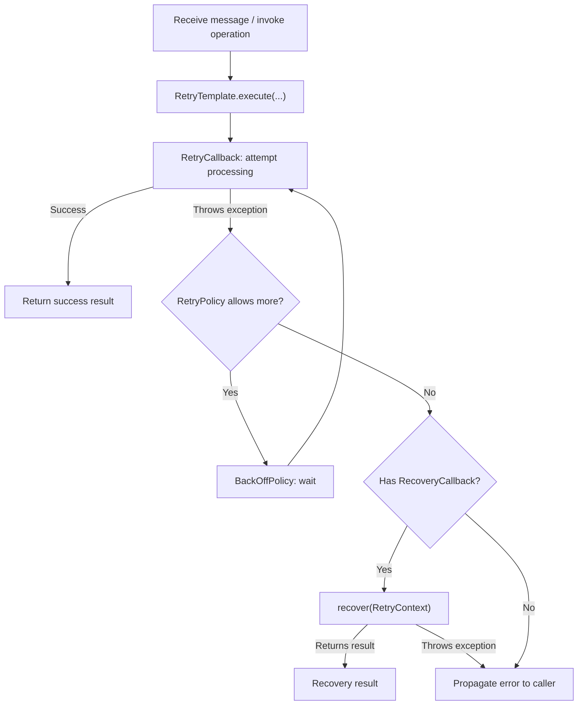
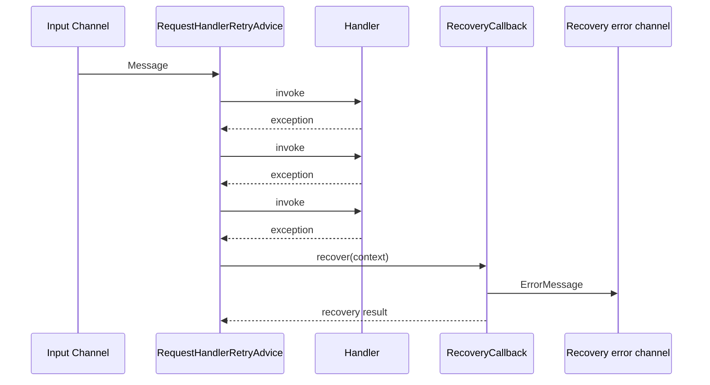
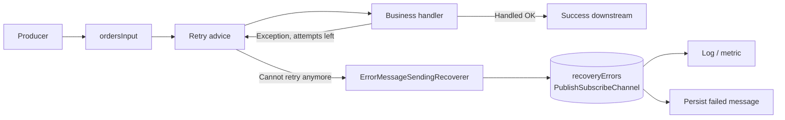
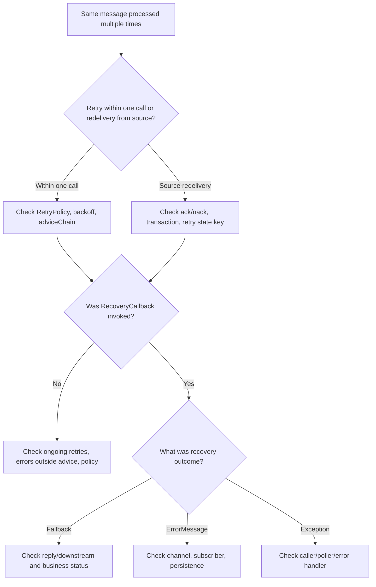

# RecoveryCallback After Retries Fail

In the **Spring Integration runtime**, a handler can fail transiently due to HTTP 503, a connection timeout, or a busy database. Bounded retries help the system ride through brief glitches without immediately routing the message to another flow. Once no more retries are possible, however, the runtime must decide: return a fallback result, record an error message for later processing, or throw the exception so the transaction or message source can perform its own recovery.

**Spring Retry's `RecoveryCallback`** is the decision point at the end of a retry sequence. Within the **Retries and recovery** chapter, this lesson explains how the callback works, how to combine it with `RetryTemplate` and Spring Integration's `RequestHandlerRetryAdvice`, and clarifies boundaries with error channels, pollers, executors, transactions, message stores, and correlation.

## 1. Where Does Retry End and Recovery Begin?

A single processing invocation can go through multiple attempts. After each exception, the retry policy checks whether another attempt is permitted; if so, the backoff policy schedules the wait and the callback runs again. When retrying can no longer continue, `RecoveryCallback` gets a chance to produce a result or handle the failure state.



In practice, the "cannot retry" branch can happen because **attempts are exhausted**, because the exception is classified as **non-retryable**, or because state/policy decides to stop. Thus `RecoveryCallback` is not limited to "failure on the Nth attempt." Moreover, errors occurring *outside the region protected by RetryTemplate* will not necessarily pass through this callback.

| Concept | Role | What it does not guarantee on its own |
| --- | --- | --- |
| `RetryCallback<T, E>` | Performs the repeatable operation | Does not define retry limits |
| `RetryPolicy` | Decides whether to continue or stop | Does not durably persist messages |
| `BackOffPolicy` | Governs the pause between attempts | Does not make execution asynchronous |
| `RetryContext` | Holds retry context, failure count, latest exception | Not equivalent to a transaction/acknowledgement |
| `RecoveryCallback<T>` | Runs when retries end without a successful result | Does not automatically re-queue from a queue/broker |

**Distinguishing outcomes:** retry succeeding means an attempt succeeded. Recovery "succeeding" only means the callback executed and returned a valid result under the API contract. If the callback merely logs and returns `null`, the original business operation has **not necessarily** completed.

## 2. Spring Retry API

The core types belong to `org.springframework.retry`. Below are condensed signatures showing how they fit together:

```java
// Condensed API sketch, not intended to be copied for compilation
interface RetryCallback<T, E extends Throwable> {
    T doWithRetry(RetryContext context) throws E;
}

interface RecoveryCallback<T> {
    T recover(RetryContext context) throws Exception;
}

// An important overload of RetryTemplate:
<T, E extends Throwable> T execute(
        RetryCallback<T, E> retryCallback,
        RecoveryCallback<T> recoveryCallback) throws E;
```

Inside `recover(RetryContext context)`, the two most useful pieces of information are:

- `context.getLastThrowable()`: the last exception recorded in the retry context; guard against `null` if the callback is called from a custom context.
- `context.getRetryCount()`: the retry/failure counter managed by Spring Retry. In standard stateless retry, you can inspect the counter after each failure; do not use it as a business ID or durable sequence number.

The callback can **return the same type `T`** as `RetryCallback`. For example, if an attempt returns `String`, recovery can return a `String` indicating "pending manual review." The callback can also throw an exception to signal "unrecoverable"; the caller/endpoint must then handle the failure.

Important note: the `@Recover` annotation commonly paired with Spring Retry's AOP-based `@Retryable` is a different declarative mechanism. Do not confuse a `@Recover` method with the `RecoveryCallback` interface passed directly to `RetryTemplate` or configured on `RequestHandlerRetryAdvice`.

## 3. Standalone Example: Retry Three Times, Then Fall Back

The example below uses **Spring Retry** and Java 17+ without setting up Spring Integration channels. The goal is to see precisely when `RecoveryCallback` is invoked.

```java
import java.util.concurrent.atomic.AtomicInteger;

import org.springframework.retry.backoff.FixedBackOffPolicy;
import org.springframework.retry.policy.SimpleRetryPolicy;
import org.springframework.retry.support.RetryTemplate;

public class RetryRecoveryDemo {
    public static void main(String[] args) {
        RetryTemplate template = new RetryTemplate();
        template.setRetryPolicy(new SimpleRetryPolicy(3));

        FixedBackOffPolicy backOff = new FixedBackOffPolicy();
        backOff.setBackOffPeriod(200L);
        template.setBackOffPolicy(backOff);

        AtomicInteger invocations = new AtomicInteger();

        String result = template.execute(
                context -> {
                    int attempt = invocations.incrementAndGet();
                    System.out.println("Attempt " + attempt);
                    throw new IllegalStateException("Remote service unavailable");
                },
                context -> {
                    Throwable last = context.getLastThrowable();
                    System.out.println("Recovery after "
                            + invocations.get() + " attempts");
                    System.out.println("Last error: "
                            + (last == null ? "unknown" : last.getMessage()));
                    return "PENDING_MANUAL_REVIEW";
                });

        System.out.println("Result: " + result);
    }
}
```

A typical run outputs:

```text
Attempt 1
Attempt 2
Attempt 3
Recovery after 3 attempts
Last error: Remote service unavailable
Result: PENDING_MANUAL_REVIEW
```

**`maxAttempts = 3` means at most three invocations total**, consisting of one initial attempt and up to two retries; not "one initial attempt plus three retries." With `FixedBackOffPolicy(200 ms)`, continuous failures typically incur two wait periods between calls. Actual elapsed latency also depends on callback execution time and JVM scheduling.

If the second attempt succeeds, `RecoveryCallback` **does not run**. If the recovery callback is omitted and all attempts fail, `RetryTemplate` normally throws the exception to the caller per the policy and exception type.

In production code, do not return the string `PENDING_MANUAL_REVIEW` to imply work was saved for manual handling. That status is only meaningful if the callback actually persisted the event into a **real recovery store** and verified the write succeeded.

## 4. How RecoveryCallback Differs from Further Retries, Rollback, and Error Channels

`RecoveryCallback` is an **end-of-retry-chain hook**. The following concerns must be configured separately:

| Requirement | What can `RecoveryCallback` do? | What else is needed? |
| --- | --- | --- |
| Return a fallback value | Return `T` in place of the missing result | Explicit contract so downstream knows this is a fallback |
| Send the error to a channel | Construct/delegate sending an `ErrorMessage` | `MessageChannel` and an error-handler subscriber |
| Persist the failed message | Write a record to DB/store/broker | Persistence, transactions, idempotency, and a replay plan |
| Request a rollback | Throw an exception to the calling context | Transaction manager and matching transaction boundary |
| Retry after a restart | Cannot accomplish this with the callback alone | Durable state/redelivery from the source and a recovery policy |

For instance, returning `null` from the callback may cause some endpoints to interpret that as **no reply**; if downstream requires a reply, that turns into another error. Likewise, returning a normal DTO may cause downstream to treat it as a successful result. When designing a fallback, consider a status-bearing type such as `Success`/`PendingReview`, or route into an error/recovery flow and terminate the branch intentionally.

There is no universal rule that "calling `RecoveryCallback` acks the message." Ack/nack behavior belongs to the source adapter or message broker and depends on the propagated error path, transaction, and listener configuration.

## 5. Combining with Spring Integration: RequestHandlerRetryAdvice

In Spring Integration, `RequestHandlerRetryAdvice` wraps **the handler call at a consumer endpoint** and uses `RetryTemplate` to re-invoke the processing step. Typical examples include a service activator making an HTTP request to an external system, or a handler calling a temporarily unavailable API.



`RequestHandlerRetryAdvice` sits at the **handler boundary**; it does not automatically wrap every upstream/downstream component. Retrying here re-invokes the handler with the current message, **not necessarily re-executing `receive()` from a queue**. Thus if a producer sent to a `QueueChannel`, retry advice on the consumer does not turn an in-RAM queue into a transaction that can undo dequeueing.

This is also why you should avoid stacking retries across multiple layers without controlling total attempts: an adapter retrying three times inside a handler wrapped by `RequestHandlerRetryAdvice` retrying three more times can trigger far more downstream calls than expected.

## 6. ErrorMessageSendingRecoverer: Routing Exhausted Retries to a Recovery Flow

Spring Integration provides `ErrorMessageSendingRecoverer` for use as a `RecoveryCallback`. This recoverer creates/sends an `ErrorMessage` to a configured `MessageChannel`, allowing final failures to enter a dedicated handling branch.

Typical flow:



**Java DSL configuration example with channels, advice, and error consumer.** Assumes Spring Integration and Spring Retry are on the classpath and classes are in a component-scanned package.

```java
import org.springframework.beans.factory.annotation.Qualifier;
import org.springframework.context.annotation.Bean;
import org.springframework.context.annotation.Configuration;
import org.springframework.integration.annotation.EnableIntegration;
import org.springframework.integration.annotation.ServiceActivator;
import org.springframework.integration.channel.DirectChannel;
import org.springframework.integration.channel.PublishSubscribeChannel;
import org.springframework.integration.dsl.IntegrationFlow;
import org.springframework.integration.handler.advice.ErrorMessageSendingRecoverer;
import org.springframework.integration.handler.advice.RequestHandlerRetryAdvice;
import org.springframework.messaging.Message;
import org.springframework.messaging.MessageChannel;
import org.springframework.messaging.MessagingException;
import org.springframework.messaging.support.ErrorMessage;
import org.springframework.messaging.support.MessageBuilder;
import org.springframework.retry.backoff.FixedBackOffPolicy;
import org.springframework.retry.policy.SimpleRetryPolicy;
import org.springframework.retry.support.RetryTemplate;
import org.springframework.stereotype.Component;

@Configuration
@EnableIntegration
class OrderRetryConfiguration {
    @Bean
    MessageChannel ordersInput() {
        return new DirectChannel();
    }

    @Bean
    MessageChannel recoveryErrors() {
        return new PublishSubscribeChannel();
    }

    @Bean
    RequestHandlerRetryAdvice orderRetryAdvice(
            @Qualifier("recoveryErrors") MessageChannel recoveryErrors) {

        RetryTemplate template = new RetryTemplate();
        template.setRetryPolicy(new SimpleRetryPolicy(3));

        FixedBackOffPolicy backOff = new FixedBackOffPolicy();
        backOff.setBackOffPeriod(200L);
        template.setBackOffPolicy(backOff);

        RequestHandlerRetryAdvice advice = new RequestHandlerRetryAdvice();
        advice.setRetryTemplate(template);
        advice.setRecoveryCallback(
                new ErrorMessageSendingRecoverer(recoveryErrors));
        return advice;
    }

    @Bean
    IntegrationFlow ordersFlow(
            @Qualifier("ordersInput") MessageChannel ordersInput,
            RequestHandlerRetryAdvice orderRetryAdvice) {

        return IntegrationFlow.from(ordersInput)
                .handle(String.class, (payload, headers) -> {
                    if (payload.startsWith("FAIL")) {
                        throw new IllegalStateException("Simulated HTTP 503");
                    }
                    return "PROCESSED:" + payload;
                }, endpoint -> endpoint.advice(orderRetryAdvice))
                .handle(message -> System.out.println(
                        "Success: " + message.getPayload()))
                .get();
    }
}

@Component
class RecoveryObserver {
    @ServiceActivator(inputChannel = "recoveryErrors")
    public void onError(ErrorMessage errorMessage) {
        Throwable cause = errorMessage.getPayload();

        Message<?> failed = null;
        if (cause instanceof MessagingException messagingException) {
            failed = messagingException.getFailedMessage();
        }
        if (failed == null) {
            failed = errorMessage.getOriginalMessage();
        }

        Object traceId = failed == null
                ? null
                : failed.getHeaders().get("traceId");
        System.err.println("Retries exhausted. traceId=" + traceId
                + ", cause=" + cause.getClass().getSimpleName());
        // In production, persist the recovery request with an explicit status.
    }
}
```

To feed a message into the flow, a producer component can inject `@Qualifier("ordersInput") MessageChannel` and call:

```java
ordersInput.send(MessageBuilder.withPayload("FAIL-42")
        .setHeader("traceId", "trace-42")
        .build());
```

In this example:

1. `DirectChannel` invokes the endpoint synchronously. `RequestHandlerRetryAdvice` executes the handler up to three times.
2. Each attempt processing `FAIL-42` throws an exception; after the last attempt, `ErrorMessageSendingRecoverer` receives the retry context.
3. The recoverer publishes an `ErrorMessage` to **`recoveryErrors`**, where `RecoveryObserver` reads the error and any traceable metadata from the failed/original message.
4. The downstream handler only receives a success result from normal execution when the payload does not start with `FAIL`.

**Do not assume this error goes to the global `errorChannel`:** the recoverer points explicitly to a channel named `recoveryErrors`. If you need the global channel, route the recoverer to that bean/channel or configure corresponding error handling. If the recovery subscriber itself throws, publishing can also fail; code must define clearly whether that still counts as recovered.

An error may be wrapped by `MessagingException` or an advice-level exception; therefore, the error consumer should safely handle cases where `getFailedMessage()`/`getOriginalMessage()` are absent and inspect the exception cause chain when classifying.

## 7. Writing a Custom RecoveryCallback

`ErrorMessageSendingRecoverer` is suitable when forwarding failed messages to an error flow. If the business requirement is "mark the order for review after retries are exhausted," you can implement a custom callback. Conceptual example:

```java
import org.springframework.retry.RecoveryCallback;
import org.springframework.retry.RetryContext;

record ProcessingResult(String status, String detail) {}

RecoveryCallback<ProcessingResult> recovery = (RetryContext context) -> {
    Throwable last = context.getLastThrowable();

    // recoveryRepository.savePendingReview(
    //     orderId, correlationId, last, context.getRetryCount());
    // Return PENDING only after persisting recovery state succeeds.

    String reason = last == null ? "UNKNOWN" : last.getClass().getSimpleName();
    return new ProcessingResult("PENDING_REVIEW", reason);
};
```

*This snippet illustrates only the callback; `recoveryRepository`, `orderId`, and `correlationId` must be provided in a real application.* If this callback is used in a plain `RetryTemplate.execute(...)` call, `ProcessingResult` is returned to the caller. If attached to a Spring Integration advice, the return type and semantics also depend on the wrapped handler/endpoint.

A callback can follow one of three strategies:

| Strategy | Implementation | Runtime meaning |
| --- | --- | --- |
| **Valid fallback** | Return a DTO with fallback data/status | Flow can continue; must distinguish from true success |
| **Route to recovery flow** | Send an `ErrorMessage` or persist a durable record, then finish | Error path has an explicit receiver |
| **Unrecoverable here** | Throw a contextual exception | Caller/poller/broker decides rollback, redelivery, or error reporting |

Avoid overly heavy work inside the callback: when stateless retry runs synchronously, the callback also typically executes on the handler's current thread. Slow DB writes, alerting HTTP calls, or broker waits can prolong how long poller/executor threads are held and increase backlog.

## 8. Retry Context vs. Original Message: Do Not Confuse the Two States

`RetryContext` holds **the state of the retry algorithm**: attempts, last exception, and custom attributes. `Message<?>` holds **message flow data**: payload, headers, message ID, and correlation keys. They relate to each other but are not interchangeable.

| Data | Where typically found | What it is used for |
| --- | --- | --- |
| Last exception | `RetryContext.getLastThrowable()` | Classify recoverable vs. permanent errors |
| Failure count in context | `RetryContext.getRetryCount()` | Analyze attempt count within one retry cycle |
| Business ID | Payload or business header | Identify the work item for reprocessing |
| `traceId`/`correlationId` | Message headers propagated through the flow | Link logs and distributed processing |
| Failed message | `MessagingException.getFailedMessage()` or original message if available | Recover original data for audit/replay |
| Durable recovery state | Dedicated DB/message store/broker | Track retries across crashes, quarantine, replay |

With `ErrorMessageSendingRecoverer`, a consumer receiving `ErrorMessage` can trace back to the failed message via the exception chain or the original message if included by the publisher. Do not assume every `Throwable` carries the original message or that headers are copied intact onto the error message.

When persisting a recovery record, include at least: `businessKey` (e.g., `orderId`), `correlationId`, handler/source name, error code, attempt count, timestamp, status (PENDING/RETRYING/RESOLVED/FAILED), and minimal data needed to replay in compliance with security policies.

## 9. How Stateless and Stateful Retry Affect When Recovery Runs

The two retry styles differ in state retention and redelivery mechanics:

| | Stateless retry | Stateful retry |
| --- | --- | --- |
| Retry state | Typically confined to a single `execute` call | Can link multiple invocations via a retry key and context cache |
| Attempts | Executed consecutively within the same call context | Can span multiple message redeliveries |
| Source redelivery | Not required to try again within one turn | Typically requires a source with appropriate redelivery/transactions |
| Risks | Holding threads, repeating side effects | Requires a stable key, eviction/cache care, and exact redelivery mechanics |
| Recovery | When retries cannot continue in that call | Can be decided based on context kept across redeliveries |

`RequestHandlerRetryAdvice` supports configuring retry state in appropriate scenarios. Stateful retry **does not turn an in-memory `QueueChannel` into a transactional resource**. It is meaningful only when the source/adapter can redeliver the corresponding message (e.g., a broker with properly configured redelivery and transactions/acks). The retry state key must be stable; using a message ID regenerated on every message construction breaks attempt correlation across deliveries.

Note that when a recovery callback returns normally: if you rely on an exception escaping to trigger rollback and redelivery, "swallowing the error" alters the transaction outcome. Verify final state by testing with the real source adapter.

## 10. Transactions, Idempotency, and Side Effects

Suppose a handler performs:

```text
Receive OrderPlaced -> write DB -> call payment API -> emit completion event
                                        \
                                         \-- payment API times out
```

If the payment API times out after actually charging funds, retrying the entire handler can cause **duplicate side effects**. `RecoveryCallback` only runs once attempts fail; it does not automatically undo side effects produced by earlier attempts.

Common safeguards:

- **Stable idempotency key:** use `orderId` or a payment request key supported downstream; never generate a new key per attempt.
- **Explicit transaction boundaries:** only resources enlisted in the transaction can roll back; external HTTP calls are normally outside a local DB transaction.
- **Check state before replay:** when a failure leaves an ambiguous outcome, query transaction status before re-sending.
- **Outbox/inbox or durable recovery records:** when events must not be lost, persist them structurally and process via a dedicated retry workflow.

For example, successfully writing `"PENDING_REVIEW"` and returning normally can tell the outer layer the handler completed. That is sound if the business accepts a pending state; it is wrong if the broker was supposed to keep the message for automatic redelivery. Outcomes must align across retry, recovery callback, transaction manager, and source adapter.

## 11. Classifying Errors Before Deciding Recovery

A safe design does not retry everything alike:

| Error | Should you retry? | Final recovery |
| --- | --- | --- |
| HTTP 503/429, transient timeouts | Bounded; appropriate backoff (honor `Retry-After` if applicable) | Pending/durable retry queue, alert if prolonged |
| Transient database deadlock | May retry the appropriate transaction unit | Record error and route to operations handling |
| Invalid payload schema | Usually no | Quarantine, fix data, avoid hot retries |
| Missing required header | Usually no | Report validation error and persist message with reason |
| Ambiguous payment outcome | Do not retry blindly | Query status, enforce idempotency, reconcile |
| Programming bug exception | Do not expect self-healing | Alert, investigate, avoid infinite retry loops |

With Spring Retry, `RetryPolicy` classifies exceptions and sets exact attempt counts; `BackOffPolicy` sets wait intervals. In the minimal `SimpleRetryPolicy(3)` example, many exception types are retried; production configurations should narrow down to recoverable exceptions.

If the policy marks an exception as **non-retryable**, recovery can run without exhausting maximum attempts; exact behavior depends on the policy, retry state, and how the callback is attached. Log the stop reason so "recovered after 1 non-retryable error" is not mistaken for "retried 3 times."

## 12. Pollers, Executors, and Recovery Failures

The same `RecoveryCallback` can have different runtime impacts:

| Flow | Where advice/callback typically runs | When callback throws an exception |
| --- | --- | --- |
| `DirectChannel`, synchronous handler | Producer/caller thread | Error can propagate back to `send()`/gateway |
| `QueueChannel` + polling consumer | Poller or configured executor thread | Error is handled in the poller/error-handler context |
| `ExecutorChannel` or async handler | Assigned worker thread | Error is observed at the worker and async error handling |

Synchronously, three attempts taking one second each plus backoff can block `send()` for several seconds. With a poller, slow retries reduce queue drain rate and build backlog; with an executor, they tie up workers and can trigger rejected tasks when the pool saturates.

**Failures inside `RecoveryCallback`** are operational failures too: if the database storing failed messages loses connectivity and the callback throws, the outer layer still has to decide what to do. Never let the callback silently return `"RECOVERED"` when persisting the recovery record failed.

## 13. Observability and Diagnostics

To distinguish ongoing retries from completed recovery, track these milestones:

1. **Attempt started/completed:** timestamp, exception type, attempt number, handler/endpoint.
2. **Retry decision:** continuing or stopped, and whether due to exhausted attempts or a non-retryable exception.
3. **Recovery invoked:** which callback ran, and whether it returned a fallback, published an `ErrorMessage`, wrote to a store, or threw.
4. **Delivery outcome:** whether downstream received the fallback or the error channel received the `ErrorMessage`, and whether its subscriber succeeded.
5. **Business outcome:** message succeeded, awaiting replay, permanently rejected, or requires reconciliation.



Attach a `correlationId` or stable business key on the inbound message and record that same identifier in attempt logs and recovery records. Metrics counting raw exceptions will **double-count** attempts of the same message; separate counters for "attempt failed," "message permanently failed," and "recovered successfully."

## 14. Common Mistakes When Using RecoveryCallback

| Mistake | Consequence | Fix |
| --- | --- | --- |
| Interpreting `maxAttempts=3` as three retries plus the initial attempt | Calls downstream more times than expected | Compute total attempts and backoff explicitly |
| Omitting recovery callback while assuming errors go to global `errorChannel` | Exception may propagate to caller/other error handler | Configure `ErrorMessageSendingRecoverer` or appropriate error path |
| Callback logs and returns `null` as if the message succeeded | No durable recovery; downstream may miss a required reply | Define explicit outcome; persist or throw as required |
| Retrying schema errors or permanent authorization failures | Wastes threads, causes log storms | Classify exceptions via `RetryPolicy` |
| Callback performs slow I/O on a poller thread | Backlog grows, throughput drops | Avoid blocking; consider a controlled recovery queue |
| Automatically retrying a handler with non-idempotent side effects | Creates duplicate records/payments | Idempotency keys, transactions, and status checks |
| Using `retryCount` as a business ID or omitting correlation | Hard to trace and replay the right message | Persist business key and stable correlation headers |
| Assuming sending `ErrorMessage` makes the broker ack/nack as desired | Delivery/rollback behaves unexpectedly | Test with the actual adapter, broker, and transaction setup |

## 15. Hands-On Labs

**Lab 1 — Fallback after three attempts.** Run the `RetryTemplate` example in section 3. Make all three attempts throw, then change it so "attempt two succeeds." Compare how many times the retry callback and recovery callback actually run. Explain why backoff only occurs between attempts.

**Lab 2 — Distinguishing permanent vs. transient failures.** Create a policy that retries only transient HTTP errors. Send two error types: a simulated 503 and a payload validation error. Record attempt counts and stop reasons for each case; verify recovery can be invoked immediately on non-retryable errors if configured by the policy/callback.

**Lab 3 — Recovery error channel.** Use `RequestHandlerRetryAdvice` and `ErrorMessageSendingRecoverer` as in section 6. Send message `FAIL-42` with a `traceId`. Subscribe two consumers to `recoveryErrors`: logging and an in-memory counter. Verify subscribers are invoked for the **final outcome** rather than once per attempt; inspect exception types and how to retrieve the failed message.

**Lab 4 — Changing the runtime channel.** Change `ordersInput` from `DirectChannel` to `QueueChannel` and add a poller to the handler. Measure threads, send latency, backlog, and when recovery occurs. Explain why retry logic stays unchanged while where exceptions are handled shifts.

**Lab 5 — Crash resilience.** Simulate writing a recovery record to a DB, then stop the application before replay. Verify the record survives restart and only one worker picks it up for reprocessing using a business idempotency key. Contrast this with a callback that only logs or stores in RAM.

## 16. Self-Check Questions

1. When is `RecoveryCallback` invoked? → When `RetryTemplate` cannot continue retrying under its policy and a recovery callback is provided; typically after exhausting attempts, or on a non-retryable error.
2. What does `maxAttempts=3` mean? → At most three managed invocations, including the initial attempt.
3. What does `RetryContext.getLastThrowable()` contain? → The last exception recorded in the retry context, if present.
4. How do you route handler errors to a channel after retries exhaust in Spring Integration? → Configure `RequestHandlerRetryAdvice` with an `ErrorMessageSendingRecoverer` pointing to the error channel.
5. Does a recovery callback returning normally mean business processing succeeded? → No; the callback may have returned a fallback or published an error record.
6. Does retrying on an in-memory `QueueChannel` undo dequeuing when a handler fails? → No; inspect transactions, stores, and the specific source redelivery setup.
7. How do you prevent duplicate side effects when retrying? → Use a stable idempotency key, appropriate transaction boundaries, and status checks when external outcomes are uncertain.

**Remember:** `RecoveryCallback` is the handling point when **the retry sequence fails to produce a successful outcome**. In Spring Integration, attach the callback to the right handler advice, choose clearly between fallback and an error flow, and verify transactions, ack/redelivery, message stores, correlation, and runtime state. Only when the final outcome is intentionally persisted and observed does recovery become a reliable part of the message flow.
