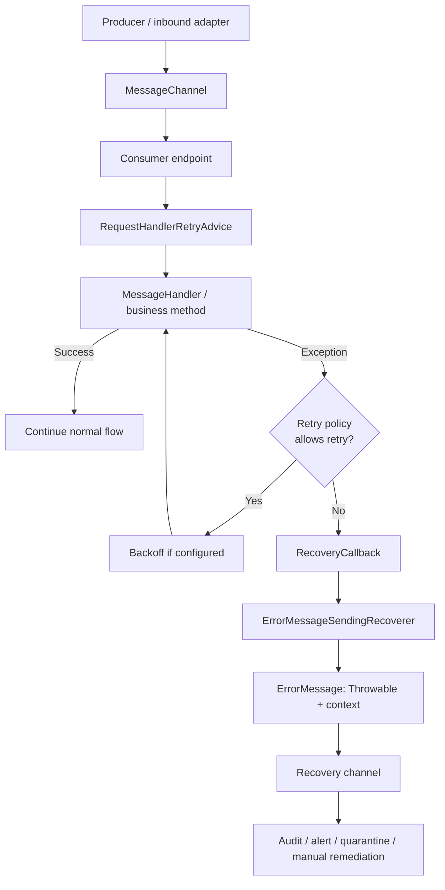

# ErrorMessageSendingRecoverer: Publishing ErrorMessage When Retries Exhaust

## 1. Why Is ErrorMessageSendingRecoverer Needed?

In **Spring Integration Runtime**, messages flow through a `MessageChannel`, are received by a consumer endpoint, and are passed to a `MessageHandler` or business method. When a handler calls a database, HTTP API, payment system, or another broker, transient errors may require retrying a message. Once the allowed attempts are exhausted, however, the flow needs an explicit **recovery policy**.

**`ErrorMessageSendingRecoverer`** in `org.springframework.integration.handler.advice` is a `RecoveryCallback<Object>` for the retry mechanism. Once retries exhaust, it **constructs an `ErrorMessage` carrying the final exception and publishes it to a message channel**, allowing another flow to log, alert, persist a failure record, or route to manual remediation.

This topic belongs to the **Retries and recovery** chapter of the `SPRING_INTEGRATION_RUNTIME` module. It relates to operating channels, endpoints, consumers, pollers, and executors, and has practical effects on lifecycle, transactions, retries, message stores, correlation, errors, threading, and performance.

This lesson focuses on Spring Integration **6.x** and configuring `RequestHandlerRetryAdvice` with **Spring Retry 2.x**. Some retry APIs changed in newer Spring Integration lines, so verify against the API of the version you are running.

**After this lesson, you will:**

1. Understand when the recovery callback runs and how it differs from an ordinary error handler.
2. Configure `RequestHandlerRetryAdvice` with `ErrorMessageSendingRecoverer` and a recovery channel.
3. Extract the exception, failed/original message, and correlation via `ErrorMessage`.
4. Distinguish exhausted retries, stateful redelivery, transaction rollback, and successfully handled messages.
5. Diagnose scenarios where recovery messages do not appear, appear duplicated, or go to the wrong channel.

## 2. Position in the Error-Handling Pipeline



**Role breakdown:**

| Component | Practical role |
|---|---|
| `RequestHandlerRetryAdvice` | Wraps message handler invocation, triggers retries per policy, and invokes callback on exhaustion |
| `RetryTemplate` / `RetryPolicy` / `BackOffPolicy` | Decides whether to retry, total attempt count, and wait duration |
| `ErrorMessageSendingRecoverer` | After retries exhaust, publishes an error event for a recovery flow to handle |
| `ErrorMessagePublisher` | Superclass providing the mechanism to construct and send `ErrorMessage` |
| `ErrorMessageStrategy` | Builds `ErrorMessage` from `Throwable` and context, optionally attaching the original message |
| Recovery `MessageChannel` | Destination for error events, e.g., a `QueueChannel` or `PublishSubscribeChannel` |
| Recovery consumer | Decides whether to persist the failure, alert, quarantine, or request intervention; the framework does not do this automatically |

`ErrorMessageSendingRecoverer` **does not re-run the handler one more time**, **does not move messages to a dead-letter queue by default**, and **does not automatically make a transaction succeed**. Its job is to publish an error event once the retry mechanism has decided to stop.

## 3. ErrorMessageSendingRecoverer API

### 3.1. Package Location and Contract

Fully qualified name:

```java
org.springframework.integration.handler.advice.ErrorMessageSendingRecoverer
```

This class:

- Extends `org.springframework.integration.core.ErrorMessagePublisher`.
- Implements `org.springframework.retry.RecoveryCallback<Object>`.
- Provides `Object recover(RetryContext context)`, invoked by the retry infrastructure after exhaustion.
- Has existed since Spring Integration 2.2; extended constructors/strategies were added in later releases.

Useful constructors:

```java
new ErrorMessageSendingRecoverer()
new ErrorMessageSendingRecoverer(MessageChannel recoveryChannel)
new ErrorMessageSendingRecoverer(
        MessageChannel recoveryChannel,
        ErrorMessageStrategy errorMessageStrategy)
```

| Constructor | Result |
|---|---|
| No-arg | Uses the default `errorChannel`; suitable when intentionally targeting the global error flow |
| Taking `MessageChannel` | Sends errors directly to the supplied channel |
| Taking channel and `ErrorMessageStrategy` | Uses a custom `ErrorMessage` construction strategy, or the default if strategy is `null` |

Using the **channel-accepting constructor** keeps boundaries clear: endpoint retries exhausted → recovery channel → recovery consumer. Give it a dedicated name, such as `orders.recovery`, to avoid mixing retry-exhausted events with general application async errors.

### 3.2. ErrorMessage Differs from a Request Message

`ErrorMessage` is a `Message<Throwable>` in Spring Messaging:

```java
ErrorMessage error = ...;

Throwable lastFailure = error.getPayload();
Message<?> original = error.getOriginalMessage();
```

- The **payload** of `ErrorMessage` is a `Throwable`; it may be a `MessagingException` wrapping a business error.
- **Original message** may be populated from context if `ErrorMessageStrategy` receives the input message.
- If the throwable is a `MessagingException`, `getFailedMessage()` may also provide the failing message.

Never assume the exception always has the exact same class as the original service exception. The framework may wrap errors in `MessageHandlingException` or another `MessagingException` depending on where in the flow the error occurred.

### 3.3. Role of ErrorMessageStrategy

`DefaultErrorMessageStrategy` builds an `ErrorMessage` from a throwable and an `AttributeAccessor`. When the context contains the request message under `ErrorMessageUtils.INPUT_MESSAGE_CONTEXT_KEY`, the strategy can populate `ErrorMessage.originalMessage`.

```java
import org.springframework.integration.support.DefaultErrorMessageStrategy;
import org.springframework.integration.handler.advice.ErrorMessageSendingRecoverer;

ErrorMessageSendingRecoverer recoverer =
        new ErrorMessageSendingRecoverer(
                recoveryChannel,
                new DefaultErrorMessageStrategy());
```

This example only shows the extension point; without special needs, the single-argument constructor already uses the default strategy.

If extra headers are needed for alerting/tracing, you can implement a custom `ErrorMessageStrategy`. However, **preserve traceability to the original/failed message** while avoiding attaching sensitive data wholesale to the error event.

## 4. Combining RequestHandlerRetryAdvice and the Recovery Callback

Core configuration pattern:

```java
RequestHandlerRetryAdvice advice = new RequestHandlerRetryAdvice();
advice.setRecoveryCallback(
        new ErrorMessageSendingRecoverer(recoveryChannel));
```

`RequestHandlerRetryAdvice` inserts retry around the advised `MessageHandler` invocation. It does not automatically retry all handlers or the entire integration flow. In annotation-based configuration, you can attach the retry advice bean with `@ServiceActivator(adviceChain = "ordersRetryAdvice")`.

Without a configured `RecoveryCallback`, the exception after retries exhaust is normally **rethrown** up the call stack; in async or polling flows, the endpoint's error handler can route it to an error channel. With `ErrorMessageSendingRecoverer`, the final failure triggers the callback to **actively publish an `ErrorMessage`**.

**Important consequence:** if publishing recovery succeeds and the callback completes normally, the original failure may be treated as **recovered at the advice layer** and stop propagating as before. This **does not mean the business operation succeeded**. If the caller/broker must know about the failure to roll back or redeliver, design matching transaction and acknowledgement semantics rather than assuming a recovery channel behaves like rethrowing.

### 4.1. Total Attempts and Backoff

With Spring Retry's `SimpleRetryPolicy(3)`, the limit is **3 executions including the initial attempt**: 1 initial attempt and up to 2 retries. Do not confuse "3 attempts" with "3 retries after the initial attempt."

`BackOffPolicy` controls the wait time between attempts. For example, `FixedBackOffPolicy` waits a fixed 100 ms; `ExponentialBackOffPolicy` scales the wait interval by a multiplier. Stateless retry backoff typically keeps the message-processing thread waiting, affecting concurrency and throughput.

### 4.2. Do Not Retry Every Error Unconditionally

A permissive default retry policy can repeat **unrecoverable** errors, such as malformed payloads or missing required headers. In production, classify exceptions:

- **Potentially transient:** connection timeouts, 503 service unavailable, rate limits, retryable DB deadlocks, resource busy.
- **Usually non-retryable:** invalid data, schema violations, permanent auth rejection, misconfigured channels.
- **Business-dependent:** conflicts, optimistic locking, duplicate requests.

Spring Integration sometimes wraps business exceptions inside `MessagingException`; when classifying by exception type, configure cause-chain traversal so wrappers do not fool the policy.

## 5. Runnable Java Example: Retry Three Times Then Receive ErrorMessage

This example uses **Spring Integration 6.x + Spring Retry 2.x + Java 17+**; it requires `spring-integration-core`, `spring-retry`, and corresponding Spring Context modules. We create a `DirectChannel` for requests and a `QueueChannel` for recovery so we can read the `ErrorMessage` in the test.

### 5.1. Configure Channels and Retry Advice

```java
import org.springframework.beans.factory.annotation.Qualifier;
import org.springframework.context.annotation.Bean;
import org.springframework.context.annotation.Configuration;
import org.springframework.integration.channel.DirectChannel;
import org.springframework.integration.channel.QueueChannel;
import org.springframework.integration.config.EnableIntegration;
import org.springframework.integration.handler.advice.ErrorMessageSendingRecoverer;
import org.springframework.integration.handler.advice.RequestHandlerRetryAdvice;
import org.springframework.messaging.MessageChannel;
import org.springframework.retry.backoff.FixedBackOffPolicy;
import org.springframework.retry.policy.SimpleRetryPolicy;
import org.springframework.retry.support.RetryTemplate;

@Configuration
@EnableIntegration
class RecoveryDemoConfig {

    @Bean("orders.in")
    MessageChannel ordersIn() {
        return new DirectChannel();
    }

    @Bean("orders.recovery")
    QueueChannel recoveryQueue() {
        return new QueueChannel();
    }

    @Bean("ordersRetryAdvice")
    RequestHandlerRetryAdvice ordersRetryAdvice(
            @Qualifier("orders.recovery") MessageChannel recoveryChannel) {

        RetryTemplate retryTemplate = new RetryTemplate();
        retryTemplate.setRetryPolicy(new SimpleRetryPolicy(3));

        FixedBackOffPolicy backoff = new FixedBackOffPolicy();
        backoff.setBackOffPeriod(100L);
        retryTemplate.setBackOffPolicy(backoff);

        RequestHandlerRetryAdvice advice = new RequestHandlerRetryAdvice();
        advice.setRetryTemplate(retryTemplate);
        advice.setRecoveryCallback(
                new ErrorMessageSendingRecoverer(recoveryChannel));
        return advice;
    }

    @Bean
    FailingOrderService failingOrderService() {
        return new FailingOrderService();
    }
}
```

Every channel bean uses an **explicit name**. The recoverer constructor takes `orders.recovery` directly, not the request's `replyChannel` address. `QueueChannel` is used here for hands-on verification; this in-memory queue is not a durable production DLQ solution.

### 5.2. Handler That Always Throws

```java
import java.util.concurrent.atomic.AtomicInteger;
import org.springframework.integration.annotation.ServiceActivator;

class FailingOrderService {

    private final AtomicInteger attempts = new AtomicInteger();

    @ServiceActivator(
            inputChannel = "orders.in",
            adviceChain = "ordersRetryAdvice")
    public void process(String orderId) {
        int current = attempts.incrementAndGet();
        System.out.println("Attempt " + current + " for " + orderId);
        throw new IllegalStateException("Backend unavailable");
    }

    public int attempts() {
        return attempts.get();
    }
}
```

The method fails on all three attempts; once the policy refuses further attempts, the callback sends an `ErrorMessage` to the recovery channel. Because the method is `void` and the recovery callback handles failure by publishing an event, this demo flow produces no **normal reply**.

### 5.3. Send a Request and Read the Recovery Event

```java
import org.springframework.context.annotation.AnnotationConfigApplicationContext;
import org.springframework.integration.channel.QueueChannel;
import org.springframework.messaging.Message;
import org.springframework.messaging.MessageChannel;
import org.springframework.messaging.MessagingException;
import org.springframework.messaging.support.ErrorMessage;
import org.springframework.messaging.support.MessageBuilder;

public class RecoveryDemo {

    public static void main(String[] args) {
        try (var context = new AnnotationConfigApplicationContext(
                RecoveryDemoConfig.class)) {

            MessageChannel input =
                    context.getBean("orders.in", MessageChannel.class);
            QueueChannel failures =
                    context.getBean("orders.recovery", QueueChannel.class);

            Message<String> request = MessageBuilder
                    .withPayload("ORD-42")
                    .setHeader("traceId", "trace-42")
                    .build();

            input.send(request);

            Message<?> recovered = failures.receive(2_000);
            if (!(recovered instanceof ErrorMessage error)) {
                throw new AssertionError("Expected ErrorMessage on recovery channel");
            }

            Throwable failure = error.getPayload();
            System.out.println(failure.getClass().getName());
            System.out.println(failure.getMessage());

            Message<?> original = error.getOriginalMessage();
            if (original != null) {
                System.out.println(original.getPayload()); // ORD-42
                System.out.println(original.getHeaders().get("traceId"));
            }

            if (failure instanceof MessagingException me
                    && me.getFailedMessage() != null) {
                System.out.println(
                        "Failed payload: " + me.getFailedMessage().getPayload());
            }

            System.out.println(
                    context.getBean(FailingOrderService.class).attempts()); // 3
        }
    }
}
```

**Expected observation:** three lines `Attempt 1`, `Attempt 2`, `Attempt 3`; 100 ms waits between attempts; then one `ErrorMessage` event on `orders.recovery`. The exception type in the payload may be a wrapper and `originalMessage` depends on context/strategy, so the example checks for `null` first.

Execution path diagram in the demo:

```text
send("ORD-42")
  └─ orders.in (DirectChannel)
      └─ @ServiceActivator + RequestHandlerRetryAdvice
          ├─ attempt 1 -> exception
          ├─ wait 100 ms
          ├─ attempt 2 -> exception
          ├─ wait 100 ms
          └─ attempt 3 -> exception
              └─ ErrorMessageSendingRecoverer
                  └─ orders.recovery (QueueChannel)
                      └─ receive() -> ErrorMessage
```

Control check: modify the handler to throw only on the **first two attempts** and finish normally on the third. Then retry succeeds, the callback **is not invoked**, and the recovery queue receives no `ErrorMessage`. This is a vital check to distinguish "retry occurred" from "recovery occurred."

## 6. When Is an ErrorMessage Created?

**Not every exception creates an event via this recoverer.** Only failures within the handler call wrapped by the advice, eligible for retry evaluation and then entering the recovery branch, trigger the callback.

| Scenario | Expected behavior |
|---|---|
| Handler succeeds immediately | No retry, no recovery event |
| Handler fails then succeeds on next attempt | Retries stop on success, no recovery event |
| Handler keeps failing until policy stops | Recovery callback is triggered |
| Advice not attached to endpoint/handler | Recoverer does not participate in handling |
| Advice present but no recovery callback configured | Once retries exhaust, exception may propagate to caller |
| Policy marks error as non-retryable | May jump to recovery per policy without waiting for max attempts |
| Recovery channel cannot receive message | Recovery publish failure may continue propagating to caller/error handler |
| Handler fails after the advised step | Errors outside advice scope are not handled by this callback |

Specifically, **publishing `ErrorMessage` does not guarantee a consumer has completed recovery processing**. For instance, a `QueueChannel` may receive the message, yet if nothing polls it, the error sits in the queue. If the application shuts down and the queue is in-memory, the event can be lost.

## 7. Distinguishing a Recovery Channel from a General Error Channel

Spring Integration has error-handling mechanisms tied to **threading and endpoints**:

- With a synchronous `DirectChannel`, exceptions normally propagate back to the sender on the same thread.
- With an `ExecutorChannel` or poller task, errors cannot be thrown directly back to a producer thread that already returned; the framework can wrap them into an `ErrorMessage` and publish to the `errorChannel` header or the global `errorChannel`.
- A poller scheduler with `MessagePublishingErrorHandler` can handle task failures and publish an `ErrorMessage`.

`ErrorMessageSendingRecoverer` is a different path: it is **invoked explicitly inside retry advice** when retries exhaust. With `new ErrorMessageSendingRecoverer(recoveryChannel)`, the error destination is **the supplied channel**, not the request's `replyChannel` by default.

| Mechanism | When triggered | Destination | Who decides? |
|---|---|---|---|
| `RequestHandlerRetryAdvice` + recoverer | Handler exhausted retry chances | Recovery channel passed to recoverer, or default global error channel | Advice/recoverer configuration |
| Executor/poller error handler | Exception escapes async/poll task | `errorChannel` header or global error channel per handler mechanics | Endpoint, error handler, request headers |
| Exception thrown on `DirectChannel` | Exception not handled by recovery | Caller on the call stack | Synchronous semantics |
| Normal business reply | Handler returns non-null value | `outputChannel`/`replyChannel` per reply flow | Handler/endpoint |

**Avoid accidentally configuring two paths to emit recovery events for the same failure.** Once the recovery callback "swallows" the failure by publishing an event, an outer async error handler typically no longer sees that error. Only if publishing the recovery event itself fails might an outer error handler see a new exception. Design one clear primary failure path.

## 8. Designing the Consumer Receiving ErrorMessage

The recovery channel only transports events. A downstream consumer must enforce a business-appropriate handling policy:

1. Read the throwable and root cause, keeping trace ID/correlation ID if present.
2. Locate the original/failed message (if available) and business key, e.g., `orderId`.
3. Classify the failure: unrecoverable data error, infrastructure error, security error, configuration error.
4. Persist a failure record with an explicit status, such as `REQUIRES_REVIEW`, or publish to a durable DLQ.
5. Emit appropriate metrics/alerts; let operators verify and actively replay in a controlled way.

Example consumer for the exercise:

```java
import org.springframework.integration.annotation.ServiceActivator;
import org.springframework.messaging.support.ErrorMessage;

public class RecoveryAuditHandler {

    @ServiceActivator(inputChannel = "orders.recovery")
    public void audit(ErrorMessage error) {
        Throwable cause = error.getPayload();
        System.err.println("Retry exhausted: " + cause.getClass().getSimpleName());
        // Production: write a safe audit record or publish to a durable DLQ.
    }
}
```

**Choose one way to consume the queue in the demo:** either call `receive()` manually as in section 5, **or** configure a consumer/poller on `orders.recovery`. Do not call `receive()` while also registering a competing consumer and expect both to receive the same message.

### Avoiding Blind Replay and Sensitive Data Exposure

`ErrorMessage` can contain stack traces, headers, the original message, and payloads. When sending to external alerting or a DLQ, mask PII, tokens, and unnecessary data; restrict access. Recovery records should retain stable business identity and attempt metadata while avoiding hard-to-serialize Java objects like channel instances in headers.

**Replay** is a new business action: verify target state, data version, and idempotency protections; the recoverer never replays automatically.

## 9. Retry and Recovery in Stateless vs. Stateful Models

### 9.1. Stateless Retry

In stateless retry, retry advice re-invokes the handler within the same message turn. Backoff intervals usually happen **on that thread**, so:

- `DirectChannel`: caller `send()` duration grows with retry count and backoff.
- `ExecutorChannel`: worker threads stay occupied while retrying/sleeping; executor queues fill easily under load.
- Polling consumer: one poll cycle can take a long time, lowering the rate of processing subsequent messages.
- Transactions: if the advice runs inside a transaction boundary or wraps a transaction advice, rollback outcomes differ. **Advice order matters**.

With `N` attempts, minimum duration is roughly the sum of handler execution times across those attempts plus backoff intervals; size gateway and poller timeouts accordingly.

### 9.2. Stateful Retry

Stateful retry retains retry state under a **stable message key**; failures may be thrown outward so the message source redelivers after rollback/nack. Subsequent attempts continue across separate message deliveries rather than inside one call stack. Exact stateful configuration depends on the `RequestHandlerRetryAdvice` version and broker/inbound adapter mechanics, so **do not copy a stateless configuration and assume it becomes stateful**.

To design stateful retry:

- The inbound source must genuinely support **redelivery**.
- The retry identity key must remain stable for the same logical message.
- Define how the state cache expires, evicts, or behaves if a message is never redelivered.
- When exhaustion triggers recovery, decide acknowledgement/rollback behavior after the callback. Successfully publishing an error does not automatically mean you want to ack the source message.

If the source does not redeliver, later retries will not happen on their own just because the advice holds state.

## 10. Transactions, Idempotency, and Guarantee Limits

Suppose a handler calls a payment service that records a transaction, yet an exception occurs before returning the response. Retrying can invoke the payment again; once retries exhaust, the recoverer publishes an `ErrorMessage`. At that point, **you cannot deduce the transaction completely failed** solely from the retry-exhausted event.

Keep these boundaries clear:

- **Transaction boundaries:** transactions are thread-bound; crossing an executor/poller usually drops the caller's transaction context. Rolling back a local DB does not roll back work committed in an external system.
- **Advice ordering:** retry wrapping transaction advice behaves differently from transaction wrapping retry; each attempt may run in its own transaction or share one, depending on wiring.
- **At-least-once:** broker redelivery, retries, and manual replay can execute the same business action multiple times.
- **Recovery callback is a separate side effect:** emitting the recovery event can succeed or fail independently of the original operation.
- **Idempotency:** use `orderId`/request ID and processed-state tracking; apply inbox/outbox or unique constraints where needed.

A common strategy is **bounded transient retry → publish correlated failure event → record final state → intentional replay**. To guarantee failure events are not lost, pick durable channels/storage and design transactions appropriately; an in-RAM `QueueChannel` provides no such guarantee.

## 11. Runtime Observability: Logs, Metrics, Tracing, and Performance

Recommended measurements:

| Metric / field | Meaning |
|---|---|
| `messageId` and business/correlation ID | Links requests to attempts and recovery events |
| `retryCount` or actual attempt count | Verifies the retry policy is active and bounded |
| Handler duration per attempt | Distinguishes slow upstream calls from slow backoff |
| Backoff elapsed time | Total worker sleep time prior to exhaustion |
| Recovery publish duration and error channel depth | Shows whether events are delivered or backing up |
| Endpoint lifecycle and executor queue | Identifies bottlenecks when channels/consumers stop or workers saturate |
| Retry recovered / eventual success rate | Evaluates whether the retry policy helps or just burns resources |

Do not merely log `"retry failed"` and assume a recovery event occurred. Confirm **the target channel received `ErrorMessage`**, and the recovery consumer processed it. When debug logging is enabled, log bean/component names, exception types, elapsed time, and message/correlation IDs; avoid dumping entire payloads that may hold sensitive data.

For polling flows, inspect poll period, `maxMessagesPerPoll`, worker pools, and error handlers. Long retry backoffs can tie up threads and grow backlogs even when the input channel appears "healthy."

## 12. Common Failures and How to Isolate Them

| Symptom | Likely cause | How to verify |
|---|---|---|
| Handler fails repeatedly but no recovery event appears | `RequestHandlerRetryAdvice` not attached, or failing call lies outside advice | Inspect `adviceChain`, advice bean, and intercepted handler scope |
| Error event appears after first attempt | Policy marks exception non-retryable, or max attempts = 1 | Inspect retry classifier config and attempt count |
| Caller sees no exception despite business failure | Recovery callback published successfully and handled failure at advice layer | Check `orders.recovery`, ACK/rollback contract, and caller response |
| `DestinationResolutionException` or recovery send error | Wrong target channel name, no subscriber, bounded channel full | Check recoverer constructor, channel bean, capacity, send timeout |
| `ErrorMessage` lacks `originalMessage` | Context lacks input message or custom strategy dropped context | Inspect `ErrorMessageStrategy` and exception's `failedMessage` |
| `ErrorMessage` contains wrapper exception | `MessageHandler` wrapped error in `MessagingException` | Inspect cause chain and `getFailedMessage()` |
| Recovery only appears on global `errorChannel` | Recoverer did not specify a channel, or error escaped advice to async error handling | Identify publisher source via logger, component, and stack trace |
| Recovery events lost after restart | In-memory `QueueChannel`, no persistent store | Choose durable channel/storage and define ACK/DLQ |
| Retry duplicates side effects | No idempotency, external service succeeded before response failed | Check business key, status lookup, duplicate audit |
| Low throughput during frequent retries | Backoff occupies worker threads, pool/queue saturation | Measure concurrency, queue backlog, and waiting tasks |
| Multiple recovery events for one logical event | Source redelivered after callback, stacked retry layers, or duplicate replay | Check acks, retry composition, deduplication keys |

A practical diagnostic checklist:

1. Confirm the message reached **the right endpoint**; the endpoint is started and its subscriber/poller is active.
2. Verify the handler has the advice and policy expected; compare **actual attempt count** with configuration.
3. Inspect the final root cause (`cause chain`) and the policy's **exhaustion condition**.
4. Confirm the recoverer was invoked and check the channel passed to its constructor.
5. Verify the recovery channel received `ErrorMessage`, has a consumer, and does not block or throw on send.
6. Cross-check source transaction/ACK behavior; look for duplicate side effects or redeliveries.
7. Measure queue depth, executor saturation, backoff, and timeouts if the issue only appears under load.

## 13. Extended Exercises and Self-Check Questions

### Exercise 1 — Succeeding After Retry

Modify `process()` to throw `IllegalStateException` only on the first two attempts and finish normally on the third. Predict and verify:

- How many times is the method invoked?
- Does `orders.recovery` receive an `ErrorMessage`?
- What does a synchronous caller observe?

### Exercise 2 — Without a Recovery Callback

Temporarily remove `advice.setRecoveryCallback(...)` while keeping `RetryTemplate`. Compare the failure after exhaustion when sending to `DirectChannel` against the version with the callback. Explain why one propagates the exception to the caller while the other emits a recovery event.

### Exercise 3 — Error Classification

Replace `SimpleRetryPolicy(3)` with a policy that retries only an application-defined transient exception and sends validation errors straight to recovery or the appropriate error path. With the error wrapped inside `MessageHandlingException`, test toggling cause-chain traversal on and off and explain the difference.

### Exercise 4 — Durable Recovery Channel

Replace the in-memory `QueueChannel` with a flow that persists error records to a database or sends them to a broker DLQ. Design the required fields: business ID, exception type, cause, timestamp, status, and replay count. Define how to protect sensitive data and handle publish failures.

### Exercise 5 — Timeouts and Threads

Route input through an `ExecutorChannel` or polling consumer, pick a sizable backoff, and measure latency, backlog, and waiting thread count. Why does caller timeout not imply recovery has finished?

### Exercise 6 — Stateful Retry and Redelivery

Assume the source is JMS/Kafka/AMQP capable of redelivery. Trace the milestones: initial delivery → exception → rollback/nack → redelivery → exhausted → recovery callback. If recovery succeeds yet inbound keeps redelivering, what can happen and how must ACK/idempotency policy change?

## 14. Operational Summary

`ErrorMessageSendingRecoverer` handles **the output of an exhausted retry sequence**: converting the final failure into an `ErrorMessage` and sending it to a channel for downstream incident management. It does not on its own solve durable storage, source message acknowledgement, cross-system transactions, or safe replay.

When designing a flow, verify all four links: **retry advice on the right handler → policy matching the right error types → recovery channel with a consumer and appropriate storage → consistent idempotency/ACK**. This boundary ensures failures are caught, observed, and recovered under control rather than silently vanishing.

## 15. Official References

- [Spring Integration 6.5.0 API — ErrorMessageSendingRecoverer](https://docs.spring.io/spring-integration/docs/6.5.0/api/org/springframework/integration/handler/advice/ErrorMessageSendingRecoverer.html): constructors, `RecoveryCallback`, and superclass `ErrorMessagePublisher`.
- [Spring Integration 6.5.0 API — RequestHandlerRetryAdvice](https://docs.spring.io/spring-integration/docs/6.5.0/api/org/springframework/integration/handler/advice/RequestHandlerRetryAdvice.html): `setRetryTemplate` and `setRecoveryCallback`.
- [Spring Integration Reference — Handler Advice, Provided Advice Classes](https://docs.spring.io/spring-integration/docs/6.1.4/reference/html/handler-advice.html): stateless/stateful retry, recovery callback, and XML/Java patterns using Spring Retry.
- [Spring Integration Reference — Error Handling](https://docs.spring.io/spring-integration/reference/error-handling.html): error channels, sync/async behavior, `ErrorMessagePublisher`, and strategies.
- [Spring Integration 6.5.0 API — DefaultErrorMessageStrategy](https://docs.spring.io/spring-integration/docs/6.5.0/api/org/springframework/integration/support/DefaultErrorMessageStrategy.html): conditions for attaching the request message as `originalMessage`.
- [Spring Retry 2.0.x API — SimpleRetryPolicy](https://docs.spring.io/spring-retry/docs/current/apidocs/spring.retry/org/springframework/retry/policy/SimpleRetryPolicy.html): `maxAttempts` limit including the initial attempt.
