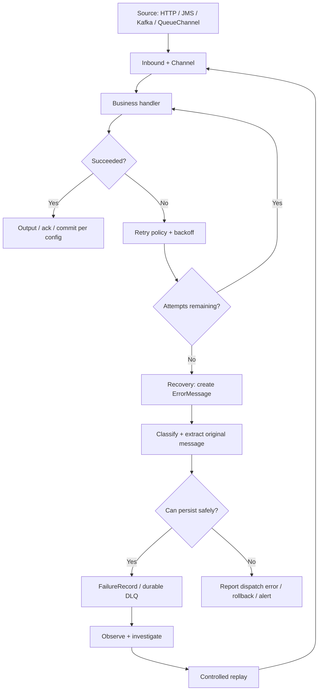

# Dead-Letter Channels and Persisting Failed Messages in Spring Integration

## 1. The Problem: Where Does a Message Go After Retries Exhaust?

An order message flows through a `MessageChannel` to a `ServiceActivator`, calls the payment system, and fails. When the failure is just a network timeout, retrying may succeed. But when data is invalid, a partner permanently rejects it, or a dependency stays down too long, **retrying indefinitely** wastes resources and creates extra side effects.

Within the **Retries and recovery** chapter of **SPRING_INTEGRATION_RUNTIME**, this lesson covers the stage **after retries are no longer appropriate**:

1. Preserve traces of the original message and the root failure cause.
2. Move unprocessable messages into quarantine (a dead-letter channel or dead-letter queue).
3. Persist enough information to investigate, fix data, and perform **controlled replay**.
4. Ensure quarantine coordinates properly with acknowledgements, transactions, executors, and pollers at runtime.

A **dead letter** is a message the system has decided **not to continue processing on the normal path at that time**. A **dead-letter channel (DLC)** is a channel you design to receive failed messages; a **dead-letter queue (DLQ)** is typically the queue holding those messages for later handling. Spring Integration does not enforce a single DLQ configuration across all adapters: you must design the error path, persistence store, and recovery workflow to match the transport type.

> **Important distinction:** The default `errorChannel` bean receives `ErrorMessage` for runtime error handling; it is **not automatically a durable DLQ**. Naming a channel `deadLetterChannel` does not automatically make it persist messages across restarts either.

## 2. Flow Diagram: Processing, Retry, Recovery, Quarantine



The `ack / commit` arrow carries **different semantics** depending on the source. For a JDBC-backed `QueueChannel`, the poller's transaction can protect dequeuing from the store. For Kafka, JMS, or RabbitMQ, acknowledgement and requeueing depend on the inbound adapter, listener container, and broker. Do not assume that merely because an error consumer received the message, the source transaction necessarily committed.

### Logical States Worth Tracking

| State | Business meaning | Next action |
| --- | --- | --- |
| `PROCESSING` | Message is currently being processed | Monitor duration and attempt count |
| `RETRYING` | Transient error, retry opportunities remain | Retry with limits and backoff |
| `DEAD_LETTERED` | Failure record persisted in quarantine | Alert or open an investigation |
| `READY_TO_REPLAY` | Root cause fixed, cleared for re-execution | Replay through an explicit flow |
| `REPLAYED` | Request re-submitted into the processing flow | Verify outcome, prevent duplicates |
| `RESOLVED` / `DISCARDED` | Finished handling or intentionally retired | Retain audit trail and retention policy |

This is an **application-proposed state model**, not a built-in Spring Integration enum.

## 3. Three Objects That Are Easily Confused

| Concept | Typical API or infrastructure | What does it do? | Persisted durably by default? |
| --- | --- | --- | --- |
| `ErrorMessage` | `org.springframework.messaging.support.ErrorMessage` | Holds a `Throwable` and optionally the original message | No |
| `errorChannel` | Message channel bean named `errorChannel`, usually `PublishSubscribeChannel` | Distributes error events to consumers | No |
| Application dead-letter channel | `DirectChannel`, `QueueChannel`, broker-backed channel, custom name | Receives messages marked for quarantine | Depends on configuration |
| Broker DLQ/DLX | JMS queue, RabbitMQ DLX/DLQ, Kafka dead-letter topic depending on stack | Quarantines messages inside the broker | Per broker mechanics |
| Failure record / audit store | Application table, `MessageStore`, object storage | Retains data needed for analysis and replay | Depends on technology and transaction |

In Spring Integration, an `ErrorMessage` has a `Throwable` as its `payload`. When context is available, `getOriginalMessage()` may return the associated message. For `MessagingException` subclasses, `getFailedMessage()` is an additional source of information. These objects are **not always complete**, and a stack trace should never be treated as a copy of the business message.

Example:

```java
import org.springframework.messaging.Message;
import org.springframework.messaging.MessagingException;
import org.springframework.messaging.support.ErrorMessage;

public Message<?> findFailedMessage(ErrorMessage error) {
    Message<?> original = error.getOriginalMessage();
    if (original != null) {
        return original;
    }

    Throwable failure = error.getPayload();
    if (failure instanceof MessagingException messagingException) {
        return messagingException.getFailedMessage();
    }
    return null; // The ErrorMessage sender may not have attached original context.
}
```

In a multi-step flow, `originalMessage` and `failedMessage` may represent messages at **two different points**. For accurate replay, define clearly whether you need to store *the initial input data*, *the message right before the failing step*, or *a re-executable business command*.

## 4. Which Errors Should Go to a Dead-Letter Channel?

A production system must **classify** failures before deciding to retry or quarantine.

| Error category | Examples | Handling approach |
| --- | --- | --- |
| Transient | Timeouts, HTTP 503, connection pool exhaustion | Bounded retry, exponential backoff and jitter where appropriate |
| Unfixable by retry | Missing required payload fields, unsupported schema | Dead-letter immediately or per explicit policy; raise data alert |
| Prolonged dependency outage | Third-party service down longer than SLA | Bounded retry then quarantine; replay once recovered |
| Business conflict | Order already paid or stale version | Investigate/idempotency; sometimes should not be replayed |
| Configuration error | Wrong channel name, no subscriber, serializer failure | Ops alert; the DLQ path itself may also fail |
| Intentionally cancelled | User withdrew the request | Terminate with audit; does not necessarily become a dead letter |

For errors marked non-retryable, avoid routing the message immediately back to the input. Doing so can create a **toxic loop**: source → failing handler → DLQ → auto-replay → failing handler.

### Mistake to Avoid: The Same Failure Traveling Multiple Paths

- `RequestHandlerRetryAdvice` retries at the handler.
- The inbound adapter/broker may also redeliver on transaction rollback or nack.
- An error flow sends back to input to "try again."

Without capping and tracking **overall attempt counts**, three layers can multiply attempts dramatically. Define clearly which layer owns short-term retry, which owns delayed retry, and which routes to dead letter.

## 5. Two Places Dead Letters Live: Application and Broker

### 5.1. Application-Level Dead-Letter Channel

The application configures a dedicated message channel receiving `ErrorMessage` or a normalized error record:

```text
orderRequests → @ServiceActivator + retry advice
                       |
                       | retry exhausted
                       v
                 retryFailures
                       |
                  ErrorMessage
                       v
             create FailureRecord
                       |
                 deadLetterQueue
                       |
                operator / replay
```

Pros: classifies errors by business rules, preserves correlation IDs, stores investigation state, replays via internal APIs. Cons: the application owns durability, concurrency, access control, and failure handling if writing to the DLQ fails.

### 5.2. Broker-Level Dead-Letter Queue/Topic

A broker can manage dead lettering via nack/reject, redelivery limits, TTL, or broker policies. For example:

- RabbitMQ: dead-letter exchange (DLX) routes dead-lettered messages to a target queue per broker configuration.
- JMS: some brokers provide a "dead letter queue" after a redelivery limit; policy and queue names depend on the broker.
- Kafka: commonly uses a dead-letter topic via consumer stack error handlers/recoverers; **not every Kafka consumer comes with a DLQ automatically**.

A broker-level DLQ preserves the raw payload and broker metadata, yet business error classification, analysis state, and replay workflows often still need a management application/consumer.

**Architectural decision:** If the source is already a broker with a suitable DLQ, consider using that mechanism for redelivery and dead lettering. If the source is HTTP, an internal poller, or a flow needing rich business failure records, an application-level DLQ/audit store may fit better. Both can be combined, provided you prevent double-publishing and state divergence between source and sink.

## 6. Implementation Pattern with RequestHandlerRetryAdvice and ErrorMessageSendingRecoverer

In Spring Integration, `RequestHandlerRetryAdvice` attaches to a handler to retry per policy. Once retries exhaust, `ErrorMessageSendingRecoverer` can create an `ErrorMessage` and send it to a recovery channel. This is a natural bridge between **retry** and **dead lettering**, though not yet a complete durable persistence solution.

### 6.1. Declaring Retry and the Recovery Channel

The following example uses Java 17+, **Spring Integration 7.x / Spring Framework 7** with the Retry API inside Spring Framework. Configuration classes reside in a component-scanned application. If your project uses **Spring Integration 6.x**, retry configuration differs: use `RetryTemplate` and `RetryPolicy` from **Spring Retry**, with `RequestHandlerRetryAdvice.setRetryTemplate(...)`; do not mix imports/APIs between the two generations.

```java
import java.time.Duration;

import org.springframework.context.annotation.Bean;
import org.springframework.context.annotation.Configuration;
import org.springframework.core.retry.RetryPolicy;
import org.springframework.integration.channel.DirectChannel;
import org.springframework.integration.channel.QueueChannel;
import org.springframework.integration.config.EnableIntegration;
import org.springframework.integration.handler.advice.ErrorMessageSendingRecoverer;
import org.springframework.integration.handler.advice.RequestHandlerRetryAdvice;
import org.springframework.messaging.MessageChannel;
import org.springframework.messaging.PollableChannel;

@Configuration
@EnableIntegration
public class RecoveryChannelsConfig {

    @Bean("retryFailures")
    public MessageChannel retryFailures() {
        return new DirectChannel();
    }

    // For lab use only: this QueueChannel lives in memory.
    @Bean("deadLetterQueue")
    public PollableChannel deadLetterQueue() {
        return new QueueChannel(100);
    }

    @Bean("dlqRetryAdvice")
    public RequestHandlerRetryAdvice dlqRetryAdvice(
            @org.springframework.beans.factory.annotation.Qualifier("retryFailures")
            MessageChannel retryFailures) {

        RetryPolicy policy = RetryPolicy.builder()
                .maxRetries(2)                    // 2 retries after the initial attempt
                .delay(Duration.ofMillis(300))      // Fixed 300 ms delay
                .build();

        RequestHandlerRetryAdvice advice = new RequestHandlerRetryAdvice();
        advice.setRetryPolicy(policy);
        advice.setRecoveryCallback(
                new ErrorMessageSendingRecoverer(retryFailures));
        return advice;
    }
}
```

Here, `maxRetries(2)` means **one initial invocation plus at most two retries, totaling three handler invocations**. `delay(Duration.ofMillis(300))` creates a fixed pause for easy observation; production may use exponential backoff and jitter sized to the SLA. Note that **retry count** is not synonymous with **total attempt count**; APIs across versions configure this differently.

**Note:** The recovery callback is invoked when retries exhaust. When the callback sends `ErrorMessage` successfully and returns normally, the original exception may be considered **recovered at the advice layer**; this is why you must ensure dead-letter persistence actually succeeds before confirming completion to the source. Never assume "recovered" means the business task finished.

### 6.2. Attaching the Advice to a Method Endpoint

```java
import org.springframework.integration.annotation.MessageEndpoint;
import org.springframework.integration.annotation.ServiceActivator;

@MessageEndpoint
public class OrderProcessor {

    @ServiceActivator(
        inputChannel = "orderRequests",
        adviceChain = "dlqRetryAdvice")
    public void process(String orderId) {
        if (orderId.startsWith("invalid-")) {
            throw new IllegalArgumentException(
                    "Order is invalid: " + orderId);
        }
        // Perform real business work, e.g., save order or charge payment.
    }
}
```

The example handler returns no reply because this is a one-way flow. When `invalid-101` is sent, `process` fails until retries exhaust; `ErrorMessageSendingRecoverer` sends an `ErrorMessage` to `retryFailures`.

On a synchronous `DirectChannel`, recovery runs on the consumer's call stack. If an `ExecutorChannel` sits before the handler, retries and recovery can run on a worker thread; the original sender does not wait for the entire cycle. With `QueueChannel` + poller, the consumer is driven by the poller. Acknowledgement and transaction mechanics then depend on the inbound endpoint and poller advice/transactions.

### 6.3. Normalizing Errors into a FailureRecord

Avoid trying to persist raw `Throwable`s, stack traces, and `ErrorMessage` objects directly: exceptions can hold non-serializable objects, sensitive data, large references, or metadata unstable across deployments.

Instead, write an **explicitly schemaed error record**:

```java
import java.io.Serializable;

public record FailedOrder(
        String failureId,
        String orderId,
        String originalMessageId,
        String correlationId,
        String errorType,
        String errorSummary,
        String failedAt,
        int schemaVersion
) implements Serializable {}
```

`failureId` identifies each DLQ entry; `orderId` is the business key for deduplication; `originalMessageId` aids tracing within a run though it may change on replay. `schemaVersion` supports reading records produced by older code.

Handler converting errors into messages carrying `FailedOrder`:

```java
import java.time.Instant;
import java.util.UUID;

import org.springframework.beans.factory.annotation.Qualifier;
import org.springframework.integration.annotation.MessageEndpoint;
import org.springframework.integration.annotation.ServiceActivator;
import org.springframework.messaging.Message;
import org.springframework.messaging.MessageChannel;
import org.springframework.messaging.MessagingException;
import org.springframework.messaging.support.ErrorMessage;
import org.springframework.messaging.support.MessageBuilder;

@MessageEndpoint
public class DeadLetterWriter {

    private final MessageChannel deadLetterQueue;

    public DeadLetterWriter(
            @Qualifier("deadLetterQueue") MessageChannel deadLetterQueue) {
        this.deadLetterQueue = deadLetterQueue;
    }

    @ServiceActivator(inputChannel = "retryFailures")
    public void write(ErrorMessage error) {
        Throwable failure = error.getPayload();
        Message<?> source = error.getOriginalMessage();

        if (source == null && failure instanceof MessagingException messagingException) {
            source = messagingException.getFailedMessage();
        }

        if (source == null || !(source.getPayload() instanceof String orderId)) {
            throw new IllegalStateException(
                    "Cannot dead-letter: original order message missing", failure);
        }

        FailedOrder record = new FailedOrder(
                UUID.randomUUID().toString(),
                orderId,
                String.valueOf(source.getHeaders().getId()),
                String.valueOf(source.getHeaders().getOrDefault(
                        "correlationId", "")),
                failure.getClass().getName(),
                "Processing failed after retries", // Sanitized message.
                Instant.now().toString(),
                1
        );

        boolean accepted = deadLetterQueue.send(
                MessageBuilder.withPayload(record).build());
        if (!accepted) {
            throw new IllegalStateException("DLQ rejected the failed order");
        }
    }
}
```

In the lab, `deadLetterQueue` is an in-memory `QueueChannel`. When durability is needed, **replace the queue bean configuration** rather than registering a second bean with the same name.

**Example assumption:** Messages arriving at `orderRequests` carry a `String orderId` payload. `DeadLetterWriter` throws if the original message is missing so it does not write an "empty" record and treat recovery as successful. In a real system, you might instead write a dedicated record for unidentifiable requests and raise an urgent alert.

`send()` returning `true` indicates the channel accepted the message per its contract; for an in-memory queue, that is **not confirmation that data was durably persisted**.

### 6.4. Sending a Test Message and Verifying

```java
import org.springframework.messaging.MessageChannel;
import org.springframework.messaging.support.MessageBuilder;

MessageChannel orders = applicationContext
        .getBean("orderRequests", MessageChannel.class);

orders.send(MessageBuilder.withPayload("invalid-101")
        .setHeader("correlationId", "checkout-101")
        .build());
```

To run this snippet, the application must define an `orderRequests` bean/channel; you can configure a `DirectChannel` with that name or declare an appropriate inbound flow.

Expected result for one failing run: the handler is attempted per policy, the recoverer publishes **one `ErrorMessage`** upon exhaustion, and `DeadLetterWriter` creates **one `FailedOrder`** and sends it to `deadLetterQueue`. If the error consumer or queue write fails, observed event counts may differ; do not treat "one retry-exhausted event" as an exactly-once guarantee in a distributed system.

## 7. Persisting Failed Messages Durably with JdbcChannelMessageStore

A default `QueueChannel` only holds messages in RAM; process restarts lose the queue. When dead letters must survive restarts, Spring Integration supports `JdbcChannelMessageStore` as the backing store for a queue. This fits well when the application already has a database and moderate message volume; do not treat a database-backed queue as the default choice for arbitrary high-volume workloads.

### 7.1. Configuring a Persistent QueueChannel with XML

The following example illustrates the exact relationship between channel, JDBC store, and query provider on PostgreSQL. This is an **alternative** to the in-memory `deadLetterQueue` bean above.

```xml
<!-- Abbreviated example, placed in a Spring XML context declaring
     the "int" namespace for http://www.springframework.org/schema/integration. -->

<bean id="pgDeadLetterQueries"
      class="org.springframework.integration.jdbc.store.channel.PostgresChannelMessageStoreQueryProvider"/>

<bean id="deadLetterStore"
      class="org.springframework.integration.jdbc.store.JdbcChannelMessageStore">
    <property name="dataSource" ref="dataSource"/>
    <property name="channelMessageStoreQueryProvider"
              ref="pgDeadLetterQueries"/>
    <property name="region" value="ORDERS_DEAD_LETTER"/>
</bean>

<int:channel id="deadLetterQueue">
    <int:queue message-store="deadLetterStore"/>
</int:channel>
```

Additional requirements: the `spring-integration-jdbc` dependency, a `dataSource` bean, and tables/indexes created from the matching DDL in the Spring Integration JDBC library; add an appropriate transaction manager if a poller consumes messages from the persistent queue transactionally.

**Do not declare `capacity` together with `message-store`** in `<int:queue>`; those two attributes cannot be combined. Persistent queue size limits should be governed by retention, infrastructure capacity, alerts, and admission policies.

`JdbcChannelMessageStore` is optimized for **message channels**. The general-purpose `JdbcMessageStore` supports use cases like aggregators or claim-check; there is no need to switch to the general store merely to persist a queue-style DLQ.

### 7.2. Durability Depends on Transaction Boundaries

With a JDBC-backed queue, **enqueue** writes the message to the database, and **poll** removes it from the store. Per Spring Integration documentation, if the store supports transactions and the poller is configured with a transaction, taking a message out can roll back on processing failure; the message is not permanently deleted when the transaction fails to commit.

However, distinguish two separate transactions:

- **Source transaction:** governs ack/commit of the message from Kafka, JMS, HTTP/business transaction, or inbound queue.
- **Dead-letter write transaction:** governs whether the DLQ record truly exists.

If these two actions span **two systems not sharing an atomic transaction**, you can hit "source acked yet DLQ not written" or "DLQ written yet source redelivers." Design idempotency, outbox/inbox, or coordinated transactions where appropriate. Spring Integration cannot turn any two arbitrary resources into one atomic transaction simply by using `errorChannel`.

### 7.3. What Data Should Be Serialized?

A `Message<?>` has headers and a payload. For reliable persistence and replay:

- Use a simple schema for `FailedOrder` or versioned JSON/Avro/Protobuf.
- Store enough of the business command to re-execute: business key, version, normalized payload, or reference to a durable object.
- Retain `correlationId`, `traceId`, original message ID, error classification, failed component/flow ID, attempt count, and timestamps.
- Strip secrets, tokens, and unnecessary personal data; encrypt or restrict access if retention is required.
- Store `errorType` and a sanitized error summary; full stack traces can go to a separate secured log store.

**Note:** Not every `Throwable` or header object is serialization-friendly. A DLQ persisting raw `ErrorMessage` objects directly can fail right at the write step; an immutable `FailedOrder` record with a controlled schema is far easier to operate.

## 8. MessageStore or a Dedicated Business Error Table?

Three approaches are common:

| Storage approach | Advantages | Limitations | Best fit |
| --- | --- | --- | --- |
| `QueueChannel` + `JdbcChannelMessageStore` | Integrates directly with pollers, message channels, transactions, and Spring Integration | Auditing/querying by business fields and manual review are less convenient than a custom schema | Needing a durable queue for automated flow reprocessing |
| Dedicated `failed_messages` table | Easy to add states, filters, approvals, audits, retention, and a replay UI | Must build repository, concurrency, and claim/replay logic yourself | Human-reviewed investigation and replay workflows |
| Broker DLQ/topic | Built-in scale, retention, redelivery, and broker operations | Business metadata/approvals may still need an auxiliary store | Flows already built on JMS/RabbitMQ/Kafka |

Systems often use a **broker DLQ to quarantine transport deliveries** and a **business error table to track resolution**, but must never dual-write in a way that creates two out-of-sync copies without reconciliation.

Reference application schema example:

```sql
CREATE TABLE failed_messages (
    failure_id       VARCHAR(64) PRIMARY KEY,
    source_message_id VARCHAR(128),
    business_key     VARCHAR(128) NOT NULL,
    correlation_id   VARCHAR(128),
    flow_name        VARCHAR(128) NOT NULL,
    failure_type     VARCHAR(255) NOT NULL,
    error_summary    VARCHAR(1000),
    payload_json     TEXT NOT NULL,
    payload_version  INTEGER NOT NULL,
    retry_count      INTEGER NOT NULL,
    status           VARCHAR(32) NOT NULL,
    failed_at        TIMESTAMP NOT NULL,
    replayed_at      TIMESTAMP NULL,
    resolved_at      TIMESTAMP NULL
);
```

This is an **application-proposed schema**, not Spring Integration's internal `INT_CHANNEL_MESSAGE` table. In production, add indexes on `status + failed_at` and `business_key`, lifecycle auditing, TTL/retention, leases/locks when multiple operators work concurrently, and strict read permissions on sensitive fields.

## 9. Recovery Does Not Equal Replay

**Recovery** is what happens when the current processing turn can no longer retry: write to DLQ, return a business error, notify an operator, or halt the transaction.

**Replay** is a **new subsequent action**: intentionally retrieving failure data, checking current conditions, and submitting it back into a defined entry point of the message flow.

For example, suppose order `order-101` succeeded at payment but failed during the DB write. If replay invokes payment again, the customer could be charged twice. Replay must therefore be driven by business key/idempotency and **only the unfinished work**, rather than blindly re-running every side effect.

### Recommended Replay Workflow

1. Select records with `status=DEAD_LETTERED` after confirming the root cause is resolved.
2. Acquire a lease or atomically transition to `REPLAYING` so two workers never pick up the same record.
3. Validate current schema version, business rules, authorization, and dependencies.
4. Construct a **new message** with `replayOf=failureId`, `correlationId`, and a stable idempotency key; do not forge system message IDs.
5. Submit through a well-defined input channel/gateway; do not bypass validation, transactions, or security of the original flow.
6. Record final status `REPLAYED/RESOLVED` once success is evidenced; if it fails again, record a new attempt or bounded history update.

**Avoid automatically polling `deadLetterQueue` just to "view" its contents**: calling `receive()` on a `QueueChannel` is a destructive consume operation that can remove the message from the queue. With a persistent queue, a transactional poller protects consumption when properly configured; an operator UI calling `receive()` outside a transaction can destroy the ability to replay later.

To inspect failures without removing messages from a queue, prefer a dedicated audit table, management API, or read-only projection.

## 10. Threading, Pollers, Executors, and Backpressure

A dead-letter flow is part of the **runtime message flow**, so it obeys the same threading, consumer, and poller rules as other endpoints.

| Component | Behavior | Risk when persisting errors |
| --- | --- | --- |
| `DirectChannel` | Synchronous consumer on sender thread | A slow writer increases recovery latency; write errors may propagate |
| `ExecutorChannel` | Dispatches to worker pool | Errors and recovery run asynchronously; caller finishes sending before DLQ write completes |
| `QueueChannel` | Places message in queue; requires poller to consume | Queue fills up, backlog grows, or data is lost if in-memory |
| `PublishSubscribeChannel` | Sends to multiple subscribers | Two subscribers both writing cause duplicates; separate observer vs. writer roles |
| `JdbcChannelMessageStore` | Stores channel messages in DB | Connection pool, transactions, serialization, indexing, and storage capacity |
| Transactional poller | Polls and processes within transaction boundary | If recovery swallows errors before rollback, source may be marked handled |

Example of "one slow step dragging down the system": `ErrorMessageSendingRecoverer` publishes to `DirectChannel retryFailures`; a synchronous writer takes 2 seconds to write to the DB. Every handler exhausting retries holds its thread for 2 extra seconds. If 20 workers fail continuously, the executor saturates and even valid orders wait.

Solutions depend on durability requirements: a broker DLQ, a transactional outbox, a dedicated bulkhead thread pool, or a durably backed queue. Simply offloading the writer onto another `ExecutorChannel` without guaranteeing persistence before ack **can increase the risk of losing errors**.

### Which Metrics Should You Measure?

- Retry rate, attempts before success, and retry-exhausted counts.
- New dead letters by `flowId`, exception type, and business category.
- `DLQ backlog`, oldest message age, and store/partition utilization.
- Time from handler failure to durable record persistence.
- Publish/recovery failure rates, DB timeouts, and serializer errors.
- Executor active threads, queue depth, rejected tasks, and poller lag.
- Messages stuck in `REPLAYING` too long and replay success/failure counts.
- Duplicate rate per business key and total emitted side effects.

## 11. When the Dead-Letter Path Itself Fails

This is an often-forgotten branch. Suppose the service activator exhausted retries, yet the JDBC connection used to write the DLQ is also down. If the recoverer or writer **swallows the write failure**, the system may report the message as "handled" even though the failed message was lost.

Recommended handling in business priority order:

1. **Separate** business processing errors from dead-letter write/routing errors using distinct metrics and alerts.
2. Do not return success/ack the source if policy requires guaranteed DLQ persistence and the write did not complete.
3. Leverage source rollback/redelivery when actually configured and verified.
4. Consider an outbox or broker publisher confirms to shrink the message-loss window.
5. Alert clearly with failure ID, correlation ID, flow ID, and timestamp; restrict payloads in logs.
6. Prepare runbooks for store full, wrong query provider, serializer error, or missing error-channel consumer.

If using a recovery callback, verify **whether the callback returns normally or throws an exception** when the dead-letter writer fails. This decides whether the exception keeps propagating or is treated as recovered, affecting upstream ack/rollback.

Do not create recursion like `deadLetterError → same deadLetterQueue → deadLetterError`: a single DLQ write failure could cause the system to self-saturate. Use an independent operational alert channel and cap recovery attempts.

## 12. Hands-On Test Scenarios

A lab should verify at least these scenarios:

| Scenario | How to trigger | What to verify |
| --- | --- | --- |
| Handler succeeds | `orderId=ok-101` | No `FailedOrder` created |
| Transient failure then success | Fail on first attempt, succeed on second | Not dead-lettered, accurate attempt count |
| Retries exhausted | `orderId=invalid-101` | One record with correlation and error type; handler tried per policy |
| Unrecoverable input context | Construct `ErrorMessage` lacking original/failed message | Writer throws, does not write an empty record |
| In-memory DLQ restart | Write record then restart | Observe data loss and lab limitation |
| Persistent queue restart | Switch to JDBC store, write then restart | Record survives per database/schema configuration |
| DLQ store unavailable | Disconnect DB or fill queue | Recovery failure is observed; ack/rollback matches policy |
| Duplicate message | Re-send same business key | Side effects idempotent, records deduplicatable |
| Controlled replay | Allow replay of a valid record | Carries `replayOf`, records history, no double-charge |
| Multiple concurrent workers | Send multiple error batches | No lost records, no replay contention, bounded backlog |

### Specific Transaction Test

With a persistent `QueueChannel` and transactional poller, make the consumer throw and verify the message remains in the store when the transaction rolls back. Then enable the recovery callback writing to the DLQ and marking it "handled"; check whether the source message is removed/acked. Compare the two runs to understand why **catching and swallowing exceptions** alters transaction semantics.

With a broker source, write a dedicated integration test because ack/nack and redelivery cannot be verified solely with unit tests on `DirectChannel`.

## 13. Production Design Checklist

- **Path:** Identify exact handler, retry advice, inbound adapter, error channel/recoverer, and DLQ sink.
- **Policy:** Specify which errors retry and which do not; total attempts, backoff, and terminal classification.
- **Durability:** After recovery reports success, does the failure record genuinely exist in the store/broker and survive restarts?
- **Transactions:** When writing to the DLQ fails, can the source roll back/requeue? Are there loss or duplicate windows?
- **Schema:** Does it capture business key, source payload/command, version, trace, reason, attempts, and timestamp?
- **Security:** Are secrets/PII inside payloads or stack traces? Who can view, replay, or delete?
- **Replay:** Are idempotency, double-replay prevention, authorization, timeouts, and audit trails in place?
- **Operations:** Are backlog/age metrics, publish-failure alerts, retention, capacity, and runbooks ready?

Summary litmus test: **If the application crashes immediately after reporting "recovery succeeded," where will operators find the failed message tomorrow, and can they replay it without causing duplicate side effects?** If the answer is unclear, the dead-letter design is incomplete.

## 14. Conclusion

A dead-letter channel is **the quarantine point for messages that cannot proceed**, while persisting failed messages is **a commitment to recoverability and later handling**. In Spring Integration, `ErrorMessageSendingRecoverer` connects exhausted retries to a recovery channel; a handler can normalize failures into `FailedOrder` and route them to a `QueueChannel`, persistent `MessageStore`, audit table, or broker DLQ depending on architecture.

Understanding **channels/endpoints/consumers/pollers/executors**, transaction boundaries, ack strategies, and correlation prevents the two deadliest bugs: **losing messages because recovery was treated as successful before durable persistence**, and **duplicate processing during replay/redelivery**. Sound design always includes idempotency, lifecycle tracking, and investigability.

## References

- [Spring Integration Reference — Provided Advice Classes (Retry Advice)](https://docs.spring.io/spring-integration/reference/handler-advice/classes.html)
- [Spring Integration Reference — Error Handling](https://docs.spring.io/spring-integration/reference/error-handling.html)
- [Spring Integration Reference — Configuring Message Channels (Persistent QueueChannel)](https://docs.spring.io/spring-integration/reference/channel/configuration.html)
- [Spring Integration Reference — JDBC Message Store](https://docs.spring.io/spring-integration/reference/jdbc/message-store.html)
- [Spring Integration API — ErrorMessageSendingRecoverer](https://docs.spring.io/spring-integration/api/org/springframework/integration/handler/advice/ErrorMessageSendingRecoverer.html)
